# FlashAccel: Leveraging High-Bandwidth Flash for High-Throughput LLM Inference

# FlashAccel：利用高带宽闪存实现高吞吐大语言模型推理

## 文献信息 / Publication Information

- **Authors / 作者**：Xinyu Wang, Yalong Xue, Xiaotian Sun, Xiaoyu Zhang, Chunmeng Dou, Xueqi Li, Xiaoming Chen（通讯作者 / Corresponding author）。
- **Version / 版本**：arXiv:2607.10186v1 [cs.AR]，11 Jul 2026 / 2026 年 7 月 11 日。
- **Source / 来源**：本地文件 `FlashAccecl(1).pdf`，16 页。

| Author / 作者 | Affiliation / 单位（中英对照） | Email / 邮箱 |
| --- | --- | --- |
| Xinyu Wang | Institute of Computing Technology, Chinese Academy of Sciences; University of Chinese Academy of Sciences / 中国科学院计算技术研究所；中国科学院大学，北京 | wangxinyu22s@ict.ac.cn |
| Yalong Xue | Institute of Computing Technology, Chinese Academy of Sciences; School of Advanced Interdisciplinary Sciences, University of Chinese Academy of Sciences / 中国科学院计算技术研究所；中国科学院大学前沿交叉科学学院，北京 | xueyalong22@mails.ucas.ac.cn |
| Xiaotian Sun | Institute of Computing Technology, Chinese Academy of Sciences; University of Chinese Academy of Sciences / 中国科学院计算技术研究所；中国科学院大学，北京 | sunxiaotian21s@ict.ac.cn |
| Xiaoyu Zhang | Institute of Computing Technology, Chinese Academy of Sciences / 中国科学院计算技术研究所，北京 | zhangxiaoyu@ict.ac.cn |
| Chunmeng Dou | Institute of Microelectronics, Chinese Academy of Sciences / 中国科学院微电子研究所，北京 | douchunmeng@ime.ac.cn |
| Xueqi Li | Institute of Computing Technology, Chinese Academy of Sciences / 中国科学院计算技术研究所，北京 | lixueqi@ict.ac.cn |
| Xiaoming Chen | Institute of Computing Technology, Chinese Academy of Sciences / 中国科学院计算技术研究所，北京 | chenxiaoming@ict.ac.cn |

## 阅读说明 / Reading Notes

本文件按“英文原文 → 中文译文”逐段排列。章节编号、引文编号、公式、脚注及图表信息均保留；英文中的跨行断词和排版空格已整理。原文数值与结论忠实保留，不混入评审意见或另行修正。原图内标签保留英文，图题提供中英对照；表格以 Markdown 重排。参考文献保留英文著录信息，并附中文题名（译名用于理解，检索时以英文为准）。

图片存放于同目录的 `FlashAccel_assets/` 文件夹；移动本文件时，请同时移动该文件夹。

## 目录 / Contents

- [摘要 / Abstract](#abstract)
- [1 引言 / Introduction](#section-1)
- [2 背景与动机 / Background and Motivation](#section-2)
- [3 挑战 / Challenges](#section-3)
- [4 硬件设计 / Hardware Design](#section-4)
- [5 数据布局设计 / Data Layout Design](#section-5)
- [6 系统设计 / System Design](#section-6)
- [7 评估 / Evaluation](#section-7)
- [8 相关工作 / Related Work](#section-8)
- [9 结论 / Conclusion](#section-9)
- [脚注 / Footnotes](#footnotes)
- [参考文献 / References](#references)

---

## Abstract / 摘要

**English**

Large language model (LLM) inference is increasingly limited by the capacity of High-Bandwidth Memory (HBM) in GPUs, as model weights and KV cache grow rapidly. High-Bandwidth Flash (HBF) provides higher capacity than HBM while retaining comparable bandwidth, making it a promising substrate for capacity-constrained LLM inference. However, its inherently high access latency, low bandwidth utilization, and lack of support for heterogeneous resource management make it difficult to integrate HBF into GPUs for LLM inference. We present FlashAccel, a co-designed system that enables efficient LLM inference using HBF. FlashAccel integrates HBF into HBM-based GPUs, providing architectural support to mitigate access latency. It improves bandwidth utilization through specialized data layouts for both model weights and KV cache, and introduces an HBF-aware storage management layer together with a programming model to organize persistent data in HBF and coordinate heterogeneous memory resources at the system level. Experimental results demonstrate that integrating six HBF stacks into the GPU enables FlashAccel to deliver an average improvement of 2.54× and 1.93× in throughput per GPU and energy efficiency over the HBM-only GPU under 100ms latency constraint, respectively.

**中文**

随着模型权重和 KV 缓存快速增长，大语言模型（LLM）推理越来越受到 GPU 中高带宽内存（HBM）容量的限制。高带宽闪存（HBF）在保持与 HBM 相当带宽的同时提供更大的容量，因此有望成为容量受限的 LLM 推理的存储基础。然而，HBF 固有的高访问延迟、较低的带宽利用率，以及对异构资源管理支持的缺乏，使其难以集成到 GPU 中用于 LLM 推理。我们提出 FlashAccel，这是一套通过协同设计实现 HBF 高效 LLM 推理的系统。FlashAccel 将 HBF 集成到基于 HBM 的 GPU 中，并提供架构支持以缓解访问延迟问题。它通过针对模型权重和 KV 缓存设计专用数据布局，提高带宽利用率；同时引入面向 HBF 的存储管理层与编程模型，在系统层面组织 HBF 中的持久化数据，并协调异构内存资源。实验结果表明，将六个 HBF 堆栈集成到 GPU 后，在 100 ms 延迟约束下，相较于仅使用 HBM 的 GPU，FlashAccel 的每 GPU 吞吐量和能效平均分别达到其 2.54 倍和 1.93 倍。

**English**

Keywords: High Bandwidth Flash, LLM Inference

**中文**

关键词：高带宽闪存、LLM 推理

## 1 Introduction / 1 引言

**English**

The rapid advancement of large language models (LLMs) is driving inference workloads toward multi-turn interactions [17, 66, 70], agents [43, 56, 64], and long-context processing [7, 8, 36]. Two key trends emerge in this evolution. First, model sizes continue to grow following the scaling law [29], at the cost of drastically increased parameter scale. Second, new workloads increasingly rely on long context lengths, leading to substantial growth in KV cache footprints during inference [9]. These trends fundamentally increase the memory capacity requirements of inference systems. However, the capacity of High-Bandwidth Memory (HBM) in GPUs has not kept pace with the rapid growth of model size. Figure 1 shows that, although GPU memory capacity has increased steadily over time, the memory footprint of popular models has grown much faster. Today, models can exceed terabytes in size, far surpassing the capacity of a single GPU, which is at most a few hundred gigabytes. Meanwhile, as the context length has grown by 4× on average over the past two years [5], the storage overhead of KV cache has increased proportionally by 4×.

**中文**

大语言模型（LLM）的快速发展，正推动推理工作负载转向多轮交互 [17, 66, 70]、智能体 [43, 56, 64] 和长上下文处理 [7, 8, 36]。这一演进体现出两个关键趋势。首先，模型规模遵循缩放定律 [29] 持续增长，代价是参数数量大幅增加。其次，新工作负载越来越依赖长上下文，导致推理期间 KV 缓存占用显著增长 [9]。这些趋势从根本上提高了推理系统对内存容量的需求。然而，GPU 中高带宽内存（HBM）的容量增长没有跟上模型规模的快速扩张。如图 1 所示，虽然 GPU 内存容量随时间稳步增加，主流模型的内存占用却增长得更快。如今，模型大小可超过 TB 级，远超单个 GPU 至多几百 GB 的容量。同时，过去两年上下文长度平均增长至原来的 4 倍 [5]，KV 缓存的存储开销也相应增长至原来的 4 倍。

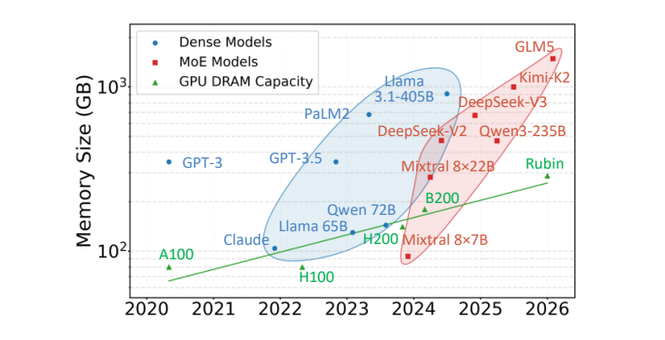

**Figure 1.** Trends in HBM memory capacity and model size.

**图 1。** HBM 内存容量与模型大小的发展趋势。

**English**

The limited HBM capacity introduces several critical challenges in LLM inference. First, during the memory-bound decode phase, insufficient memory capacity restricts the batch size, leading to low compute utilization and throughput. Second, the memory pressure often forces early eviction of KV cache, preventing reuse opportunities in multi-turn interactions and increasing recomputation overhead [33]. Third, due to the limited capacity of a single GPU, storing large models requires multi-GPU systems, which incur significant hardware cost and introduce additional complexity in inter-GPU communication, task scheduling, and fault tolerance.

**中文**

有限的 HBM 容量给 LLM 推理带来了几个关键挑战。首先，在受内存带宽限制的解码阶段，内存容量不足限制了批量大小，导致计算利用率和吞吐量偏低。其次，内存压力往往迫使系统提前驱逐 KV 缓存，使多轮交互中的复用机会丧失，并增加重新计算开销 [33]。第三，由于单个 GPU 容量有限，存储大模型需要多 GPU 系统，这会带来显著硬件成本，并增加 GPU 间通信、任务调度和容错的复杂性。

**English**

Prior works [35, 52, 68] have leveraged Flash memories to address the capacity bottleneck. They typically store the model weights in Flash and use in-storage computation to exploit internal parallelism. However, these works are primarily designed for edge scenarios. Their limited bandwidth and computational capacity are insufficient to meet the requirements of high-throughput scenarios that require powerful compute devices (i.e., GPUs) and memory devices with both large capacity and high bandwidth. To provide both high bandwidth and large capacity, High-Bandwidth Flash (HBF) has been proposed. HBF is a specialized Flash memory that delivers bandwidth comparable to HBM while retaining the high density and non-volatility of Flash [23, 25]. By integrating HBF into the GPU alongside HBM, we can significantly expand memory capacity to achieve potentially higher decode throughput. However, this capacity advantage does not automatically translate into throughput gains.

**中文**

已有研究 [35, 52, 68] 利用闪存解决容量瓶颈。它们通常将模型权重存储在闪存中，并通过存内计算利用内部并行性。然而，这些工作主要面向边缘场景，其有限的带宽和计算能力无法满足高吞吐场景的要求：这类场景需要强大的计算设备（即 GPU），以及兼具大容量和高带宽的存储设备。为了同时提供高带宽和大容量，人们提出了高带宽闪存（HBF）。HBF 是一种专用闪存，在提供与 HBM 相当带宽的同时，保留了闪存的高密度和非易失性 [23, 25]。将 HBF 与 HBM 一同集成到 GPU 中，可以显著扩展内存容量，从而有望提高解码吞吐量。然而，容量优势并不会自动转化为吞吐量收益。

**English**

Several critical challenges prevent leveraging HBF for high-throughput inference. First, Flash suffers from inherently high access latency [10], which can hurt the end-to-end latency. Second, although HBF provides high peak bandwidth, it requires a high degree of parallelism to reach the peak bandwidth. Inefficient data layout can limit parallel access opportunities and result in low bandwidth utilization. Third, integrating HBF introduces heterogeneous memory resources, raising the challenge of managing these resources and exposing efficient abstractions to software.

**中文**

若干关键挑战阻碍了 HBF 在高吞吐推理中的应用。首先，闪存固有的高访问延迟 [10] 会损害端到端延迟。其次，虽然 HBF 具有较高峰值带宽，但必须具备高度并行性才能达到这一带宽。低效的数据布局会限制并行访问机会，导致带宽利用率偏低。第三，集成 HBF 会引入异构内存资源，因此需要解决如何管理这些资源，以及如何向软件提供高效抽象的问题。

**English**

Addressing these challenges requires hardware–software co-design. FlashAccel addresses these challenges through co-design across architecture, data layout, and system software. Architecturally, FlashAccel mitigates Flash access latency with SRAM buffers distributed across HBF dies for data prefetching. It also integrates HBF, HBM, and GPU cores into a unified accelerator to relieve the capacity bottleneck. At the data layout level, FlashAccel addresses the low bandwidth utilization challenge of HBF by designing specialized layouts for weights and KV cache, enabling high parallelism during inference. At the system level, FlashAccel provides an HBF-aware storage management layer to organize persistent data in HBF and a programming model that allows applications to efficiently utilize heterogeneous memory resources.

**中文**

解决上述挑战需要软硬件协同设计。FlashAccel 从架构、数据布局和系统软件三个层面开展协同设计。在架构层面，FlashAccel 利用分布在 HBF 各个裸片上的 SRAM 缓冲区进行数据预取，以缓解闪存访问延迟；同时将 HBF、HBM 和 GPU 核心集成为统一加速器，以减轻容量瓶颈。在数据布局层面，FlashAccel 针对权重和 KV 缓存设计专用布局，使推理时能够获得较高并行度，从而解决 HBF 带宽利用率偏低的问题。在系统层面，FlashAccel 提供面向 HBF 的存储管理层，以组织 HBF 中的持久化数据，并提供编程模型，使应用能够高效利用异构内存资源。

**English**

In summary, we make the following contributions.

**中文**

概括而言，我们的贡献如下。

**English**

We identify the key challenges of employing HBF for LLM inference, including high access latency that affects the end-to-end latency, the gap between peak read bandwidth and effective bandwidth under LLM workloads, and the lack of management for heterogeneous memory resources.

**中文**

我们识别出将 HBF 用于 LLM 推理的关键挑战，包括影响端到端延迟的高访问延迟、LLM 工作负载下峰值读取带宽与有效带宽之间的差距，以及异构内存资源管理的缺失。

**English**

We introduce FlashAccel, an HBF-based accelerator for high-throughput LLM serving. FlashAccel combines hardware–software co-design techniques that hide high access latency, enable near-peak bandwidth for weights and KV cache, and efficiently manage heterogeneous resources.

**中文**

我们提出 FlashAccel，这是一种基于 HBF、面向高吞吐 LLM 服务的加速器。FlashAccel 结合软硬件协同设计技术，隐藏高访问延迟，使权重和 KV 缓存访问接近峰值带宽，并高效管理异构资源。

**English**

Experimental results show that FlashAccel significantly improves throughput and energy efficiency by 2.54× and 1.93×, respectively, compared with HBM-only GPU implementations.

**中文**

实验结果表明，与仅使用 HBM 的 GPU 实现相比，FlashAccel 的吞吐量和能效显著提升，分别达到其 2.54 倍和 1.93 倍。

## 2 Background & Motivation / 2 背景与动机

### 2.1 LLM Workload / 2.1 LLM 工作负载

**English**

LLMs consist of multiple stacked transformer layers [55], each requiring storage for static model weights (shared across all requests) and dynamic KV cache (isolated per request) [55]. LLM inference consists of prefill and decode phases with distinct computational characteristics [33, 67]. Prefill processes all input tokens together, making it predominantly compute-bound. In decode, each request provides one token per step, leading to frequent access to the model weights and KV cache, which makes it memory-bound.

**中文**

LLM 由多个堆叠的 Transformer 层构成 [55]，每一层都需要存储静态模型权重（由所有请求共享）和动态 KV 缓存（按请求隔离）[55]。LLM 推理包括预填充（prefill）和解码（decode）两个阶段，它们具有不同的计算特征 [33, 67]。预填充同时处理所有输入 token，因此主要受计算能力限制。在解码阶段，每个请求每一步提供一个 token，需要频繁访问模型权重和 KV 缓存，因此主要受内存带宽限制。

**English**

As KV cache grows over inference steps, most frameworks [33, 71] adopt PagedAttention-style mechanisms [33] that partition KV cache into fixed-size blocks for fine-grained memory allocation, reducing fragmentation and improving memory utilization. Frameworks also manage KV cache eviction. Upon request completion, the computed KV cache is retained in memory for potential reuse by future requests. When memory is exhausted, the framework evicts history KV cache to serve new requests.

**中文**

随着推理步数增加，KV 缓存不断增长。大多数框架 [33, 71] 采用类似 PagedAttention 的机制 [33]，将 KV 缓存划分为固定大小的块，以进行细粒度内存分配，减少碎片并提高内存利用率。框架还管理 KV 缓存的驱逐。请求完成后，已计算的 KV 缓存会保留在内存中，以供后续请求潜在复用。当内存耗尽时，框架会驱逐历史 KV 缓存，以服务新请求。

### 2.2 Memory Capacity Bottleneck / 2.2 内存容量瓶颈

**English**

The rapid growth of model weights and KV cache has made GPUs’ HBM capacity a fundamental bottleneck for LLM inference. This bottleneck directly limits the batch size in the decode phase. Consider running Qwen3-32B [63] on an H100 GPU [40] with 80GB HBM. After reserving approximately 64GB for model weights, only 16GB remains available for KV cache. For an 8K context length, each request requires about 2GB KV cache, meaning the GPU can support a batch size of at most 8. According to the Roofline model [60], larger batch sizes increase the arithmetic intensity of weight-related operations and thus improve GPU utilization. Figure 2(a) shows that a small batch size limits throughput, whereas larger batch sizes significantly improve throughput with only marginal impact on latency.

**中文**

模型权重和 KV 缓存的快速增长，使 GPU 的 HBM 容量成为 LLM 推理的根本瓶颈。这一瓶颈直接限制了解码阶段的批量大小。以在具有 80 GB HBM 的 H100 GPU [40] 上运行 Qwen3-32B [63] 为例：为模型权重预留约 64 GB 后，只有 16 GB 可用于 KV 缓存。在 8K 上下文长度下，每个请求需要约 2 GB KV 缓存，这意味着 GPU 最多只能支持批量大小为 8。根据 Roofline 模型 [60]，更大的批量能够提高权重相关操作的算术强度，从而提高 GPU 利用率。图 2(a) 显示，小批量会限制吞吐量，而较大的批量能够显著提高吞吐量，同时只对延迟产生较小影响。

**English**

HBM capacity further limits the reuse opportunities of KV cache. Figure 2(b) illustrates the reuse opportunity in multi-turn interactions. KV cache generated in previous turns can be reused during the prefill phase for future turns, avoiding recomputation of this KV cache. However, reuse requires retaining KV caches in memory. In the example above, each request requires 2GB of KV cache, meaning a single GPU can store KV caches for only eight requests. When serving more requests, KV caches are frequently evicted, leading to low cache hit rates and additional recomputation overhead. Prior work [57] shows that achieving high reuse efficiency may require up to 4× more memory capacity for KV cache.

**中文**

HBM 容量还限制了 KV 缓存的复用机会。图 2(b) 展示了多轮交互中的复用机会。之前轮次生成的 KV 缓存，可以在后续轮次的预填充阶段复用，避免重新计算这些 KV 缓存。然而，复用要求将 KV 缓存保留在内存中。在上述例子中，每个请求需要 2 GB KV 缓存，因此单个 GPU 只能存储八个请求的 KV 缓存。当服务更多请求时，KV 缓存会被频繁驱逐，导致缓存命中率下降，并增加重新计算开销。已有研究 [57] 表明，要实现较高复用效率，KV 缓存所需内存容量可能达到原来的 4 倍。

**English**

Current LLM inference systems mitigate memory capacity limitations by interconnecting multiple GPUs, at the expense of increased deployment cost and system complexity [53]. The aggravated inter-GPU communication significantly impacts performance, with collective communication accounting for up to 20% of total latency [20]. In addition, system reliability degrades as scale increases. [31] reveals that in a 1024-GPU system, failures occur on average every 7.9 hours.

**中文**

当前 LLM 推理系统通过互连多个 GPU 来缓解内存容量限制，代价是部署成本和系统复杂性增加 [53]。加重的 GPU 间通信会显著影响性能，集合通信所占延迟最高可达总延迟的 20% [20]。此外，系统可靠性会随规模扩大而下降。研究 [31] 表明，在一个包含 1024 个 GPU 的系统中，平均每 7.9 小时就会发生一次故障。

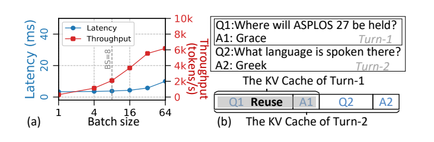

**Figure 2.** (a) Benefits of batching. All results are obtained using an 8-layer configuration of Qwen3-32B due to capacity limits (For the full model, H100 only supports batch size less than 8). (b) Benefits of KV cache reuse.

**图 2。** (a) 批处理的收益。受容量限制，所有结果均采用 Qwen3-32B 的八层配置得到（对于完整模型，H100 只能支持小于 8 的批量大小）。(b) KV 缓存复用的收益。

### 2.3 Flash for LLM Inference / 2.3 用于 LLM 推理的闪存

**English**

Flash memory is attractive for alleviating the capacity bottleneck due to its high storage density. As shown in Figure 3(a), a Flash die comprises an array die stacked over a circuit die via hybrid bonding [34, 73]. The array die stores data using vertically stacked NAND cells, while the circuit die integrates peripheral circuits. Figure 3(b) shows the Flash hierarchy of channel-die-plane-block-page. A Flash device consists of multiple channels, each of which serves as an independent interface and is shared by one or more dies. Each die contains multiple planes with independent read/write circuits in the circuit die, enabling parallel data exchange between the NAND array and the page buffer. Within a plane, blocks are the units of erase operation, while pages are the units of read and program operations.

**中文**

闪存具有较高存储密度，因此是缓解容量瓶颈的有吸引力的选择。如图 3(a) 所示，一个闪存裸片由通过混合键合集成的阵列裸片和电路裸片构成，前者堆叠在后者之上 [34, 73]。阵列裸片利用垂直堆叠的 NAND 单元存储数据，电路裸片则集成外围电路。图 3(b) 展示了闪存的通道—裸片—平面—块—页层次结构。一个闪存设备包含多个通道，每个通道都是独立接口，并由一个或多个裸片共享。每个裸片包含多个平面，其电路裸片中的读写电路相互独立，使 NAND 阵列与页缓冲区之间能够并行交换数据。在一个平面内部，块是擦除操作的单位，页则是读取和编程操作的单位。

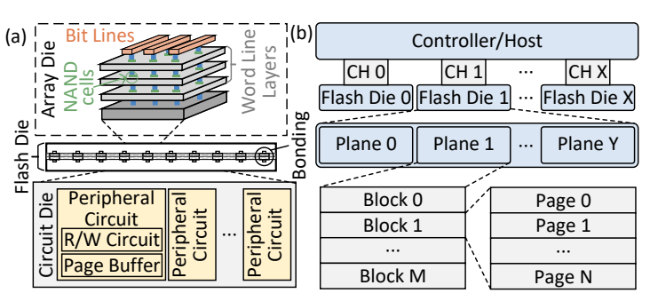

**Figure 3.** Architecture of Flash memory. (a) Physical structure. (b) Logical structure.

**图 3。** 闪存架构。(a) 物理结构。(b) 逻辑结构。

**English**

Recent works such as AiF [35], Lincoln [52], and Cambricon-LLM [68] use Flash for LLM inference. They store model weights in Flash and place compute units within Flash to exploit plane-level parallelism. These designs enable edge inference, but are not suitable for high-throughput inference. These designs provide only hundreds of GB/s bandwidth and few TFLOPS of computational capacity, far below modern GPUs. These limitations in both bandwidth and compute capacity directly restrict inference throughput. Moreover, they store only model weights in Flash but ignore the large KV cache footprint.

**中文**

近期的 AiF [35]、Lincoln [52] 和 Cambricon-LLM [68] 等工作将闪存用于 LLM 推理。它们将模型权重存储在闪存中，并把计算单元置于闪存内部，以利用平面级并行性。这些设计能够实现边缘推理，但不适合高吞吐推理。其带宽仅为数百 GB/s，计算能力仅为数 TFLOPS，远低于现代 GPU。带宽和计算能力上的这些限制直接约束了推理吞吐量。此外，它们只在闪存中存储模型权重，却忽略了占用大量空间的 KV 缓存。

**English**

A more promising approach to accelerating LLM inference with Flash is to integrate a Flash device of high bandwidth with the GPU, alleviating its capacity bottleneck. The key to achieving high bandwidth is exploiting plane-level parallelism. An HBF can be realized by increasing the number of planes per die (e.g., partitioning a die into 16 planes [46]), adopting HBM-like 3D stacking [28] to enable parallelism across multiple Flash dies, and leveraging TSVs to provide high-bandwidth interconnects between Flash and GPUs.

**中文**

利用闪存加速 LLM 推理的一个更有前景的方案，是将高带宽闪存设备与 GPU 集成，从而缓解 GPU 的容量瓶颈。实现高带宽的关键在于利用平面级并行性。HBF 可以通过增加每个裸片的平面数量（例如将一个裸片划分为 16 个平面 [46]）、采用类似 HBM 的三维堆叠 [28] 来实现多个闪存裸片之间的并行，以及利用硅通孔（TSV）提供闪存与 GPU 之间的高带宽互连来实现。

**English**

The main concern with storing KV cache in Flash is endurance. For example, single-level cell (SLC) Flash typically provides about 100K P/E cycles [30, 39, 59]. Prior works [35, 52, 68] avoid storing frequently updated KV caches in Flash to circumvent endurance limits. However, recent advances in attention mechanisms make storing KV cache in Flash feasible. According to the DeepSeek report [15], the prefill cluster (approximately 764 GPUs) writes 266 billion new tokens per day[^1]. Building upon these inputs, the decode cluster (approximately 1,051 GPUs) generates an additional 168 billion tokens. Based on these statistics, each GPU in the prefill cluster writes 22.7TB of KV cache per day, while each GPU in the decode cluster writes 26.9TB of KV cache per day. SLC Flash can provide about 55 P/E cycles per day over a 5-year lifetime. Thus, a 1TB HBF device can sustain about 55TB of data writes per day, which is sufficient for the inference workloads. In addition, relaxing retention guarantees can extend endurance by up to 50× [12, 37], making Flash a practical medium for KV cache storage.

**中文**

将 KV 缓存存储在闪存中的主要顾虑是耐久性。例如，单层单元（SLC）闪存通常支持约 100K 次编程/擦除（P/E）循环 [30, 39, 59]。已有工作 [35, 52, 68] 为规避耐久性限制，不将频繁更新的 KV 缓存存入闪存。然而，注意力机制的最新进展使这一做法变得可行。根据 DeepSeek 报告 [15]，预填充集群（约 764 个 GPU）每天写入 2660 亿个新 token[^1]。在这些输入基础上，解码集群（约 1051 个 GPU）额外生成 1680 亿个 token。根据这些统计，预填充集群中每个 GPU 每天写入 22.7 TB KV 缓存，解码集群中每个 GPU 每天写入 26.9 TB KV 缓存。在五年寿命内，SLC 闪存可支持平均每天约 55 次 P/E 循环。因此，一个 1 TB HBF 设备每天可承受约 55 TB 的数据写入，足以满足推理工作负载。此外，放宽数据保持保证，最多可将耐久性提高至原来的 50 倍 [12, 37]，使闪存成为可用于 KV 缓存存储的介质。

## 3 Challenges / 3 挑战

### 3.1 High Access Latency / 3.1 高访问延迟

**English**

Compared with HBM, Flash exhibits significantly higher access latency. Even with high read bandwidth comparable to HBM, the high read latency of HBF severely degrades end-to-end performance. Using HBF, the GPU receives the first batch of data roughly 4 μs ($t_R$) after issuing an access request [32], whereas HBM requires only about 100 ns [27], which is a 40× gap. For example, a 4k × 4k FP8 GEMV operation can be completed on H200 in approximately 4 μs. When using HBF instead, it incurs an additional 4 μs access latency, leading to a 50% end-to-end latency increase.

**中文**

与 HBM 相比，闪存的访问延迟显著更高。即使读取带宽可与 HBM 相当，HBF 的高读取延迟仍会严重降低端到端性能。使用 HBF 时，GPU 在发出访问请求后约 4 μs（$t_R$）才能收到第一批数据 [32]，而 HBM 只需要约 100 ns [27]，二者相差 40 倍。例如，在 H200 上，一个 4k × 4k 的 FP8 GEMV 操作可以在约 4 μs 内完成。若改用 HBF，则会额外产生 4 μs 的访问延迟，使端到端延迟增加 50%。

### 3.2 Low Bandwidth Utilization / 3.2 带宽利用率偏低

**English**

Due to the inherent high read latency, Flash exhibits low per-plane bandwidth (e.g., a plane reads a 4KB page in 4 μs, 1 GB/s). Achieving high aggregate bandwidth requires exploiting parallelism across thousands of planes. For example, matching the 4.8 TB/s bandwidth of H200 requires 4,916 planes to read concurrently.

**中文**

由于固有的高读取延迟，闪存每个平面的带宽较低，例如一个平面用 4 μs 读取一个 4 KB 页面，对应 1 GB/s。要获得较高聚合带宽，需要利用数千个平面的并行性。例如，要达到 H200 的 4.8 TB/s 带宽，需要 4916 个平面同时读取。

**English**

We define a hyper page as a logical access unit that aggregates one page from every plane. Accessing multiple hyper pages sequentially can maximize inter-plane parallelism and approach the peak bandwidth. When accessing data in HBF, we define plane load as the number of pages that need to be read from a plane. Since a plane serves page reads serially, the overall read latency is determined by the maximum plane load across all planes. If data is unevenly distributed across planes, some planes become idle earlier while others continue reading, reducing plane-level parallelism and bandwidth utilization. The resulting bandwidth loss directly prolongs memory-bound decode.

**中文**

我们将超页（hyper page）定义为一种逻辑访问单位：它聚合了每个平面上的一个页面。顺序访问多个超页能够最大化平面间并行性，并接近峰值带宽。访问 HBF 数据时，我们将平面负载定义为需要从某个平面读取的页面数量。由于一个平面串行处理页面读取，总体读取延迟由所有平面中的最大负载决定。如果数据在平面间分布不均，一些平面会较早空闲，而另一些平面仍在读取，导致平面级并行度和带宽利用率降低。由此造成的带宽损失，会直接延长受内存带宽限制的解码过程。

**English**

This issue is particularly evident in weight access. For an HBF of 4.8 TB/s bandwidth, its hyper page size is about 19MB. However, Figure 4(a) shows that a weight matrix in Qwen3-235B is only 12MB. As a result, accessing a single weight tensor activates only a subset of planes, leading to insufficient parallelism and bandwidth utilization. Although accessing multiple weight tensors consecutively increases data size beyond a hyper page, its benefit still strongly depends on data layout. Existing inference frameworks usually store weights in the order of variable initialization in the source code, rather than the order they are actually accessed during inference. In case ① of Figure 4(b), when weights A, B, and C are accessed consecutively, the source-code declaration order places D between A and B, yielding a maximum plane load of 3. In contrast, case ② of Figure 4(b) achieves a maximum plane load of 2. Therefore, reorganizing weights by execution order reduces the maximum plane load by 33% and correspondingly lowers access latency.

**中文**

这一问题在权重访问中尤其明显。对于带宽为 4.8 TB/s 的 HBF，超页大小约为 19 MB。然而，图 4(a) 中 Qwen3-235B 的一个权重矩阵只有 12 MB。因此，访问单个权重张量只能激活一部分平面，并行度和带宽利用率不足。虽然连续访问多个权重张量能够使数据量超过一个超页，但其收益仍高度依赖数据布局。现有推理框架通常按照源代码中变量初始化的顺序存储权重，而非推理时实际访问的顺序。在图 4(b) 的情况①中，连续访问权重 A、B 和 C 时，源代码声明顺序将 D 放在 A 与 B 之间，导致最大平面负载为 3。相比之下，情况②的最大平面负载为 2。因此，按执行顺序重新组织权重，可将最大平面负载降低 33%，并相应降低访问延迟。

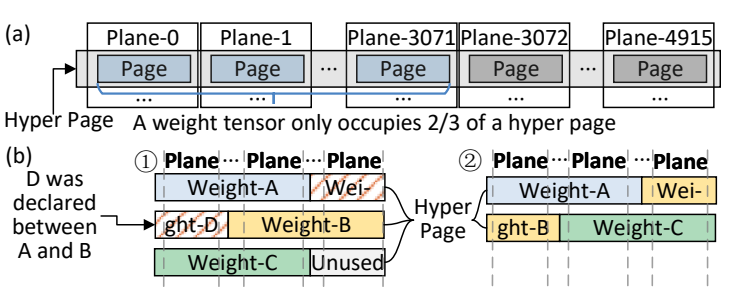

**Figure 4.** Low bandwidth utilization of accessing weights in HBF. (a) Accessing one weight. (b) Accessing multiple weights.

**图 4。** 访问 HBF 中权重时的低带宽利用率。(a) 访问单个权重。(b) 访问多个权重。

**English**

The problem is even more complicated for KV cache because its data layout changes at runtime. At each inference step, the system accesses a unified KV cache constructed from the KV caches of all active requests. Since active requests change over steps, even if the unified KV cache is evenly distributed across planes at one step, the balance does not persist. As requests complete and new ones arrive, the KV cache distribution becomes imbalanced in subsequent steps. As shown in Figure 5, requests 1–4 are processed in the first step, and their KV cache is evenly distributed across planes[^2]. In a later step, if requests 1 and 3 complete, only requests 2 and 4 remain active. The unified KV cache becomes imbalanced across planes, yielding a maximum plane load of 3 versus an average load of 2, resulting in a 33% bandwidth loss. This imbalance becomes worse over time. Due to the paging mechanism and eviction process, the KV cache of a single request becomes fragmented across multiple planes. Meanwhile, the active request set at each step evolves in a near-random manner, resulting in an imbalanced distribution of unified KV cache across planes. Assuming each partitioned KV block of the unified KV cache is uniformly assigned to planes, the load can be modeled as a balls-into-bins problem [44, 51]. Under this model, distributing 100GB KV cache of Qwen3-235B across 4,916 planes causes the maximum plane load to exceed the average load by 52%, leading to 52% bandwidth loss. Furthermore, existing attention kernels parallelize across requests, resulting in simultaneous reads of all requests’ KV cache. This strategy fails to align accesses at hyper-page granularity. As shown in Figure 5, attention kernels may simultaneously access two requests’ KV cache in the same plane, leading to contention analogous to bank conflicts, which further degrades bandwidth utilization.

**中文**

KV 缓存的问题更复杂，因为其数据布局在运行时不断变化。在每个推理步骤中，系统访问由所有活跃请求的 KV 缓存构成的统一 KV 缓存。由于活跃请求随步骤变化，即使某一步的统一 KV 缓存在平面间均匀分布，这种平衡也不会持续。当请求完成且新请求到达时，后续步骤的 KV 缓存分布会变得不均衡。如图 5 所示，第一步处理请求 1—4，它们的 KV 缓存在各平面间均匀分布[^2]。在之后某一步，如果请求 1 和 3 已完成，只有请求 2 和 4 仍活跃，统一 KV 缓存便会出现平面间不均衡：最大平面负载为 3，平均负载为 2，导致 33% 的带宽损失。这种不均衡会随时间加剧。由于分页机制和驱逐过程，单个请求的 KV 缓存会分散在多个平面上。与此同时，每一步的活跃请求集合以近似随机的方式变化，使统一 KV 缓存的分布不均衡。假设统一 KV 缓存中划分出的每个 KV 块被均匀随机分配到平面，其负载可建模为“球入箱”问题 [44, 51]。在该模型下，将 Qwen3-235B 的 100 GB KV 缓存分布到 4916 个平面，会使最大平面负载比平均值高 52%，导致 52% 的带宽损失。此外，现有注意力内核按请求并行执行，会同时读取所有请求的 KV 缓存。这种策略无法按超页粒度对齐访问。如图 5 所示，注意力内核可能同时访问位于同一平面的两个请求的 KV 缓存，产生类似存储体冲突的争用，进一步降低带宽利用率。

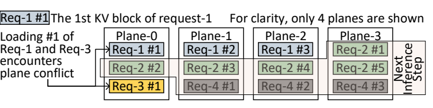

**Figure 5.** Imbalance of accessing KV cache in HBF.

**图 5。** 访问 HBF 中 KV 缓存时的负载不均衡。

### 3.3 System Resource Management / 3.3 系统资源管理

**English**

The third challenge is system-level support for HBF. Unlike HBM, HBF is non-volatile, so the system must support persistent data organization inside HBF for objects such as model weights and KV cache. It also has to coordinate HBF, HBM, and SRAM during execution. Existing approaches do not fit the management of HBF well. Using an HBM-style paging mechanism for data stored in HBF provides direct and low-latency access, but it does not support persistence, because page table mappings are discarded when the program terminates. Conventional Flash stacks support persistence but incur metadata and latency overhead from layered address translation [1, 10]. Moreover, as HBF bandwidth approaches that of HBM, treating Flash as a lower tier behind HBM becomes increasingly inefficient because it forces unnecessary staging through HBM. Instead, HBF should be exposed as a directly accessible resource for GPUs, while SRAM is used to hide Flash access latency. This requires a storage management layer for persistent data in HBF and a programming abstraction for accessing heterogeneous memory resources.

**中文**

第三个挑战是 HBF 的系统级支持。与 HBM 不同，HBF 具有非易失性，因此系统必须支持在 HBF 内部组织模型权重、KV 缓存等对象的持久化数据，并在执行期间协调 HBF、HBM 和 SRAM。现有方法并不适合 HBF 管理。对存储在 HBF 中的数据采用 HBM 风格的分页机制，可以提供直接、低延迟的访问，但无法支持持久化，因为程序结束时页表映射会被丢弃。传统闪存栈支持持久化，却会因多层地址转换而产生元数据和延迟开销 [1, 10]。此外，随着 HBF 带宽接近 HBM，将闪存视为 HBM 后面的较低层级会越来越低效，因为这会强制数据经过不必要的 HBM 中转。HBF 应作为 GPU 可直接访问的资源暴露，而 SRAM 用于隐藏闪存访问延迟。这需要面向 HBF 持久化数据的存储管理层，以及用于访问异构内存资源的编程抽象。

## 4 Hardware Design / 4 硬件设计

**English**

FlashAccel combines HBF, HBM, and GPU cores into a heterogeneous accelerator for LLM inference. FlashAccel can be realized using either co-located integration (CLI) [46] or cascaded integration (CSI) [23], as illustrated in Figure 6(a). CLI places HBF alongside the GPU, partially replacing HBM to increase overall capacity and lower HBM cost. CSI connects HBF to the GPU in a daisy-chain manner through the HBM base die, preserving more HBM stacks and thereby maximizing HBM capacity and bandwidth. In this heterogeneous memory system, HBM and HBF serve complementary roles. HBM handles small, frequently updated intermediate data for its low access latency, while HBF stores large, read-dominated data such as model weights and KV cache. Figure 6(b) shows the HBF stack architecture. Each stack contains 8 Flash dies above a base die, interconnected by TSVs. Each Flash die integrates an array die and a circuit die through hybrid bonding. Following [52] and [46], FlashAccel increases plane-level parallelism by scaling each Flash die to 96 planes. Figure 6(c) shows that HBF integrates SRAM buffers in different dies as caches for data prefetch to mitigate Flash latency. According to [52], the circuit die contains substantial unused silicon area. FlashAccel places SRAM in this unused area, providing each plane with an SRAM cache. For the base die, in addition to the NAND controller and PHY, we also integrate SRAM cache, increasing the overall SRAM capacity. Each stack has a total SRAM capacity greater than $2 \times \mathrm{Peak\_Bandwidth} \times \mathrm{Read\_Latency}$ to support the Flash data prefetch mechanism described in Section 6.2.3, ensuring the basic double-buffered pipeline. We target SLC-based HBF for its lower read latency and higher write endurance. Although SLC Flash provides lower bit density than multi-level cell (MLC) and triple-level cell (TLC), HBF still retains a substantial capacity advantage over HBM.

**中文**

FlashAccel 将 HBF、HBM 和 GPU 核心组合为用于 LLM 推理的异构加速器。如图 6(a) 所示，它可采用共置集成（CLI）[46] 或级联集成（CSI）[23] 实现。CLI 将 HBF 放置在 GPU 旁边，部分替换 HBM，以增加总体容量并降低 HBM 成本。CSI 则通过 HBM 基础裸片，以菊花链方式将 HBF 连接到 GPU，保留更多 HBM 堆栈，从而最大化 HBM 容量和带宽。在这一异构内存系统中，HBM 与 HBF 互为补充：HBM 利用其低访问延迟，处理较小且频繁更新的中间数据；HBF 存储模型权重、KV 缓存等较大且以读取为主的数据。图 6(b) 展示了 HBF 堆栈架构。每个堆栈在一个基础裸片上方包含八个闪存裸片，并通过 TSV 互连。每个闪存裸片利用混合键合集成阵列裸片与电路裸片。参照 [52] 和 [46]，FlashAccel 将每个闪存裸片扩展到 96 个平面，以提高平面级并行性。图 6(c) 显示，HBF 在不同裸片中集成 SRAM 缓冲区，将其作为数据预取缓存以缓解闪存延迟。根据 [52]，电路裸片中有大量未利用的硅面积。FlashAccel 在这些区域放置 SRAM，为每个平面提供 SRAM 缓存。在基础裸片中，除 NAND 控制器和物理层（PHY）外，我们也集成 SRAM 缓存，以增加总体 SRAM 容量。每个堆栈的 SRAM 总容量大于 $2 \times \mathrm{Peak\_Bandwidth} \times \mathrm{Read\_Latency}$（2 × 峰值带宽 × 读取延迟），以支持第 6.2.3 节所述的闪存数据预取机制，确保基本的双缓冲流水线。我们采用基于 SLC 的 HBF，以获得更低读取延迟和更高写入耐久性。虽然 SLC 闪存的位密度低于多层单元（MLC）和三层单元（TLC）闪存，但 HBF 相对于 HBM 仍具有显著容量优势。

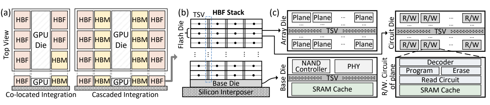

**Figure 6.** Architecture of FlashAccel. (a) Two options for integrating HBF. (b) Architecture of an HBF stack. (c) Design of array die, circuit die, and base die inside HBF.

**图 6。** FlashAccel 架构。(a) 集成 HBF 的两种方案。(b) HBF 堆栈架构。(c) HBF 内部阵列裸片、电路裸片和基础裸片的设计。

## 5 Data Layout Design / 5 数据布局设计

**English**

Data layout design is the core of FlashAccel co-design, because achieving high HBF bandwidth utilization depends not only on hardware capability, but also on whether data accesses can be arranged to match Flash parallelism. Efficient data layout enables data accesses in HBF to approach peak bandwidth.

**中文**

数据布局设计是 FlashAccel 协同设计的核心，因为要获得较高 HBF 带宽利用率，不仅取决于硬件能力，还取决于能否安排数据访问以匹配闪存的并行性。高效的数据布局使 HBF 数据访问能够接近峰值带宽。

### 5.1 Weights in HBF / 5.1 HBF 中的权重

**English**

To expose HBF parallelism, FlashAccel places static weights across all planes in execution order, balancing load and approaching peak bandwidth. Figure 7 illustrates the weight layout strategy. For a given model architecture, the computation graph of each inference step is fixed, which enables offline determination of the execution order. FlashAccel partitions each operator’s static weights into page-sized units (e.g., A0, A1, and A2) and maps them across all planes and channels in round-robin order. After mapping the current operator, the system continues with subsequent operators according to the execution order, starting from the plane immediately following the last assigned plane of the current operator. As a result, the entire weight set is approximately balanced across planes from a global perspective. Combined with the prefetch mechanism described in Section 6.2.3, which loads these weights sequentially, this data layout enables high HBF bandwidth utilization.

**中文**

为了发挥 HBF 并行性，FlashAccel 按执行顺序将静态权重分布到所有平面，平衡负载并接近峰值带宽。图 7 展示了权重布局策略。对于给定模型架构，每个推理步骤的计算图是固定的，因此可以离线确定执行顺序。FlashAccel 将每个算子的静态权重划分为页面大小的单元（例如 A0、A1 和 A2），并以轮转方式映射到所有平面与通道。完成当前算子的映射后，系统按照执行顺序继续处理后续算子，起始位置为当前算子最后一个已分配平面的下一个平面。由此，从全局视角看，整个权重集合在平面之间近似均衡。结合第 6.2.3 节中按顺序加载这些权重的预取机制，该数据布局能够实现较高 HBF 带宽利用率。

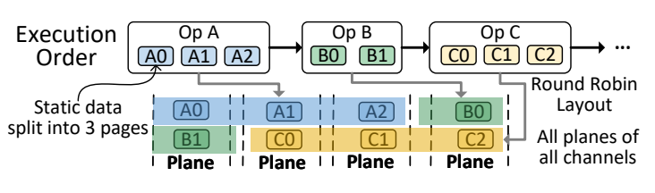

**Figure 7.** Data layout for weights in HBF.

**图 7。** HBF 中权重的数据布局。

### 5.2 KV Cache in HBF / 5.2 HBF 中的 KV 缓存

**English**

The layout of the KV cache is more complicated than that of static weights because the active request set changes at every inference step. FlashAccel organizes per-request KV blocks as a unified KV cache. This abstraction enables write, offload, and read policies that balance plane load and preserve HBF bandwidth.

**中文**

KV 缓存的布局比静态权重更复杂，因为活跃请求集合在每个推理步骤都会变化。FlashAccel 将各请求的 KV 块组织成统一 KV 缓存。这一抽象支持能够平衡平面负载并维持 HBF 带宽的写入、卸载和读取策略。

**English**

At the beginning of a decode step, the unified KV cache can be divided into two types of KV blocks. Resident KV blocks are already stored in HBF from previous steps and have not been evicted. Nonresident KV blocks must be written into HBF from a remote KV cache pool or from newly generated prefill outputs produced on prefill GPUs. As shown in Figure 8 ❶, FlashAccel aggregates nonresident KV blocks into as many full hyper pages as possible and writes them to HBF to improve inter-plane balance. Residual blocks that do not fill a hyper page are placed randomly to avoid hotspots. Balancing incoming writes is insufficient because resident KV blocks may already be skewed across planes. This imbalance reduces bandwidth utilization in the memory-bound decode phase. To address this issue, FlashAccel rebalances plane load after the write phase through selective offloading. We first compute the average plane load of the unified KV cache and then offload excess pages from overloaded planes to HBM until no plane exceeds the average load (Figure 8 ❷). Benefiting from HBM’s low read latency, the offloaded data can effectively utilize HBM bandwidth. This selective offloading avoids extra HBF writes and thereby preserves Flash endurance. Since the same unified KV cache is typically reused across multiple subsequent decoding steps, the extra offloading overhead can be amortized.

**中文**

在一个解码步骤开始时，统一 KV 缓存可以分成两类 KV 块。驻留 KV 块是之前步骤已存储在 HBF 中且尚未被驱逐的块。非驻留 KV 块需要从远端 KV 缓存池，或从预填充 GPU 新生成的预填充输出中写入 HBF。如图 8❶ 所示，FlashAccel 尽可能将非驻留 KV 块聚合成完整超页，再写入 HBF，以改善平面间平衡。不足以填满一个超页的剩余块被随机放置，以避免热点。仅平衡新写入的数据并不足够，因为驻留 KV 块在各平面之间可能已经存在偏斜。这种不均衡会降低受内存带宽限制的解码阶段的带宽利用率。为此，FlashAccel 在写入阶段结束后，通过选择性卸载重新平衡平面负载。我们先计算统一 KV 缓存的平均平面负载，再将过载平面的多余页面卸载到 HBM，直至没有平面超过平均负载（图 8❷）。得益于 HBM 的低读取延迟，被卸载的数据可以高效利用 HBM 带宽。选择性卸载避免了额外的 HBF 写入，从而保护闪存耐久性。由于同一统一 KV 缓存通常会在之后多个解码步骤中复用，额外卸载开销可以被摊薄。

**English**

During attention computation, conventional kernels load KV cache in parallel across requests. This may trigger concurrent reads to different requests whose KV blocks happen to reside in the same plane, causing plane conflicts that reduce parallelism. Figure 8 ❸ illustrates the proposed HBF-friendly loading scheme. The GPU performs accesses to HBF at hyper-page granularity to maximize effective bandwidth, and then processes all KV blocks within each hyper page in parallel. A small fraction of KV blocks offloaded to HBM is fetched from HBM in the same step. Using FlashAttention [14], we compute partial attention results per KV block and then reduce them by request to obtain the final result.

**中文**

在注意力计算期间，传统内核按请求并行加载 KV 缓存。这可能触发对不同请求的并发读取，而这些请求的 KV 块恰好位于同一平面，从而产生平面冲突并降低并行度。图 8❸ 展示了我们提出的适合 HBF 的加载方案。GPU 以超页粒度访问 HBF，以最大化有效带宽，然后并行处理每个超页中的所有 KV 块。在同一步中，从 HBM 读取已卸载到 HBM 的少量 KV 块。借助 FlashAttention [14]，我们为每个 KV 块计算部分注意力结果，再按请求归约，得到最终结果。

**English**

Each decode step also produces new KV cache for every request. We temporarily buffer them in HBM (Figure 8 ❹). At the end of each step, once the filled blocks are sufficient to form one or more full hyper pages, we flush them back to HBF using the same hyper-page-based write policy (Figure 8 ❺). Since the KV cache generated at each decode step is too small to form a hyper page, directly flushing it to HBF would underutilize bandwidth. The proposed strategy avoids inefficiency and improves bandwidth utilization for KV cache writes and future reads.

**中文**

每个解码步骤还会为每个请求生成新的 KV 缓存。我们将其暂存在 HBM 中（图 8❹）。在每一步结束时，一旦已填满的块足以组成一个或多个完整超页，就采用同样的基于超页的写入策略将其刷回 HBF（图 8❺）。每个解码步骤生成的 KV 缓存太少，不足以组成一个超页，因此直接写入 HBF 会使带宽利用不足。所提出的策略避免了这种低效情况，并提高 KV 缓存写入和未来读取的带宽利用率。

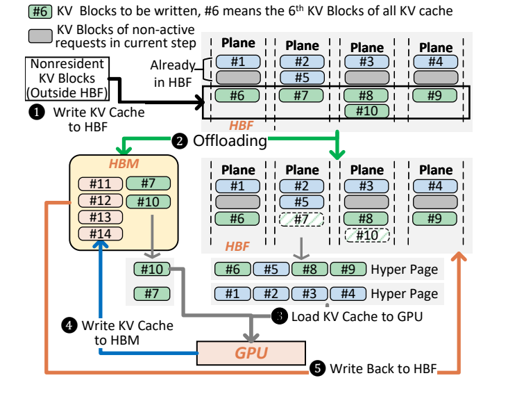

**Figure 8.** Data layout of KV cache in HBF and optimizations for achieving peak bandwidth.

**图 8。** HBF 中 KV 缓存的数据布局，以及实现峰值带宽的优化。

**English**

Besides the above strategies, increasing the KV block size, i.e., storing more tokens in every KV block, can further mitigate inter-plane load imbalance. Under random plane mapping, increasing the KV block size significantly reduces the maximum plane load, as shown in Figure 9. A larger KV block spans multiple NAND pages and is therefore distributed across a group of adjacent planes rather than confined to a single plane. This spreads load over multiple planes, weakens local hotspots and reduces the amount of rebalancing required.

**中文**

除了上述策略，增大 KV 块大小，即在每个 KV 块中存储更多 token，也能进一步缓解平面间负载不均衡。如图 9 所示，在随机平面映射下，增大 KV 块会显著降低最大平面负载。较大的 KV 块跨越多个 NAND 页面，因此会分布在一组相邻平面上，而非局限于单个平面。这会将负载分散到多个平面，减弱局部热点，并减少所需的重新均衡工作。

**English**

However, the KV block size cannot be arbitrarily large. Since a KV block is typically written to HBF only after it is filled, a larger block size leaves more partially filled data buffered in HBM and increases HBM pressure. For the Qwen3-235B model, a KV block size of 512KB with batch size 256 requires at least 8GB of HBM, imposing high HBM pressure on the CLI architecture. Larger block sizes also increase internal fragmentation. FlashAccel uses 256KB KV blocks to balance plane-level skew and HBM pressure.

**中文**

然而，KV 块不能任意增大。由于 KV 块通常在填满后才写入 HBF，较大的块会使更多尚未填满的数据暂存在 HBM 中，增加 HBM 压力。对于 Qwen3-235B 模型，在批量大小为 256、KV 块大小为 512 KB 时，至少需要 8 GB HBM，这会对 CLI 架构造成较高 HBM 压力。更大的块还会增加内部碎片。FlashAccel 采用 256 KB KV 块，在平面级负载偏斜与 HBM 压力之间取得平衡。

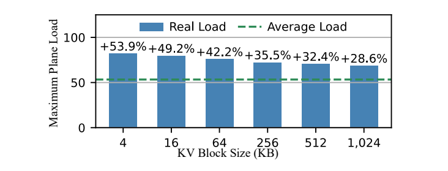

**Figure 9.** Maximum plane load across different block sizes.

**图 9。** 不同块大小下的最大平面负载。

## 6 System Design / 6 系统设计

**English**

The above data layout and access optimizations require system support at two levels. First, the system has to coordinate HBM, HBF, and SRAM during inference. Second, it must organize persistent data stored in HBF. Accordingly, FlashAccel provides a programming model for heterogeneous resource coordination and an HBF-aware storage management layer for persistent data organization. The programming model exposes a unified virtual address space to programs, while the storage management layer maintains the metadata needed to locate persistent objects in HBF.

**中文**

上述数据布局与访问优化需要两方面系统支持。首先，系统需要在推理期间协调 HBM、HBF 和 SRAM。其次，它必须组织存储在 HBF 中的持久化数据。因此，FlashAccel 提供用于异构资源协调的编程模型，以及用于持久化数据组织的 HBF 感知存储管理层。编程模型向程序提供统一虚拟地址空间；存储管理层则维护用于定位 HBF 中持久化对象的元数据。

### 6.1 HBF-aware Storage Management / 6.1 面向 HBF 的存储管理

**English**

FlashAccel uses a lightweight HBF-aware storage layer for persistent data placement. It treats model weights and per-request KV cache as persistent objects, partitions them into data units, and maintains per-object indexing metadata to locate them. In conventional Flash storage stacks, locating data typically requires two levels of indirection. The program first uses file-system metadata to obtain a logical address, which is then translated by the Flash translation layer (FTL) in hardware (e.g., SSD controller) into a physical Flash address. Since Flash does not support in-place updates, the two-level indirection is necessary. When data is modified, the new data must be written to a different physical address, and the FTL is responsible for tracking these remapped addresses. However, the FTL is costly for HBF, as it demands a GB-scale logical-to-physical mapping table [22] stored in low latency SRAM or DRAM, and incurs extra address translation overhead [1]. Our key observation is that both model weights and KV cache follow append-only write patterns. FlashAccel therefore eliminates the FTL and directly records the physical address of each data unit in the object’s indexing metadata. As a result, locating data in HBF requires only the indexing metadata, avoiding the overheads of FTL. By storing the metadata in Flash, we ensure data persistence. To match the block-level erase semantics of Flash, the storage layer adopts an isolated block allocation policy. Weight objects and each request’s KV cache object are placed in separate blocks. Because KV cache eviction occurs at request granularity, erasing the KV cache of one request does not affect weight objects or the KV cache objects of other requests, thereby avoiding write amplification and reducing Flash wear [11].

**中文**

FlashAccel 使用轻量级、面向 HBF 的存储层来放置持久化数据。它将模型权重和各请求的 KV 缓存视为持久化对象，将其划分为数据单元，并为每个对象维护索引元数据以定位这些单元。在传统闪存存储栈中，定位数据通常需要两级间接寻址。程序先通过文件系统元数据获得逻辑地址，再由硬件中的闪存转换层（FTL，例如位于 SSD 控制器中）将其转换为物理闪存地址。由于闪存不支持原位更新，两级间接寻址是必要的。数据修改后，新数据必须写入不同的物理地址，FTL 负责跟踪这些重新映射的地址。然而，FTL 对 HBF 来说开销很大，因为它需要一个 GB 级的逻辑到物理地址映射表 [22]，存储在低延迟 SRAM 或 DRAM 中，同时引入额外地址转换开销 [1]。我们的关键观察是，模型权重和 KV 缓存都遵循仅追加的写入模式。因此，FlashAccel 消除 FTL，直接在对象索引元数据中记录每个数据单元的物理地址。这样，定位 HBF 中的数据只需要索引元数据，避免了 FTL 开销。我们将元数据存储在闪存中，以确保数据持久化。为了匹配闪存按块擦除的语义，存储层采用隔离的块分配策略，将权重对象和每个请求的 KV 缓存对象放在不同块中。由于 KV 缓存按请求粒度驱逐，擦除一个请求的 KV 缓存不会影响权重对象或其他请求的 KV 缓存对象，从而避免写放大，并减少闪存磨损 [11]。

### 6.2 Programming Model / 6.2 编程模型

**English**

FlashAccel exposes HBF through a programming model comprising an interface set and a runtime. After the program invokes these interfaces, the runtime maintains page table mappings from logical addresses to the physical addresses of HBM, HBF, or SRAM. This design exposes heterogeneous memory through a unified virtual address space. The programming model provides different interfaces for accessing weights and KV cache stored in HBF, accounting for distinct access characteristics. To address the HBF access latency challenge, it also provides interfaces that leverage SRAM to hide data access latency.

**中文**

FlashAccel 通过由接口集和运行时组成的编程模型暴露 HBF。程序调用这些接口后，运行时维护从逻辑地址到 HBM、HBF 或 SRAM 物理地址的页表映射。该设计通过统一虚拟地址空间暴露异构内存。考虑到不同的访问特征，编程模型为 HBF 中的权重和 KV 缓存提供不同访问接口。为了处理 HBF 的访问延迟问题，它还提供利用 SRAM 隐藏数据访问延迟的接口。

#### 6.2.1 Weight Access Interface / 6.2.1 权重访问接口

**English**

Weights are the simplest object in the model because they are static and read-only. FlashAccel introduces a primitive NandMmap interface to expose weight objects stored in HBF to the virtual address space. NandMmap maps a weight object in HBF into the virtual address space and returns a logical base address. The program can subsequently access the mapped weights using ordinary load operations on the returned logical address. Upon a NandMmap call, the runtime first reserves a contiguous free range in the virtual address space, as shown in Figure 10(a). It then retrieves the metadata of the target object from the storage management layer to obtain the physical page addresses of the mapped data in HBF. Finally, it updates the page table to associate the returned logical address range with the corresponding physical addresses in HBF. Since weights are static, these mappings can be established once during model initialization and reused throughout inference.

**中文**

权重是模型中最简单的对象，因为它是静态且只读的。FlashAccel 引入 NandMmap 基本接口，将存储在 HBF 中的权重对象暴露到虚拟地址空间。NandMmap 将 HBF 中的权重对象映射到虚拟地址空间，并返回逻辑基地址。随后，程序可以在返回的逻辑地址上执行普通加载操作，以访问已映射权重。调用 NandMmap 时，运行时首先在虚拟地址空间预留一段连续空闲区域，如图 10(a) 所示。接着，它从存储管理层获取目标对象的元数据，得到 HBF 中映射数据的物理页面地址。最后，它更新页表，将返回的逻辑地址范围与 HBF 中相应物理地址关联。由于权重是静态的，这些映射可以在模型初始化时建立一次，并在整个推理期间复用。

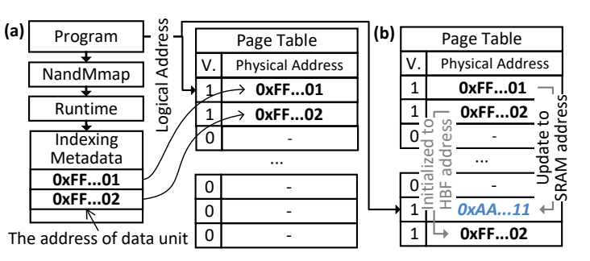

**Figure 10.** Page table mapping (a) after NandMmap, and (b) further after SramPrefetch.

**图 10。** 页表映射：(a) 执行 NandMmap 后；(b) 进一步执行 SramPrefetch 后。

#### 6.2.2 KV Cache Access Interface / 6.2.2 KV 缓存访问接口

**English**

Unlike model weights, the KV cache is maintained separately for each request rather than shared across requests. FlashAccel stores each request’s KV cache as an independent persistent object in the HBF storage management layer. However, during each inference step, the system must jointly read and write the KV caches of all active requests. To support this access pattern, we introduce a group object abstraction. GroupCreate logically combines the KV-cache objects of active requests in the same inference step into a single group object. Based on this abstraction, FlashAccel introduces three interfaces: GroupMmap, GroupWrite, and GroupArrange, to support grouped reads, append-only writes, and offloading, respectively.

**中文**

与模型权重不同，KV 缓存按请求分别维护，而非在请求之间共享。FlashAccel 在 HBF 存储管理层中，将每个请求的 KV 缓存存储为独立的持久化对象。然而，在每个推理步骤中，系统必须共同读写所有活跃请求的 KV 缓存。为了支持这种访问模式，我们引入组对象抽象。GroupCreate 在逻辑上将同一推理步骤内活跃请求的 KV 缓存对象合并为一个组对象。基于这一抽象，FlashAccel 引入 GroupMmap、GroupWrite 和 GroupArrange 三个接口，分别支持分组读取、仅追加写入和卸载。

**English**

GroupMmap maps a group object into a contiguous logical address space and returns the base address and a read table. The runtime first reserves a contiguous virtual address region, and then builds a plane-distribution table (Figure 11) for all objects in the group and uses it to pack data from different objects into hyper pages whenever possible. These hyper pages are mapped contiguously into the virtual region at hyper-page granularity. The runtime also returns the read table to resolve each offset of the logical base address to its corresponding object identifier. This design allows the program to access the group object through one logical address range, while transparently serving HBF accesses at hyper-page granularity for high bandwidth utilization.

**中文**

GroupMmap 将组对象映射到连续逻辑地址空间，并返回基地址和读取表。运行时首先预留一段连续虚拟地址区域，然后为组中的所有对象构建平面分布表（图 11），并尽可能利用该表将不同对象的数据组织为超页。这些超页以超页粒度连续映射到虚拟地址区域。运行时还返回读取表，将逻辑基地址的各个偏移解析为相应对象标识。该设计使程序可以通过一个逻辑地址范围访问组对象，同时透明地以超页粒度执行 HBF 访问，从而获得较高带宽利用率。

**English**

GroupArrange performs the offloading mechanism described in Section 5.2. The runtime computes the load of the group object across different planes and derives the average load. It then migrates data from overloaded planes in HBF to HBM. Finally, it updates the page table so that the physical addresses of the offloaded data point to their new addresses in HBM (Figure 11). This interface alleviates load imbalance across planes and improves overall read bandwidth.

**中文**

GroupArrange 实现第 5.2 节所述的卸载机制。运行时计算组对象在不同平面上的负载并得到平均负载，然后将 HBF 中过载平面上的数据迁移到 HBM。最后，它更新页表，使已卸载数据的物理地址指向其新的 HBM 地址（图 11）。该接口缓解平面间负载不均衡，提高总体读取带宽。

**English**

GroupWrite handles append-only writes to the KV cache, flushing data from HBM to Flash. GroupWrite takes a pointer to data in HBM together with a write table that specifies which object each portion of the data belongs to. Following the write policy described in Section 5.2, the runtime splits data in HBM into hyper pages whenever possible and distributes them across HBF in a plane-balanced manner. For data smaller than a hyper page, the runtime randomly selects planes for placement. The runtime updates the object metadata in the storage management layer, the page table, and the read table of GroupMmap according to the write table and the plane addresses determined during placement, so that the newly written data remains accessible.

**中文**

GroupWrite 处理 KV 缓存的仅追加写入，将数据从 HBM 刷入闪存。GroupWrite 接收指向 HBM 中数据的指针，以及指定每部分数据属于哪个对象的写入表。运行时按照第 5.2 节的写入策略，尽可能将 HBM 中的数据划分为超页，并以平面负载均衡的方式分布到 HBF。对于小于一个超页的数据，运行时随机选择平面进行放置。根据写入表和放置时确定的平面地址，运行时更新存储管理层中的对象元数据、页表以及 GroupMmap 的读取表，保证新写入的数据仍然可访问。

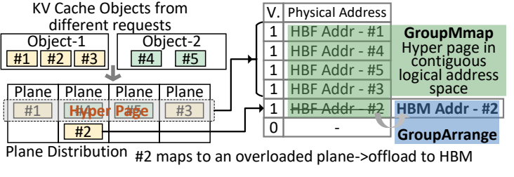

**Figure 11.** Page table mapping after GroupMmap and GroupArrange.

**图 11。** 执行 GroupMmap 和 GroupArrange 后的页表映射。

#### 6.2.3 Data Prefetch / 6.2.3 数据预取

**English**

FlashAccel incorporate a data prefetch mechanism into the programming model to leverage the SRAM resources to hide the high read latency of Flash. Specifically, FlashAccel introduces SramPrefetch, which takes a logical address (e.g., the returned address of NandMmap and GroupMmap for weights and KV cache, respectively) referring to data in HBF and a prefetch size as input, and returns an output logical address referring to prefetched data in SRAM for subsequent accesses. FlashAccel also provides SramRelease to release the allocated SRAM space after the last consumer finishes. A kernel therefore follows a simple pattern: prefetch to SRAM, compute on the returned address, and release the SRAM resources. For data objects larger than the SRAM capacity, the runtime split them into multiple smaller tiles that fit in SRAM and execute them sequentially. Figure 12(a) illustrates how a large weight matrix is split into three tiles, each of which is prefetched into SRAM, multiplied with the activation, and discarded before processing the next tile.

**中文**

FlashAccel 在编程模型中引入数据预取机制，利用 SRAM 资源隐藏闪存的高读取延迟。具体而言，FlashAccel 引入 SramPrefetch，其输入是指向 HBF 数据的逻辑地址（例如分别由 NandMmap 和 GroupMmap 返回的权重与 KV 缓存地址）和预取大小，输出是指向 SRAM 中已预取数据的逻辑地址，供后续访问使用。FlashAccel 还提供 SramRelease，在最后一个使用者完成后释放已分配 SRAM 空间。因此，内核遵循一个简单模式：将数据预取到 SRAM，在返回地址上执行计算，然后释放 SRAM 资源。对于大于 SRAM 容量的数据对象，运行时将其划分为多个可放入 SRAM 的较小分块，并依次执行。图 12(a) 展示了一个大权重矩阵如何被切分为三个分块：每个分块被预取到 SRAM，与激活值相乘，并在处理下一个分块前丢弃。

**English**

To overlap prefetch with computation, the runtime employs prefetch-aware scheduling. Figure 12(b) shows how SramPrefetch operations are extracted from the compute graph, organized into a queue following the topological order of the computational graph, and executed asynchronously from the compute kernels. This design allows Flash access latency to be overlapped with computation, as depicted in Figure 12(c).

**中文**

为了使预取与计算重叠，运行时采用预取感知调度。图 12(b) 展示了如何从计算图中提取 SramPrefetch 操作，按照计算图拓扑顺序将其组织为队列，并与计算内核异步执行。该设计使闪存访问延迟能够与计算重叠，如图 12(c) 所示。

**English**

When the runtime encounters a prefetch request, it first creates page table mappings for the returned logical address and initially points them to the original Flash addresses, ensuring that the data remains accessible. The runtime then attempts to migrate data in Flash to SRAM in the background at the hyper-page granularity. It first tries to allocate space in the SRAM of the plane. If that fails, it falls back to the SRAM on the base die. When allocation succeeds, the data is read from Flash into SRAM and the corresponding mappings in the page table are updated to the SRAM location. Otherwise, if no SRAM space is available, the original Flash mapping is retained. Figure 10(b) shows the page table after prefetching weights data from HBF.

**中文**

运行时遇到预取请求时，首先为返回的逻辑地址创建页表映射，并让映射初始指向原始闪存地址，以保证数据仍可访问。随后，运行时尝试在后台按超页粒度将闪存数据迁移到 SRAM。它先尝试在平面的 SRAM 中分配空间；如果失败，则转而使用基础裸片上的 SRAM。分配成功后，从闪存读取数据到 SRAM，并将页表中的相应映射更新为 SRAM 位置。否则，如果没有可用 SRAM 空间，则保留原始闪存映射。图 10(b) 展示了从 HBF 预取权重数据后的页表。

**English**

SramPrefetch does not stall the execution of dependent compute kernels. If a compute kernel begins execution before data prefetch completes, the unprefetched portions retain their original Flash addresses in the page table, allowing the kernel to access the correct data. After the last consumer compute kernel completes, SramRelease reclaims the associated SRAM space for future prefetches.

**中文**

SramPrefetch 不会阻塞依赖它的计算内核。如果计算内核在数据预取完成前开始执行，尚未预取的部分在页表中仍保留原始闪存地址，使内核可以访问正确数据。当最后一个使用者计算内核完成后，SramRelease 回收相应 SRAM 空间，供后续预取使用。

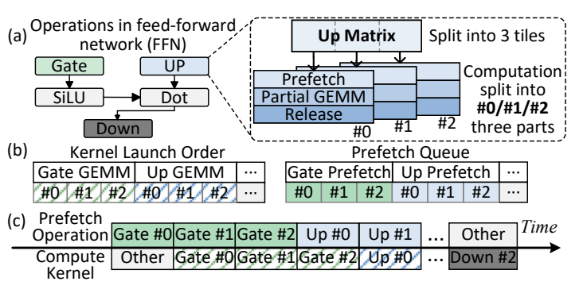

**Figure 12.** Proposed prefetch mechanism. (a) Modification to original compute kernels after introducing prefetch. (b) Kernel launch order and prefetch queue. (c) Overlap of prefetch and computation.

**图 12。** 所提出的预取机制。(a) 引入预取后对原始计算内核的修改。(b) 内核启动顺序与预取队列。(c) 预取与计算重叠。

## 7 Evaluation / 7 评估

### 7.1 Evaluation Setup / 7.1 评估设置

**English**

Workloads: Table 1 summarizes the four representative models used in our evaluation. These models cover popular attention mechanisms including group-query attention (GQA) [2], multi-head latent attention (MLA) [48], and feed-forward network (FFN) variants, including dense FFNs and mixture-of-experts (MoE) [49] FFNs. We apply different parallelism strategies for these models including tensor parallelism (TP), data parallelism (DP) and expert parallelism (EP). FP16 is used for all models, except that the weights of DeepSeekV3 [16] are in FP8. We set two sequence length configurations for different workloads. For long-context workloads, we derive the average sequence lengths of all tasks in the LongProc benchmark [65], setting the input and output sequence lengths to 8.11K and 2.53K, respectively. The second configuration targets agentic workloads with multi-turn interactions. Based on statistics reported in [58], we set the average input and output sequence lengths to 15K and 6K, respectively. Baseline and Configuration: The baseline is a DGX-H200 node [41]. A DGX-H200 node contains 8 H200 GPUs within the same NVLink domain, each with 900 GB/s NVLink bandwidth. Each H200 GPU is equipped with 6 HBM3e stacks [38], delivering a total of 141GB DRAM capacity and 4.8 TB/s memory bandwidth. This baseline configuration is denoted as 8×H200.

**中文**

工作负载：表 1 总结了评估中使用的四个代表性模型。这些模型覆盖常用的注意力机制，包括分组查询注意力（GQA）[2]、多头潜在注意力（MLA）[48]，以及前馈网络（FFN）变体，包括稠密 FFN 和混合专家（MoE）FFN [49]。我们为这些模型采用不同并行策略，包括张量并行（TP）、数据并行（DP）和专家并行（EP）。除 DeepSeekV3 [16] 的权重采用 FP8 外，其余模型均使用 FP16。我们为不同工作负载设置两组序列长度。对于长上下文工作负载，根据 LongProc 基准 [65] 中所有任务的平均序列长度，将输入与输出长度分别设为 8.11K 和 2.53K。第二组配置面向具有多轮交互的智能体工作负载。根据 [58] 的统计，将平均输入和输出序列长度分别设为 15K 和 6K。

基线与配置：基线为一个 DGX-H200 节点 [41]。节点内包含八个处于同一 NVLink 域中的 H200 GPU，每个 GPU 的 NVLink 带宽为 900 GB/s。每个 H200 配备六个 HBM3e 堆栈 [38]，提供总计 141 GB 的 DRAM 容量和 4.8 TB/s 的内存带宽。该基线配置记作 8×H200。

### Table 1. Model configuration / 表 1. 模型配置

**English**

| Models | Attention | FFN |
| --- | --- | --- |
| Qwen3-235B [63] | GQA / DP @ 188KB/token | MoE / EP |
| Qwen3-Coder-480B [63] | GQA / DP @ 248KB/token | MoE / EP |
| LLaMA3.1-405B [18] | GQA / TP @ 502KB/token | Dense / TP |
| DeepseekV3-671B [16] | MLA / DP @ 70KB/token | MoE / EP |

**中文**

| 模型 | 注意力机制 / 并行方式 / 每 token KV 占用 | 前馈网络 / 并行方式 |
| --- | --- | --- |
| Qwen3-235B [63] | 分组查询注意力 / 数据并行 / 188 KB/token | 混合专家 / 专家并行 |
| Qwen3-Coder-480B [63] | 分组查询注意力 / 数据并行 / 248 KB/token | 混合专家 / 专家并行 |
| LLaMA3.1-405B [18] | 分组查询注意力 / 张量并行 / 502 KB/token | 稠密网络 / 张量并行 |
| DeepseekV3-671B [16] | 多头潜在注意力 / 数据并行 / 70 KB/token | 混合专家 / 专家并行 |

**English**

We model an HBF stack designed to deliver HBM3e-level bandwidth while providing 8× higher capacity. Table 2 summarizes its configuration. Following Lincoln [52], we design the Flash die based on XL-Flash [32]. Each Flash die contains 96 planes, and each plane has a capacity of 256MB. We derive area parameters from the die-shot in [32]. For a conservative evaluation, $t_R$ and $t_{Prog}$ are kept the same as in [32] even though the capacity of each plane is reduced by 4×. We integrate HBF into the GPU and evaluate two FlashAccel configurations: CSI and CLI. CSI places 6 HBF stacks alongside the 6 HBM stacks in H200. Since FlashAccel does not require large HBM capacity for data storage, each HBM stack is reduced to 2 DRAM layers to minimize cost in CSI design. CLI replaces 5 of 6 HBM stacks with HBF and retains 1 HBM stack. Since HBF offers higher capacity, fewer GPUs are needed to store model weights. Therefore, beyond 8×CSI and 8×CLI configurations, we also evaluate 4×CSI and 4×CLI. Simulation: We build an event-driven simulator on top of LLMCompass [69] to model the latency of LLM inference on both FlashAccel and conventional GPUs. LLMCompass searches tiling strategies to find efficient GEMM mappings on GPU hardware and uses ScaleSim [45] to estimate latency. We extend it with a NAND simulator that models page access latency at plane granularity. We modify the memory model of LLMCompass to simulate the access of data residing in Flash and SRAM cache by providing the corresponding latencies.

**中文**

我们建模的 HBF 堆栈旨在提供 HBM3e 级带宽，同时提供其八倍容量。表 2 总结了配置。参照 Lincoln [52]，我们基于 XL-Flash [32] 设计闪存裸片。每个裸片包含 96 个平面，每个平面容量为 256 MB。面积参数来自 [32] 的裸片照片。为了进行保守评估，尽管每个平面的容量缩小到原来的四分之一，$t_R$ 和 $t_{Prog}$ 仍保持与 [32] 相同。我们将 HBF 集成到 GPU 中，并评估 CSI、CLI 两种 FlashAccel 配置。CSI 在 H200 的六个 HBM 堆栈旁增加六个 HBF 堆栈。由于 FlashAccel 不需要大容量 HBM 存储数据，CSI 设计将每个 HBM 堆栈缩减为两层 DRAM，以降低成本。CLI 用 HBF 替换六个 HBM 堆栈中的五个，保留一个 HBM 堆栈。HBF 提供更大容量，因此存储模型权重需要的 GPU 更少。除 8×CSI 和 8×CLI 外，我们还评估 4×CSI 和 4×CLI。

模拟：我们在 LLMCompass [69] 基础上构建事件驱动模拟器，建模 FlashAccel 和传统 GPU 上的 LLM 推理延迟。LLMCompass 搜索分块策略，以寻找适合 GPU 硬件的高效 GEMM 映射，并使用 ScaleSim [45] 估计延迟。我们扩展了 NAND 模拟器，以平面粒度建模页面访问延迟；同时修改 LLMCompass 的内存模型，通过提供相应延迟，模拟对闪存和 SRAM 缓存中数据的访问。

### Table 2. HBF configuration / 表 2. HBF 配置

**English**

| Component | Configuration |
| --- | --- |
| Flash organization | SLC 96 wordline-layers, 4KB / page; 256 pages / 256 blocks / 96 planes, 192 Gb / die |
| Array Die | Plane area = 1.43 mm²; TSV area = 12 mm²; total area = 149 mm²; $t_R$ = 4 μs; $t_{Prog}$ = 75 μs |
| Circuit Die | Plane peripheral circuit area = 1.21 mm²; 32KB SRAM per plane (0.050 mm²); total area = 143 mm² (including TSV 12 mm² and Other Peripheral area 10.17 mm²) |
| Base Die | SRAM capacity = 8MB |
| HBF stack | 8 × Flash Die + 1 × Base Die @ 768GB/s; total Flash/SRAM capacity = 192GB / 32MB |

**中文**

| 组成部分 | 配置 |
| --- | --- |
| 闪存组织 | SLC，96 层字线，4 KB/页；256 页/块、256 块/平面、96 平面/裸片，192 Gb/裸片 |
| 阵列裸片 | 平面面积 1.43 mm²；TSV 面积 12 mm²；总面积 149 mm²；读取延迟 $t_R$ = 4 μs；编程延迟 $t_{Prog}$ = 75 μs |
| 电路裸片 | 平面外围电路面积 1.21 mm²；每平面 32 KB SRAM（0.050 mm²）；总面积 143 mm²（含 TSV 12 mm² 和其他外围电路 10.17 mm²） |
| 基础裸片 | SRAM 容量 8 MB |
| HBF 堆栈 | 8 个闪存裸片 + 1 个基础裸片，带宽 768 GB/s；总闪存/SRAM 容量 192 GB / 32 MB |

### 7.2 Evaluation Results / 7.2 评估结果

**English**

Figure 13 shows the throughput per GPU in the decode phase across five hardware configurations under varying models and sequence lengths. We use two decode latency service-level objectives (SLOs) [72], 50ms (∼20 tokens/s/user) and 100ms (∼10 tokens/s/user). FlashAccel removes the capacity bottleneck of HBM on batching, shifting the limiting factor for throughput from memory capacity to latency budget. Since larger batch sizes increase the arithmetic intensity of memory-bound FFN operations, this shift directly improves decode throughput. For each configuration, we therefore use the largest batch size that satisfies both the SLO and HBM capacity constraints, and report throughput per GPU normalized to the baseline. For example, for LLaMA3.1-405B with 15K/6K context length, each request requires 10GB of KV cache, limiting the maximum batch size of 8×H200 to 30, whereas under a 50ms SLO, 8×CSI can support a theoretical batch size of 110 after accounting for the memory footprint of model weights.

**中文**

图 13 展示了不同模型和序列长度下，五种硬件配置在解码阶段的每 GPU 吞吐量。我们采用两种解码延迟服务级目标（SLO）[72]：50 ms（约每用户每秒 20 token）和 100 ms（约每用户每秒 10 token）。FlashAccel 消除了 HBM 容量对批处理的限制，使吞吐量的限制因素从内存容量转变为延迟预算。更大的批量提高了受内存带宽限制的 FFN 操作的算术强度，因此直接提升解码吞吐量。我们对每种配置选取同时满足 SLO 与 HBM 容量约束的最大批量，并报告相对于基线归一化的每 GPU 吞吐量。例如，LLaMA3.1-405B 在 15K/6K 上下文长度下，每个请求需要 10 GB KV 缓存，将 8×H200 的最大批量限制为 30；而在 50 ms SLO 下，计入模型权重的内存占用后，8×CSI 理论上可支持批量大小为 110。

**English**

Across all models, sequence lengths, and SLOs, 8×CSI consistently outperforms the baseline, delivering a 2.15× average throughput gain by supporting substantially larger batch sizes. 8×CLI shows lower throughput than 8×CSI, as the CLI architecture has only 5 HBF stacks, resulting in 16.7% lower bandwidth compared to CSI. Under the strict 50ms SLO, this bandwidth limitation causes it to slightly underperform the baseline on DeepSeek-V3 model and Qwen3-235B model. Under a 100ms SLO, CLI can load more KV cache per step, enabling larger batch sizes and a 2.04× overall throughput improvement.

**中文**

在所有模型、序列长度和 SLO 下，8×CSI 始终优于基线，通过支持显著更大的批量，实现平均 2.15 倍吞吐量。8×CLI 的吞吐量低于 8×CSI，因为 CLI 只有五个 HBF 堆栈，带宽比 CSI 低 16.7%。在严格的 50 ms SLO 下，这一带宽限制使其在 DeepSeek-V3 和 Qwen3-235B 模型上略低于基线。在 100 ms SLO 下，CLI 每步可加载更多 KV 缓存，支持更大批量，总体吞吐量达到基线的 2.04 倍。

**English**

We further investigate configurations with fewer GPUs. For HBM-based GPUs, a 4×H200 setup cannot fit model weights and is not evaluated. Both 4×CLI and 4×CSI suffer from reduced aggregate bandwidth. For LLaMA3.1-405B and Qwen3-Coder-480B, loading weights alone takes close to 50ms, leaving insufficient time for KV cache loading and computation under a 50ms SLO. Thus, these models cannot be served under this constraint. For other models, the limited bandwidth and strict SLO restrict batch size, resulting in lower throughput than the 8×H200 baseline. When the SLO is relaxed to 100ms, more KV cache can be loaded per step, enabling larger batch sizes. Despite using fewer GPUs, FlashAccel still outperforms the baseline on LLaMA-405B, Qwen3-235B, and Qwen3-480B in throughput per GPU.

**中文**

我们进一步考察使用更少 GPU 的配置。对于基于 HBM 的 GPU，4×H200 无法容纳模型权重，因此未予评估。4×CLI 和 4×CSI 都受到聚合带宽下降的影响。对于 LLaMA3.1-405B 和 Qwen3-Coder-480B，仅加载权重就需要接近 50 ms，在 50 ms SLO 下没有足够时间用于 KV 缓存加载和计算，因此无法在这一约束下服务这些模型。对于其他模型，有限带宽和严格 SLO 限制了批量大小，使吞吐量低于 8×H200 基线。当 SLO 放宽到 100 ms 时，每步能够加载更多 KV 缓存，支持更大批量。尽管使用更少 GPU，FlashAccel 在 LLaMA-405B、Qwen3-235B 和 Qwen3-480B 上的每 GPU 吞吐量仍优于基线。

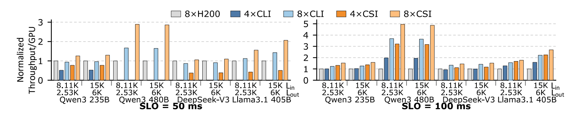

**Figure 13.** Throughput per GPU comparison among the baseline, CLI, and CSI.

**图 13。** 基线、CLI 和 CSI 的每 GPU 吞吐量比较。

**English**

Figure 14 shows throughput per GPU when scaling to 16 GPUs. For HBM-based GPUs, the additional memory capacity allows larger batch sizes. However, scaling to 16 GPUs moves communication from NVLink to RDMA [41], reducing bandwidth by about 9× and making all-to-all communication in EP much more expensive. As a result, the baseline shows little throughput improvement, and in some cases even degrades. Although 16×CSI and 16×CLI still achieve higher throughput per GPU than 16×H200, their performance is also limited by communication overhead. Compared with 8×CSI and 8×CLI, both show lower throughput per GPU. We also find that, for both CSI and CLI, an 8× HBF-based GPU system delivers higher throughput per GPU than a 16× HBM-based GPU system. Because each HBF-based GPU provides more capacity, a smaller system within a high interconnect bandwidth domain can sustain the workload, improving both cost efficiency and throughput per GPU.

**中文**

图 14 展示了扩展到 16 个 GPU 后的每 GPU 吞吐量。对基于 HBM 的 GPU，额外内存容量允许使用更大批量。然而，扩展到 16 个 GPU 后，通信从 NVLink 转为 RDMA [41]，带宽降低约九倍，使专家并行中的全互连通信更加昂贵。因此，基线吞吐量几乎没有改善，有些情况甚至下降。虽然 16×CSI 和 16×CLI 的每 GPU 吞吐量仍高于 16×H200，但其性能也受到通信开销限制。相较于 8×CSI 和 8×CLI，两者的每 GPU 吞吐量均更低。我们还发现，无论 CSI 还是 CLI，八卡 HBF GPU 系统的每 GPU 吞吐量都高于十六卡 HBM GPU 系统。由于每个 HBF GPU 提供更大容量，位于高带宽互连域内的较小系统就能支撑工作负载，从而提高成本效率和每 GPU 吞吐量。

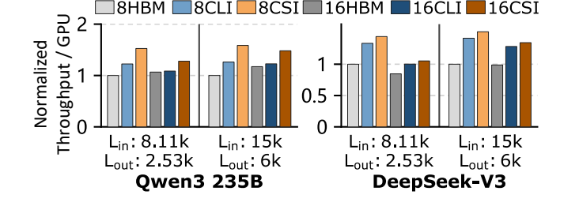

**Figure 14.** Throughput per GPU comparison after extending to 16 GPUs.

**图 14。** 扩展到 16 个 GPU 后的每 GPU 吞吐量比较。

### 7.3 Ablation Study / 7.3 消融研究

**English**

We ablate each optimization in FlashAccel. Figure 15 presents the latency breakdown of 6 accelerator configurations executing a Qwen3-235B model with a batch size of 256. Plain HBF denotes an HBF-based GPU without any optimizations. We further construct three ablated variants by disabling an optimization from the full CSI FlashAccel design at a time, namely prefetching, weight layout, and KV cache layout. With all optimizations enabled, FlashAccel matches HBM-based latency within ∼4%, including 2% offloading overhead. Figure 15 reports throughput under a 100ms SLO. Disabling prefetching, weight layout, and KV cache layout degrades throughput by 55%, 7%, and 15%, respectively, relative to FlashAccel. Plain HBF suffers a 65% throughput loss and falls below the HBM-based GPU. Overall, these results show that all three optimizations are necessary to close the performance gap of HBF. Prefetching plays a dominant role in mitigating access latency, while layout optimizations further improve bandwidth utilization.

**中文**

我们对 FlashAccel 的各项优化进行消融。图 15 展示了六种加速器配置在批量大小 256 下执行 Qwen3-235B 模型时的延迟分解。Plain HBF 表示没有任何优化的 HBF GPU。我们还从完整 CSI FlashAccel 设计中每次禁用一项优化，构造三个消融变体，分别去掉预取、权重布局和 KV 缓存布局。全部优化启用后，FlashAccel 与 HBM 配置的延迟差距控制在约 4% 内，其中包括 2% 的卸载开销。图 15 同时报告 100 ms SLO 下的吞吐量。相较于 FlashAccel，禁用预取、权重布局和 KV 缓存布局使吞吐量分别下降 55%、7% 和 15%。Plain HBF 的吞吐量下降 65%，低于 HBM GPU。总体而言，这些结果表明，三项优化对于弥合 HBF 性能差距都是必要的。预取在缓解访问延迟方面发挥主导作用，布局优化则进一步提高带宽利用率。

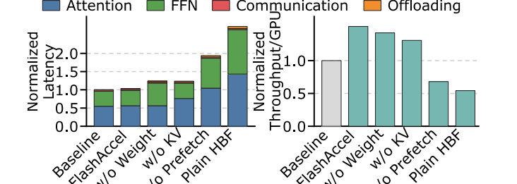

**Figure 15.** (a) Latency breakdown of different configurations. (b) Throughput comparison among different configurations.

**图 15。** (a) 不同配置的延迟分解。(b) 不同配置的吞吐量比较。

### 7.4 Write Issues / 7.4 写入问题

**English**

Flash suffers from write-side limitations in both bandwidth and endurance. Table 2 shows that the write latency of program operation ($t_{Prog}$ ) is significantly higher than the latency of read (tR ), which limits HBF write bandwidth. While the read bandwidth reaches 4.6 TB/s for CSI, the peak write bandwidth is only 245.8 GB/s. The endurance is another concern. Prior works [12, 37] demonstrate that reducing retention time from 3 years to 3 days can extend P/E cycles by up to 50×. Conservatively, we assume that reducing the retention time can extend the endurance by up to 10×, increasing the P/E cycles from 100K to 1M. Even so, it still cannot match the nearly unlimited write endurance of DRAM. However, the wide adoption of new attention mechanisms, like GQA and MLA, reduces write volume compared to multi-head attention (MHA), making it possible to store KV cache in Flash. Across all evaluated configurations, each HBF-based GPU generates and writes at most 276MB of new KV cache per second in the decode node (8×CSI running Qwen3-480B under a 100ms SLO, 1138 tokens/s). In addition, based on the input/output length ratio (i.e., ∼2.58:1) in agent workloads [58], each HBF-based GPU writes another 712MB of KV cache per second from the prefill node. In total, each HBF-based GPU writes 988MB of KV cache per second, taking only 3.9ms and incurring an additional overhead of 4%. Over a 5-year deployment period, this amounts to 148,570TB of total KV cache writes. With 1152GB capacity and 1M P/E cycles, CSI provides 1,125,000 TBW, sufficient for KV cache storage.

**中文**

闪存在写入带宽和耐久性两方面都存在限制。表 2 显示，编程操作的写入延迟（$t_{Prog}$）显著高于读取延迟（$t_R$），限制了 HBF 写入带宽。CSI 的读取带宽可达 4.6 TB/s，但峰值写入带宽只有 245.8 GB/s。耐久性是另一个问题。已有研究 [12, 37] 表明，将数据保持时间从三年缩短到三天，最多可使 P/E 循环次数达到原来的 50 倍。保守起见，我们假设缩短保持时间可使耐久性提高至原来的 10 倍，将 P/E 循环从 100K 次提高到 1M 次。即使如此，它仍无法匹配 DRAM 近乎无限的写入耐久性。然而，GQA、MLA 等新注意力机制的广泛采用，相比多头注意力（MHA）减少了写入量，使闪存存储 KV 缓存成为可能。在所有评估配置中，解码节点的每个 HBF GPU 每秒最多生成并写入 276 MB 新 KV 缓存（8×CSI 在 100 ms SLO 下运行 Qwen3-480B，吞吐量为 1138 token/s）。另外，根据智能体工作负载的输入/输出长度比约 2.58∶1 [58]，每个 HBF GPU 每秒还需写入来自预填充节点的 712 MB KV 缓存。总计每 GPU 每秒写入 988 MB KV 缓存，只需 3.9 ms，并产生 4% 的额外开销。在五年部署期内，总 KV 缓存写入量为 148570 TB。CSI 具有 1152 GB 容量和 1M 次 P/E 循环，可提供 1125000 TBW，足以存储 KV 缓存。

### 7.5 Prefill and KV Cache Reuse / 7.5 预填充与 KV 缓存复用

**English**

During the prefill phase, each request usually contains enough tokens to achieve high compute intensity, even without constructing a large batch size. In this case, both HBM-based GPUs and HBF-based GPUs can process the prefill requests efficiently. In multi-turn interactions, however, the GPU for prefill needs to store the KV cache of previous turns for each session for future turns in the same session to reuse it, avoiding the recomputation for these cached tokens. Larger capacity allows the system to reduces KV cache eviction. Figure 16 reports the KV cache hit rate measured using multi-turn interaction traces [6] on different numbers of HBM-based GPUs and HBF-based GPUs. Due to the large memory capacity, both 8×CLI and 8×CSI can store the KV cache for all sessions and achieve the ideal hit rate. In comparison, even when we scale the HBM-based GPU system to 16 GPUs, its hit rate is still 50% lower than that of the HBF-based GPU system. Figure 16 also shows that the higher hit rates of 8×CSI and 8×CLI reduce the number of tokens that require computation by up to 89% compared with 8×H200, thereby providing additional speedup.

**中文**

在预填充阶段，每个请求通常包含足够多的 token，即使不构建大批量，也能够获得较高计算强度。在这种情况下，HBM GPU 和 HBF GPU 都可以高效处理预填充请求。然而，在多轮交互中，预填充 GPU 需要为每个会话保留之前轮次的 KV 缓存，以便同一会话的后续轮次复用，避免重新计算这些已缓存 token。更大容量使系统能够减少 KV 缓存驱逐。图 16 报告了利用多轮交互轨迹 [6]，在不同数量的 HBM GPU 和 HBF GPU 上测得的 KV 缓存命中率。得益于大容量，8×CLI 和 8×CSI 都能存储所有会话的 KV 缓存，达到理想命中率。相比之下，即使将 HBM GPU 系统扩展至 16 卡，其命中率仍比 HBF GPU 系统低 50%。图 16 还显示，相较于 8×H200，8×CSI 和 8×CLI 的较高命中率最多可将需要计算的 token 数量减少 89%，带来额外加速。

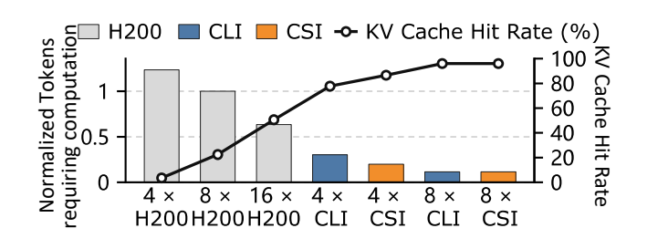

**Figure 16.** KV cache hit rate and normalized tokens requiring computation (normalized to 8×H200).

**图 16。** KV 缓存命中率，以及需要计算的 token 数量（以 8×H200 为基准归一化）。

### 7.6 Energy and Area Analysis / 7.6 能耗与面积分析

**English**

Flash memory suffers from high read energy consumption. While hybrid bonding can reduce read power, measurements from a real hybrid-bonded Flash prototype still show a read energy of 8 pJ/bit [62], which is 2.7× higher than that of HBM3e (2.99 pJ/bit [4]). After integrating HBF, the overall TDP of CSI and CLI architectures increases 1.31× and 1.23×, respectively. Nevertheless, thanks to the throughput advantages of HBF, we observe improvements in tokens per Joule. Figure 17 illustrates the energy efficiency (tokens/J) of different accelerators under a 100ms SLO. On average, 8×CSI and 8×CLI deliver 1.93× and 1.66× higher energy efficiency than 8×H200, respectively.

**中文**

闪存的读取能耗较高。虽然混合键合能够降低读取功耗，但真实混合键合闪存原型的测量结果仍显示，读取能耗为 8 pJ/bit [62]，约为 HBM3e（2.99 pJ/bit [4]）的 2.7 倍。集成 HBF 后，CSI 和 CLI 架构的总体热设计功耗（TDP）分别增至原来的 1.31 倍和 1.23 倍。不过，得益于 HBF 的吞吐量优势，我们观察到每焦耳处理 token 数的提升。图 17 展示了不同加速器在 100 ms SLO 下的能效（token/J）。8×CSI 和 8×CLI 的平均能效分别达到 8×H200 的 1.93 倍和 1.66 倍。

**English**

Our evaluation shows that HBF occupies an area of 149mm2 , which is 1.23× larger than that of standard HBM3e (121mm2 ). This overhead stems from our conservative assumptions based on the design in [32], which uses only 96 wordline layers. Recent technologies [13, 54, 61] have achieved over 300 wordline layers, significantly improving storage density and reducing area overhead for a given capacity. Using array dies with more wordline layers allows HBF to achieve area parity with the HBM stack. Even with only 96 wordline layers, our HBF design still achieves 6.5× higher density than HBM3e.

**中文**

评估显示，HBF 占用面积为 149 mm²，约为标准 HBM3e（121 mm²）的 1.23 倍。这一开销来自基于 [32] 设计所做的保守假设，该设计只有 96 层字线。近期技术 [13, 54, 61] 已达到超过 300 层字线，显著提高存储密度，并降低给定容量下的面积开销。使用具有更多字线层的阵列裸片，可以使 HBF 面积与 HBM 堆栈相当。即使只有 96 层字线，我们的 HBF 设计仍实现了 HBM3e 的 6.5 倍存储密度。

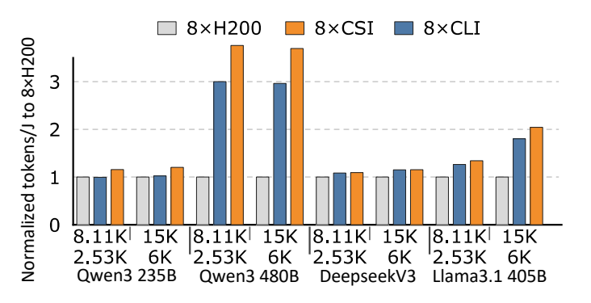

**Figure 17.** Energy efficiency comparison.

**图 17。** 能效比较。

## 8 Related Works / 8 相关工作

**English**

Flash Offloading Strategy: Prior works [3, 21, 26, 50] offload model weights or KV cache to SSDs to mitigate the DRAM capacity bottleneck, enabling LLM execution without out-of-memory failures. However, these designs are fundamentally constrained by the low SSD bandwidth, leading to extremely high decode latency, which limits their practicality in datacenter deployment. FlashAccel addresses this issue by increasing plane-level parallelism in Flash and employing dedicated layout optimizations to achieve high bandwidth.

**中文**

闪存卸载策略：已有工作 [3, 21, 26, 50] 将模型权重或 KV 缓存卸载到 SSD，以缓解 DRAM 容量瓶颈，使 LLM 能够运行而不发生内存不足。然而，这些设计从根本上受到 SSD 低带宽限制，导致极高的解码延迟，制约其在数据中心部署中的实用性。FlashAccel 通过提高闪存平面级并行度，并采用专用布局优化实现高带宽，解决这一问题。

**English**

In-storage Processing Accelerators: These accelerators [35, 52, 68] place compute units inside Flash to exploit its internal bandwidth for on-device inference. However, the limited silicon area inside Flash restricts computational capacity, resulting in low throughput. Moreover, they do not support storing KV cache in Flash, leaving capacity challenges unaddressed. FlashAccel instead integrates HBF with GPUs to provide high computational capacity, and enables KV cache storage via SLC Flash and system support for append-only KV cache writes.

**中文**

存内处理加速器：这些加速器 [35, 52, 68] 将计算单元放置在闪存内部，利用内部带宽实现设备端推理。然而，闪存内部有限的硅面积限制了计算能力，导致吞吐量较低。此外，它们不支持在闪存中存储 KV 缓存，因此容量问题仍未解决。FlashAccel 则将 HBF 与 GPU 集成，以获得高计算能力，并通过 SLC 闪存及支持仅追加 KV 缓存写入的系统机制，实现 KV 缓存存储。

**English**

Processing-in-memory Accelerators: Some works [19, 24, 42, 47] accelerate attention execution using DRAM-based processing-in-memory (PIM) which provides high internal bandwidth but limited computational capacity. They mainly target MHA that has low arithmetic intensity. Recent MLA and GQA impose higher computational demands that are difficult for PIM to sustain. In addition, PIM does not address the inherent low density of DRAM which leads to high cost. By contrast, FlashAccel improves density with Flash and, through GPU integration, supports attention mechanisms requiring more computation.

**中文**

存内计算加速器：部分研究 [19, 24, 42, 47] 利用基于 DRAM 的存内计算（PIM）加速注意力执行。这类方案提供较高内部带宽，但计算能力有限，主要面向算术强度较低的 MHA。近期的 MLA 和 GQA 提出更高计算需求，PIM 难以支撑。此外，PIM 没有解决 DRAM 固有的低密度及由此导致的高成本问题。相比之下，FlashAccel 利用闪存提高密度，并通过与 GPU 集成，支持需要更多计算的注意力机制。

## 9 Conclusion / 9 结论

**English**

This work points out the key obstacles that prevent HBF from translating its capacity advantages into LLM-serving performance, and addresses them through co-design across architecture, data layout, and system software. FlashAccel introduces an SRAM cache at the architectural level and a prefetch interface at the system level to mitigate the high access latency of Flash. A specialized data layout fully leverages plane-level parallelism for weights and KV cache to improve bandwidth utilization. An HBF management layer and a programming model address the management and usage of heterogeneous memory resources. Experimental results show that FlashAccel achieves 2.54× higher throughput than HBM-based GPU.

**中文**

本工作指出了阻碍 HBF 将容量优势转化为 LLM 服务性能的关键障碍，并通过架构、数据布局和系统软件的协同设计加以解决。FlashAccel 在架构层面引入 SRAM 缓存，在系统层面引入预取接口，以缓解闪存的高访问延迟。专用数据布局充分利用权重和 KV 缓存的平面级并行性，提高带宽利用率。HBF 管理层与编程模型解决了异构内存资源的管理和使用问题。实验结果表明，FlashAccel 的吞吐量达到基于 HBM 的 GPU 的 2.54 倍。

## Footnotes / 脚注

[^1]: **English:** The prefill cluster processes 608 billion tokens in total, but 342 billion tokens are served via KV cache hits and do not require additional writes. **中文：** 预填充集群共处理 6080 亿个 token，但其中 3420 亿个 token 通过 KV 缓存命中得到服务，无需额外写入。

[^2]: **English:** For clarity, we assume the size of each KV block in KV cache is the same as the page size of the plane in figures. **中文：** 为清晰起见，图中假设 KV 缓存中每个 KV 块的大小与平面的页面大小相同。

## References / 参考文献

以下保留原文参考文献的作者、发表信息及编号，并附中文题名。

**[1] English**

Nitin Agrawal, Vijayan Prabhakaran, Ted Wobber, John D Davis, Mark Manasse, and Rina Panigrahy. 2008. Design tradeoffs for {SSD} performance. In 2008 USENIX Annual Technical Conference (USENIX ATC 08).

**中文题名：** SSD 性能的设计权衡

**[2] English**

Joshua Ainslie, James Lee-Thorp, Michiel De Jong, Yury Zemlyanskiy, Federico Lebrón, and Sumit Sanghai. 2023. Gqa: Training generalized multi-query transformer models from multi-head checkpoints. In Proceedings of the 2023 Conference on Empirical Methods in Natural Language Processing. 4895–4901.

**中文题名：** GQA：从多头检查点训练通用多查询 Transformer 模型

**[3] English**

Keivan Alizadeh, Seyed Iman Mirzadeh, Dmitry Belenko, S Khatamifard, Minsik Cho, Carlo C Del Mundo, Mohammad Rastegari, and Mehrdad Farajtabar. 2024. Llm in a flash: Efficient large language model inference with limited memory. In Proceedings of the 62nd Annual Meeting of the Association for Computational Linguistics (Volume 1: Long Papers). 12562–12584.

**中文题名：** LLM in a Flash：内存受限条件下的高效大语言模型推理

**[4] English**

Oscar Antepara, Zhengji Zhao, Brian Austin, Nan Ding, Leonid Oliker, Nicholas J Wright, and Samuel Williams. 2025. Benchmark-driven Models for Energy Analysis and Attribution of GPU-Accelerated Supercomputing. In Proceedings of the International Conference for High Performance Computing, Networking, Storage and Analysis. 888–904.

**中文题名：** 基准驱动的 GPU 加速超级计算能耗分析与归因模型

**[5] English**

Malika Aubakirova, Alex Atallah, Chris Clark, Justin Summerville, and Anjney Midha. 2026. State of AI: An Empirical 100 Trillion Token Study with OpenRouter. arXiv preprint arXiv:2601.10088 (2026).

**中文题名：** AI 现状：基于 OpenRouter 的 100 万亿 token 实证研究

**[6] English**

badlogic. 2026. pi-mono. https://github.com/badlogic/pi-mono. Version: main branch, accessed 2026-04-15.

**中文题名：** pi-mono（项目名）

**[7] English**

Yushi Bai, Xin Lv, Jiajie Zhang, Hong Lyu, Jiankai Tang, Zhidian Huang, Zhengxiao Du, Xiao Liu, Aohan Zeng, Lei Hou, Yuxiao Dong, Jie Tang, and Juanzi Li. 2024. Longbench: A bilingual, multitask benchmark for long context understanding. In Proceedings of the 62nd annual meeting of the association for computational linguistics (volume 1: Long papers). 3119–3137.

**中文题名：** LongBench：面向长上下文理解的双语、多任务基准

**[8] English**

Iz Beltagy, Matthew E Peters, and Arman Cohan. 2020. Longformer: The long-document transformer. arXiv preprint arXiv:2004.05150 (2020).

**中文题名：** Longformer：面向长文档的 Transformer

**[9] English**

Adithya Bhaskar, Alexander Wettig, Tianyu Gao, Yihe Dong, and Danqi Chen. 2025. Cache Me If You Can: How Many KVs Do You Need for Effective Long-Context LMs? arXiv preprint arXiv:2506.17121 (2025).

**中文题名：** 能缓存就缓存：有效的长上下文语言模型需要多少 KV？

**[10] English**

Jalil Boukhobza, Pierre Olivier, Wen Sheng Lim, Liang-Chi Chen, Yun-Shan Hsieh, Shin-Ting Wu, Chien-Chung Ho, Po-Chun Huang, and Yuan-Hao Chang. 2025. A survey on flash-memory storage systems: A host-side perspective. ACM Transactions on Storage 21, 3 (2025), 1–59.

**中文题名：** 闪存存储系统综述：主机侧视角

**[11] English**

Yu Cai, Saugata Ghose, Erich F Haratsch, Yixin Luo, and Onur Mutlu. 2017. Error characterization, mitigation, and recovery in flashmemory-based solid-state drives. Proc. IEEE 105, 9 (2017), 1666–1704.

**中文题名：** 基于闪存的固态硬盘中的错误表征、缓解与恢复

**[12] English**

Yu Cai, Gulay Yalcin, Onur Mutlu, Erich F Haratsch, Adrian Cristal, Osman S Unsal, and Ken Mai. 2012. Flash correct-and-refresh: Retention-aware error management for increased flash memory lifetime. In 2012 IEEE 30th International Conference on Computer Design (ICCD). IEEE, 94–101.

**中文题名：** Flash Correct-and-Refresh：通过感知数据保持特性的错误管理延长闪存寿命

**[13] English**

Wanik Cho, Chanhui Jeong, Jongwoo Kim, Jongseok Jung, Keunseon Ahn, Jayoon Goo, Sangkyu Lee, Kayoung Cho, Tei Cho, Dauni Kim, Gwan Park, Yushin Ahn, Sooyeol Chai, Gwihan Ko, Sunyoung Jung, Eunwoo Jo, Taehun Park, Jinhyun Ban, Cheoljoong Park, Jae Hyun Park, Sanghoon Oh, Sojin Jeong, Youngjun Kwak, Kyungsoo Jeong, Jinyeop Kim, Minchol Shin, Eunho Yang, Taisik Shin, Youngil Kim, Jiseong Mun, Chanyang Ryu, Huihyeon Park, Changwan Ha, Jong Tai Park, Peng Zhang, Sooyong Park, Rezaul Haque, Hang Tian, Sunghwa Ok, Wonbeom Choi, Junyoun Lim, Dongkyu Yoon, Sechun Park, Wonsun Park, Kichang Gwon, Seungpil Lee, Hwang Huh, Woopyo Jeong, and Jungdal Choi. 2025. A 321-layer 2Tb 4b/cell 3D-NAND-flash memory with a 75MB/s program throughput. In 2025 IEEE International Solid-State Circuits Conference (ISSCC), Vol. 68. IEEE, 512–514.

**中文题名：** 编程吞吐量为 75 MB/s 的 321 层、2 Tb、4 bit/cell 3D NAND 闪存

**[14] English**

Tri Dao, Dan Fu, Stefano Ermon, Atri Rudra, and Christopher Ré. 2022. Flashattention: Fast and memory-efficient exact attention with io-awareness. Advances in neural information processing systems 35 (2022), 16344–16359.

**中文题名：** FlashAttention：具有 I/O 感知能力的快速、内存高效的精确注意力

**[15] English**

DeepSeek-AI. 2025. Day 6: One More Thing, DeepSeek-V3/R1 Inference System Overview. https://github.com/deepseek-ai/open-infra-index/blob/main/202502OpenSourceWeek/day_6_one_more_thing_deepseekV3R1_inference_system_overview.md GitHub repository.

**中文题名：** 第六天：还有一件事——DeepSeek-V3/R1 推理系统概览

**[16] English**

DeepSeek-AI, Aixin Liu, Bei Feng, Bing Xue, Bingxuan Wang, Bochao Wu, Chengda Lu, Chenggang Zhao, Chengqi Deng, Chenyu Zhang, Chong Ruan, Damai Dai, Daya Guo, Dejian Yang, Deli Chen, Dongjie Ji, Erhang Li, Fangyun Lin, Fucong Dai, Fuli Luo, Guangbo Hao, Guanting Chen, Guowei Li, H. Zhang, Han Bao, Hanwei Xu, Haocheng Wang, Haowei Zhang, Honghui Ding, Huajian Xin, Huazuo Gao, Hui Li, Hui Qu, J. L. Cai, Jian Liang, Jianzhong Guo, Jiaqi Ni, Jiashi Li, Jiawei Wang, Jin Chen, Jingchang Chen, Jingyang Yuan, Junjie Qiu, Junlong Li, Junxiao Song, Kai Dong, Kai Hu, Kaige Gao, Kang Guan, Kexin Huang, Kuai Yu, Lean Wang, Lecong Zhang, Lei Xu, Leyi Xia, Liang Zhao, Litong Wang, Liyue Zhang, Meng Li, Miaojun Wang, Mingchuan Zhang, Minghua Zhang, Minghui Tang, Mingming Li, Ning Tian, Panpan Huang, Peiyi Wang, Peng Zhang, Qiancheng Wang, Qihao Zhu, Qinyu Chen, Qiushi Du, R. J. Chen, R. L. Jin, Ruiqi Ge, Ruisong Zhang, Ruizhe Pan, Runji Wang, Runxin Xu, Ruoyu Zhang, Ruyi Chen, S. S. Li, Shanghao Lu, Shangyan Zhou, Shanhuang Chen, Shaoqing Wu, Shengfeng Ye, Shengfeng Ye, Shirong Ma, Shiyu Wang, Shuang Zhou, Shuiping Yu, Shunfeng Zhou, Shuting Pan, T. Wang, Tao Yun, Tian Pei, Tianyu Sun, W. L. Xiao, Wangding Zeng, Wanjia Zhao, Wei An, Wen Liu, Wenfeng Liang, Wenjun Gao, Wenqin Yu, Wentao Zhang, X. Q. Li, Xiangyue Jin, Xianzu Wang, Xiao Bi, Xiaodong Liu, Xiaohan Wang, Xiaojin Shen, Xiaokang Chen, Xiaokang Zhang, Xiaosha Chen, Xiaotao Nie, Xiaowen Sun, Xiaoxiang Wang, Xin Cheng, Xin Liu, Xin Xie, Xingchao Liu, Xingkai Yu, Xinnan Song, Xinxia Shan, Xinyi Zhou, Xinyu Yang, Xinyuan Li, Xuecheng Su, Xuheng Lin, Y. K. Li, Y. Q. Wang, Y. X. Wei, Y. X. Zhu, Yang Zhang, Yanhong Xu, Yanhong Xu, Yanping Huang, Yao Li, Yao Zhao, Yaofeng Sun, Yaohui Li, Yaohui Wang, Yi Yu, Yi Zheng, Yichao Zhang, Yifan Shi, Yiliang Xiong, Ying He, Ying Tang, Yishi Piao, Yisong Wang, Yixuan Tan, Yiyang Ma, Yiyuan Liu, Yongqiang Guo, Yu Wu, Yuan Ou, Yuchen Zhu, Yuduan Wang, Yue Gong, Yuheng Zou, Yujia He, Yukun Zha, Yunfan Xiong, Yunxian Ma, Yuting Yan, Yuxiang Luo, Yuxiang You, Yuxuan Liu, Yuyang Zhou, Z. F. Wu, Z. Z. Ren, Zehui Ren, Zhangli Sha, Zhe Fu, Zhean Xu, Zhen Huang, Zhen Zhang, Zhenda Xie, Zhengyan Zhang, Zhewen Hao, Zhibin Gou, Zhicheng Ma, Zhigang Yan, Zhihong Shao, Zhipeng Xu, Zhiyu Wu, Zhongyu Zhang, Zhuoshu Li, Zihui Gu, Zijia Zhu, Zijun Liu, Zilin Li, Ziwei Xie, Ziyang Song, Ziyi Gao, and Zizheng Pan. 2025. DeepSeek-V3 Technical Report. arXiv:2412.19437 [cs.CL] https://arxiv.org/abs/2412.19437

**中文题名：** DeepSeek-V3 技术报告

**[17] English**

Kaustubh Deshpande, Ved Sirdeshmukh, Johannes Baptist Mols, Lifeng Jin, Ed-Yeremai Hernandez-Cardona, Dean Lee, Jeremy Kritz, Willow E Primack, Summer Yue, and Chen Xing. 2025. Multichallenge: A realistic multi-turn conversation evaluation benchmark challenging to frontier llms. In Findings of the Association for Computational Linguistics: ACL 2025. 18632–18702.

**中文题名：** MultiChallenge：对前沿大语言模型具有挑战性的真实多轮对话评估基准

**[18] English**

Abhimanyu Dubey, Abhinav Jauhri, Abhinav Pandey, Abhishek Kadian, Ahmad Al-Dahle, Aiesha Letman, Akhil Mathur, Alan Schelten, Amy Yang, Angela Fan, Anirudh Goyal, Anthony S. Hartshorn, Aobo Yang, Archi Mitra, Archie Sravankumar, Artem Korenev, Arthur Hinsvark, Arun Rao, Aston Zhang, Aur’elien Rodriguez, Austen Gregerson, Ava Spataru, Baptiste Rozière, Bethany M. Biron, Binh Tang, Bobbie Chern, Charlotte Caucheteux, Chaya Nayak, Chloe Bi, Chris Marra, Chris McConnell, Christian Keller, Christophe Touret, Chunyang Wu, Corinne Wong, Cristian Canton Ferrer, Cyrus Nikolaidis, Damien Allonsius, Daniel J. Song, Danielle Pintz, Danny Livshits, David Esiobu, Dhruv Choudhary, Dhruv Mahajan, Diego Garcia-Olano, Diego Perino, Dieuwke Hupkes, Egor Lakomkin, Ehab A. AlBadawy, E I Lobanova, Emily Dinan, Eric Michael Smith, Filip Radenovic, Frank Zhang, Gabriel Synnaeve, Gabrielle Lee, Georgia Lewis Anderson, Graeme Nail, Grégoire Mialon, Guanglong Pang, Guillem Cucurell, Hailey Nguyen, Hannah Korevaar, Hu Xu, Hugo Touvron, Iliyan Zarov, Imanol Arrieta Ibarra, Isabel M. Kloumann, Ishan Misra, Ivan Evtimov, Jade Copet, Jaewon Lee, Jan Geffert, Jana Vranes, Jason Park, Jay Mahadeokar, Jeet Shah, Jelmer van der Linde, Jennifer Billock, Jenny Hong, Jenya Lee, Jeremy Fu, Jianfeng Chi, Jianyu Huang, Jiawen Liu, Jie Wang, Jiecao Yu, Joanna Bitton, Joe Spisak, Jongsoo Park, Joseph Rocca, Joshua Johnstun, Joshua Saxe, Ju-Qing Jia, Kalyan Vasuden Alwala, K. Upasani, Kate Plawiak, Keqian Li, Kenneth Heafield, Kevin R. Stone, Khalid El-Arini, Krithika Iyer, Kshitiz Malik, Kuen ley Chiu, Kunal Bhalla, Lauren Rantala-Yeary, Laurens van der Maaten, Lawrence Chen, Liang Tan, Liz Jenkins, Louis Martin, Lovish Madaan, Lubo Malo, Lukas Blecher, Lukas Landzaat, Luke de Oliveira, Madeline Muzzi, Ma hesh Pasupuleti, Mannat Singh, Manohar Paluri, Marcin Kardas, Mathew Oldham, Mathieu Rita, Maya Pavlova, Melissa Hall Melanie Kambadur, Mike Lewis, Min Si, Mitesh Kumar Singh, Mona Hassan, Naman Goyal, Narjes Torabi, Niko lay Bashlykov, Nikolay Bogoychev, Niladri S. Chatterji, Olivier Duchenne, Onur cCelebi, Patrick Alrassy, Pengchuan Zhang, Pengwei Li, Petar Vasić, Peter Weng, Prajjwal Bhargava, Pratik Dubal, Praveen Krishnan, Punit Singh Koura, Puxin Xu, Qing He, Qingxiao Dong, Ragavan Srinivasan, Raj Ganapathy, Ramon Calderer, Ricardo Silveira Cabral, Robert Stojnic, Roberta Raileanu, Rohit Girdhar, Rohit Patel, Romain Sauvestre, Ron nie Polidoro, Roshan Sumbaly, Ross Taylor, Ruan Silva, Rui Hou, Rui Wang, Saghar Hosseini, Sa hana Chennabasappa, Sanjay Singh, Sean Bell, Seohyun Sonia Kim, Sergey Edunov, Shaoliang Nie, Sharan Narang, Sharath Chandra Raparthy, Sheng Shen, Shengye Wan, Shruti Bhosale, Shun Zhang, Simon Vandenhende, Soumya Batra, Spencer Whitman, Sten Sootla, Stéphane Collot, Suchin Gururangan, Sydney Borodinsky, Tamar Herman, Tara Fowler, Tarek Sheasha, Thomas Georgiou, Thomas Scialom, Tobias Speckbacher, Todor Mihaylov, Tong Xiao, Ujjwal Karn, Vedanuj Goswami, Vibhor Gupta, Vignesh Ramanathan, Viktor Kerkez, Vincent Gonguet, Virginie Do, Vish Vogeti, Vladan Petrovic, Weiwei Chu, Wenhan Xiong, Wenyin Fu, Whit ney Meers, Xavier Martinet, Xiaodong Wang, Xiaoqing Ellen Tan, Xinfeng Xie, Xuchao Jia, Xuewei Wang, Yaelle Goldschlag, Yashesh Gaur, Yasmine Babaei, Yiqian Wen, Yiwen Song, Yuchen Zhang, Yue Li, Yuning Mao, Zacharie Delpierre Coudert, Zhengxu Yan, Zhengxing Chen, Zoe Papakipos, Aaditya K. Singh, Aaron Grattafiori, Abha Jain, Adam Kelsey, Adam Shajnfeld, Adi Gangidi, Adolfo Victoria, Ahuva Goldstand, Ajay Menon, Ajay Sharma, Alex Boesenberg, Alex Vaughan, Alexei Baevski, Allie Feinstein, Amanda Kallet, Amit Sangani, Anam Yunus, Andrei Lupu, Andres Alvarado, Andrew Caples, Andrew Gu, Andrew Ho, Andrew Poulton, Andrew Ryan, Ankit Ramchandani, Annie Franco, Aparajita Saraf, Arkabandhu Chowdhury, Ashley Gabriel, Ashwin Bharambe, Assaf Eisenman, Azadeh Yazdan, Beau James, Ben Maurer, Benjamin Leonhardi, Po-Yao (Bernie) Huang, Beth Loyd, Beto de Paola, Bhargavi Paranjape, Bing Liu, Bo Wu, Boyu Ni, Braden Hancock, Bram Wasti, Brandon Spence, Brani Stojkovic, Brian Gamido, Britt Montalvo, Carl Parker, Carly Burton, Catalina Mejia, Changhan Wang, Changkyu Kim, Chao Zhou, Chester Hu, Ching-Hsiang Chu, Chris Cai, Chris Tindal, Christoph Feichtenhofer, Damon Civin, Dana Beaty, Daniel Kreymer, Shang-Wen Li, Danny Wyatt, David Adkins, David Xu, Davide Testuggine, Delia David, Devi Parikh, Diana Liskovich, Didem Foss, Dingkang Wang, Duc Le, Dustin Holland, Edward Dowling, Eissa Jamil, Elaine Montgomery, Eleonora Presani, Emily Hahn, Emily Wood, Erik Brinkman, Esteban Arcaute, Evan Dunbar, Evan Smothers, Fei Sun, Felix Kreuk, Feng Tian, Firat Ozgenel, Francesco Caggioni, Francisco (Paco) Guzmán, Frank J. Kanayet, Frank Seide, Gabriela Medina Florez, Gabriella Schwarz, Gada Badeer, Georgia Swee, Gil Halpern, Govind Thattai, Grant Herman, Grigory Sizov, Guangyi Zhang, Guna Lakshminarayanan, Hamid Shojanazeri, Han Zou, Hannah Wang, Han Zha, Haroun Habeeb, Harrison Rudolph, Helen Suk, Henry Aspegren, Hunter Goldman, Igor Molybog, Igor Tufanov, Irina-Elena Veliche, Itai Gat, Jake Weissman, James Geboski, James Kohli, Japhet Asher, Jean-Baptiste Gaya, Jeff Marcus, Jeff Tang, Jennifer Chan, Jenny Zhen, Jeremy Reizenstein, Jeremy Teboul, Jessica Zhong, Jian Jin, Jingyi Yang, Joe Cummings, Jon Carvill, Jon Shepard, Jonathan McPhie, Jonathan Torres, Josh Ginsburg, Junjie Wang, Kaixing(Kai) Wu, U KamHou, Karan Saxena, Karthik Prasad, Kartikay Khandelwal, Katayoun Zand, Kathy Matosich, Kaushik Veeraraghavan, Kelly Michelena, Keqian Li, Kun Huang, Kunal Chawla, Kushal Lakhotia, Kyle Huang, Lailin Chen, Lakshya Garg, A Lavender, Leandro Silva, Lee Bell, Lei Zhang, Liangpeng Guo, Licheng Yu, Liron Moshkovich, Luca Wehrstedt, Madian Khabsa, Manav Avalani, Manish Bhatt, Maria Tsimpoukelli, Martynas Mankus, Matan Hasson, Matthias Lennie, Matthias Reso, Maxim Groshev, Maxim Naumov, Maya Lathi, Meghan Keneally, Michael L. Seltzer, Michal Valko, Michelle Restrepo, Mihir Patel, Mik Vyatskov, Mikayel Samvelyan, Mike Clark, Mike Macey, Mike Wang, Miquel Jubert Hermoso, Mo Metanat, Mohammad Rastegari, Mun ish Bansal, Nandhini Santhanam, Natascha Parks, Natasha White, Navy ata Bawa, Nayan Singhal, Nick Egebo, Nicolas Usunier, Nikolay Pavlovich Laptev, Ning Dong, Ning Zhang, Norman Cheng, Oleg Chernoguz, Olivia Hart, Omkar Salpekar, Ozlem Kalinli, Parkin Kent, Parth Parekh, Paul Saab, Pavan Balaji, Pe dro Rittner, Philip Bontrager, Pierre Roux, Piotr Dollár, Polina Zvyagina, Prashant Ratanchandani, Pritish Yuvraj, Qian Liang, Rachad Alao, Rachel Rodriguez, Rafi Ayub, Raghotham Murthy, Raghu Nayani, Rahul Mitra, Raymond Li, Rebekkah Hogan, Robin Battey, Rocky Wang, Ro han Maheswari, Russ Howes, Ruty Rinott, Sai Jayesh Bondu, Samyak Datta, Sara Chugh, Sara Hunt, Sargun Dhillon, S. Yu. Sidorov, Satadru Pan, Saurabh Verma, Seiji Yamamoto, Sharadh Ramaswamy, Shaun Lindsay, Sheng Feng, Shenghao Lin, Shengxin Zha, Shiva Shankar, Shuqiang Zhang, Sinong Wang, Sneha Agarwal, Soji Sajuyigbe, Soumith Chintala, Stephanie Max, Stephen Chen, Steve Kehoe, Steve Satterfield, Sudarshan Govindaprasad, Sumit Kumar Gupta, Sung-Bae Cho, Sunny Virk, Suraj Subramanian, Sy Choudhury, Sydney Goldman, Tal Remez, Tamar Glaser, Tamara Best, Thilo Kohler, Thomas Robinson, Tianhe Li, Tianjun Zhang, Tim Matthews, Timothy Chou, Tzook Shaked, Varun Vontimitta, Victoria O Ajayi, Victoria Montanez, Vijai Mohan, Vinay Kumar, Vishal Mangla, Vlad Ionescu, Vlad Andrei Poenaru, Vlad T. Mihailescu, Vladimir Ivanov, Wei Li, Wenchen Wang, Wenwen Jiang, Wes Bouaziz, Will Constable, Xia Tang, Xiaofang Wang, Xiaojian Wu, Xiaolan Wang, Xide Xia, Xilun Wu, Xinbo Gao, Yanjun Chen, Ye Hu, Ye Jia, Ye Qi, Yenda Li, Yilin Zhang, Ying Zhang, Yossi Adi, Youngjin Nam, Yu Wang, Yuchen Hao, Yundi Qian, Yuzi He, Zach Rait, Zachary DeVito, Zef Rosnbrick, Zhaoduo Wen, Zhenyu Yang, and Zhiwei Zhao. 2024. The llama 3 herd of models. arXiv preprint arXiv:2407.21783 (2024).

**中文题名：** Llama 3 模型家族

**[19] English**

Zehao Fan, Garrett Gagnon, Zhenyu Liu, and Liu Liu. 2025. Sparse Attention Remapping with Clustering for Efficient LLM Decoding on PIM. arXiv:2505.05772 [cs.CL] https://arxiv.org/abs/2505.05772

**中文题名：** 通过聚类进行稀疏注意力重映射，实现 PIM 上的高效 LLM 解码

**[20] English**

Raja Gond, Nipun Kwatra, and Ramachandran Ramjee. 2025. Token-Weave: Efficient Compute-Communication Overlap for Distributed LLM Inference. https://arxiv.org/abs/2505.11329

**中文题名：** Token-Weave：面向分布式 LLM 推理的高效计算与通信重叠

**[21] English**

Sylvain Gugger, Lysandre Debut, Thomas Wolf, Philipp Schmid, Zachary Mueller, Sourab Mangrulkar, Marc Sun, and Benjamin Bossan. 2022. Accelerate: Training and inference at scale made simple, efficient and adaptable. https://github.com/huggingface/accelerate.

**中文题名：** Accelerate：让大规模训练与推理变得简单、高效且灵活

**[22] English**

Aayush Gupta, Youngjae Kim, and Bhuvan Urgaonkar. 2009. DFTL: a flash translation layer employing demand-based selective caching of page-level address mappings. Acm Sigplan Notices 44, 3 (2009), 229–240.

**中文题名：** DFTL：采用按需选择性缓存页面级地址映射的闪存转换层

**[23] English**

Minho Ha, Euiseok Kim, and Hoshik Kim. 2026. H 3: Hybrid Architecture Using High Bandwidth Memory and High Bandwidth Flash for Cost-Efficient LLM Inference. IEEE Computer Architecture Letters (2026).

**中文题名：** H³：结合高带宽内存与高带宽闪存、实现高性价比 LLM 推理的混合架构

**[24] English**

Guseul Heo, Sangyeop Lee, Jaehong Cho, Hyunmin Choi, Sanghyeon Lee, Hyungkyu Ham, Gwangsun Kim, Divya Mahajan, and Jongse Park. 2024. Neupims: Npu-pim heterogeneous acceleration for batched llm inferencing. In Proceedings of the 29th ACM International Conference on Architectural Support for Programming Languages and Operating Systems, Volume 3. 722–737.

**中文题名：** NeuPIMs：面向批量 LLM 推理的 NPU-PIM 异构加速

**[25] English**

Po-Kai Hsu, Weihong Xu, Qunyou Liu, Tajana Rosing, and Shimeng Yu. 2026. HAVEN: High-Bandwidth Flash Augmented Vector Engine for Large-Scale Approximate Nearest-Neighbor Search Acceleration. arXiv preprint arXiv:2603.01175 (2026).

**中文题名：** HAVEN：用于加速大规模近似最近邻搜索的高带宽闪存增强向量引擎

**[26] English**

Yitao Hu, Xiulong Liu, Guotao Yang, Linxuan Li, Kai Zeng, Zhixin Zhao, Sheng Chen, Laiping Zhao, Wenxin Li, and Keqiu Li. 2025. TightLLM: Maximizing throughput for LLM inference via adaptive offloading policy. IEEE Trans. Comput. (2025).

**中文题名：** TightLLM：通过自适应卸载策略最大化 LLM 推理吞吐量

**[27] English**

Hongjing Huang, Zeke Wang, Jie Zhang, Zhenhao He, Chao Wu, Jun Xiao, and Gustavo Alonso. 2021. Shuhai: A tool for benchmarking high bandwidth memory on FPGAs. IEEE Trans. Comput. 71, 5 (2021), 1133–1144.

**中文题名：** Shuhai：用于在 FPGA 上测试高带宽内存的工具

**[28] English**

Hongshin Jun, Jinhee Cho, Kangseol Lee, Ho-Young Son, Kwiwook Kim, Hanho Jin, and Keith Kim. 2017. Hbm (high bandwidth memory) dram technology and architecture. In 2017 IEEE International Memory Workshop (IMW). IEEE, 1–4.

**中文题名：** HBM（高带宽内存）的 DRAM 技术与架构

**[29] English**

Jared Kaplan, Sam McCandlish, Tom Henighan, Tom B Brown, Benjamin Chess, Rewon Child, Scott Gray, Alec Radford, Jeffrey Wu, and Dario Amodei. 2020. Scaling laws for neural language models. arXiv preprint arXiv:2001.08361 (2020).

**中文题名：** 神经语言模型的缩放定律

**[30] English**

KIOXIA Corporation. 2022. New Storage Class Memory Solution Accelerates Non-Relational Database Performance: Aerospike® NoSQL Databases Using KIOXIA FL6 Series Enterprise NVMe® SCM SSDs Deliver Heightened Performance Gains versus TLC SSDs. Application Brief Rev. 1.0. KIOXIA Corporation. https://americas.kioxia.com/content/dam/kioxia/en-us/business/ssd/enterprise-ssd/asset/KIOXIA_FL6_Application_Brief.pdf

**中文题名：** 新型存储级内存方案加速非关系数据库：采用 KIOXIA FL6 系列企业级 NVMe SCM SSD 的 Aerospike NoSQL 数据库，相较 TLC SSD 获得更高性能

**[31] English**

Apostolos Kokolis, Michael Kuchnik, John Hoffman, Adithya Kumar, Parth Malani, Faye Ma, Zachary DeVito, Shubho Sengupta, Kalyan Saladi, and Carole-Jean Wu. 2025. Revisiting reliability in large-scale machine learning research clusters. In 2025 IEEE International Symposium on High Performance Computer Architecture (HPCA). IEEE, 1259–1274.

**中文题名：** 重新审视大规模机器学习研究集群的可靠性

**[32] English**

Toshiyuki Kouchi, Mami Kakoi, Noriyasu Kumazaki, Akio Sugahara, Akihiro Imamoto, Yasufumi Kajiyama, Yuri Terada, Bushnaq Sanad, Naoaki Kanagawa, Takuyo Kodama, Ryo Fukuda, Hiromitsu Komai, Norichika Asaoka, Hidekazu Ohnishi, Ryosuke Isomura, Takaya Handa, Kensuke Yamamoto, Yuki Ishizaki, Yoko Deguchi, Atsushi Okuyama, Junichi Sato, Hiroki Yabe, Hua-Ling Cynthia Hsu, and Masahiro Yoshihara. 2020. A 128gb 1-bit/cell 96-word-line-layer 3d flash memory to improve the random read latency with tprog= 75 μs and tr= 4 μs. IEEE Journal of Solid-State Circuits 56, 1 (2020), 225–234.

**中文题名：** 采用 75 μs 编程时间和 4 μs 读取时间、改善随机读取延迟的 128 Gb、1 bit/cell、96 字线层 3D 闪存

**[33] English**

Woosuk Kwon, Zhuohan Li, Siyuan Zhuang, Ying Sheng, Lianmin Zheng, Cody Yu, Joey Gonzalez, Hao Zhang, and Ion Stoica. 2023. vllm: Easy, fast, and cheap llm serving with pagedattention. See https://vllm.ai/(accessed 9 August 2023) (2023).

**中文题名：** vLLM：借助 PagedAttention 实现简单、快速、低成本的 LLM 服务

**[34] English**

Chae Yeon Lee, Chae Ho Won, Seyeon Jung, Eun Su Jung, Tae Min Choi, Hwa Rim Lee, JinUk Yoo, Songhun Yoon, and Sung Gyu Pyo. 2025. 3D integrated process and hybrid bonding of high bandwidth memory (HBM). Electronic Materials Letters 21, 3 (2025), 395–419.

**中文题名：** 高带宽内存（HBM）的三维集成工艺与混合键合

**[35] English**

Jaeyong Lee, Hyeunjoo Kim, Sanghun Oh, Myoungjun Chun, Myungsuk Kim, and Jihong Kim. 2025. Aif: Accelerating on-device llm inference using in-flash processing. In Proceedings of the 52nd Annual International Symposium on Computer Architecture. 529–543.

**中文题名：** AiF：利用闪存内处理加速设备端 LLM 推理

**[36] English**

Nelson F Liu, Kevin Lin, John Hewitt, Ashwin Paranjape, Michele Bevilacqua, Fabio Petroni, and Percy Liang. 2024. Lost in the middle: How language models use long contexts. Transactions of the association for computational linguistics 12 (2024), 157–173.

**中文题名：** 迷失在中间：语言模型如何使用长上下文

**[37] English**

Yixin Luo, Yu Cai, Saugata Ghose, Jongmoo Choi, and Onur Mutlu. 2015. WARM: Improving NAND flash memory lifetime with write-hotness aware retention management. In 2015 31st Symposium on Mass Storage Systems and Technologies (MSST). IEEE, 1–14.

**中文题名：** WARM：通过写入热度感知的数据保持管理改善 NAND 闪存寿命

**[38] English**

Micron Technology. 2024. HBM3E: Powering the future of AI with high-bandwidth memory. https://www.micron.com/about/blog/applications/ai/microns-hbm3e-powering-the-future-of-ai-with-high-bandwidth-memory Accessed: 2026-04-16.

**中文题名：** HBM3E：用高带宽内存驱动 AI 的未来

**[39] English**

Vidyabhushan Mohan, Taniya Siddiqua, Sudhanva Gurumurthi, and Mircea R Stan. 2010. How I learned to stop worrying and love flash endurance. In 2nd Workshop on Hot Topics in Storage and File Systems (HotStorage 10).

**中文题名：** 我如何学会不再担忧并爱上闪存耐久性

**[40] English**

NVIDIA Corporation. 2022. NVIDIA H100 GPU. https://resources.nvidia.com/en-us-gpu-resources/h100-datasheet-24306. Accessed: 2026-04-14.

**中文题名：** NVIDIA H100 GPU

**[41] English**

NVIDIA Corporation. 2024. NVIDIA DGX H200 System Architecture. https://www.nvidia.com/en-us/data-center/dgx-h200/. Includes ConnectX-7 InfiniBand networking, implying RDMA capability.

**中文题名：** NVIDIA DGX H200 系统架构

**[42] English**

Jaehyun Park, Jaewan Choi, Kwanhee Kyung, Michael Jaemin Kim, Yongsuk Kwon, Nam Sung Kim, and Jung Ho Ahn. 2024. Attacc! unleashing the power of pim for batched transformer-based generative model inference. In Proceedings of the 29th ACM International Conference on Architectural Support for Programming Languages and Operating Systems, Volume 2. 103–119.

**中文题名：** ATTACC！释放 PIM 在批量 Transformer 生成模型推理中的潜力

**[43] English**

Joon Sung Park, Joseph O’Brien, Carrie Jun Cai, Meredith Ringel Morris, Percy Liang, and Michael S Bernstein. 2023. Generative agents: Interactive simulacra of human behavior. In Proceedings of the 36th annual acm symposium on user interface software and technology. 1–22.

**中文题名：** 生成式智能体：人类行为的交互式模拟

**[44] English**

Martin Raab and Angelika Steger. 1998. “Balls into bins”—A simple and tight analysis. In International Workshop on Randomization and Approximation Techniques in Computer Science. Springer, 159–170.

**中文题名：** “球入箱”问题：简单且紧致的分析

**[45] English**

Ananda Samajdar, Yuhao Zhu, Paul Whatmough, Matthew Mattina, and Tushar Krishna. 2018. Scale-sim: Systolic cnn accelerator simulator. arXiv preprint arXiv:1811.02883 (2018).

**中文题名：** Scale-Sim：脉动阵列 CNN 加速器模拟器

**[46] English**

SanDisk. 2025. Memory-Centric AI: Sandisk’s High Bandwidth Flash Will Redefine AI Infrastructure. https://www.sandisk.com/company/newsroom/blogs/2025/memory-centric-ai-sandisks-high-bandwidth-flash-will-redefine-ai-infrastructure [Online].

**中文题名：** 以存储为中心的 AI：闪迪高带宽闪存将重新定义 AI 基础设施

**[47] English**

Minseok Seo, Xuan Truong Nguyen, Seok Joong Hwang, Yongkee Kwon, Guhyun Kim, Chanwook Park, Ilkon Kim, Jaehan Park, Jeongbin Kim, Woojae Shin, Jongsoon Won, Haerang Choi, Kyuyoung Kim, Daehan Kwon, Chunseok Jeong, Sangheon Lee, Yongseok Choi, Wooseok Byun, Seungcheol Baek, Hyuk-Jae Lee, and John Kim. 2024. Ianus: Integrated accelerator based on npu-pim unified memory system. In Proceedings of the 29th ACM International Conference on Architectural Support for Programming Languages and Operating Systems, Volume 3. 545–560.

**中文题名：** IANUS：基于 NPU-PIM 统一内存系统的集成加速器

**[48] English**

Zhihong Shao, Damai Dai, Daya Guo, Bo Liu (Benjamin Liu), Zihan Wang, and Huajian Xin. 2024. Deepseek-v2: A strong, economical, and efficient mixture-of-experts language model. arXiv preprint arXiv:2405.04434 (2024).

**中文题名：** DeepSeek-V2：强大、经济且高效的混合专家语言模型

**[49] English**

Noam Shazeer, Azalia Mirhoseini, Krzysztof Maziarz, Andy Davis, Quoc Le, Geoffrey Hinton, and Jeff Dean. 2017. Outrageously large neural networks: The sparsely-gated mixture-of-experts layer. arXiv preprint arXiv:1701.06538 (2017).

**中文题名：** 超大规模神经网络：稀疏门控混合专家层

**[50] English**

Ying Sheng, Lianmin Zheng, Binhang Yuan, Zhuohan Li, Max Ryabinin, Beidi Chen, Percy Liang, Christopher Ré, Ion Stoica, and Ce Zhang. 2023. Flexgen: High-throughput generative inference of large language models with a single gpu. In International Conference on Machine Learning. PMLR, 31094–31116.

**中文题名：** FlexGen：利用单个 GPU 实现大语言模型的高吞吐生成式推理

**[51] English**

Ramesh Sitaraman. 2001. The power of two random choices: A survey of techniques and results. (2001).

**中文题名：** 两次随机选择的力量：技术与结果综述

**[52] English**

Weiyi Sun, Mingyu Gao, Zhaoshi Li, Aoyang Zhang, Iris Ying Chou, Jianfeng Zhu, Shaojun Wei, and Leibo Liu. 2025. Lincoln: Real-Time 50˜ 100B LLM Inference on Consumer Devices with LPDDR-Interfaced, Compute-Enabled Flash Memory. In 2025 IEEE International Symposium on High Performance Computer Architecture (HPCA). IEEE, 1734–1750.

**中文题名：** Lincoln：利用具有 LPDDR 接口、支持计算的闪存，在消费级设备上实现 500 亿至 1000 亿参数 LLM 的实时推理

**[53] English**

Yifan Sun, Trinayan Baruah, Saiful A. Mojumder, Shi Dong, Rafael Ubal, Xiang Gong, Shane Treadway, Yuhui Bao, Vincent Zhao, José L. Abellán, John Kim, Ajay Joshi, and David Kaeli. 2018. MGSim + MGMark: A Framework for Multi-GPU System Research. arXiv:1811.02884 [cs.DC] https://arxiv.org/abs/1811.02884

**中文题名：** MGSim + MGMark：用于多 GPU 系统研究的框架

**[54] English**

Jayanth M. Thimmaiah, Ryuji Yamashita, In-Soo Yoon, Jason Li, Cynthia Hsu, Takuya Ariki, Naoki Ookuma, Yosuke Kato, Koichiro Hayashi, Kazuki Yamauchi, Indra K V, Masahiro Kano, Sirisha Bhamidipati, Sneha Bhatia, Seema Malhotra, Naoki Ojima, Ella Wu, Zhiyong Yang, Frank W. Tsai, Mathias Bayle, Naoyuki Minami, Yasuyuki Fujihara, Kei Kitamura, Tomofumi Kitani, Takuyo Kodama, Takaya Handa, Naoaki Kanagawa, Yuki Ishizaki, Susumu Fujimura, Yoshinao Suzuki, Mario Sako, Yumi Higashi, Yoshihisa Watanabe, Toshiyuki Kouchi, Aravinth V, Chin-Yi Chen, Xiang Yang, Guirong Liang, and Jenny Wang. 2026. A 2Tb 4b/Cell 6-Plane 3D-Flash Memory with 37.6 Gb/mm 2 Bit Density and> 85MB/s Write Throughput. In 2026 IEEE International Solid-State Circuits Conference (ISSCC), Vol. 69. IEEE, 254–256.

**中文题名：** 具有 37.6 Gb/mm² 位密度和超过 85 MB/s 写入吞吐量的 2 Tb、4 bit/cell、六平面 3D 闪存

**[55] English**

Ashish Vaswani, Noam Shazeer, Niki Parmar, Jakob Uszkoreit, Llion Jones, Aidan N Gomez, Łukasz Kaiser, and Illia Polosukhin. 2017. Attention is all you need. Advances in neural information processing systems 30 (2017).

**中文题名：** 注意力就是你所需要的一切

**[56] English**

Guanzhi Wang, Yuqi Xie, Yunfan Jiang, Ajay Mandlekar, Chaowei Xiao, Yuke Zhu, Linxi Fan, and Anima Anandkumar. 2023. Voyager: An open-ended embodied agent with large language models. arXiv preprint arXiv:2305.16291 (2023).

**中文题名：** Voyager：具有大语言模型的开放式具身智能体

**[57] English**

Jiahao Wang, Jinbo Han, Xingda Wei, Sijie Shen, Dingyan Zhang, Chenguang Fang, Rong Chen, Wenyuan Yu, and Haibo Chen. 2025. {KVCache} Cache in the Wild: Characterizing and Optimizing {KVCache} Cache at a Large Cloud Provider. In 2025 USENIX Annual Technical Conference (USENIX ATC 25). 465–482.

**中文题名：** 真实环境中的 KV Cache Cache：在大型云服务商中表征并优化 KV Cache Cache

**[58] English**

Qian Wang, Zhenheng Tang, Zichen Jiang, Nuo Chen, Tianyu Wang, and Bingsheng He. 2025. Agenttaxo: Dissecting and benchmarking token distribution of llm multi-agent systems. In ICLR 2025 Workshop on Foundation Models in the Wild.

**中文题名：** AgentTaxo：剖析并评测 LLM 多智能体系统的 token 分布

**[59] English**

Wei Wang, Wen Pan, Tao Xie, and Deng Zhou. 2016. How many MLCs should impersonate SLCs to optimize SSD performance?. In Proceedings of the Second International Symposium on Memory Systems. 238–247.

**中文题名：** 为优化 SSD 性能，应让多少 MLC 单元模拟 SLC？

**[60] English**

Samuel Williams, Andrew Waterman, and David Patterson. 2009. Roofline: an insightful visual performance model for multicore architectures. Commun. ACM 52, 4 (2009), 65–76.

**中文题名：** Roofline：面向多核架构的直观、可视化性能模型

**[61] English**

Kosuke Yanagidaira, Mario Sako, Yasuhiro Hirashima, Yumi Higashi, Yutaka Shimizu, Takeshi Nakano, Yusuke Ochi, Hiroaki Yamada, Nobushi Matsuura, Akihiro Imamoto, Kazuaki Kawaguchi, Koji Tabata, Hiroaki Hoshino, Takeshi Hioka, Shigehito Saigusa, Hiroki Date, Masaki Unno, Jumpei Sato, You Kamata, Takahiro Shimizu, Akio Sugahara, Taira Shibuya, Atsushi Okuyama, Junji Yamada, Takatoshi Minamoto, Hardwell Chibvongodze, Naoki Ojima, Hiroshi Sugawara, Masahiro Kano, Jang-Woo Lee, Hiroyuki Mizukoshi, Ryuji Yamashita, Kensaku Abe, Naohito Morozumi, In-Soo Yoon, Takuya Ariki, Jong Hak Yuh, Khin Htoo, Yosuke Kato, Yoshihiro Oyama, Yen-Lung Jason Li, Yoshihisa Watanabe, Toshiyuki Kouchi, and Koji Hosono. 2025. A 29-Gb/mm 2 1-Tb 3-b/Cell 3-D Flash Memory With CMOS Direct Bonded Array (CBA) Technology. IEEE Journal of Solid-State Circuits (2025).

**中文题名：** 采用 CMOS 直接键合阵列（CBA）技术、位密度为 29 Gb/mm² 的 1 Tb、3 bit/cell 3D 闪存

**[62] English**

Kosuke Yanagidaira, Mario Sako, Yasuhiro Hirashima, Junya Matsuno, Yumi Higashi, Yutaka Shimizu, Akihiro Imamoto, Kazuaki Kawaguchi, Koji Tabata, Takeshi Nakano, Yusuke Ochi, Hiroaki Hoshino, Takeshi Hioka, Shigehito Saigusa, Hiroki Date, Masaki Unno, Jumpei Sato, You Kamata, Hardwell Chibvongodze, Naoki Ojima, Hiroshi Sugawara, Masahiro Kano, Jang-woo Lee, Hiroyuki Mizukoshi, Ryuji Yamashita, Kensaku Abe, Naohito Morozumi, In-Soo Yoon, Takuya Ariki, Jong Hak Yuh, Khin Htoo, Yosuke Kato, Yoshihisa Watanabe, and Toshiyuki Kouchi. 2025. A 1Tb 3b/Cell 3D-Flash Memory with a 29%-Improved-Energy-Efficiency Read Operation and 4.8 Gb/S Power-Isolated Low-Tapped-Termination I/Os. In 2025 IEEE International Solid-State Circuits Conference (ISSCC), Vol. 68. IEEE, 1–3.

**中文题名：** 读取操作能效提升 29%、采用 4.8 Gb/s 电源隔离低抽头终端 I/O 的 1 Tb、3 bit/cell 3D 闪存

**[63] English**

An Yang, Anfeng Li, Baosong Yang, Beichen Zhang, Binyuan Hui, Bo Zheng, Bowen Yu, Chang Gao, Chengen Huang, Chenxu Lv, Chujie Zheng, Dayiheng Liu, Fan Zhou, Fei Huang, Feng Hu, Hao Ge, Haoran Wei, Huan Lin, Jialong Tang, Jian Yang, Jianhong Tu, Jianwei Zhang, Jianxin Yang, Jiaxin Yang, Jingren Zhou, Jingren Zhou, Junyan Lin, Kai Dang, Keqin Bao, Ke-Pei Yang, Le Yu, Li-Chun Deng, Mei Li, Min Xue, Mingze Li, Pei Zhang, Peng Wang, Qin Zhu, Rui Men, Ruize Gao, Shi-Qiang Liu, Shuang Luo, Tianhao Li, Tianyi Tang, Wenbiao Yin, Xingzhang Ren, Xinyu Wang, Xinyu Zhang, Xuancheng Ren, Yang Fan, Yang Su, Yi-Chao Zhang, Yinger Zhang, Yu Wan, Yuqiong Liu, Zekun Wang, Zeyu Cui, Zhenru Zhang, Zhipeng Zhou, and Zihan Qiu. 2025. Qwen3 technical report. arXiv preprint arXiv:2505.09388 (2025).

**中文题名：** Qwen3 技术报告

**[64] English**

Shunyu Yao, Jeffrey Zhao, Dian Yu, Nan Du, Izhak Shafran, Karthik R Narasimhan, and Yuan Cao. 2022. React: Synergizing reasoning and acting in language models. In The eleventh international conference on learning representations.

**中文题名：** ReAct：在语言模型中协同推理与行动

**[65] English**

Xi Ye, Fangcong Yin, Yinghui He, Joie Zhang, Howard Yen, Tianyu Gao, Greg Durrett, and Danqi Chen. 2025. LongProc: Benchmarking Long-Context Language Models on Long Procedural Generation. In Second Conference on Language Modeling. https://openreview.net/forum?id=ruWC5LIMSo

**中文题名：** LongProc：长过程生成任务上的长上下文语言模型基准

**[66] English**

Zihao Yi, Jiarui Ouyang, Zhe Xu, Yuwen Liu, Tianhao Liao, Haohao Luo, and Ying Shen. 2025. A survey on recent advances in llm-based multi-turn dialogue systems. Comput. Surveys 58, 6 (2025), 1–38.

**中文题名：** 基于 LLM 的多轮对话系统最新进展综述

**[67] English**

Gyeong-In Yu, Joo Seong Jeong, Geon-Woo Kim, Soojeong Kim, and Byung-Gon Chun. 2022. Orca: A distributed serving system for {Transformer-Based} generative models. In 16th USENIX symposium on operating systems design and implementation (OSDI 22). 521–538.

**中文题名：** Orca：面向基于 Transformer 的生成模型的分布式服务系统

**[68] English**

Zhongkai Yu, Shengwen Liang, Tianyun Ma, Yunke Cai, Ziyuan Nan, Di Huang, Xinkai Song, Yifan Hao, Jie Zhang, Tian Zhi, Yongwei Zhao, Zidong Du, Xing Hu, Qi Guo, and Tianshi Chen. 2024. Cambricon-llm: A chiplet-based hybrid architecture for on-device inference of 70b llm. In 2024 57th IEEE/ACM International Symposium on Microarchitecture (MICRO). IEEE, 1474–1488.

**中文题名：** Cambricon-LLM：面向设备端 700 亿参数 LLM 推理的芯粒式混合架构

**[69] English**

Hengrui Zhang, August Ning, Rohan Baskar Prabhakar, and David Wentzlaff. 2024. Llmcompass: Enabling efficient hardware design for large language model inference. In 2024 ACM/IEEE 51st Annual International Symposium on Computer Architecture (ISCA). IEEE, 1080–1096.

**中文题名：** LLMCompass：支持 LLM 推理硬件的高效设计

**[70] English**

Lianmin Zheng, Wei-Lin Chiang, Ying Sheng, Siyuan Zhuang, Zhanghao Wu, Yonghao Zhuang, Zi Lin, Zhuohan Li, Dacheng Li, Eric P. Xing, Haotong Zhang, Joseph E. Gonzalez, and Ion Stoica. 2023. Judging llm-as-a-judge with mt-bench and chatbot arena. Advances in neural information processing systems 36 (2023), 46595–46623.

**中文题名：** 评判作为裁判的 LLM：MT-Bench 与 Chatbot Arena

**[71] English**

Lianmin Zheng, Liangsheng Yin, Zhiqiang Xie, Chuyue Sun, Jeff Huang, Cody Hao Yu, Shiyi Cao, Christos Kozyrakis, Ion Stoica, Joseph E. Gonzalez, Clark W. Barrett, and Ying Sheng. 2024. Sglang: Efficient execution of structured language model programs. Advances in neural information processing systems 37 (2024), 62557–62583.

**中文题名：** SGLang：结构化语言模型程序的高效执行

**[72] English**

Yinmin Zhong, Shengyu Liu, Junda Chen, Jianbo Hu, Yibo Zhu, Xuanzhe Liu, Xin Jin, and Hao Zhang. 2024. {DistServe}: Disaggregating prefill and decoding for goodput-optimized large language model serving. In 18th USENIX Symposium on Operating Systems Design and Implementation (OSDI 24). 193–210.

**中文题名：** DistServe：通过分离预填充与解码实现有效吞吐优化的 LLM 服务

**[73] English**

Anqi Zhou, Yu Zhang, Fei Ding, Ziqi Lian, Renxi Jin, Yudong Yang, Qidong Wang, and Liqiang Cao. 2024. Research progress of hybrid bonding technology for three-dimensional integration. Microelectronics Reliability 155 (2024), 115372.

**中文题名：** 面向三维集成的混合键合技术研究进展

