# Characterizing High Bandwidth Flash for LLM Serving

# 面向 LLM 服务的高带宽闪存特性分析

## 文献信息 / Publication Information

- **Authors / 作者**：Zack Yu、Chloe Wong、Coleman Hooper、Minjae Lee、Wonjun Kang、Youngjin Cho、Michael W. Mahoney、Yakun Sophia Shao、Kurt Keutzer、Amir Gholami。
- **Affiliations / 单位**：University of California, Berkeley / 加州大学伯克利分校；FuriosaAI；ICSI；LBNL。具体作者对应关系见下表。
- **Corresponding author / 通讯作者**：Amir Gholami（原文信封标记）。
- **Version / 版本**：[arXiv:2609.39131v2](https://arxiv.org/abs/2609.39131v2) [cs.LG]，2026-10-05。仅依据本地 PDF 标识，未另行核实会议或期刊发表状态。
- **Source / 来源**：本地用户提供的 `Characterizing High Bandwidth Flash for LLM Serving.pdf`，共 10 页。

| Author / 作者      | Affiliation / 单位                       | Email / 邮箱                |
| ------------------ | ---------------------------------------- | --------------------------- |
| Zack Yu            | UC Berkeley / 加州大学伯克利分校         | zack.yu@berkeley.edu        |
| Chloe Wong         | UC Berkeley / 加州大学伯克利分校         | chloe.wong@berkeley.edu     |
| Coleman Hooper     | UC Berkeley / 加州大学伯克利分校         | chooper@berkeley.edu        |
| Minjae Lee         | FuriosaAI，Seoul, South Korea / 韩国首尔 | minjae.lee@furiosa.ai       |
| Wonjun Kang        | FuriosaAI，Seoul, South Korea / 韩国首尔 | kangwj1995@furiosa.ai       |
| Youngjin Cho       | FuriosaAI，Seoul, South Korea / 韩国首尔 | youngjin.cho@furiosa.ai     |
| Michael W. Mahoney | UC Berkeley；ICSI；LBNL                  | mahoneymw@stat.berkeley.edu |
| Yakun Sophia Shao  | UC Berkeley / 加州大学伯克利分校         | ysshao@berkeley.edu         |
| Kurt Keutzer       | UC Berkeley / 加州大学伯克利分校         | keutzer@berkeley.edu        |
| Amir Gholami       | UC Berkeley；ICSI                        | amirgh@berkeley.edu         |

## 阅读说明 / Reading Notes

沿用 H³、HBF-Sim 等笔记的“英文原文 → 中文译文”逐段格式，保留章节编号、引文编号、原文数值、图表与公式。跨栏和跨页段落接回完整，修复排版断词、连字及数学字形；每段提供 PDF 页码与来源编号。

正文、摘要、关键词、致谢和全部 40 条参考文献均覆盖。6 幅原图保留图内英文标签，图注提供中英对照；7 张表提供双语表头、完整数据和原表截图。8 个显示公式以 Markdown 数学重建，公式仅出现一次，附近保留中英原文说明；额外“公式说明”由译者提供，不属于论文原文。参考文献保留英文完整著录并附中文题名及出版信息译文，检索时以英文为准。

图片位于同目录 `assets/`，移动译稿时请一并移动。`source_map.json` 记录来源页码、区域和中英文本，`translation_notes.md` 记录术语、提取方法与需要区分的统计口径。

## 目录 / Contents

- [摘要 / Abstract](#abstract)
- [1 引言 / Introduction](#section-1)
- [2 相关工作 / Related Work](#section-2)
- [3 研究方法 / Methodology](#section-3)
- [4 系统概览 / System Overview](#section-4)
- [5 实验结果 / Results](#section-5)
- [6 结论 / Conclusion](#section-6)
- [致谢 / Acknowledgements](#acknowledgements)
- [参考文献 / References](#references)
- [术语对照 / Terminology](#terminology)
- [阅读提示 / Reading Tips](#reading-tips)

**页码索引：** [PDF p.1](#S001) · [PDF p.2](#S007) · [PDF p.3](#S016) · [PDF p.4](#S026) · [PDF p.5](#S038) · [PDF p.6](#S043) · [PDF p.7](#S051) · [PDF p.8](#S058) · [PDF p.9](#S060) · [PDF p.10](#R006)。跨页段落的 Source 同时列出起止页。

---

## Abstract / 摘要

**Source:** p.1 · S001

**Original:** Large language model (LLM) serving requires substantial memory to store model weights and KV caches. As models grow larger and contexts become longer, memory capacity and bandwidth increasingly become bottlenecks for serving performance. Agentic workloads compound this pressure through repeated interactions over growing contexts, making it increasingly important to retain KV state for reuse. High-bandwidth flash (HBF) offers a way to expand accelerator memory capacity for large language model (LLM) serving, but its access costs and limited write endurance complicate its use. We evaluate HBF for high-throughput agentic serving across system design and scheduling choices to understand when additional capacity improves serving performance and energy efficiency. We introduce an HBM–HBF–host hierarchical storage system and buffered cache-aware scheduling, and use trace-driven simulations to analyze their effects on performance, energy consumption, and HBF write lifetime. Across the evaluated workloads, the fastest HBF-augmented systems reduce completion time by 36.1–87.7% relative to HBM-only systems. Modeled energy savings reach 59.1%, with benefits depending on the workload and weight placement. Buffered cache-aware scheduling extends estimated HBF write lifetime from 1.21 to 14.82 years in the evaluated configuration. These results demonstrate the importance of coordinating data placement and scheduling to improve serving efficiency while sustaining a practical HBF write lifetime.

**中文:** 大语言模型（LLM）服务需要大量内存来存储模型权重和 KV 缓存。随着模型规模扩大、上下文变长，内存容量和带宽日益成为服务性能的瓶颈。智能体工作负载在不断增长的上下文上反复交互，进一步加剧了这种压力，使保留 KV 状态以供复用变得愈发重要。高带宽闪存（HBF）提供了一种为 LLM 服务扩展加速器内存容量的方法，但其访问代价和有限的写入耐久性使应用变得复杂。我们从系统设计和调度选择等方面评估高吞吐智能体服务中的 HBF，以理解额外容量何时能够改善服务性能与能效。我们提出 HBM—HBF—主机分层存储系统，以及带准入余量的缓存感知调度，并通过轨迹驱动仿真分析它们对性能、能耗和 HBF 写入寿命的影响。在所评估的工作负载中，最快的 HBF 增强系统相较于纯 HBM 系统，将完成时间缩短了 36.1%–87.7%。建模能耗最高节省 59.1%，收益取决于工作负载和权重放置方式。在所评估配置下，带准入余量的缓存感知调度将估算的 HBF 写入寿命从 1.21 年延长至 14.82 年。这些结果表明，要在维持实用 HBF 写入寿命的同时提高服务效率，协调数据放置与调度十分重要。

### Keywords / 关键词

**Source:** p.1 · S002

**Original:** High-bandwidth flash, LLM serving, LLM inference, KV cache management, Hierarchical KV cache, AI infrastructure, LLM serving simulation

**中文:** 高带宽闪存、LLM 服务、LLM 推理、KV 缓存管理、分层 KV 缓存、AI 基础设施、LLM 服务仿真。

## 1 Introduction / 1 引言

**Source:** p.1 · S003

**Original:** LLM serving places competing demands on accelerator memory. Model weights occupy substantial capacity, while KV state grows with context length and the number of active requests. Accelerator compute throughput has historically grown faster than memory bandwidth, widening the gap between how quickly data can be processed and how quickly it can be supplied [7]. Larger batches can improve weight reuse and kernel utilization, but require more memory for active KV state [13, 28]. Retaining cached prefixes adds another demand on capacity, yet can avoid computation when later requests reuse them [40]. A serving system must balance these uses of memory to sustain efficient execution.

**中文:** LLM 服务对加速器内存提出了相互竞争的需求。模型权重占据大量容量，而 KV 状态会随上下文长度和活跃请求数量增加。从历史上看，加速器计算吞吐量的增长速度快于内存带宽，处理数据的速度与供给数据的速度之间的差距因此不断扩大 [7]。增大批量可以改善权重复用与内核利用率，但也需要更多内存来容纳活跃 KV 状态 [13, 28]。保留缓存前缀又会增加容量需求，不过当后续请求复用这些前缀时，可以避免计算 [40]。服务系统必须平衡这些内存用途，才能维持高效执行。

**Source:** p.1 · S004

**Original:** Agentic serving makes this balance particularly important. Repeated model calls can extend a shared context with new instructions, intermediate results, and tool outputs [12, 21]. The KV state of a completed request may therefore remain useful for a later call. Admitting more requests can displace this state before it is reused, requiring host reloads or repeated prefill [16]. Long contexts increase both the space needed to retain reusable prefixes and the cost of recovering them. Agentic workloads thus motivate studying memory capacity together with cache retention, rather than treating capacity only as a way to increase batch size.

**中文:** 智能体服务使这种平衡尤为重要。反复调用模型时，新的指令、中间结果和工具输出会不断扩展共享上下文 [12, 21]。因此，已完成请求的 KV 状态仍可能对后续调用有用。接纳更多请求可能在这些状态被再次使用前就将其挤出，从而需要从主机回载或重复执行 prefill [16]。长上下文既增加了保留可复用前缀所需的空间，也提高了恢复这些前缀的代价。因此，智能体工作负载促使我们将内存容量与缓存保留放在一起研究，而不是仅把容量视为扩大批量的一种手段。

**Source:** p.1 · S005

**Original:** High-bandwidth flash (HBF) offers a way to expand device memory and reduce dependence on host storage [9, 27]. Its capacity can accommodate model weights, larger active KV caches, and more reusable prefixes. However, HBF has different costs from HBM. In the configuration studied here, HBF reads consume more energy than HBM reads, writes are much slower, and repeated writes consume finite program/erase endurance [9, 22]. Simply adding capacity does not ensure that a serving policy uses it efficiently. Effective use of HBF requires deciding which data belongs in each tier and when admitting more work is worth the resulting cache pressure.

**中文:** 高带宽闪存（HBF）提供了一种扩展设备内存、减少对主机存储依赖的途径 [9, 27]。它的容量可以容纳模型权重、更大的活跃 KV 缓存以及更多可复用前缀。然而，HBF 的代价与 HBM 不同。在本文研究的配置中，HBF 读取比 HBM 读取消耗更多能量，写入慢得多，而且重复写入会消耗有限的编程/擦除耐久性 [9, 22]。单纯增加容量并不能保证服务策略会高效利用这些容量。有效使用 HBF，需要决定每一层应该存放哪些数据，以及何时值得承受由接纳更多工作带来的缓存压力。

**Source:** p.1 · S006

**Original:** We compare Sandisk’s shared-site architecture, where HBM and HBF share a limited number of sites around the accelerator, with the H³ architecture, where HBM occupies all sites and HBF is chained behind HBM [9, 27].

**中文:** 我们比较 Sandisk 的共享位置架构与 H³ 架构：前者让 HBM 和 HBF 共享加速器周围数量有限的连接位置；后者由 HBM 占据全部位置，再将 HBF 串接在 HBM 后方 [9, 27]。

**Source:** p.2 · S007

**Original:** We introduce an HBM–HBF–host hierarchical storage system that manages weight placement, KV residency, and cache movement across HBM, HBF, host DRAM, and SSD. New KV state and reloaded prefixes enter HBM, while less recently used cache can move to lower tiers as capacity becomes scarce. We complement this hierarchical storage system with buffered cache-aware scheduling, which uses an admission buffer to leave room for decode growth and reduces pressure to evict reusable caches.

**中文:** 我们提出 HBM—HBF—主机分层存储系统，管理 HBM、HBF、主机 DRAM 和 SSD 之间的权重放置、KV 驻留与缓存迁移。新 KV 状态和回载的前缀先进入 HBM；随着容量趋于紧张，较久未使用的缓存可以迁移到更低层级。我们为该分层存储系统配套设计了带准入余量的缓存感知调度：利用准入缓冲余量为 decode 增长留下空间，降低驱逐可复用缓存的压力。

**Source:** p.2 · S008

**Original:** We target high-throughput serving settings like synthetic-data generation, asynchronous agent workflows, and reinforcement learning rollouts, where many independent sessions can be processed concurrently. Our focus is on settings that prioritize overall workload completion time and energy efficiency and can tolerate increased per-request latency. In this setting, additional capacity translates directly into larger batches and more retained KV state. We evaluate the hierarchy and scheduling policy using a request-level simulator with kernel latency models fitted to GPU measurements. The simulator tracks scheduling, cache residency, data movement, and parallel execution while replaying multi-turn workloads for dense and sparse-MoE models. Our evaluation covers both the original traces and synthetically extended conversations, comparing completion time, modeled energy, cache reuse, and estimated write lifetime. Energy and completion-time decompositions explain how weight reuse, repeated prefill, KV accesses, and data transfers contribute to the observed benefits and costs. This paper makes three contributions:

**中文:** 我们的目标是合成数据生成、异步智能体工作流和强化学习 rollout 等高吞吐服务场景，在这些场景中，大量独立会话可以并发处理。我们关注优先考虑整体工作负载完成时间和能效、并能容忍单请求延迟增加的场景。在这一条件下，额外容量可以直接转化为更大批量和更多保留的 KV 状态。我们利用请求级模拟器评估分层结构和调度策略，其内核延迟模型由 GPU 测量数据拟合得到。模拟器回放稠密模型和稀疏 MoE 模型的多轮工作负载，跟踪调度、缓存驻留、数据迁移及并行执行。评估同时覆盖原始轨迹与合成延长的会话，比较完成时间、建模能耗、缓存复用和估算写入寿命。能耗与完成时间的分解说明了权重复用、重复 prefill、KV 访问和数据传输如何形成观测到的收益与代价。本文作出以下三项贡献：

**Source:** p.2 · S009

**Original:** • An HBM–HBF–host hierarchical storage system for LLM serving, with placement and data-movement policies that account for each tier’s capacity and access costs. On the 1× traces for Llama-3.1-405B [8] and GLM-5.2, hybrid systems retaining weights in HBM reduce completion time by 46.0–60.0% and modeled energy by 21.1–24.1% relative to HBM-only baselines.

**中文:** • 面向 LLM 服务的 HBM—HBF—主机分层存储系统，其放置和数据迁移策略考虑各层的容量与访问代价。在 Llama-3.1-405B [8] 和 GLM-5.2 的 1× 轨迹中，将权重保留在 HBM 的混合系统相较于纯 HBM 基线，将完成时间缩短 46.0%–60.0%，将建模能耗降低 21.1%–24.1%。

**Source:** p.2 · S010

**Original:** • Buffered cache-aware scheduling that preserves reusable KV state through admission control. Relative to FCFS, buffered cache-aware scheduling with 10% admission headroom reduces completion time by 23.1% and extends estimated HBF write lifetime from 1.21 to 14.82 years under the modeled endurance assumptions.

**中文:** • 通过准入控制保留可复用 KV 状态的带准入余量缓存感知调度。在所建模的耐久性假设下，相较于先来先服务（FCFS），预留 10% 准入余量的缓存感知调度将完成时间缩短 23.1%，并将估算的 HBF 写入寿命从 1.21 年延长至 14.82 年。

**Source:** p.2 · S011

**Original:** • A trace-driven analysis of how workload characteristics, weight and expert placement, and parallelism affect HBF’s value for serving. The analysis identifies the different sources of savings in dense and sparse serving and shows how longer conversations change the performance and energy tradeoffs.

**中文:** • 通过轨迹驱动分析研究工作负载特征、权重与专家放置以及并行方式如何影响 HBF 对服务的价值。分析揭示了稠密与稀疏模型服务中不同的节省来源，并展示更长会话如何改变性能与能耗之间的取舍。

## 2 Related Work / 2 相关工作

**Source:** p.2 · S012

**Original:** LLM serving and KV-cache management. Orca, vLLM, and SGLang improve batching, KV-memory management, and prefix reuse [13, 38, 40], while FlexGen coordinates GPU, CPU, and disk resources for throughput-oriented inference [28]. Autellix and ThunderAgent schedule agent programs across model and tool calls [12, 21]; Continuum uses KV-cache time-to-live to balance retention against admission pressure [16]. HiCache, LMCache, and Mooncake support hierarchical or distributed KV storage and reuse [18, 26, 35], with CacheGen and CacheBlend addressing KV compression and cached-context reuse [19, 37]. Our focus is coordinating these storage and scheduling decisions under HBF’s asymmetric access costs and finite write endurance.

**中文:** LLM 服务与 KV 缓存管理。Orca、vLLM 和 SGLang 改进了批处理、KV 内存管理及前缀复用 [13, 38, 40]；FlexGen 则协调 GPU、CPU 和磁盘资源，实现面向吞吐量的推理 [28]。Autellix 和 ThunderAgent 跨模型调用与工具调用调度智能体程序 [12, 21]；Continuum 利用 KV 缓存生存时间，在缓存保留与准入压力之间取得平衡 [16]。HiCache、LMCache 和 Mooncake 支持分层或分布式 KV 存储与复用 [18, 26, 35]；CacheGen 和 CacheBlend 分别处理 KV 压缩及缓存上下文复用 [19, 37]。我们的重点是在 HBF 访问代价不对称且写入耐久性有限的条件下，协调这些存储与调度决策。

**Source:** p.2 · S013

**Original:** HBF and flash-based inference. The Sandisk HBF roadmap and H³ architecture motivate flash capacity near accelerators [9, 27]. Existing flash-based designs cover weight offloading, SSD-based KV swapping, computation in flash, and vector search [2, 10, 11, 39]. Concurrent HBF serving studies highlight the challenges of storing KV caches in HBF, adopting SSD-style KV backing or restricting HBF to static expert weights, while others identify endurance as a major barrier [17, 25, 30]. We address these challenges through hierarchical placement and buffered cache-aware scheduling to reduce cache churn and repeated writes.

**中文:** HBF 与基于闪存的推理。Sandisk 的 HBF 路线图和 H³ 架构推动了在加速器附近提供闪存容量的研究 [9, 27]。现有闪存设计涵盖权重卸载、基于 SSD 的 KV 换入换出、闪存内计算以及向量搜索 [2, 10, 11, 39]。同期 HBF 服务研究强调了将 KV 缓存存入 HBF 的挑战，或采用类似 SSD 的 KV 后备存储，或将 HBF 限于静态专家权重；另有研究将耐久性视为主要障碍 [17, 25, 30]。我们通过分层放置和带准入余量的缓存感知调度应对这些挑战，以减少缓存反复迁移和重复写入。

**Source:** p.2 · S014

**Original:** Simulation-based evaluation. LLMServingSim 2.0 models heterogeneous and disaggregated serving infrastructure [4]; ASTRA-sim2.0 models distributed training systems [33]; and MemExplorer explores heterogeneous memory designs for agentic-inference NPUs [34]. Our request-level simulation examines how placement and admission decisions affect completion time, energy, and writes across an HBM–HBF–host hierarchy.

**中文:** 基于仿真的评估。LLMServingSim 2.0 对异构、解耦的服务基础设施建模 [4]；ASTRA-sim2.0 对分布式训练系统建模 [33]；MemExplorer 探索面向智能体推理 NPU 的异构内存设计空间 [34]。我们的请求级仿真考察放置与准入决策如何影响 HBM—HBF—主机层次结构中的完成时间、能耗和写入量。

## 3 Methodology / 3 研究方法

### 3.1 Goal of Study / 3.1 研究目标

**Source:** p.2 · S015

**Original:** Our goal is to characterize how adding HBF improves LLM serving efficiency and what algorithms are necessary to obtain that improvement. We evaluate high-throughput serving through fixed-workload completion time and modeled energy, without imposing a per-request latency target. We also report cache-hit fractions, KV writes, and an endurance-based lifetime estimate. Comparisons hold the request workload and accelerator count fixed within each experiment. Completion time is the elapsed simulated time required to finish all requests, including arrivals, inter-turn gaps, computation, communication, and cache management. We report mean time per output token (TPOT) to expose the accompanying latency tradeoffs.

**中文:** 我们的目标是刻画添加 HBF 如何改善 LLM 服务效率，以及实现这种改善需要哪些算法。我们通过固定工作负载的完成时间和建模能耗评估高吞吐服务，不设定单请求延迟目标。我们还报告缓存命中比例、KV 写入量及基于耐久性的寿命估算。在每项实验中，对比保持请求工作负载和加速器数量不变。完成时间是完成全部请求所需的模拟经过时间，包含请求到达、轮间间隔、计算、通信和缓存管理。我们报告平均每输出 token 时间（TPOT），以展示随之而来的延迟取舍。

### 3.2 Simulation Method / 3.2 仿真方法

**Source:** p.2–3 · S016

**Original:** Request execution and cache state. The simulator tracks request arrivals and simulates execution asynchronously across model replicas. Each step selects eligible work, performs required cache preparation, executes a forward pass, advances requests, and accounts for subsequent cache movement. Mixed batches can contain both prefill and decode work. Chunked prefill splits prompt processing across steps under a shared prefill-token budget, allowing prefill chunks to execute alongside decode requests with reasonable latency [1]. Decode tokens do not consume this budget. Requests in a session execute in order, and the next turn becomes eligible after the preceding turn completes and its recorded gap elapses. The simulator tracks residency separately in HBM, HBF, host DRAM, and SSD. Prefixes already on the device avoid host reload, prefixes on the host incur transfer service, and unavailable prefixes are computed again. KV state continues to grow during decoding, so active requests can exhaust HBM even without new admissions. We model this decode overflow and the resulting cache eviction and offload costs, including any reloads needed before subsequent execution. The simulator operates at the request level, tracking the number of tokens stored in each memory tier rather than individual token positions. We assume that token placement within each tier follows the specified policy.

**中文:** 请求执行与缓存状态。模拟器跟踪请求到达，并在不同模型副本之间异步模拟执行。每一步选择满足条件的工作、完成所需缓存准备、执行一次前向传播、推进请求，并计入后续缓存迁移。混合批次可以同时包含 prefill 和 decode 工作。分块 prefill 在共享 prefill token 预算约束下，将提示词处理拆分到多个步骤，使 prefill 分块能够与 decode 请求一起执行，并维持合理延迟 [1]。Decode token 不消耗该预算。同一会话内的请求按顺序执行；上一轮完成且记录的间隔过去后，下一轮才可被处理。模拟器分别跟踪 HBM、HBF、主机 DRAM 和 SSD 中的驻留状态。前缀已在设备上时无须主机回载；前缀在主机上时需要传输；不可用的前缀则重新计算。KV 状态在 decode 期间持续增长，因此即使没有新请求获准进入，活跃请求也可能耗尽 HBM。我们对这种 decode 溢出以及由此产生的缓存驱逐和卸载代价建模，包括后续执行前所需的任何回载。模拟器在请求级工作，跟踪各存储层中存储的 token 数量，而非逐个 token 的位置。我们假设各层内部的 token 放置遵循指定策略。

**Source:** p.3 · S017

**Original:** Kernel Modeling. We calibrate kernel latency models using GPU measurements on NVIDIA H100 and B200. GEMM-style kernels use a roofline model combining launch overhead with compute and memory service time; grouped GEMM accounts for routed tokens and active-expert weights. HBM and HBF service times are added for H³ and combined by their maximum for shared-site GEMM and decode attention.

**中文:** 内核建模。我们利用 NVIDIA H100 和 B200 上的 GPU 测量数据校准内核延迟模型。GEMM 类内核采用 roofline 模型，结合启动开销、计算服务时间和内存服务时间；分组 GEMM 计入路由后的 token 以及活跃专家权重。对于 H³，将 HBM 和 HBF 服务时间相加；对于共享位置设计中的 GEMM 和 decode 注意力，则取两者的最大值。

**Source:** p.3 · S018

**Original:** Attention is modeled separately for prefill and decode. Prefill attention latency depends on the number of query–key pairs evaluated and the attention kernel implementation, while decode uses a fitted memory-bandwidth utilization model. Sparse MLA extrapolates from dense MLA profiles by limiting attention work to the selected keys. The indexer accounts separately for projections, scoring, top-k selection, and index writes, with scoring and selection latency fitted to query count and context length. Indexer scoring uses an FP8 timing proxy while storage and memory-energy accounting remain 16-bit; top-k energy is not calibrated. Mixed-batch and HBF performance are modeled extrapolations from the measured kernels.

**中文:** 对 prefill 和 decode 的注意力分别建模。Prefill 注意力延迟取决于被计算的 query–key 对数量及注意力内核实现；decode 则采用拟合的内存带宽利用率模型。稀疏 MLA 通过将注意力工作限制到被选中的 key，从稠密 MLA 测量结果外推得到。索引器分别计入投影、打分、top-k 选择和索引写入，打分与选择延迟由 query 数量及上下文长度拟合。索引器打分使用 FP8 时序代理，但存储和内存能耗核算仍保持 16-bit；top-k 能耗未经过校准。混合批次与 HBF 性能均由实测内核进行模型外推。

**Source:** p.3 · S019

**Original:** Energy Modeling. Energy is accumulated from arithmetic operations, modeled memory accesses, and communication:

**中文:** 能耗建模。能耗由算术运算、建模的内存访问及通信累加而成：

**Equation (1) / 公式（1）** · p.3 · E001

$$
E=\sum_j N_j e_j+\sum_m 8\left(R_m e_m^{r}+W_m e_m^{w}\right)+E_{\mathrm{comm}},\tag{1}
$$

**公式说明 / Equation note：** 运算能耗、各层读取/写入能耗与通信能耗相加；读写字节数乘以 8，转换为比特数。

**Source:** p.3 · S020

**Original:** where $j$ indexes the arithmetic operations in Table 2, $N_j$ is the operation count, and $e_j$ is the corresponding energy per operation. For memory tier $m$, $R_m$ and $W_m$ are bytes read and written, and $e_m^r$ and $e_m^w$ are read and write energy per bit. $E_{\mathrm{comm}}$ is the energy consumed by data transfers over communication links. We estimate energy from operation counts and memory and communication traffic, without adding static power consumption. Faster kernels alone therefore do not reduce modeled energy; savings come from fewer operations, less data movement, or accesses to lower-energy memory tiers.

**中文:** 其中，j 对应表 2 中的算术运算类型，$N_j$ 为运算次数，$e_j$ 为相应的单次运算能耗。对于存储层 m，$R_m$ 与 $W_m$ 分别为读、写字节数，$e_m^r$ 与 $e_m^w$ 分别为每比特读、写能耗。$E_{\mathrm{comm}}$ 是通信链路上传输数据所消耗的能量。我们依据运算次数以及内存和通信流量估算能耗，不加入静态功耗。因此，仅让内核变快不会降低建模能耗；节省来自运算更少、数据迁移更少，或访问能耗更低的存储层。

**Source:** p.3 · S021

**Original:** Parallelism Modeling. We model TP [29], EP [15], and data-parallel attention (DPA) [6]. With DPA enabled, each attention DP rank handles its own requests and KV state, including full MLA QKVO projections and indexer work. FFN/MoE execution uses the combined rank batches and the configured TP/EP layout, with expert assignment balanced using LPLB [5]. The shared FFN phase waits for the slowest attention rank. For models using IndexCache [3], we separately model full layers, which execute the indexer, and shared layers, which reuse an earlier full layer’s sparse-token selection. For each layer category g, let $L_g$ denote the number of layers in that category. The forward latency is approximated as follows:

**中文:** 并行建模。我们对 TP [29]、EP [15] 和数据并行注意力（DPA）[6] 建模。启用 DPA 时，各注意力 DP rank 处理自身请求和 KV 状态，包括完整 MLA QKVO 投影及索引器工作。FFN/MoE 使用合并后的各 rank 批次以及所配置的 TP/EP 布局执行，并通过 LPLB [5] 平衡专家分配。共享 FFN 阶段等待最慢的注意力 rank。对于采用 IndexCache [3] 的模型，我们分别建模完整层与共享层：前者执行索引器，后者复用较早完整层的稀疏 token 选择。对于每种层类别 g，令 $L_g$ 表示该类别的层数。前向传播延迟近似如下：

**Equation (2) / 公式（2）** · p.3 · E002

$$
T_{\mathrm{forward}}=\sum_g L_g\left(\max_r T_{g,r}^{\mathrm{attn}}+T_g^{\mathrm{FFN}}+T_g^{\mathrm{comm}}\right).\tag{2}
$$

**公式说明 / Equation note：** 各类层累加：最慢注意力 rank 的耗时，加上 FFN 和通信耗时，再乘以该类层数。

**Source:** p.3 · S022

**Original:** Energy sums activity across ranks. Independent replicas maintain separate clocks and share modeled host resources. Total completion time is the latest replica completion.

**中文:** 能耗对所有 rank 的活动求和。独立副本维护各自的时钟，并共享所建模的主机资源。总完成时间取最晚完成的副本的完成时刻。

**Source:** p.3 · S023

**Original:** Communication Modeling. Independent PCIe links can transfer data concurrently, while transfers sharing host DRAM or SSD compete for bandwidth. After startup, let $r_i$ be the fraction of transfer i completed per second. Let $s_{i,L}$, $s_{i,D}$, and $s_{i,S}$ be its standalone bandwidth service times for the local PCIe/device-memory path, host DRAM, and SSD. The local time is the maximum of link and device-memory service times; host times include reads and writes required for staging. For the active transfers in a scheduling call, rates satisfy

**中文:** 通信建模。独立 PCIe 链路可以并发传输，而共享主机 DRAM 或 SSD 的传输会竞争带宽。启动后，令 $r_i$ 为每秒完成的传输 i 的比例。令 $s_{i,L}$、$s_{i,D}$ 和 $s_{i,S}$ 分别表示该传输在本地 PCIe/设备内存路径、主机 DRAM 与 SSD 上独立执行时的带宽服务时间。本地时间取链路服务时间与设备内存服务时间的最大值；主机时间包含暂存所需的读写。对于一次调度调用中的活跃传输，其速率满足：

**Equation (3) / 公式（3）** · p.3 · E003

$$
\begin{aligned}0&\le r_i, &r_i s_{i,L}&\le1,\\\sum_i r_i s_{i,D}&\le A_D(t),\\\sum_i r_i s_{i,S}&\le A_S(t).\end{aligned}\tag{3}
$$

**公式说明 / Equation note：** 每条传输受本地路径约束，共享 DRAM 和 SSD 上的传输合计还需满足剩余可用带宽约束。

**Source:** p.3 · S024

**Original:** where $A_D(t)$, $A_S(t)$ ∈ [0, 1] are the remaining available fractions of host DRAM and SSD bandwidth after earlier reservations. The simulator allocates transfer rates subject to these constraints and updates them as transfers start or finish or available bandwidth changes. Dependent transfers execute sequentially, and forward execution waits for the required cache data. GPU collectives include startup overhead plus the maximum of network transfer time and HBM buffer access time.

**中文:** 其中，$A_D(t)$、$A_S(t)$∈[0,1] 分别表示扣除先前预留后，主机 DRAM 和 SSD 带宽剩余可用的比例。模拟器在这些约束下分配传输速率，并在传输开始、结束或可用带宽变化时更新速率。存在依赖的传输按顺序执行，前向执行则等待所需缓存数据就绪。GPU 集合通信包括启动开销，以及网络传输时间与 HBM 缓冲区访问时间两者中的最大值。

**Source:** p.3 · S025

**Original:** Comparison with vLLM. We compare our HBM-only simulator with profiled vLLM measurements [13] for Llama-3.1-8B on one NVIDIA H100 GPU. Figure 1 sweeps 32–4,096 single-turn requests, with a mean input length of 4,096 tokens and mean output lengths of 128 or 512 tokens in the simulator. Across all 16 points in Figure 1, the simulator achieves a mean absolute percentage error of 9.14% in throughput relative to profiled vLLM.

**中文:** 与 vLLM 的比较。我们将纯 HBM 模拟器与单个 NVIDIA H100 GPU 上 Llama-3.1-8B 的 vLLM 测量结果 [13] 比较。图 1 覆盖 32–4,096 个单轮请求；模拟器中的平均输入长度为 4,096 tokens，平均输出长度为 128 或 512 tokens。在图 1 的全部 16 个测试点上，模拟器吞吐量相对 vLLM 实测值的平均绝对百分比误差为 9.14%。

**Figure 1 / 图 1**

**Source:** p.3 · F001

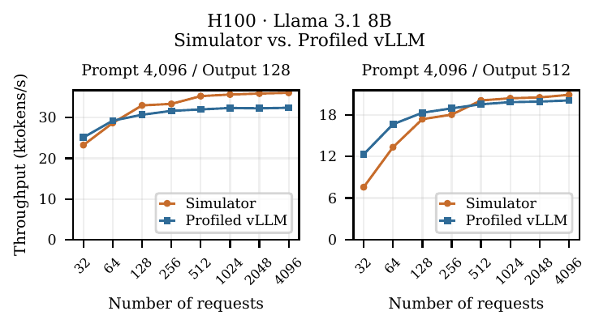

**Original caption:** Figure 1: Simulator versus profiled vLLM on H100: total input-plus-output token throughput. Simulated request lengths follow lognormal distributions with σ = 0.5; host KV offload is disabled.

**中文图注:** 图 1：模拟器与 H100 上 vLLM 测量结果的比较：统计输入加输出的总 token 吞吐量。模拟请求长度遵循 σ＝0.5 的对数正态分布；禁用向主机卸载 KV。

### 3.3 Simulation Trace / 3.3 仿真轨迹

**Source:** p.3–4 · S026

**Original:** The workload is derived from LMCache multi-turn agentic sessions [20], containing 24,880 turns in 767 sessions. Input lengths are computed using each model’s tokenizer, while output lengths and inter-turn gaps are taken from the dataset. We scale the workload by replicating conversations as independent sessions, yielding 771 sessions for the 25k-turn experiments and 3,080 sessions for the 100k-turn experiments. The final session is truncated to reach the target turn count.

**中文:** 工作负载来自 LMCache 多轮智能体会话 [20]，包含 767 个会话、24,880 轮。输入长度由各模型的 tokenizer 计算，输出长度及轮间间隔取自数据集。我们通过将会话复制为独立会话来扩大工作负载：25k 轮实验包含 771 个会话，100k 轮实验包含 3,080 个会话。最后一个会话会被截断，以达到目标轮数。

**Source:** p.4 · S027

**Original:** We also construct a 5× trace by concatenating five copies of each session. Each appended copy’s input lengths are offset by the preceding copy’s final input plus output length. This yields 500k turns across the same 3,080 sessions and increases mean input length from 22,558 to 89,125 tokens.

**中文:** 我们还将每个会话的五份副本拼接，构造 5× 轨迹。每个追加副本的输入长度，均加上前一副本最终输入长度与输出长度之和作为偏移。这样，在同样的 3,080 个会话中得到 500k 轮，平均输入长度从 22,558 tokens 增至 89,125 tokens。

**Source:** p.4 · S028

**Original:** Sparse-attention lookup. We estimate selected-token placement from offline GLM sparse-selection profiles. At a fixed reference context of 32,768 tokens, we measure the expected number $f(k)$ of selected tokens in the most recent k positions and use piecewise-linear interpolation between sampled window sizes. There are at most s = 2,048 selected tokens per query. For runtime context x and k HBM-resident KV tokens, let $s_x$ = min(x, s). The model uses

**中文:** 稀疏注意力查找。我们根据离线 GLM 稀疏选择画像估计所选 token 的放置。在固定的 32,768-token 参考上下文中，测量最近 k 个位置中被选中 token 数量的期望值 $f(k)$，并在采样的窗口大小之间作分段线性插值。每个 query 最多选择 s＝2,048 个 token。对于运行时上下文 x 和驻留 HBM 的 k 个 KV token，令 $s_x$＝min(x,s)。模型使用：

**Equation (4) / 公式（4）** · p.4 · E004

$$
\begin{aligned}h(x,k)&=\operatorname{clip}\left(f(k),\max(0,s_x-(x-k)),\min(k,s_x)\right),\\h_{\mathrm{HBF}}(x,k)&=s_x-h(x,k).\end{aligned}\tag{4}
$$

**公式说明 / Equation note：** h(x,k) 估计选中的 HBM token 数，剩余部分为 HBF token；clip 的上下界保证不会超过各层可提供的 token 数。

**Source:** p.4 · S029

**Original:** This preserves the available token counts in both tiers.

**中文:** 这保证了两层中可用 token 数量的一致性。

**Source:** p.4 · S030

**Original:** Expert lookup. We profiled GLM-5.2’s expert routing on two sessions from the LMCache trace. One serves as the training set that determines expert-copy allocation and HBM placement, while the other serves as the test set to estimate how many expert copies are accessed in each batch.

**中文:** 专家查找。我们对 LMCache 轨迹中两个会话的 GLM-5.2 专家路由进行了画像分析。其中一个作为训练集，用于确定专家副本分配与 HBM 放置；另一个作为测试集，用于估计每个批次访问了多少专家副本。

## 4 System Overview / 4 系统概览

### 4.1 H³ versus Sandisk’s Shared-Site Design / 4.1 H³ 与 Sandisk 共享位置设计的比较

**Source:** p.4 · S031

**Original:** We consider two architectures shown in Figure 2. The Sandisk shared-site design places HBM and HBF around the accelerator’s limited space that can attach HBM/HBF stacks. The illustrated configuration divides eight positions into four HBM and four HBF stacks. The H³ design instead connects HBF behind HBM, retaining eight HBM stacks while adding eight HBF stacks. We assume HBM buffering can stage data arriving from HBF to fully hide latency. In this case, the H³ architecture can provide larger capacity and better bandwidth than the shared-site design.

**中文:** 我们考虑图 2 中的两种架构。Sandisk 共享位置设计将 HBM 和 HBF 布置在加速器周围可连接 HBM/HBF 堆栈的有限空间内。图示配置把八个位置分配给四个 HBM 与四个 HBF 堆栈。H³ 则将 HBF 连接在 HBM 后方，在保留八个 HBM 堆栈的同时增加八个 HBF 堆栈。我们假设 HBM 缓冲能够暂存从 HBF 到达的数据，从而完全隐藏延迟。在这种情况下，H³ 架构能够提供比共享位置设计更大的容量与更好的带宽。

**Figure 2 / 图 2**

**Source:** p.4 · F002

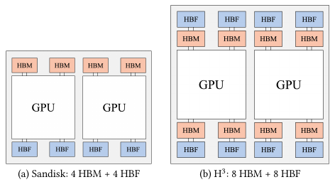

**Original caption:** Figure 2: Two memory architectures we considered in this study. The sites refer to the space where HBM/HBF stacks can connect to the accelerator. HBM and HBF compete for shared sites in the first architecture, whereas HBM and HBF are connected sequentially in the second architecture. We simulate both architectures.

**中文图注:** 图 2：本研究考虑的两种内存架构。位置是指 HBM/HBF 堆栈可连接到加速器的空间。第一种架构中，HBM 与 HBF 竞争共享位置；第二种架构中，HBM 与 HBF 依次连接。我们对两种架构都进行了仿真。

**Source:** p.4 · S032

**Original:** Let $D_H$ and $D_F$ be fixed amounts of data read from HBM and HBF, and let $B$ be their equal per-stack read bandwidth. Suppose the shared-site design allocates $m$ of its eight positions to HBM and the remaining $8-m$ to HBF, where $0<m<8$. With concurrent reads from the two tiers, its service time is

**中文:** 令 $D_H$ 和 $D_F$ 分别为从 HBM、HBF 读取的固定数据量，B 为两者相同的单堆栈读取带宽。假设共享位置设计将八个位置中的 m 个分配给 HBM，其余 8−m 个分配给 HBF，其中 0＜m＜8。当两层并发读取时，其服务时间为：

**Equation (5) / 公式（5）** · p.4 · E005

$$
T_{\mathrm{shared}}=\max\left(\frac{D_H}{mB},\frac{D_F}{(8-m)B}\right).\tag{5}
$$

**公式说明 / Equation note：** 共享位置设计假设两层读取并发，取各自服务时间的最大值。

**Source:** p.4 · S033

**Original:** Even if HBM and HBF reads are serialized in the H³ design, its read time is no greater than that of the shared-site design.

**中文:** 即使 H³ 设计中的 HBM 和 HBF 读取串行执行，其读取时间也不会大于共享位置设计。

**Equation (6) / 公式（6）** · p.4 · E006

$$
\begin{aligned}T_{8+8}&=\frac{D_H}{8B}+\frac{D_F}{8B}\\&=\frac{m}{8}\frac{D_H}{mB}+\frac{8-m}{8}\frac{D_F}{(8-m)B}\\&\le T_{\mathrm{shared}}.\end{aligned}\tag{6}
$$

**公式说明 / Equation note：** 在固定读数据量和相同单堆栈带宽的假设下，8＋8 设计的串行读取时间为共享位置两项服务时间的加权平均，不超过其最大值。

**Source:** p.4 · S034

**Original:** For GEMM and decode attention, we model HBM and HBF service sequentially for H³ and concurrently for the shared-site design. Data movement is pipelined across successive memory tiers, assuming overlap in transfer time. However, a chip that uses the H³ design will be more expensive than a chip that uses the shared-site design because it uses more HBM/HBF stacks. Therefore, we evaluate both architectures in our simulation studies.

**中文:** 对于 GEMM 和 decode 注意力，我们对 H³ 中的 HBM/HBF 服务按串行建模，对共享位置设计按并发建模。数据在连续存储层之间流水迁移，假设传输时间可以重叠。不过，由于使用了更多 HBM/HBF 堆栈，采用 H³ 设计的芯片将比采用共享位置设计的芯片更昂贵。因此，我们在仿真研究中同时评估这两种架构。

### 4.2 Hierarchical Storage System / 4.2 分层存储系统

**Source:** p.4 · S035

**Original:** Figure 3 shows the storage hierarchy. HBM contains frequently accessed weights and active data, while HBF expands the on-device working set. Host DRAM and SSD hold state that cannot remain on the accelerator. New KV state and reloaded prefixes are staged in HBM. As space becomes scarce, older KV state moves toward HBF and then the host.

**中文:** 图 3 展示了存储层次结构。HBM 存放频繁访问的权重和活跃数据，HBF 扩展设备端工作集。主机 DRAM 和 SSD 存放无法保留在加速器上的状态。新 KV 状态和回载前缀先暂存到 HBM。随着空间紧张，较旧的 KV 状态会向 HBF 迁移，继而向主机迁移。

**Figure 3 / 图 3**

**Source:** p.5 · F003

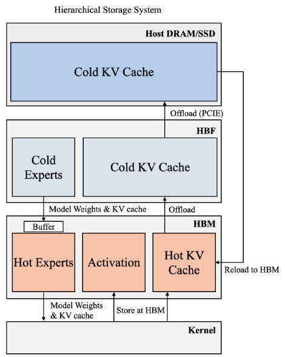

**Original caption:** Figure 3: Hierarchical placement of weights, activations, and KV state. Host reload returns to HBM, and colder device state can move through HBF to the host. The buffer drawn on the HBF read path is the latency hiding buffer of the H³ architecture.

**中文图注:** 图 3：权重、激活和 KV 状态的分层放置。从主机回载的数据返回 HBM，较冷的设备状态可经 HBF 迁移到主机。HBF 读路径中画出的缓冲区是 H³ 架构的延迟隐藏缓冲区。

**Source:** p.4 · S036

**Original:** Weights and activations. Weight placement is fixed for each evaluated configuration. Single-tier experiments place all weights in HBM or HBF; the split MoE configuration places frequently used experts in HBM and the remainder in HBF. Activations are written to HBM since repeatedly writing short-lived activations to flash would consume endurance rapidly.

**中文:** 权重与激活。对于每种被评估配置，权重放置均保持固定。单层放置实验将所有权重放入 HBM 或 HBF；分层 MoE 配置将常用专家放在 HBM，其余专家放在 HBF。激活写入 HBM，因为将短生命周期的激活反复写入闪存，会迅速消耗其耐久性。

**Source:** p.4 · S037

**Original:** Cache eviction and offload. We use request-level least-recently-used (LRU) ordering to select eligible cache entries when a memory tier runs out of space. HBM data is demoted to HBF or offloaded to host DRAM. DRAM data spills to SSD, and SSD data is discarded when necessary. Assuming LRU requests are less likely to be accessed than recently used requests, this retains hotter cache on HBM and moves colder cache to the cold memory tiers. Completed-session caches remain available for reuse until evicted. Reference locks exclude active requests from ordinary LRU eviction, although their state can move from HBM to HBF when device capacity permits. Future turns reload offloaded prefixes and recompute missing ones.

**中文:** 缓存驱逐与卸载。当某一存储层空间耗尽时，我们按照请求级最近最少使用（LRU）顺序，选择符合条件的缓存条目。HBM 数据会下沉到 HBF，或卸载到主机 DRAM。DRAM 数据会溢出到 SSD，SSD 数据在必要时被丢弃。假设 LRU 请求比最近使用的请求更不容易再次被访问，这样可以把更热的缓存保留在 HBM，并将更冷的缓存迁往冷存储层。已完成会话的缓存会一直保留供复用，直到被驱逐。引用锁使活跃请求不受普通 LRU 驱逐影响，不过当设备容量允许时，其状态仍可从 HBM 移到 HBF。后续轮次会回载已卸载的前缀，并重新计算缺失部分。

**Source:** p.4–5 · S038

**Original:** Index-first placement. Sparse attention accesses only a selected subset of KV tokens, but the indexer accesses all index data across the context. We therefore treat index data as hotter data and separate the residency of indices and attention KV for more fine-grained data movement. Under HBM pressure, eligible KV is demoted before indices. On reload, indices preferentially return to HBM, displacing eligible KV when necessary. Under HBF pressure, indices are offloaded to the host before attention KV, so that indices can be placed in HBM on reload. These priorities aim to place the frequently accessed indices on HBM while placing more sparse KV in HBF.

**中文:** 索引优先放置。稀疏注意力仅访问选定的 KV token 子集，但索引器会访问整个上下文的全部索引数据。因此，我们将索引视为更热的数据，并分别管理索引与注意力 KV 的驻留，以实现更细粒度的数据迁移。HBM 有压力时，先下沉符合条件的 KV，再下沉索引。回载时，索引优先返回 HBM，必要时挤出符合条件的 KV。HBF 有压力时，索引先于注意力 KV 卸载到主机，以便回载时将索引放进 HBM。这些优先级旨在把频繁访问的索引放在 HBM，而把访问更稀疏的 KV 放在 HBF。

### 4.3 Buffered Cache-aware Scheduling / 4.3 带准入余量的缓存感知调度

**Source:** p.5 · S039

**Original:** Cache-aware scheduling prioritizes waiting requests with more device-resident prefix tokens and uses queue order to resolve ties. This avoids unnecessary reload or prefill work when a reusable prefix is available. However, ordering alone does not control the amount of active state. If too many requests are admitted, their growing contexts can displace a completed session’s KV cache before the next turn reuses it.

**中文:** 缓存感知调度优先处理设备端驻留前缀 token 更多的等待请求，并以队列顺序打破平局。存在可复用前缀时，这样可以避免不必要的回载或 prefill 工作。然而，仅有排序无法控制活跃状态的数据量。如果接纳过多请求，其不断增长的上下文可能在下一轮复用前，就挤出某个已完成会话的 KV 缓存。

**Source:** p.5 · S040

**Original:** We add an admission fraction b ∈ [0, 1]. Let C be usable device KV/index capacity after resident weights, L the currently locked footprint, and $A_i$ the footprint newly locked by admitting request i. Admission requires

**中文:** 我们引入准入比例 b∈[0,1]。令 C 为扣除驻留权重后可用的设备 KV/索引容量，L 为当前已锁定的数据占用量，$A_i$ 为接纳请求 i 后新增锁定的数据占用量。准入必须满足：

**Equation (7) / 公式（7）** · p.5 · E007

$$
L+A_i\le bC.\tag{7}
$$

**公式说明 / Equation note：** 接纳一个请求后，活跃请求锁定的数据量不能超过准入比例乘以可用 KV/索引容量。

**Source:** p.5 · S041

**Original:** A 10% buffer uses b = 0.9, while no buffer uses b = 1. In the implementation, $A_i$ accounts for the incoming request’s full context footprint, including any cached prefix newly brought under an active lock. Completed-session cache is evictable and is excluded from L until re-admitted.

**中文:** 预留 10% 余量对应 b＝0.9，不预留余量对应 b＝1。在实现中，$A_i$ 计入新到达请求的完整上下文数据占用，包括任何新纳入活跃锁保护的已缓存前缀。已完成会话的缓存可以被驱逐，并且在再次获准进入之前不计入 L。

**Source:** p.5 · S042

**Original:** The threshold is checked at admission, not enforced as a fixed physical partition after every decode token. Active contexts can grow, and completed sessions can release locks while leaving cached data resident. The buffer preserves reusable KV state by limiting admission pressure, allowing subsequent requests to reuse cached prefixes. Although the buffer limits the active batch size, improved cache reuse can increase throughput. By retaining reusable KV state, buffered scheduling reduces repeated writes to HBF and extends its estimated write lifetime. As Table 4 shows, the buffer extends estimated HBF write lifetime to over a decade in both evaluated hybrid configurations. The admission fraction b also provides a way to adapt scheduling to device endurance and lifetime requirements. For devices with lower P/E endurance or deployments targeting a longer service life, a smaller b leaves more headroom for cache retention and can reduce HBF writes, at the cost of a smaller active batch.

**中文:** 这一阈值在准入时检查，并非在每生成一个 decode token 后都作为固定物理分区强制执行。活跃上下文可以继续增长，已完成会话也可以释放锁，同时让缓存数据保持驻留。该余量通过限制准入压力保留可复用 KV 状态，使后续请求可以复用缓存前缀。虽然余量限制了活跃批量大小，但更好的缓存复用仍可能提高吞吐量。通过保留可复用 KV 状态，带余量调度减少向 HBF 的重复写入，并延长其估算写入寿命。如表 4 所示，在评估的两种混合配置中，该余量均将估算 HBF 写入寿命延长至十年以上。准入比例 b 也提供了一种适应设备耐久性与目标寿命要求的方法。对于 P/E 耐久性更低的设备，或目标服务寿命更长的部署，更小的 b 能为缓存保留留下更多余量、减少 HBF 写入，代价是更小的活跃批量。

**Figure 4 / 图 4**

**Source:** p.5 · F004

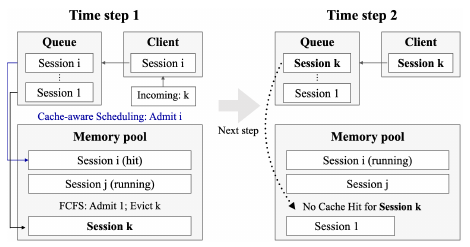

**Original caption:** Figure 4: Vanilla cache-aware scheduling can lose a future cache hit. At time step 1, the scheduler selects the cache hit from session i, then admits session 1 in queue order, evicting session k’s cached prefix. When session k returns at time step 2, its prefix is no longer resident.

**中文图注:** 图 4：普通缓存感知调度可能丢失未来的缓存命中。时间步 1，调度器选择会话 i 的缓存命中请求，然后按队列顺序接纳会话 1，挤出会话 k 的缓存前缀。当会话 k 在时间步 2 返回时，其前缀已不再驻留。

**Figure 5 / 图 5**

**Source:** p.5 · F005

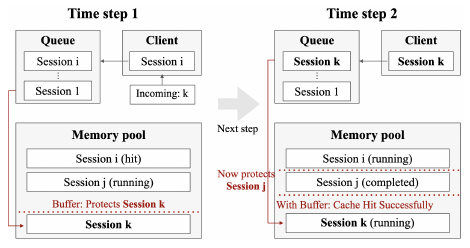

**Original caption:** Figure 5: Buffered cache-aware scheduling can preserve a future cache hit. Delaying session 1 leaves session k’s cached prefix resident for reuse at time step 2. Dotted lines illustrate admission headroom. Session k is retained at time step 1, and session j completes and remains cached at time step 2.

**中文图注:** 图 5：带准入余量的缓存感知调度可以保留未来的缓存命中。推迟会话 1，可使会话 k 的缓存前缀保持驻留，供时间步 2 复用。虚线表示准入余量。时间步 1 保留会话 k；时间步 2 会话 j 完成，并继续保持缓存。

**Source:** p.6 · S043

**Original:** Figures 4 and 5 contrast unbuffered and buffered cache-aware admission. Preserving headroom can prevent useful cache from being displaced shortly before reuse. This may reduce instantaneous concurrency, yet improve workload completion time by avoiding later reloads, demotions, and repeated prefill.

**中文:** 图 4 和图 5 比较无余量与有余量的缓存感知准入。保留余量可以防止有用缓存在即将复用前被挤出。这可能降低瞬时并发度，但通过避免后续回载、下沉和重复 prefill，能够改善工作负载完成时间。

## 5 Results / 5 实验结果

### 5.1 Experimental Setups / 5.1 实验设置

**Source:** p.6 · S044

**Original:** All experiments use the simulator’s B200 compute model and 16-bit weight/cache storage assumptions. Indexer latency uses an FP8 scoring proxy, as described in the kernel model. HBM-only devices contain eight 24-GB HBM stacks. Hybrid devices combine 24-GB HBM stacks with 375-GB HBF stacks. The H³-style configuration uses eight stacks of each type, while shared-site configurations divide eight stack sites between HBM and HBF. Stack allocations are specified for each experiment. Table 1 lists the device-memory parameters used in the study.

**中文:** 所有实验均使用模拟器的 B200 计算模型，权重和缓存存储假设为 16-bit。索引器延迟如内核模型所述，采用 FP8 打分代理。纯 HBM 设备包含八个 24 GB HBM 堆栈。混合设备组合 24 GB HBM 堆栈和 375 GB HBF 堆栈。H³ 式配置对两种类型各使用八个堆栈；共享位置配置则在八个堆栈位置之间分配 HBM 和 HBF。各实验分别注明堆栈分配。表 1 列出本研究采用的设备内存参数。

**Table 1 / 表 1**

**Source:** p.6 · T001

**Original caption:** Table 1: Per-stack memory assumptions. GB and TB use decimal units. HBF read energy is set to twice HBM’s following MemExplorer [34], however H³ reports up to four times the power consumption [9]. Given limited published HBF write specifications, we use typical SSD write parameters and assume SLC endurance of 100,000 P/E cycles. Since activation writes remain in HBM, HBF sees marginal write traffic compared with read traffic, modeled energy is therefore not very sensitive to the exact HBF write cost assumption.

**中文表注:** 表 1：单堆栈内存假设。GB 和 TB 使用十进制单位。遵循 MemExplorer [34]，HBF 读取能耗设为 HBM 的两倍；但 H³ 报告的功耗最高可达四倍 [9]。鉴于已公开的 HBF 写入规格有限，我们使用典型 SSD 写入参数，并假设 SLC 耐久性为 100,000 次 P/E 循环。由于激活写入保持在 HBM，相较于读取流量，HBF 写入流量很小，因此建模能耗对具体的 HBF 写入代价假设不太敏感。

| Parameter / 参数                  | HBM        | HBF          |
| --------------------------------- | ---------- | ------------ |
| Capacity / 容量（GB）             | 24 [23]    | 375 [9]      |
| Read bandwidth / 读带宽（GB/s）   | 1,000 [14] | 1,000 [9]    |
| Write bandwidth / 写带宽（GB/s）  | 1,000 [14] | 8            |
| Read startup / 读取启动（μs）     | 0.1 [22]   | 20 [9]       |
| Write startup / 写入启动（μs）    | 0.1 [22]   | 250          |
| Read energy / 读能耗（pJ/bit）    | 3.4 [24]   | 6.8 [34]     |
| Write energy / 写能耗（pJ/bit）   | 3.4 [24]   | 100          |
| Assumed P/E cycles / 假设擦写次数 | —          | 100,000 [30] |

**原表截图 / Original table:**

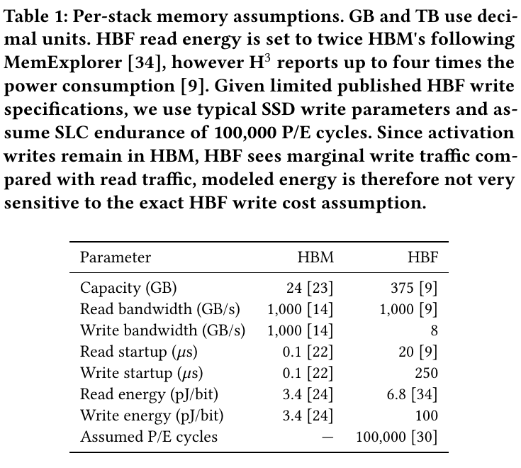

**Table 2 / 表 2**

**Source:** p.6 · T002

**Original caption:** Table 2: Arithmetic energy parameters at 4 nm, scaled from 7 nm by 0.546 [31, 32, 39].

**中文表注:** 表 2：4 nm 工艺下的算术运算能耗参数，由 7 nm 参数乘以 0.546 缩放得到 [31, 32, 39]。

| Operation type j / 运算类型            | Energy e_j / 能耗（pJ/op） |
| -------------------------------------- | -------------------------- |
| FP16 multiply–accumulate / FP16 乘累加 | 0.38                       |
| FP32 addition / FP32 加法              | 0.22                       |
| FP32 multiplication / FP32 乘法        | 0.71                       |
| FP32 exponentiation / FP32 指数运算    | 7.4                        |
| FP32 division / FP32 除法              | 5.6                        |
| FP32 square root / FP32 平方根         | 11.1                       |

**原表截图 / Original table:**

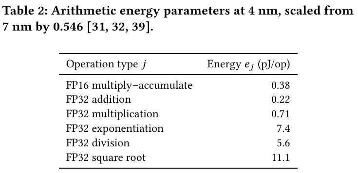

**Source:** p.6 · S045

**Original:** The host model provides 16 independent DDR5-7200 channels at 57.6 GB/s and 64 GB each, plus 32 SSDs at 8 GB/s and 1 TB each. GPU–host transfers use PCIe Gen5 x16 with approximately 63 GB/s per direction after line coding; GPU collectives use a 900-GB/s modeled NVLink endpoint bandwidth. Shared host bandwidth is aggregated rather than multiplied by the number of simultaneous GPU transfers.

**中文:** 主机模型提供 16 个独立 DDR5-7200 通道，每个通道带宽为 57.6 GB/s、容量为 64 GB，另有 32 块 SSD，每块带宽为 8 GB/s、容量为 1 TB。GPU—主机传输使用 PCIe Gen5 x16，扣除线路编码后每方向约 63 GB/s；GPU 集合通信采用 900 GB/s 的 NVLink 端点带宽模型。共享主机带宽按聚合资源计入，而不是按并发 GPU 传输数量成倍增加。

**Table 3 / 表 3**

**Source:** p.6 · T003

**Original caption:** Table 3: Workload and parallelism configuration. TP/EP denotes tensor/expert parallelism with the stated group size; DPA denotes data-parallel attention. 2×TP8/EP8 uses two eight-GPU replicas. The 1× and 5× traces contain 100k and 500k turns. Qwen uses a separate 25k-turn workload.

**中文表注:** 表 3：工作负载与并行配置。TP/EP 表示张量/专家并行及对应的分组规模；DPA 表示数据并行注意力。2×TP8/EP8 使用两个八 GPU 副本。1× 与 5× 轨迹分别包含 100k 和 500k 轮。Qwen 使用单独的 25k 轮工作负载。

| Model / 模型   | GPUs / GPU 数 | Turns / 轮数 | Parallelism / 并行方式 |
| -------------- | ------------- | ------------ | ---------------------- |
| Qwen3-32B      | 1             | 25k          | TP1                    |
| Llama-3.1-405B | 8             | 100k         | TP8                    |
| GLM-5.2        | 16            | 100k         | TP16/EP16 + DPA        |
| GLM-5.2        | 16            | 100k         | 2×TP8/EP8 + DPA        |
| GLM-5.2        | 16            | 500k         | TP16/EP16 + DPA        |
| GLM-5.2        | 16            | 500k         | 2×TP8/EP8 + DPA        |

**原表截图 / Original table:**

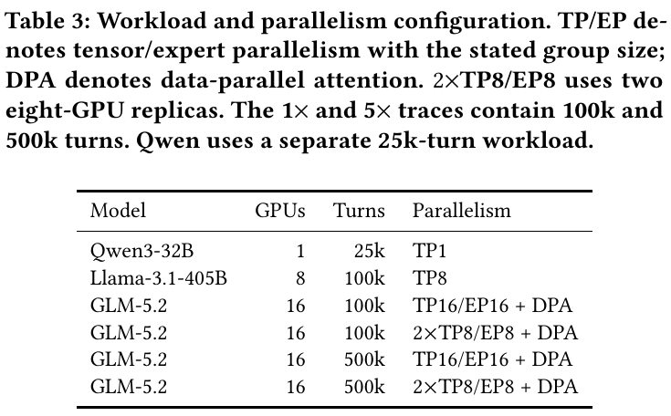

**Source:** p.6 · S046

**Original:** The 1× trace contains 100k turns with the original conversation lengths. Table 3 summarizes model sizes, workload lengths, and parallelism. The Qwen [36] study varies scheduling with weights in HBM. The large-model studies use cache-aware scheduling with a 10% buffer, mixed batches, session-sticky routing, and KV offload. For Llama, we shard KV heads across TP ranks without DPA. For GLM, we use DPA to avoid replicating the MLA latent KV cache across TP ranks, with either one TP16/EP16 replica or two TP8/EP8 replicas. All GLM configurations use index-first placement and the sparse-attention lookup described in the simulation methodology. All runs use a chunked-prefill budget of 2,048 tokens per scheduling engine per step, shared across prefill requests. For GLM DPA, each attention rank has its own scheduling engine. Each 1× or 5× workload is shared across replicas, not repeated independently on each replica. Based on offline replay experiments with profiled routing distributions, we use 32 redundant expert copies and assume ideal EP token-load balance under LPLB.

**中文:** 1× 轨迹包含采用原始会话长度的 100k 轮。表 3 汇总了模型规模、工作负载长度和并行方式。Qwen [36] 研究将权重放在 HBM，并改变调度策略。大模型研究使用预留 10% 余量的缓存感知调度、混合批次、会话粘性路由和 KV 卸载。对于 Llama，我们在 TP rank 之间切分 KV 头，不采用 DPA。对于 GLM，我们使用 DPA 避免在 TP rank 间复制 MLA 潜在 KV 缓存，使用一个 TP16/EP16 副本或两个 TP8/EP8 副本。全部 GLM 配置均采用索引优先放置和仿真方法中描述的稀疏注意力查找。所有运行对每个调度引擎每一步设置 2,048-token 的分块 prefill 预算，由 prefill 请求共享。对于 GLM DPA，每个注意力 rank 都有自己的调度引擎。每份 1× 或 5× 工作负载由多个副本共同处理，而不是在每个副本上独立重复。根据使用画像路由分布进行的离线回放实验，我们采用 32 个冗余专家副本，并假设 LPLB 能实现理想 EP token 负载均衡。

**Source:** p.6 · S047

**Original:** Device and host token hit rates use total input tokens as a common denominator. Device includes HBM and HBF while host includes DRAM and SSD. These fractions are measured when requests are admitted for prefill. The remaining input tokens require computation because they are new or uncached.

**中文:** 设备与主机 token 命中率以全部输入 token 数作为共同分母。设备包含 HBM 和 HBF，主机包含 DRAM 和 SSD。这些比例在请求获准进入 prefill 时测量。其余输入 token 因为是新增或未缓存的内容，需要执行计算。

**Source:** p.6 · S048

**Original:** All sessions submit their first request at simulation time zero. Subsequent turns arrive after the preceding turn completes and the recorded inter-turn gap elapses. We measure the time and energy required to complete this fixed workload, without imposing an external request arrival rate.

**中文:** 所有会话都在仿真零时刻提交首个请求。后续轮次在上一轮完成且记录的轮间间隔过去后到达。我们测量完成这一固定工作负载所需的时间与能耗，不施加外部请求到达速率。

**Source:** p.6 · S049

**Original:** In the result tables, X + Y denotes HBM+HBF stack counts per GPU. TPOT is the mean per-request time per output token after the first. Lower completion time, energy, and TPOT are better. Bold entries in the Llama and GLM configuration tables mark the minimum in each metric column. All configurations in those two tables use a 10% scheduling buffer.

**中文:** 结果表中的 X＋Y 表示每 GPU 的 HBM＋HBF 堆栈数。TPOT 是各请求首个输出 token 之后每输出 token 时间的平均值。完成时间、能耗和 TPOT 均越低越好。Llama 与 GLM 配置表中的粗体表示每一指标列的最小值。这两张表中的所有配置均采用 10% 调度余量。

### 5.2 Scheduling and Write Endurance / 5.2 调度与写入耐久性

**Source:** p.6 · S050

**Original:** Table 4 compares FCFS, cache-aware scheduling, and buffered cache-aware scheduling on Qwen. Reserving admission headroom preserves reusable KV state. On HBM alone, the buffer raises device hits from 6.61% to 56.79% and more than halves HBM KV writes relative to unbuffered cache-aware scheduling. The hybrid configurations retain most reusable prefixes on the device with the buffer enabled.

**中文:** 表 4 在 Qwen 上比较 FCFS、缓存感知调度和带准入余量的缓存感知调度。预留准入余量能够保留可复用 KV 状态。在纯 HBM 上，相较于无余量的缓存感知调度，该余量将设备命中率从 6.61% 提高至 56.79%，并使 HBM KV 写入量减少一半以上。启用余量后，混合配置把大多数可复用前缀保留在设备上。

**Table 4 / 表 4**

**Source:** p.7 · T004

**Original caption:** Table 4: Qwen3-32B scheduling on one GPU, 25k turns, and HBM-resident weights. Shared-site 4 HBM + 4 HBF divides eight stack sites. H³ adds eight HBF stacks alongside eight HBM stacks. FCFS means first-come, first-served. Cache aware, 10% reserves 10% admission headroom (bold hybrid rows). Clock is workload completion time. Device and host hit rates are the fractions of admitted input tokens served from device memory (HBM or HBF) and host storage (DRAM or SSD), respectively. Life estimates HBF write endurance via Equation 8. A dash indicates that HBF lifetime is not applicable to HBM-only configurations, as HBM is not subject to flash program/erase-cycle limits.

**中文表注:** 表 4：单 GPU、25k 轮、权重驻留 HBM 的 Qwen3-32B 调度实验。共享位置 4 HBM＋4 HBF 将八个堆栈位置分开分配。H³ 在八个 HBM 堆栈之外再增加八个 HBF 堆栈。FCFS 为先来先服务。“Cache aware, 10%”预留 10% 准入余量（混合配置的对应行加粗）。Clock 表示工作负载完成时间。设备与主机命中率分别为已接纳输入 token 中由设备内存（HBM/HBF）与主机存储（DRAM/SSD）提供的比例。Life 依据公式（8）估算 HBF 写入耐久寿命。破折号表示 HBF 寿命不适用于纯 HBM 配置，因为 HBM 不受闪存编程/擦除次数限制。

| Memory / 内存     | Scheduling / 调度                         | Clock / 时间（s） | Energy / 能耗（MJ） | HBM KV writes / 写入（TB） | HBF KV writes / 写入（TB） | Device hit / 设备命中（%） | Host hit / 主机命中（%） | Life / 寿命（年） |
| ----------------- | ----------------------------------------- | ----------------- | ------------------- | -------------------------- | -------------------------- | -------------------------- | ------------------------ | ----------------- |
| 8 HBM             | FCFS / 先来先服务                         | 19,033.77         | 2.323               | 158.54                     | 0.00                       | 0.16                       | 96.36                    | —                 |
| 8 HBM             | Cache aware / 缓存感知                    | 18,479.17         | 2.274               | 148.41                     | 0.00                       | 6.61                       | 89.92                    | —                 |
| 8 HBM             | Cache aware, 10% / 缓存感知＋10% 余量     | 16,313.41         | 2.245               | 69.35                      | 0.00                       | 56.79                      | 39.73                    | —                 |
| 4 HBM + 4 HBF     | FCFS / 先来先服务                         | 23,228.20         | 2.983               | 8.23                       | 147.15                     | 7.30                       | 89.23                    | 0.75              |
| 4 HBM + 4 HBF     | Cache aware / 缓存感知                    | 20,821.73         | 2.849               | 7.91                       | 93.00                      | 41.72                      | 54.80                    | 1.06              |
| **4 HBM + 4 HBF** | **Cache aware, 10% / 缓存感知＋10% 余量** | **16,614.28**     | **2.703**           | **6.89**                   | **7.48**                   | **96.06**                  | **0.47**                 | **10.57**         |
| 8 HBM + 8 HBF     | FCFS / 先来先服务                         | 13,552.76         | 2.758               | 9.16                       | 106.79                     | 32.84                      | 63.69                    | 1.21              |
| 8 HBM + 8 HBF     | Cache aware / 缓存感知                    | 10,930.78         | 2.659               | 7.32                       | 21.81                      | 86.87                      | 9.66                     | 4.77              |
| **8 HBM + 8 HBF** | **Cache aware, 10% / 缓存感知＋10% 余量** | **10,419.17**     | **2.640**           | **6.88**                   | **6.69**                   | **96.46**                  | **0.06**                 | **14.82**         |

**原表截图 / Original table:**

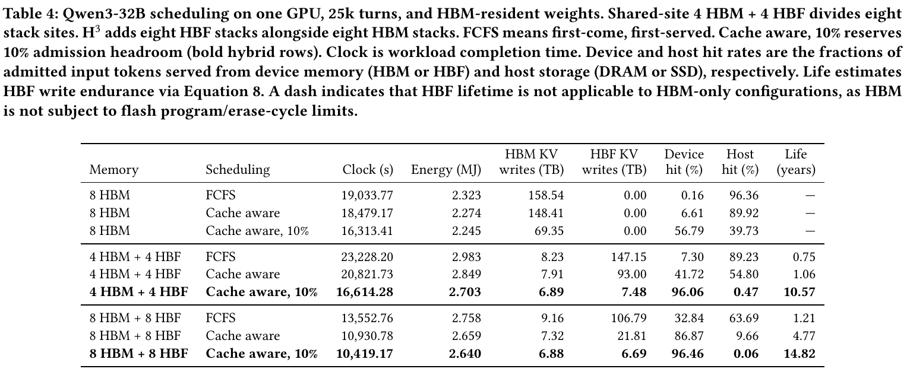

**Source:** p.7 · S051

**Original:** On H³, adding the buffer reduces HBF KV writes by 69.33%, while completion time falls by 4.68%. On shared-site 4+4, writes fall by 91.96% and completion time by 20.21%. Thus, the buffer’s main benefit is reduced cache churn and write traffic. Shared-site 4+4 still finishes 1.84% later than buffered HBM-only serving, showing that greater cache retention does not always yield faster execution.

**中文:** 在 H³ 上，增加余量使 HBF KV 写入减少 69.33%，完成时间减少 4.68%。在共享位置 4＋4 上，写入减少 91.96%，完成时间减少 20.21%。因此，余量的主要收益是减少缓存反复迁移与写流量。共享位置 4＋4 的完成时间仍比带余量的纯 HBM 服务长 1.84%，这说明保留更多缓存并不总能带来更快执行。

**Source:** p.7 · S052

**Original:** For HBF capacity $C_F$, endurance P, modeled write volume $W_F$, and workload duration T, we estimate

**中文:** 对于 HBF 容量 $C_F$、耐久次数 P、建模写入量 $W_F$ 和工作负载持续时间 T，我们估算：

**Equation (8) / 公式（8）** · p.7 · E008

$$
L_{\mathrm{write}}=\frac{PC_F}{W_F/T}.\tag{8}
$$

**公式说明 / Equation note：** 可承受的总写入量 P×C_F 除以平均写入速率 W_F/T，得到写入寿命；寿命与 T 采用一致的时间单位。

**Source:** p.7 · S053

**Original:** Assuming uniform wear, unit write amplification, and 100k P/E cycles, the reduced write rate raises estimated lifetime from 1.21 to 14.82 years for H³ and from 0.75 to 10.57 years for shared-site 4+4 relative to FCFS. These are extrapolations of the modeled average write rate. If commercial HBF endurance is lower, increasing admission headroom may reduce evictions and writes at the cost of a smaller active batch. Ultimately, the appropriate buffer depends on workload and device endurance.

**中文:** 假设均匀磨损、写放大为 1、P/E 次数为 100k，相较于 FCFS，更低的写入速率使 H³ 的估算寿命从 1.21 年增至 14.82 年，共享位置 4＋4 的估算寿命从 0.75 年增至 10.57 年。这些结果是基于建模平均写入速率的外推。如果商用 HBF 的耐久性更低，增加准入余量可以减少驱逐和写入，代价是更小的活跃批量。最终，合适的余量取决于工作负载与设备耐久性。

### 5.3 Memory Architecture and Weight Placement / 5.3 内存架构与权重放置

**Source:** p.7 · S054

**Original:** Architecture. Tables 5 and 6 compare the dense Llama and sparse-MoE GLM workloads. On the 1× trace, H³ with weights in HBM reduces completion time by 45.95% for Llama and 59.99% for GLM relative to HBM-only serving. Appropriately configured shared-site designs also provide substantial benefits with eight total stack sites. For example, GLM 6+2 reduces completion time by 56.13% and energy by 15.58%. H³ TP16 with HBM weights nevertheless completes sooner, uses less energy, and has lower mean TPOT than this shared-site point.

**中文:** 架构。表 5 和表 6 比较稠密 Llama 与稀疏 MoE GLM 工作负载。在 1× 轨迹上，权重放在 HBM 的 H³ 相较于纯 HBM 服务，分别将 Llama 和 GLM 的完成时间减少 45.95% 和 59.99%。在总共八个堆栈位置的约束下，配置合适的共享位置设计也能带来显著收益。例如 GLM 6＋2 将完成时间减少 56.13%，能耗减少 15.58%。不过，权重放在 HBM 的 H³ TP16 比该共享位置配置完成得更快、能耗更少，平均 TPOT 也更低。

**Source:** p.7 · S055

**Original:** Figure 6 visualizes completion time and modeled energy for six representative configurations from Table 6. The table retains the complete comparison, including all shared-site allocations and TPOT.

**中文:** 图 6 将表 6 中六种代表性配置的完成时间与建模能耗可视化。表格保留完整比较，包括全部共享位置分配方式和 TPOT。

**Table 5 / 表 5**

**Source:** p.7 · T005

**Original caption:** Table 5: Llama-3.1-405B weight placement on 8 GPUs with eight-way tensor parallelism (TP8), the 1× trace (100k turns), and a 10% scheduling buffer. X + Y denotes X HBM and Y HBF stacks per GPU. 8+0 is HBM-only and H³ adds HBF stacks alongside HBM. Time is workload completion time. TPOT is mean per-request time per output token after the first. Arrows indicate lower is better. Bold marks each column minimum.

**中文表注:** 表 5：在八 GPU、八路张量并行（TP8）、1× 轨迹（100k 轮）和 10% 调度余量下，Llama-3.1-405B 的权重放置。X＋Y 表示每 GPU 有 X 个 HBM 和 Y 个 HBF 堆栈。8＋0 为纯 HBM；H³ 在 HBM 之外增加 HBF 堆栈。Time 为工作负载完成时间。TPOT 为各请求首 token 之后每输出 token 时间的平均值。箭头表示越低越好。粗体表示各列最小值。

| Configuration / 配置           | Time / 时间（s）↓ | Energy / 能耗（MJ）↓ | TPOT（ms）↓ |
| ------------------------------ | ----------------- | -------------------- | ----------- |
| 8+0, HBM weights / HBM 权重    | 39,666            | 53.60                | **90.85**   |
| H³ 8+8, HBM weights / HBM 权重 | 21,439            | **40.70**            | 438.61      |
| H³ 8+8, HBF weights / HBF 权重 | **21,423**        | 42.06                | 438.27      |

**原表截图 / Original table:**

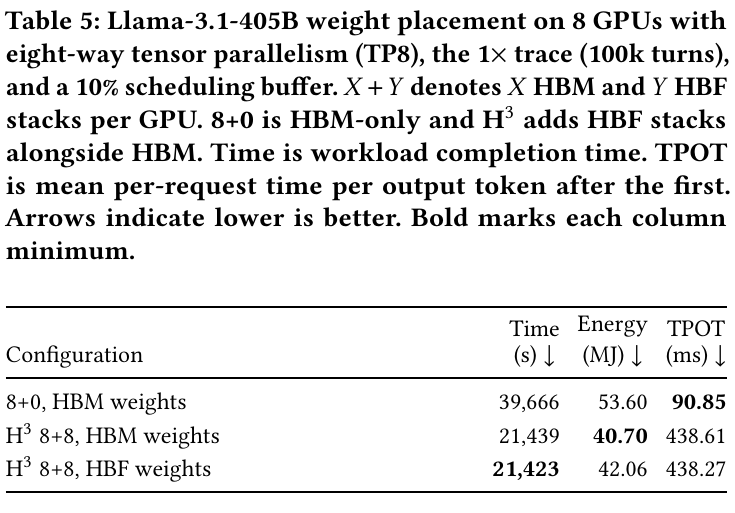

**Source:** p.7 · S056

**Original:** Weight placement and parallelism. For Llama, moving weights to HBF changes completion time little but increases energy by 3.33%. For GLM TP16, it similarly offers little completion-time benefit while increasing energy by 32.78% relative to H³ with HBM weights, taking it above the HBM-only baseline. Sparse attention reduces KV-read traffic, making weight placement more consequential for GLM’s energy budget.

**中文:** 权重放置与并行方式。对于 Llama，将权重移到 HBF 几乎不改变完成时间，但能耗增加 3.33%。对于 GLM TP16，完成时间同样几乎没有收益，而能耗相较于 HBM 权重的 H³ 增加 32.78%，超过纯 HBM 基线。稀疏注意力减少了 KV 读取流量，使权重放置对 GLM 能耗预算的影响更大。

**Source:** p.7 · S057

**Original:** The H³ split-TP8 configuration retains 160 logical experts plus 32 redundant copies in HBM per replica, with 96 experts in HBF and other weights in HBM. This leaves approximately 23.90 GB HBM per GPU for KV/index state. On the 1× trace, split placement reduces energy by 24.50% relative to all-HBF TP8 weights, at a 5.44% completion-time cost. Relative to TP16 with HBM weights, split TP8 is 2.42% faster but consumes 8.35% more energy. On the 5× trace, TP8 with all weights in HBF finishes fastest, 4.97% sooner than split TP8 but using 27.31% more energy, while TP16 with HBM weights uses the least energy.

**中文:** H³ 分层 TP8 配置在每个副本的 HBM 中保留 160 个逻辑专家和 32 个冗余副本，将 96 个专家放在 HBF，其余权重放在 HBM。这样，每个 GPU 约有 23.90 GB HBM 可用于 KV/索引状态。在 1× 轨迹上，相较于权重全部位于 HBF 的 TP8，分层放置将能耗减少 24.50%，代价是完成时间增加 5.44%。相较于 HBM 权重的 TP16，分层 TP8 快 2.42%，但能耗多 8.35%。在 5× 轨迹上，权重全部位于 HBF 的 TP8 完成最快，比分层 TP8 早 4.97%，但能耗多 27.31%；HBM 权重的 TP16 则能耗最低。

**Table 6 / 表 6**

**Source:** p.8 · T006

**Original caption:** Table 6: GLM-5.2 architecture, placement, and parallelism on 16 GPUs with a 10% scheduling buffer. X + Y denotes X HBM and Y HBF stacks per GPU. H³ adds HBF alongside HBM, while shared-site designs divide eight stack sites between them. TP16 uses one 16-GPU replica with TP16/EP16, while 2×TP8 uses two 8-GPU replicas with TP8/EP8. Both use data-parallel attention. HBM/HBF denotes all weights in that tier. Split places selected experts in HBM, remaining experts in HBF, and other weights in HBM, using offline expert lookup and ideal expert balance. The 1×/5× traces contain 100k/500k turns with original/extended contexts. Time is workload completion time, and TPOT is mean per-request time per output token after the first. On the 5× trace, among the tested shared-site allocations, 4+4 minimizes completion time and 6+2 minimizes energy. Bold marks each column minimum across all configurations. Figure 6 visualizes the completion-time and energy tradeoffs for six of these configurations.

**中文表注:** 表 6：16 GPU 和 10% 调度余量下，GLM-5.2 的架构、放置与并行方式。X＋Y 表示每 GPU 的 X 个 HBM 与 Y 个 HBF 堆栈。H³ 在 HBM 之外增加 HBF，共享位置设计则把八个位置分配给二者。TP16 使用一个 TP16/EP16 的 16 GPU 副本，2×TP8 使用两个 TP8/EP8 的八 GPU 副本，两者均使用 DPA。HBM/HBF 表示全部权重位于该层。Split 将选定专家放在 HBM，其余专家放在 HBF，其他权重放在 HBM，采用离线专家查找并假设理想专家均衡。1×/5× 分别含 100k/500k 轮，对应原始/延长上下文。Time 为工作负载完成时间，TPOT 为各请求首 token 之后每输出 token 时间的平均值。在 5× 轨迹的已测共享位置配置中，4＋4 完成时间最短，6＋2 能耗最低。粗体表示全部配置中各指标列的最小值。图 6 展示其中六种配置的时间与能耗取舍。

| Architecture / 架构    | Stacks / 堆栈 | Parallelism / 并行 | Weights / 权重 | 1× Time（s） | 1× Energy（MJ） | 1× TPOT（ms） | 5× Time（s） | 5× Energy（MJ） | 5× TPOT（ms） |
| ---------------------- | ------------- | ------------------ | -------------- | ------------ | --------------- | ------------- | ------------ | --------------- | ------------- |
| HBM-only / 纯 HBM      | 8+0           | TP16               | HBM            | 11,354       | 9.11            | **218.72**    | 198,411      | 91.99           | **191.93**    |
| H³                     | 8+8           | TP16               | HBM            | 4,543        | **7.19**        | 279.15        | 28,279       | **37.62**       | 355.63        |
| H³                     | 8+8           | TP16               | HBF            | 4,538        | 9.54            | 278.01        | 27,036       | 48.17           | 333.66        |
| H³                     | 8+8           | 2×TP8              | HBF            | **4,204**    | 10.31           | 230.67        | **24,385**   | 52.06           | 280.43        |
| H³                     | 8+8           | 2×TP8              | Split / 分层   | 4,433        | 7.79            | 252.61        | 25,661       | 40.89           | 307.66        |
| Shared-site / 共享位置 | 2+6           | TP16               | Split / 分层   | 6,073        | 8.51            | 342.12        | 35,809       | 44.81           | 406.36        |
| Shared-site / 共享位置 | 4+4           | TP16               | Split / 分层   | 5,264        | 7.99            | 322.72        | 33,459       | 41.97           | 423.71        |
| Shared-site / 共享位置 | 6+2           | TP16               | Split / 分层   | 4,981        | 7.69            | 302.87        | 39,019       | 40.28           | 410.47        |

**原表截图 / Original table:**

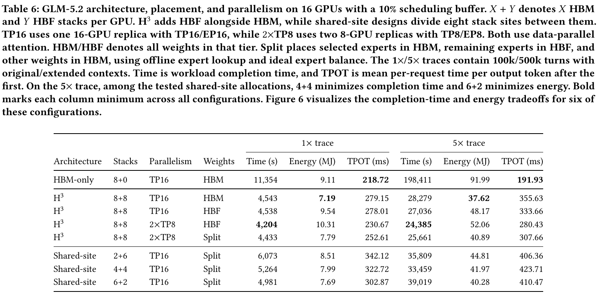

**Figure 6 / 图 6**

**Source:** p.8 · F006

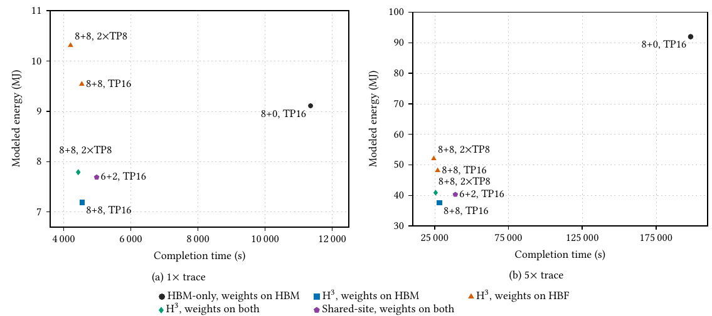

**Original caption:** Figure 6: Completion-time and modeled-energy tradeoffs for six GLM-5.2 configurations on (a) the 1× and (b) the 5× traces (100k/500k turns). X + Y denotes HBM+HBF stacks per GPU; TP16 is one 16-GPU replica and 2×TP8 denotes two 8-GPU replicas. Lower is better on both axes. Table 6 gives placement details.

**中文图注:** 图 6：六种 GLM-5.2 配置在（a）1× 和（b）5× 轨迹（100k/500k 轮）下的完成时间与建模能耗取舍。X＋Y 为每 GPU 的 HBM＋HBF 堆栈数；TP16 为一个 16 GPU 副本，2×TP8 为两个八 GPU 副本。两轴均越低越好。放置细节见表 6。

**Source:** p.7–8 · S058

**Original:** Workload and shared-site allocation. The shared-site 2+6, 4+4, and 6+2 configurations retain 15+1, 100+32, and 144+32 logical experts plus redundant copies in HBM, respectively. Experts are prioritized for HBM placement by their access frequency in the training profile, with the remaining experts and redundant copies placed in HBF.

**中文:** 工作负载与共享位置分配。共享位置 2＋6、4＋4 和 6＋2 配置，分别在 HBM 中保留 15＋1、100＋32 和 144＋32 个逻辑专家及冗余副本。依据训练画像中的访问频率，优先将专家放在 HBM，其余专家和冗余副本放在 HBF。

**Source:** p.8 · S059

**Original:** On the 1× trace, 6+2 provides the lowest completion time, energy, and mean TPOT among the tested shared-site allocations. On the 5× trace, 4+4 completes 14.25% sooner than 6+2, while 6+2 consumes 4.01% less energy than 4+4. Longer contexts increase KV-space requirements, but expert placement also determines how much HBM remains available to KV. With 144+32 HBM experts, 6+2 achieves 98.11% device hits on the extended trace. The preferred allocation therefore depends on workload and whether completion time or energy is the objective. H³ retains the strongest completion-time results in these comparisons.

**中文:** 在 1× 轨迹上，6＋2 在被测共享位置分配方案中具有最低的完成时间、能耗和平均 TPOT。在 5× 轨迹上，4＋4 比 6＋2 早完成 14.25%，而 6＋2 比 4＋4 少消耗 4.01% 的能量。更长的上下文提高了 KV 空间需求，但专家放置同样决定 HBM 中还剩多少空间可用于 KV。6＋2 在 HBM 中放置 144＋32 个专家，在延长轨迹上达到 98.11% 的设备命中率。因此，最佳分配取决于工作负载，以及目标是完成时间还是能耗。在这些比较中，H³ 仍保持最好的完成时间表现。

**Source:** p.9 · S060

**Original:** Larger batches also introduce a latency tradeoff: mean TPOT rises from 90.85 to 438.61 ms for Llama and from 218.72 to 279.15 ms for GLM H³ with HBM weights on the 1× trace. On the 5× trace, every evaluated hybrid configuration has higher mean TPOT than HBM-only serving.

**中文:** 更大的批量也带来延迟取舍：在 1× 轨迹上，采用 H³、HBM 权重时，Llama 平均 TPOT 从 90.85 ms 增至 438.61 ms，GLM 从 218.72 ms 增至 279.15 ms。在 5× 轨迹上，全部被评估混合配置的平均 TPOT 都高于纯 HBM 服务。

### 5.4 Sources of Energy Savings / 5.4 能耗节省的来源

**Source:** p.9 · S061

**Original:** Table 7 separates energy savings from weight reuse, KV/index reads, and avoided prefill computation. On the 1× trace, H³ with HBM weights saves 24.06% of baseline energy for Llama and 21.09% for GLM. Dense serving achieves greater percentage savings here despite its larger HBF KV-read cost. Prefix reuse avoids 53.33 million query-token computations, contributing 20.25 percentage points of baseline energy savings. The compared GLM runs perform the same prefill work without recomputation.

**中文:** 表 7 将权重复用、KV/索引读取和避免 prefill 计算带来的能耗节省分开列出。在 1× 轨迹上，权重驻留 HBM 的 H³ 使 Llama 和 GLM 分别节省基线能耗的 24.06% 和 21.09%。尽管稠密模型服务的 HBF KV 读取代价更高，但这里它的能耗节省比例更大。前缀复用避免了 5,333 万个 query-token 的计算，贡献了基线能耗 20.25 个百分点的节省。对比的 GLM 运行执行相同的 prefill 工作，没有重复计算。

**Table 7 / 表 7**

**Source:** p.9 · T007

**Original caption:** Table 7: Energy-savings contributions relative to same-model, same-workload HBM-only energy. Llama denotes Llama-3.1-405B and GLM denotes GLM-5.2. X + Y gives HBM+HBF stack counts per GPU; 1×/5× denotes the original/extended trace with 100k/500k turns. The 8+8 columns use H³ with HBM weights. The 6+2 and 4+4 configurations use shared-site expert placement. Entries are percentage points: positive values save energy and negative values add cost. Avoided prefill counts computation only, other savings are the residual, and bold totals may differ due to rounding.

**中文表注:** 表 7：相对于同模型、同工作负载纯 HBM 能耗的节能贡献。Llama 为 Llama-3.1-405B，GLM 为 GLM-5.2。X＋Y 为每 GPU 的 HBM＋HBF 堆栈数；1×/5× 对应 100k/500k 轮原始/延长轨迹。8＋8 列采用 H³ 且权重位于 HBM；6＋2 和 4＋4 采用共享位置专家放置。条目以百分点计：正值表示节能，负值表示新增代价。“避免 prefill”仅计计算，其他节省为剩余项；加粗的总计可能因四舍五入而略有差异。

| Contribution / 贡献                         | Llama 8+8 1× | GLM 6+2 1× | GLM 8+8 1× | GLM 4+4 5× | GLM 8+8 5× |
| ------------------------------------------- | ------------ | ---------- | ---------- | ---------- | ---------- |
| Reduced weight reads / 权重读取减少         | +15.22       | +14.06     | +19.50     | +51.28     | +55.14     |
| Increased KV/index reads / KV/索引读取增加  | −13.16       | −0.69      | −0.63      | −1.39      | −0.61      |
| Avoided repeated prefill / 避免重复 prefill | +20.25       | 0.00       | 0.00       | 0.00       | 0.00       |
| Other net savings / 其他净节省              | +1.74        | +2.21      | +2.21      | +4.49      | +4.58      |
| **Net energy savings / 净能耗节省**         | **24.06%**   | **15.58%** | **21.09%** | **54.37%** | **59.10%** |

**原表截图 / Original table:**

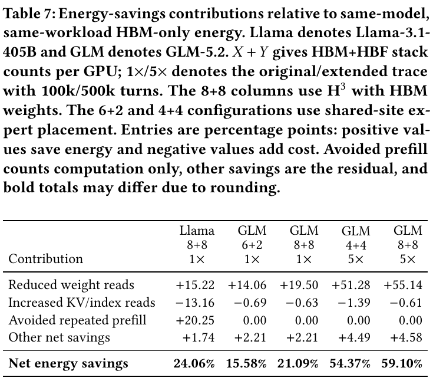

**Source:** p.9 · S062

**Original:** Batching amortizes weight loads and reduces kernel launches. Llama’s weight-read energy falls by 77.8%, compared with 30.7% for GLM shared-site 6+2 and 42.6% for GLM H³ 8+8. Weight reuse and reduced recomputation lower modeled energy, whereas kernel saturation reduces latency. Rank-local DPA batches and aggregate MoE batches differ in their opportunities for weight reuse.

**中文:** 批处理摊薄权重加载，并减少内核启动。Llama 的权重读取能耗下降 77.8%；GLM 共享位置 6＋2 与 GLM H³ 8＋8 分别下降 30.7% 和 42.6%。权重复用与减少重算降低建模能耗，而充分利用内核可降低延迟。各 rank 本地 DPA 批次与聚合 MoE 批次在权重复用机会方面存在差异。

**Source:** p.9 · S063

**Original:** For H³ GLM with HBM weights, repricing HBF reads from twice to four times HBM read energy at fixed traffic retains 19.72% energy savings, compared with 21.09%. Most read energy in this configuration comes from HBM-resident weights, limiting sensitivity to HBF read energy. Shared-site 6+2 additionally incurs HBF reads for expert weights.

**中文:** 对于权重放在 HBM 的 H³ GLM，在流量固定时，将 HBF 读取能耗从 HBM 的两倍改为四倍，仍可节省 19.72% 的能耗，原先为 21.09%。该配置的大部分读取能耗来自 HBM 驻留权重，因此对 HBF 读取能耗不太敏感。共享位置 6＋2 还会产生读取 HBF 专家权重的开销。

### 5.5 Scope and Limitations / 5.5 研究范围与局限性

**Source:** p.9 · S064

**Original:** We focus on high-throughput serving, where added memory capacity supports larger batches and greater KV cache reuse. Latency-constrained serving, where small batches limit the benefit of added capacity, is outside the scope of this study. We do not model a production HBF controller, complete package power, wear leveling, or every activation and staging write. Kernel latency models are calibrated on measurements from NVIDIA H100 and B200 GPUs. HBF performance and large batches are extrapolations beyond the profiled hardware. We only model autoregressive decoding without speculative decoding.

**中文:** 我们关注高吞吐服务，在该场景中，新增内存容量支持更大批量和更多 KV 缓存复用。受延迟约束的服务中，小批量会限制新增容量的收益，此类场景不在本研究范围内。我们没有建模生产级 HBF 控制器、完整封装功耗、磨损均衡，以及所有激活和暂存写入。内核延迟模型由 NVIDIA H100 和 B200 GPU 的测量数据校准。HBF 性能和大批量情况属于超出所测硬件范围的外推。我们仅建模自回归解码，不包含推测解码。

## 6 Conclusion / 6 结论

**Source:** p.9 · S065

**Original:** For high-throughput LLM serving, high-bandwidth flash can turn added capacity into faster, more energy-efficient execution, but only when data placement and scheduling account for its costs. Combining an HBM–HBF–host hierarchy with buffered cache-aware scheduling, HBF-augmented systems with weights in HBM reduce workload completion time by 46–60% and modeled energy by 21–24% relative to HBM-only serving on the 1× traces for Llama-3.1-405B and GLM-5.2. On the GLM-5.2 5× trace, the HBM-weight configuration achieves a 7.0× speedup and 59% energy savings. These gains come mainly from retaining reusable KV state on the device and amortizing weight reads over larger batches. Write endurance, often cited as the key obstacle to placing KV cache in flash, becomes manageable once admission is controlled. Reserving 10% headroom and prioritizing cache hits reduce HBF KV writes by 94% and extend estimated write lifetime from 1.2 to 14.8 years. HBF should therefore be co-designed with the scheduler rather than treated as passive overflow capacity.

**中文:** 对于高吞吐 LLM 服务，高带宽闪存能够把新增容量转化为更快、更节能的执行，但前提是数据放置和调度考虑其代价。结合 HBM—HBF—主机层次结构与带准入余量的缓存感知调度，在 Llama-3.1-405B 和 GLM-5.2 的 1× 轨迹中，权重放在 HBM 的 HBF 增强系统相较于纯 HBM 服务，将工作负载完成时间缩短 46%–60%，将建模能耗降低 21%–24%。在 GLM-5.2 的 5× 轨迹上，HBM 权重配置达到 7.0 倍加速和 59% 能耗节省。这些收益主要来自在设备上保留可复用 KV 状态，以及通过更大批量摊薄权重读取。写入耐久性常被视为将 KV 缓存放入闪存的关键障碍，而一旦控制准入，这一问题就变得可管理。预留 10% 余量并优先处理缓存命中，可将 HBF KV 写入减少 94%，并将估算写入寿命从 1.2 年延长至 14.8 年。因此，应将 HBF 与调度器协同设计，而不是将其当作被动的溢出容量。

## Acknowledgements / 致谢

**Source:** p.9 · S066

**Original:** We acknowledge gracious support from the Furiosa AI, Apple, NVIDIA, Macronix, Citadel, Meta, and Panasonic. Furthermore, we appreciate support from Google Cloud, the Google TRC team, and specifically Jonathan Caton, Divvy Thakkar, and Prof. David Patterson. Prof. Keutzer’s lab is also sponsored by funding through BDD, BAIR, and Humanoid robotics. We also acknowledge support by the Director, Office of Science, Office of Advanced Scientific Computing Research, of the U.S. Department of Energy under Contract No. DE-AC02-05CH11231. Amir Gholaminejad acknowledges DOE SciGPT grant and UCOP. Michael W. Mahoney acknowledges DARPA, NSF, the DOE Competitive Portfolios grant, and the DOE SciGPT grant. Our conclusions do not necessarily reflect the position or the policy of our sponsors, and no official endorsement should be inferred.

**中文:** 我们感谢 Furiosa AI、Apple、NVIDIA、Macronix、Citadel、Meta 和 Panasonic 的慷慨支持。我们也感谢 Google Cloud、Google TRC 团队，特别是 Jonathan Caton、Divvy Thakkar 和 David Patterson 教授的支持。Keutzer 教授的实验室还得到 BDD、BAIR 和 Humanoid robotics 的经费支持。我们也感谢美国能源部科学办公室先进科学计算研究办公室主任提供的支持，合同编号为 DE-AC02-05CH11231。Amir Gholaminejad 感谢 DOE SciGPT 项目资助与 UCOP。Michael W. Mahoney 感谢 DARPA、NSF、DOE Competitive Portfolios 项目和 DOE SciGPT 项目资助。我们的结论不一定反映资助方的立场或政策，也不应被理解为得到了官方认可。

## References / 参考文献

**Source:** p.9 · R001

**Original:** [1] Amey Agrawal, Nitin Kedia, Ashish Panwar, Jayashree Mohan, Nipun Kwatra, Bhargav Gulavani, Alexey Tumanov, and Ramachandran Ramjee. 2024. Taming Throughput-Latency Tradeoff in LLM Inference with Sarathi-Serve. In 18th USENIX Symposium on Operating Systems Design and Implementation (OSDI 24). USENIX Association, Santa Clara, CA, 117–134. https://www.usenix.org/conference/osdi24/presentation/agrawal

**中文:** [1] 《利用 Sarathi-Serve 调和 LLM 推理中的吞吐量—延迟取舍》。2024 年，第 18 届 USENIX 操作系统设计与实现研讨会（OSDI 24），117–134 页。

**Source:** p.9 · R002

**Original:** [2] Keivan Alizadeh, Seyed Iman Mirzadeh, Dmitry Belenko, S. Khatamifard, Minsik Cho, Carlo C Del Mundo, Mohammad Rastegari, and Mehrdad Farajtabar. 2024. LLM in a flash: Efficient Large Language Model Inference with Limited Memory. In Proceedings of the 62nd Annual Meeting of the Association for Computational Linguistics (Volume 1: Long Papers). Association for Computational Linguistics, 12562–12584. doi:10.18653/v1/2024.acl-long.678

**中文:** [2] 《LLM in a flash：有限内存下的高效大语言模型推理》。2024 年，第 62 届计算语言学协会年会论文集，第 1 卷：长文，12562–12584 页。

**Source:** p.9 · R003

**Original:** [3] Yushi Bai, Qian Dong, Ting Jiang, Xin Lv, Zhengxiao Du, Aohan Zeng, Jie Tang, and Juanzi Li. 2026. IndexCache: Accelerating Sparse Attention via Cross-Layer Index Reuse. arXiv:2603.12201 doi:10.48550/arXiv.2603.12201

**中文:** [3] 《IndexCache：通过跨层索引复用加速稀疏注意力》。2026 年，arXiv:2603.12201。

**Source:** p.9 · R004

**Original:** [4] Jaehong Cho, Hyunmin Choi, Guseul Heo, and Jongse Park. 2026. LLMServingSim 2.0: A Unified Simulator for Heterogeneous and Disaggregated LLM Serving Infrastructure. In 2026 IEEE International Symposium on Performance Analysis of Systems and Software (ISPASS). IEEE, 1–14. doi:10.1109/ispass69572.2026.00012

**中文:** [4] 《LLMServingSim 2.0：面向异构、解耦 LLM 服务基础设施的统一模拟器》。2026 年，IEEE 系统与软件性能分析国际研讨会（ISPASS），1–14 页。

**Source:** p.9 · R005

**Original:** [5] DeepSeek-AI. 2025. LPLB: Linear-Programming-Based Load Balancer for Mixture-of-Experts Models. https://github.com/deepseek-ai/LPLB.

**中文:** [5] 《LPLB：面向混合专家模型、基于线性规划的负载均衡器》。DeepSeek-AI，2025 年，GitHub 项目。

**Source:** p.10 · R006

**Original:** [6] DeepSeek-AI et al. 2024. DeepSeek-V3 Technical Report. arXiv:2412.19437 doi:10.48550/arXiv.2412.19437

**中文:** [6] 《DeepSeek-V3 技术报告》。2024 年，arXiv:2412.19437。

**Source:** p.10 · R007

**Original:** [7] Amir Gholami, Zhewei Yao, Sehoon Kim, Coleman Hooper, Michael W. Mahoney, and Kurt Keutzer. 2024. AI and Memory Wall. IEEE Micro 44, 3 (2024), 33–39. doi:10.1109/mm.2024.3373763

**中文:** [7] 《AI 与内存墙》。2024 年，IEEE Micro，44(3)：33–39。

**Source:** p.10 · R008

**Original:** [8] Aaron Grattafiori, Abhimanyu Dubey, Abhinav Jauhri, et al. 2024. The Llama 3 Herd of Models. arXiv:2407.21783 doi:10.48550/arXiv.2407.21783

**中文:** [8] 《Llama 3 模型家族》。2024 年，arXiv:2407.21783。

**Source:** p.10 · R009

**Original:** [9] Minho Ha, Euiseok Kim, and Hoshik Kim. 2026. H³: Hybrid Architecture Using High Bandwidth Memory and High Bandwidth Flash for Cost-Efficient LLM Inference. IEEE Computer Architecture Letters 25, 1 (2026), 49–52. doi:10.1109/lca.2026.3660969

**中文:** [9] 《H³：结合高带宽内存与高带宽闪存、实现高成本效益 LLM 推理的混合架构》。2026 年，IEEE Computer Architecture Letters，25(1)：49–52。

**Source:** p.10 · R010

**Original:** [10] Po-Kai Hsu, Weihong Xu, Qunyou Liu, Tajana Rosing, and Shimeng Yu. 2026. HAVEN: High-Bandwidth Flash Augmented Vector Engine for Large-Scale Approximate Nearest-Neighbor Search Acceleration. arXiv preprint. arXiv:2603.01175 https://arxiv.org/abs/2603.01175v1 Version 1, revised 2026-03-01.

**中文:** [10] 《HAVEN：用于加速大规模近似最近邻搜索的高带宽闪存增强向量引擎》。2026 年，arXiv 预印本，2603.01175，第 1 版，修订于 2026-03-01。

**Source:** p.10 · R011

**Original:** [11] Inho Jeong, Sunghyeon Woo, Sol Namkung, and Dongsuk Jeon. 2025. HiFC: High-efficiency Flash-based KV Cache Swapping for Scaling LLM Inference. In Advances in Neural Information Processing Systems, Vol. 38, Main Conference. Curran Associates, Inc., 47561–47590. doi:10.52202/085713-1587

**中文:** [11] 《HiFC：通过高效的基于闪存的 KV 缓存换入换出扩展 LLM 推理》。2025 年，神经信息处理系统进展，第 38 卷，主会，47561–47590 页。

**Source:** p.10 · R012

**Original:** [12] Hao Kang, Ziyang Li, Weili Xu, Xinyu Yang, Yinfang Chen, Junxiong Wang, Beidi Chen, Tushar Krishna, Chenfeng Xu, and Simran Arora. 2026. ThunderAgent: A Simple, Fast and Program-Aware Agentic Inference System. arXiv preprint. arXiv:2602.13692 https://arxiv.org/abs/2602.13692v3 Version 3, revised 2026-06-30.

**中文:** [12] 《ThunderAgent：一种简单、快速且感知程序的智能体推理系统》。2026 年，arXiv 预印本，2602.13692，第 3 版，修订于 2026-06-30。

**Source:** p.10 · R013

**Original:** [13] Woosuk Kwon, Zhuohan Li, Siyuan Zhuang, Ying Sheng, Lianmin Zheng, Cody Hao Yu, Joseph Gonzalez, Hao Zhang, and Ion Stoica. 2023. Efficient Memory Management for Large Language Model Serving with PagedAttention. In Proceedings of the 29th Symposium on Operating Systems Principles. ACM, 611–626. doi:10.1145/3600006.3613165

**中文:** [13] 《利用 PagedAttention 为大语言模型服务实现高效内存管理》。2023 年，第 29 届操作系统原理研讨会（SOSP），611–626 页。

**Source:** p.10 · R014

**Original:** [14] Lenovo. [n. d.]. ThinkSystem NVIDIA HGX B200 180GB 1000W GPU Product Guide. Lenovo Press. https://lenovopress.lenovo.com/lp2226-thinksystem-nvidia-b200-180gb-1000w-gpu

**中文:** [14] 《ThinkSystem NVIDIA HGX B200 180GB 1000W GPU 产品指南》。Lenovo Press，原文未注明日期。

**Source:** p.10 · R015

**Original:** [15] Dmitry Lepikhin, HyoukJoong Lee, Yuanzhong Xu, Dehao Chen, Orhan Firat, Yanping Huang, Maxim Krikun, Noam Shazeer, and Zhifeng Chen. 2021. GShard: Scaling Giant Models with Conditional Computation and Automatic Sharding. In International Conference on Learning Representations. https://openreview.net/forum?id=qrwe7XHTmYb

**中文:** [15] 《GShard：通过条件计算与自动分片扩展超大模型》。2021 年，国际学习表征会议（ICLR）。

**Source:** p.10 · R016

**Original:** [16] Hanchen Li, Runyuan He, Qiuyang Mang, Qizheng Zhang, Huanzhi Mao, Xiaokun Chen, Hangrui Zhou, Huanchen Zhang, Alvin Cheung, Joseph Gonzalez, and Ion Stoica. 2025. Continuum: Efficient and Robust Multi-Turn LLM Agent Scheduling with KV Cache Time-to-Live. arXiv preprint. arXiv:2511.02230 https://arxiv.org/abs/2511.02230v7 Version 7, revised 2026-09-08.

**中文:** [16] 《Continuum：利用 KV 缓存生存时间实现高效、稳健的多轮 LLM 智能体调度》。2025 年，arXiv 预印本，2511.02230，第 7 版，修订于 2026-09-08。

**Source:** p.10 · R017

**Original:** [17] Zhuoran Li, Zhuohang Bian, Xin Huang, Yibo Zhao, Guangyu Sun, and Youwei Zhuo. 2026. HBF Sucks? A Full-Stack Characterization of High-Bandwidth Flash for KV-Centric LLM Serving. arXiv preprint. arXiv:2608.11668 https://arxiv.org/abs/2608.11668v3 Version 3, revised 2026-08-25.

**中文:** [17] 《HBF 很糟糕吗？面向 KV 中心式 LLM 服务的高带宽闪存全栈特性分析》。2026 年，arXiv 预印本，2608.11668，第 3 版，修订于 2026-08-25。

**Source:** p.10 · R018

**Original:** [18] Yuhan Liu, Yihua Cheng, Jiayi Yao, Yuwei An, Xiaokun Chen, Shaoting Feng, Yuyang Huang, Samuel Shen, Rui Zhang, Kuntai Du, and Junchen Jiang. 2025. LMCache: An Efficient KV Cache Layer for Enterprise-Scale LLM Inference. arXiv preprint. arXiv:2510.09665 https://arxiv.org/abs/2510.09665v2 Version 2, revised 2025-12-05.

**中文:** [18] 《LMCache：面向企业规模 LLM 推理的高效 KV 缓存层》。2025 年，arXiv 预印本，2510.09665，第 2 版，修订于 2025-12-05。

**Source:** p.10 · R019

**Original:** [19] Yuhan Liu, Hanchen Li, Yihua Cheng, Siddhant Ray, Yuyang Huang, Qizheng Zhang, Kuntai Du, Jiayi Yao, Shan Lu, Ganesh Ananthanarayanan, Michael Maire, Henry Hoffmann, Ari Holtzman, and Junchen Jiang. 2024. CacheGen: KV Cache Compression and Streaming for Fast Large Language Model Serving. In Proceedings of the ACM SIGCOMM 2024 Conference. ACM, 38–56. doi:10.1145/3651890.3672274

**中文:** [19] 《CacheGen：通过 KV 缓存压缩与流式传输实现快速大语言模型服务》。2024 年，ACM SIGCOMM 2024 会议论文集，38–56 页。

**Source:** p.10 · R020

**Original:** [20] LMCache. 2026. LMCache Agentic Dataset: Multi-Turn LLM Agent Sessions for KV Cache Benchmarking. https://huggingface.co/datasets/sammshen/lmcache-agentic-traces

**中文:** [20] 《LMCache 智能体数据集：用于 KV 缓存基准测试的多轮 LLM 智能体会话》。LMCache，2026 年，Hugging Face 数据集。

**Source:** p.10 · R021

**Original:** [21] Michael Luo, Xiaoxiang Shi, Colin Cai, Tianjun Zhang, Justin Wong, Yichuan Wang, Chi Wang, Yanping Huang, Zhifeng Chen, Joseph E. Gonzalez, and Ion Stoica. 2025. Autellix: An Efficient Serving Engine for LLM Agents as General Programs. arXiv preprint. arXiv:2502.13965 https://arxiv.org/abs/2502.13965v1 Version 1, revised 2025-02-19.

**中文:** [21] 《Autellix：将 LLM 智能体视为通用程序的高效服务引擎》。2025 年，arXiv 预印本，2502.13965，第 1 版，修订于 2025-02-19。

**Source:** p.10 · R022

**Original:** [22] Xiaoyu Ma and David Patterson. 2026. Challenges and Research Directions for Large Language Model Inference Hardware. Computer 59, 5 (2026), 55–64. doi:10.1109/mc.2026.3652916

**中文:** [22] 《大语言模型推理硬件的挑战与研究方向》。2026 年，Computer，59(5)：55–64。

**Source:** p.10 · R023

**Original:** [23] Micron Technology. [n. d.]. HBM3E. https://www.micron.com/products/memory/hbm/hbm3e

**中文:** [23] 《HBM3E》。Micron Technology 产品资料，原文未注明日期。

**Source:** p.10 · R024

**Original:** [24] Ki-Ill Moon, Ho-Young Son, and Kangwook Lee. 2023. Advanced Packaging Technologies in Memory Applications for Future Generative AI Era. In 2023 International Electron Devices Meeting (IEDM). IEEE, 1–4. doi:10.1109/IEDM45741.2023.10413890

**中文:** [24] 《面向未来生成式 AI 时代的内存应用先进封装技术》。2023 年，国际电子器件会议（IEDM），1–4 页。

**Source:** p.10 · R025

**Original:** [25] Vinicius Petrucci, Felippe Zacarias, and Vishal Tanna. 2026. Is High-Bandwidth Flash All You Need?. In 3rd Workshop on Hot Topics in System Infrastructure (HotInfra). Raleigh, NC, USA. https://hotinfra.org/2026/papers/hotinfra26-final83.pdf Workshop co-located with ISCA 2026, June 28, 2026.

**中文:** [25] 《你所需要的只有高带宽闪存吗？》。2026 年，第 3 届系统基础设施热点问题研讨会（HotInfra），美国北卡罗来纳州罗利；与 ISCA 2026 同期举办，日期为 2026-06-28。

**Source:** p.10 · R026

**Original:** [26] Ruoyu Qin, Zheming Li, Weiran He, Jialei Cui, Feng Ren, Mingxing Zhang, Yongwei Wu, Weimin Zheng, and Xinran Xu. 2025. Mooncake: Trading More Storage for Less Computation — A KVCache-centric Architecture for Serving LLM Chatbot. In 23rd USENIX Conference on File and Storage Technologies (FAST 25). USENIX Association, 155–170. https://www.usenix.org/conference/fast25/presentation/qin

**中文:** [26] 《Mooncake：以更多存储换取更少计算——面向 LLM 聊天机器人服务、以 KVCache 为中心的架构》。2025 年，第 23 届 USENIX 文件与存储技术会议（FAST 25），155–170 页。

**Source:** p.10 · R027

**Original:** [27] Sandisk. 2025. Sandisk Unveils the Future of Memory Architecture for AI: Introducing High Bandwidth Flash. HBF Fact Sheet / Tech Brief. Sandisk. https://documents.sandisk.com/content/dam/asset-library/en_us/assets/public/sandisk/collateral/company/Sandisk-HBF-Fact-Sheet.pdf

**中文:** [27] 《Sandisk 揭示 AI 内存架构的未来：推出高带宽闪存》。2025 年，HBF 事实说明/技术简报，Sandisk。

**Source:** p.10 · R028

**Original:** [28] Ying Sheng, Lianmin Zheng, Binhang Yuan, Zhuohan Li, Max Ryabinin, Beidi Chen, Percy Liang, Christopher Re, Ion Stoica, and Ce Zhang. 2023. FlexGen: High-Throughput Generative Inference of Large Language Models with a Single GPU. In Proceedings of the 40th International Conference on Machine Learning (Proceedings of Machine Learning Research, Vol. 202). PMLR, 31094–31116. https://proceedings.mlr.press/v202/sheng23a.html

**中文:** [28] 《FlexGen：使用单个 GPU 实现大语言模型高吞吐生成式推理》。2023 年，第 40 届国际机器学习会议（ICML），机器学习研究论文集第 202 卷，31094–31116 页。

**Source:** p.10 · R029

**Original:** [29] Mohammad Shoeybi, Mostofa Patwary, Raul Puri, Patrick LeGresley, Jared Casper, and Bryan Catanzaro. 2019. Megatron-LM: Training Multi-Billion Parameter Language Models Using Model Parallelism. arXiv:1909.08053 doi:10.48550/arXiv.1909.08053

**中文:** [29] 《Megatron-LM：利用模型并行训练数十亿参数语言模型》。2019 年，arXiv:1909.08053。

**Source:** p.10 · R030

**Original:** [30] Dowon Son, Yonggon Park, Hyunuk Cho, Hyungkyu Ham, Onur Mutlu, Sungjin Lee, Gwangsun Kim, and Jisung Park. 2026. Exploring High-Bandwidth Flash for Modern LLM Inference: Opportunities and Challenges. IEEE Computer Architecture Letters 25, 2 (2026), 251–254. doi:10.1109/LCA.2026.3705817

**中文:** [30] 《探索面向现代 LLM 推理的高带宽闪存：机遇与挑战》。2026 年，IEEE Computer Architecture Letters，25(2)：251–254。

**Source:** p.10 · R031

**Original:** [31] TSMC. 2020. TSMC Showcases Leading Technologies at Online Technology Symposium and OIP Ecosystem Forum. https://pr.tsmc.com/english/news/2729

**中文:** [31] 《台积电在在线技术研讨会与 OIP 生态系统论坛展示领先技术》。TSMC，2020 年，新闻稿。

**Source:** p.10 · R032

**Original:** [32] TSMC. 2021. TSMC Expands Advanced Technology Leadership with N4P Process. https://pr.tsmc.com/english/news/2874

**中文:** [32] 《台积电通过 N4P 工艺进一步扩大先进技术领先优势》。TSMC，2021 年，新闻稿。

**Source:** p.10 · R033

**Original:** [33] William Won, Taekyung Heo, Saeed Rashidi, Srinivas Sridharan, Sudarshan Srinivasan, and Tushar Krishna. 2023. ASTRA-sim2.0: Modeling Hierarchical Networks and Disaggregated Systems for Large-model Training at Scale. In 2023 IEEE International Symposium on Performance Analysis of Systems and Software (ISPASS). IEEE, 283–294. doi:10.1109/ISPASS57527.2023.00035

**中文:** [33] 《ASTRA-sim2.0：面向大规模模型训练，对分层网络与解耦系统建模》。2023 年，IEEE 系统与软件性能分析国际研讨会（ISPASS），283–294 页。

**Source:** p.10 · R034

**Original:** [34] Haoran Wu, Zeyu Cao, Yao Lai, Binglei Lou, Jiayi Nie, Can Xiao, Timi Adeniran, Przemyslaw Forys, Kauser Johar, Catriona Wright, Junyi Liu, Kai Shi, Nicholas D. Lane, Rika Antonova, Jianyi Cheng, Timothy Jones, Aaron Zhao, and Robert Mullins. 2026. MemExplorer: Navigating the Heterogeneous Memory Design Space for Agentic Inference NPUs. arXiv preprint. arXiv:2604.16007 https://arxiv.org/abs/2604.16007v1 Version 1, revised 2026-04-17.

**中文:** [34] 《MemExplorer：探索智能体推理 NPU 的异构内存设计空间》。2026 年，arXiv 预印本，2604.16007，第 1 版，修订于 2026-04-17。

**Source:** p.10 · R035

**Original:** [35] Zhiqiang Xie. 2025. SGLang HiCache: Fast Hierarchical KV Caching with Your Favorite Storage Backends. LMSYS Org blog. https://www.lmsys.org/blog/2025-09-10-sglang-hicache/Published September 10, 2025. Accessed September 11, 2026.

**中文:** [35] 《SGLang HiCache：使用你偏好的存储后端实现快速分层 KV 缓存》。LMSYS Org 博客，发表于 2025-09-10，原文注明访问于 2026-09-11。

**Source:** p.10 · R036

**Original:** [36] An Yang, Anfeng Li, Baosong Yang, et al. 2025. Qwen3 Technical Report. arXiv:2505.09388 doi:10.48550/arXiv.2505.09388

**中文:** [36] 《Qwen3 技术报告》。2025 年，arXiv:2505.09388。

**Source:** p.10 · R037

**Original:** [37] Jiayi Yao, Hanchen Li, Yuhan Liu, Siddhant Ray, Yihua Cheng, Qizheng Zhang, Kuntai Du, Shan Lu, and Junchen Jiang. 2025. CacheBlend: Fast Large Language Model Serving for RAG with Cached Knowledge Fusion. In Proceedings of the Twentieth European Conference on Computer Systems. ACM, 94–109. doi:10.1145/3689031.3696098

**中文:** [37] 《CacheBlend：融合缓存知识，实现面向 RAG 的快速大语言模型服务》。2025 年，第 20 届欧洲计算机系统会议（EuroSys）论文集，94–109 页。

**Source:** p.10 · R038

**Original:** [38] Gyeong-In Yu, Joo Seong Jeong, Geon-Woo Kim, Soojeong Kim, and Byung-Gon Chun. 2022. Orca: A Distributed Serving System for Transformer-Based Generative Models. In 16th USENIX Symposium on Operating Systems Design and Implementation (OSDI 22). USENIX Association, 521–538. https://www.usenix.org/conference/osdi22/presentation/yu

**中文:** [38] 《Orca：面向基于 Transformer 的生成模型的分布式服务系统》。2022 年，第 16 届 USENIX 操作系统设计与实现研讨会（OSDI 22），521–538 页。

**Source:** p.10 · R039

**Original:** [39] Sebastian Zhao, Minseo Kim, Coleman Richard Charles Hooper, Luca Manolache, Michael W. Mahoney, Sophia Shao, Kurt Keutzer, and Amir Gholami. 2026. LLM Inference in a Flash!. In Machine Learning for Computer Architecture and Systems 2026. https://openreview.net/forum?id=gSphYexssc ISCA 2026 workshop, oral presentation.

**中文:** [39] 《LLM Inference in a Flash!（闪存中的 LLM 推理！）》。2026 年，面向计算机架构与系统的机器学习研讨会，ISCA 2026 研讨会口头报告。

**Source:** p.10 · R040

**Original:** [40] Lianmin Zheng, Liangsheng Yin, Zhiqiang Xie, Chuyue Sun, Jeff Huang, Cody Hao Yu, Shiyi Cao, Christos Kozyrakis, Ion Stoica, Joseph E. Gonzalez, Clark Barrett, and Ying Sheng. 2024. SGLang: Efficient Execution of Structured Language Model Programs. In Advances in Neural Information Processing Systems, Vol. 37. Curran Associates, Inc., 62557–62583. doi:10.52202/079017-2000

**中文:** [40] 《SGLang：结构化语言模型程序的高效执行》。2024 年，神经信息处理系统进展，第 37 卷，62557–62583 页。

## Terminology / 术语对照

| Term / 术语                     | Expansion / 英文展开或说明                     | 中文译法                           |
| ------------------------------- | ---------------------------------------------- | ---------------------------------- |
| HBF                             | high-bandwidth flash                           | 高带宽闪存                         |
| HBM                             | high-bandwidth memory                          | 高带宽内存                         |
| LLM serving                     | large language model serving                   | 大语言模型服务                     |
| KV cache                        | key–value cache                                | 键值缓存／KV 缓存                  |
| agentic workload                | agentic workload                               | 智能体工作负载                     |
| hierarchical storage            | hierarchical storage system                    | 分层存储系统                       |
| shared-site design              | shared-site design                             | 共享位置设计                       |
| site                            | stack connection site                          | 堆栈连接位置                       |
| H³                              | HBM–HBF chained architecture                   | H³ 混合架构                        |
| buffered cache-aware scheduling | cache-aware scheduling with admission headroom | 带准入余量的缓存感知调度           |
| admission fraction              | admission fraction b                           | 准入比例                           |
| admission headroom              | admission headroom                             | 准入余量                           |
| latency hiding buffer           | hardware latency hiding buffer                 | 延迟隐藏缓冲区                     |
| locked footprint                | currently locked footprint                     | 锁定数据占用量                     |
| cache churn                     | repeated cache eviction and movement           | 缓存反复迁移／缓存抖动             |
| residency                       | cache residency                                | 驻留状态                           |
| demotion                        | movement to a colder memory tier               | 下沉                               |
| offload / reload                | cache offload / reload                         | 卸载／回载                         |
| prefill / decode                | prefill / autoregressive decoding              | 预填充／解码                       |
| chunked prefill                 | chunked prefill                                | 分块预填充                         |
| session-sticky routing          | session-sticky routing                         | 会话粘性路由                       |
| TP                              | tensor parallelism                             | 张量并行                           |
| EP                              | expert parallelism                             | 专家并行                           |
| DPA                             | data-parallel attention                        | 数据并行注意力                     |
| MLA                             | multi-head latent attention                    | 多头潜在注意力                     |
| MoE                             | mixture of experts                             | 混合专家                           |
| FFN                             | feed-forward network                           | 前馈网络                           |
| GEMM                            | general matrix multiplication                  | 通用矩阵乘法                       |
| TPOT                            | time per output token after the first          | 首 token 后的平均每输出 token 时间 |
| completion time                 | fixed-workload completion time                 | 固定工作负载完成时间               |
| modeled energy                  | activity/traffic-based modeled energy          | 建模能耗                           |
| P/E cycles                      | program/erase cycles                           | 编程／擦除次数                     |
| SLC                             | single-level cell                              | 单层单元                           |
| write amplification             | write amplification                            | 写放大                             |
| wear leveling                   | wear leveling                                  | 磨损均衡                           |
| LRU                             | least recently used                            | 最近最少使用                       |
| index-first placement           | index-first placement                          | 索引优先放置                       |
| Split                           | weights split across memory tiers              | 分层权重放置                       |

## Reading Tips / 阅读提示

以下为译稿阅读说明，不属于论文原文。

- HBF 性能、能耗与耐久性来自模型假设；纯 HBM 验证的 9.14% 误差不等于 HBF 已获实物验证。

- 完成时间、平均 TPOT 与能耗采用不同统计口径，最快配置不必然最节能或延迟最低。

- “buffer”在 H³ 读路径中指硬件缓冲区，在调度中指准入余量；二者不可混同。

- 1×/5× 是原始/合成延长轨迹；25k、100k、500k 的 k 表示千。GB/TB 按原表采用十进制。

- 各段 Source 为本地 PDF 页码；S/F/T/E/R 编号为本译稿定位标识，不是论文原有段落编号。

- 原文参数、结论和限定条件均按本地 v2 保留；没有混入其他版本或外部资料。
