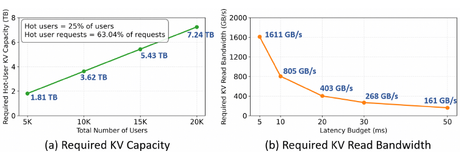
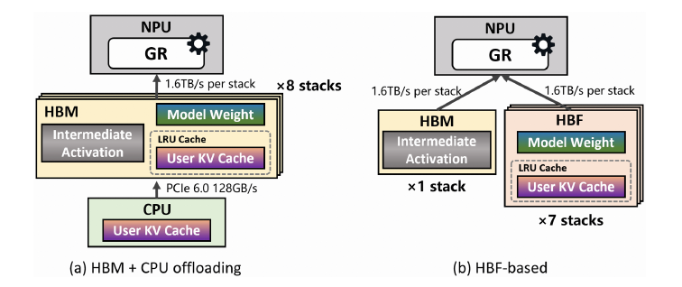
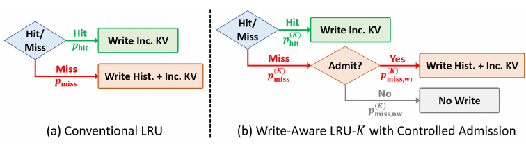
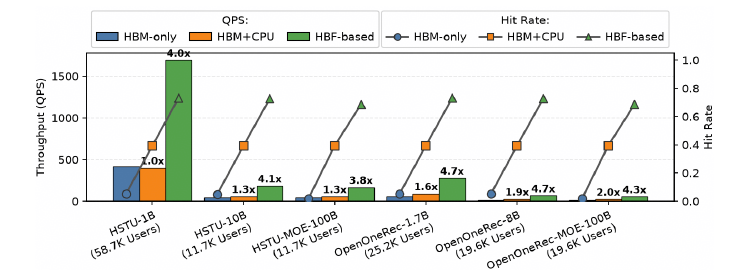
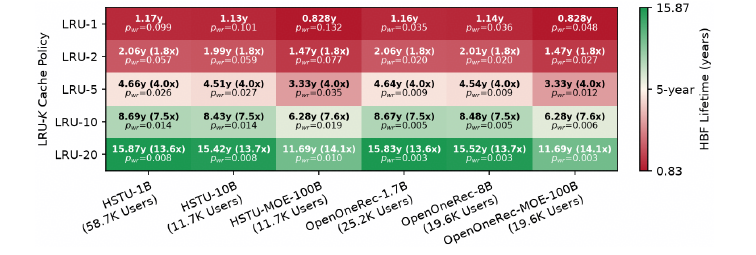
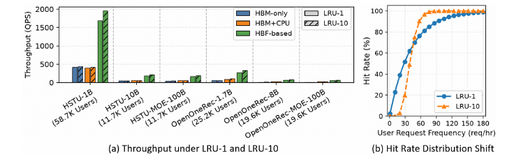

# Enabling HBF：写入感知的 KV 缓存管理

论文：Enabling High-Bandwidth Flash for Generative Recommendation Serving with Write-Aware KV Cache Policy  
作者：Danni Peng、Kai Wu、Tianyu Zuo、Pengfei Xia、Hui Zang，华为技术有限公司  
版本：arXiv:2609.07175v1，2026 年 9 月 7 日

## 一、背景动机

### 1. 一种适合复用 KV 的场景：生成式推荐

- **推荐模型在算什么**：输入一个用户过去的浏览、点击、购买等交互序列，模型先理解这段历史，再对候选物品打分或生成物品的语义 token。前面对应 prefill，后面对应 decode。
- **为什么值得保存 KV**：同一用户下次请求时，大部分历史没有变，只多了几条新交互。把旧历史的 KV 留下来，下次只算新增部分，就能省去长历史的重复计算。
- **与对话生成的区别**：这里保存的是跨请求复用的用户历史。HSTU 一次 decode 就完成候选批量打分，OpenOneRec 只生成少量物品语义 token；大量 KV 来自长历史，而不是一轮长回答不断追加的输出。

### 2. HBM 放不下，CPU 内存读不快

- **容量需求**：一万用户、HSTU-10B，仅保留最活跃的 25% 用户就需要 3.62 TB KV；八个 HBM4 堆栈合计只有 288 GB，还要容纳权重和中间激活。
- **带宽需求**：8K 交互历史的请求要在 20 ms 内完成，需要 403 GB/s KV 读取带宽。本文 HBM 与 CPU 内存之间的 PCIe 6.0 链路只有 128 GB/s。
- **HBF 的机会**：单堆栈 512 GB、读取带宽 1.6 TB/s，适合放大规模、反复读取的用户 KV。容量和读带宽都能照顾到。



图 2：用户规模决定 KV 容量，延迟目标决定 KV 读带宽。

### 3. 核心问题：LRU 让 HBF 写得太多

- **传统做法**：命中时读取历史 KV，只追加增量 KV；未命中时重新计算历史，并把“历史＋增量”的完整 KV 写入缓存。
- **问题出在哪里**：一个用户哪怕只来一次，LRU 也把他的整段历史写进 HBF。用户没再来，这次写入没有换回任何复用收益，还挤掉了原来的缓存。
- **寿命后果**：本文假设 SLC 有十万次 P/E 寿命，但七堆栈 HBF 在 HSTU-10B 的一万用户负载下，采用普通 LRU 也只能使用约一年。

补充知识：**算出 KV 和把 KV 留在缓存里是两件事**。未命中时，模型为了完成当前请求，需要重新计算历史；算完之后是否值得写入 HBF，应该再做一次判断。

## 二、设计方案

### 1. 改进机会

- **完整写入远大于增量写入**：历史可能有几千个 token，新增交互只有几个。挡住一次低价值的完整写入，比省掉一次很小的增量写入更有效。
- **用户热度有差别**：活跃用户会反复请求，历史通常也更长。把空间留给这些用户，既能增加后续复用，又能避免重算更长的历史。
- **准入与替换可以分开**：LRU 解决“空间不够时踢谁”；准入控制先解决“新来的用户值不值得存”。少写一些没有复用价值的 KV，HBF 就能多用几年。

### 2. 系统概览



- **HBM 的部分（放频繁更新的数据）**：保留一个 HBM4 堆栈，存放频繁更新的中间激活。
- **HBF 的部分（放权重与用户 KV）**：七个 HBF 堆栈存放模型权重与用户 KV，总容量为 3584 GB；扣除权重后的空间用于 KV 缓存。
- **策略的部分（先判断，再写入）**：采用带准入控制的 LRU-K，结合访问频率与新近程度，过滤复用机会少的用户。命中仍然追加增量 KV；未命中则分成“写入完整 KV”和“完成计算后不保留 KV”两条路径。

### 3. LRU-K 怎么决定一个用户值不值得存

- **记录什么**：关注用户倒数第 K 次请求的时间。只看最近一次，刚来过的偶发用户也显得很热；看倒数第 K 次，可以判断他是否连续有过多次访问。
- **比较什么**：把新用户倒数第 K 次请求的时间，与缓存中最旧的倒数第 K 次请求时间比较。新用户更近，才允许把完整 KV 放进去。
- **K=1 会怎样**：退化为传统 LRU，每次未命中都准入。K 增大后，低频用户更难进入缓存。

举例：取 K=3，缓存里最弱的用户倒数第三次访问发生在 10:00。用户 A 的倒数第三次访问在 10:20，A 可以进入缓存；用户 B 只出现过一次，尚未形成三次访问历史，就先不为他保留完整 KV。这里的时间仅用于解释比较规则。



### 4. 三条执行路径

| 请求情况 | 当前请求怎么完成 | 写入 HBF 的 KV |
|---|---|---|
| 命中 | 读历史 KV，计算增量 prefill 和候选 decode | 增量 KV |
| 未命中、准入 | 重新计算历史、增量和 decode，再保存结果 | 完整历史＋增量 KV |
| 未命中、不准入 | 同样完成历史、增量和 decode 的计算，结果不保留为用户缓存 | 无持久 KV 写入 |

- **关键变化**：从“所有未命中都写完整 KV”，变成“只有值得复用的未命中才写完整 KV”。当前请求照常完成，减少的是为未来保留缓存所付出的写入。
- **性能为什么还能保持**：低频用户少占空间，高频、长历史用户留得更多。一次命中就能省下较长的 prefill，抵消未缓存低频用户带来的重算。

### 5. 寿命怎么算

```text
每请求平均写入量 = 命中概率 × 增量 KV 大小
                 + 未命中且准入概率 × 完整 KV 大小

HBF 寿命 = KV 可用容量 × P/E 次数
           ÷（总请求率 × 每请求平均写入量）
```

- **分子基本固定**：硬件容量和闪存 P/E 次数确定后，可承受的累计写入量基本确定。
- **策略改分母**：减少完整 KV 的写入概率，就能减少单位时间写入量、延长寿命。这里统计的是写入 HBF 的 KV 数据量；要评估物理 NAND 写放大，还需要加入 FTL、垃圾回收等产生的物理写入。

## 三、实验结果

平台：GR 服务的 roofline 分析模型与模拟用户请求。  
配置：统一峰值算力 2 PFLOPs；对比八个 HBM4、八个 HBM4＋2 TB CPU 内存、一个 HBM4＋七个 HBF。  
负载：HSTU 1B / 10B / 100B-MoE；OpenOneRec 1.7B / 8B / 100B-MoE；最大历史 8K、候选数 500。

### 1. 吞吐量



- **效果 1（HBF 的容量与带宽收益）**：三种配置统一使用 LRU-1，HBF-based 的 QPS 达到 HBM-only 的 3.8–4.7 倍。更大的缓存留住更多用户，减少历史 prefill；读取带宽也足够支撑复用。
- **效果 2（CPU 卸载的收益）**：六个模型中的五个达到 HBM-only 的 1.3–2.0 倍。HSTU-1B 反而略降，因为模型小，沿慢链路把 KV 读回来可能比重算还费时间。

### 2. 写入与寿命



- **效果 3（寿命延长）**：保持 HBF 配置，LRU-1 换成 LRU-10，全部六个负载都从约一年延长至六年以上。图 6 中 LRU-10 的寿命为 6.28–8.69 年，相对 LRU-1 为约 7.5–7.6 倍。
- **效果 4（完整写入减少）**：HSTU-10B 的完整 KV 写入概率从 0.101 降至 0.014，相对下降约 86.1%。这是完整写入事件的概率；总写入量还包含命中时追加的增量 KV。
- **效果 5（吞吐基本保持）**：K 从 1 增到 10，QPS 还有小幅提高。缓存向更活跃、历史更长的用户集中，避免了更多长历史重算。



### 效果这么明显的原因分析

- **原来的写入太宽松**：只来一次的用户也写整段历史，LRU-K 直接挡掉这部分。
- **被挡掉的是大写入**：省掉的是历史＋增量，不只是几个新 token。
- **留下的缓存更值钱**：高频用户会继续来，长历史用户重算也更贵，空间留给他们能同时照顾性能。

### 局限性分析

- 请求采用泊松模型，活跃程度与历史长度正相关；真实用户的突发访问和热点切换会改变合适的 K。
- 算法围绕用户级 KV 准入展开，KV block 的物理聚集、擦除块回收和磨损均衡仍有继续设计的空间。
- 寿命由容量、P/E 与写入速率推算，实际部署还需要测量 NAND 物理写入与管理开销。

### 对技术路线二的启发

- **先从源头少写**：在 HBM→HBF 迁移前增加准入判断，优先持久保留复用价值高的 KV。
- **再把值得写的数据放好**：对已准入的 KV，再按预计失效时间组织布局，减少垃圾回收搬运。准入控制与生命周期布局可以组合。
- **实验怎么拆**：固定 HBM/HBF 容量与带宽，依次比较 LRU、LRU-K、LRU-K＋生命周期布局，记录吞吐、每请求逻辑写入量、NAND 物理写入量、WAF 和寿命。预取开关另做消融，便于看清每部分收益。

来源定位：背景与系统配置见 p.1–3；LRU-K 与公式（4）–（6）见 p.3；吞吐见图 5，寿命见图 6，策略吞吐与命中分布见图 7（均 p.4）。86.1% 为按正文 0.101、0.014 计算。
