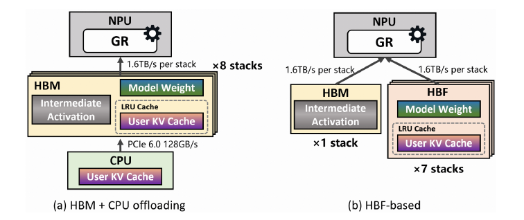
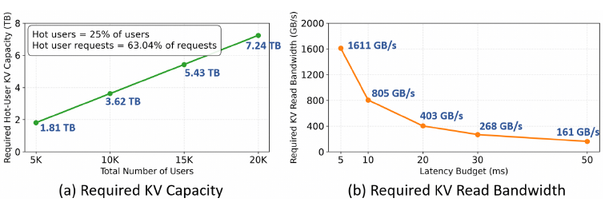
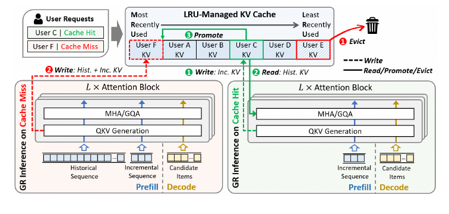
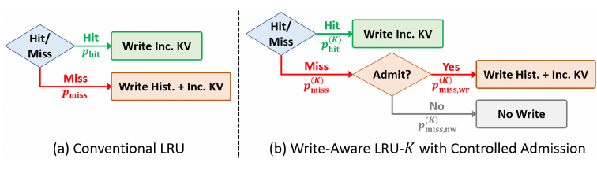
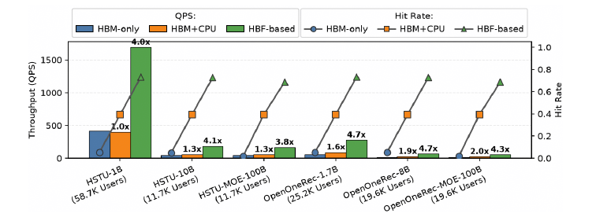
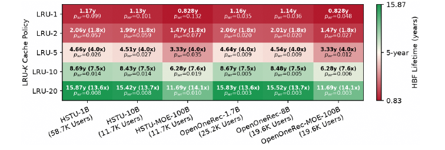
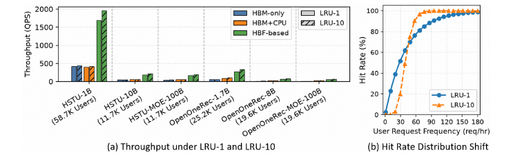

# Enabling High-Bandwidth Flash for Generative Recommendation Serving with Write-Aware KV Cache Policy

# 通过写入感知的 KV 缓存策略支持高带宽闪存上的生成式推荐服务

作者：Danni Peng、Kai Wu、Tianyu Zuo、Pengfei Xia、Hui Zang。

单位：Huawei Technologies Co., Ltd.（华为技术有限公司）。

本地版本：arXiv:2609.07175v1，2026-09-07，共 5 页。

英文原文与中文译文逐段排列；正文、公式、图表、脚注和参考文献按本地 PDF 版本整理。图内英文保留，图注提供中文译文。


## Abstract / 摘要


<a id="S001"></a>

**原文 / Original · p.1**

Generative recommendation (GR) systems increasingly leverage user-level KV cache reuse to avoid recomputing long user histories. However, the growing KV cache capacity and bandwidth requirements introduce new challenges for memory system. High-Bandwidth Flash (HBF) provides a promising solution by offering substantially higher capacity than HBM while approaching HBM-class read bandwidth, enabling larger-scale KV cache retention and improved serving throughput. Yet conventional Least-Recently-Used (LRU) KV cache management tightly couples KV cache writes with cache misses, generating excessive write traffic that rapidly exhausts flash endurance. In this work, we evaluate a write-aware KV cache policy based on admission-controlled LRU-K for HBF-based GR serving. By filtering low-reuse users before cache admission, LRU-K decouples KV cache writes from misses and significantly reduces unnecessary writes. We develop an analytical model to characterize GR serving performance, KV cache write traffic, and HBF lifetime, and evaluate performance across diverse memory systems and GR workloads. Our results show that HBF-based systems achieve 3.8–4.7× higher throughput than HBM-only systems. Moreover, LRU-K extends HBF lifetime from about one year under conventional LRU to over six years with a moderate K = 10, while maintaining comparable or even slightly improved throughput. These results highlight the importance of write-aware KV cache policy for sustainable HBF-based GR serving.

**中文**

生成式推荐（GR）系统越来越多地复用用户级 KV 缓存，以避免重新计算冗长的用户历史。然而，持续增长的 KV 缓存容量和带宽需求给存储系统带来了新的挑战。高带宽闪存（HBF）的容量显著高于 HBM，读取带宽则接近 HBM，因而能够保留更大规模的 KV 缓存并提高服务吞吐量。不过，传统最近最少使用（LRU）KV 缓存管理将 KV 写入与缓存未命中紧密绑定，产生大量写入流量，迅速消耗闪存耐久度。本文针对基于 HBF 的 GR 服务，评估了一种基于准入控制 LRU-K 的写入感知 KV 缓存策略。LRU-K 在缓存准入之前过滤低复用用户，将 KV 写入与未命中解耦，显著减少不必要的写入。我们建立分析模型，刻画 GR 服务性能、KV 缓存写入流量和 HBF 寿命，并在多种存储系统和 GR 负载下开展评估。结果表明，基于 HBF 的系统吞吐量达到仅使用 HBM 的系统的 3.8–4.7 倍。此外，采用适中的 K=10 时，LRU-K 将 HBF 寿命从传统 LRU 下的约一年延长至六年以上，同时保持相近甚至略有提升的吞吐量。这些结果表明，写入感知 KV 缓存策略对于可持续的 HBF 生成式推荐服务十分重要。


<a id="S002"></a>

**原文 / Original · p.1**

Index Terms—High-bandwidth flash, write endurance, generative recommendation serving, KV cache policy.

**中文**

关键词：高带宽闪存、写入耐久度、生成式推荐服务、KV 缓存策略。


## I. Introduction / 引言


<a id="S003"></a>

**原文 / Original · p.1**

Recently, generative recommendation (GR) has gained increasing attention due to its scaling potential. Built upon transformer-based architectures, GR models improve recommendation quality by scaling model capacity and incorporating longer user interaction histories [1], [2].

**中文**

近年来，生成式推荐（GR）凭借其扩展潜力受到越来越多的关注。GR 模型基于 Transformer 架构，通过扩大模型容量、纳入更长的用户交互历史来提升推荐质量 [1]、[2]。


<a id="S004"></a>

**原文 / Original · p.1**

To reduce the latency overhead of recomputing long user histories, recent GR systems employ user-level KV cache reuse across serving requests. As shown in Figure 1a, current industry practice commonly places user KV caches in accelerator memory, such as HBM, alongside model weights and intermediate activations to meet stringent latency requirements. CPU memory can further be leveraged to expand cache capacity by offloading inactive user KV [3], [4]. However, as GR services evolve toward larger models, broader user populations, and tighter latency SLOs, this design faces two key challenges.

**中文**

为了降低重复计算长用户历史的延迟开销，近期 GR 系统在不同服务请求之间复用用户级 KV 缓存。如图 1a，业界通常将用户 KV 缓存与模型权重、中间激活一起放在 HBM 等加速器内存中，以满足严格的延迟要求。还可以将不活跃用户的 KV 卸载到 CPU 内存，进一步扩大缓存容量 [3]、[4]。然而，随着 GR 服务面向更大的模型、更广的用户群和更严格的延迟 SLO，这种设计面临两项关键挑战。





<a id="S005"></a>

**原文 / Original · p.1**

Fig. 1. GR serving on conventional HBM+CPU versus an HBF-based system

**中文**

图 1：传统 HBM+CPU 系统与基于 HBF 的系统上的生成式推荐服务。





<a id="S006"></a>

**原文 / Original · p.1**

Fig. 2. Required KV Cache Capacity and Read Bandwidth for HSTU-10B.

**中文**

图 2：HSTU-10B 所需的 KV 缓存容量与读取带宽。


<a id="S007"></a>

**原文 / Original · p.1**

First, persistent user-level KV caches impose substantial storage demands that scale with the user base. As shown in Figure 2a, for a 10K-user workload with a representative scaled-up HSTU-10B model, retaining only the hottest 25% of users requires 3.62 TB of KV cache capacity. This far exceeds what HBM alone can practically provide, making CPU memory offloading necessary. Second, tighter latency SLOs require increasingly high KV cache bandwidth. As shown in Figure 2b, meeting a 20 ms latency target for a request with an 8K-interaction history requires 403 GB/s of KV cache read bandwidth, far beyond the bandwidth typically available for CPU memory. Together, these challenges expose a fundamental mismatch between emerging GR KV cache requirements and existing memory systems: HBM provides sufficient bandwidth but insufficient capacity for user-level KV caching at scale, while CPU memory offers greater capacity but is constrained by substantially lower bandwidth.

**中文**

第一，持久保留用户级 KV 缓存会产生随用户规模增长的大量存储需求。如图 2a，对于采用代表性扩展模型 HSTU-10B 的一万用户负载，仅保留最活跃的 25% 用户就需要 3.62 TB 的 KV 缓存容量，远超单靠 HBM 能够实际提供的容量，因此需要向 CPU 内存卸载。第二，更严格的延迟 SLO 要求更高的 KV 缓存带宽。如图 2b，要让一条包含 8K 交互历史的请求达到 20 ms 延迟目标，需要 403 GB/s 的 KV 读取带宽，远高于 CPU 内存通常可提供的带宽。这揭示了新兴 GR 的 KV 缓存需求与现有存储系统之间的根本矛盾：HBM 带宽足够，但难以为大规模用户缓存提供足够容量；CPU 内存容量更大，却受限于明显更低的带宽。


<a id="S008"></a>

**原文 / Original · p.1**

High-Bandwidth Flash (HBF) has emerged as a promising solution to these limitations [5]. By replacing HBM’s DRAM with low-latency NAND flash and exploiting massive internal parallelism, HBF offers over 10× higher per-stack capacity than HBM4 (e.g., 512 GB vs. 36 GB) while approaching HBM-class read bandwidth (e.g., 1.6 TB/s per stack) [5]–[8].

**中文**

高带宽闪存（HBF）为解决上述限制提供了一条有前景的路径 [5]。通过将 HBM 的 DRAM 替换为低延迟 NAND 闪存并利用大规模内部并行，HBF 的单堆栈容量可超过 HBM4 的十倍，例如 512 GB 对 36 GB，同时提供接近 HBM 的读取带宽，例如每堆栈 1.6 TB/s [5]–[8]。


<a id="S009"></a>

**原文 / Original · p.1–2**

These properties make HBF well suited for large, frequently accessed user KV caches. However, NAND flash has limited write endurance; typical single-level cell (SLC) flash supports only around 100K program/erase (P/E) cycles [9]. Fortunately, unlike LLM decoding, where KV caches are generated and grow within each session, GR reuses user KV caches across requests from the same user, largely decoupling KV write frequency from request frequency. Writes therefore occur mainly on cache misses, substantially reducing write traffic and making GR more amenable to HBF-based KV caching. In this work, we consider an HBF-based GR serving system that reserves one HBM4 stack for frequently updated intermediate activations and places model weights and user KV caches across seven HBF stacks to leverage their read-dominant access patterns, as shown in Figure 1b [7].

**中文**

这些特性使 HBF 很适合保存规模大、访问频繁的用户 KV 缓存。不过，NAND 闪存的写入耐久度有限，典型单层单元（SLC）闪存仅支持约十万次编程/擦除（P/E）循环 [9]。与 LLM 解码时 KV 在每个会话内部不断生成和增长不同，GR 可以在同一用户的多次请求之间复用 KV，因而在很大程度上将 KV 写入频率与请求频率解耦。写入主要发生在缓存未命中时，写流量较低，因此 GR 更适合使用 HBF 保存 KV。本文考虑的 HBF 生成式推荐系统预留一个 HBM4 堆栈存放频繁更新的中间激活，将模型权重与用户 KV 缓存放在七个 HBF 堆栈中，以利用其以读为主的访问模式，如图 1b [7]。


<a id="S010"></a>

**原文 / Original · p.2**

However, despite GR’s lower KV write frequency than LLM decoding, conventional GR KV cache management can still significantly undermine HBF endurance. Existing GR systems commonly adopt the Least-Recently-Used (LRU) policy for KV cache management [3], [4], which tightly couples cache writes with cache misses. As illustrated in Figure 3, every cache miss triggers a full KV computation (historical KV + incremental KV) and inserts the full cache at the MRU position while evicting the LRU entry. Such write-on-miss behavior admits even one-off users, causing frequent cache churn and accelerated flash wear. For example, under a 10K-user HSTU-10B workload, a seven-stack HBF device can last only about one year. Hence, the existing LRU policy needs to be revised to sustainably leverage HBF’s capacity benefit for GR serving.

**中文**

尽管 GR 的 KV 写入频率低于 LLM 解码，传统 GR 的缓存管理仍会显著损害 HBF 耐久度。现有 GR 系统普遍采用 LRU [3]、[4]，将缓存写入与未命中绑定。如图 3，每次未命中都会计算完整 KV，即历史 KV 与增量 KV，随后将其插入最近使用（MRU）位置并驱逐最久未使用的条目。这种“未命中就写入”的做法连一次性用户也接纳，造成频繁替换并加速闪存磨损。例如，在一万用户的 HSTU-10B 负载下，七堆栈 HBF 设备只能使用约一年。因此，需要调整 LRU 策略，才能长期利用 HBF 的容量优势。


<a id="S011"></a>

**原文 / Original · p.2**

In this work, we evaluate a write-aware, admission-controlled LRU-K policy [10], which selectively admits user KV caches based on the K-th request. Unlike conventional LRU, LRU-K filters low-reuse users before admission, decoupling KV writes from cache misses and reducing unnecessary write traffic. To quantitatively assess its impacts on GR serving performance and HBF endurance, we develop an analytical framework and evaluate LRU-K across system configurations and GR models. Our contributions are three-fold:

**中文**

本文评估带准入控制的写入感知 LRU-K 策略 [10]，根据用户的第 K 次请求选择性地接纳其 KV。与传统 LRU 不同，LRU-K 在准入前过滤低复用用户，将 KV 写入与未命中解耦，减少不必要的写入。为定量评估其对 GR 性能与 HBF 耐久度的影响，我们建立分析框架，在不同系统配置和 GR 模型上评估 LRU-K。本文有三项贡献：


<a id="S012"></a>

**原文 / Original · p.2**

• We develop an analytical model for GR serving that characterizes KV cache access, serving performance, write traffic, and HBF lifetime.

• We propose adopting LRU-K in place of conventional LRU and model the reduction in write traffic enabled by write-miss decoupling.

• We evaluate diverse memory configurations (HBM-only, HBM+CPU, and HBF-based) and GR models (HSTU and OpenOneRec), and show that HBF-based systems achieve 3.8–4.7× higher throughput than HBM-only systems but suffer from limited lifetime under conventional LRU. With LRU-10, HBF lifetime extends to over six years while maintaining throughput.

**中文**

① 建立 GR 服务分析模型，刻画 KV 访问、服务性能、写流量与 HBF 寿命。

② 提出用 LRU-K 替换传统 LRU，并建模写入与未命中解耦所带来的写流量减少。

③ 评估 HBM-only、HBM+CPU、HBF-based 等配置及 HSTU、OpenOneRec 模型。HBF 系统吞吐量达到 HBM-only 的 3.8–4.7 倍，但传统 LRU 下寿命受限；LRU-10 则在维持吞吐量的同时将 HBF 寿命延长至六年以上。





<a id="S013"></a>

**原文 / Original · p.2**

Fig. 3. GR Serving Workflow with Conventional LRU-Managed KV Cache. On a cache hit, historical KV is read and incremental KV is written; On a cache miss, both historical and incremental KV are written.

**中文**

图 3：传统 LRU 管理 KV 缓存的 GR 服务流程。命中时读取历史 KV、写入增量 KV；未命中时同时写入历史 KV 和增量 KV。


## II. GR Inference Workload Modeling / GR 推理负载建模


<a id="S014"></a>

**原文 / Original · p.2**

GR inference typically involves processing a user’s interaction sequence (i.e., prefill) and scoring candidate items (i.e., decode) to generate recommendations. The interaction sequence consists of a long historical sequence (e.g., thousands of tokens) followed by a much shorter incremental sequence of newly arrived interactions (e.g., a few tokens). To avoid recomputing the long historical prefix, recent GR systems persist and reuse user-level KV caches across requests, leveraging conventional LRU for cache management [3], [4]. Figure 3 illustrates this GR inference workflow.

**中文**

GR 推理通常先处理用户交互序列，即 prefill，再对候选物品打分，即 decode，生成推荐。交互序列由较长的历史序列，例如数千个 token，以及随后较短的新增交互序列，例如几个 token，组成。为了避免重复计算长历史前缀，近期 GR 系统跨请求保留并复用用户级 KV，以传统 LRU 管理缓存 [3]、[4]。图 3 展示了这一推理流程。


## A. Serving Performance / 服务性能


<a id="S015"></a>

**原文 / Original · p.2**

Upon receiving a user request, the system first checks the KV cache for a hit or miss. On a cache hit, the historical KV cache is read from memory, while only incremental prefill and candidate decoding are computed; the new incremental KV is then appended to the cache. On a cache miss, the historical prefill is recomputed together with incremental prefill and decoding, and the resulting full KV cache is inserted into memory. Using a roofline analytical model, the hit- and miss-path latencies under conventional LRU are

**中文**

系统收到请求后，首先判断 KV 缓存是否命中。命中时从内存读取历史 KV，只计算增量 prefill 与候选物品 decode，再将新增 KV 追加到缓存。未命中时，需要重新计算历史 prefill、增量 prefill 和 decode，并将完整 KV 插入内存。使用 roofline 分析模型，传统 LRU 的命中与未命中路径延迟为：


```text
T_hit = max(T_inc+decode^comp, T_hist^read, T_inc^write)
T_miss = max(T_hist+inc+decode^comp, T_hist+inc^write)    (1)
```


<a id="S016"></a>

**原文 / Original · p.2**

where T comp is computed as the forward-pass FLOPs of the respective operations divided by the device peak compute throughput, and T read/write is computed as the transferred data volume divided by the read/write bandwidth1 . The average request latency and device throughput (QPS) are therefore

**中文**

其中，T^comp 等于对应操作前向计算的 FLOPs 除以设备峰值算力；T^read/write 等于传输数据量除以读写带宽¹。平均请求延迟和设备吞吐量 QPS 为：


```text
T̄_req = p_hit × T_hit + (1 − p_hit) × T_miss
QPS = 1 / T̄_req   [req/sec]    (2)
```


<a id="S017"></a>

**原文 / Original · p.2**

where phit is the hit rate of conventional LRU cache. Since a cache hit avoids expensive historical prefill, the higher hit rate enabled by the larger capacity of HBF reduces average request latency and improves serving throughput.

**中文**

其中，p_hit 是传统 LRU 的命中率。命中能够避免昂贵的历史 prefill，因此 HBF 大容量带来的更高命中率可以降低平均请求延迟、提高吞吐量。


## B. KV Cache Write Traffic and HBF Lifetime / KV 写流量与 HBF 寿命


<a id="S018"></a>

**原文 / Original · p.2**

Under conventional LRU, every cache miss writes the full historical-plus-incremental KV cache, while a cache hit writes only the incremental KV. Hence, the average write volume per request and the corresponding HBF lifetime are

**中文**

传统 LRU 在每次未命中时写入完整的历史加增量 KV；命中时只写增量 KV。因此，每个请求的平均写入量和相应的 HBF 寿命为：


```text
D̄_write,req = p_hit × D_inc + (1 − p_hit) × D_hist+inc
L_HBF = (C_KV × E_flash) / (λ_wload × D̄_write,req)    (3)
```


<a id="S019"></a>

**原文 / Original · p.3**

Here, Dinc denotes the incremental KV cache size, Dhist+inc denotes the full KV cache size, CKV represents the usable HBF capacity allocated to KV cache (i.e., HBF device capacity minus model weights), Eflash denotes the NAND flash write endurance measured in P/E cycles, and λwload represents the workload overall request rate derived from the evaluated user scale and request arrival distribution. Since Dhist+inc is substantially larger than Dinc , writing the full KV cache on every miss can rapidly exhaust the limited write endurance of HBF. This motivates a cache policy that decouples cache writes from cache misses.

**中文**

其中，D_inc 为增量 KV 大小，D_hist+inc 为完整 KV 大小，C_KV 为分配给 KV 缓存的可用 HBF 容量，即 HBF 设备总容量减去模型权重；E_flash 是以 P/E 循环数表示的 NAND 写入耐久度；λ_wload 是根据所评估用户规模与请求到达分布得到的负载总请求率。由于完整 KV 远大于增量 KV，每次未命中都写完整 KV 会快速耗尽 HBF 耐久度，因此需要将缓存写入与未命中解耦。


## III. Write-Aware LRU-K Cache Policy / 写入感知的 LRU-K 缓存策略


<a id="S020"></a>

**原文 / Original · p.3**

We consider an admission-controlled LRU-K policy [10], which uses each user’s K-th most recent request to assess their KV reuse potential for cache admission. Unlike conventional LRU, which relies on the most recent request, LRU-K admits a KV cache only if its K-th request is more recent than the oldest K-th request among cached entries. This criterion filters one-off or recently inactive users before persisting their KV, capturing user hotness based on both recency and frequency. As a result, KV cache writes are decoupled from cache misses, with the miss path split into a miss-write path and a miss-no-write path, only the former of which incurs KV write traffic, as shown in Figure 4.

**中文**

我们考虑带准入控制的 LRU-K 策略 [10]，根据每个用户倒数第 K 次请求评估 KV 复用潜力。传统 LRU 只考虑最近一次请求；LRU-K 只有在该用户倒数第 K 次请求比缓存条目中最旧的倒数第 K 次请求更新时，才允许其 KV 进入缓存。这一准则结合访问新近程度与频率，在保留 KV 前过滤一次性或近期不活跃的用户。未命中路径因此被分为“未命中且写入”和“未命中但不写入”，只有前者产生 KV 写流量，如图 4。





<a id="S021"></a>

**原文 / Original · p.3**

Fig. 4. Conventional LRU vs LRU-K with Controlled Admission.

**中文**

图 4：传统 LRU 与带准入控制的 LRU-K 对比。


## A. Controlled Admission and Write-Miss Decoupling / 准入控制与写入—未命中解耦


<a id="S022"></a>

**原文 / Original · p.3**

Let aK ≜ Pr(admit | miss, K) denote the conditional probability that a cache miss satisfies the LRU-K admission criterion. The miss probability is therefore divided into:

**中文**

令 a_K ≜ Pr(admit | miss,K)，表示未命中满足 LRU-K 准入准则的条件概率。未命中概率因此分为两部分：


```text
p_miss,wr^(K) = p_miss^(K) × a_K
p_miss,nw^(K) = p_miss^(K) × (1 − a_K)    (4)
```


<a id="S023"></a>

**原文 / Original · p.3**

where p_miss^(K) = 1 − p_hit^(K), and p_hit^(K) is the hit rate of LRU-K. Both p_hit^(K) and a_K depend on cache capacity, request locality, and the value of K, and can be derived analytically or from request traces. In our evaluation, we adopt a Poisson request model, X ∼ Poisson(λτ_C), where λ is the request arrival rate and τ_C is the characteristic time associated with cache capacity C, i.e., the time window within which a user’s K-th most recent request must occur for its KV to remain cached². We can obtain:

**中文**

其中，p_miss^(K)=1−p_hit^(K)，p_hit^(K) 为 LRU-K 命中率。命中率和 a_K 均取决于缓存容量、请求局部性与 K，可通过分析或请求轨迹得到。评估采用泊松请求模型 X∼Poisson(λτ_C)，λ 为请求到达率，τ_C 为与缓存容量 C 关联的特征时间，即用户倒数第 K 次请求需要落入的时间窗口，以使其 KV 保持缓存²。由此得到：


```text
p_hit^(K) = Pr(X ≥ K) = 1 − Σ[x=0…K−1] ((λτ_C)^x e^(−λτ_C) / x!)
a_K = Pr(X = K−1 | X < K)
    = ((λτ_C)^(K−1) e^(−λτ_C) / (K−1)!)
      / Σ[x=0…K−1] ((λτ_C)^x e^(−λτ_C) / x!)
```


<a id="S024"></a>

**原文 / Original · p.3**

For LRU-1 which admits based on the most recent request, a₁ = 1, the policy degenerates to conventional LRU: p_miss,wr^(1) = p_miss^(1) = 1 − p_hit^(1) and p_miss,nw^(1) = 0.

**中文**

LRU-1 根据最近一次请求决定准入，a₁=1，因此退化为传统 LRU：p_miss,wr^(1)=p_miss^(1)=1−p_hit^(1)，p_miss,nw^(1)=0。


## B. Impacts on HBF Lifetime and Serving Performance / 对 HBF 寿命和服务性能的影响


<a id="S025"></a>

**原文 / Original · p.3**

Since only hit and miss-write requests generate KV writes, the write volume per request and HBF lifetime of LRU-K are

**中文**

只有命中请求和“未命中且写入”请求会产生 KV 写入，因此 LRU-K 下每请求写入量与 HBF 寿命为：


```text
D̄_write,req^(K) = p_hit^(K) × D_inc + p_miss,wr^(K) × D_hist+inc
L_HBF^(K) = (C_KV × E_flash) / (λ_wload × D̄_write,req^(K))    (5)
```


<a id="S026"></a>

**原文 / Original · p.3**

Compared with conventional LRU (i.e., LRU-1) in (3), LRU-K reduces the full KV write rate from 1 − p_hit^(1) to p_miss,wr^(K). While miss-no-write requests still incur historical prefill, they avoid writing large D_hist+inc, substantially reducing write volume per request and extending HBF lifetime.

**中文**

与式（3）的传统 LRU，即 LRU-1，相比，LRU-K 将完整 KV 写入概率从 1−p_hit^(1) 降至 p_miss,wr^(K)。未命中但不写入的请求仍需计算历史 prefill，却避免了写入大量完整 KV，因此能够显著降低每请求写入量，延长 HBF 寿命。


<a id="S027"></a>

**原文 / Original · p.3**

For latency under LRU-K, the hit path is identical to LRU in (1), i.e., T_hit^(K) = T_hit, and the miss-write path matches the LRU miss path, i.e., T_miss,wr^(K) = T_miss. The miss-no-write path incurs only computation, i.e., T_miss,nw^(K) = T_hist+inc+decode^comp. The average request latency and throughput under LRU-K are

**中文**

LRU-K 的命中路径与式（1）的 LRU 相同，即 T_hit^(K)=T_hit；未命中且写入路径也与 LRU 未命中路径相同，即 T_miss,wr^(K)=T_miss。未命中但不写入的路径只有计算开销，即 T_miss,nw^(K)=T_hist+inc+decode^comp。LRU-K 下平均请求延迟和吞吐量为：


```text
T̄_req^(K) = p_hit^(K) × T_hit^(K)
           + p_miss,wr^(K) × T_miss,wr^(K)
           + p_miss,nw^(K) × T_miss,nw^(K)
QPS^(K) = 1 / T̄_req^(K)   [req/sec]    (6)
```


<a id="S028"></a>

**原文 / Original · p.3**

Increasing K slightly improves QPS as LRU-K preferentially retains more active users who have longer histories, saving more computation on cache hits (details in Section IV-B).

**中文**

增大 K 会略微提高 QPS，因为 LRU-K 优先保留历史更长的活跃用户，命中时能够节省更多计算，详见 IV-B 节。


## IV. Evaluation / 评估


## A. Experimental Setup / 实验设置


<a id="S029"></a>

**原文 / Original · p.3**

a) Hardware Configuration: We evaluate three memory configurations for GR serving. 1) HBM-only: a device equipped with eight HBM4 stacks, where each stack provides 36 GB capacity and 1.6 TB/s read/write bandwidth [7]. 2) HBM+CPU: augments the HBM-only design with 2 TB of CPU memory for expanded KV cache capacity, with KV cache transfers over PCIe 6.0 at 128 GB/s. We assume a write-through updates to CPU memory [3], [4]. 3) HBF-based: a device with seven HBF stacks and one HBM4 stack. The HBM4 stack is reserved for frequently updated intermediate data. Each HBF stack provides 512 GB capacity, 1.6 TB/s read bandwidth, and 48 GB/s write bandwidth [8]. To achieve the target read bandwidth, we assume 25 planes per HBF die (16 dies per HBF stack) and a 1-µs latency for 4-KB page reads. Following prior work [6], [7], each HBF stack includes a 3.13-MB SRAM staging buffer on the logic die for prefetching and double buffering. We further assume HBF employs SLC flash with a write endurance of 100K P/E cycles. A peak compute throughput of 2 PFLOPs is applied for all configurations.

**中文**

a）硬件配置：评估三类 GR 存储配置。① HBM-only：八个 HBM4 堆栈，每个容量 36 GB、读写带宽 1.6 TB/s [7]。② HBM+CPU：在 HBM-only 基础上增加 2 TB CPU 内存扩展 KV 缓存，采用 PCIe 6.0、128 GB/s 传输 KV，假设以 write-through 方式更新 CPU 内存 [3]、[4]。③ HBF-based：七个 HBF 加一个 HBM4 堆栈，HBM4 存放频繁更新的中间数据。每个 HBF 容量 512 GB、读取带宽 1.6 TB/s、写入带宽 48 GB/s [8]。为达到目标读取带宽，假设每个 HBF die 有 25 个 plane、每堆栈 16 个 die，4 KB 页读取延迟 1 μs。沿用已有工作 [6]、[7]，每个 HBF 堆栈的逻辑 die 包含 3.13 MB SRAM 暂存缓冲，用于预取与双缓冲。假设 HBF 使用支持十万次 P/E 循环的 SLC 闪存；所有配置的峰值算力统一为 2 PFLOPs。


<a id="S030"></a>

**原文 / Original · p.4**

b) Workloads: We evaluate HSTU 1B, 10B, and a 100B MoE variant [1], as well as OpenOneRec 1.7B, 8B, and a 100B MoE variant [2]. HSTU performs batched candidate scoring in a single decoding step, whereas OpenOneRec autoregressively generates item semantic tokens over few decoding steps, with each step requiring KV access. We simulate user traffic spanning diverse activity levels [4], with hot users having request rates above 100 req/hr. Following HSTU [1], we use a maximum historical sequence length of 8K, with more active users having longer sequence length. The candidate size is set to 500.

**中文**

b）负载：评估 HSTU 1B、10B、100B MoE 变体 [1]，以及 OpenOneRec 1.7B、8B、100B MoE 变体 [2]。HSTU 在单次解码步骤中对候选物品批量打分；OpenOneRec 通过少量自回归解码步骤生成物品语义 token，每一步都访问 KV。模拟覆盖多种活跃程度的用户流量 [4]，热门用户请求率超过每小时 100 次。沿用 HSTU [1]，历史序列最大长度设为 8K，越活跃的用户历史越长，候选数量为 500。


## B. Evaluation Results / 评估结果





<a id="S031"></a>

**原文 / Original · p.4**

Fig. 5. Throughput Comparison under LRU-1.

**中文**

图 5：LRU-1 下的吞吐量对比。


<a id="S032"></a>

**原文 / Original · p.4**

a) Throughput: We first compare the serving throughput of HBM-only, HBM+CPU, and HBF-based configurations under conventional LRU (i.e., LRU-1). Since KV cache capacity demands vary across models, we adopt a model-specific user scale based on the capacity required to retain hot users in HBM+CPU. As shown in Figure 5, HBF-based consistently achieves higher QPS than HBM+CPU and HBM-only, mainly due to its larger KV cache capacity, which improves hit rates and reduces expensive historical prefill recomputation (Eq. 1 and Eq. 2). Compared with HBM-only, HBM+CPU improves QPS by 1.3–2.0× for five of six models by expanding KV cache capacity through CPU offloading. HSTU-1B is the exception: although offloading increases its cache hit rate, the model is sufficiently small that fetching the full KV cache from bandwidth-limited CPU memory can be slower than recomputing the user history, slightly reducing throughput. With both large capacity and high read bandwidth, HBFbased configuration achieves 3.8–4.7× higher QPS than HBM-only across all models. Although an HBF stack may consume more power (<80W) than HBM (40W), its higher per-device throughput can reduce the total required device count, offsetting the additional power overhead at the system level.

**中文**

a）吞吐量：首先在传统 LRU，即 LRU-1，下比较三种配置。由于各模型 KV 容量需求不同，根据 HBM+CPU 保留热门用户所需容量，为各模型设置相应用户规模。如图 5，HBF-based 的 QPS 始终高于 HBM+CPU 和 HBM-only，主要因为更大 KV 容量提高命中率，减少昂贵的历史 prefill 重算，见式（1）、（2）。相比 HBM-only，HBM+CPU 在六个模型中的五个上将 QPS 提升至 1.3–2.0 倍。HSTU-1B 是例外：卸载虽提高了命中率，但模型足够小，从带宽受限的 CPU 内存取回完整 KV 可能比重算历史更慢，使吞吐量略有下降。HBF 同时具有大容量与高读取带宽，在全部模型上达到 HBM-only 的 3.8–4.7 倍 QPS。尽管单个 HBF 堆栈功耗可能高于 HBM，即小于 80 W 对 40 W，更高的单设备吞吐量可以减少所需设备数量，在系统层面抵消新增功耗。





<a id="S033"></a>

**原文 / Original · p.4**

Fig. 6. HBF Lifetime and Write Rate under Different LRU-K Values.

**中文**

图 6：不同 LRU-K 参数下的 HBF 寿命与写入概率。


<a id="S034"></a>

**原文 / Original · p.4**

b) HBF Lifetime: For the HBF-only configuration, we evaluate HBF lifetime under LRU-K with K increasing from 1 to 20, where LRU-1 is equivalent to conventional LRU. As shown in Figure 6, LRU-1 yields an HBF lifetime of about one year. By increasing K to 10, all workloads achieve lifetimes of over six years, meeting typical flash device warranty periods [11]. This gain mainly comes from the reduction in the full KV write probability p_wr. Under LRU-1, every miss triggers insertion, so p_wr^(1) = 1 − p_hit^(1). In contrast, LRU-K decouples cache insertions from misses, reducing the full write probability to p_wr^(K) = p_miss,wr^(K) = (1 − p_hit^(K))a_K. For example, for HSTU-10B, increasing K from 1 to 10 reduces p_wr from 0.101 to 0.014, significantly lowering KV write traffic and extending HBF lifetime. Meanwhile, we observe that QPS slightly increases as K increases from 1 to 10 (Figure 7a). This is because LRU-K filters out infrequent users and shifts cache residency toward hotter users (Figure 7b). By retaining more active users with longer histories, LRU-K avoids costly prefill of long sequences and improves serving throughput. Thus, a moderate K can substantially improve HBF endurance while maintaining or slightly improving throughput. Although LRU-K involves tracking access history for admission decisions, its endurance gains outweigh the added management overhead.

**中文**

b）HBF 寿命：针对文中称作 HBF-only 的配置，将 LRU-K 的 K 从 1 增加到 20，其中 LRU-1 等价于传统 LRU。如图 6，LRU-1 的 HBF 寿命约一年；当 K=10 时，全部负载的寿命均超过六年，达到典型闪存设备保修期 [11]。收益主要来自完整 KV 写入概率 p_wr 降低。LRU-1 每次未命中都插入，p_wr^(1)=1−p_hit^(1)；LRU-K 将插入与未命中解耦，p_wr^(K)=p_miss,wr^(K)=(1−p_hit^(K))a_K。例如 HSTU-10B 的 K 从 1 增至 10 后，p_wr 从 0.101 降至 0.014，显著减少 KV 写流量并延长寿命。同时，图 7a 显示 QPS 略有提升。这是因为 LRU-K 过滤低频用户，使缓存更多留给热门用户，如图 7b；保留历史更长的活跃用户，能够避免昂贵的长序列 prefill。适中的 K 因而可以在保持或略增吞吐量的同时显著提高耐久度。尽管 LRU-K 需要跟踪访问历史来决定准入，其耐久度收益超过了额外管理开销。





<a id="S035"></a>

**原文 / Original · p.4**

Fig. 7. Throughput and Hit Rate Distribution Shift for LRU-1 and LRU-10.

**中文**

图 7：LRU-1 与 LRU-10 的吞吐量对比及命中率分布变化。


## V. Conclusion / 结论


<a id="S036"></a>

**原文 / Original · p.4**

In this work, we investigate HBF for GR serving, focusing on its write endurance limitation. HBF offers much higher capacity than HBM and improves throughput through more KV cache retention, but conventional LRU can quickly exhaust its write endurance. We therefore evaluate an admission-controlled LRU-K policy that selectively persists KV caches and decouples writes from cache misses. Across diverse GR models, HBF-based systems achieve 3.8–4.7× higher throughput than HBM-only, while LRU-K extends HBF lifetime from about one year with LRU-1 to over six years with LRU-10. These results highlight the importance of write-aware KV cache policy for sustainable HBF-based GR serving.

**中文**

本文研究 HBF 生成式推荐服务的写入耐久度限制。HBF 容量远高于 HBM，可通过保留更多 KV 提高吞吐量，但传统 LRU 会快速消耗耐久度。因此，本文评估带准入控制的 LRU-K，选择性地保留 KV，将写入与未命中解耦。在多种 GR 模型上，HBF-based 吞吐量达到 HBM-only 的 3.8–4.7 倍；LRU-10 将 HBF 寿命从 LRU-1 下的约一年延长至六年以上。这说明写入感知 KV 缓存策略对于可持续的 HBF 生成式推荐服务十分重要。


## Footnotes and author notes / 脚注与作者说明


<a id="S037"></a>

**原文 / Original · p.2**

¹ For tiered memory (e.g., HBM+CPU), our model additionally capture different tier-specific bandwidths, per-tier hit/miss behavior, and inter-tier data movement; details are omitted here for brevity.

**中文**

¹ 对 HBM+CPU 等分层存储，模型还考虑各层不同的带宽、各层命中/未命中行为与层间数据搬运，正文为简洁而省略细节。


<a id="S038"></a>

**原文 / Original · p.3**

² Under the characteristic-time approximation, the LRU-K criterion is equivalent to requiring at least K requests within the characteristic time τ_C.

**中文**

² 在特征时间近似下，LRU-K 准则等价于要求特征时间 τ_C 内至少发生 K 次请求。


<a id="S039"></a>

**原文 / Original · p.1**

This work has been submitted to the IEEE for possible publication. Copyright may be transferred without notice, after which this version may no longer be accessible. The authors are with Huawei Technologies Co., Ltd. Corresponding author’s e-mail: peng.danni@huawei.com.

**中文**

本工作已投稿至 IEEE。版权可能在不另行通知的情况下转移，此后该版本可能不再可访问。作者均来自华为技术有限公司，通讯作者邮箱：peng.danni@huawei.com。


## References / 参考文献


<a id="S040"></a>

**原文 / Original · p.4**

[1] J. Zhai et al., “Actions speak louder than words: Trillion-parameter sequential transducers for generative recommendations,” in Proceedings of the 41st International Conference on Machine Learning, ser. Proceedings of Machine Learning Research, vol. 235. PMLR, 2024, pp. 57 434–57 460.

**中文**

[1] J. Zhai 等：《行动胜于言语：用于生成式推荐的万亿参数序列转换器》。ICML 2024，PMLR 235，57434–57460 页。


<a id="S041"></a>

**原文 / Original · p.4**

[2] G. Zhou, H. Bao, J. Huang, J. Deng, J. Zhang, J. She, K. Cai, L. Ren, L. Ren, Q. Luo et al., “Openonerec technical report,” arXiv preprint arXiv:2512.24762, 2025.

**中文**

[2] G. Zhou 等：《OpenOneRec 技术报告》。arXiv:2512.24762，2025。


<a id="S042"></a>

**原文 / Original · p.4**

[3] X. Wang et al., “Mtserve: Efficient serving for generative recommendation models with hierarchical caches,” arXiv preprint arXiv:2604.xxxxx, 2026.

**中文**

[3] X. Wang 等：《MTServe：利用分层缓存高效服务生成式推荐模型》。arXiv:2604.xxxxx，2026。


<a id="S043"></a>

**原文 / Original · p.4**

[4] J. Sun et al., “Bat: Efficient generative recommender serving with bipartite attention,” in Proceedings of the 31st ACM International Conference on Architectural Support for Programming Languages and Operating Systems (ASPLOS). ACM, 2026.

**中文**

[4] J. Sun 等：《BAT：利用二部注意力高效服务生成式推荐模型》。ASPLOS，2026。


<a id="S044"></a>

**原文 / Original · p.4**

[5] SanDisk, “High-bandwidth flash,” Technical Fact Sheet, 2025. [Online]. Available: https://documents.sandisk.com/content/dam/asset-library/en us/assets/public/sandisk/collateral/company/Sandisk-HBF-Fact-Sheet. pdf

**中文**

[5] SanDisk：《高带宽闪存》。技术资料，2025。URL 见英文条目。


<a id="S045"></a>

**原文 / Original · p.5**

[6] M. Ha, E. Kim, and H. Kim, “H3: Hybrid architecture using high bandwidth memory and high bandwidth flash for cost-efficient LLM inference,” IEEE Computer Architecture Letters, 2026.

**中文**

[6] M. Ha、E. Kim、H. Kim：《H3：利用高带宽内存与高带宽闪存实现低成本 LLM 推理的混合架构》。IEEE Computer Architecture Letters，2026。


<a id="S046"></a>

**原文 / Original · p.5**

[7] D. Son et al., “Exploring high-bandwidth flash for modern LLM inference: Opportunities and challenges,” IEEE Computer Architecture Letters, 2026.

**中文**

[7] D. Son 等：《探索面向现代 LLM 推理的高带宽闪存：机遇与挑战》。IEEE Computer Architecture Letters，2026。


<a id="S047"></a>

**原文 / Original · p.5**

[8] K. Kyung et al., “High-bandwidth flash for KV caches: Endurance and performance implications,” IEEE Computer Architecture Letters, 2026.

**中文**

[8] K. Kyung 等：《用于 KV 缓存的高带宽闪存：耐久度与性能影响》。IEEE Computer Architecture Letters，2026。


<a id="S048"></a>

**原文 / Original · p.5**

[9] Micron Technology, Inc., “Nand flash memory,” Online, 2026. [Online]. Available: https://www.micron.com/products/storage/nand-flash

**中文**

[9] Micron Technology：《NAND 闪存》。在线资料，2026。


<a id="S049"></a>

**原文 / Original · p.5**

[10] E. J. O’neil, P. E. O’neil, and G. Weikum, “The lru-k page replacement algorithm for database disk buffering,” Acm Sigmod Record, vol. 22, no. 2, pp. 297–306, 1993.

**中文**

[10] E. J. O’Neil、P. E. O’Neil、G. Weikum：《用于数据库磁盘缓冲的 LRU-K 页面替换算法》。ACM SIGMOD Record，22(2)，297–306 页，1993。


<a id="S050"></a>

**原文 / Original · p.5**

[11] Samsung Semiconductor, “Storage warranty period,” https: //semiconductor.samsung.com/ssd/datacenter-ssd/pm893/, 2022, online; accessed: 2026-08-06.

**中文**

[11] Samsung Semiconductor：《存储产品保修期》。在线资料，2022；访问日期 2026-08-06。
