# Gandalf: Flash Shall Not Die! Increasing Flash Storage Lifetime for KV Cache Offloading in LLM Serving

# Gandalf：闪存不应消亡！延长 LLM 服务中 KV 缓存卸载的闪存存储寿命

## 文献信息 / Publication Information

- **Authors / 作者**：Maharani A. P. Irawan、Kuntai Du、Jiayi Yao、Dongjoo Seo、Yuyang Huang、Haryadi S. Gunawi、Junchen Jiang。
- **Version / 版本**：arXiv:2610.30791v1 [cs.LG]，2026-10-22。依据本地 PDF 页边版本标记；不混入其他版本。
- **Source / 来源**：[本地原论文（14 页）](../../文献/Gandalf.pdf)。正文至 PDF 第 12 页，参考文献延续至第 14 页。

| Author / 作者 | Affiliation / 单位 |
| --- | --- |
| Maharani A. P. Irawan* | The University of Chicago, USA / 芝加哥大学，美国 |
| Kuntai Du | TensorMesh Inc., USA / TensorMesh 公司，美国 |
| Jiayi Yao | The University of Chicago, USA / 芝加哥大学，美国 |
| Dongjoo Seo | Samsung Semiconductor, USA / 三星半导体，美国 |
| Yuyang Huang | The University of Chicago, USA / 芝加哥大学，美国 |
| Haryadi S. Gunawi | The University of Chicago, USA / 芝加哥大学，美国 |
| Junchen Jiang† | TensorMesh Inc., USA / TensorMesh 公司，美国 |

## 阅读说明 / Reading Notes

沿用已有笔记的“英文原文 → 中文译文”逐段格式，保留章节编号、引文编号、图表、公式及脚注。双栏正文按先左后右的顺序恢复，跨栏、跨页的段落已接回，排版断词和连字已整理。每个单元标注 PDF 页码及稳定来源编号；来源编号仅用于回查，并非原论文章节编号。图片移至相关讨论附近，页码仍指向原始位置。

14 幅图及 3 张表均直接裁剪自本地 PDF，保留原英文标签与数值，提供中英图注；3 张表另附可复制的中英表头表格。8 个编号公式以数学格式恢复，仅显示一次，公式中的文字标签提供中英对照。参考文献保留完整英文著录，并附中文题名与主要出版信息；完整作者和网址以相邻英文著录为准。引文未另作联网核验。

译文忠实保留作者的模型设定、模拟假设、结论和数值。原文的指标定义、倍数、图文差异等疑点单独记录在 [翻译与核对说明](translation_notes.md)，没有据此修改实验结果。

图片位于同目录 `assets/`，移动本文时请同时移动该文件夹。`source_map.json` 保存来源定位和对照文本。

## 目录 / Contents

- [摘要 / Abstract](#abstract)
- [1 引言 / 1 Introduction](#section-1)
- [2 研究动机 / Motivation](#section-2)
- [2.1 KV 缓存超出内存容量](#section-2-1)
- [2.2 为什么不用 HDD 集群？ / 2.2 Why not HDD cluster?](#section-2-2)
- [2.3 KV 缓存正在迅速耗尽 SSD 寿命 / 2.3 KV Caching is Rapidly Killing SSDs](#section-2-3)
- [2.4 既有工作如何应对 SSD 耐久性问题？ / 2.4 How does prior work address SSD endurance?](#section-2-4)
- [2.5 SSD 寿命与缓存命中率之间的权衡 / 2.5 SSD lifetime and Cache Hit Rate Trade-off](#section-2-5)
- [2.6 关键观察：混合模型具有异质复用模式 / 2.6 Key Observation: Hybrid model has heterogeneous reuse pattern](#section-2-6)
- [3 系统概览 / 3 Overview](#section-3)
- [3.1 注意力类型感知放置 / 3.1 Attention type-aware placement](#section-3-1)
- [3.2 理解潜在收益 / 3.2 Understanding the Potential](#section-3-2)
- [3.3 容量感知 KV 缓存管理 / 3.3 Capacity-aware KV Cache Management](#section-3-3)
- [3.4 优化 / 3.4 Optimization](#section-3-4)
- [4 实现 / 4 Implementation](#section-4)
- [5 评估 / Evaluation](#section-5)
- [5.1 实验设置](#section-5-1)
- [5.2 端到端性能 / 5.2 End-to-end Performance](#section-5-2)
- [5.3 缓存容量比例敏感性 / 5.3 Cache Ratio Sensitivity](#section-5-3)
- [5.4 权衡超参数敏感性 / 5.4 Trade-Off Hyperparameter Sensitivity](#section-5-4)
- [5.5 模型线性状态／全注意力 KV 大小比敏感性 / 5.5 Model Linear-to-Full Sensitivity](#section-5-5)
- [5.6 收益来自哪里？ / 5.6 Where does the improvement come from?](#section-5-6)
- [5.7 与各基线逐一比较 / 5.7 Comparing Gandalf to each baseline.](#section-5-7)
- [5.8 缓存加载延迟受到多大影响？ / 5.8 How much is the cache load latency affected?](#section-5-8)
- [5.9 优化不会对性能产生负面影响 / 5.9 The optimization does not affect the performance negatively.](#section-5-9)
- [6 相关工作 / 6 Related Work](#section-6)
- [7 结论 / 7 Conclusion](#section-7)
- [参考文献 / References](#references)
- [作者脚注 / Author Footnotes](#footnotes)
- [术语对照 / Terminology](#terminology)

---

## Abstract / 摘要

**Source:** PDF p.1 · S002

**Original:** KV caching reduces the serving cost of large language models (LLMs), but the growing KV cache footprint is increasingly exceeds GPU and host-memory capacity. Therefore, people use SSD to expand the KV cache storage capacity with high I/O bandwidth. However, in production LLM workload, such as multi-round conversation and LLM agents, the total amount of KV cache writes significantly exceeds SSD capacity, shortening SSD lifetime from years to months. To improve SSD lifetime, a natural solution is to reduce the KV cache writes by gating the KV cache writes via historical access patterns. However, that significantly lowers the KV cache hit rate (and increase the LLM serving cost) since KV caches from different attention types might have identical historical access pattern but different future access patterns. Our insight is that, to reduce KV cache writes without hurting KV cache hit rate, one need to not only consider the access pattern, but also application-level information such as the attention type of KV cache. Leveraging this observation, we propose Gandalf, the first SSD KV cache offloading system with SSD life time awareness. Gandalf prioritize the admission of full-attention KV cache into SSD over the cache generated by other types of attention, which significantly increases SSD lifetime without sacrificing cache hit rate. Our evaluation shows that Gandalf extends the SSD lifetime by 7.3× on average, while having negligible impact on cache hit rate across multiple workload traces and wide range of hardware capacity. Gandalf design can be extended to other flash-based storage, such as High Bandwidth Flash (HBF).

**中文：** KV 缓存能够降低大语言模型（LLM）的服务成本，但不断增长的 KV 缓存占用正日益超出 GPU 和主机内存的容量。因此，人们使用 SSD，以较高的 I/O 带宽扩展 KV 缓存的存储容量。然而，在多轮对话和 LLM 智能体等生产环境工作负载中，KV 缓存的总写入量远超 SSD 容量，使 SSD 寿命从数年缩短至数月。要延长 SSD 寿命，一个自然的办法是根据历史访问模式控制 KV 缓存写入，从而减少写入量。但这会显著降低 KV 缓存命中率，并增加 LLM 服务成本，因为不同注意力类型产生的 KV 缓存可能具有相同的历史访问模式，却具有不同的未来访问模式。我们的洞见是：要在不损害 KV 缓存命中率的情况下减少写入，不仅需要考虑访问模式，还需要考虑 KV 缓存的注意力类型等应用层信息。基于这一观察，我们提出 Gandalf，这是首个具有 SSD 寿命感知能力的 SSD KV 缓存卸载系统。Gandalf 优先将全注意力 KV 缓存准入 SSD，而非其他注意力类型产生的缓存，从而在不牺牲缓存命中率的情况下显著延长 SSD 寿命。评估表明，在多种工作负载轨迹和广泛的硬件容量配置下，Gandalf 平均将 SSD 寿命延长至原来的 7.3 倍，对缓存命中率的影响可以忽略不计。Gandalf 的设计还可扩展到高带宽闪存（HBF）等其他闪存存储。

## 1 Introduction / 1 引言

**Source:** PDF p.1 · S004

**Original:** Large language models (LLMs) have demonstrated strong capabilities in multi-round conversations and agentic workflows, garnering wide adoption. These workloads accumulate conversation histories, tool outputs, and intermediate states, resulting in increasingly long and frequently reused contexts. However, recomputing the attention key-value (KV) states for these contexts at every rounds substantially increases inference latency and cost. Hence, people store all KV caches in their system to avoid recomputation and increase cache hit rate [1, 32]. Production workloads generates Terabytes of KV-cache per day at the amount that exceeds the capacity of GPU and host memory, motivating the use of higher-capacity storage tiers. Flash-based storage, e.g. NVMe SSDs, provides a scalable and comparatively cost-effective tier for storing these caches [29].

**中文：** 大语言模型（LLM）在多轮对话和智能体工作流中展现出强大能力，因而得到广泛采用。这些工作负载会积累对话历史、工具输出和中间状态，形成越来越长、且被频繁复用的上下文。然而，如果每一轮都重新计算这些上下文的注意力键值（KV）状态，就会显著增加推理延迟和成本。因此，人们在系统中保存所有 KV 缓存，以避免重新计算并提高缓存命中率 [1, 32]。生产环境工作负载每天会产生数 TB 的 KV 缓存，超过 GPU 和主机内存的容量，因此需要采用容量更大的存储层。NVMe SSD 等闪存存储为这些缓存提供了可扩展且成本效益相对较高的存储层 [29]。

**Source:** PDF p.1 · S012

**Original:** This additional capacity comes with an endurance challenge because SSDs can only handle a finite volume of writes before they are worn out [4]. Under production workloads, aggressive KV-cache admission improves cache-hit rate but generates substantial write volume, exhausting SSD endurance within days to months. Therefore, existing production-level systems came up with simple filtering techniques that gates SSD admission, trading potential cache hits for fewer writes. Frequency-based solutions, for example, offloads a KV cache to SSD only if it has demonstrated $N$ × reuse, with N as a hyperparameter [30, 35]. However, even with such filtering, the aggregate KV-cache write volume remains excessive for practical SSD endurance. This raises a central question: How can we improve the SSD lifetime without sacrificing KV caching performance benefit?

**中文：** 这种额外容量也带来了耐久性挑战，因为 SSD 在磨损失效前只能承受有限的写入量 [4]。在生产环境工作负载下，积极准入 KV 缓存可以提高命中率，但也会产生大量写入，在数天至数月内耗尽 SSD 的写入耐久预算。因此，现有生产级系统采用简单的过滤技术来控制 SSD 准入，以减少潜在缓存命中为代价降低写入量。例如，基于频率的方案只有在某个 KV 缓存已展现出 $N$ 次复用后，才将其卸载到 SSD，其中 $N$ 为超参数 [30, 35]。然而，即使采用这种过滤，KV 缓存的总写入量对于实际 SSD 的耐久能力而言仍然过大。由此产生了一个核心问题：**如何在不牺牲 KV 缓存性能收益的前提下延长 SSD 寿命？**

**Source:** PDF p.1 · S010

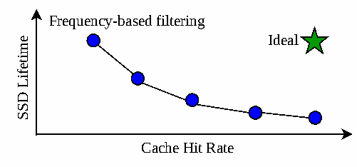

**Original:** Figure 1: Using historical access pattern creates a trade-off between cache hit rate and SSD lifetime. Gandalf maintains cache hit rate while increasing SSD lifetime.

**中文：** 图 1：使用历史访问模式，会在缓存命中率与 SSD 寿命之间形成权衡。Gandalf 在延长 SSD 寿命的同时维持缓存命中率。

**Source:** PDF p.1、2 · S013

**Original:** The key challenge lies in predicting the future reuse of KV caches such that we can selectively retain only the most reusable caches to make the most of SSD’s capacity. Future prediction is difficult, but we found application-specific property that strongly correlates with reuse pattern. We leverage two observations: (1) Recent LLMs increasingly employ hybrid architectures that combine full-attention layers with linear- or sparse-attention layers, and (2) These different attention layer types produce KV caches with substantially different reuse patterns under emerging mainstream workloads: multi-round conversations and agentic workflows. In particular, states from linear- and sparse-attention layers are reused less frequently than KV caches from full-attention layers.

**中文：** 关键挑战在于预测 KV 缓存的未来复用情况，以便只选择性保留最有可能被复用的缓存，充分利用 SSD 容量。预测未来很困难，但我们发现，应用特有的属性与复用模式高度相关。我们利用了两项观察：（1）近期的 LLM 越来越多地采用混合架构，将全注意力层与线性注意力层或稀疏注意力层相结合；（2）在多轮对话和智能体工作流这些新兴主流工作负载中，不同注意力层类型产生的 KV 缓存具有显著不同的复用模式。具体而言，线性注意力层和稀疏注意力层的状态，其复用频率低于全注意力层的 KV 缓存。

**Source:** PDF p.2 · S014

**Original:** Consider a multi-round conversation workload use-case, which reuse pattern illustrated in Table 1. At the beginning of each new round, the full-attention KV entries for the entire preceding context is needed. This pattern repeats for every new round, hence these KV entries are reused across all future rounds. In contrast, a linear-attention layer’s state and sliding-window cache is only needed to generate the immediate next round’s response, and is then discarded, hence every state is only reused once.

**中文：** 以多轮对话工作负载为例，其复用模式如表 1 所示。每一新轮次开始时，都需要此前整个上下文的全注意力 KV 条目。这一模式在每一新轮次中重复，因此这些 KV 条目会在后续所有轮次中被复用。相比之下，线性注意力层的状态和滑动窗口缓存仅用于生成紧接着的下一轮响应，随后便被丢弃，因此每个状态只复用一次。

**Source:** PDF p.1 · S011

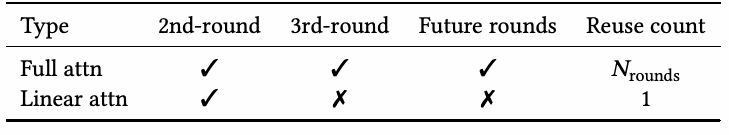

**Original:** Table 1: Reuse pattern of first round’s KV caches in multi-round conversation

**中文：** 表 1：多轮对话中第一轮 KV 缓存的复用模式。

| Type / 类型 | 2nd-round / 第 2 轮 | 3rd-round / 第 3 轮 | Future rounds / 后续轮次 | Reuse count / 复用次数 |
| --- | --- | --- | --- | --- |
| Full attn / 全注意力 | ✓ | ✓ | ✓ | $N_{\mathrm{rounds}}$ |
| Linear attn / 线性注意力 | ✓ | ✗ | ✗ | 1 |

**Source:** PDF p.2 · S015

**Original:** This reuse pattern heterogeneity motivates attention-type-aware cache placement. Writing large, one-time use linear-attention states to SSD provides little cache hit benefit while consuming both write endurance and cache capacity. Layer type can therefore serve as a practical placement signal, allowing us to utilize SSDs to expand cache capacity while minimizing endurance loss. We propose an attention layer-aware placement policy that caches short-lived linear-attention states in host memory while keeping longer-lived full-attention KV caches on SSD.

**中文：** 复用模式的这种异质性启发了注意力类型感知的缓存放置策略。将体积较大、仅使用一次的线性注意力状态写入 SSD，既消耗写入耐久预算和缓存容量，又只能带来很少的缓存命中收益。因此，层类型可以作为实用的放置信号，使我们能够利用 SSD 扩展缓存容量，同时尽量降低耐久损耗。我们提出一种注意力层感知放置策略：将短寿命线性注意力状态缓存在主机内存中，将寿命较长的全注意力 KV 缓存保存在 SSD 上。

**Source:** PDF p.2 · S016

**Original:** However, there are 2 practical challenges that entail this placement policy.

**中文：** 然而，这种放置策略面临 2 个实际挑战。

**Source:** PDF p.2 · S017

**Original:** First, this placement policy is too rigid: the size of CPU DRAM and SSD is fixed, but workload can generate different amounts of different attention states. Particularly, a workload with many concurrent sessions can generate a large number of reusable linear-attention states that exceeds the available DRAM capacity, similarly, a workload with long contexts can generate a large number of reusable full-attention KV caches that exceeds the available SSD capacity. We call this a hardware-to-utilization imbalance. This imbalance forces frequent cache eviction on the saturated tier despite available capacity elsewhere in the storage hierarchy, thus lowering cache-hit rate. Worse, if the overutilization happens in SSD, the resulting write churn can consume its endurance budget more rapidly and further shorten its lifetime. Therefore, we design a capacity-aware placement policy that filters SSD admission based on utilization and pressure of each tier, balancing cache hit rate against SSD endurance.

**中文：** 首先，这种放置策略过于僵化：CPU DRAM 和 SSD 的容量固定，但不同工作负载可能产生不同数量、不同类型的注意力状态。特别是，并发会话较多的工作负载可能产生大量可复用的线性注意力状态，超过可用 DRAM 容量；类似地，长上下文工作负载可能产生大量可复用的全注意力 KV 缓存，超过可用 SSD 容量。我们将其称为“硬件与利用需求失衡”。这种失衡会迫使已饱和的存储层频繁驱逐缓存，即使存储层级中的其他位置仍有空闲容量，从而降低缓存命中率。更糟的是，如果过度利用发生在 SSD 上，由此产生的反复写入会更快消耗其耐久预算，进一步缩短寿命。因此，我们设计了一种容量感知放置策略，根据各层的利用率和压力过滤 SSD 准入，在缓存命中率与 SSD 耐久性之间取得平衡。

**Source:** PDF p.2 · S018

**Original:** Second, such rigid placement moves cache hit from DRAM to SSD, which can hurt TTFT because SSD bandwidth is substantially lower than DRAM bandwidth. Hence, transferring large full-attention KV caches from SSD may hurt TTFT.

**中文：** 其次，这种僵化放置会把原本由 DRAM 提供的缓存命中转移至 SSD。由于 SSD 带宽显著低于 DRAM 带宽，这可能损害首 token 延迟（TTFT）。因此，从 SSD 传输体积较大的全注意力 KV 缓存可能增加 TTFT。

**Source:** PDF p.2 · S019

**Original:** We explore the potential of attention-type-aware placement using an offline oracle that jointly optimizes SSD admission and cache eviction decisions, biased towards our tier placement. The oracle reveals two complementary design principles. First, placement must adapt to tier capacity and selectively persist KV caches on SSD to preserve the prefix-hit boundary. Second, admission and eviction must be optimized jointly: admitting a new cache has cost and benefit. It benefits future reuse, but it has write cost and replacement cost—cost of replacing other cache entries, may or may not already pay for its promised benefit. An SSD admission is beneficial only when its expected reuse value exceeds the sum of write cost and the value of the entries it evicts. Together, these principles characterize the best attainable trade-off among SSD lifetime, cache-hit rate, and TTFT. We then distill the oracle’s decisions into an online, capacity-aware policy that estimates future reuse from historical access patterns.

**中文：** 我们使用离线预知算法（oracle）探索注意力类型感知放置的潜力。该算法倾向于采用我们提出的分层放置方式，并联合优化 SSD 准入与缓存驱逐决策。它揭示了两个相辅相成的设计原则。第一，放置必须适应各层容量，并选择性地将 KV 缓存持久化到 SSD，以保留前缀命中边界。第二，准入和驱逐必须联合优化：准入新缓存既有收益，也有成本。收益来自未来复用，成本则包括写入成本与替换成本——即替换其他缓存条目的代价，而这些被替换条目可能已经兑现、也可能尚未兑现其预期收益。只有当预期复用价值超过写入成本与被驱逐条目价值之和时，SSD 准入才有益。这些原则共同刻画了 SSD 寿命、缓存命中率和 TTFT 之间可达到的最佳权衡。随后，我们将 oracle 的决策提炼为一种在线容量感知策略，根据历史访问模式估计未来复用。

**Source:** PDF p.2 · S021

**Original:** Contributions. Our work makes the following contributions:

**中文：** **贡献。** 本文的主要贡献如下：

**Source:** PDF p.2 · S022

**Original:** (1) We are the first to show that the SSD lifetime is significantly lower than its factory guarantee in production-scale SSD-based KV cache offloading.

**中文：** （1）我们首次表明，在生产规模、基于 SSD 的 KV 缓存卸载中，SSD 寿命显著低于其出厂保证期限。

**Source:** PDF p.2 · S023

**Original:** (2) We show that, leveraging application-level information (the attention type corresponds to each KV cache objects), we can significantly reduce the write volume and increase SSD life time with negligible impact on KV cache hit rate.

**中文：** （2）我们表明，利用应用层信息，即每个 KV 缓存对象对应的注意力类型，可以显著减少写入量并延长 SSD 寿命，同时对 KV 缓存命中率的影响可以忽略不计。

**Source:** PDF p.2 · S024

**Original:** (3) We propose Gandalf, a KV caching system that can increase SSD lifetime by 7.3× (on average) with negligible impact on hit rate across a wide range of LLMs and hardware capacity.

**中文：** （3）我们提出 KV 缓存系统 Gandalf。在广泛的 LLM 和硬件容量配置下，它平均将 SSD 寿命延长至原来的 7.3 倍，对命中率的影响可以忽略不计。

**Source:** PDF p.2 · S025

**Original:** Although this paper only demonstrates Gandalf on SSD, but the technique is extendable to other flash-based storage devices, such as High Bandwidth Flash (HBF).

**中文：** 尽管本文只在 SSD 上展示了 Gandalf，但该技术可扩展到高带宽闪存（HBF）等其他闪存存储设备。

## 2 Motivation / 2 研究动机

### 2.1 KV Caches Exceed Memory Capacity / 2.1 KV 缓存超出内存容量

**Source:** PDF p.2 · S027

**Original:** Over the past years, the increasing intelligence and context window size of LLMs empowered multi-round conversations and agentic workflows. These types of workloads continuously accumulate conversation history, intermediate reasoning, tool outputs, and subagent results. Unlike single-turn requests, these workloads repeatedly extend and reuse an existing prefix, causing each session’s KV-cache footprint to grow throughout its lifetime. Hence, the aggregate KV cache sizes saved across requests and sessions are getting enormous.

**中文：** 过去几年，LLM 智能水平和上下文窗口长度的增长，推动了多轮对话和智能体工作流的发展。这类工作负载会持续积累对话历史、中间推理、工具输出和子智能体结果。与单轮请求不同，它们会反复扩展并复用已有前缀，使每个会话的 KV 缓存占用在其整个生命周期中持续增长。因此，跨请求、跨会话保存的 KV 缓存总量正变得极其庞大。

**Source:** PDF p.2 · S028

**Original:** Long contexts also make cache misses increasingly expensive. When a reusable prefix is not cached, the serving system must recompute its KV states by prefilling all preceding tokens before generating a response. In workloads with long context sizes, such as multi-round conversation, agentic workflow, and long document processing, this repeatedly consumes scarce GPU computation, increasing TTFT and serving cost. People therefore seek to retain as much reusable KV state as possible, effectively trading storage capacity for computation.

**中文：** 长上下文也使缓存未命中的代价越来越高。当某个可复用前缀未被缓存时，服务系统必须在生成响应前，对此前所有 token 执行预填充，重新计算其 KV 状态。在多轮对话、智能体工作流和长文档处理等长上下文工作负载中，这会反复消耗稀缺的 GPU 计算资源，增加 TTFT 和服务成本。因此，人们希望尽量保留更多可复用 KV 状态，实质上是用存储容量换取计算资源。

**Source:** PDF p.2、3 · S029

**Original:** Our analysis of two one-day SemiAnalysis Claude Code traces [40] estimates that representative hybrid models generate 81–240 TB of KV-cache state per day (Table 2). At peak, the concurrently active KV-cache working set reaches 8.6TB, exceeding practical host-memory capacity, hence provisioning sufficient CPU DRAM would be prohibitively expensive. Retaining this state for future reuse is therefore infeasible using memory alone. Consequently, the cache capacity must extend beyond GPU and host memory to higher-capacity local storage.

**中文：** 我们分析了两条各持续一天的 SemiAnalysis Claude Code 轨迹 [40]，估计代表性混合模型每天会生成 81–240 TB 的 KV 缓存状态（表 2）。在峰值时，并发活跃的 KV 缓存工作集达到 8.6 TB，超过实际可配置的主机内存容量；配置足够的 CPU DRAM 将带来难以承受的成本。因此，仅靠内存无法保留这些状态以供未来复用。缓存容量必须扩展到 GPU 和主机内存之外、容量更大的本地存储。

**Source:** PDF p.2 · S020

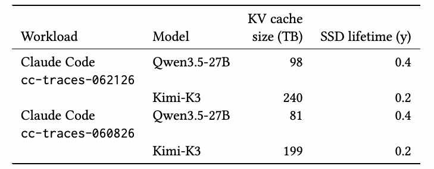

**Original:** Table 2: Under KV cache offloading workloads, SSDs may last less than a year—far short of their five-year warranty.

**中文：** 表 2：在 KV 缓存卸载工作负载下，SSD 的寿命可能不足一年，远短于五年保修期。

| Workload / 工作负载 | Model / 模型 | KV cache size / KV 缓存量（TB） | SSD lifetime / SSD 寿命（年） |
| --- | --- | ---: | ---: |
| Claude Code · cc-traces-062126 | Qwen3.5-27B | 98 | 0.4 |
| Claude Code · cc-traces-062126 | Kimi-K3 | 240 | 0.2 |
| Claude Code · cc-traces-060826 | Qwen3.5-27B | 81 | 0.4 |
| Claude Code · cc-traces-060826 | Kimi-K3 | 199 | 0.2 |

### 2.2 Why not HDD cluster? / 2.2 为什么不用 HDD 集群？

**Source:** PDF p.3 · S032

**Original:** Local NVMe SSD is a popular extension of the memory hierarchy for LLM serving [13, 16, 28, 38, 41, 43]. Since SSD is known to have a limited endurance problem, why haven’t people used HDD instead? To make HDD fast enough, we could parallelize I/O across a cluster of HDDs. To answer this question, we first compare the endurance of SSD and HDD given the manufacturer’s specifications.

**中文：** 本地 NVMe SSD 是 LLM 服务中扩展内存层级的常见选择 [13, 16, 28, 38, 41, 43]。既然 SSD 的耐久性有限，为什么人们没有改用 HDD？为了使 HDD 足够快，可以让一个 HDD 集群并行执行 I/O。为回答这一问题，我们首先依据制造商规格比较 SSD 与 HDD 的耐久能力。

**Source:** PDF p.3 · S033

**Original:** SSD stores data by programming charge in NAND-flash cells, which tolerate only a finite number of program/erase (write) cycles. Manufacturers quantify this endurance as Terabytes Written (TBW), or equivalently Drive Writes Per Day (DWPD) over a warranty period. For a drive with capacity $C$, rated for $D$ DWPD over $Y$ years, its host-write endurance budget is $E_{\mathrm{TBW}}=C\times D\times365\times Y$. Garbage collection can amplify host writes by copying live data while reclaiming space. The write-amplification factor (WAF) measures this additional write traffic: $\mathrm{WAF}=W_{\mathrm{NAND}}/W_{\mathrm{host}}$, where $W_{\mathrm{host}}$ and $W_{\mathrm{NAND}}$ denote the logical host writes and physical NAND writes, respectively. Thus, SSD will live until

**中文：** SSD 通过向 NAND 闪存单元写入电荷来存储数据，而这些单元只能承受有限次数的编程／擦除（写入）循环。制造商以总写入 TB 数（TBW），或保修期内等价的每日整盘写入次数（DWPD）来量化其耐久性。对于容量为 $C$、在 $Y$ 年内额定支持 $D$ DWPD 的设备，其主机写入耐久预算为 $E_{\mathrm{TBW}}=C\times D\times365\times Y$。垃圾回收会在回收空间时复制有效数据，从而放大主机写入量。写放大系数（WAF）用于衡量这部分额外写入流量：$\mathrm{WAF}=W_{\mathrm{NAND}}/W_{\mathrm{host}}$，其中 $W_{\mathrm{host}}$ 和 $W_{\mathrm{NAND}}$ 分别表示逻辑主机写入量与物理 NAND 写入量。因此，SSD 可持续使用到：

**Source:** PDF p.3 · S035 · Equation / 公式（1）

$$
T_{\mathrm{SSD}}=\frac{E_{\mathrm{TBW}}}{\mathrm{WAF}\times E_{\mathrm{workload}}}\quad\text{Terabytes Written}\tag{1}
$$

公式末尾的英文原标签分别为“写入 TB 数”和“读写 TB 数”；原式的量纲与寿命推算口径见翻译说明。

**Source:** PDF p.3 · S036

**Original:** HDDs store data by magnetizing regions of rotating platters. Manufacturers specify an annual total read and write limit of $RW_{\mathrm{limit}}$ TB/year. Over $Y$ years, this rate corresponds to a nominal cumulative transfer envelope of $E_{\mathrm{HDD}}=RW_{\mathrm{limit}}\times Y$. Manufacturers also specify HDD reliability by Annualized Failure Rate (AFR) and Mean Time Between Failures (MTBF). Exceeding $E_{\mathrm{HDD}}$ results in increasing AFR and decreasing MTBF, hence more frequent failures and recovery overhead will occur, slowing the HDD for both reads and writes. For a KV-cache workload that writes $W_{\mathrm{host}}$ bytes and reads each written byte an average of $h$ times, the total HDD workload is $E_{\mathrm{workload}}=(1+h)W_{\mathrm{host}}$. HDD operates reliably until

**中文：** HDD 通过磁化旋转盘片上的区域来存储数据。制造商规定每年的总读写上限为 $RW_{\mathrm{limit}}$ TB／年。在 $Y$ 年内，该速率对应的标称累计传输额度为 $E_{\mathrm{HDD}}=RW_{\mathrm{limit}}\times Y$。制造商也使用年化故障率（AFR）和平均无故障时间（MTBF）来描述 HDD 可靠性。超过 $E_{\mathrm{HDD}}$ 会使 AFR 升高、MTBF 降低，从而带来更频繁的故障和恢复开销，拖慢 HDD 的读写。对于主机写入量为 $W_{\mathrm{host}}$ 字节、每个写入字节平均被读取 $h$ 次的 KV 缓存工作负载，HDD 总工作负载为 $E_{\mathrm{workload}}=(1+h)W_{\mathrm{host}}$。HDD 可以可靠运行到：

**Source:** PDF p.3 · S038 · Equation / 公式（2）

$$
T_{\mathrm{HDD}}=\frac{E_{\mathrm{HDD}}}{E_{\mathrm{workload}}}\quad\text{Terabytes Read and Written}\tag{2}
$$

公式末尾的英文原标签分别为“写入 TB 数”和“读写 TB 数”；原式的量纲与寿命推算口径见翻译说明。

**Source:** PDF p.3 · S039

**Original:** This differs from SSDs, for which reads do not consume the rated TBW endurance.

**中文：** 这与 SSD 不同：SSD 的读取不消耗额定 TBW 耐久预算。

**Source:** PDF p.3 · S040

**Original:** Takeaway: Although HDDs avoid flash wear-out, both reads and writes exercise their mechanical components and count toward their lifetime. KV-cache workloads generate substantial traffic in both directions, making HDDs poorly suited as a storage. Figure 2 compares SSD and HDD configurations with equal aggregate I/O bandwidth and \$20k Total Cost of Ownership (TCO) budget. HDDs require substantially more devices, power, and space, yet it has a shorter projected lifetime than SSD when each written KV-cache entry is reused at least 3×.

**中文：** **要点：** 虽然 HDD 没有闪存磨损问题，但读写都会驱动机械部件，并计入其寿命负载。KV 缓存工作负载在读写两个方向都会产生大量流量，使 HDD 不适合作为这类存储。图 2 比较了总 I/O 带宽相同、总拥有成本（TCO）预算均为 2 万美元的 SSD 与 HDD 配置。HDD 需要多得多的设备、功耗和空间；当每个写入的 KV 缓存条目被复用至少 3 次时，其预计寿命仍比 SSD 更短。

**Source:** PDF p.3 · S030

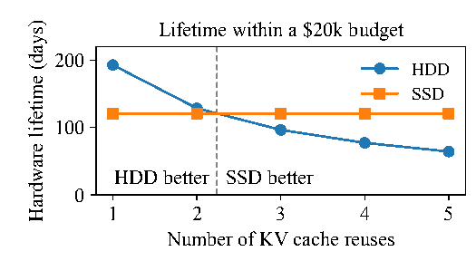

**Original:** Figure 2: Under same acquisition budget, SSD is more optimal to be used for KV cache offloading workload, which is reuse-heavy.

**中文：** 图 2：在相同购置预算下，SSD 更适合用于复用密集的 KV 缓存卸载工作负载。

**Source:** PDF p.3 · S041

**Original:** Since multi-round conversation and agentic workloads trigger heavy reuse as shown in Table 1, SSD is the more cost-effective option compared to HDD, at the same Total Cost of Ownership (TCO). Therefore, we focused on SSD for this work, and leave the integration with HDD for future work. Although we focus on commodity enterprise SSDs, our placement and endurance-management techniques also apply to emerging flash-based context-memory tiers, including high-bandwidth flash (HBF).

**中文：** 由于多轮对话和智能体工作负载会产生表 1 所示的大量复用，在相同总拥有成本（TCO）下，SSD 比 HDD 更具成本效益。因此，本文聚焦 SSD，将与 HDD 的集成留作未来工作。尽管我们重点研究通用企业级 SSD，但所提出的放置和耐久管理技术也适用于高带宽闪存（HBF）等新兴闪存上下文存储层。

### 2.3 KV Caching is Rapidly Killing SSDs / 2.3 KV 缓存正在迅速耗尽 SSD 寿命

**Source:** PDF p.3 · S043

**Original:** Under frontier model and agentic workloads, our analysis shows that even a 30-TB enterprise SSD can exhaust its rated TBW in less than one year. Smaller enterprise SSDs wear out even faster, with a 2-TB drive reaching its rated TBW in just days. In §2.2, we discussed that SSD wear is a product of host-write volume and device-level write amplification. We target host writes by reducing the KV-cache writes issued to SSD.

**中文：** 我们的分析表明，在前沿模型和智能体工作负载下，即使是 30 TB 企业级 SSD，也可能在不到一年内耗尽额定 TBW。容量较小的企业级 SSD 磨损得更快，2 TB 设备只需数天就可能达到额定 TBW。第 2.2 节讨论过，SSD 磨损是主机写入量与设备级写放大的乘积。我们针对主机写入，减少向 SSD 发出的 KV 缓存写入。

**Source:** PDF p.3 · S044

**Original:** Tiered KV caches commonly use write-through or write-back offloading.

**中文：** 分层 KV 缓存通常采用直写或回写卸载。

**Source:** PDF p.3 · S045

**Original:** Write-through immediately copies every admitted KV states to SSD, maximizing availability at multiple tiers, but generating substantial SSD write. This duplication preserves the entry after DRAM eviction, but wastes SSD endurance when all of its reuse occurs in a short time while it remains in DRAM. The SSD copy then consumes write budget without serving a cache hit.

**中文：** **直写（write-through）** 会立即将每个准入的 KV 状态复制到 SSD，使其在多个存储层中尽可能可用，但会产生大量 SSD 写入。这种复制可在条目被 DRAM 驱逐后继续保留它；然而，如果条目的全部复用都在其仍驻留 DRAM 的短时间内完成，就会浪费 SSD 耐久预算。此时 SSD 副本消耗了写入预算，却未贡献任何缓存命中。

**Source:** PDF p.3 · S046

**Original:** Write-back persists demoted KV states from higher storage tier regardless of its expected reuse. This policy still writes every DRAM eviction to SSD, including states that contribute little to future cache hits.

**中文：** **回写（write-back）** 会将从上层存储降级的 KV 状态持久化，而不考虑其预期复用。这种策略仍会把每个被 DRAM 驱逐的状态写入 SSD，其中包括对未来缓存命中几乎没有贡献的状态。

**Source:** PDF p.3 · S047

**Original:** Selective write-through reduces this traffic using a fixed reuse threshold; for example, NVIDIA Dynamo offloads a block only after its access frequency reaches two [30]. However, frequency-only filtering ignores state size, layer-specific reuse, tier occupancy, and the remaining write budget, allowing large, short-lived states to consume substantial endurance for little benefit.

**中文：** **选择性直写（selective write-through）** 使用固定的复用阈值来减少这类流量。例如，NVIDIA Dynamo 仅在块的访问频率达到两次后才进行卸载 [30]。然而，只依赖频率的过滤忽略了状态大小、特定层的复用特征、各层占用情况和剩余写入预算，使得体积较大、寿命较短的状态可能消耗大量耐久预算，却收益甚微。

### 2.4 How does prior work address SSD endurance? / 2.4 既有工作如何应对 SSD 耐久性问题？

**Source:** PDF p.3 · S049

**Original:** SSD endurance has long been a concern in flash-based caching systems. Traditional systems, such as Flashcache [11] and Google’s Colossus Flash Cache [51], use SSDs to accelerate access to persistent data. Recent studies show that KV-cache offloading introduces similar endurance challenges in LLM serving [23, 42]. Existing approaches can be grouped into three categories.

**中文：** SSD 耐久性长期以来一直是闪存缓存系统关注的问题。Flashcache [11] 和 Google 的 Colossus Flash Cache [51] 等传统系统使用 SSD 加速持久化数据访问。近期研究表明，KV 缓存卸载也给 LLM 服务带来了类似的耐久性挑战 [23, 42]。现有方法可分为三类。

**Source:** PDF p.3、4 · S050

**Original:** Increasing physical write endurance. Hardware provisioning distributes writes across more SSDs, aggregating write budget and reducing the per-device write rate, thereby increasing aggregate write endurance at the cost of additional acquisition, power, and maintenance costs [19]. Classic SSD endurance technique called retention relaxation increases tolerable NAND program/erase cycles by reducing data retention requirements [5, 26]. FlashAccel exploits the short lifetime of KV caches to trade retention for endurance [45]. However, both approaches increase the available write budget rather than reducing host-level KV-cache writes, and may require additional hardware or device support. They also do not leverage unique property of KV caches: we can choose to not cache the KV cache and recompute it when needed. It may therefore remain insufficient for sustained LLM serving, especially in multi-round and agentic workloads.

**中文：** **提高物理写入耐久性。** 通过增加硬件，将写入分散到更多 SSD 上，汇总写入预算并降低每个设备的写入速率，可以提高总体写入耐久能力，代价是额外的购置、功耗和维护成本 [19]。一种经典 SSD 耐久性技术称为“放宽数据保持要求”，它通过降低数据保持要求，提高 NAND 可承受的编程／擦除循环次数 [5, 26]。FlashAccel 利用 KV 缓存寿命短的特点，用较短数据保持时间换取更高耐久性 [45]。然而，这两类方法增加的是可用写入预算，并未减少主机侧 KV 缓存写入，而且可能需要额外硬件或设备支持。它们也没有利用 KV 缓存的一项独有属性：可以选择不缓存，而在需要时重新计算。因此，对于持续的 LLM 服务，尤其是多轮对话和智能体工作负载，这些方法仍可能不足。

**Source:** PDF p.4 · S052

**Original:** Selective KV cache admission and eviction. Although not aimed at prolonging SSD lifetime, many existing cache admission and eviction policies selectively filters KV caches to optimize cache utilization and reuse to increase cache hit rate, indirectly reducing writes. One approach schedules requests that involve resident KV caches, which KV caches fits in the available space [52]. LRU-K admits a KV cache only after it has been accessed K times [31, 35]. DeepSeek-V4.1 retains sliding window KV caches in distributed memory pool to guarantee other KV cache availability for at least 72 hours inside the persistent storage [8]. HotPrefix [22] and PrefixShield [46] leverages prefix-based policies to evict cold KV caches from GPU HBM, while Workload-Aware [44] considers reuse probability, block position, and lifetime. LPC [49] and SAECache [12] predict reuse through learning-based methods. RR-evict [34] uses a round-robin eviction to ensure fairness across sessions, while Bidaw [14] predicts reuse distance from prior responses in the session. Another approach uses recency, frequency, and EWMA-based reuse estimates for prefetching and eviction [43]. MeritKV [17] gates admission to storage backend if the saved prefill time, minus lookup and transfer costs, minus historical miss’ recomputation costs, is less than a threshold. However, these approaches do not explicitly optimize SSD endurance.

**中文：** **选择性 KV 缓存准入与驱逐。** 尽管许多现有缓存准入和驱逐策略并非为延长 SSD 寿命而设计，它们仍会选择性过滤 KV 缓存，通过优化缓存利用与复用提高命中率，并间接减少写入。一种方法调度那些所需 KV 缓存已驻留、且能容纳于可用空间中的请求 [52]。LRU-$K$ 仅在 KV 缓存已被访问 $K$ 次后才准入 [31, 35]。DeepSeek-V4.1 将滑动窗口 KV 缓存保留在分布式内存池中，以保证其他 KV 缓存能在持久化存储中保留至少 72 小时 [8]。HotPrefix [22] 和 PrefixShield [46] 利用基于前缀的策略，从 GPU HBM 中驱逐冷 KV 缓存；Workload-Aware [44] 则考虑复用概率、块位置和寿命。LPC [49] 和 SAECache [12] 使用学习方法预测复用。RR-evict [34] 使用轮转驱逐保证会话间公平性，Bidaw [14] 根据会话中此前的响应预测复用距离。另一种方法综合最近访问、频率和基于指数加权移动平均（EWMA）的复用估计，执行预取与驱逐 [43]。MeritKV [17] 在节省的预填充时间减去查找与传输成本、再减去历史未命中的重新计算成本后低于阈值时，对存储后端准入进行门控。然而，这些方法并未显式优化 SSD 耐久性。

### 2.5 SSD lifetime and Cache Hit Rate Trade-off / 2.5 SSD 寿命与缓存命中率之间的权衡

**Source:** PDF p.4 · S054

**Original:** Hardware configuration—size of host memory and SSD capacity—is fixed. But workload demand can vary substantially over time. Since cache entries are reused homogeneously, the storage hierarchy must treat them uniformly. Hence, existing solutions trades off SSD lifetime against cache hit rate, as shown in Figure 3.

**中文：** 硬件配置——主机内存大小和 SSD 容量——是固定的，但工作负载需求会随时间显著变化。由于缓存条目被视为具有同质的复用特征，存储层级必须统一处理它们。因此，现有方案需要在 SSD 寿命与缓存命中率之间作出权衡，如图 3 所示。

**Source:** PDF p.4 · S051

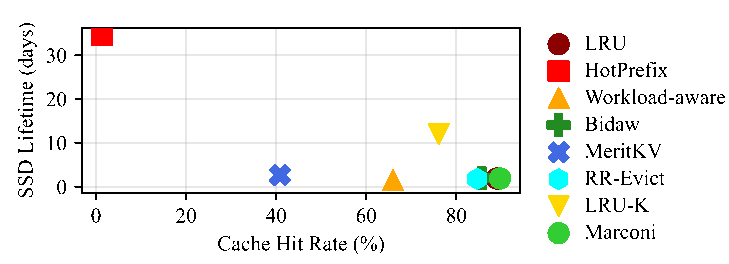

**Original:** Figure 3: Existing systems trades off SSD lifetime and cache hit rate.

**中文：** 图 3：现有系统需要在 SSD 寿命和缓存命中率之间作出权衡。

**Source:** PDF p.4 · S055

**Original:** Storing more KV-cache entries on SSD increases the probability that future requests find reusable state, thereby improving the cache-hit rate and reducing TTFT. However, the resulting write volume rapidly consumes the SSD’s finite endurance budget. Conversely, storing fewer entries reduces SSD traffic and extends device lifetime, but may discard reusable state, lowering the cache-hit rate and increasing TTFT. Thus, when cache entries are homogeneous, improving one objective necessarily comes at the expense of the other. Breaking this trade-off requires identifying writes that consume SSD endurance but contribute little to future cache reuse.

**中文：** 在 SSD 上存储更多 KV 缓存条目，会提高未来请求找到可复用状态的概率，从而提高缓存命中率并降低 TTFT。然而，由此产生的写入量会迅速消耗 SSD 有限的耐久预算。反过来，存储更少条目可减少 SSD 流量并延长设备寿命，但可能丢弃可复用状态，降低命中率并增加 TTFT。因此，当缓存条目具有同质特征时，改善一个目标必然要牺牲另一个目标。要打破这一权衡，必须识别那些消耗 SSD 耐久预算、却对未来缓存复用贡献很小的写入。

### 2.6 Key Observation: Hybrid model has heterogeneous reuse pattern / 2.6 关键观察：混合模型具有异质复用模式

**Source:** PDF p.4 · S058

**Original:** Dense models use full attention across all layers. When a cached context is resumed, the KV entries of every tokens in the sequence prefix are reused. Thus, storing a larger portion of the prefix allows more recomputation to be avoided, creating a near one-for-one trade-off between SSD writes and cache-hit rate. Each layer and token’s admitted KV entry provides comparable reuse value, and reducing SSD writes generally sacrifices a corresponding caching opportunity. This creates the apparent one-for-one trade-off between SSD lifetime and cache-hit rate.

**中文：** 稠密模型的所有层都使用全注意力。当恢复使用某个缓存上下文时，序列前缀中每个 token 的 KV 条目都会被复用。因此，存储更大比例的前缀可以避免更多重新计算，使 SSD 写入量与缓存命中率之间形成近似一对一的权衡。每一层、每个 token 被准入的 KV 条目都提供相近的复用价值，减少 SSD 写入通常就会牺牲相应的缓存机会。由此形成 SSD 寿命与缓存命中率之间表面上的一对一权衡。

**Source:** PDF p.4 · S059

**Original:** Hybrid models break this trade-off due to its model architecture: combining full-attention layers with sparse attention layers, such as linear and sliding-window attention. As shown in Table 1, cached states from different layer types exhibit substantially non-uniform reuse patterns, where linear state is reused much less than full attention KV cache. We observed that under append-only workloads such as multi-round conversation, all prefix tokens’ full-attention KV caches are reused in every subsequent round, so their reuse count increases as the conversation grows. By contrast, each sparse-attention state is typically used only once—to generate the immediately following round—before being superseded by a newer state.

**中文：** 混合模型的架构打破了这一权衡：它将全注意力层与线性注意力、滑动窗口注意力等稀疏注意力层相结合。如表 1 所示，不同层类型的缓存状态呈现出显著不均匀的复用模式，线性状态的复用远少于全注意力 KV 缓存。我们观察到，在多轮对话等仅追加的工作负载下，所有前缀 token 的全注意力 KV 缓存都会在后续每一轮被复用，因此其复用次数随对话增长而增加。相比之下，每个稀疏注意力状态通常只使用一次，用于生成紧接着的下一轮，随后便被更新的状态取代。

**Source:** PDF p.4 · S060

**Original:** Uniformly writing these short-lived states to SSD is inefficient. Write-through immediately persists them, while write-back may persist them upon eviction, even though they are likely to be superseded after only one reuse. When the latest linear-attention state can remain in DRAM until the next round, its SSD copy provides no additional cache hit but still consumes SSD endurance and capacity. Such writes may also evict more reusable full-attention KV entries, further reducing cache effectiveness.

**中文：** 将这些短寿命状态统一写入 SSD 是低效的。直写会立即将其持久化，回写则可能在驱逐时持久化，即使它们很可能只复用一次就被取代。当最新的线性注意力状态可以一直留在 DRAM 中直到下一轮时，其 SSD 副本不会增加缓存命中，却仍消耗 SSD 耐久预算和容量。这类写入还可能驱逐更有复用价值的全注意力 KV 条目，进一步降低缓存效果。

## 3 Overview / 3 系统概览

**Source:** PDF p.4、5 · S062

**Original:** As shown in Figure 4, Gandalf involves a two-tier storage hierarchy setup, comprising of DRAM (L1) and SSD (L2). § 3.1 describes our attention type-aware placement policy that strictly decides the placement of each admitted state based on the attention type’s reuse pattern. § 3.2 investigates the potential of attention-type-aware placement by an oracle-based optimal algorithmic approximation that maximizes cache hit rate while minimizing SSD writes in a wear-aware manner. As a result of the investigation, § 3.3 explains the capacity-aware cache management policy that decides whether to drop or move the state to SSD based on its expected future reuse and the SSD write cost consumed. § 3.4 explains an optimization to reduce the score computation overhead while maintaining its effectiveness.

**中文：** 如图 4 所示，Gandalf 采用包含 DRAM（L1）和 SSD（L2）的两级存储层级。第 3.1 节介绍注意力类型感知放置策略，严格依据注意力类型的复用模式确定每个准入状态的位置。第 3.2 节通过基于 oracle 的最优算法近似，研究注意力类型感知放置的潜力，以磨损感知方式在最小化 SSD 写入的同时最大化缓存命中率。基于这一研究，第 3.3 节介绍容量感知缓存管理策略，根据状态的预期未来复用与 SSD 写入成本，决定将其丢弃还是移动至 SSD。第 3.4 节介绍一项优化，在保持有效性的同时降低评分计算开销。

**Source:** PDF p.4 · S056

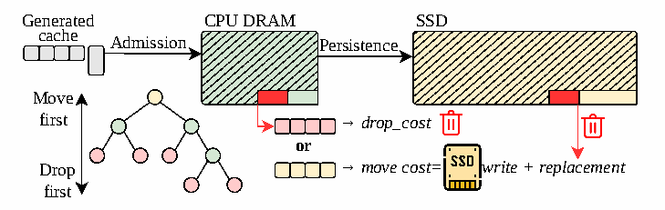

**Original:** Figure 4: Gandalf overview. Gandalf admits new KV caches to host memory and, when it is full, chooses between dropping a DRAM cache or moving it to SSD based on SSD write and replacement-cache recomputation costs.

**中文：** 图 4：Gandalf 概览。Gandalf 将新 KV 缓存准入主机内存；内存满时，根据 SSD 写入成本及替换缓存的重新计算成本，在丢弃 DRAM 缓存与将其移入 SSD 之间选择。

### 3.1 Attention type-aware placement / 3.1 注意力类型感知放置

**Source:** PDF p.5 · S064

**Original:** Hybrid models produce cached states with substantially different sizes and reuse patterns. Full-attention layers retain per-token KV entries, so their cache grows with the prefix length, whereas linear-attention layers maintain a fixed-size recurrent state at each checkpoint. Sliding-window layers retain only the most recent W tokens and can therefore use the same placement policy as linear-attention layers. The state types also differ substantially in size. Across our evaluated models, a single linear-attention state occupies as much space as the full-attention KV entries for 2k–16k tokens. However, reuse is only meaningful when all types of states are available at the same prefix boundary.

**中文：** 混合模型产生的缓存状态在大小和复用模式上存在显著差异。全注意力层保留每个 token 的 KV 条目，因此缓存随前缀长度增长；线性注意力层则在每个检查点维护固定大小的递归状态。滑动窗口层仅保留最近 $W$ 个 token，因此可以采用与线性注意力层相同的放置策略。各类状态的大小也相差很大。在我们评估的模型中，一个线性注意力状态所占空间，相当于 2k–16k 个 token 的全注意力 KV 条目。然而，只有当各类状态都在同一个前缀边界上可用时，复用才有意义。

**Source:** PDF p.5 · S065

**Original:** This heterogeneity in size and reuse pattern brings 2 opportunities: (1) not all KV state needs to be cached, and (2) where an admitted state should be placed. The heterogeneity creates two distinct cache-management decisions. First, admission determines which generated states provide sufficient reuse value to retain. Second, placement determines the storage tier in which each admitted state should reside.

**中文：** 大小与复用模式的异质性带来 2 个机会：（1）并非所有 KV 状态都需要缓存；（2）可以决定已准入状态应放在哪里。这种异质性产生两个不同的缓存管理决策。首先，准入决定哪些生成状态具有足够的复用价值、值得保留。其次，放置决定每个已准入状态应驻留在哪个存储层。

**Source:** PDF p.5 · S066

**Original:** Prior works has solved “which KV state should be cached” by probing the reuse boundary [33, 46]. These mechanisms address which states should be retained, but they do not determine whether an admitted state should reside in DRAM or in SSD. Our work is aimed to improve SSD lifetime by managing KV cache placement leveraging its attention layer type to give a hint on the most suitable placement in the storage tier.

**中文：** 既有工作通过探测复用边界，解决了“应缓存哪些 KV 状态”的问题 [33, 46]。这些机制决定哪些状态应被保留，但不决定已准入状态应驻留在 DRAM 还是 SSD 中。我们的目标是利用 KV 缓存的注意力层类型，为最合适的存储层放置位置提供线索，通过管理缓存放置延长 SSD 寿命。

**Source:** PDF p.5 · S067

**Original:** We therefore retain linear state in DRAM and full attention KV caches in SSD. Each linear state generated at the end of each conversation round is put in DRAM while the full attention KV cache is put on SSD. When the storage tier (DRAM/SSD) is out of space, the least-recently-used cache on the tier is evicted.

**中文：** 因此，我们将线性状态保留在 DRAM 中，将全注意力 KV 缓存保留在 SSD 中。每轮对话结束时生成的线性状态放入 DRAM，全注意力 KV 缓存则放入 SSD。当某个存储层（DRAM／SSD）空间耗尽时，驱逐该层最近最少使用的缓存。

### 3.2 Understanding the Potential / 3.2 理解潜在收益

**Source:** PDF p.5 · S069

**Original:** Mathematical model to estimate the SSD-lifetime improvement of attention-type-aware placement over conventional write-back, independent from eviction strategies. Consider a workload containing s sessions, each with an average of n cached tokens and r conversation rounds. Let f denote the size of full-attention KV entries per token, and let ℓ denote the size of one linear-attention state. The size of full-attention and linear-attention state for each session are therefore F = nf and L = rℓ, respectively.

**中文：** **数学模型：** 估计注意力类型感知放置相较传统回写在 SSD 寿命上的改善，独立于驱逐策略。考虑包含 $s$ 个会话的工作负载，每个会话平均有 $n$ 个缓存 token 和 $r$ 轮对话。令 $f$ 为每个 token 的全注意力 KV 条目大小，$\ell$ 为一个线性注意力状态的大小。因此，每个会话的全注意力状态与线性注意力状态总大小分别为 $F=nf$ 和 $L=r\ell$。

**Source:** PDF p.5 · S070

**Original:** Under write-back, both full-attention KV entries and linear-attention states are admitted to DRAM and written to SSD upon eviction. Let C denote the CPU DRAM capacity reserved for KV cache. Assuming each evicted byte is written to SSD at most once except the last C bytes, the SSD host-write volume is $W_{\mathrm{write\text{-}back}}$ = s (F + L) − C.

**中文：** 在回写策略下，全注意力 KV 条目和线性注意力状态都先准入 DRAM，并在被驱逐时写入 SSD。令 $C$ 为预留给 KV 缓存的 CPU DRAM 容量。假设除最后留在 DRAM 中的 $C$ 字节外，每个被驱逐字节最多写入 SSD 一次，则 SSD 主机写入量为 $W_{\mathrm{write\text{-}back}}=s(F+L)-C$。

**Source:** PDF p.5 · S072

**Original:** With attention type-aware placement, only a fraction p ∈ [0, 1] of the linear-attention states needs to be spilled to SSD, while all full-attention KV entries are written to SSD. Hence, the SSD host-write volume is $W_{\mathrm{type\text{-}aware}}$ = sF + psL = s (F + pL).

**中文：** 采用注意力类型感知放置时，仅有比例为 $p\in[0,1]$ 的线性注意力状态需要溢出至 SSD，而所有全注意力 KV 条目都写入 SSD。因此，SSD 主机写入量为 $W_{\mathrm{type\text{-}aware}}=sF+psL=s(F+pL)$。

**Source:** PDF p.5 · S073

**Original:** SSD’s projected lifetime T is inversely proportional to its write rate since writing to SSD reduces its lifespan. So the approximate SSD-lifetime improvement is

**中文：** 由于写入 SSD 会缩短其寿命，预计 SSD 寿命 $T$ 与写入速率成反比。因此，SSD 寿命的近似改善倍数为：

**Source:** PDF p.5 · S074 · Equation / 公式（3）

$$
I_{\mathrm{type\text{-}aware}}=\frac{T_{\mathrm{type\text{-}aware}}}{T_{\mathrm{write\text{-}back}}}\approx\frac{W_{\mathrm{write\text{-}back}}}{W_{\mathrm{type\text{-}aware}}}=\frac{s(F+L)-C}{s(F+pL)}\tag{3}
$$

**Source:** PDF p.5 · S075

**Original:** Thus, the attainable SSD-lifetime improvement grows with the size of linear-attention state relative to full-attention KV cache and decreases with the fraction of linear state that must spill to SSD.

**中文：** 因此，线性注意力状态相对于全注意力 KV 缓存越大，可达到的 SSD 寿命改善越显著；必须溢出至 SSD 的线性状态比例越高，改善则越小。

**Source:** PDF p.5 · S076

**Original:** Capacity requirement for type-aware placement. The ideal type-aware placement keeps linear-attention states in DRAM and full-attention KV cache in SSD. In Equation 3, this corresponds to p = 0, which maximizes the SSD lifetime improvement. However, achieving this upper bound requires sufficient DRAM capacity to retain the live linear states.

**中文：** **类型感知放置的容量要求。** 理想的类型感知放置将线性注意力状态保留在 DRAM，将全注意力 KV 缓存保留在 SSD。在公式（3）中，这对应 $p=0$，可最大化 SSD 寿命改善。然而，要达到这一上界，需要有足够的 DRAM 容量保留仍然有效的线性状态。

**Source:** PDF p.5 · S077

**Original:** As observed in Section 2.6, in multi-round conversation and agentic workloads, each session only needs to retain one linear-attention state at a time, but it must retain all full-attention KV entries for the entire prefix. Strict separation requires enough DRAM to hold one live linear-attention state for every session and enough SSD capacity to hold every session’s full-attention KV cache. As shown in Figure 5, with the same number of sessions, the CPU/SSD capacity ratio required to achieve maximum SSD-lifetime improvement decreases with session length because the live linear state has fixed size, whereas full-attention KV grows with the number of tokens. Consequently, strict type-based placement cannot always use both tiers efficiently. For short sessions, linear states dominate capacity and some may need to borrow SSD space. For long sessions, full-attention KV dominates and may benefit from borrowing unused DRAM space. We therefore design a capacity-aware placement algorithm as an SSD admission gate that treats attention type as a reuse pattern proxy for placement preference. The gate selects which objects to move, retain, or evict based on their size, attention type-specific expected reuse, tier occupancy, and SSD-write cost. We first study an offline optimal algorithm, approximate its decisions, and then derive a practical online policy.

**中文：** 如第 2.6 节所述，在多轮对话和智能体工作负载中，每个会话在任一时刻只需保留一个线性注意力状态，但必须保留整个前缀的全部全注意力 KV 条目。严格分离要求 DRAM 足以容纳每个会话的一个有效线性状态，SSD 足以容纳每个会话的全注意力 KV 缓存。如图 5 所示，在会话数量相同的情况下，为达到最大 SSD 寿命改善所需的 CPU／SSD 容量比会随会话长度增长而下降，因为有效线性状态大小固定，而全注意力 KV 随 token 数增长。因此，严格按类型放置并不总能高效利用两个存储层。对于短会话，线性状态主导容量需求，部分状态可能需要借用 SSD 空间。对于长会话，全注意力 KV 主导容量需求，借用空闲 DRAM 空间可能更有利。因此，我们设计了一种作为 SSD 准入门控的容量感知放置算法，将注意力类型作为复用模式的代理信号，用来表达放置偏好。该门控根据对象大小、特定注意力类型的预期复用、各层占用情况及 SSD 写入成本，选择移动、保留或驱逐哪些对象。我们先研究离线最优算法，再近似其决策，最后推导出实用的在线策略。

**Source:** PDF p.5 · S071

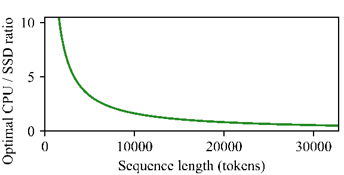

**Original:** Figure 5: CPU/SSD capacity ratio to obtain maximum SSD lifetime improvement.

**中文：** 图 5：获得最大 SSD 寿命改善所需的 CPU／SSD 容量比。

**Source:** PDF p.6 · S078

**Original:** Oracle-based approximation. We know that we can improve the SSD lifetime by $I_{\mathrm{type\text{-}aware}}$ , but this model may not preserve the cache hit rate. We therefore modeled an offline oracle condition that optimizes cache hit rates while minimizing SSD write volume to prolong SSD lifetime. Sparse states are still kept in DRAM, while full KV caches are kept in SSD.

**中文：** **基于 oracle 的近似。** 我们知道，SSD 寿命可以改善至原来的 $I_{\mathrm{type\text{-}aware}}$ 倍，但这一模型未必能维持缓存命中率。因此，我们构建了一个离线 oracle 场景，在优化缓存命中率的同时尽量减少 SSD 写入量，以延长 SSD 寿命。稀疏状态仍保存在 DRAM，全注意力 KV 缓存仍保存在 SSD。

**Source:** PDF p.6 · S079

**Original:** Cost model. We keep two costs of admission: the benefit and the cost. Benefit: Promoting an object that is hit H times saves $C_r$ · H dollars of recomputation, where $C_r$ is the portion of GPU rent to recompute one chunk of KV. Cost: Promoting an object of size s bytes costs $C_w$ · s dollars, where $C_w$ is the portion of SSD purchase cost to write one byte. Since SSD is eventually broken due to the write volume, we need to consider the cost of writing. When an admission causes eviction of another object that still has remaining $H_{\mathrm{left}}$ hits, the benefit paid by the evicted object becomes the replacement cost of the admitted object. Hence, the total cost becomes $C_w$ · s + $C_r$ · $H_{\mathrm{left}}$ .

**中文：** **成本模型。** 我们为准入同时考虑收益和成本。**收益：** 将一个会被命中 $H$ 次的对象提升至 SSD，可节省 $C_r\cdot H$ 美元的重新计算成本，其中 $C_r$ 是重新计算一个 KV 块所占用的 GPU 租赁成本。**成本：** 提升一个大小为 $s$ 字节的对象需付出 $C_w\cdot s$ 美元，其中 $C_w$ 是写入一个字节所分摊的 SSD 购置成本。由于 SSD 最终会因写入量耗尽寿命，必须考虑写入成本。当一次准入导致另一个仍剩余 $H_{\mathrm{left}}$ 次命中的对象被驱逐时，被驱逐对象原本可贡献的收益就成为新准入对象的替换成本。因此，总成本为 $C_w\cdot s+C_r\cdot H_{\mathrm{left}}$。

**Source:** PDF p.6 · S080

**Original:** We want to maximize the net benefit, which is equivalent to maximizing the number of hits minus the consumed write volume:

**中文：** 我们希望最大化净收益，等价于最大化命中次数减去消耗的写入量：

**Source:** PDF p.6 · S081 · Equation / 公式（4）

$$
\max C_r(H-H_{\mathrm{left}})-C_wW\;\Longleftrightarrow\;\max(H-H_{\mathrm{left}})-\lambda W,\qquad\lambda=\frac{C_w}{C_r}\tag{4}
$$

**Source:** PDF p.6 · S082

**Original:** where $H$ and $H_{\mathrm{left}}$ are summed over all promotions and $W$ is the total bytes written to SSD. $\lambda$ tells us how many hits a written byte must earn to be worth writing.

**中文：** 其中，$H$ 和 $H_{\mathrm{left}}$ 对所有提升操作求和，$W$ 为写入 SSD 的总字节数。$\lambda$ 表示每个写入字节至少需要带来多少次命中，才值得写入。

**Source:** PDF p.6 · S083

**Original:** SSD Promotion rule. When an object i leaves DRAM, the oracle decides whether to write it to SSD or drop it. Because the oracle knows the future, it knows $H_i$, the number of times object i will be requested again. Let $x_i$ = 1 if the oracle writes i to SSD and $x_i$ = 0 if it drops it. The total cost of object i is then

**中文：** **SSD 提升规则。** 当对象 $i$ 离开 DRAM 时，oracle 决定将它写入 SSD 还是丢弃。由于 oracle 知道未来，它知道对象 $i$ 未来还会被请求的次数 $H_i$。令 $x_i=1$ 表示将 $i$ 写入 SSD，$x_i=0$ 表示丢弃。对象 $i$ 的总成本为：

**Source:** PDF p.6 · S084 · Equation / 公式（5）

$$
C_i(x_i)=\underbrace{(1-x_i)H_iC_r}_{\text{recompute if dropped / 丢弃后重新计算}}+\underbrace{x_iC_ws_i}_{\text{write if kept / 保留时写入}}\tag{5}
$$

**Source:** PDF p.6 · S085

**Original:** The cheaper option wins, so the oracle writes an object only when the recompute benefit worth more than the endurance cost.

**中文：** 选择成本较低的选项，因此只有当避免重新计算的收益大于耐久成本时，oracle 才会写入对象。

**Source:** PDF p.6 · S086

**Original:** Eviction when the SSD is full. If the admission causes an eviction, there is additional replacement cost of losing the future hits of the evicted objects. The oracle picks the residents with the fewest future hits as eviction candidates. It writes the new object only if its benefit, $H_iC_r-C_ws_i$, is larger than the recompute cost of the hits lost by evicting the victim candidates, i.e., $H_i-\lambda s_i>H_{\mathrm{left}}$, where $H_{\mathrm{left}}$ sums the remaining hits of the evicted candidates. Otherwise it keeps the SSD as it is and drops the new object.

**中文：** **SSD 满时的驱逐。** 如果准入引发驱逐，就会增加一项替换成本，即失去被驱逐对象未来命中的代价。oracle 选择未来命中次数最少的驻留对象作为驱逐候选。只有当新对象的收益 $H_iC_r-C_ws_i$ 大于驱逐这些候选对象而损失命中的重新计算成本，即 $H_i-\lambda s_i>H_{\mathrm{left}}$ 时，才写入新对象。其中，$H_{\mathrm{left}}$ 是被驱逐候选对象剩余命中次数之和。否则，保持 SSD 内容不变，丢弃新对象。

### 3.3 Capacity-aware KV Cache Management / 3.3 容量感知 KV 缓存管理

**Source:** PDF p.6 · S089

**Original:** Gandalf keeps the oracle’s objective (4): maximize the recomputation saved by cache hits while minimizing the cost of SSD writes and replacement cost of evicted objects. With the CPU/SSD ratio insight in §3.2, we design a practical policy that approximates the oracle’s decisions while considering the occupancy of each tier in an online manner.

**中文：** Gandalf 保留 oracle 在公式（4）中的目标：最大化缓存命中所节省的重新计算，同时最小化 SSD 写入成本和被驱逐对象的替换成本。结合第 3.2 节对 CPU／SSD 容量比的认识，我们设计了一种实用策略，以在线方式考虑各层占用情况，近似 oracle 的决策。

**Source:** PDF p.6 · S090

**Original:** Promotion decision. Every admitted KV cache is first placed in DRAM, which costs no endurance. When DRAM is full, Gandalf prefers moving the cache j to SSD when dropping causes recomputation that exceeds the cost of writing it to SSD:

**中文：** **提升决策。** 每个准入的 KV 缓存都先放入 DRAM，不消耗耐久预算。当 DRAM 已满时，如果丢弃缓存 $j$ 引起的重新计算成本高于写入 SSD 的成本，Gandalf 就倾向于将它移动到 SSD：

**Source:** PDF p.6 · S092 · Equation / 公式（6）

$$
\alpha\cdot\mathrm{move\_cost}_j<\mathrm{drop\_cost}_j\;\Longleftrightarrow\;\frac{\mathrm{drop\_cost}_j}{\mathrm{move\_cost}_j}>\alpha\tag{6}
$$

**Source:** PDF p.6 · S093

**Original:** and otherwise drops it. α is a tunable hyperparameter. Larger α makes writes more selectively, reducing SSD wear but increasing cache misses, whereas smaller α does the opposite.

**中文：** 否则便将其丢弃。$\alpha$ 是可调超参数。较大的 $\alpha$ 会使写入更加严格，减少 SSD 磨损，但增加缓存未命中；较小的 $\alpha$ 则相反。

**Source:** PDF p.6 · S094

**Original:** 3.3.1 Dropping a DRAM candidate. Dropping an item misses the cache hit opportunity, so it costs the recomputation of the dropped object on its next read, which is the factor of number of hits $H_d$ , the chunks have to be recomputed $v_d$ , and the GPU cost to recompute one chunk $C_r$ . However, in online setting, $H_d$ is unknown, so Gandalf estimates it from the past history of requests. Three observations make the estimation simple.

**中文：** **3.3.1 丢弃 DRAM 候选对象。** 丢弃对象会失去缓存命中机会，因此其代价是下次读取时重新计算该对象，取决于命中次数 $H_d$、需要重新计算的块数 $v_d$，以及 GPU 重新计算一个块的成本 $C_r$。但在线场景下 $H_d$ 未知，因此 Gandalf 根据历史请求估计它。以下三项观察使估计变得简单。

**Source:** PDF p.6 · S095

**Original:** First, only the next read matters. A drop decision directly loses the next hit. When it is reused again, the next read is recomputed and admitted back to DRAM, where Gandalf decides its fate again. When Gandalf decides its fate, it already pays for the recomputation cost of the object that it causes to be evicted. We therefore needs to know only whether d will be read again, not how many times. Linear attention states is simple to predict: as shown in Figure 6 most linear states are read once and then discarded, so $H_d$ is either one or zero. We therefore only need to predict next reuse probability for full attention KV chunks.

**中文：** **第一，只需考虑下一次读取。** 一次丢弃决策直接损失的是下一次命中。当对象再次被复用时，下次读取会重新计算它，并将其重新准入 DRAM，之后 Gandalf 再决定它的去向。在 Gandalf 再次作出决定时，它已支付了由其决策导致被驱逐对象的重新计算成本。因此，只需要知道 $d$ 是否还会被读取，而不需要知道总共会读取多少次。线性注意力状态很容易预测：如图 6 所示，大多数线性状态只读一次就被丢弃，因此 $H_d$ 为 1 或 0。由此只需预测全注意力 KV 块的下一次复用概率。

**Source:** PDF p.6 · S091

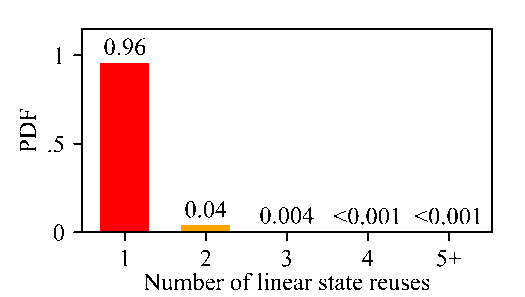

**Original:** Figure 6: In Claude Code WEKA trace, most linear-attention states are reused once or never.

**中文：** 图 6：在 Claude Code WEKA 轨迹中，大多数线性注意力状态只复用一次，或从不复用。

**Source:** PDF p.6 · S096

**Original:** Second, returns are predictable from history. In the history, there has been many requests being processed, and we can learn from them to predict the future. Suppose the chunk’s session has been idle for $a_d$ requests. Gandalf asks: of the past sessions that were also idle this long, how many came back? The chance of return is the share that came back, denoted as $H_d$ . It is close to 1 when the predictor, based on the past experience with many requests, sure that the cache will be read again, close to 0 otherwise.

**中文：** **第二，可以根据历史预测再次访问。** 历史中处理过大量请求，可以从中学习以预测未来。假设某个块所属会话已经闲置了 $a_d$ 个请求。Gandalf 会问：过去同样闲置这么久的会话中，有多少后来再次活跃？再次访问的概率就是这些回归会话所占的比例，记为 $H_d$。如果预测器根据大量历史请求确信该缓存还会被读取，其值接近 1；否则接近 0。

**Source:** PDF p.6 · S097

**Original:** Third, an object needed soon has a high value. Keeping d is not free: it holds $s_d$ bytes of DRAM until its next read. Thus, evicting an object that is needed farthest in the future is the cheapest, because it frees the most DRAM for the longest time [3]. In the same light, an object idle for long is likely to stay idle for long. Therefore, Gandalf divides (7) by $s_d$ and by $a_d$ , the wait time of d so far. It prices a drop by its cost per byte of DRAM per request it frees, shown in Equation 7.

**中文：** **第三，很快就要使用的对象价值更高。** 保留 $d$ 并非没有代价：在下次读取之前，它会一直占据 $s_d$ 字节 DRAM。因此，驱逐未来最晚才会被使用的对象成本最低，因为它能在最长时间内释放最多 DRAM [3]。同理，已经闲置很久的对象也可能继续闲置很久。因此，Gandalf 将公式（7）中的成本除以 $s_d$ 和对象迄今为止的等待时间 $a_d$。它按照每释放一字节 DRAM、每个请求间隔所对应的成本，为丢弃操作定价，如公式（7）所示。

**Source:** PDF p.6 · S098 · Equation / 公式（7）

$$
\mathrm{drop\_cost}=H_dv_dC_r\;\longrightarrow\;h_d=\frac{H_dv_dC_r}{s_da_d}\tag{7}
$$

**Source:** PDF p.7 · S099

**Original:** 3.3.2 Moving a DRAM candidate to SSD. Moving an object to SSD costs the SSD’s endurance, plus the future hits lost on the objects evicted to make room for it.

**中文：** **3.3.2 将 DRAM 候选对象移动至 SSD。** 将对象移动至 SSD 的成本，包括 SSD 耐久损耗，以及为腾出空间而驱逐其他对象所损失的未来命中。

**Source:** PDF p.7 · S100

**Original:** SSD write cost. Writing $s_j$ bytes to SSD consumes $C_w$ $s_j$ dollars of endurance, where $C_w$ = $P_{\mathrm{SSD}}/E_{\mathrm{TBW}}$ is the SSD’s purchase price per byte of rated write endurance. To make SSD lasts for $T_{\mathrm{target}}$ years, Gandalf limits the bytes written to SSD at elapsed time t, so the write cost is scaled by a multiplier $t_L$ that grows when the bytes written W exceeds the budget at time t, and shrinks when they fall behind W . Without a target, $t_L$ = 1 and the price alone limits wear.

**中文：** **SSD 写入成本。** 向 SSD 写入 $s_j$ 字节会消耗价值为 $C_ws_j$ 美元的耐久预算，其中 $C_w=P_{\mathrm{SSD}}/E_{\mathrm{TBW}}$ 是每字节额定写入耐久能力所分摊的 SSD 购置价格。为了让 SSD 使用 $T_{\mathrm{target}}$ 年，Gandalf 限制经过时间 $t$ 时的累计写入字节数，并用乘数 $t_L$ 缩放写入成本：当已写入量 $W$ 超过时刻 $t$ 的预算时，该乘数增大；当写入量落后于 $W$ 时，该乘数减小。若不设目标，则 $t_L=1$，仅由价格限制磨损。

**Source:** PDF p.7 · S101

**Original:** Replacement cost. Promoting j may evict other objects $E_j$ from SSD. Each of the evicted objects might still be needed in the future, losing its remaining $H_e$ reads, each worth $v_e$ $C_r$ , as in (7).

**中文：** **替换成本。** 提升 $j$ 可能导致 SSD 中其他对象集合 $E_j$ 被驱逐。每个被驱逐对象未来都可能仍被需要，从而失去其剩余的 $H_e$ 次读取；根据公式（7），每次读取价值为 $v_eC_r$。

**Source:** PDF p.7 · S102

**Original:** Total move cost. Following the third observation, Gandalf prices a move by its cost per byte of DRAM per request it frees, so that it compares with $h_d$ :

**中文：** **总移动成本。** 根据第三项观察，Gandalf 按照每释放一字节 DRAM、每个请求间隔所对应的成本为移动操作定价，使其能够与 $h_d$ 比较：

**Source:** PDF p.7 · S103 · Equation / 公式（8）

$$
\mathrm{move\_cost}=\underbrace{C_ws_j}_{\text{cost of writing }j\text{ / 写入成本}}+\underbrace{\sum_{e\in E_j}H_ev_eC_r}_{\text{replacement cost in SSD / SSD 替换成本}}\;\longrightarrow\;\frac{t_LC_w}{a_j}+\min_{e\in E_j}h_e\tag{8}
$$

**Source:** PDF p.7 · S104

**Original:** Gandalf evicts the SSD leaves with the lowest $h_e$ and charges the cheapest of them. While the SSD has room, $E_j$ is empty and replacement cost is not charged.

**中文：** Gandalf 驱逐 $h_e$ 最低的 SSD 叶节点，并按其中成本最低者计费。当 SSD 仍有空间时，$E_j$ 为空，不计替换成本。

### 3.4 Optimization / 3.4 优化

**Source:** PDF p.7 · S106

**Original:** Scoring every cached chunk for every eviction is expensive: the cache holds millions of chunks, and their probability-weighted scores evolve over time. Gandalf avoids this cost with three observations.

**中文：** 每次驱逐都为所有缓存块评分，成本很高：缓存中包含数百万个块，其按概率加权的评分还会随时间变化。Gandalf 利用三项观察来避免这类成本。

**Source:** PDF p.7 · S107

**Original:** First, only leaves can be dropped, and only root-side DRAM nodes can be moved to SSD. Gandalf only maintains these two sets in an incremental manner. Dropping a leaf exposes at most its parent as a new leaf, while moving a root-side node exposes its children as new move candidates. Thus, recomputing the scores of the caches only happens when there is cache pressure, to a small number of items.

**中文：** **第一，只有叶节点可以被丢弃，只有靠近根部的 DRAM 节点可以移动至 SSD。** Gandalf 仅增量维护这两个集合。丢弃一个叶节点，最多会使其父节点成为新的叶节点；移动一个根侧节点，则会使其子节点成为新的移动候选。因此，缓存评分仅在发生缓存压力时，对少量条目重新计算。

**Source:** PDF p.7 · S108

**Original:** Second, scores in Equation (7) change as objects age, but remain fixed within a request. Gandalf keeps each tier’s leaf candidates in a min-heap ordered by their probability-weighted drop scores $H_d$ . A heap is rebuilt only when first queried in a new request and is reused for all subsequent evictions in that request. New leaves are inserted immediately, while stale entries are discarded lazily from the heap top.

**中文：** **第二，公式（7）中的评分随对象变旧而变化，但在同一个请求内保持不变。** Gandalf 为每个存储层的叶节点候选维护一个最小堆，按照概率加权的丢弃评分 $H_d$ 排序。每个新请求只有首次查询时才重建堆，该请求内后续所有驱逐都复用它。新叶节点立即插入，失效条目则在堆顶被惰性移除。

**Source:** PDF p.7 · S109

**Original:** Third, Gandalf partitions root-side DRAM candidates by cache type: linear and full. Within each size class, the candidate with the longest estimated remaining life has the lowest SSD write fee. A lazy heap ordered by remaining life therefore identifies this candidate without rescoring the class again during the request. By default, Gandalf compares only the longest-lived candidate from each size class. In later evaluation, we show that comparing only one candidate does not sacrifice performance. A separate lazy min-heap over SSD leaves identifies the lowest-valued SSD victim, and hence the replacement cost when DRAM pressure triggers a move from DRAM to SSD such that an object needs to be evicted from SSD to make room. After the heaps are built, each decision examines only their heads, rather than rescoring or sorting all cache objects.

**中文：** **第三，Gandalf 按缓存类型将根侧 DRAM 候选分为线性状态和全注意力 KV。** 在每个大小类别中，预计剩余寿命最长的候选具有最低的 SSD 写入费用。因此，按剩余寿命排序的惰性堆能够找到该候选，无需在请求期间再次为整个类别评分。默认情况下，Gandalf 只比较每个大小类别中寿命最长的一个候选。后续评估将表明，仅比较一个候选不会牺牲性能。另外，一个针对 SSD 叶节点的惰性最小堆用于识别价值最低的 SSD 驱逐对象，从而确定替换成本：当 DRAM 压力触发对象从 DRAM 移动至 SSD、需要驱逐 SSD 对象腾出空间时，使用该成本。建堆之后，每次决策仅检查堆顶，无需对全部缓存对象重新评分或排序。

## 4 Implementation / 4 实现

**Source:** PDF p.7 · S111

**Original:** Verifying the simulator. We first ran vLLM [18] and connect it with LMCache [7] on RawBlock mode, with a Claude Code trace, then attaching an eBPF-based logger to dump out the storage-facing trace. This includes columns such as: timestamp since first run, type of operation (R/W), logical block address (LBA) accessed, size, and number of pages. We then replayed this trace on FEMU [21] with a 1TB @ 0.3 DWPD for 5 years SSD configuration to observe SSD lifetime given a KV cache offloading workload, resulting to our finding that KV cache is killing SSD. From this result, we obtained the SSD lifetime duration. Then, we build a trace-based simulator that estimates SSD lifetime by the TBW, and confirm the lifetime using the SSD lifetime we obtained by using SSD emulator. Simulator are needed to test all of our experiments prior to implementing in real hardware, which will effectively kills SSD for sure. After all technique was confirmed, we move our technique to real production system, involving LMCache [7] deployed as a backend for vLLM [18] inference engine.

**中文：** **验证模拟器。** 我们首先运行 vLLM [18]，将其连接到 RawBlock 模式下的 LMCache [7]，执行一条 Claude Code 轨迹，并附加基于 eBPF 的日志记录器，导出面向存储的访问轨迹。轨迹包括首次运行以来的时间戳、操作类型（读／写）、访问的逻辑块地址（LBA）、大小和页数等列。随后，我们在 FEMU [21] 中重放轨迹，将 SSD 配置为 1 TB、0.3 DWPD、保修期 5 年，以观察 KV 缓存卸载工作负载下的 SSD 寿命，由此发现 KV 缓存正在迅速消耗 SSD 寿命。我们从这一结果得到 SSD 寿命时长，然后构建基于轨迹的模拟器，通过 TBW 估计 SSD 寿命，并用 SSD 仿真器得到的寿命进行验证。在真实硬件上实现前，需要先通过模拟器运行所有实验，因为直接实验确实会使 SSD 耗尽寿命。所有技术确认后，我们将其迁移至实际生产系统，使用 LMCache [7] 作为 vLLM [18] 推理引擎的后端。

**Source:** PDF p.7 · S112

**Original:** SSD lifetime estimation. Specifically, given that we confirmed the SSD lifetime using an emulator in the small scale, we estimate SSD lifetime by the TBW (Total Bytes Written). Once one trace is replayed, we can obtain the total write volume to SSD. Assuming that this trace is replayed over and over in production system, we can then obtain the total write volume per day, and then estimate the SSD lifetime by dividing the TBW by the total write volume per day.

**中文：** **SSD 寿命估计。** 具体来说，在使用仿真器进行小规模寿命验证之后，我们通过 TBW（总写入字节数）估计 SSD 寿命。每重放一条轨迹，便可得到 SSD 总写入量。假设生产系统反复重放这条轨迹，就可得到每日总写入量，再用 TBW 除以每日总写入量来估计 SSD 寿命。

**Source:** PDF p.7 · S113

**Original:** Transfer between tiers. Transfer between one tier and another assumes modes two-hops, using CPU as a staging buffer. Hit served from SSD must be transferred to CPU DRAM adhering SSD read bandwidth and SSD transfer bandwidth; hit served from CPU DRAM will go to GPU memory adhering CPU-to-GPU PCIe bandwidth;

**中文：** **层间传输。** 层间传输假设采用两跳方式，以 CPU 作为暂存缓冲。SSD 命中的数据必须先传输到 CPU DRAM，受 SSD 读取带宽和 SSD 传输带宽约束；CPU DRAM 命中的数据再传输到 GPU 内存，受 CPU 至 GPU 的 PCIe 带宽约束。

**Source:** PDF p.7 · S114

**Original:** Hardware specs. The simulator models the hardware specs of the system that affects the transfer between SSD, CPU DRAM, and GPU HBM. We assume a specific GPU model, check the tokens per second throughput, and every generated KV cache is directly saved in the KV cache storage, e.g. LMCache [7]. For the SSD model, the simulator supports specifying DWPD (Drive Writes Per Day) and capacity. However, for our evaluation, we assume 1 DWPD (Drive Writes Per Day) for 5 years, which is a majority specification for enterprise SSDs. We check the SSD read and transfer bandwidth via FIO [2]. We then vary the SSD capacity for the evaluation.

**中文：** **硬件规格。** 模拟器对影响 SSD、CPU DRAM 与 GPU HBM 之间传输的系统硬件规格进行建模。我们假设某一具体 GPU 型号，检查其每秒 token 吞吐量，并将每个生成的 KV 缓存直接存入 LMCache [7] 等 KV 缓存存储系统。SSD 模型支持指定 DWPD（每日整盘写入次数）和容量。但在评估中，我们假设 5 年内支持 1 DWPD，这是企业级 SSD 的常见规格。我们通过 FIO [2] 测量 SSD 读取和传输带宽，随后改变 SSD 容量进行评估。

**Source:** PDF p.7 · S115

**Original:** Known limitation. The simulator assumes write-amplification factor (WAF) to be 1, since the simulator does not model the SSD internal operations, such as garbage collection, wear leveling, and other internal operations that may affect the SSD lifetime. Hence, the simulator may overestimate the SSD lifetime for all the evaluated techniques, Gandalf and baselines. However, since WAF is implicated by the fast write rate, if we reduce the write volume using Gandalf, we can still reduce the WAF and improve the SSD lifetime.

**中文：** **已知局限。** 模拟器假设写放大系数（WAF）为 1，因为它没有建模 SSD 内部的垃圾回收、磨损均衡，以及其他可能影响寿命的操作。因此，对于 Gandalf 和所有基线，模拟器都可能高估 SSD 寿命。不过，由于 WAF 与较高写入速率有关，通过 Gandalf 降低写入量，仍可以降低 WAF 并改善 SSD 寿命。

## 5 Evaluation / 5 评估

### 5.1 Setup / 5.1 实验设置

**Source:** PDF p.7、8 · S117

**Original:** Baselines. We compare Gandalf against six cache-management baselines: general tier eviction policies such as LRU, Marconi [33], Workload-aware [44]; general tier selective admission policy such as MeritKV [17]; and GPU to DRAM selective admission policies such as HotPrefix [22] and LRU-K [35];

**中文：** **基线。** 我们将 Gandalf 与六种缓存管理基线比较：通用分层驱逐策略 LRU、Marconi [33] 和 Workload-aware [44]；通用分层选择性准入策略 MeritKV [17]；以及 GPU 至 DRAM 的选择性准入策略 HotPrefix [22] 和 LRU-K [35]。

**Source:** PDF p.8 · S119

**Original:** Since not all baselines are designed to operate with DRAM and SSD, for evaluation fairness, we augment each baseline with both tiers as a capacity expansion to GPU HBM, thereby increasing their effective cache capacity while preserving their original admission and victim selection rules. A KV cache entry is admitted to lower tiers only if it is evicted from the upper tier. Eviction happens as a side effect of admission, and the eviction policy of each baseline is retained as is. For all baselines that has hyperparameters, we sweep the hyperparameter space to show the best configuration on each trace.

**中文：** 由于并非所有基线都为同时使用 DRAM 与 SSD 而设计，为保证评估公平，我们为每个基线都加入这两个层，作为 GPU HBM 的容量扩展，在增加有效缓存容量的同时保留原有的准入与驱逐对象选择规则。KV 缓存条目只有在被上层驱逐时才会准入下层。驱逐作为准入的附带结果发生，各基线原有的驱逐策略保持不变。对于带超参数的基线，我们扫描超参数空间，展示其在每条轨迹上的最佳配置。

**Source:** PDF p.8 · S120

**Original:** Workload Traces. We evaluate Gandalf on real-world traces with known timestamps and request sequences, including:

**中文：** **工作负载轨迹。** 我们使用时间戳和请求顺序已知的真实轨迹评估 Gandalf，包括：

**Source:** PDF p.8 · S121

**Original:** (1) Qwen Bailian Trace A [44], the trace from Aliyun Bailian inference service that contains 46.4% multi-turn conversations with text, file understanding, multimodal understanding, and search tasks;

**中文：** （1）Qwen Bailian Trace A [44]：来自阿里云百炼推理服务的轨迹，其中 46.4% 为多轮对话，涵盖文本、文件理解、多模态理解和搜索任务。

**Source:** PDF p.8 · S122

**Original:** (2) Claude Code WEKA SemiAnalysis trace [40], Claude Code agentic serving traces showing multi agents, subagents, and compacted traces;

**中文：** （2）Claude Code WEKA SemiAnalysis 轨迹 [40]：Claude Code 智能体服务轨迹，包含多智能体、子智能体和经过压缩整理的轨迹。

**Source:** PDF p.8 · S123

**Original:** (3) AIPerf Trace [9], a trace generated using the AIPerf benchmark tool that contains 400k requests, where each session contains 100 turns of user queries and responses. The statistics of the traces are summarized in Table 3.

**中文：** （3）AIPerf Trace [9]：使用 AIPerf 基准测试工具生成的轨迹，包含 400k 个请求，每个会话有 100 轮用户提问与响应。轨迹统计见表 3。

**Source:** PDF p.8 · S118

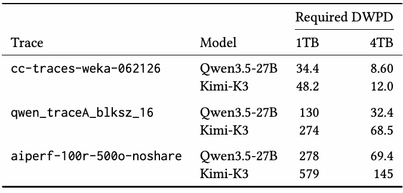

**Original:** Table 3: The traces writes exceed the SSD’s workload DWPD rating.

**中文：** 表 3：各轨迹的写入负载超过 SSD 的额定 DWPD。

| Trace / 轨迹 | Model / 模型 | Required DWPD / 所需 DWPD（1 TB SSD） | Required DWPD / 所需 DWPD（4 TB SSD） |
| --- | --- | ---: | ---: |
| cc-traces-weka-062126 | Qwen3.5-27B | 34.4 | 8.60 |
| cc-traces-weka-062126 | Kimi-K3 | 48.2 | 12.0 |
| qwen_traceA_blksz_16 | Qwen3.5-27B | 130 | 32.4 |
| qwen_traceA_blksz_16 | Kimi-K3 | 274 | 68.5 |
| aiperf-100r-500o-noshare | Qwen3.5-27B | 278 | 69.4 |
| aiperf-100r-500o-noshare | Kimi-K3 | 579 | 145 |

**Source:** PDF p.8 · S124

**Original:** Models and Cache Sizes. Throughout the experiments, we evaluate Gandalf and the baselines on Kimi-K3, a representative hybrid model having 72% linear attention layers, a typical ratio for many hybrid LLMs. We set the DRAM cache size to 100GB and vary the SSD size: 1TB, 4TB, following the common SSD capacity range for enterprise SSDs. This DRAM size is chosen to hold less than 1% of the peak active KV cache size of most of the traces shown in Table 3, which is a reasonable assumption for a production system with limited DRAM capacity.

**中文：** **模型与缓存大小。** 实验中，我们使用 Kimi-K3 评估 Gandalf 和基线。Kimi-K3 是一个代表性混合模型，72% 的层为线性注意力层，这也是许多混合 LLM 的典型比例。DRAM 缓存大小设为 100 GB，SSD 容量选择 1 TB 和 4 TB，符合企业级 SSD 的常见容量范围。选择这一 DRAM 大小，是为了使其小于表 3 中大多数轨迹峰值活跃 KV 缓存大小的 1%；对于 DRAM 容量受限的生产系统，这是合理假设。

**Source:** PDF p.8 · S125

**Original:** Metrics. We evaluate Gandalf and the baselines on the following metrics:

**中文：** **指标。** 我们使用以下指标评估 Gandalf 和基线：

**Source:** PDF p.8 · S126

**Original:** • SSD lifetime, measured in years, is the time until the SSD reaches its write endurance limit, given the total bytes written (TBW) and the drive writes per day (DWPD) specification.

**中文：** • **SSD 寿命：** 以年计，表示在给定总写入字节数（TBW）和每日整盘写入次数（DWPD）规格下，SSD 达到写入耐久极限所需的时间。

**Source:** PDF p.8 · S127

**Original:** • Cache miss ratio, the fraction of requests that are served from the cache (DRAM or SSD) without needing to recompute the KV cache entries.

**中文：** • **缓存未命中率（Cache miss ratio）：** 无需重新计算 KV 缓存条目、直接由缓存（DRAM 或 SSD）提供服务的请求所占比例。〔译注：本句按原文定义翻译；该定义实际描述的是命中率，与指标名称不一致，详见翻译说明。〕

**Source:** PDF p.8 · S128

**Original:** • Cache load latency, measured in seconds, is the time taken to load KV cache from DRAM and SSD to GPU, or to recompute the KV cache entries if they are not present in the cache.

**中文：** • **缓存加载延迟：** 以秒计，表示将 KV 缓存从 DRAM 和 SSD 加载到 GPU 所需的时间；若缓存不存在，则包含重新计算 KV 缓存条目的时间。

### 5.2 End-to-end Performance / 5.2 端到端性能

**Source:** PDF p.8 · S130

**Original:** Figure 7 compares Gandalf with the baselines on TraceA, Claude-Code and AIPerf with the Kimi-K3 model, 100 GB of DRAM and a 1 TB SSD. Gandalf, as well as other baselines with trade-off hyperparameters, are shown as lines through their hyperparameter space. Gandalf uses the write-fee multiplier α (0–64), LRU-K uses K (1–10), HotPrefix uses the frequency threshold F (1–10), and Marconi uses its own α (0–2).

**中文：** 图 7 在 Kimi-K3 模型、100 GB DRAM 和 1 TB SSD 配置下，比较 Gandalf 与各基线在 TraceA、ClaudeCode 和 AIPerf 上的表现。Gandalf 和其他含权衡超参数的基线，都用连接不同超参数配置的曲线表示。Gandalf 使用写入费用乘数 $\alpha$（0–64），LRU-K 使用 $K$（1–10），HotPrefix 使用频率阈值 $F$（1–10），Marconi 使用其自身的 $\alpha$（0–2）。

**Source:** PDF p.9 · S136

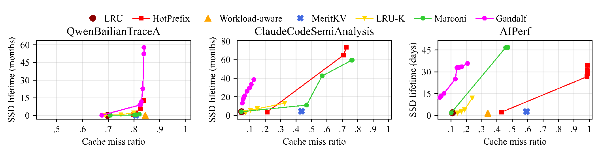

**Original:** Figure 7: SSD lifetime against cache miss ratio for Gandalf and the baselines on all traces with Kimi-K3 model, 100 GB of DRAM and a 1 TB SSD. Gandalf , LRU-K, HotPrefix and Marconi are lines through their hyperparameters (Gandalf ’s 𝛼, LRU-K’s 𝐾, HotPrefix’s hotness frequency, and Marconi’s 𝛼).

**中文：** 图 7：在 Kimi-K3、100 GB DRAM 和 1 TB SSD 下，Gandalf 及各基线在所有轨迹上的 SSD 寿命与缓存未命中率关系。Gandalf、LRU-K、HotPrefix 和 Marconi 的曲线连接不同超参数配置，分别为 Gandalf 的 α、LRU-K 的 K、HotPrefix 的热度频率阈值和 Marconi 的 α。

**Source:** PDF p.8 · S131

**Original:** SSD lifetime. In this hardware configuration, at its lowest miss ratio (α = 0), Gandalf extends the SSD lifetime over the lowest-miss baseline by 2× on TraceA, 3.3× on ClaudeCode, and 6.5× on AIPerf. It does so by writing 2.0–6.5× fewer bytes to the SSD. Raising α trades hits for a longer lifetime. On ClaudeCode, every baseline point with a miss ratio of up to 0.47 lasts 2.9–10.3× shorter than Gandalf at an equal or lower miss ratio. Only Marconi with α ≥ 1 and HotPrefix with F ≥ 7 last longer than Gandalf’s longest-lived point, and they miss 4.5–6.1× more. On AIPerf, every baseline point except Marconi with α ≥ 0.5 lasts 1.0–23.8× shorter than Gandalf at an equal or lower miss ratio. Marconi last 1.3× longer than Gandalf’s longest-lived point, but results in 2.2× more cache misses. On TraceA, Gandalf reaches 57.7 months at a 0.839 miss ratio, 4.1× the 12.7 months of the longest-lived baseline, HotPrefix with F = 10, at the same miss ratio. LRU-K works in the opposite direction, where increasing K trades a lower miss ratio for a longer lifetime.

**中文：** **SSD 寿命。** 在这一硬件配置下，当 Gandalf 取得其最低未命中率（$\alpha=0$）时，相较于未命中率最低的基线，其 SSD 寿命在 TraceA、ClaudeCode 和 AIPerf 上分别达到 2 倍、3.3 倍和 6.5 倍，原因是写入 SSD 的字节数减少至原来的 1/2.0–1/6.5。增大 $\alpha$ 会以命中换取更长寿命。在 ClaudeCode 上，对每个未命中率不超过 0.47 的基线点，都能找到未命中率相同或更低的 Gandalf 点，其寿命为该基线的 2.9–10.3 倍。只有 $\alpha\ge1$ 的 Marconi 和 $F\ge7$ 的 HotPrefix 比 Gandalf 寿命最长的点更长寿，但其未命中为后者的 4.5–6.1 倍。在 AIPerf 上，除 $\alpha\ge0.5$ 的 Marconi 外，对每个基线点都能找到未命中率相同或更低的 Gandalf 点，其寿命为基线的 1.0–23.8 倍。Marconi 的寿命是 Gandalf 最长寿命点的 1.3 倍，但缓存未命中也达到 2.2 倍。在 TraceA 上，Gandalf 在未命中率为 0.839 时达到 57.7 个月，是同一未命中率下最长寿命基线 HotPrefix（$F=10$）的 12.7 个月的 4.1 倍。LRU-K 的变化方向相反：增大 $K$ 会以更低的未命中率换取更长寿命。〔相关数字与方向表述按原文保留。〕

**Source:** PDF p.8 · S132

**Original:** Cache miss ratio. Gandalf reaches the lowest miss ratio of all policies on TraceA and on AIPerf. On ClaudeCode, Marconi with α = 0 and LRU miss slightly less than Gandalf (0.045 and 0.047 vs. 0.052), but write 3.3× more to the SSD.

**中文：** **缓存未命中率。** Gandalf 在 TraceA 和 AIPerf 上达到了所有策略中的最低未命中率。在 ClaudeCode 上，Marconi（$\alpha=0$）和 LRU 的未命中率略低于 Gandalf，分别为 0.045 和 0.047，而 Gandalf 为 0.052；但二者向 SSD 写入的字节数是 Gandalf 的 3.3 倍。

**Source:** PDF p.8 · S133

**Original:** In summary, with DRAM size of 100GB and 1TB SSD, Gandalf improves SSD lifetime by 7.3× on average while maintaining or even reducing the cache miss ratio.

**中文：** 总体而言，在 100 GB DRAM 和 1 TB SSD 下，Gandalf 在维持甚至降低缓存未命中率的同时，平均将 SSD 寿命延长至原来的 7.3 倍。

### 5.3 Cache Ratio Sensitivity / 5.3 缓存容量比例敏感性

**Source:** PDF p.8、9 · S135

**Original:** Figure 8 shows TraceA with Kimi-K3 under different DRAM/SSD capacity ratios, keeping the total DRAM+SSD capacity at 4TB, from 200GB of DRAM with a 3.8TB SSD to 1000GB with a 3TB SSD. Gandalf is ran while keeping write price per GB constant, so the decision to write to SSD is only affected by the capacity ratio. Gandalf uses the extra DRAM to keep more KV cache entries in memory, which reduces the miss ratio from 0.75 to 0.6, while its SSD lifetime stays similar across all ratios. Its SSD lifetime stays between 29 and 35 months across all ratios, decreasing slightly only because the SSD size itself shrinks. The baselines barely benefit from the extra DRAM. LRU-K’s miss ratio stays at 0.785–0.791. HotPrefix, while it increases SSD lifetime to 33-122 months, it has an impractical miss ratio of 0.852–0.856, which does not meet deployment Service Level Objectives (SLOs) because it is too far from the trace’s maximum achievable miss ratio of 0.6. LRU-K writes a KV entry evicted from DRAM to the SSD when the session’s K-th most recent entry is still in DRAM, hence relying on the past historical access without considering whether the entry will be reused in the future. On TraceA most entries pass it, so LRU-K writes about 60TB to the SSD and keeps both tiers full; with the total capacity fixed, moving capacity from the SSD to DRAM changes little, and its miss ratio stays at 0.785–0.791. Gandalf instead writes only about 0.5TB to the SSD, keeping most of its working set in DRAM where writes cost no SSD wear, so additional DRAM turns directly into hits.

**中文：** 图 8 展示了 Kimi-K3 在 TraceA 上、不同 DRAM／SSD 容量比下的结果。DRAM 与 SSD 总容量固定为 4 TB，配置从 200 GB DRAM 加 3.8 TB SSD，到 1000 GB DRAM 加 3 TB SSD。运行 Gandalf 时，每 GB 的写入价格保持不变，因此 SSD 写入决策仅受容量比例影响。Gandalf 利用额外 DRAM 将更多 KV 缓存条目保留在内存，使未命中率从 0.75 降至 0.6，同时各比例下 SSD 寿命相近，保持在 29–35 个月，仅因 SSD 本身容量缩小而略有下降。基线几乎不能从额外 DRAM 中获益。LRU-K 的未命中率保持在 0.785–0.791。HotPrefix 虽将 SSD 寿命提高到 33–122 个月，但未命中率高达 0.852–0.856，不具实用性；它距离轨迹“可达到的最大未命中率”0.6 太远，无法满足部署的服务等级目标（SLO）。LRU-K 在会话中倒数第 $K$ 个最近条目仍在 DRAM 时，将被 DRAM 驱逐的 KV 条目写入 SSD，因此依赖历史访问，而未考虑未来是否复用。在 TraceA 上，大多数条目都通过这一条件，因此 LRU-K 向 SSD 写入约 60 TB，并使两层保持满载；总容量固定时，把容量从 SSD 转移给 DRAM 改变不大，未命中率仍为 0.785–0.791。Gandalf 则仅向 SSD 写入约 0.5 TB，将大部分工作集保留在写入不会磨损 SSD 的 DRAM 中，因此额外 DRAM 可以直接转化为命中。〔“最大未命中率”沿用原文措辞。〕

**Source:** PDF p.9 · S137

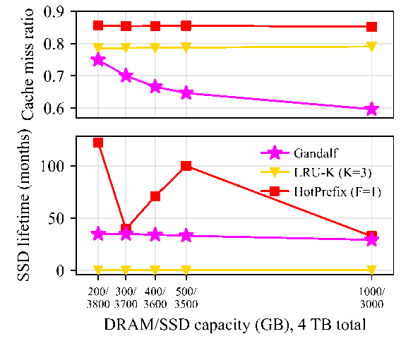

**Original:** Figure 8: Gandalf achieves lower cache miss ratio while achieving higher SSD lifetime under different DRAM/SSD capacity ratios. We fix the total capacity of DRAM and SSD to 4TB to make sure the cache miss ratio and lifetime is comparable across different setups.

**中文：** 图 8：在不同 DRAM／SSD 容量比例下，Gandalf 同时实现较低的缓存未命中率和较长的 SSD 寿命。DRAM 与 SSD 总容量固定为 4 TB，确保不同配置间的未命中率和寿命可比。

**Source:** PDF p.9 · S138

**Original:** Hence, Gandalf improves cache miss ratio by 5–25% over the best baseline at every capacity ratio, while extending SSD lifetime by 120× in various tested scenarios with total cache capacity at 4TB.

**中文：** 因此，在总缓存容量为 4 TB 的多种测试场景中，Gandalf 在每种容量比例下，相较最佳基线改善缓存未命中率 5–25%，同时将 SSD 寿命延长至原来的 120 倍。

### 5.4 Trade-Off Hyperparameter Sensitivity / 5.4 权衡超参数敏感性

**Source:** PDF p.9 · S140

**Original:** Figure 7 also sweeps α, the weight Gandalf gives to the move cost when deciding whether to write an entry to the SSD (6), from 0 to 64, with 100GB of DRAM and a 1TB SSD. By default, Gandalf sets α = 1, which balances SSD lifetime and cache hit ratio across all traces. A larger α makes writing to the SSD more selective, so the SSD lives longer at the cost of more misses: from α = 1 to α = 64, the SSD lifetime grows 6.5× on TraceA, 2.3× on ClaudeCode, and 2.7× on AIPerf (0.4 to 1.2 months), while the miss ratio rises by 0.016, 0.071, and 0.172, respectively. A lower α lets Gandalf trade lifetime for hits. With α = 0, Gandalf wins in both metrics against the baseline with the lowest miss ratio on TraceA and on AIPerf. On ClaudeCode, Gandalf at α = 0 comes within 0.007 of Marconi’s miss ratio while its SSD lasts 3.3× longer.

**中文：** 图 7 还在 100 GB DRAM 和 1 TB SSD 下，将 $\alpha$ 从 0 扫描至 64。该参数是 Gandalf 决定是否将条目写入 SSD 时，赋予移动成本的权重，见公式（6）。默认 $\alpha=1$，用于在各条轨迹上平衡 SSD 寿命和缓存命中率。较大的 $\alpha$ 使 SSD 写入更具选择性，以更多未命中为代价延长寿命：从 $\alpha=1$ 增至 $\alpha=64$ 时，SSD 寿命在 TraceA、ClaudeCode 和 AIPerf 上分别达到原来的 6.5 倍、2.3 倍和 2.7 倍，其中 AIPerf 从 0.4 个月增至 1.2 个月；未命中率分别增加 0.016、0.071 和 0.172。较低的 $\alpha$ 允许 Gandalf 用寿命换取命中。在 $\alpha=0$ 时，Gandalf 在 TraceA 和 AIPerf 上，两个指标均优于未命中率最低的基线。在 ClaudeCode 上，Gandalf（$\alpha=0$）的未命中率与 Marconi 相差不超过 0.007，而 SSD 寿命为其 3.3 倍。

**Source:** PDF p.9 · S142

**Original:** Therefore, operators can tune α to meet their desired trade-off between SSD lifetime and cache hit ratio, and Gandalf is robust to a wide range of α values.

**中文：** 因此，运维人员可调整 $\alpha$，满足期望的 SSD 寿命与缓存命中率权衡；Gandalf 对较宽范围的 $\alpha$ 取值均具有稳健性。

### 5.5 Model Linear-to-Full Sensitivity / 5.5 模型线性状态／全注意力 KV 大小比敏感性

**Source:** PDF p.9、10 · S144

**Original:** Figure 9 compares Gandalf with LRU-K and HotPrefix on AIPerf for four hybrid models with 100GB of DRAM and a 4TB SSD, ordered by the size of a linear-attention state relative to a full-attention KV chunk, from 147× for Qwen3.5-27B to 1,016× for Kimi-K3. Gandalf extends the SSD lifetime on every model, by 3.6–6.6× over LRU-K and 3.6–7.1× over HotPrefix. It also reduces the miss ratio on three of the four models, by 0.006–0.034 relative to LRU-K and by 0.089–0.419 relative to HotPrefix. On Nemotron-H, Gandalf keeps the miss ratio similar to LRU-K, but extends the SSD lifetime by 3.6× . Among Nemotron-H, Gemma3-27B, and Kimi-K3, the lifetime gain over LRU-K grows with the state-to-KV ratio, from 3.6× to 5.8× and 6.6× , and Qwen3.5-27B. Even in the model with the smallest ratio, Gandalf still gains 3.9× .

**中文：** 图 9 在 AIPerf、100 GB DRAM 和 4 TB SSD 下，对四种混合模型比较 Gandalf、LRU-K 与 HotPrefix。模型按单个线性注意力状态相对于一个全注意力 KV 块的大小排序，从 Qwen3.5-27B 的 147 倍到 Kimi-K3 的 1,016 倍。Gandalf 在每个模型上都延长了 SSD 寿命：相较 LRU-K 达到 3.6–6.6 倍，相较 HotPrefix 达到 3.6–7.1 倍。它还降低了四个模型中三个模型的未命中率：相较 LRU-K 低 0.006–0.034，相较 HotPrefix 低 0.089–0.419。在 Nemotron-H 上，Gandalf 的未命中率与 LRU-K 相近，但 SSD 寿命达到其 3.6 倍。在 Nemotron-H、Gemma3-27B 和 Kimi-K3 上，相较 LRU-K 的寿命收益随状态／KV 比增大，依次为 3.6 倍、5.8 倍和 6.6 倍；原文此处还接有“以及 Qwen3.5-27B”。即使在该比例最小的模型上，Gandalf 仍获得 3.9 倍寿命收益。

**Source:** PDF p.9 · S141

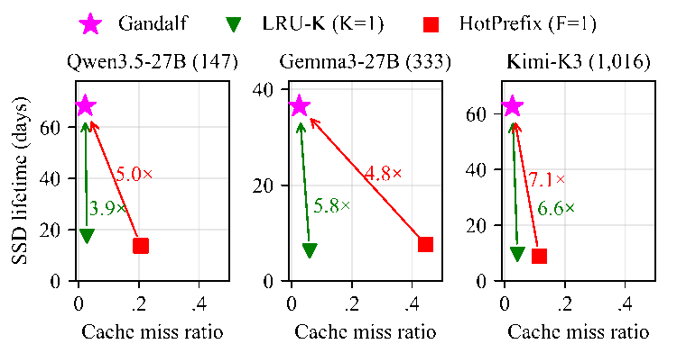

**Original:** Figure 9: Gandalf improves baselines in wide range of hybrid models having different linear-to-full cache size ratios.

**中文：** 图 9：对于线性状态与全注意力缓存大小比不同的多种混合模型，Gandalf 均优于基线。

**Source:** PDF p.10 · S146

**Original:** The larger the ratio, the higher the penalty of writing a linear state that is never reused, so the improvement obtained by Gandalf’s filtering is larger. This makes Gandalf especially needed for deployment of hybrid models with large linear-attention states, which are increasingly common in modern LLMs.

**中文：** 该比例越大，写入一个永不复用的线性状态所付出的代价就越高，因此 Gandalf 过滤带来的改善也越大。这使 Gandalf 特别适合部署具有大体积线性注意力状态的混合模型，而这类模型在现代 LLM 中越来越常见。

### 5.6 Where does the improvement come from? / 5.6 收益来自哪里？

**Source:** PDF p.10 · S148

**Original:** Avoid writing non-reused linear states in SSD. Gandalf avoids writing linear states that will not be reused multiple times, such as those at every turn of a multi-turn conversation, to the SSD. Figure 10 shows, over time, the fraction of SSD writes that contribute to cache hits at least once, for Gandalf and LRU-K on ClaudeCode with Qwen3.5-27B, 100GB of DRAM and a 1TB SSD. Throughout the trace, a higher fraction of Gandalf’s SSD writes are hit than those of LRU-K at K = 1, for both full-attention KV and linear states.

**中文：** **避免将不再复用的线性状态写入 SSD。** Gandalf 避免向 SSD 写入不会被多次复用的线性状态，例如多轮对话每一轮结束时的状态。图 10 在 ClaudeCode、Qwen3.5-27B、100 GB DRAM 和 1 TB SSD 下，展示了随时间变化、至少贡献一次缓存命中的 SSD 写入所占比例，对比 Gandalf 与 LRU-K。在整个轨迹中，无论全注意力 KV 还是线性状态，Gandalf 的 SSD 写入中最终被命中的比例均高于 $K=1$ 的 LRU-K。

**Source:** PDF p.10 · S145

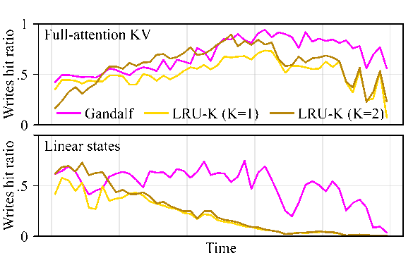

**Original:** Figure 10: Gandalf SSD admission results in higher fraction of SSD writes that contributes to cache hits at least once. Unlike baselines, Gandalf cache hit is stable across time.

**中文：** 图 10：采用 Gandalf 的 SSD 准入后，SSD 写入中至少贡献一次缓存命中的比例更高。与基线不同，Gandalf 的缓存命中表现随时间保持稳定。

**Source:** PDF p.10 · S149

**Original:** LRU-K at K = 1 writes 120.6k linear states to the SSD, and only 21% of them are ever hit there: 43% are never requested again, and 45% had already served their one hit from DRAM before being moved to the SSD, i.e., the state of a turn that the next turn already reused. A larger K does not fix this. LRU-K [35] counts references per object, which captures hotness for objects that persist across requests, such as a user’s KV cache in generative recommendation. A linear state, however, is superseded at every turn and is referenced at most about twice, so it reaches K = 2 references only after its one reuse is over: LRU-K drops a state that leaves DRAM before the next turn arrives, and writes one that the next turn has already reused. With K = 2, LRU-K writes 1.9× fewer linear states (62.6k), but 90% of them had already been hit before being written, 58% are never requested again, and only 13% are hit on the SSD; meanwhile its miss ratio rises from 0.1 to 0.14. Gandalf instead decides by whether a state will be reused later, not by how often it was referenced: it writes 8.8× fewer linear states than LRU-K at K = 1, and 57% of them are hit on the SSD.

**中文：** $K=1$ 的 LRU-K 向 SSD 写入 120.6k 个线性状态，其中只有 21% 曾在 SSD 上被命中：43% 此后再未被请求，45% 在移动到 SSD 前就已经在 DRAM 中完成了唯一一次命中，即某轮状态已经被下一轮复用。增大 $K$ 不能解决这一问题。LRU-K [35] 对每个对象统计引用次数，这可以刻画跨请求持续存在对象的热度，例如生成式推荐中某个用户的 KV 缓存。但线性状态每一轮都会被取代，最多大约被引用两次，因此只有在唯一一次复用结束后才达到 $K=2$ 次引用：LRU-K 会丢弃在下一轮到达前就离开 DRAM 的状态，却写入那些已经被下一轮复用过的状态。当 $K=2$ 时，LRU-K 写入的线性状态减少至原来的 1/1.9，为 62.6k 个，但其中 90% 在写入前已经被命中过，58% 此后再未被请求，仅 13% 在 SSD 上被命中；同时，未命中率从 0.1 升至 0.14。Gandalf 则根据状态未来是否还会复用作决策，而非依据此前被引用的次数：相比 $K=1$ 的 LRU-K，它写入的线性状态减少至 1/8.8，其中 57% 在 SSD 上被命中。

**Source:** PDF p.10 · S151

**Original:** As the SSD is full, LRU-K gets more selective at admitting cache to SSD, hence the cache hit rate decreases. Gandalf, however, maintains a high cache hit rate throughout.

**中文：** 当 SSD 已满时，LRU-K 的 SSD 准入变得更严格，因此缓存命中率下降。Gandalf 则始终维持较高的缓存命中率。

**Source:** PDF p.10 · S152

**Original:** Avoid writing rarely reused full-attention KV in SSD. We also increase the reusability of the full-attention KV cache entries that are written to the SSD, by filtering out those that are unlikely to be reused in the future, such as those at the end of a conversation or session. Gandalf writes 33% fewer full-attention KV chunks than LRU-K at K = 1 (21.5M vs. 32.1M), and 61% of them are hit on the SSD, compared to 50% for LRU-K. Of the chunks LRU-K writes, 9.6% are never requested again, compared to 5.3% for Gandalf, so Gandalf writes 2.7× fewer such chunks (1.1M vs. 3.1M). Despite writing fewer chunks, Gandalf serves 18% more full-attention hits from the SSD (265M vs. 225M), i.e., 12.3 hits per chunk written compared to 7.0 for LRU-K. Together, Gandalf writes 92TB to the SSD instead of 153TB, which extends the SSD lifetime by 1.7× (98 vs. 59 days) at a similar miss ratio (0.099 vs. 0.098).

**中文：** **避免将很少复用的全注意力 KV 写入 SSD。** 我们还过滤掉未来不太可能复用的条目，例如对话或会话末尾的条目，提高已写入 SSD 的全注意力 KV 缓存条目的复用程度。Gandalf 写入的全注意力 KV 块比 $K=1$ 的 LRU-K 少 33%，分别为 21.5M 和 32.1M；其中 61% 在 SSD 上被命中，而 LRU-K 为 50%。LRU-K 写入的块中，9.6% 此后再未被请求；Gandalf 为 5.3%，因此 Gandalf 写入的此类块减少至原来的 1/2.7，分别为 1.1M 和 3.1M。尽管写入块更少，Gandalf 从 SSD 提供的全注意力命中却多 18%，分别为 265M 和 225M，即每个写入块贡献 12.3 次命中，而 LRU-K 为 7.0 次。综合来看，Gandalf 向 SSD 写入 92 TB，而非 153 TB，在未命中率相近的情况下（0.099 对 0.098），将 SSD 寿命延长至 1.7 倍（98 天对 59 天）。

**Source:** PDF p.10 · S153

**Original:** Attention type-aware placement. Gandalf places linear states in DRAM and full-attention KV in the SSD. Figure 11 shows where the cache hits of each kind are served from, for Gandalf and LRU-K at K = 1 in the same setting as above. Gandalf serves 87% of its full-attention KV hits from the SSD and 90% of its linear-state hits from DRAM. LRU-K, which places objects by recency regardless of their kind, serves 74% of its full-attention KV hits from the SSD and only 67% of its linear-state hits from DRAM since its DRAM also holds full-attention KV that Gandalf would have moved to the SSD. To serve the remaining 33% (27.0k hits) from the SSD, LRU-K writes 120.6k linear states to it, 4.5 writes per hit, whereas Gandalf serves 8.0k linear-state hits from the SSD with 13.7k writes, 1.7 writes per hit.

**中文：** **注意力类型感知放置。** Gandalf 将线性状态放在 DRAM，将全注意力 KV 放在 SSD。图 11 在与上述相同的设置下，对比 Gandalf 与 $K=1$ 的 LRU-K，展示各类缓存命中由哪一层提供。Gandalf 的全注意力 KV 命中有 87% 来自 SSD，线性状态命中有 90% 来自 DRAM。LRU-K 不区分对象类型，只按最近访问情况放置：其全注意力 KV 命中有 74% 来自 SSD，线性状态命中仅有 67% 来自 DRAM，因为其 DRAM 还保存了 Gandalf 会移动到 SSD 的全注意力 KV。为了从 SSD 提供其余 33% 的线性状态命中（27.0k 次），LRU-K 向 SSD 写入 120.6k 个线性状态，每次命中对应 4.5 次写入。Gandalf 则以 13.7k 次写入提供 8.0k 次 SSD 线性状态命中，每次命中对应 1.7 次写入。

**Source:** PDF p.10 · S150

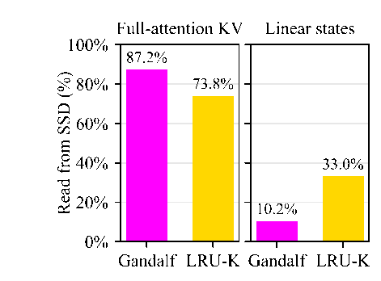

**Original:** Figure 11: A bigger portion of linear state cache hit in Gandalf comes from DRAM, while most full attention KV cache hit comes from SSD.

**中文：** 图 11：Gandalf 的线性状态缓存命中有更大比例来自 DRAM，而大多数全注意力 KV 缓存命中来自 SSD。

**Source:** PDF p.10 · S154

**Original:** In summary, the improvement of Gandalf comes from leveraging attention type as a proxy for reusability, which: (1) avoids writing linear states at the end of each rounds to the SSD, (2) avoids writing rarely reused full-attention KV to the SSD, and (3) places linear states in DRAM and full-attention KV in the SSD.

**中文：** 总体而言，Gandalf 的收益来自将注意力类型作为复用能力的代理信号，从而：（1）避免将每轮结束时的线性状态写入 SSD；（2）避免将很少复用的全注意力 KV 写入 SSD；（3）将线性状态放在 DRAM，将全注意力 KV 放在 SSD。

### 5.7 Comparing Gandalf to each baseline. / 5.7 与各基线逐一比较

**Source:** PDF p.10 · S156

**Original:** Figure 12 breaks down each policy’s SSD writes on TraceA (2 hours duration) with Kimi-K3, 100GB of DRAM and a 1TB SSD, with Gandalf at α = 1, HotPrefix at F = 1, LRU-K at K = 3, and Marconi at α = 0.

**中文：** 图 12 在持续 2 小时的 TraceA、Kimi-K3、100 GB DRAM 和 1 TB SSD 下，分解各策略的 SSD 写入。参数分别为 Gandalf 的 $\alpha=1$、HotPrefix 的 $F=1$、LRU-K 的 $K=3$，以及 Marconi 的 $\alpha=0$。

**Source:** PDF p.11 · S157

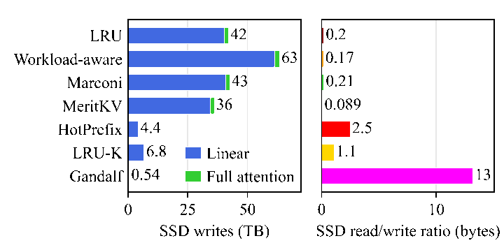

**Original:** Figure 12: The gain from Gandalf comes from both reducing the amount of writes to the SSD (left) and increasing the Read/Write ratio (right).

**中文：** 图 12：Gandalf 的收益同时来自减少 SSD 写入量（左）和提高读／写比（右）。

**Source:** PDF p.11 · S158

**Original:** Write-back baselines (LRU, Workload-aware, Marconi). These policies write every object evicted from DRAM to the SSD: they decide which object to evict, but not whether to move it to the SSD or drop it. Linear states make up 96% of the bytes they write, yet only 1.6–8.5% of the linear states they write are ever hit on the SSD, and 57% of LRU’s are never requested again. Gandalf writes 25 linear states instead of LRU’s 90k, and 3.2× fewer full-attention bytes (0.53 against 1.70TB). In total, it writes 73× fewer bytes than LRU (0.58 against 42.2TB), and its SSD lasts 73× longer (253 against 3.5 days). Workload-aware and Marconi change only which object to evict; Marconi writes about as much as LRU (42.7TB, 3.4 days), and Workload-aware writes 1.5× more (63.5TB, 2.3 days). At α = 1, Gandalf has a higher miss ratio than LRU (0.818 against 0.697; see below). With α = 0, Gandalf has the lowest miss ratio of all policies, 0.603, and its SSD still lasts 1.4× longer than LRU’s (4.95 against 3.46 days), because what it writes is read more: its SSD serves 1.8× as many full-attention hits (2.04M against 1.14M) and 2.2× as many linear-state hits (38.9k against 18.0k).

**中文：** **回写基线（LRU、Workload-aware、Marconi）。** 这些策略将每个被 DRAM 驱逐的对象写入 SSD：它们决定驱逐哪个对象，却不决定将其移动至 SSD 还是丢弃。线性状态占其写入字节数的 96%，但写入的线性状态中仅 1.6–8.5% 曾在 SSD 上被命中，LRU 的线性状态有 57% 此后再未被请求。Gandalf 仅写入 25 个线性状态，而 LRU 写入 90k 个；全注意力写入字节数则减少至 1/3.2，分别为 0.53 TB 和 1.70 TB。总计，Gandalf 的写入量减少至 LRU 的 1/73（0.58 TB 对 42.2 TB），SSD 寿命达到 73 倍（253 天对 3.5 天）。Workload-aware 和 Marconi 只改变驱逐对象的选择；Marconi 写入量与 LRU 相近（42.7 TB，3.4 天），Workload-aware 则写入其 1.5 倍（63.5 TB，2.3 天）。在 $\alpha=1$ 时，Gandalf 的未命中率高于 LRU，分别为 0.818 和 0.697，详见下文。在 $\alpha=0$ 时，Gandalf 具有所有策略中最低的未命中率 0.603，SSD 寿命仍为 LRU 的 1.4 倍（4.95 天对 3.46 天），因为写入数据得到了更多读取：其 SSD 提供的全注意力命中为 1.8 倍（2.04M 对 1.14M），线性状态命中为 2.2 倍（38.9k 对 18.0k）。

**Source:** PDF p.11 · S159

**Original:** MeritKV. MeritKV admits an object to the SSD only when the prefill it saves outweighs the expected reuse latency plus the write cost, but it admits the first three demands of every object unconditionally to learn its reuse. Most linear states are written before this estimate applies: 97% of the linear states it writes had never been hit before the write. It still writes 36.1TB (4.0 days), only 5.6% of its linear-state writes are hit on the SSD, and it misses 0.807 of chunks.

**中文：** **MeritKV。** 只有当对象节省的预填充代价超过预期复用延迟与写入成本之和时，MeritKV 才将其准入 SSD；但为了学习复用情况，它会无条件准入每个对象的前三次请求。大多数线性状态在该估计生效前就已写入：它写入的线性状态中，97% 在写入前从未被命中。它仍写入 36.1 TB，SSD 寿命为 4.0 天，线性状态写入中仅 5.6% 在 SSD 上被命中，块未命中率为 0.807。

**Source:** PDF p.11 · S160

**Original:** HotPrefix. HotPrefix admits a prefix to DRAM only if it has been requested at least F times while DRAM has room, and otherwise only if its frequency times its recency clock beats the coldest DRAM entry; a refused prefix is dropped rather than written to the SSD. This cuts its writes to 4.4TB, 9.6× fewer than LRU, and its SSD lasts 33 days. The filter, however, does not tell reused linear states from the rest: 97% of the linear states it writes had never been hit before, 51% are never requested again, and only 17% are hit on the SSD. The dropped prefixes become misses, so its miss ratio is 0.802; Gandalf at α = 1 lasts 7.6× longer at a 0.016 higher miss ratio. With F = 10, HotPrefix writes 0.38TB and lasts 388 days, but misses 0.839 of chunks.

**中文：** **HotPrefix。** DRAM 有空间时，HotPrefix 只有在某个前缀已被请求至少 $F$ 次后才将其准入 DRAM；否则，只有当其频率与最近访问时钟的乘积超过 DRAM 中最冷条目时才准入。被拒绝的前缀会被丢弃，而非写入 SSD。这将写入量降至 4.4 TB，为 LRU 的 1/9.6，SSD 寿命为 33 天。然而，这一过滤器无法区分会被复用的线性状态与其他状态：它写入的线性状态中，97% 此前从未被命中，51% 此后再未被请求，只有 17% 在 SSD 上被命中。被丢弃的前缀会造成未命中，因此其未命中率为 0.802；Gandalf 在 $\alpha=1$ 时，未命中率高出 0.016，但寿命达到其 7.6 倍。当 $F=10$ 时，HotPrefix 写入 0.38 TB、寿命达 388 天，但块未命中率为 0.839。

**Source:** PDF p.11 · S161

**Original:** LRU-K. LRU-K writes an object to the SSD only once it has been referenced K times. With K = 3, it writes 6.8TB, 6.2× fewer than LRU, and 31% of the linear states it writes are hit on the SSD, against 7.9% for LRU. The objects it refuses are dropped, so its miss ratio rises to 0.750, and its SSD lasts 21.5 days; Gandalf at α = 1 lasts 11.8× longer at a 0.068 higher miss ratio.

**中文：** **LRU-K。** LRU-K 仅在对象被引用 $K$ 次后将其写入 SSD。当 $K=3$ 时，它写入 6.8 TB，为 LRU 的 1/6.2，写入的线性状态有 31% 在 SSD 上被命中，而 LRU 为 7.9%。被拒绝的对象会被丢弃，因此其未命中率升至 0.750，SSD 寿命为 21.5 天；Gandalf 在 $\alpha=1$ 时，未命中率高出 0.068，但寿命达到其 11.8 倍。

**Source:** PDF p.11 · S163

**Original:** Where Gandalf gives up hits. At α = 1, Gandalf misses more than LRU on TraceA (0.818 against 0.697). Since it writes only 25 linear states, a conversation whose linear state has left DRAM must be recomputed from the start, and its full-attention KV cannot be used either: Gandalf serves 19.5k linear-state hits against 42.4k for LRU, and 1.11M full-attention hits against 1.91M. In exchange, its SSD lasts 73× longer. A smaller α recovers these hits at a shorter lifetime (§5.4).

**中文：** **Gandalf 在何处牺牲命中。** 在 TraceA 上，$\alpha=1$ 时 Gandalf 的未命中率高于 LRU，分别为 0.818 和 0.697。由于仅写入 25 个线性状态，一旦某个对话的线性状态已离开 DRAM，就必须从头重新计算，该对话的全注意力 KV 也无法使用：Gandalf 提供 19.5k 次线性状态命中，而 LRU 为 42.4k 次；全注意力命中分别为 1.11M 和 1.91M。作为交换，其 SSD 寿命达到 73 倍。较小的 $\alpha$ 可用较短寿命换回这些命中（第 5.4 节）。

### 5.8 How much is the cache load latency affected? / 5.8 缓存加载延迟受到多大影响？

**Source:** PDF p.11 · S165

**Original:** We approximate the cache load latency of a request as the maximum of the time to transfer its cached KV to GPU HBM and the time to recompute its missed tokens, since the two overlap. The transfer uses DRAM as a staging buffer: KV on the SSD is first read into DRAM (10GB/s), then every cached byte is sent to GPU HBM (50GB/s); recomputation runs at 60k tokens/s. Figure 13 shows the average cache load latency against SSD lifetime on ClaudeCode with Kimi-K3, 100GB of DRAM and a 1TB SSD. The baselines with the lowest load latency, Marconi at α = 0 and LRU, load in 0.66s and their SSDs last 4 months. Gandalf at α = 1 lasts 4.2× longer (17.0 months) at a load latency of 0.78s, 0.12s higher. It reads more of its hits from the SSD, which is slower than DRAM, and its miss ratio is 0.01 higher (0.056 against 0.045), so slightly more tokens are recomputed. At a similar load latency, Gandalf lasts 3.7× longer than LRU-K at K = 2 (21.2 against 5.7 months, 0.79s against 0.81s), and with α = 64 it lasts 5.3× longer than LRU-K at K = 3 while still loading faster (38.6 against 7.3 months, 0.91s against 0.93s).

**中文：** 我们将请求的缓存加载延迟近似为两个时间的较大值：将已缓存 KV 传输到 GPU HBM 的时间，以及重新计算未命中 token 的时间，因为两者可以重叠。传输以 DRAM 为暂存缓冲：先将 SSD 上的 KV 读入 DRAM（10 GB/s），再将每个已缓存字节发送至 GPU HBM（50 GB/s）；重新计算速率为 60k tokens/s。图 13 在 ClaudeCode、Kimi-K3、100 GB DRAM 和 1 TB SSD 下，展示平均缓存加载延迟与 SSD 寿命的关系。加载延迟最低的基线 Marconi（$\alpha=0$）与 LRU 均为 0.66 s，SSD 寿命为 4 个月。Gandalf（$\alpha=1$）的寿命达到其 4.2 倍，为 17.0 个月，加载延迟为 0.78 s，高出 0.12 s。它有更多命中来自比 DRAM 慢的 SSD，且未命中率高出约 0.01（0.056 对 0.045），因此需重新计算略多的 token。在相近加载延迟下，Gandalf 的寿命为 $K=2$ 的 LRU-K 的 3.7 倍（21.2 对 5.7 个月，0.79 对 0.81 s）；当 $\alpha=64$ 时，寿命为 $K=3$ 的 LRU-K 的 5.3 倍，而且加载仍更快（38.6 对 7.3 个月，0.91 对 0.93 s）。

**Source:** PDF p.11 · S162

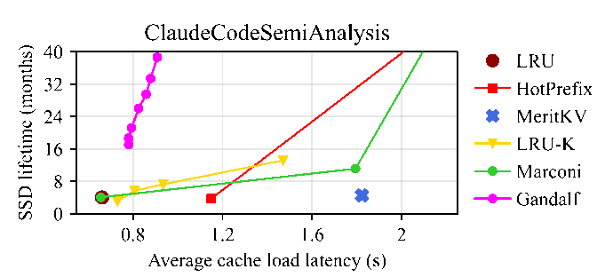

**Original:** Figure 13: Gandalf increases SSD lifetime while maintaining low cache load latency.

**中文：** 图 13：Gandalf 在保持较低缓存加载延迟的同时延长 SSD 寿命。

**Source:** PDF p.11 · S166

**Original:** However, more recomputation is not always worse. Every write wears out the SSD, effectively using a portion of its purchase price, so the cost of a request is the GPU cost of recomputing its missed tokens plus the SSD price share. Figure 14 shows this cost as an average per request, choosing the cheapest hyperparameters for each policy. SSD wear makes up 66–86% of the cost of LRU, Marconi and LRU-K, and the cheapest baseline, LRU-K at K = 2, costs \$0.74 per 1k requests. Gandalf at α = 1 costs \$0.30 per 1k requests, 2.5× less: it recomputes more than LRU and Marconi (\$0.13 against \$0.11 per 1k requests), but its SSD wear is 3.0× lower than that of any baseline (\$0.16 against \$0.49–0.73).

**中文：** 然而，更多重新计算并不总是更差。每次写入都会磨损 SSD，相当于消耗其购置价格的一部分，因此请求成本是重新计算未命中 token 的 GPU 成本，加上分摊的 SSD 价格。图 14 为每个策略选取成本最低的超参数，展示平均请求成本。SSD 磨损占 LRU、Marconi 和 LRU-K 成本的 66–86%；最便宜的基线是 $K=2$ 的 LRU-K，每 1k 个请求花费 0.74 美元。Gandalf（$\alpha=1$）每 1k 个请求花费 0.30 美元，成本降至约 1/2.5：其重新计算成本高于 LRU 和 Marconi（每 1k 个请求 0.13 美元，对比 0.11 美元），但 SSD 磨损成本低至任一基线的约 1/3.0（0.16 美元，对比 0.49–0.73 美元）。

**Source:** PDF p.12 · S167

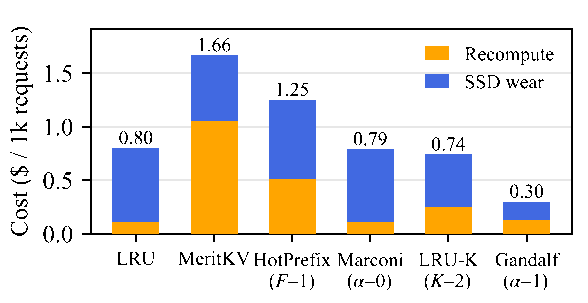

**Original:** Figure 14: Average cost per request, recomputation plus SSD wear, on ClaudeCode with Kimi-K3, 100 GB of DRAM and a 1 TB SSD. Gandalf has the lowest cost once the SSD wear is counted.

**中文：** 图 14：在 ClaudeCode、Kimi-K3、100 GB DRAM 和 1 TB SSD 下，每个请求的平均成本，包括重新计算和 SSD 磨损。计入 SSD 磨损后，Gandalf 的成本最低。

**Source:** PDF p.12 · S168

**Original:** Therefore, Gandalf may choose to recompute more tokens if the SSD write cost is high, since the inference saving cost involves not only GPU as a hardware resource, but also SSD.

**中文：** 因此，当 SSD 写入成本较高时，Gandalf 可能选择重新计算更多 token，因为推理成本节省不仅涉及 GPU 这一硬件资源，也涉及 SSD。

### 5.9 The optimization does not affect the performance negatively. / 5.9 优化不会对性能产生负面影响

**Source:** PDF p.12 · S170

**Original:** To keep each decision cheap, the move door (§3.4) checks, for each slot size, only the longest-lived DRAM entry as a candidate to move to the SSD. A move is then blocked whenever that one entry’s score falls below its write fee, even if another entry of the same size would be worth writing. To measure what this costs, we let the move door check up to 64 candidates per slot size, with Kimi-K3, 100GB of DRAM, a 1TB SSD and α = 1. Checking more candidates does not lower Gandalf’s miss ratio: it stays at 0.823 on TraceA and 0.036 on AIPerf for every number of candidates. On TraceA, the extra candidates only move entries that are not read again, so the SSD writes grow by 1.4% (501 to 508GiB) and the SSD lifetime shortens from 271 to 268 days; on AIPerf, the first candidate is never blocked, so the result is identical. A single candidate per slot size therefore loses no hits.

**中文：** 为了降低每次决策的成本，移动门控（第 3.4 节）对每种槽位大小，仅检查寿命最长的 DRAM 条目作为移入 SSD 的候选。当该条目的评分低于写入费用时，就阻止移动，即使同样大小的其他条目可能值得写入。为衡量这一做法的代价，我们在 Kimi-K3、100 GB DRAM、1 TB SSD 和 $\alpha=1$ 下，让移动门控对每种槽位大小最多检查 64 个候选。检查更多候选并未降低 Gandalf 的未命中率：无论候选数多少，TraceA 始终为 0.823，AIPerf 始终为 0.036。在 TraceA 上，额外候选只会移动此后不再读取的条目，使 SSD 写入量增加 1.4%（501 GiB 增至 508 GiB），SSD 寿命从 271 天缩短至 268 天；在 AIPerf 上，第一个候选从未被阻止移动，因此结果完全相同。所以，每种槽位大小仅检查一个候选并未损失命中。

## 6 Related Work / 6 相关工作

**Source:** PDF p.12 · S172

**Original:** Tiered KV-cache systems. CachedAttention, FlashGen, LMCache, and Mooncake extend GPU memory with host DRAM, SSD, or distributed storage [7, 13, 16, 36], while TENURE and placement studies decide where KV caches should reside across these tiers [28, 43]. InfiniGen and Tutti instead reduce lower-tier access overhead through selective fetching and GPU-directed SSD I/O [20, 37]. These systems primarily optimize capacity, latency, or throughput rather than SSD endurance.

**中文：** **分层 KV 缓存系统。** CachedAttention、FlashGen、LMCache 和 Mooncake 使用主机 DRAM、SSD 或分布式存储扩展 GPU 内存 [7, 13, 16, 36]，TENURE 和其他放置研究则决定 KV 缓存应驻留在哪一层 [28, 43]。InfiniGen 与 Tutti 通过选择性获取和由 GPU 发起的 SSD I/O，降低下层访问开销 [20, 37]。这些系统主要优化容量、延迟或吞吐量，而非 SSD 耐久性。

**Source:** PDF p.12 · S173

**Original:** KV admission, eviction, and compression. Prior policies predict reuse from prefix structure, recency, frequency, semantics, queued demand, or workload history [12, 22, 33, 34, 44, 46, 48, 49]. MeritKV, Bidaw, LRU-K, and NVIDIA KVBM further incorporate reuse utility, storage cost, or write awareness [14, 17, 30, 35]. Orthogonal techniques reduce the footprint through token eviction, quantization, or model-level KV compression [8, 25, 53]. Most of these techniques do not jointly manage DRAM placement, SSD admission, and SSD eviction using attention-type reuse heterogeneity and an explicit endurance cost.

**中文：** **KV 准入、驱逐与压缩。** 既有策略根据前缀结构、最近访问、频率、语义、排队需求或工作负载历史来预测复用 [12, 22, 33, 34, 44, 46, 48, 49]。MeritKV、Bidaw、LRU-K 和 NVIDIA KVBM 进一步考虑复用效用、存储成本或写入感知 [14, 17, 30, 35]。与其正交的技术通过 token 驱逐、量化或模型级 KV 压缩缩小占用 [8, 25, 53]。这些技术大多没有结合注意力类型带来的复用异质性与显式耐久成本，联合管理 DRAM 放置、SSD 准入和 SSD 驱逐。

**Source:** PDF p.12 · S174

**Original:** Flash-aware caching and storage. General flash caches control wear through admission filtering and write-rate constraints [10, 47, 51], while offline work extends Bélady-style analysis to account for flash erasures [6]. Device- and interface-level techniques reduce physical writes through retention management, stream placement, and cache-aware reclamation [24, 26, 27, 39]. For LLM serving, HiFC, FlashAccel, and HBFlex optimize flash data paths, writeback, and reclamation [15, 45, 54]. These mechanisms are complementary to Gandalf because they do not use attention semantics to value individual KV states.

**中文：** **闪存感知缓存与存储。** 通用闪存缓存通过准入过滤和写入速率约束控制磨损 [10, 47, 51]；离线研究则扩展 Bélady 式分析，将闪存擦除纳入考虑 [6]。设备级和接口级技术通过数据保持管理、流放置和缓存感知回收来减少物理写入 [24, 26, 27, 39]。面向 LLM 服务，HiFC、FlashAccel 和 HBFlex 优化闪存数据路径、回写与回收 [15, 45, 54]。这些机制与 Gandalf 互补，因为它们没有使用注意力语义来衡量单个 KV 状态的价值。

**Source:** PDF p.12 · S175

**Original:** Lifetime-aware KV placement. Most closely related, Lachesis places agent KV segments across HBM and high-bandwidth flash using lifetimes inferred from the agent harness [50]. In contrast, Gandalf targets host DRAM and SSD, derives reuse differences from hybrid-attention semantics without harness-specific information, and jointly considers capacity, recomputation benefit, and SSD write cost.

**中文：** **寿命感知 KV 放置。** 最相关的工作 Lachesis 根据智能体执行框架推断的寿命，在 HBM 与高带宽闪存之间放置智能体 KV 片段 [50]。Gandalf 则面向主机 DRAM 与 SSD，无需执行框架特定信息，即可从混合注意力语义推导复用差异，并联合考虑容量、重新计算收益和 SSD 写入成本。

## 7 Conclusion / 7 结论

**Source:** PDF p.12 · S177

**Original:** This paper presents Gandalf, an SSD-based KV cache offloading system that uses the attention type associated with each KV cache object to predict its likelihood of future reuse. Gandalf retains short-lived linear-attention states in DRAM, while offloading full-attention KV caches with high reuse potential to SSD. Its placement policy balances the expected cache hits from each SSD write against the resulting device wear. By filtering writes based on both reuse potential and wear cost, Gandalf preserves cache hit rates while extending SSD lifetime. Across a range of hybrid models and hardware capacities, Gandalf improves SSD lifetime by 2–7.3× over the best baseline. As KV caches continue to outgrow available memory, we hope Gandalf motivates future KV cache systems to consider not only the performance benefits of SSD offloading, but also the wear caused by each write. We leave the extension of Gandalf to other types of flash-based storage as a future work.

**中文：** 本文提出 Gandalf，这是一种基于 SSD 的 KV 缓存卸载系统，使用每个 KV 缓存对象对应的注意力类型来预测未来复用的可能性。Gandalf 将短寿命线性注意力状态保留在 DRAM，将复用潜力较高的全注意力 KV 缓存卸载到 SSD。其放置策略权衡每次 SSD 写入带来的预期缓存命中与由此产生的设备磨损。通过同时依据复用潜力和磨损成本过滤写入，Gandalf 在维持缓存命中率的同时延长 SSD 寿命。在多种混合模型和硬件容量下，相较最佳基线，Gandalf 将 SSD 寿命延长至 2–7.3 倍。随着 KV 缓存继续超出可用内存容量，我们希望 Gandalf 能推动未来 KV 缓存系统既考虑 SSD 卸载的性能收益，也考虑每次写入带来的磨损。将 Gandalf 扩展至其他闪存存储类型留作未来工作。

## References / 参考文献

**Source:** PDF p.12 · S179

**Original:** [1] Anthropic.[n.d.].Prompt caching.https://platform.claude.com/docs/en/build-with-claude/prompt-caching.Accessed: 2026-09-30.

**中文：** [1] Anthropic。（无日期）。《提示缓存》。访问日期：2026-09-30。链接与英文著录一致。

**Source:** PDF p.12 · S180

**Original:** [2] Jens Axboe and Vincent Fu.[n.d.].1.fio - Flexible I/O tester.https://fio.readthedocs.io/en/latest/fio_doc.html.[Accessed 12-10-2026].

**中文：** [2] Jens Axboe、Vincent Fu。（无日期）。《1. fio——灵活的 I/O 测试工具》。访问日期：12-10-2026，保留原文日期格式。

**Source:** PDF p.12 · S181

**Original:** [3] L.A.Belady.1966.A Study of Replacement Algorithms for a Virtual-Storage Computer.IBM Systems Journal 5, 2 (1966), 78–101.

**中文：** [3] L. A. Belady。1966。《虚拟存储计算机替换算法研究》。IBM Systems Journal，第 5 卷第 2 期，78–101 页。

**Source:** PDF p.12 · S182

**Original:** [4] Joe Brewer and Manzur Gill.2011.Nonvolatile memory technologies with emphasis on flash: a comprehensive guide to understanding and using flash memory devices.John Wiley & Sons.

**中文：** [4] Joe Brewer、Manzur Gill。2011。《以闪存为重点的非易失性存储技术：理解和使用闪存器件的综合指南》。John Wiley & Sons。

**Source:** PDF p.12 · S183

**Original:** [5] Yu Cai, Gulay Yalcin, Onur Mutlu, Erich F Haratsch, Adrian Cristal, Osman S Unsal, and Ken Mai.2012.Flash correct-and-refresh: Retention-aware error management for increased flash memory lifetime.In 2012 IEEE 30th International Conference on Computer Design (ICCD).IEEE, 94–101.

**中文：** [5] Yu Cai 等。2012。《闪存纠错与刷新：通过保持感知错误管理延长闪存寿命》。2012 年第 30 届 IEEE 国际计算机设计会议（ICCD），IEEE，94–101 页。

**Source:** PDF p.12 · S184

**Original:** [6] Yue Cheng, Fred Douglis, Philip Shilane, Michael Trachtman, Grant Wallace, Peter Desnoyers, and Kai Li.2016.Erasing Bélady’s Limitations: In Search of Flash Cache Offline Optimality.In 2016 USENIX Annual Technical Conference (USENIX ATC 16).USENIX Association, 379–392.https://www.usenix.org/conference/atc16/technical-sessions/presentation/cheng

**中文：** [6] Yue Cheng 等。2016。《消除 Bélady 的局限：探索闪存缓存的离线最优性》。2016 年 USENIX 年度技术会议（ATC 16），USENIX Association，379–392 页。

**Source:** PDF p.12 · S185

**Original:** [7] Yihua Cheng, Yuhan Liu, Jiayi Yao, Yuwei An, Xiaokun Chen, Shaoting Feng, Yuyang Huang, Samuel Shen, Kuntai Du, and Junchen Jiang.2025.LMCache: An Efficient KV Cache Layer for Enterprise-Scale LLM Inference.arXiv preprint arXiv:2510.09665 (2025).

**中文：** [7] Yihua Cheng 等。2025。《LMCache：面向企业规模 LLM 推理的高效 KV 缓存层》。arXiv 预印本，arXiv:2510.09665。

**Source:** PDF p.12 · S186

**Original:** [8] DeepSeek-AI.2026.DeepSeek-V4.1-Flash: Pushing the Limits of KV Cache Compression.arXiv:2609.19969 [cs.CL] https://arxiv.org/abs/2609.19969

**中文：** [8] DeepSeek-AI。2026。《DeepSeek-V4.1-Flash：突破 KV 缓存压缩极限》。arXiv:2609.19969 [cs.CL]。

**Source:** PDF p.12 · S187

**Original:** [9] NVIDIA Dynamo.[n.d.].GitHub - ai-dynamo/aiperf: AIPerf is a comprehensive benchmarking tool that measures the performance of generative AI models served by your preferred inference solution.— github.com.https://github.com/ai-dynamo/aiperf.[Accessed 21-10-2026].

**中文：** [9] NVIDIA Dynamo。（无日期）。《GitHub：ai-dynamo/aiperf——AIPerf 是一款综合基准测试工具，用于测量由用户所选推理方案提供服务的生成式 AI 模型性能》。访问日期：21-10-2026，保留原文格式。

**Source:** PDF p.13 · S188

**Original:** [10] Assaf Eisenman, Asaf Cidon, Evgenya Pergament, Or Haimovich, Ryan Stutsman, Mohammad Alizadeh, and Sachin Katti.2019.Flashield: A Hybrid Key-Value Cache that Controls Flash Write Amplification.In 16th USENIX Symposium on Networked Systems Design and Implementation (NSDI 19).USENIX Association, 65–78.https://www.usenix.org/conference/nsdi19/presentation/eisenman

**中文：** [10] Assaf Eisenman 等。2019。《Flashield：控制闪存写放大的混合键值缓存》。第 16 届 USENIX 网络系统设计与实现研讨会（NSDI 19），USENIX Association，65–78 页。

**Source:** PDF p.13 · S189

**Original:** [11] Facebook.[n.d.].Flashcache: A General-Purpose Write-Back Block Cache for Linux.https://github.com/facebookarchive/flashcache.Accessed: 2026-10-03.

**中文：** [11] Facebook。（无日期）。《Flashcache：面向 Linux 的通用回写块缓存》。访问日期：2026-10-03。

**Source:** PDF p.13 · S190

**Original:** [12] Shaoke Fang, Ziang Li, Wenfei Wu, Jiatong Ji, Qingsong Liu, and Ruizhi Pu.2026.Not All Tokens Are Worth Caching: Learning Semantic-Aware Eviction for LLM Prefix Caches.arXiv preprint arXiv:2605.18825 (2026).

**中文：** [12] Shaoke Fang 等。2026。《并非所有 token 都值得缓存：学习面向 LLM 前缀缓存的语义感知驱逐》。arXiv 预印本，arXiv:2605.18825。

**Source:** PDF p.13 · S191

**Original:** [13] Bin Gao, Zhuomin He, Puru Sharma, Qingxuan Kang, Djordje Jevdjic, Junbo Deng, Xingkun Yang, Zhou Yu, and Pengfei Zuo.2024.{Cost-Efficient} large language model serving for multi-turn conversations with {CachedAttention}.In 2024 USENIX annual technical conference (USENIX ATC 24).111–126.

**中文：** [13] Bin Gao 等。2024。《利用 CachedAttention 实现高成本效益的多轮对话大语言模型服务》。2024 年 USENIX 年度技术会议（ATC 24），111–126 页。

**Source:** PDF p.13 · S192

**Original:** [14] Shipeng Hu, Guangyan Zhang, Yuqi Zhou, Yaya Wei, Ziyan Zhong, and Jike Chen.2026.Bidaw: Enhancing {Key-Value} Caching for Interactive {LLM} Serving via Bidirectional {Computation–Storage} Awareness.In 24th USENIX Conference on File and Storage Technologies (FAST 26).101–116.

**中文：** [14] Shipeng Hu 等。2026。《Bidaw：通过双向计算—存储感知增强交互式 LLM 服务的键值缓存》。第 24 届 USENIX 文件与存储技术会议（FAST 26），101–116 页。

**Source:** PDF p.13 · S193

**Original:** [15] Inho Jeong, Sunghyeon Woo, Sol Namkung, and Dongsuk Jeon.2026.HiFC: High-efficiency flash-based KV cache swapping for scaling LLM inference.Advances in Neural Information Processing Systems 38 (2026), 47561–47590.

**中文：** [15] Inho Jeong 等。2026。《HiFC：用于扩展 LLM 推理的高效闪存 KV 缓存换入换出》。Advances in Neural Information Processing Systems，第 38 卷，47561–47590 页。

**Source:** PDF p.13 · S194

**Original:** [16] Jinwoo Jeong and Jeongseob Ahn.2025.Accelerating llm serving for multi-turn dialogues with efficient resource management.In Proceedings of the 30th ACM International Conference on Architectural Support for Programming Languages and Operating Systems, Volume 2.1–15.

**中文：** [16] Jinwoo Jeong、Jeongseob Ahn。2025。《通过高效资源管理加速多轮对话 LLM 服务》。第 30 届 ACM 程序设计语言与操作系统体系结构支持国际会议论文集，第 2 卷，1–15 页。

**Source:** PDF p.13 · S195

**Original:** [17] Kushal Khemani, Evan J.Leri, and Sparsh Mittal.2026.MeritKV: Utility-Gated Admission Control for KV-Cache Reuse in LLM Serving.Transactions on Machine Learning Research (TMLR) (2026).Accepted by TMLR.https://openreview.net/forum?id=y3j6fucWQP

**中文：** [17] Kushal Khemani、Evan J. Leri、Sparsh Mittal。2026。《MeritKV：面向 LLM 服务中 KV 缓存复用的效用门控准入控制》。Transactions on Machine Learning Research（TMLR）。原文注明已被 TMLR 接收。

**Source:** PDF p.13 · S196

**Original:** [18] Woosuk Kwon, Zhuohan Li, Siyuan Zhuang, Ying Sheng, Lianmin Zheng, Cody Hao Yu, Joseph Gonzalez, Hao Zhang, and Ion Stoica.2023.Efficient memory management for large language model serving with pagedattention.In Proceedings of the 29th symposium on operating systems principles.611–626.

**中文：** [18] Woosuk Kwon 等。2023。《通过 PagedAttention 实现大语言模型服务的高效内存管理》。第 29 届操作系统原理研讨会论文集，611–626 页。

**Source:** PDF p.13 · S197

**Original:** [19] Joohee Lee, Kwangjin Ko, Taeho Hwang, Woosuk Chung, Hoshik Kim, and Donguk Moon.2026.Prompt Caching on Flash: Achieving Memory-Class Latency for LLM Inference.IEEE Computer Architecture Letters (2026).

**中文：** [19] Joohee Lee 等。2026。《闪存上的提示缓存：为 LLM 推理实现内存级延迟》。IEEE Computer Architecture Letters。

**Source:** PDF p.13 · S198

**Original:** [20] Wonbeom Lee, Jungi Lee, Junghwan Seo, and Jaewoong Sim.2024.InfiniGen: Efficient Generative Inference of Large Language Models with Dynamic KV Cache Management.In 18th USENIX Symposium on Operating Systems Design and Implementation (OSDI 24).USENIX Association, 155–172.https://www.usenix.org/conference/osdi24/presentation/lee

**中文：** [20] Wonbeom Lee、Jungi Lee、Junghwan Seo、Jaewoong Sim。2024。《InfiniGen：通过动态 KV 缓存管理实现大语言模型的高效生成式推理》。第 18 届 USENIX 操作系统设计与实现研讨会（OSDI 24），USENIX Association，155–172 页。

**Source:** PDF p.13 · S199

**Original:** [21] Huaicheng Li, Mingzhe Hao, Michael Hao Tong, Swaminathan Sundararaman, Matias Bjørling, and Haryadi S Gunawi.2018.The {CASE} of {FEMU}: Cheap, accurate, scalable and extensible flash emulator.In 16th USENIX Conference on File and Storage Technologies (FAST 18).83–90.

**中文：** [21] Huaicheng Li 等。2018。《FEMU 的 CASE：低成本、准确、可扩展且可扩充的闪存仿真器》。第 16 届 USENIX 文件与存储技术会议（FAST 18），83–90 页。

**Source:** PDF p.13 · S200

**Original:** [22] Yuhang Li, Rong Gu, Chengying Huan, Zhibin Wang, Renjie Yao, Chen Tian, and Guihai Chen.2025.HotPrefix: Hotness-aware KV cache scheduling for efficient prefix sharing in LLM inference systems.Proceedings of the ACM on Management of Data 3, 4 (2025), 1–27.

**中文：** [22] Yuhang Li 等。2025。《HotPrefix：面向 LLM 推理系统高效前缀共享的热度感知 KV 缓存调度》。Proceedings of the ACM on Management of Data，第 3 卷第 4 期，1–27 页。

**Source:** PDF p.13 · S201

**Original:** [23] Zhuoran Li, Zhuohang Bian, Xin Huang, Yibo Zhao, Guangyu Sun, and Youwei Zhuo.2026.HBF Sucks? A Full-Stack Characterization of High-Bandwidth Flash for KV-Centric LLM Serving.arXiv:2608.11668 [cs.AR] doi:10.48550/arXiv.2608.11668

**中文：** [23] Zhuoran Li 等。2026。《HBF Sucks? 面向以 KV 为中心的 LLM 服务的高带宽闪存全栈特性分析》。arXiv:2608.11668 [cs.AR]。DOI：10.48550/arXiv.2608.11668。

**Source:** PDF p.13 · S202

**Original:** [24] Ren-Shuo Liu, Chia-Lin Yang, and Wei Wu.2012.Optimizing NAND Flash-Based SSDs via Retention Relaxation.In 10th USENIX Conference on File and Storage Technologies (FAST 12).USENIX Association.https://www.usenix.org/conference/fast12/optimizing-nand-flash-based-ssds-retention-relaxation

**中文：** [24] Ren-Shuo Liu、Chia-Lin Yang、Wei Wu。2012。《通过放宽数据保持要求优化基于 NAND 闪存的 SSD》。第 10 届 USENIX 文件与存储技术会议（FAST 12），USENIX Association。

**Source:** PDF p.13 · S203

**Original:** [25] Zirui Liu, Jiayi Yuan, Hongye Jin, Shaochen Zhong, Zhaozhuo Xu, Vladimir Braverman, Beidi Chen, and Xia Hu.2024.KIVI: A Tuning-Free Asymmetric 2bit Quantization for KV Cache.In Proceedings of the 41st International Conference on Machine Learning (Proceedings of Machine Learning Research, Vol.235).PMLR, 32332–32344.https://proceedings.mlr.press/v235/liu24bz.html

**中文：** [25] Zirui Liu 等。2024。《KIVI：面向 KV 缓存、无需调参的非对称 2 比特量化》。第 41 届国际机器学习会议论文集，Proceedings of Machine Learning Research 第 235 卷，PMLR，32332–32344 页。

**Source:** PDF p.13 · S204

**Original:** [26] Yixin Luo, Yu Cai, Saugata Ghose, Jongmoo Choi, and Onur Mutlu.2015.WARM: Improving NAND flash memory lifetime with write-hotness aware retention management.In 2015 31st Symposium on Mass Storage Systems and Technologies (MSST).IEEE, 1–14.

**中文：** [26] Yixin Luo 等。2015。《WARM：通过写热度感知的数据保持管理延长 NAND 闪存寿命》。2015 年第 31 届海量存储系统与技术研讨会（MSST），IEEE，1–14 页。

**Source:** PDF p.13 · S205

**Original:** [27] Sara McAllister, Yucong Sherry Wang, Benjamin Berg, Daniel S.Berger, George Amvrosiadis, Nathan Beckmann, and Gregory R.Ganger.2024.FairyWREN: A Sustainable Cache for Emerging Write-Read-Erase Flash Interfaces.In 18th USENIX Symposium on Operating Systems Design and Implementation (OSDI 24).USENIX Association, 745–764.https://www.usenix.org/conference/osdi24/presentation/mcallister

**中文：** [27] Sara McAllister 等。2024。《FairyWREN：面向新兴写入—读取—擦除闪存接口的可持续缓存》。第 18 届 USENIX 操作系统设计与实现研讨会（OSDI 24），USENIX Association，745–764 页。

**Source:** PDF p.13 · S206

**Original:** [28] Amir Noohi and Antonio Barbalace.2026.TENURE: Residency Leases for Tiered LLM KV Caches.In ACM Symposium on Cloud Computing (SoCC).

**中文：** [28] Amir Noohi、Antonio Barbalace。2026。《TENURE：面向分层 LLM KV 缓存的驻留租约》。ACM 云计算研讨会（SoCC）。

**Source:** PDF p.13 · S207

**Original:** [29] NVIDIA.[n.d.].Introducing NVIDIA BlueField-4-Powered CMX Context Memory Storage Platform for the Next Frontier of AI | NVIDIA Technical Blog — developer.nvidia.com.https://developer.nvidia.com/blog/introducing-nvidia-bluefield-4-powered-inference-context-memory-storage-platform-for-the-next-frontier-of-ai/?ncid=so-twit-393593.[Accessed 30-09-2026].

**中文：** [29] NVIDIA。（无日期）。《介绍由 NVIDIA BlueField-4 驱动、面向 AI 下一前沿的 CMX 上下文内存存储平台》。NVIDIA 技术博客。访问日期：30-09-2026，保留原文格式。

**Source:** PDF p.13 · S209

**Original:** [30] NVIDIA.2026.KVBM Guide.https://docs.nvidia.com/dynamo/v1.4.2/knowledge-base/modular-components/kvbm/kvbm-guide.NVIDIA Dynamo Documentation, version 1.4.2; accessed 2026-10-01.

**中文：** [30] NVIDIA。2026。《KVBM 指南》。NVIDIA Dynamo 文档，版本 1.4.2；访问日期：2026-10-01。

**Source:** PDF p.13 · S210

**Original:** [31] Elizabeth J.O’Neil, Patrick E.O’Neil, and Gerhard Weikum.1993.The LRU-K page replacement algorithm for database disk buffering.SIGMOD Rec.22, 2 (June 1993), 297–306.doi:10.1145/170036.170081

**中文：** [31] Elizabeth J. O’Neil、Patrick E. O’Neil、Gerhard Weikum。1993。《面向数据库磁盘缓冲的 LRU-K 页面替换算法》。SIGMOD Rec.，第 22 卷第 2 期，1993 年 6 月，297–306 页。DOI：10.1145/170036.170081。

**Source:** PDF p.13 · S211

**Original:** [32] OpenAI.[n.d.].Prompt caching.https://developers.openai.com/api/docs/guides/prompt-caching.Accessed: 2026-09-30.

**中文：** [32] OpenAI。（无日期）。《提示缓存》。访问日期：2026-09-30。

**Source:** PDF p.13 · S212

**Original:** [33] Rui Pan, Zhuang Wang, Zhen Jia, Can Karakus, Luca Zancato, Tri Dao, Yida Wang, and Ravi Netravali.2025.Marconi: Prefix caching for the era of hybrid llms.Proceedings of Machine Learning and Systems 7 (2025).

**中文：** [33] Rui Pan 等。2025。《Marconi：面向混合 LLM 时代的前缀缓存》。Proceedings of Machine Learning and Systems，第 7 卷。

**Source:** PDF p.13 · S213

**Original:** [34] Zaifeng Pan, Chris Wu, Zhengding Hu, Xinwei Qiang, Zhongkai Yu, and Yufei Ding.2026.RR-Evict: Fine-Grained Prefix Cache Eviction beyond LRU for Agentic LLM Serving.arXiv preprint arXiv:2609.32278 (2026).

**中文：** [34] Zaifeng Pan 等。2026。《RR-Evict：面向智能体 LLM 服务、超越 LRU 的细粒度前缀缓存驱逐》。arXiv 预印本，arXiv:2609.32278。

**Source:** PDF p.13 · S214

**Original:** [35] Danni Peng, Kai Wu, Tianyu Zuo, Pengfei Xia, and Hui Zang.2026.Enabling High-Bandwidth Flash for Generative Recommendation Serving with Write-Aware KV Cache Policy.arXiv preprint arXiv:2609.07175 (2026).

**中文：** [35] Danni Peng 等。2026。《通过写入感知 KV 缓存策略，使高带宽闪存适用于生成式推荐服务》。arXiv 预印本，arXiv:2609.07175。

**Source:** PDF p.13 · S215

**Original:** [36] Ruoyu Qin, Zheming Li, Weiran He, Jialei Cui, Feng Ren, Mingxing Zhang, Yongwei Wu, Weimin Zheng, and Xinran Xu.2025.Mooncake: Trading More Storage for Less Computation—A KVCache-Centric Architecture for Serving LLM Chatbot.In 23rd USENIX Conference on File and Storage Technologies (FAST 25).USENIX Association, 155–170.https://www.usenix.org/conference/fast25/presentation/qin

**中文：** [36] Ruoyu Qin 等。2025。《Mooncake：用更多存储换取更少计算——面向 LLM 聊天机器人服务、以 KVCache 为中心的架构》。第 23 届 USENIX 文件与存储技术会议（FAST 25），USENIX Association，155–170 页。

**Source:** PDF p.13 · S216

**Original:** [37] Shi Qiu, Yifan Hu, Xintao Wang, Wenhao Zhu, Jianqin Yan, Hao Chen, Kaiqiang Xu, Kai Chen, and Yiming Zhang.2026.Tutti: Making SSD-Backed KV Cache Practical for Long-Context LLM Serving.arXiv:2605.03375 [cs.OS] https://arxiv.org/abs/2605.03375

**中文：** [37] Shi Qiu 等。2026。《Tutti：使基于 SSD 的 KV 缓存适用于长上下文 LLM 服务》。arXiv:2605.03375 [cs.OS]。

**Source:** PDF p.13 · S217

**Original:** [38] Jeff Rasley, Samyam Rajbhandari, Olatunji Ruwase, and Yuxiong He.2020.Deepspeed: System optimizations enable training deep learning models with over 100 billion parameters.In Proceedings of the 26th ACM SIGKDD international conference on knowledge discovery & data mining.3505–3506.

**中文：** [38] Jeff Rasley、Samyam Rajbhandari、Olatunji Ruwase、Yuxiong He。2020。《DeepSpeed：通过系统优化支持训练超过 1000 亿参数的深度学习模型》。第 26 届 ACM SIGKDD 知识发现与数据挖掘国际会议论文集，3505–3506 页。

**Source:** PDF p.13 · S218

**Original:** [39] Eunhee Rho, Kanchan Joshi, Seung-Uk Shin, Nitesh Jagadeesh Shetty, Jooyoung Hwang, Sangyeun Cho, Daniel DG Lee, and Jaeheon Jeong.2018.FStream: Managing Flash Streams in the File System.In 16th USENIX Conference on File and Storage Technologies (FAST 18).USENIX Association, 257–264.https://www.usenix.org/conference/fast18/presentation/rho

**中文：** [39] Eunhee Rho 等。2018。《FStream：在文件系统中管理闪存流》。第 16 届 USENIX 文件与存储技术会议（FAST 18），USENIX Association，257–264 页。

**Source:** PDF p.13 · S219

**Original:** [40] SemiAnalysis.2026.cc-traces-weka-062126: WekaTrace corpus derived from SemiAnalysis Claude Code proxy traces.https://huggingface.co/datasets/semianalysisai/cc-traces-weka-062126.Built 2026-06-21 via utils/agentic/build_weka_hf_dataset.py.

**中文：** [40] SemiAnalysis。2026。《cc-traces-weka-062126：由 SemiAnalysis Claude Code 代理轨迹派生的 WekaTrace 语料库》。2026-06-21 通过 `utils/agentic/build_weka_hf_dataset.py` 构建。

**Source:** PDF p.13 · S220

**Original:** [41] Ying Sheng, Lianmin Zheng, Binhang Yuan, Zhuohan Li, Max Ryabinin, Beidi Chen, Percy Liang, Christopher Ré, Ion Stoica, and Ce Zhang.2023.Flexgen: High-throughput generative inference of large language models with a single gpu.In International Conference on Machine Learning.PMLR, 31094–31116.

**中文：** [41] Ying Sheng 等。2023。《FlexGen：使用单个 GPU 实现大语言模型的高吞吐生成式推理》。国际机器学习会议，PMLR，31094–31116 页。

**Source:** PDF p.13 · S221

**Original:** [42] Dowon Son, Yonggon Park, Hyunuk Cho, Hyungkyu Ham, Onur Mutlu, Sungjin Lee, Gwangsun Kim, and Jisung Park.2026.Exploring High-Bandwidth Flash for Modern LLM Inference: Opportunities and Challenges.IEEE Computer Architecture Letters 25, 2 (July 2026), 251–254.doi:10.1109/LCA.2026.3705817

**中文：** [42] Dowon Son 等。2026。《探索高带宽闪存在现代 LLM 推理中的应用：机遇与挑战》。IEEE Computer Architecture Letters，第 25 卷第 2 期，2026 年 7 月，251–254 页。DOI：10.1109/LCA.2026.3705817。

**Source:** PDF p.13 · S222

**Original:** [43] Srikanta Datta Tumkur, Jay Iyer, Mehar Simhadri, Sai Pavan Kumar, Sai Kapil Kumar, and Ramesh Nampelly.2026.Where Should the KV Cache Live? Placement Policies Across GPU, CPU, and SSD for Long-Lived Sessions.arXiv preprint arXiv:2609.16215 (2026).

**中文：** [43] Srikanta Datta Tumkur 等。2026。《KV 缓存应放在哪里？面向长寿命会话、跨 GPU、CPU 和 SSD 的放置策略》。arXiv 预印本，arXiv:2609.16215。

**Source:** PDF p.13 · S223

**Original:** [44] Jiahao Wang, Jinbo Han, Xingda Wei, Sijie Shen, Dingyan Zhang, Chenguang Fang, Rong Chen, Wenyuan Yu, and Haibo Chen.2025.{KVCache} Cache in the Wild: Characterizing and Optimizing {KVCache} Cache at a Large Cloud Provider.In 2025 USENIX Annual Technical Conference (USENIX ATC 25).465–482.

**中文：** [44] Jiahao Wang 等。2025。《真实环境中的 KVCache 缓存：大型云服务商 KVCache 缓存的特性分析与优化》。2025 年 USENIX 年度技术会议（ATC 25），465–482 页。

**Source:** PDF p.13 · S224

**Original:** [45] Xinyu Wang, Yalong Xue, Xiaotian Sun, Xiaoyu Zhang, Chunmeng Dou, Xueqi Li, and Xiaoming Chen.2026.FlashAccel: Leveraging High-Bandwidth Flash for High-Throughput LLM Inference.arXiv preprint arXiv:2607.10186 (2026).

**中文：** [45] Xinyu Wang 等。2026。《FlashAccel：利用高带宽闪存实现高吞吐 LLM 推理》。arXiv 预印本，arXiv:2607.10186。

**Source:** PDF p.13 · S225

**Original:** [46] Zhiyu Wang and Rajkumar Buyya.2026.Preserving Admission Responsibility in Multi-Tenant Large Language Model Prefix Caches.arXiv:2608.01657 [cs.DC] https://arxiv.org/abs/2608.01657

**中文：** [46] Zhiyu Wang、Rajkumar Buyya。2026。《在多租户大语言模型前缀缓存中维持准入责任》。arXiv:2608.01657 [cs.DC]。

**Source:** PDF p.13 · S226

**Original:** [47] Daniel Lin-Kit Wong, Hao Wu, Carson Molder, Sathya Gunasekar, Jimmy Lu, Snehal Khandkar, Abhinav Sharma, Daniel S.Berger, Nathan Beckmann, and Gregory R.Ganger.2024.Baleen: ML Admission and Prefetching for Flash Caches.In 22nd USENIX Conference on File and Storage Technologies (FAST 24).USENIX Association, 347–371.https://www.usenix.org/conference/fast24/presentation/wong

**中文：** [47] Daniel Lin-Kit Wong 等。2024。《Baleen：面向闪存缓存的机器学习准入与预取》。第 22 届 USENIX 文件与存储技术会议（FAST 24），USENIX Association，347–371 页。

**Source:** PDF p.13 · S227

**Original:** [48] Bing Xie, Zhipeng Wang, Masahiro Tanaka, and Zhen Zheng.2026.PEEK: Predictive Queue-Informed KV Cache Management for LLM Serving.arXiv:2607.02525 [cs.DC] https://arxiv.org/abs/2607.02525

**中文：** [48] Bing Xie、Zhipeng Wang、Masahiro Tanaka、Zhen Zheng。2026。《PEEK：面向 LLM 服务、利用队列信息的预测式 KV 缓存管理》。arXiv:2607.02525 [cs.DC]。

**Source:** PDF p.13 · S228

**Original:** [49] Dongsheng Yang, Austin Li, Kai Li, and Wyatt Lloyd.2026.Learned prefix caching for efficient LLM inference.Advances in Neural Information Processing Systems 38 (2026), 45770–45792.

**中文：** [49] Dongsheng Yang、Austin Li、Kai Li、Wyatt Lloyd。2026。《用于高效 LLM 推理的学习型前缀缓存》。Advances in Neural Information Processing Systems，第 38 卷，45770–45792 页。

**Source:** PDF p.13、14 · S229

**Original:** [50] Jaehoon Yang, Jeongmin Lee, Haneul Park, Seung Yul Lee, Nam Sung Kim, and Jae W.Lee.2026.Lachesis: Lifetime-Aware KV Cache Placement for Agent Serving across HBM and High-Bandwidth Flash.arXiv:2610.08378 [cs.AR] https://arxiv.org/abs/2610.08378

**中文：** [50] Jaehoon Yang 等。2026。《Lachesis：面向智能体服务、跨 HBM 与高带宽闪存的寿命感知 KV 缓存放置》。arXiv:2610.08378 [cs.AR]。

**Source:** PDF p.14 · S231

**Original:** [51] Tzu-Wei Yang, Seth Pollen, Mustafa Uysal, Arif Merchant, and Homer Wolfmeister.2022.{CacheSack}: Admission optimization for google datacenter flash caches.In 2022 USENIX Annual Technical Conference (USENIX ATC 22).1021– 1036.

**中文：** [51] Tzu-Wei Yang 等。2022。《CacheSack：Google 数据中心闪存缓存的准入优化》。2022 年 USENIX 年度技术会议（ATC 22），1021–1036 页。

**Source:** PDF p.14 · S232

**Original:** [52] Zack Yu, Chloe Wong, Coleman Hooper, Minjae Lee, Wonjun Kang, Youngjin Cho, Michael W.Mahoney, Yakun Sophia Shao, Kurt Keutzer, and Amir Gholami.2026.Characterizing High Bandwidth Flash for LLM Serving.arXiv:2609.39131 [cs.LG] https://arxiv.org/abs/2609.39131

**中文：** [52] Zack Yu 等。2026。《面向 LLM 服务的高带宽闪存特性分析》。arXiv:2609.39131 [cs.LG]。

**Source:** PDF p.14 · S233

**Original:** [53] Zhenyu Zhang, Ying Sheng, Tianyi Zhou, Tianlong Chen, Lianmin Zheng, Ruisi Cai, Zhao Song, Yuandong Tian, Christopher Ré, Clark Barrett, Zhangyang Wang, and Beidi Chen.2023.H₂O: Heavy-Hitter Oracle for Efficient Generative Inference of Large Language Models.In Advances in Neural Information Processing Systems, Vol.36.https://proceedings.neurips.cc/paper_files/paper/2023/hash/6ceefa7b15572587b78ecfcebb2827f8-Abstract-Conference.html

**中文：** [53] Zhenyu Zhang 等。2023。《H₂O：面向大语言模型高效生成式推理的重频项预知算法》。Advances in Neural Information Processing Systems，第 36 卷。

**Source:** PDF p.14 · S234

**Original:** [54] Shuzhang Zhong, Weikai Xu, Yifan Zhou, Tongbin Zhao, Tenghao Zhao, Yifei Kang, Cunyin Chang, Shu Li, Guangyu Sun, and Meng Li.2026.HBFlex: A Flexible Memory System for Bridging Fine-Grained LLM States and Coarse-Grained HBF Parallel Execution.arXiv:2609.18675 [cs.AR] https://arxiv.org/abs/2609.18675

**中文：** [54] Shuzhang Zhong 等。2026。《HBFlex：连接细粒度 LLM 状态与粗粒度 HBF 并行执行的灵活内存系统》。arXiv:2609.18675 [cs.AR]。

## 作者脚注 / Author Footnotes

**Source:** PDF p.1 · F001

**Original:** * Part of this work was done while the author was an intern at TensorMesh Inc.

**中文：** * 本工作的一部分在作者于 TensorMesh 公司实习期间完成。

**Source:** PDF p.1 · F002

**Original:** † Also with The University of Chicago.

**中文：** † 同时隶属于芝加哥大学。

## 术语对照 / Terminology

| English | 中文 |
| --- | --- |
| KV cache / key-value state | KV 缓存／键值状态 |
| offloading | 卸载 |
| full attention | 全注意力 |
| linear attention / recurrent state | 线性注意力／递归状态 |
| sliding-window attention | 滑动窗口注意力 |
| hybrid model | 混合模型 |
| admission / admission gate | 准入／准入门控 |
| placement | 放置 |
| eviction / victim | 驱逐／被驱逐对象 |
| promotion / demotion | 提升／降级；具体传输方向以所在段落为准 |
| write-through / write-back | 直写／回写 |
| write endurance / wear | 写入耐久性／磨损 |
| TBW / DWPD | 总写入量额度／每日整盘写入次数 |
| WAF | 写放大系数 |
| TTFT | 首 token 延迟 |
| cache miss ratio / cache hit rate | 缓存未命中率／缓存命中率 |
| prefix-hit boundary | 前缀命中边界 |
| oracle | 离线预知算法 |
| drop cost / move cost | 丢弃成本／移动成本 |
| replacement cost | 替换成本 |
| retention relaxation | 放宽数据保持要求 |
| root-side node / leaf | 根侧节点／叶节点 |
| lazy min-heap | 惰性最小堆 |
| HBF / HBM | 高带宽闪存／高带宽内存 |
