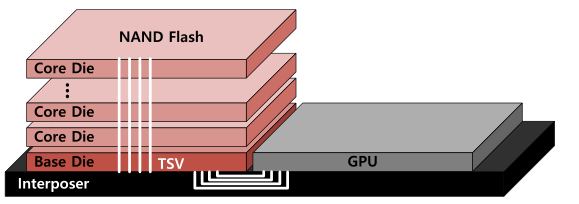

# H³: Hybrid Architecture Using High Bandwidth Memory and High Bandwidth Flash for Cost-Efficient LLM Inference

# H³：结合高带宽内存与高带宽闪存、实现高成本效益 LLM 推理的混合架构

## 文献信息 / Publication Information

- **Authors / 作者**：Minho Ha、Euiseok Kim、Hoshik Kim。
- **Affiliation / 单位**：SK hynix Inc., Icheon-Si 17336, South Korea / 韩国 SK 海力士公司，利川市，17336。
- **Corresponding author / 通讯作者**：Minho Ha。
- **Emails / 邮箱**：minho1.ha@sk.com；euiseok.kim@sk.com；hoshik.kim@sk.com。
- **Publication / 出版信息**：IEEE Computer Architecture Letters，2026 年，第 25 卷第 1 期，第 49–52 页（January–June / 1–6 月）。
- **DOI**：[10.1109/LCA.2026.3660969](https://doi.org/10.1109/LCA.2026.3660969)。
- **History / 稿件日期**：2026-01-04 收稿；2026-01-31 修订；2026-02-01 接收；2026-02-04 在线发表；当前版本日期 2026-02-17。
- **Source / 来源**：本地用户提供的 H³ PDF，共 4 页；PDF 页码 1–4 对应期刊页码 49–52。

## 阅读说明 / Reading Notes

沿用现有笔记的“英文原文 → 中文译文”逐段格式，保留章节编号、引文编号、原图和公式。跨栏、跨页段落已接回完整，跨行断词、连字及文字层粘连空格已整理。每段标注 PDF 页码及稳定来源编号；这些编号为阅读定位用途，不是原文段落编号。

6 幅原图均置于首次实质讨论附近，图内英文标签保留，图注提供中英对照。公式使用 Markdown 数学格式呈现，显示公式仅出现一次。参考文献保留英文著录并附中文题名及出版信息译文，检索时以英文信息为准。译文保留作者的规格假设、预测及仿真措辞。

图片位于同目录 `assets/`；移动笔记时请同时移动该文件夹。`source_map.json` 保存逐段来源定位，`translation_notes.md` 记录术语和原文疑点。

## 目录 / Contents

- [摘要 / Abstract](#abstract)
- [I. 引言 / Introduction](#section-1)
- [II. 研究动机 / Motivation](#section-2)
- [III. 所提架构及其使用方式 / Proposed Architecture and Its Usage](#section-3)
- [IV. 评估 / Evaluation](#section-4)
- [V. 结论与未来工作 / Conclusion and Future Work](#section-5)
- [参考文献 / References](#references)
- [术语对照 / Terminology](#terminology)
- [阅读提示](#reading-tips)

**页码索引：** [PDF p.1 / 期刊 p.49](#S001) · [PDF p.2 / 期刊 p.50](#S012) · [PDF p.3 / 期刊 p.51](#S017) · [PDF p.4 / 期刊 p.52](#S025)。跨页段落的 Source 同时列出两页。

---

## Abstract / 摘要

**Source:** p.1 / 期刊 p.49 · S001

**Original:** Abstract—Large language model (LLM) inference requires massive memory capacity to process long sequences, posing a challenge due to the capacity limitations of high bandwidth memory (HBM). High bandwidth flash (HBF) is an emerging memory device based on NAND flash that offers HBM-comparable bandwidth with much larger capacity, but suffers from disadvantages such as longer access latency, lower write endurance, and higher power consumption. This paper proposes H³, a hybrid architecture designed to effectively utilize both HBM and HBF by leveraging their respective strengths. By storing read-only data in HBF and other data in HBM, H³-equipped systems can process more requests at once with the same number of GPUs than HBM-only systems, making H³ suitable for gigantic read-only use cases in LLM inference, particularly those employing a shared pre-computed key-value cache. Simulation results show that a GPU system with H³ achieves up to 2.69x higher throughput per power compared to a system with HBM-only. This result validates the cost-effectiveness of H³ for handling LLM inference with gigantic read-only data.

**中文:** 摘要——大语言模型（LLM）推理在处理长序列时需要巨大的内存容量，而高带宽内存（HBM）的容量限制给这一需求带来了挑战。高带宽闪存（HBF）是一种基于 NAND 闪存的新兴存储器件，能够提供与 HBM 相当的带宽和大得多的容量，但也存在访问延迟更长、写入耐久性更低、功耗更高等缺点。本文提出 H³，这是一种旨在发挥 HBM 与 HBF 各自优势、有效利用二者的混合架构。通过将只读数据存入 HBF、将其他数据存入 HBM，配备 H³ 的系统能够在 GPU 数量相同的情况下，同时处理比仅使用 HBM 的系统更多的请求。因此，H³ 适用于 LLM 推理中的超大规模只读应用场景，尤其是采用共享预计算键值缓存的场景。仿真结果表明，采用 H³ 的 GPU 系统，其单位功耗吞吐量最高可达到仅使用 HBM 系统的 2.69 倍。这一结果验证了 H³ 在处理含超大规模只读数据的 LLM 推理时的成本效益。

**Source:** p.1 / 期刊 p.49 · S002

**Original:** Index Terms—High bandwidth memory, high bandwidth flash, large language model.

**中文:** 关键词——高带宽内存、高带宽闪存、大语言模型。

## I. Introduction / I. 引言

**Source:** p.1 / 期刊 p.49 · S003

**Original:** LARGE language models (LLMs) continue to evolve, moving from simple chatbots to research assistant, agentic AI, and multimodal AI [1]. Throughout this evolution, the sequence length required by LLM inference is increasing dramatically (e.g., the latest Llama 4 supports sequence lengths up to 10 M [2].). There is active research on efficiently processing such long sequences [3], [4] and on precomputed key-value (KV) caches for long sequence data shared by multiple requests [5]. In [5], when requests arrive, these pre-computed KV caches are read without writing. Processing extremely long sequences in this way during LLM inference requires large memory capacity and results in gigantic KV cache reads. For example, assuming Llama 3.1 405B [6] inference, the capacity of the shared precomputed KV cache of 1 M and 10 M sizes is approximately 540 GB and 5.4 TB, respectively, requiring dozens of GPUs just to store these values.

**中文:** 大语言模型（LLM）不断演进，正从简单的聊天机器人走向研究助手、智能体 AI 和多模态 AI [1]。在这一演进过程中，LLM 推理所需的序列长度急剧增长（例如，最新的 Llama 4 支持长达 10 M 的序列 [2]）。目前，研究者正积极探索如何高效处理这类长序列 [3]、[4]，以及如何为多个请求共享的长序列数据预先计算键值（KV）缓存 [5]。在文献 [5] 中，请求到达后只读取这些预计算 KV 缓存，而不进行写入。LLM 推理以这种方式处理超长序列时，需要很大的内存容量，并产生海量 KV 缓存读取。例如，假设执行 Llama 3.1 405B [6] 推理，长度分别为 1 M 和 10 M 的共享预计算 KV 缓存，其容量约为 540 GB 和 5.4 TB，仅存储这些数据就需要数十个 GPU。

**Source:** p.1 / 期刊 p.49 · S004

**Original:** From a hardware perspective, high bandwidth memory (HBM) capacity is insufficient compared to the increasing amount of data during LLM inference. To overcome this HBM capacity shortfall, high bandwidth flash (HBF), which vertically stacks NAND flash to mimic HBM, has been proposed [7]. HBF offers bandwidth similar to HBM and larger capacity than HBM, but suffers from disadvantages such as longer access latency, lower write endurance, and higher power consumption per bit than HBM. Therefore, sub-system architectures and use cases that can highlight the advantages of HBF while offsetting its disadvantages are needed.

**中文:** 从硬件角度看，相较于 LLM 推理期间不断增长的数据量，高带宽内存（HBM）的容量不足。为克服 HBM 容量不足的问题，人们提出了高带宽闪存（HBF）：它通过垂直堆叠 NAND 闪存来仿照 HBM 的形式 [7]。HBF 提供与 HBM 相近的带宽和更大的容量，但也存在访问延迟更长、写入耐久性更低、每比特功耗更高等缺点。因此，需要能够突出 HBF 优势、同时弥补其不足的子系统架构与应用场景。

**Source:** p.1 / 期刊 p.49 · S005

**Original:** In this paper, we propose a hybrid architecture for effectively utilizing HBF, considering its strengths and weaknesses. The key contributions of this paper are as follows:

**中文:** 本文结合 HBF 的优势与不足，提出一种能够有效利用 HBF 的混合架构。本文的主要贡献如下：

**Source:** p.1 / 期刊 p.49 · S006

**Original:** We propose H³, a hybrid architecture that can effectively utilize HBM and HBF.

**中文:** 我们提出 H³，一种能够有效利用 HBM 和 HBF 的混合架构。

**Source:** p.1 / 期刊 p.49 · S007

**Original:** We explore a use case well-suited for H³.

**中文:** 我们探索了一个适合 H³ 的应用场景。

**Source:** p.1 / 期刊 p.49 · S008

**Original:** We demonstrate the cost-effectiveness of H³ through a simulation-based performance evaluation.

**中文:** 我们通过基于仿真的性能评估，展示了 H³ 的成本效益。

## II. Motivation / II. 研究动机

### A. Gigantic Read-Only Use Case / A. 超大规模只读应用场景

**Source:** p.1 / 期刊 p.49 · S009

**Original:** During LLM inference, many data types exhibit read-only behavior. For example, LLM weight parameters are repeatedly read. Specifically, Llama 3.1 405B [6] requires approximately 405 GB to store model weights in FP8 precision. This means that 405 GB of reads occur each time a batch is processed.

**中文:** 在 LLM 推理过程中，许多类型的数据呈现只读行为。例如，LLM 的权重参数会被反复读取。具体而言，以 FP8 精度存储 Llama 3.1 405B [6] 的模型权重约需 405 GB。这意味着每处理一个批次，就会产生 405 GB 的读取量。

**Source:** p.1 / 期刊 p.49 · S010

**Original:** Particularly, in cache-augmented generation (CAG) [5], which has recently attracted considerable research attention, when the LLM receives a query, it reads the gigantic shared precomputed KV cache, performs a computation, and then outputs a response (Fig. 1). In other words, the shared pre-computed KV cache is inherently read-only. In CAG, attention computation uses shared KV attention, which amortizes memory access overhead, preventing significant latency increase even with a large batch size. Therefore, increasing the batch size can lead to substantial gains in throughput. However, due to the limited capacity of the HBM on GPUs [8], running CAG with large batch sizes is challenging. Storing the gigantic shared pre-computed KV cache on HBM requires more GPUs, increasing cost and overall system power requirements.

**中文:** 尤其是在近期受到广泛研究关注的缓存增强生成（CAG）[5] 中，当 LLM 收到查询时，会读取超大规模共享预计算 KV 缓存，执行计算，然后输出响应（图 1）。换言之，共享预计算 KV 缓存在本质上是只读的。在 CAG 中，注意力计算采用共享 KV 注意力机制，能够摊薄内存访问开销，使得即使采用较大的批量大小，延迟也不会显著增加。因此，增大批量大小可以大幅提高吞吐量。然而，由于 GPU 上的 HBM 容量有限 [8]，以大批量运行 CAG 仍面临挑战。将超大规模共享预计算 KV 缓存存储在 HBM 中需要更多 GPU，从而增加成本和整个系统的功耗需求。

**Figure 1 / 图 1：缓存增强生成**

**Source:** p.1 / 期刊 p.49 · F001 / C001；置于 S010 后。

**Original caption:** Fig. 1. The concept of cache augmented generation (CAG) [5], a representative example of a gigantic read-only use case.

**中文图注:** 图 1。缓存增强生成（CAG）[5] 的概念，这是超大规模只读应用场景的一个代表性示例。

### B. High Bandwidth Flash / B. 高带宽闪存

**Source:** p.1 / 期刊 p.49, p.2 / 期刊 p.50 · S011

**Original:** As shown in Fig. 2, HBF is a device that supports high bandwidth by vertically stacking NAND flash dies and connecting the base die and NAND flash dies with through silicon vias (TSVs). Currently, various memory and flash vendors are developing HBF aiming to support bandwidth similar to HBM and much larger capacity than HBM [7]. Since HBF is not yet a commercially available device, in this paper, we will assume its target specifications [7]. The expected advantages of HBF are 1) up to 16x larger capacity than HBM, and 2) similar bandwidth to HBM, and the expected disadvantages are 1) slower access (ns vs. μs), 2) lower write endurance, and 3) up to 4x higher power consumption than HBM.

**中文:** 如图 2 所示，HBF 通过垂直堆叠 NAND 闪存裸片，并采用硅通孔（TSV）连接基底裸片与 NAND 闪存裸片，实现高带宽。目前，多家内存与闪存厂商正在研发 HBF，目标是提供与 HBM 相近的带宽和远大于 HBM 的容量 [7]。由于 HBF 尚未成为商用器件，本文采用其目标规格作为假设 [7]。HBF 的预期优势包括：1）容量最高可达 HBM 的 16 倍；2）带宽与 HBM 相近。其预期缺点包括：1）访问更慢（ns 级与 μs 级的差别）；2）写入耐久性更低；3）功耗最高可达 HBM 的 4 倍。

**Figure 2 / 图 2：HBF 的堆叠结构**

**Source:** p.2 / 期刊 p.50 · F002 / C002；置于 S011 后。

**Original caption:** Fig. 2. The concept of HBF.

**中文图注:** 图 2。HBF 的概念。

**Source:** p.2 / 期刊 p.50 · S012

**Original:** Since HBF has clear advantages and disadvantages, it can only be effectively used in certain use cases, and the gigantic read-only use case mentioned in Section II-A can be an effective use case. Gigantic KV cache data and weight parameters can be stored due to the large capacity of HBF, and the low write endurance of HBF is no longer a disadvantage because they have a read-only data pattern. We will discuss a way to overcome the slow access latency of HBF later in this paper.

**中文:** 由于 HBF 的优缺点都很明显，只有在特定应用场景中才能有效利用它，而第 II-A 节提到的超大规模只读场景就是一个合适的例子。HBF 的大容量能够容纳超大规模 KV 缓存数据和权重参数；由于这些数据的访问模式是只读的，HBF 较低的写入耐久性也就不再构成劣势。本文后续将讨论一种克服 HBF 访问延迟较长问题的方法。

## III. Proposed Architecture and Its Usage / III. 所提架构及其使用方式

### A. H³: Hybrid Architecture Using HBM and HBF / A. H³：使用 HBM 与 HBF 的混合架构

**Source:** p.2 / 期刊 p.50 · S013

**Original:** As mentioned in Section II-B, since HBF is a device with both advantages and disadvantages, its use alone has limitations. Therefore, we propose H³, a hybrid architecture that utilizes both HBM and HBF, aiming to highlight the advantages of HBF and compensate for its shortcomings. There can be various implementation methods for hybrid architectures. For example, one method places the HBM and HBF directly next to the GPU’s shoreline. However, this method has the disadvantage of reducing the number of HBMs due to the limited shoreline space on the GPU. To maximize the bandwidth of the HBM and HBF, as shown in Fig. 3(a), the HBMs in the H³ are connected to the GPU’s shoreline, and the HBMs and HBFs are daisy-chained. Within the HBM base die, memory access is divided into two paths by address decoder & router: one accessing the HBM and the other accessing the HBF. Consequently, the GPU can directly access the HBF through the HBM base die (Fig. 3(b)). In other words, both the HBM and HBF serve as the GPU’s main memory. Since both HBM and HBF are used as main memory, the host uses the unified address space with divided memory regions when accessing HBM or HBF (Fig. 3(c)).

**中文:** 如第 II-B 节所述，HBF 同时具有优势和不足，因此单独使用它存在局限。为此，我们提出同时利用 HBM 与 HBF 的混合架构 H³，旨在发挥 HBF 的优势并弥补其不足。混合架构可以有多种实现方式。例如，一种方式是将 HBM 和 HBF 都直接布置在 GPU 的芯片边缘接口区域（shoreline）旁。但由于 GPU 边缘接口空间有限，这种方式会减少可连接的 HBM 数量。为最大化 HBM 与 HBF 的带宽，如图 3(a) 所示，H³ 将 HBM 连接到 GPU 的边缘接口，并以菊花链方式连接 HBM 与 HBF。在 HBM 基底裸片内部，地址译码器与路由器将内存访问分成两条路径：一条访问 HBM，另一条访问 HBF。因此，GPU 可以通过 HBM 基底裸片直接访问 HBF（图 3(b)）。换言之，HBM 与 HBF 均作为 GPU 的主存。由于二者都用作主存，主机访问 HBM 或 HBF 时采用统一地址空间，并在其中划分不同的内存区域（图 3(c)）。

**Figure 3 / 图 3：H³ 混合架构**

**Source:** p.2 / 期刊 p.50 · F003 / C003；置于 S013 后。

**Original caption:** Fig. 3. H³ Architecture overview.

**中文图注:** 图 3。H³ 架构概览。

**Source:** p.2 / 期刊 p.50 · S014

**Original:** In Fig. 3(b), it is assumed that the GPU, HBM base die, and HBF base die are connected via a die-to-die (D2D) interface and the bandwidth between the GPU and the HBM base die is equal to the bandwidth between each base die and the core die. We also assumed that the HBM and HBF controller are located on their own base die. This is subject to change depending on silicon area availability.

**中文:** 在图 3(b) 中，我们假设 GPU、HBM 基底裸片与 HBF 基底裸片通过裸片间（D2D）接口连接，并且 GPU 与 HBM 基底裸片之间的带宽，等于各基底裸片与其核心裸片之间的带宽。我们还假设 HBM 和 HBF 控制器分别位于各自的基底裸片上。具体安排可能随可用硅面积而变化。

### B. Usage: LLM With Gigantic Read-Only Data / B. 应用：包含超大规模只读数据的 LLM

**Source:** p.2 / 期刊 p.50 · S015

**Original:** H³ is suitable for LLM inference with the gigantic model weights and shared pre-computed KV cache described in Section II. These values, which are gigantic and read-only, are well-suited for the HBF supporting large capacity and having limited write endurance. Therefore, the model weights and shared pre-computed KV caches are stored in the HBF. In addition, the generated KV caches and other data are stored in the HBM. Fig. 4 explains how it works. In Fig. 4, when accessing HBF, hop latency may be added, but since LLM inference is memory bandwidth-bound, hop latency can be sufficiently hidden. Since the data access pattern of LLM inference is deterministic [9], we expect that it will be possible to allocate data suitable for the HBM and the HBF with the support of deep learning framework. Processing a particular operation may require data stored in both the HBM and HBF. However, because the tensors required for the operation can be accurately predicted, tensor-level scheduling is possible, making contention between the HBM and HBF manageable.

**中文:** H³ 适用于第 II 节所述的、包含超大规模模型权重与共享预计算 KV 缓存的 LLM 推理。这些数据规模庞大且只读，非常适合容量大但写入耐久性有限的 HBF。因此，模型权重与共享预计算 KV 缓存存储在 HBF 中，而推理过程中生成的 KV 缓存及其他数据存储在 HBM 中。图 4 展示了其工作方式。在图 4 中，访问 HBF 可能引入额外的跳转延迟，但由于 LLM 推理受内存带宽限制，这一延迟可以被充分隐藏。由于 LLM 推理的数据访问模式具有确定性 [9]，我们预计在深度学习框架的支持下，可以将数据分配到适合的 HBM 或 HBF 中。处理某个特定操作时，可能同时需要存储在 HBM 和 HBF 中的数据。但由于能够准确预测该操作所需的张量，可以进行张量级调度，从而使 HBM 与 HBF 之间的资源争用得到管理。

**Figure 4 / 图 4：HBM 与 HBF 的数据访问**

**Source:** p.2 / 期刊 p.50 · F004 / C004；置于 S015 后。

**Original caption:** Fig. 4. A description of how HBM and HBF are accessed in LLM inference with gigantic shared pre-computed KV cache.

**中文图注:** 图 4。在采用超大规模共享预计算 KV 缓存的 LLM 推理中，HBM 与 HBF 的访问方式。

**Source:** p.2 / 期刊 p.50, p.3 / 期刊 p.51 · S016

**Original:** The advantage of applying H³ to gigantic read-only use cases is that it supports larger capacity allowing for larger batch processing with the same number of GPUs. Larger batch processing leads to improved throughput, ultimately resulting in cost savings when running an LLM inference system. Using HBF for read-only use cases also has the additional benefit of reducing garbage collection and wear-leveling overhead.

**中文:** 将 H³ 应用于超大规模只读场景的优势在于，它提供更大的容量，使系统在 GPU 数量相同的情况下能够处理更大的批次。更大的批次能够提高吞吐量，最终降低 LLM 推理系统的运行成本。将 HBF 用于只读场景，还具有减少垃圾回收和磨损均衡开销的额外好处。

### C. Optimization: Latency Hiding Buffer / C. 优化：延迟隐藏缓冲区

**Source:** p.3 / 期刊 p.51 · S017

**Original:** As HBF is inherently NAND flash-based, it has longer access latency than HBM. Therefore, hiding its long latency is essential for using it as memory. To compensate for the long NAND flash latency, the latency hiding buffer (LHB), which is a kind of prefetch buffer, is integrated into the base die of either HBM or HBF of the H³ (In Fig. 3(b), LHB is in the base die of HBM). For LLM inference, the next layer can be processed only after the previous layer is completed, and the model weight and KV cache required for computation in one layer are pre-determined. In other words, LLM inference has a deterministic and sequential data pattern [9]. Therefore, the data required for computation can be accurately predicted in advance and the latency of NAND flash can be hidden by continuously bringing the data required for the computation to the LHB. To effectively utilize the LHB, the deep learning framework needs to be modified to provide prefetching hints. Since prefetching hints are deterministic and the prefetched data unit is at the coarse-grained tensor-level, the prefetching overhead is expected to be small. Expected size and silicon area overhead of the LHB will be discussed later.

**中文:** 由于 HBF 基于 NAND 闪存，其访问延迟比 HBM 更长。因此，将其用作内存时，隐藏这一长延迟至关重要。为弥补 NAND 闪存的长延迟，H³ 在 HBM 或 HBF 的基底裸片中集成了延迟隐藏缓冲区（LHB），它是一种预取缓冲区（在图 3(b) 中，LHB 位于 HBM 基底裸片中）。对于 LLM 推理，只有在前一层完成后才能处理下一层，而每一层计算所需的模型权重和 KV 缓存都是预先确定的。换言之，LLM 推理具有确定性、顺序性的数据访问模式 [9]。因此，可以提前准确预测计算所需的数据，并通过持续将这些数据预取到 LHB 中，隐藏 NAND 闪存的延迟。为有效利用 LHB，需要修改深度学习框架，使其提供预取提示。由于预取提示具有确定性，且预取数据采用粗粒度的张量级单位，预计预取开销较小。后文将讨论 LHB 的预期容量和硅面积开销。

## IV. Evaluation / IV. 评估

### A. Experimental Setup / A. 实验设置

**Source:** p.3 / 期刊 p.51 · S018

**Original:** 1) Method: As the HBF is a device under development, actual measurements are impossible. Therefore, an in-house simulator based on analytical modeling, proven in previous studies [3], [4], [10], is developed to evaluate the performance of H³-equipped system. The in-house simulator estimates execution time, throughput, throughput per power consumption based on computation time, data transfer time, and communication time between GPUs. Computation time is calculated based on the number of operations of the LLM model and the GPU performance. Data transfer time of HBM and HBF is calculated based on the LLM model size, KV cache size, and bandwidth of devices. When calculating data transfer time, data is partitioned and duplicated to optimize performance by considering tensor parallelism (TP) and data parallelism. In addition, communication time between GPUs is calculated assuming ring all-reduce that occurs when applying TP.

**中文:** 1）方法：由于 HBF 仍处于研发阶段，无法进行实际测量。因此，我们基于已在先前研究 [3]、[4]、[10] 中得到验证的分析建模方法，开发了内部模拟器，以评估配备 H³ 的系统的性能。该模拟器根据计算时间、数据传输时间和 GPU 间通信时间，估算执行时间、吞吐量及单位功耗吞吐量。计算时间依据 LLM 模型的运算量和 GPU 性能计算。HBM 与 HBF 的数据传输时间依据 LLM 模型大小、KV 缓存大小和器件带宽计算。计算数据传输时间时，会考虑张量并行（TP）和数据并行，通过数据分片与复制优化性能。此外，GPU 间通信时间按采用 TP 时发生的环形全归约（ring all-reduce）进行计算。

**Source:** p.3 / 期刊 p.51 · S019

**Original:** 2) Workload: Llama 3.1 405B [6] is selected as the workload for performance evaluation. The selected Llama 3.1 405B is sufficiently representative because it is large enough to be comparable to the latest frontier LLMs, and the pre-computed KV cache is related to the context window size but not to the model weights size. The original Llama 3.1 405B has a context window of 128 K, but to evaluate long sequence processing performance, we assume support for 1 M and 10 M. We assume that input sequence length (ISL) and output sequence length (OSL) are 1 K each, and the remainder except for ISL and OSL is occupied by the shared pre-computed KV cache. In the current experimental environment, the shared pre-computed KV cache occupies approximately 35% and 84% of the total capacity for 1 M and 10 M cases, respectively.

**中文:** 2）工作负载：选择 Llama 3.1 405B [6] 作为性能评估的工作负载。该模型具有充分的代表性，因为其规模足以与最新的前沿 LLM 相比，而且预计算 KV 缓存的大小取决于上下文窗口大小，与模型权重大小无关。原始 Llama 3.1 405B 的上下文窗口为 128 K，但为评估长序列处理性能，我们假设它支持 1 M 和 10 M。输入序列长度（ISL）与输出序列长度（OSL）均假设为 1 K，除 ISL 和 OSL 外，其余部分由共享预计算 KV 缓存占据。在当前实验环境中，1 M 与 10 M 场景的共享预计算 KV 缓存分别约占总容量的 35% 和 84%。

**Source:** p.3 / 期刊 p.51 · S020

**Original:** 3) HBF Specifications: We assume the GPU is the B200, the latest GPU currently available [8]. In the B200, HBM3e, supporting 192 GB and 8 TB/s per GPU (24 GB and 1 TB/s per cube), is mounted. Based on the relative performance of HBF in Section II-B, we assume the HBF has a capacity of 3 TB, approximately 16x larger than the HBM3e, and a bandwidth of 8 TB/s, the same as the HBM3e. The thermal design power (TDP) per cube of HBM3e and HBF is assumed to be 40 W and 160 W, respectively, considering the per-cube capacity and the power consumption per bit of current NAND flash. Power estimation is based on current NAND flash technology. However, we expect that power consumption of HBF will be further reduced through power optimization during the HBF development process.

**中文:** 3）HBF 规格：我们假设采用当时最新可用的 B200 GPU [8]。B200 配备 HBM3e，每个 GPU 的容量为 192 GB、带宽为 8 TB/s（每个堆栈的容量为 24 GB、带宽为 1 TB/s）。根据第 II-B 节中 HBF 的相对性能，我们假设 HBF 容量为 3 TB，约为 HBM3e 的 16 倍；带宽为 8 TB/s，与 HBM3e 相同。考虑每个堆栈的容量及当前 NAND 闪存的每比特功耗，假设 HBM3e 与 HBF 的每堆栈热设计功耗（TDP）分别为 40 W 和 160 W。功耗估算基于当前 NAND 闪存技术。不过，我们预计在 HBF 研发过程中进行功耗优化，将进一步降低其功耗。

**Source:** p.3 / 期刊 p.51 · S021

**Original:** 4) Hardware Configuration: We assume a DGX-style system [8]. Experiments with 1 M sequence length use 8 GPUs, while those with 10 M sequence length use 32 GPUs. These numbers of GPUs are the minimum number of GPUs required to run each sequence length for the HBM-only case. Therefore, in the 10 M case, communication between GPU servers occurs through a scale-out fabric (e.g., InfiniBand) rather than a scale-up fabric (e.g., NVLink).

**中文:** 4）硬件配置：我们假设采用类似 DGX 的系统 [8]。序列长度为 1 M 的实验使用 8 个 GPU，序列长度为 10 M 的实验使用 32 个 GPU。这些数量是在仅使用 HBM 的情况下，运行相应序列长度所需的最少 GPU 数。因此，在 10 M 场景中，GPU 服务器之间通过横向扩展互连（例如 InfiniBand）通信，而非纵向扩展互连（例如 NVLink）。

### B. Experimental Results / B. 实验结果

**Source:** p.3 / 期刊 p.51 · S022

**Original:** 1) Batch Size: By storing the gigantic shared pre-computed KV cache in the HBF, more free capacity is available in the HBM, allowing GPUs with H³ to process larger batch sizes. Fig. 5 shows the processable batch sizes for the 1 M and 10 M cases, depending on the number of GPUs. In the 1 M case, shown in Fig. 5(a), when using H³, batch sizes up to 2.6x larger can be processed than when using HBM alone. Similarly, in the 10 M case, shown in Fig. 5(b), using H³ allows for batch sizes up to 18.8x larger than using HBM alone. There are various factors that contribute to improving throughput, but increasing batch size is clearly the most important factor.

**中文:** 1）批量大小：将超大规模共享预计算 KV 缓存存储在 HBF 中，可以释放更多 HBM 容量，使采用 H³ 的 GPU 能够处理更大的批次。图 5 展示了不同 GPU 数量下，1 M 与 10 M 场景能够处理的批量大小。在图 5(a) 所示的 1 M 场景中，采用 H³ 时可处理的批量大小最高为仅使用 HBM 时的 2.6 倍。同样，在图 5(b) 所示的 10 M 场景中，采用 H³ 时可处理的批量大小最高为仅使用 HBM 时的 18.8 倍。提高吞吐量的因素有多种，但增大批量大小显然是最重要的因素。

**Figure 5 / 图 5：最大批量大小**

**Source:** p.3 / 期刊 p.51 · F005 / C005；置于 S022 后。

**Original caption:** Fig. 5. Maximum batch size based on number of GPUs (x means that it cannot be run due to insufficient memory capacity.).

**中文图注:** 图 5。不同 GPU 数量下的最大批量大小（× 表示因内存容量不足而无法运行）。

**Source:** p.3 / 期刊 p.51 · S023

**Original:** An interesting observation is that a single GPU with H³ can run a 1 M case, and a 10 M case can be run with two GPUs. This observation shows that long sequences can be processed at extremely low cost, in spite of performance degradation.

**中文:** 一个有趣的观察是：配备 H³ 的单个 GPU 就能够运行 1 M 场景，而两个 GPU 即可运行 10 M 场景。这表明，即使性能有所下降，仍可以以极低的成本处理长序列。

**Source:** p.3 / 期刊 p.51, p.4 / 期刊 p.52 · S024

**Original:** 2) Throughput: Processing larger batch sizes leads to improved throughput. Fig. 6 shows tokens per second (TPS) per request, a metric for throughput mainly determined by the batch size and execution time of the LLM inference system. Throughput of H³ is 1.25x higher in the 1 M case and 6.14x higher in the 10 M case. This means that when applying H³, more tokens can be generated in the same execution time, which directly leads to a reduction in LLM service costs. Furthermore, from this result, it can be predicted that the throughput gap will increase as the sequence length increases.

**中文:** 2）吞吐量：处理更大的批次能够提高吞吐量。图 6 展示了每个请求的每秒 token 数（TPS），这是一项吞吐量指标，主要由 LLM 推理系统的批量大小和执行时间决定。在 1 M 和 10 M 场景中，H³ 的吞吐量分别达到基线的 1.25 倍和 6.14 倍。这意味着采用 H³ 后，可以在相同执行时间内生成更多 token，从而直接降低 LLM 服务成本。此外，由此可以推测，随着序列长度增长，吞吐量差距还会扩大。

**Figure 6 / 图 6：吞吐量与单位功耗吞吐量**

**Source:** p.4 / 期刊 p.52 · F006 / C006；置于 S024 后。

**Original caption:** Fig. 6. Comparison of throughput and throughput per power.

**中文图注:** 图 6。吞吐量与单位功耗吞吐量的对比。

**Source:** p.4 / 期刊 p.52 · S025

**Original:** 3) Throughput Per Power: To demonstrate that H³ is more cost-effective despite the addition of HBF which consumes more power, we also conducted a throughput per power evaluation. Throughput per power is calculated by dividing the simulated throughput by the total TDP (including GPU TDP, assuming 680 W without HBM or HBF [8]). As shown in Fig. 6(b), despite the higher TDP of the H³-equipped GPU, it achieves up to 2.69x higher throughput per power. These results imply that H³ can be used to cost-effectively handle gigantic read-only LLM inference.

**中文:** 3）单位功耗吞吐量：为了说明即使加入功耗更高的 HBF，H³ 仍具有更好的成本效益，我们还评估了单位功耗吞吐量。该指标通过仿真吞吐量除以总 TDP 计算得到，总 TDP 包括 GPU 的 TDP（假设不含 HBM 或 HBF 时为 680 W [8]）。如图 6(b) 所示，尽管配备 H³ 的 GPU 的 TDP 更高，其单位功耗吞吐量最高仍可达到基线的 2.69 倍。这些结果表明，H³ 可用于以较好的成本效益处理超大规模只读 LLM 推理。

**Source:** p.4 / 期刊 p.52 · S026

**Original:** 4) Bandwidth Reduction of HBF: Although we assume that the HBF has the same bandwidth as the HBM, practical issues during productization may lead to supporting a lower bandwidth. Therefore, we examine the performance impact of halving the HBF bandwidth in the H³. Fig. 6 shows that even with the HBF bandwidth halved, throughput of H³ in the 1 M is still better than that of the HBM-only. Furthermore, in the 10 M case, throughput per power of H³ is still 2.09x higher. For H³, since not all data is stored in HBF, the overall performance is not reduced by the bandwidth reduction rate of HBF.

**中文:** 4）HBF 带宽降低：虽然我们假设 HBF 的带宽与 HBM 相同，但产品化过程中的实际问题可能使其只能支持较低带宽。因此，我们考察了 H³ 中 HBF 带宽减半对性能的影响。图 6 表明，即使 HBF 带宽减半，H³ 在 1 M 场景中的吞吐量仍优于仅使用 HBM 的系统。此外，在 10 M 场景中，H³ 的单位功耗吞吐量仍为基线的 2.09 倍。由于 H³ 并非将全部数据都存储在 HBF 中，整体性能不会按 HBF 带宽的下降比例同步降低。

### C. Silicon Area Overhead of Latency Hiding Buffer / C. 延迟隐藏缓冲区的硅面积开销

**Source:** p.4 / 期刊 p.52 · S027

**Original:** To calculate silicon area overhead, we should first determine the capacity requirement of the LHB. It is calculated by the bandwidth and the access latency of the HBF. To supply data to the GPU with full bandwidth without stopping, double buffering is assumed.

**中文:** 为计算硅面积开销，首先需要确定 LHB 的容量需求。该需求由 HBF 的带宽和访问延迟计算得到。为了持续以满带宽向 GPU 提供数据，这里假设采用双缓冲。

**Source:** p.4 / 期刊 p.52 · E001 · Eq. (1)

$$
Capacity_{LHB} = 2 \times BW_{HBF} \times Latency_{HBF}.
$$

**公式编号 / Equation number:** (1)

**Source:** p.4 / 期刊 p.52 · S028

**Original:** In Eq. (1), $Capacity_{LHB}$, $BW_{HBF}$, and $Latency_{HBF}$ denote the size of the LHB, bandwidth per cube of HBF, and access latency of HBF, respectively. Referring to Section IV-A, the $BW_{HBF}$ is 1 TB/s. $Latency_{HBF}$ is assumed to be 20 μs, based on the read access latency of publicly available SLC NAND flash [11]. Therefore, the LHB capacity requirement is 40 MB. Since 20 μs latency observed in current commodity NAND flash products is expected to improve further when HBF becomes commercially available, the LHB capacity requirement is expected to decrease below 40 MB.

**中文:** 在式（1）中，$Capacity_{LHB}$、$BW_{HBF}$ 和 $Latency_{HBF}$ 分别表示 LHB 的容量、HBF 每堆栈带宽以及 HBF 访问延迟。根据第 IV-A 节，$BW_{HBF}$ 为 1 TB/s。基于公开可用的 SLC NAND 闪存读取访问延迟 [11]，假设 $Latency_{HBF}$ 为 20 μs。因此，LHB 的容量需求为 40 MB。由于预计在 HBF 商用时，当前商品化 NAND 闪存产品的 20 μs 延迟会进一步改善，LHB 的容量需求有望降至 40 MB 以下。

**Source:** p.4 / 期刊 p.52 · S029

**Original:** Based on the capacity requirement, the silicon area of the LHB can be calculated. In this paper, we assume the latest 3 nm SRAM, considering the base die process around the time HBF is commercialized in the future. The 3 nm SRAM is known to have a bit density of 0.021 μm² [12]. Therefore, the area of 40 MB SRAM core is 6.72 mm². Assuming a 20% overhead for the additional circuitry, the total area is estimated to be 8.06 mm². This is approximately 6.7% of the base die area of 121 mm², an acceptable value considering the free space of the base die. For reference, 121 mm² is the base die area of the currently commercialized HBM, and it is expected that the area will increase further in future HBM and custom HBM.

**中文:** 根据容量需求，可以计算 LHB 的硅面积。考虑到未来 HBF 商用时基底裸片可能采用的工艺，本文假设采用最新的 3 nm SRAM。已知 3 nm SRAM 的比特密度为 0.021 μm² [12]。因此，40 MB SRAM 核心的面积为 6.72 mm²。假设附加电路带来 20% 的开销，总面积估计为 8.06 mm²，约占 121 mm² 基底裸片面积的 6.7%。考虑到基底裸片上的空余空间，这一开销是可接受的。作为参考，121 mm² 是当前已商用 HBM 的基底裸片面积，预计未来 HBM 与定制 HBM 的基底裸片面积还将进一步增大。

## V. Conclusion and Future Work / V. 结论与未来工作

**Source:** p.4 / 期刊 p.52 · S030

**Original:** This paper proposes H³, a hybrid architecture that effectively integrates HBM and HBF to address the capacity limitations of HBM for long sequence LLM inference. H³ leverages the deterministic nature of LLM workloads to strategically place data: the massive read-only shared KV cache and the model weights are stored in the HBF, while the frequently accessed generated KV caches are stored in the low-latency HBM. To mitigate the inherent high latency of HBF, a latency hiding buffer is introduced. Simulation results demonstrate that the proposed architecture can handle significantly larger batch sizes compared to an HBM-only configuration and achieves up to 2.69x higher throughput per power, proving its potential to realize a cost-effective infrastructure for LLM inference with gigantic read-only data.

**中文:** 本文提出 H³，这是一种有效整合 HBM 与 HBF 的混合架构，旨在解决长序列 LLM 推理中 HBM 容量受限的问题。H³ 利用 LLM 工作负载的确定性，进行有针对性的数据放置：将海量只读共享 KV 缓存和模型权重存储在 HBF 中，将频繁访问的生成 KV 缓存存储在低延迟 HBM 中。为缓解 HBF 固有的高延迟，架构引入了延迟隐藏缓冲区。仿真结果表明，相较于仅使用 HBM 的配置，该架构能够处理显著更大的批次，单位功耗吞吐量最高可达其 2.69 倍，证明了它在构建面向超大规模只读数据 LLM 推理的高成本效益基础设施方面的潜力。

**Source:** p.4 / 期刊 p.52 · S031

**Original:** H³ is one of several architectures for utilizing HBF. There are various ways to use HBM and HBF together (e.g., hybrid stacking of HBM and HBF), and in certain cases, it may be possible to use HBF alone. Therefore, future work will focus on exploring optimal architectures that can exploit the benefits of HBF and other applications suitable for HBF.

**中文:** H³ 是利用 HBF 的多种架构之一。HBM 与 HBF 可以通过多种方式配合使用，例如混合堆叠 HBM 与 HBF；在某些情况下，也可能单独使用 HBF。因此，未来工作将重点探索能够发挥 HBF 优势的最优架构，以及其他适合 HBF 的应用。

## References / 参考文献

**Source:** p.4 / 期刊 p.52 · R001

**Original:** [1] G. Comanici et al., “Gemini 2.5: Pushing the frontier with advanced reasoning, multimodality, long context, and next generation agentic capabilities,” 2025, arXiv:2507.06261.

**中文:** [1] 《Gemini 2.5：推进高级推理、多模态、长上下文与下一代智能体能力的前沿》。2025 年，arXiv:2507.06261。

**Source:** p.4 / 期刊 p.52 · R002

**Original:** [2] Meta, “Llama 4,” 2025. [Online]. Available: https://www.llama.com/docs/model-cards-and-prompt-formats/llama4/

**中文:** [2] Meta，《Llama 4》。2025 年，在线资源。

**Source:** p.4 / 期刊 p.52 · R003

**Original:** [3] S. Choi, M. Rhee, E. Kim, K. Shin, Y. Joo, and H. Kim, “PNM meets sparse attention: Enabling multi-million tokens inference at scale,” IEEE Comput. Archit. Lett., vol. 24, no. 2, pp. 353–356, Jul.-Dec. 2025.

**中文:** [3] 《当近内存处理（PNM）遇上稀疏注意力：实现可扩展的数百万 token 推理》。《IEEE Computer Architecture Letters》，第 24 卷第 2 期，第 353–356 页，2025 年 7–12 月。

**Source:** p.4 / 期刊 p.52 · R004

**Original:** [4] M. Rhee, S. Choi, E. Kim, J. Sim, Y. Joo, and H. Kim, “MoSKA: Mixture of shared KV attention for efficient long-sequence LLM inference,” IEEE Comput. Archit. Lett., vol. 24, no. 2, pp. 365–368, Jul.-Dec. 2025.

**中文:** [4] 《MoSKA：用于高效长序列 LLM 推理的混合共享 KV 注意力》。《IEEE Computer Architecture Letters》，第 24 卷第 2 期，第 365–368 页，2025 年 7–12 月。

**Source:** p.4 / 期刊 p.52 · R005

**Original:** [5] B. J. Chan, C.-T. Chen, J.-H. Cheng, and H.-H. Huang, “Don’t do rag: When cache-augmented generation is all you need for knowledge tasks,” in Proc. ACM Web Conf., 2025, pp. 893–897.

**中文:** [5] 《无需 RAG：当缓存增强生成足以满足知识任务需求时》。ACM Web 会议论文集，2025 年，第 893–897 页。

**Source:** p.4 / 期刊 p.52 · R006

**Original:** [6] A. Dubey et al., “The Llama 3 herd of models,” 2024. arXiv:2407.21783.

**中文:** [6] 《Llama 3 模型家族》。2024 年，arXiv:2407.21783。

**Source:** p.4 / 期刊 p.52 · R007

**Original:** [7] SanDisk, “Memory-Centric AI: Sandisk’s high bandwidth flash will redefine AI infrastructure,” 2025. [Online]. Available: https://www.sandisk.com/company/newsroom/blogs/2025/memory-centric-AI-sandisks-high-bandwidth-flash-will-redefine-ai-infrastructure

**中文:** [7] SanDisk，《以内存为中心的 AI：SanDisk 高带宽闪存将重新定义 AI 基础设施》。2025 年，在线资源。

**Source:** p.4 / 期刊 p.52 · R008

**Original:** [8] NVIDIA, “Nvidia blackwell architecture technical brief,” 2025. [Online]. Available: https://resources.nvidia.com/en-us-blackwell-architecture?ncid=no-ncid,

**中文:** [8] NVIDIA，《NVIDIA Blackwell 架构技术简介》。2025 年，在线资源。

**Source:** p.4 / 期刊 p.52 · R009

**Original:** [9] D. Abts et al., “The GROQ software-defined scale-out tensor streaming multiprocessor: From chips-to-systems architectural overview,” in Proc. IEEE Hot Chips 34 Symp.2022, pp. 1–69.

**中文:** [9] 《GROQ 软件定义、横向扩展的张量流多处理器：从芯片到系统的架构概述》。IEEE Hot Chips 34 研讨会论文集，2022 年，第 1–69 页。

**Source:** p.4 / 期刊 p.52 · R010

**Original:** [10] R. Patwari, A. Sirasao, and D. Das, “Forecasting LLM inference performance via hardware-agnostic analytical modeling,” 2025, arXiv:2508.00904.

**中文:** [10] 《通过与硬件无关的分析建模预测 LLM 推理性能》。2025 年，arXiv:2508.00904。

**Source:** p.4 / 期刊 p.52 · R011

**Original:** [11] Q. Wei, Y. Li, Z. Jia, M. Zhao, Z. Shen, and B. Li, “Reinforcement learning-assisted management for convertible SSDS,” in Proc. Des. Automat. Conf., 2023, pp. 1–6.

**中文:** [11] 《面向可转换 SSD 的强化学习辅助管理》。设计自动化会议（DAC）论文集，2023 年，第 1–6 页。

**Source:** p.4 / 期刊 p.52 · R012

**Original:** [12] S.-Y. Wu et al., “A 3 nm CMOS finflex platform technology with enhanced power efficiency and performance for mobile SoC and high performance computing applications,” in Proc. Int. Electron Devices Meeting, 2022, pp. 27.5.1–27.5.4.

**中文:** [12] 《面向移动 SoC 与高性能计算应用、提升能效和性能的 3 nm CMOS FinFlex 平台技术》。国际电子器件会议（IEDM）论文集，2022 年，第 27.5.1–27.5.4 页。

## 首页脚注 / First-page Footnotes

**Source:** p.1 / 期刊 p.49 · N001

**Original:** Received 4 January 2026; revised 31 January 2026; accepted 1 February 2026. Date of publication 4 February 2026; date of current version 17 February 2026. (Corresponding author: Minho Ha.)

**中文:** 2026 年 1 月 4 日收稿；2026 年 1 月 31 日修订；2026 年 2 月 1 日接收。发表日期为 2026 年 2 月 4 日；当前版本日期为 2026 年 2 月 17 日。（通讯作者：Minho Ha。）

**Source:** p.1 / 期刊 p.49 · N002

**Original:** The authors are with SK hynix Inc., Icheon-Si 17336, South Korea (e-mail: minho1.ha@sk.com; euiseok.kim@sk.com; hoshik.kim@sk.com).

**中文:** 作者均就职于韩国 SK 海力士公司，地址为韩国利川市，邮编 17336（电子邮箱：minho1.ha@sk.com；euiseok.kim@sk.com；hoshik.kim@sk.com）。

**Source:** p.1 / 期刊 p.49 · N003

**Original:** Digital Object Identifier 10.1109/LCA.2026.3660969

**中文:** 数字对象标识符（DOI）：10.1109/LCA.2026.3660969。

## 术语对照 / Terminology

| 原文术语 | 首次展开／定义 | 统一译法 |
| --- | --- | --- |
| H³ | Hybrid architecture using HBM and HBF | H³ 混合架构 |
| HBM | high bandwidth memory | 高带宽内存 |
| HBF | high bandwidth flash | 高带宽闪存 |
| LLM | large language model | 大语言模型 |
| KV cache | key-value cache | 键值缓存／KV 缓存 |
| shared pre-computed KV cache | shared pre-computed key-value cache | 共享预计算 KV 缓存 |
| generated KV cache | generated key-value cache | 生成 KV 缓存 |
| CAG | cache-augmented generation | 缓存增强生成 |
| LHB | latency hiding buffer | 延迟隐藏缓冲区 |
| TSV | through silicon via | 硅通孔 |
| D2D | die-to-die | 裸片间接口 |
| base die | base die | 基底裸片 |
| core die | core die | 核心裸片 |
| cube | memory cube / stack | 堆栈 |
| shoreline | GPU shoreline | 芯片边缘接口区域 |
| TP | tensor parallelism | 张量并行 |
| TDP | thermal design power | 热设计功耗 |
| ISL | input sequence length | 输入序列长度 |
| OSL | output sequence length | 输出序列长度 |
| throughput per power | throughput divided by power | 单位功耗吞吐量 |
| wear-leveling | wear-leveling | 磨损均衡 |

## 阅读提示

以下为阅读定位说明，不属于论文原文。

- 本文评估基于分析模型与内部模拟器；HBF 容量、带宽、功耗及 LHB 面积等均按文中假设计算。
- 共享预计算 KV 缓存与推理中新生成的 KV 缓存是两类数据：前者随模型权重放在 HBF，后者放在 HBM。
- 原文第 IV-B-2 节写作 “TPS per request”，图 6 横轴则标作 “Normalized TPS per Batch”。译稿分别保留正文与原图，未自行统一统计口径。
- 原文以 “bit density” 描述 0.021 μm²；译文保留该表述。其面积估算对应的单位含义及 MB 计数口径见 `translation_notes.md`。
