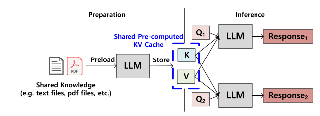
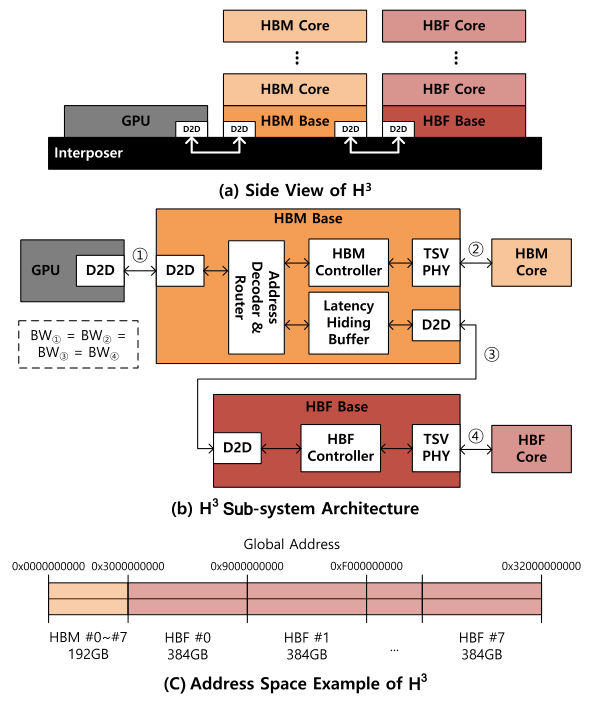
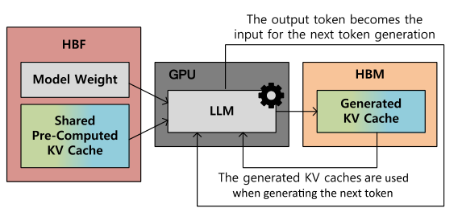
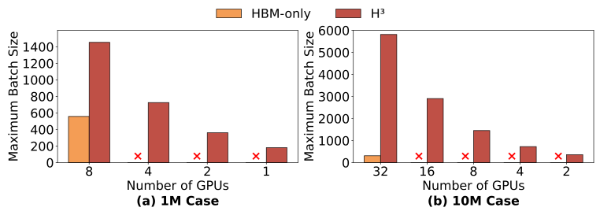
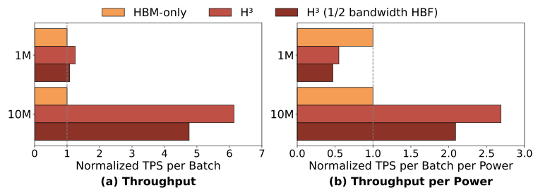

---
tags:
  - papers/gpu-memory-systems
aliases:
  - H3 文献汇报
  - H³ 论文解读
date: 2026-10-19
doi: 10.1109/LCA.2026.3660969
---

# H³ 文献汇报

*Hybrid Architecture Using High Bandwidth Memory and High Bandwidth Flash for Cost-Efficient LLM Inference*

Minho Ha、Euiseok Kim、Hoshik Kim｜SK hynix｜IEEE Computer Architecture Letters，2026，25(1)：49–52

## 一、背景动机

### 1. HBM 与 HBF 各有什么特点

- **HBM：** 延迟低、适合频繁读写，但容量有限。模型权重和 KV 缓存越来越大，仅靠 HBM 往往需要增加 GPU 数量，才能把数据放下。

- **HBF：** 垂直堆叠 NAND 闪存，目标是提供接近 HBM 的带宽和更大容量；代价是微秒级访问延迟、较低写入耐久性和较高功耗。本文假设容量约为 HBM 的 **16 倍**、每堆栈功耗为其 **4 倍**。[1]

### 2. 一种重要场景：缓存增强生成 CAG

- **工作方式：** 先把多个请求共用的知识内容计算成 KV 缓存；请求到达后，读取这份共享缓存并生成回答。模型权重和共享预计算 KV 缓存都只读，适合放进 HBF。

- **容量压力：** Llama 3.1 405B 的 FP8 权重约为 **405 GB**；1 M 和 10 M 长度的共享 KV 缓存分别约为 **540 GB、5.4 TB**，仅存放数据就可能需要很多 GPU。[1]

*原文图 1：多个请求复用同一份预计算 KV 缓存。*

**补充知识：** 共享预计算 KV 缓存由多个请求复用；生成 KV 缓存则在每个请求生成新 token 时不断更新。两者的读写特性不同，不能全部当成只读数据。

### 3. 核心问题：容量扩展之后，怎样真正提高效率

- **挑战 1：** HBF 容量大，但访问慢，直接替换 HBM 可能让 GPU 等待数据。

- **挑战 2：** GPU 边缘接口空间有限，把 HBM 与 HBF 都直接连上去，可能挤占原有 HBM 数量；增加 HBF 还会提高功耗，吞吐收益必须足够大。[2]

## 二、设计方案

### 1. 改进机会

- **按读写特性分工：** 模型权重和共享预计算 KV 缓存只读，交给大容量 HBF；生成 KV 缓存及其他数据需要更新，保留在低延迟 HBM。

- **按已知顺序预取：** 作者利用层间顺序及张量访问的可预测性，提前取出后续所需数据，为隐藏 NAND 延迟创造机会。[2]

### 2. 系统概览

*原文图 3：HBM 基底裸片负责分流访问，HBM 与 HBF 共同构成 GPU 主存。*

- **连接部分：** GPU 先连接 HBM，再由 HBM 基底裸片向外连接 HBF，形成菊花链。这样可以保留 GPU 边缘接口连接的 HBM 数量。

- **访问部分：** HBM 基底裸片内增加地址译码器与路由器，把请求分成 HBM 路径和 HBF 路径；两类存储使用统一地址空间中的不同区域。

- **软件部分：** 深度学习框架负责把数据放到合适的存储区域，并提供张量级预取提示。作者假设 D2D 链路带宽与堆栈内部带宽相匹配；具体调度与争用处理仍依赖实现。[2]

### 3. 数据怎样流动，延迟怎样隐藏

*原文图 4：HBF 存放权重与共享缓存，HBM 存放推理中新生成的缓存。*

- **计算过程：** GPU 读取 HBF 中的模型权重、共享预计算 KV 缓存，以及 HBM 中的生成 KV 缓存，完成当前计算；新产生的 KV 写回 HBM，供后续生成步骤使用。

- **延迟隐藏：** 在 HBM 或 HBF 的基底裸片上加入延迟隐藏缓冲区 LHB。框架提前给出预取提示，让 NAND 读取与当前数据的供给重叠；图 3 中 LHB 位于 HBM 基底裸片。

- **缓冲区大小：** 按满带宽连续供数和双缓冲假设，LHB 容量由下式估算。每堆栈带宽为 **1 TB/s**、读取延迟为 **20 μs**，得到 **40 MB**。按 3 nm SRAM 估算，加上 20% 附加电路开销，面积约为 **8.06 mm²**，占 121 mm² 基底裸片的 **6.7%**。[3]

$$
Capacity_{LHB} = 2 \times BW_{HBF} \times Latency_{HBF}
$$

## 三、实验结果

**平台：** 基于分析模型的内部模拟器，模拟 B200 GPU；HBF 尚在研发，本文没有实物测量。
**配置：** 每 GPU 配 192 GB HBM3e、8 TB/s 带宽；H³ 额外提供约 3 TB HBF、8 TB/s 带宽。每堆栈 HBM/HBF 的 TDP 分别为 40 W/160 W。
**工作负载：** Llama 3.1 405B，假设扩展到 1 M/10 M 上下文，分别用 8/32 个 GPU 比较；输入和输出各为 1 K。原模型上下文为 128 K。[4]

*原文图 5：不同 GPU 数量下的最大批量大小；× 表示容量不足。*

- **效果 1（批量扩展）：** 1 M 和 10 M 场景的最大批量大小分别达到纯 HBM 的 **2.6 倍、18.8 倍**。单个 H³ GPU 可运行 1 M，两个可运行 10 M；这是容量可行性结论，不代表性能与多 GPU 配置相同。[5]

- **效果 2（吞吐提升）：** 在相同 GPU 数量的对照中，1 M 和 10 M 场景的吞吐量分别达到纯 HBM 的 **1.25 倍、6.14 倍**。

- **效果 3（单位功耗吞吐量）：** 10 M 场景最高达到基线的 **2.69 倍**。但图 6 中，1 M 场景反而低于基线，说明扩容并不保证更高能效。

- **效果 4（带宽敏感性）：** HBF 带宽减半后，1 M 场景吞吐量仍高于基线；10 M 场景单位功耗吞吐量仍为基线的 **2.09 倍**。[5]

*原文图 6：吞吐量提升与功耗代价需要一起看，长上下文的收益更明显。*

### 效果为什么会有这么大差别

- **扩容释放批量空间：** 共享缓存从 HBM 移到 HBF，HBM 可容纳更多请求的生成 KV 缓存。10 M 场景共享缓存约占原配置总容量的 84%，1 M 约占 35%，所以前者释放容量的收益更大。[4]

- **能效取决于能否覆盖新增功耗：** 按论文计入口径，每 GPU 的基线 TDP 为 680＋8×40＝**1000 W**，H³ 为 1000＋8×160＝**2280 W**。据此推算：10 M 能效比约为 6.14÷2.28＝**2.69**；1 M 则仅为 1.25÷2.28≈**0.55**。这是根据论文参数的计算，不是实测功率。[4–5]

### 局限性分析

- **验证与场景：** 结果来自分析模型，且围绕超大规模共享只读缓存展开；不能直接外推到频繁写入、缓存复用少或所有 LLM 服务场景。

- **延迟与实现：** 论文估算了 LHB 容量和面积，但未充分展示预取不及时、链路争用和缓冲容量变化的影响，也未给出完整在线服务的尾延迟评估。

- **成本口径：** 单位功耗吞吐量按 TDP 计算，未计入完整服务器、网络和散热功耗，也没有采购价格或总拥有成本测算；“成本效益”主要由容量与该能效指标支持。[分析]

来源定位（PDF 页码）：[1] p.1–2，§II；[2] p.2–3，§III；[3] p.4，§IV-C、式(1)；[4] p.3–4，§IV-A/B；[5] p.3–4，§IV-B、图5–6。“原因分析”中的推算与“局限性分析”为报告分析。DOI：10.1109/LCA.2026.3660969。

