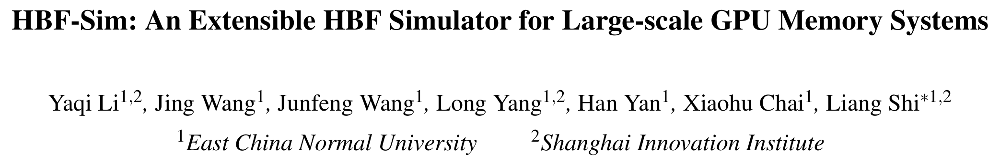
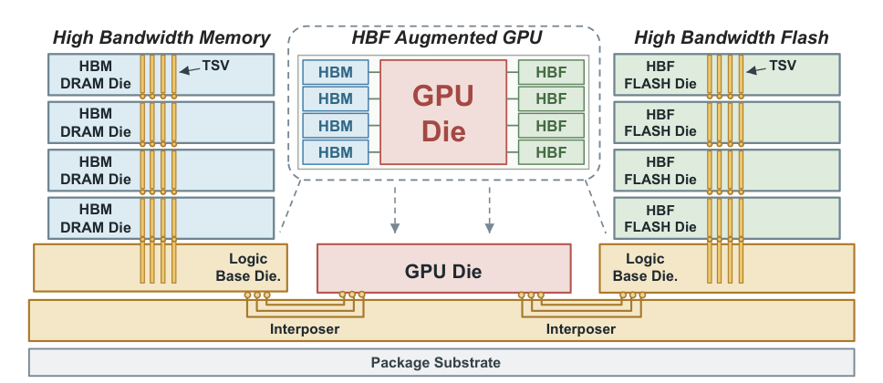
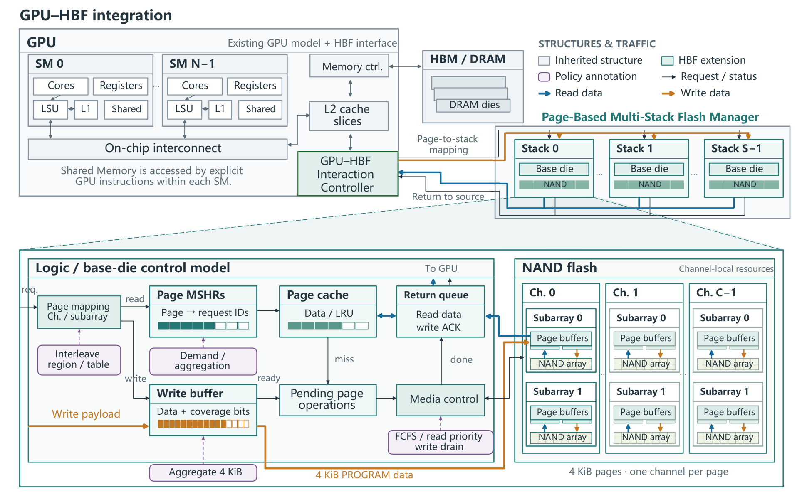
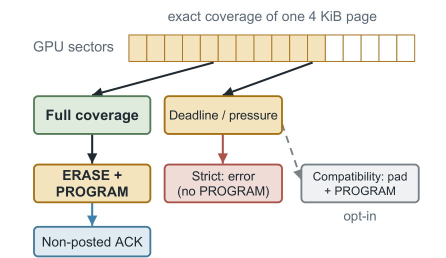
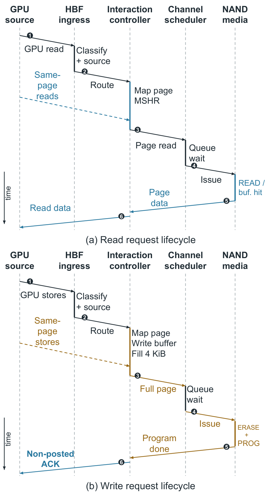
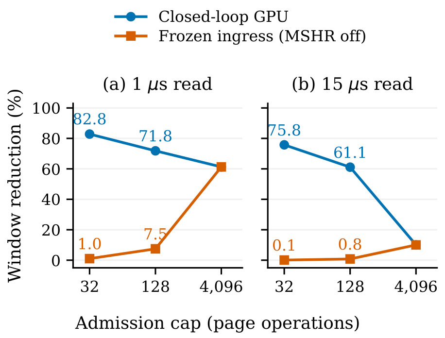
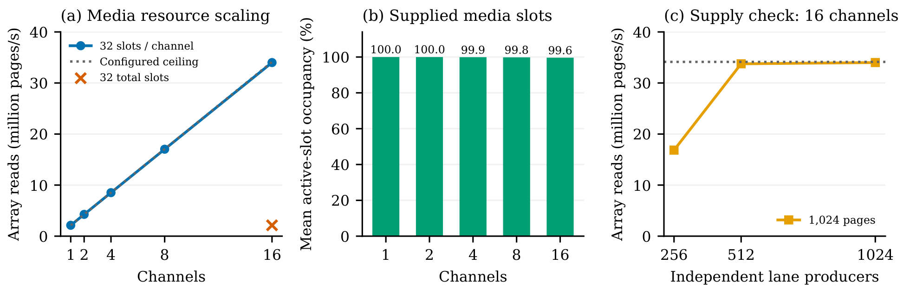
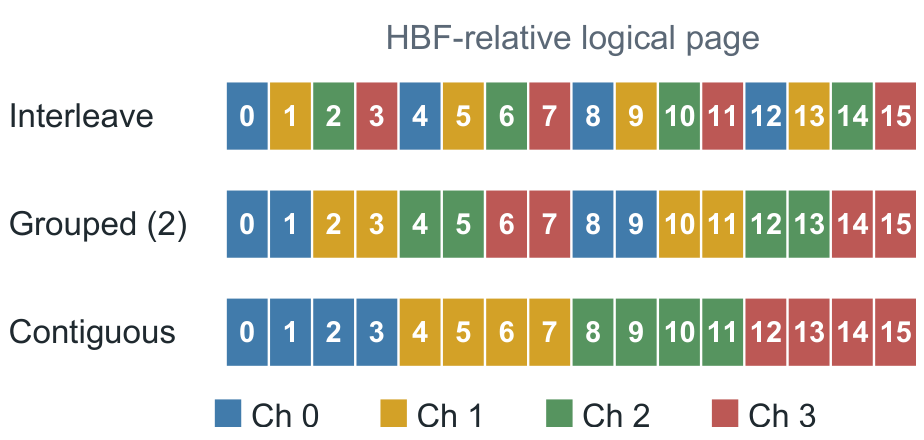
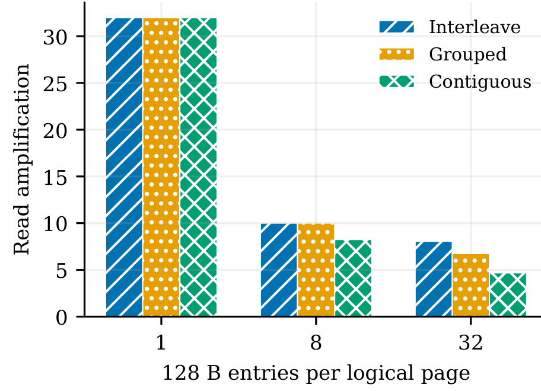
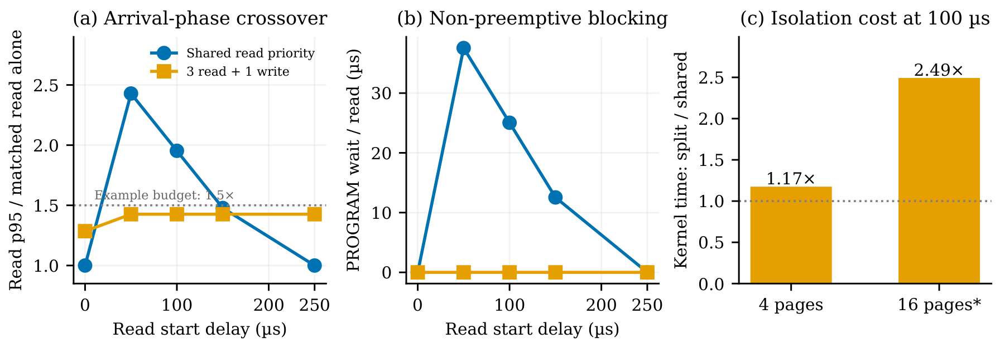

---

# HBF-Sim

> **一句话看懂这篇论文：** 现在大家都在讨论把高带宽闪存（HBF）直接焊在 GPU 旁边来解决大模型显存不够用的问题，但**市面上还没有真正的 HBF 硬件**。华东师范大学（李亚奇、石亮团队）和上海创智学院做了这套开源仿真器 **HBF-Sim**——把 GPU 仿真器和 NAND 闪存模型真正接成一个**闭环**，用来搞清楚 HBF 装在 GPU 旁边到底快在哪、卡在哪，以及以后该怎么设计。

---

## 一、背景动机

### 1. 大模型推理为啥催生了 HBF？（顺便补点 AI 推理基础）

+ **AI 推理主要在显存里放两样东西：**
  + **模型权重（Weights）：** 大模型训练完之后固定下来的“脑子参数”，推理时**只读不改**，体积动辄几百 GB，按顺序读出来算。
  + **KV 缓存（KV Cache）：** 大模型和你聊天时，为了不用每次都把之前说过的话重新算一遍，会在显存里记一份“草稿本”。对话越长、同时服务的用户越多（batch size 越大），这份草稿本就膨胀得越厉害，既有**重复读取**（比如共享系统提示词），又有不断**追加写入**的新内容。
  + 此外在 RAG（检索增强生成，类似外挂知识库）场景下，还要随机去抓很多零散的**向量数据**，访问非常碎。
+ **HBM 显存太小，外挂 SSD 又太慢：** GPU 旁边现有的 HBM（高带宽内存）速度极快（1–8 TB/s，延迟约 100 ns），但容量太小（单卡 80–192 GB）且贼贵。装不下时，要么被迫把宝贵的 KV 草稿本删掉重算，要么多买几张 GPU 拼在一起，或者把数据卸载到 CPU 内存和 PCIe NVMe SSD 上——但一过 PCIe 总线，带宽掉到几~十几 GB/s，延迟和软件栈开销立马爆炸。
+ **HBF 的定位：** 把高密度 NAND 闪存堆叠芯片（Stack）和 GPU **直接共同封装在一起**（走 UCIe/AXI 这类内存风格接口，而不是传统块设备协议）。按 SK 海力士和闪迪联合发布的 OCP HBF v0.7.0 规范，单个 HBF 可配 **512 GiB** 容量、最多 **16 个独立主机通道**，名义接口总带宽高达 **3.072 TB/s**——你可以把它理解成**“速度逼近显存、容量和价格接近闪存”的新层级**。

*原论文图 1：HBM 与 HBF 都和 GPU 封装在同一块基板上，物理上都离 GPU 很近，但底层介质脾气完全不同。*

### 2. 用 SSD 思维看懂 HBF：它既不是大号 HBM，也不是快号 SSD

如果你懂 SSD，下面这四个特点能让你一秒摸清 HBF 的底细：

| 存储层级 | 接口方式 | 访问粒度 | 典型延迟 | 设备端 GC | 容量级别 | 带宽 |
| --- | --- | --- | --- | --- | --- | --- |
| **HBM** | 伪通道（内存） | 32–64 B | ~100 ns | 无 | 80–192 GB | 1–8 TB/s |
| **HBF** | **UCIe / AXI（内存风格）** | **主机 64 B / 闪存 4 KiB** | **1–15 µs** | **无（主机管）** | **可配 512 GiB** | **名义 3.07 TB/s** |
| **CXL-flash** | CXL.mem | 64 B | µs–ms | 部分有 | TB 级 | 数十 GB/s |
| **NVMe SSD** | PCIe / NVMe（块设备） | 512 B–4 KiB | ~100 µs | 有（FTL+GC） | TB 级 | 3–14 GB/s |

+ **粒度严重错配（零买 vs 整箱拿）：** GPU 访问显存像“零买”，每次只发 **32 B 扇区**或 **64/128 B 缓存行（Cache-line）** 的小请求；但底层 NAND 闪存按 **4 KiB 页**干活。只想要 32 B，底层可能得整整读出 4 KiB（**128 倍读放大**）！能不能把同一页的零碎请求合并、能不能复用页缓冲，直接决定实际带宽。
+ **通道各管各的，不借资源：** HBF 最多 16 个通道，但**每个通道死绑定自己名下的那批 NAND Die / 子阵列（Subarray）**，类似于 SSD 里各 Channel 管各家的闪存颗粒，不能跨通道借用。接口标称 3.072 TB/s，如果数据摆得不对、请求全挤在少数通道或同一个子阵列上，根本跑不出标称带宽。
+ **严格整页写 + 落盘才回确认（Non-posted write）：** 普通 SSD 往往数据一进主控 DRAM 写缓存就赶紧回复“写完了”；但 HBF 要求控制器先把零碎写入**凑满完整 4 KiB 一页**，按块内从 page 0 开始的顺序写进 NAND，并且**等编程（PROGRAM，约 200 µs）真正完成才给 GPU 回确认（ACK）**。写不完就会把 GPU 的后续指令“憋住”（背压）。
+ **没有设备端 GC（垃圾回收）：** 传统 SSD 内部有复杂的 FTL 和后台 GC 搬运有效页；但按 OCP HBF 规范，**HBF 芯片内部不做后台 GC**，磨损均衡和空间回收交给主机侧按区（Zone）重映射来做（类似 ZNS SSD 的思路），避免设备后台自己偷偷做 GC 拖垮 GPU 尾延迟。

### 3. 核心问题：为什么现有仿真器全都不够用？（补点 GPU 仿真器基础）

+ **先科普一下什么是 GPU 仿真器（Accel-Sim / GPGPU-Sim）：** 做体系结构研究时，新硬件还没流片，就得靠软件在 CPU 上一步步“模拟”GPU 怎么执行指令、怎么读写缓存和显存。**GPGPU-Sim / Accel-Sim** 就是学术界最权威的 GPU 周期级仿真器（你可以把它当成 **GPU 领域的 MQSim**）。
+ **现有工具的三大短板：**
  1. **GPU 仿真器不懂闪存：** GPGPU-Sim / Accel-Sim 把显存抽象成了纯 DRAM。哪怕你把 DRAM 容量调大、延迟拉长到 15 µs，它也没有 4 KiB 页合并、页缓冲复用、整页凑齐写入这些闪存规矩。
  2. **SSD 仿真器不懂 GPU：** MQSim、SimpleSSD、FEMU、Cylon 这些工具面向的是块设备（NVMe）或 CPU 侧 CXL 接口，默认带 SSD 的 FTL/GC 逻辑，而且**接不上 GPU 的指令执行流水线**。
  3. **拿“固定时间戳轨迹”硬回放会算错账（最关键的痛点）：** 以前有些做法是先把 GPU 发请求的时间点录下来，然后喂给一个独立的存储模拟器去算耗时（开环回放）。这就像拿录像测高速收费站：就算你把收费站升级成 ETC，录像里后面的车还是按原来堵车时的慢时间点开过来，根本看不出“前面快了 → 后面也能早点发车”的连锁反应！
+ **论文要做的事：** 把 **Accel-Sim（GPU 侧）** 和 **精确的 HBF 闪存模型（存储侧）** 真正接成一个**双向反馈的闭环**——GPU 发请求 → HBF 合并/排队/读或编程闪存 → 返回数据或写确认 → GPU 释放名额、继续跑后续指令并发出下一批请求。

---

## 二、设计方案

### 1. 整体思路：把“接口翻译”和“闪存干活”拆成两层

HBF-Sim 故意在 GPU 时序和 NAND 介质时序之间划了一条清晰的边界，把整个 HBF 子系统拆成两个协作层：
+ **上层：GPU–HBF 交互控制器（Interaction Controller）**—— 位于逻辑基底（Base die）上方，负责“当翻译”：把 GPU 发来的零碎访存请求按 4 KiB 归页、决定分给哪个堆栈（Stack）/ 通道（Channel）/ 子阵列（Subarray），并记住是谁发的以便原路送回。
+ **下层：基于页的多堆栈闪存管理器（Page-Based Multi-Stack Flash Manager）**—— 负责“干实活”：在每个堆栈内部做读请求合并（MSHR）、写请求攒整页（Write Buffer）、多级缓存命中以及底层 NAND 的读写擦调度。

### 2. 系统概览

*原论文图 2：HBF-Sim 整体架构。上半部分展示如何嵌入 Accel-Sim 的 GPU 访存路径（原有 HBM/DRAM 路径照常保留）；下半部分把单个 HBF 堆栈拆开，左边是逻辑/基底控制结构，右边是归各通道私有的 NAND 子阵列资源，紫色圆角框代表用户可自由配置替换的策略插槽。*

+ **无缝接入 GPU：** GPU 内部的 SM（计算核心小队）、L1/L2 缓存、原有 HBM 通道都保留不变。只要访存地址落在配置的 HBF 地址区间内，就自动分流进 HBF-Sim；GPU 的内存分区（Memory Partition）只用来记“回程地址”，**不会错误地把 HBF 堆栈复制成好几份或凭空翻倍带宽**。
+ **独立时钟与低开销实现：** HBF 内部介质计时（读/写/擦、缓存命中）跟着模拟器的 DRAM 时钟走，完成后换算回 GPU 核心周期。仿真器采用**惰性初始化**（只给用到过的子阵列分配状态），每个时钟周期只推进**正在忙的子阵列**，整个系统空闲时直接跳过 HBF 步进——因此几乎不拖慢原本的 GPU 仿真速度（实测主机运行时间仅多约 2.9%，内存几乎没涨）。

### 3. 交互控制器：粒度对齐与通道地址映射

+ **粒度对齐（把零碎地址归到 4 KiB 页）：** 设 HBF 起始基址为 $B$、请求地址为 $a$、页大小 $P = 4096\text{ B}$，逻辑页号就是 $p(a) = \lfloor (a - B) / P \rfloor$。比如 $B+64$ 和 $B+128$ 都会归到第 0 页，方便后面合并；$B+4096$ 归到第 1 页。
+ **多堆栈与通道映射：** 支持 1 个或多个独立 HBF 堆栈，每个堆栈标准支持 **1 / 2 / 4 / 8 / 16 通道**（也支持超过 16 通道的扩展实验）。一旦准入，请求就固定绑定到**某一个堆栈、某一个通道及其名下的子阵列**，绝不跨通道借资源。
+ **三种可插拔放置策略（Placement）：**
  1. **逐页交错（Page Interleave）：** 第 0 页放通道 0、第 1 页放通道 1……轮流发牌，把连续页铺开到多通道。
  2. **连续区域（Contiguous）：** 把一大片连续页整体划给指定通道。
  3. **显式映射表（Explicit Mapping Table）：** 由用户按数据类型（比如权重放哪、KV 放哪）或自定义规则（比如后文的两页分组）精确指定每一页去哪。
+ **链路与背压建模：** 每个通道用抽象的“带宽信用（Bandwidth Credit）”来模拟主机链路传输速率，并用**在途操作数上限（Admission Cap）** 限制排队深度——队列一满就顶住上游，把背压自然传回 GPU。

### 4. 页级读模块：MSHR 合并 + 两级复用缓冲

+ **页级 MSHR（未完成访存登记表，防重复读同一页）：** 你可以把 MSHR 理解成“同页拼车登记表”。当多个 32 B / 64 B / 128 B 的 GPU 读请求落在同一个 4 KiB 页时，大家只需要触发 **1 次** NAND 页读，共享这一页的数据！提供两种可切换模式：
  + **按需模式（Demand）：** 第一个请求一进来立刻派发 NAND 读，后来落在同一页的请求直接“蹭车”挂在同一个 MSHR 上。
  + **聚合模式（Aggregation，可选）：** 收到第一个请求后稍微等一小会儿（设定一个时间窗口上限，或攒够指定字节数，默认 4 KiB）再派发读操作，适合同页密集访问以进一步减少重复读，但会拉长首个请求的等待时间。
+ **两级缓冲加速（能蹭缓存绝不翻闪存）：**
  + **NAND 页缓冲（Page Buffer）：** 每个子阵列配 **2 个 NAND 页缓冲**（类似 SSD 里 Plane 的 Page Register）。如果刚刚读过的页还留在缓冲里且满足访存顺序约束，再次读取只需付极短的缓冲命中延迟，不用再花 15 µs 读 NAND 阵列。
  + **逻辑基底页缓存（Page Cache）：** 位于 Base die 上的 LRU 页缓存，支持跨 Kernel、跨时间窗口的数据复用。
+ **底层 NAND 介质状态机：** 每个子阵列维护 `READ`、`PROGRAM`、`ERASE` 三种状态，默认时序为 **读 15 µs、编程 200 µs、擦除 2 ms**（全部可配置）。调度器支持 FCFS（先来先服务）、读优先（Read Priority）、写排空（Write Drain）等策略；注意**读优先只能调整“还没开工”的排队顺序，不能强行打断已经开始编程的闪存操作**。

### 5. 合并写模块：严格凑满 4 KiB + 落盘才回 ACK

*原论文图 3：基于页的写入聚合机制。只有不同位置的小写入并集真正铺满完整 4 KiB，才触发擦除与编程；没凑满就被迫刷出时，默认走严格报错，只有显式开启兼容模式才会补零写入。*

+ **按字节覆盖位图判定“满没满”：** 写缓冲（Write Buffer）不仅存写入的数据，还给每一页维护一张**字节覆盖位图**。把多次小写入覆盖的位置取**并集**——**反复覆盖写同一块区域不会让这一页变得更完整！**
+ **什么时候刷出（Flush）？** 凑满完整 4 KiB、写缓冲空间告急、超过等待期限（Deadline）、同一页来了读请求需要保序，或者系统空闲排空时，都会触发刷出。
+ **严格模式 vs 兼容模式：**
  + **默认严格模式（`strict`）：** 如果到期或被迫刷出时还没凑满 4 KiB，直接记录一次“不完整页错误”，不执行 PROGRAM（忠实反映 OCP HBF 的严格整页写语义）。
  + **可选兼容模式（`partial`）：** 显式开启后，允许把缺的字节补齐（Padding）再编程，同时单独记账记录“半页编程次数”和“白白浪费的填充字节数”。
+ **非投递写确认（Non-posted ACK）：** 按块内顺序写、先擦后写；**必须等 200 µs 的 PROGRAM 彻底完成，才把写确认（ACK）送回 GPU**，让 GPU 真实感受到闪存写慢带来的背压。

### 6. 一次读写请求怎么走完 + 全链路追踪

*原论文图 4：HBF-Sim 中的读（上）与写（下）完整生命周期，时间从上往下推进，直观展示了从 GPU 发出到结果原路返回的全过程。*

+ **全生命周期 7 个状态：** 每个请求在仿真器里依次经过 `INGRESS`（进入 HBF 入口）→ `MAPPED`（映射好堆栈/通道/子阵列）→ `BUFFERED`（仅写请求：在写缓冲里攒 4 KiB）→ `QUEUED`（在通道队列里排队）→ `MEDIAOP`（在 NAND 子阵列里执行读/擦/编程或命中缓冲）→ `RETURN`（沿原路返回源 GPU 分区）→ `COMPLETED`（完成，通知 GPU 继续干活）。
+ **细粒度 Trace 与统计：** 可选导出固定 15 列的 CSV 请求追踪日志（`hbf-trace-v1`），记录每个请求的周期、页号、通道、子阵列、排队深度、延迟、缓存/MSHR 命中和报错，还能统计读放大（`介质读取字节 / GPU 请求字节`）、按区擦写次数（PEC）分布等；配套的独立设备回放工具也能直接吃这份日志，方便做对照实验。

---

## 三、实验结果

**平台与方法：** 基于 Accel-Sim 扩展实现，默认 GPU 核心时钟 1.132 GHz、DRAM 时钟 850 MHz，默认 NAND 时序为读 15 µs / 编程 200 µs / 擦除 2 ms（模型参数，非真实 HBF 硬件标定）。先做功能正确性验证（1–16 通道路由 64/64 零丢包、同页 32 请求触发 1 次页读 + 31 次 MSHR 命中、4 堆栈 512 GiB 稀疏寻址无报错），再做闭环对比、MQSim 交叉核对、资源扩展测试、真实大模型轨迹运行，以及两个系统优化案例研究。

### 1. 为什么必须用“闭环仿真”？（固定轨迹回放会严重看走眼）

论文设计了一个绝妙的对照实验：16 个页、每页 32 个 128 B 读请求、15 µs 读延迟，对比“**开启 MSHR 同页合并**”相对“关闭合并”能让 HBF 完成窗口缩短多少。两组跑完全相同的 C++ HBF 控制器代码，唯一区别在于：**闭环 GPU** 让 GPU 实时响应 HBF 的完成信号；**冻结入口（开环回放）** 则死锁着未开启合并时录下来的请求到达时间。

*原论文图 5：当准入名额紧张（32 或 128 槽）时，冻结入口时间的开环回放几乎完全看不出 MSHR 合并的威力。*

| 准入槽上限（Admission Cap） | 闭环 GPU 仿真（窗口缩短） | 冻结入口回放（窗口缩短） | 预测偏差 |
| --- | --- | --- | --- |
| **32 槽（高度拥堵）** | **75.8%** | 0.1% | 差 75.7 个百分点 |
| **128 槽（中度拥堵）** | **61.1%** | 0.8% | 差 60.3 个百分点 |
| **4,096 槽（完全不堵）** | 10.0% | 10.0% | 0（两者重合） |

+ **大白话解释原因：** 队列名额紧张时（比如 128 槽），开启 MSHR 合并后，同一页的请求不用各自霸占名额，名额飞快空出来，上游 GPU 就能提前把后面的请求全塞进来——入口跨度直接从 **86,972 周期** 暴缩到 **414 周期**，整个 GPU Kernel 从 **93,699 降到 40,164 周期**！而固定回放傻傻按原来的堵车时间表发请求，所以只测出 0.8% 的提升。只有名额多到根本不堵（4,096 槽）时，开环才和闭环一致。

### 2. MQSim 交叉核对、通道扩展与真实大模型跑通

+ **与经典 SSD 仿真器 MQSim 交叉核对：** 在纯只读 64 页（1 或 4 通道、每通道 1 个串行 Die）场景下对比两者。把读延迟从 1 µs 调到 15 µs 时，两者的总时间增量完全一致（单通道 +896 µs、4 通道 +224 µs），证明底层页读与多通道并行逻辑正确；突发完成时间在 15 µs 读下仅差 **2.2%**，在 1 µs 读下差约 **33%**（主要因为 MQSim 保留了原生 NVMe/ONFI 协议开销，如约 290 ns 的命令阶段）。
+ **多通道并行扩展（分清“内部带宽”和“有效带宽”）：**

*原论文图 6：1–16 通道扩展（每通道 32 子阵列与 32 活动槽，15 µs 读）。(a) 蓝线几乎线性增长，但橘色叉号表明若总活动槽锁死 32 个，加到 16 通道也完全不提速；(b) 活动槽利用率达 99.6–100%；(c) 16 通道下至少需要 512 个独立请求源才能喂饱 512 个槽位。*

  + 通道从 1 扩到 16（同步扩展每通道 32 子阵列和活动槽），**NAND 阵列读取带宽** 从 **8.738 涨到 139.285 GB/s（15.94 倍）**；但如果总活动槽锁死在 32，加到 16 通道带宽依然卡在 **8.738 GB/s**——说明真正提速的是**可同时干活的介质并行槽位**，不是光堆通道数。
  + **警惕带宽口径陷阱：** 在上述稀疏读测试里，GPU 每次只读 4 B（触发 32 B 扇区请求），底层却读了整页 4 KiB。所以虽然内部阵列读了 **139.285 GB/s**，传回给 GPU 的**有效扇区带宽只有 1.088 GB/s**！看 HBF 性能绝对不能把内部闪存带宽直接当成应用吞吐。
+ **真实大模型解码验证（Qwen3-1.7B）：** 用 NVBit 在 RTX 4090 上抓取 Qwen3-1.7B（BF16、batch=1、28 层、29 token 上下文）生成单个 token 的完整解码步骤（共 **1,819 个 GPU Kernel**），仅把**模型权重**映射到单堆栈 16 通道 HBF，KV 缓存和中间激活留在普通显存。

| Qwen3-1.7B 解码验证指标 | 仿真结果 |
| --- | --- |
| 抓取 / 完整跑完的 GPU Kernel 数 | **1,819 / 1,819**（全部走通） |
| GPU Kernel 序列总执行时间 | **249.95 ms**（352,434,530 周期） |
| HBF 读请求数 / 返回完成数 | **107,540,992 / 107,540,992**（严格一一对应） |
| 返回扇区字节数 / 底层阵列读字节数 | **3.441 GB / 3.441 GB** |

### 3. 基于 HBF-Sim 的两个系统优化案例（最有启发的部分）

论文接着演示了“用这套仿真器能发现哪些反直觉的架构规律”，一共做了两个实战案例：

#### 案例一：数据怎么放（Placement）—— 省了页服务次数，GPU 却未必更快

*原论文图 7：三种静态放置策略把逻辑页分配给 4 个通道的方式（逐页交错、两页分组、连续分片）。*

*原论文图 8：缩短读时序（tR = 20 DRAM ticks）下，每页访问越密集，连续放置降低“页服务放大”越明显（32 项/页时相对逐页交错降低 41.9%）。*

+ **反直觉发现 ①：页服务放大暴降 41.9%，但 GPU 反而慢了 0.69%！** 在每页 32 个 128 B 读请求时，逐页交错、两页分组、连续放置的页服务次数分别是 **129、108、75 次**（连续放置把页服务放大从 8.0625 降到 4.6875）。但拆开一看，三者真正读 NAND 阵列的次数**全都是 16 次**，省下来的全是廉价的“页缓冲命中”；而连续放置让 GPU Kernel 耗时从 6,505 周期微涨到 6,550 周期（+0.69%）。**启示：光降页服务次数没用，得看有没有砍掉关键路径上的真正阵列读取！**
+ **反直觉发现 ②：同样是平衡通道，换个步长性能天差地别（快 3.94 倍 vs 慢一半）：** 恢复默认 15 µs 读延迟，测试按不同逻辑页步长（Stride = 1 / 4 / 32）访问 64 或 128 个活跃页，对比“内置逐页交错（I）”和“活跃页条带化（S）”：

| 活跃页数 | 访问步长（Stride） | 实际用到的子阵列数（I / S） | Kernel 加速比（S 相对 I，E=1） | 发生了什么？ |
| --- | --- | --- | --- | --- |
| **64 页** | 1（连续） | 32 / 8 | **1.00×** | 两者都吃满了 8 个并发上限，打平 |
| **64 页** | **4** | **8 / 4** | **0.51×（变慢近一半！）** | S 虽然通道均匀了，但子阵列从 8 个缩到 4 个，并行度减半 |
| **64 页** | **32** | **1 / 4** | **3.94×（快近 4 倍！）** | I 撞了模数冲突全挤在 1 个子阵列上，S 铺开到 4 个子阵列 |

+ **设计启示 1：** HBF 的数据放置策略必须**同时兼顾页内复用、通道均衡、子阵列并行度**三件事，只盯着“通道均衡”甚至可能帮倒忙。

#### 案例二：读写混跑时，要不要把读和写拆开到独立通道？（Read/Write Isolation）

问一个很现实的问题：闪存写一页要 200 µs，读一页只要 15 µs；如果读请求撞上正在写的通道，靠**共享通道 + 读优先调度**够不够，还是干脆把 4 个通道静态拆成 **3 个读通道 + 1 个写通道（3R/1W）** 隔离开？

*原论文图 9：(a) 读 p95 尾延迟随“读请求相对写请求的启动延迟”变化，1.5× 为示例延迟预算线；(b) 读请求撞上正在执行的不可打断 PROGRAM 时平均等待时间；(c) 隔离带来的整机 Kernel 时间代价（16 页带星号组需放宽组页期限至 400 µs 才能跑完）。*

| 对比维度（4 写页、读延迟 100 µs 启动，3R/1W 相对共享读优先） | 变化幅度 | 背后原因 |
| --- | --- | --- |
| **读请求 p95 尾延迟** | **降低 27.0%**（232K → 170K 周期） | 读独占 3 通道，完全避开不可打断的 200 µs 编程阻塞 |
| **写请求 p95 尾延迟** | **暴涨至 4.00 倍**（227K → 906K 周期） | 写只剩 1 个通道，写入并行度被砍，排起长队 |
| **整个 GPU Kernel 耗时** | **增加 17.5%**（776K → 912K 周期） | 整体要等所有写完才结束，被单写通道拖慢了 |

+ **不是什么时候隔离都更好（到达相位决定输赢）：** 读优先**无法打断已经开工的 200 µs 编程**。所以当读恰好在写开始后 **50 µs 或 100 µs** 撞进来时，共享模式会被堵死，只有 **3R/1W 隔离**能把读尾延迟压在 1.5× 预算内；但在 **0 µs**（读先抢跑）或 **250 µs**（写已经结束）时，共享模式不仅总时间更快，连读 p95 延迟都比隔离更低！
+ **别忘了可行性底线：** 写流量涨到 16 页时，在默认 11.76 µs 严苛组页期限下，静态 3R/1W 因为写通道堵死**直接触发严格写超时失败**；必须把期限放宽到 400 µs 才能跑完，代价是整机耗时涨到 **2.49 倍**。
+ **设计启示 2：** 读写通道隔离不能一刀切，必须结合到达节奏动态权衡“读尾延迟预算”与“写吞吐/整机时间”，而且**先确保满足严格整页写期限（能跑通），再去比快慢**。

### 4. 局限性与阅读边界

+ **没有真机硬件标定：** 因为市面上还没有量产 HBF 芯片，论文验证的是 OCP v0.7.0 规范下的功能与语义正确性，以及和 MQSim 一致的趋势，**不能等同于真实 HBF 硅片的周期级精确性能**。
+ **暂未建模的底层物理细节：** 当前版本没有模拟 ECC 纠错、读重试（Read Retry）、闪存刷新（Refresh）和发热降频，也没有把 UCIe/AXI 链路细化到事务级协议，这些在真机上会影响尾延迟。
+ **大模型实验覆盖有限：** Qwen3-1.7B 是较小模型、batch=1 的单个解码步，且只把权重放进了 HBF，暂不能直接外推成“千亿大模型 + 长上下文 KV 卸载”的整体吞吐结论。
+ **策略仍是静态的：** 目前验证的是静态映射与静态通道划分，如何根据实时访存模式做**自适应数据放置与动态读写通道分配**，正是留给后续研究的开放方向。
