# HBF-Sim: An Extensible HBF Simulator for Large-scale GPU Memory Systems

# HBF-Sim：面向大规模 GPU 内存系统的可扩展 HBF 模拟器

## 文献信息 / Publication Information

- **Authors / 作者**：Yaqi Li¹˒²、Jing Wang¹、Junfeng Wang¹、Long Yang¹˒²、Han Yan¹、Xiaohu Chai¹、Liang Shi¹˒²*。
- **Affiliations / 单位**：¹ East China Normal University / 华东师范大学；² Shanghai Innovation Institute / 上海创智学院。
- **Source / 来源**：本地文件 `FAST_2027___Yaqi___HBF_Sim.pdf`，14 页。PDF 未注明正式发表信息与版本日期；文件名不作为录用或发表状态的依据。

## 阅读说明 / Reading Notes

沿用 FlashAccel 译稿的“英文原文 → 中文译文”逐段排列方式，保留章节编号、引文编号、公式及原文数值。跨行断词、跨栏和跨页段落已整理，原文的技术主张、限定条件及笔误含义均按原稿保留。原图标签保留英文，图题中英对照；表格以 Markdown 重排，并保留原表截图便于核对。参考文献保留英文著录信息，附中文题名，检索时以英文为准。

图片位于同目录 `HBF-Sim_assets/`，移动译稿时请一并移动。每段的页码与 S 编号可回溯到原文；详细坐标保存在 `source_map.json`。

## 目录 / Contents

- [摘要 / Abstract](#abstract)
- [1 引言 / Introduction](#section-1)
- [2 背景 / Background](#section-2)
- [3 研究动机 / Motivation](#section-3)
- [4 HBF-Sim 模拟器设计 / HBF-Sim Simulator Design](#section-4)
- [5 平台验证与评估 / Platform Validation and Evaluation](#section-5)
- [6 基于 HBF-Sim 的优化案例 / HBF-Sim-based Optimization Cases](#section-6)
- [7 讨论 / Discussion](#section-7)
- [8 相关工作 / Related Work](#section-8)
- [9 结论 / Conclusion](#section-9)
- [参考文献 / References](#references)
- [术语对照 / Terminology](#terminology)

---

## Abstract / 摘要

<!-- Source: p.1 S001 -->

**Source:** p.1 S002

**Original:** High-bandwidth flash (HBF) is introduced to address the memory wall, which can co-package a dense NAND stack with the GPU, targeting the performance gap between near-accelerator bandwidth and flash density. HBF, however, is neither a large HBM nor a fast NVMe SSD. Its usable bandwidth depends on how GPU cache-line requests map onto NAND pages, how concurrency spreads across channel-affine die sets, and how media management interacts with the GPU memory pipeline. To our knowledge, existing GPU, SSD, or HBF simulators cannot faithfully model this behavior.

**中文:** 高带宽闪存（HBF）旨在解决内存墙问题：它可将高密度 NAND 堆栈与 GPU 共同封装，弥合靠近加速器的高带宽与闪存高密度之间的性能差距。然而，HBF 既不是容量更大的 HBM，也不是速度更快的 NVMe SSD。其可用带宽取决于 GPU 缓存行请求如何映射到 NAND 页、并发访问如何分布到与通道绑定的裸片集合，以及介质管理如何与 GPU 内存流水线交互。据我们所知，现有 GPU、SSD 或 HBF 模拟器均无法忠实建模这些行为。

**Source:** p.1 S003

**Original:** We present HBF-Sim, an extensible, reusable, and faithful HBF simulator integrated with simulated GPUs. It closes the loop between GPU issue limits, device queuing, and NAND behavior in one end-to-end request path. HBF-Sim separates a GPU–HBF interaction controller from page-based parallel stack storage, and it models the full GPU–HBF request path. It provides an MSHR-based address mapping table that merges cache-line requests into page-based operations, as well as a page-based multi-stack flash manager for highly parallel reads and writes. Validation tests and device-level microbenchmarks expose performance bottlenecks caused by limited channel distribution and resource conflicts, offering concrete guidance for next-generation HBF architectures.

**中文:** 我们提出 HBF-Sim，这是一款与模拟 GPU 集成、可扩展、可复用且能够忠实反映 HBF 行为的模拟器。它在一条端到端请求路径中，将 GPU 请求发射限制、设备排队与 NAND 行为连接成闭环。HBF-Sim 将 GPU–HBF 交互控制器与基于页的并行堆栈存储分离，并对完整的 GPU–HBF 请求路径建模。它提供基于 MSHR 的地址映射表，将缓存行请求合并为页级操作，同时提供基于页的多堆栈闪存管理器，以支持高度并行的读写。验证测试和设备级微基准揭示了通道分布受限与资源冲突造成的性能瓶颈，为下一代 HBF 架构提供了具体指导。

## 1 Introduction / 1 引言

<!-- Source: p.1 S004 -->

**Source:** p.1 S005

**Original:** Memory-hungry workloads such as LLM training and agentic inference are increasingly bounded by the limited capacity of on-chip HBM and DDR memory [6]. Model weights are largely read-only and fixed in size [18], whereas the key–value (KV) cache grows with context length and batch size. During decoding, insufficient HBM capacity forces systems either to evict reusable KV entries or to shard models across more GPUs. Recent work has explored CPU DRAM and flash as extensions to GPU memory [1,29], but these remote memory tiers remain constrained by PCIe bandwidth, access latency, and software-stack overhead.

**中文:** LLM 训练和智能体推理等内存密集型工作负载，日益受到片上 HBM 与 DDR 内存容量有限的制约 [6]。模型权重大多只读且大小固定 [18]，而键值（KV）缓存会随上下文长度和批量大小增长。在解码过程中，HBM 容量不足迫使系统驱逐可复用的 KV 条目，或将模型分片到更多 GPU 上。近期研究探索了利用 CPU DRAM 和闪存扩展 GPU 内存 [1,29]，但这些远端存储层仍受 PCIe 带宽、访问延迟和软件栈开销的限制。

**Source:** p.1 S006

**Original:** High-bandwidth flash (HBF) offers a promising way to alleviate the GPU memory wall. As a package-local memory tier for GPUs, it provides 512 GiB of density and multi-TB/s interface bandwidth at a fraction of HBM’s cost. A recent Open Compute Project (OCP) specification [24], proposed by SK hynix and SanDisk, integrates a dense NAND stack co-packaged with the GPU and served by up to 16 independent UCIe host channels, yielding an aggregate interface bandwidth of 3.072 TB/s. HBF is thus positioned as a "memory-interface flash" tier, offering near-accelerator latency and bandwidth together with flash density and cost.

**中文:** 高带宽闪存（HBF）为缓解 GPU 内存墙提供了一条有前景的途径。作为 GPU 封装内的存储层，它以远低于 HBM 的成本提供 512 GiB 容量和数 TB/s 的接口带宽。SK hynix 与 SanDisk 提出的近期开放计算项目（OCP）规范 [24]，将高密度 NAND 堆栈与 GPU 共同封装，并通过最多 16 个独立 UCIe 主机通道提供服务，聚合接口带宽达到 3.072 TB/s。因此，HBF 被定位为一种“内存接口闪存”层，兼具靠近加速器的延迟与带宽特性，以及闪存的密度与成本优势。

**Source:** p.1 S007

**Original:** However, simulating HBF behavior is not easy. An HBF-enhanced architecture is neither a large HBM nor a fast NVMe SSD. The main difficulty is to leverage the available bandwidth, which depends on several factors. In detail, it may depend on how 64 B GPU cache-line requests map onto 4 KiB NAND pages, how request concurrency spreads across channel-affine die sets, and how 4 KiB write aggregation and backpressure interact with the GPU’s memory pipeline. It relates to media management, which prohibits the garbage-collection machinery that every SSD simulator assumes. Unforturenately, existing platform ignore these interactions. GPU simulators (GPGPU-Sim [3], Accel-Sim [13]) abstract off-chip storage as DRAM. SSD simulators and emulators (MQSim [32], FEMU [19], Cylon [36]) implement NVMe/CXL block-device semantics. Recent HBF studies (e.g., H3 [7], HAVEN [8], TileLens [9], FlashAccel [34], DASH [15], and Li et al. [21]) build on internal or application-specific models. Their publicly available descriptions do not establish support for the full set of GPU–HBF request and completion semantics studied in this work.

**中文:** 然而，模拟 HBF 行为并不容易。HBF 增强架构既不是容量更大的 HBM，也不是速度更快的 NVMe SSD。主要难点在于如何利用可用带宽，而这取决于多个因素。具体而言，这可能取决于如何将 64 B 的 GPU 缓存行请求映射到 4 KiB NAND 页、如何使并发请求分布到与通道绑定的裸片集合，以及 4 KiB 写聚合和反压如何与 GPU 内存流水线交互。这还涉及介质管理：HBF 不允许采用各类 SSD 模拟器所假定的垃圾回收机制。遗憾的是，现有平台忽略了这些交互。GPU 模拟器（GPGPU-Sim [3]、Accel-Sim [13]）将片外存储抽象为 DRAM。SSD 模拟器和仿真器（MQSim [32]、FEMU [19]、Cylon [36]）实现的是 NVMe/CXL 块设备语义。近期 HBF 研究（如 H3 [7]、HAVEN [8]、TileLens [9]、FlashAccel [34]、DASH [15] 和 Li 等人的研究 [21]）则依赖内部模型或面向特定应用的模型。它们公开的描述尚未证明其支持本文研究的完整 GPU–HBF 请求与完成语义。

**Source:** p.1–2 S008

**Original:** This paper presents HBF-Sim, an extensible, reusable, and more faithful HBF simulator integrated with Accel-Sim/GPGPU-Sim. It models the full GPU–HBF request path and is designed to study hardware and system design. HBF-Sim explicitly separates the GPU–HBF interaction controller, which sits above the base die and owns granularity alignment, address mapping, and memory/flash management, from the page-based parallel stack storage, which owns coalescing-based data storage and data retrieval. The GPU drives HBF through ordinary load/store interfaces, while a detailed per-request trace exposes both request state transitions and accounting. We make the following contributions:

**中文:** 本文提出 HBF-Sim，这是一款与 Accel-Sim/GPGPU-Sim 集成、可扩展、可复用且保真度更高的 HBF 模拟器。它对完整的 GPU–HBF 请求路径建模，用于研究硬件与系统设计。HBF-Sim 明确区分两部分：位于基底裸片之上、负责粒度对齐、地址映射以及内存/闪存管理的 GPU–HBF 交互控制器，以及负责基于合并的数据存储与数据读取的页级并行堆栈存储。GPU 通过普通的加载/存储接口驱动 HBF，详细的逐请求轨迹则呈现请求状态转换与统计计量信息。我们的贡献如下：

**Source:** p.2 S009

**Original:** • An Open-source and Scalable Simulation Framework. Our HBF-Sim mainly consists of two parts, GPU-HBF interaction controller for data alignment and page-based flash manager for multi-stack parallelism. We implement HBF-Sim as an extension to Accel-Sim with a configurable GPU-HBF request/completion path and release it as open source (§4).

**中文:** • **开源且可扩展的模拟框架。** HBF-Sim 主要由两部分组成：用于数据对齐的 GPU–HBF 交互控制器，以及实现多堆栈并行的页级闪存管理器。我们将 HBF-Sim 实现为 Accel-Sim 的扩展，提供可配置的 GPU–HBF 请求/完成路径，并以开源方式发布（§4）。

**Source:** p.2 S010

**Original:** • High-Performance Flash Access Strategies. We propose an MSHR-based address mapping table that efficiently merges GPU cache-line requests into page-based HBF operations (§4.1). We further design a page-based, multi-stack flash management method that supports highly parallel reads and writes (§4.2).

**中文:** • **高性能闪存访问策略。** 我们提出基于 MSHR 的地址映射表，将 GPU 缓存行请求高效合并为页级 HBF 操作（§4.1）。我们还设计了基于页的多堆栈闪存管理方法，以支持高度并行的读写（§4.2）。

**Source:** p.2 S011

**Original:** • Flexible System Extension and Performance Optimization. Our simulator is built on an extensible architecture that supports flexible configuration of storage capacity, bandwidth, NAND timing, placement, mapping, and controller limits (§4). Users can readily extend this architecture and plug in their own optimizations (§6).

**中文:** • **灵活的系统扩展与性能优化。** 模拟器采用可扩展架构，支持灵活配置存储容量、带宽、NAND 时序、数据放置、映射以及控制器限制（§4）。用户可以方便地扩展这一架构，并接入自己的优化方案（§6）。

**Source:** p.2 S012

**Original:** • Insights for Future HBF-Enhanced System Design. Through validation tests and device-level microbenchmarks, we measure fine-grained workload behavior and cost (§5). Our observations identify performance bottlenecks caused by limited channel distribution and resource conflicts, which inspire potential designs for next-generation HBF architectures.

**中文:** • **对未来 HBF 增强系统设计的启示。** 我们通过验证测试和设备级微基准，测量细粒度的工作负载行为及开销（§5）。观测结果识别出通道分布受限与资源冲突导致的性能瓶颈，为下一代 HBF 架构的潜在设计提供启发。

## 2 Background / 2 背景

<!-- Source: p.2 S013 -->

### 2.1 HBF Device Semantics / 2.1 HBF 设备语义

<!-- Source: p.2 S014 -->

**Source:** p.2 S015

**Original:** HBF is defined as a new storage tier that bridges the gap between HBM (High Bandwidth Memory) and SSDs (Solid-State Drives), aimed at addressing the “memory wall” challenge posed by the era of large AI models. SK Hynix and SanDisk have jointly released the first High Bandwidth Flash (HBF) standard specification (version 0.7.0) [24] and made it available through the OCP (Open Compute Project). HBF is exposed to the host through a memory-like interface rather than as a block device. The cube provides up to 16 independent host channels, each bound to a fixed set of NAND dies and a local address space. Because requests on one channel cannot access resources owned by another, placement directly determines how much parallelism the device can deliver. The aggregate interface bandwidth reaches 3.072 TB/s across all channels, but that bandwidth is only attainable when requests are mapped to the appropriate channel-local resources.

**中文:** HBF 被定义为弥合 HBM（高带宽内存）与 SSD（固态硬盘）之间差距的新存储层，旨在应对大 AI 模型时代带来的“内存墙”挑战。SK Hynix 与 SanDisk 联合发布了首个高带宽闪存（HBF）标准规范（0.7.0 版）[24]，并通过 OCP（开放计算项目）提供该规范。HBF 通过类似内存的接口呈现给主机，而不是作为块设备。一个 HBF 立方体最多提供 16 个独立主机通道，每个通道绑定一组固定的 NAND 裸片和一个局部地址空间。由于一个通道上的请求无法访问其他通道拥有的资源，数据放置直接决定了设备能够提供多少并行性。所有通道的聚合接口带宽可达 3.072 TB/s，但只有将请求映射到适当的通道本地资源，才能达到这一带宽。

**Source:** p.2 S016

**Original:** HBF differs from conventional memory in its media semantics. Host reads are 64B granular, while the NAND HBFs operates at 4 KiB page granularity. A host read must therefore be aligned to a single NAND page, which may be served from a page buffer when ordering constraints permit. Writes are non-posted: the controller accumulates a full 4 KiB page before programming NAND, and completion occurs only after programming finishes. Pages within a block are written sequentially from page 0.

**中文:** HBF 的介质语义不同于传统内存。主机读取的粒度为 64 B，而 HBF 中的 NAND 以 4 KiB 页为粒度工作。因此，主机读请求必须对齐到单个 NAND 页；在顺序约束允许时，可由页缓冲区提供该页。写操作采用非投递式语义：控制器在编程 NAND 前先积累完整的 4 KiB 页，只有编程结束后写操作才完成。块内各页从第 0 页开始顺序写入。

**Source:** p.2 S017

**Original:** Unlike an SSD, there’s no device-managed garbage collection on HBF. Instead, wear management is handled on the host side through zone remapping, and no background valid-page migration is performed. Thus, SSD-style FTLs serve only as a reference, not as the primary model for HBF behavior.

**中文:** 与 SSD 不同，HBF 没有设备管理的垃圾回收。相反，磨损管理通过主机侧的区带重映射完成，也不执行后台有效页迁移。因此，SSD 式闪存转换层（FTL）只能作为参考，不能作为 HBF 行为的主要模型。

**Source:** p.2 S018

**Original:** Table 1 compares HBF with HBM, CXL-flash, and NVMe SSDs. Compared with HBM, HBF offers much larger capacity but retains flash-like latency and page granularity. Compared with CXL-attached flash and NVMe SSDs, HBF keeps a memory-like load/store interface while moving the flash device onto the GPU package, thereby reducing host-stack and link overheads.

**中文:** 表 1 比较了 HBF、HBM、CXL-flash 与 NVMe SSD。相较于 HBM，HBF 提供大得多的容量，但仍保留闪存式延迟与页粒度。相较于通过 CXL 连接的闪存和 NVMe SSD，HBF 在将闪存设备移入 GPU 封装的同时，保留类似内存的加载/存储接口，从而降低主机软件栈和链路开销。

**Source:** p.2 C002 · **Placed near:** p.2 S018

| 指标 / Metric | HBM | HBF | CXL-flash | NVMe SSD |
| --- | --- | --- | --- | --- |
| 接口 / Interface | pseudo-ch（伪通道） | UCIe/AXI | CXL.mem | PCIe/NVMe |
| 粒度 / Granularity | 32–64 B | 64 B / 4 KiB | 64 B | 512 B–4 KiB |
| 延迟 / Latency | 100 ns | 1–15 µs | µs–ms | 100 µs |
| 设备垃圾回收 / Device GC | no（无） | no（无） | partial（部分） | yes（有） |
| 容量 / Capacity | 80–192 GB | configurable 512 GiB span（可配置的 512 GiB 地址跨度） | TB-class（TB 级） | TB-class（TB 级） |
| 带宽 / BW | 1–8 TB/s | nominal 3.07 TB/s（标称） | 10s GB/s（数十 GB/s） | 3–14 GB/s |

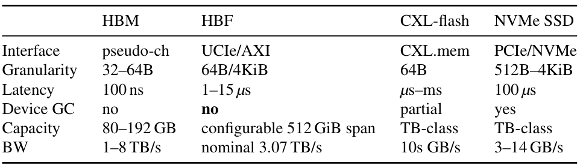

**Table 1.** Comparison of representative memory and storage tiers. Parameters are based on respective industry specifications (JEDEC HBM3/3e, OCP HBF v0.7.0 [24], CXL 3.1 [5]) and enterprise SSD datasheets [22,27]. HBF latency reflects representative flash media access and buffer-hit timing profiles.

**表 1。** 代表性内存与存储层的比较。参数依据各自的行业规范（JEDEC HBM3/3e、OCP HBF v0.7.0 [24]、CXL 3.1 [5]）及企业级 SSD 数据手册 [22,27]。HBF 延迟反映代表性的闪存介质访问和缓冲区命中时序配置档。

### 2.2 HBF in the GPU Memory Hierarchy / 2.2 GPU 内存层次中的 HBF

<!-- Source: p.2 S019 -->

**Source:** p.2–3 S020

**Original:** HBF becomes a new package-local flash tier alongside HBM on GPU, as shown in Figure 1. Its NAND dies and logic/base die connect to the GPU through package-level links, but this physical proximity does not give HBF DRAM-like access behavior. As Table 1 summarizes, HBF combines a memory-style interface with page-buffered reads, channel-affine media resources, and non-posted page writes. Modeling its place in the GPU memory hierarchy therefore requires both GPU execution timing and these flash semantics.

**中文:** 如图 1 所示，HBF 成为 GPU 上与 HBM 并列的封装内闪存层。其 NAND 裸片和逻辑/基底裸片通过封装级链路与 GPU 相连，但这种物理上的接近并不会使 HBF 具有类似 DRAM 的访问行为。如表 1 所概括，HBF 将内存式接口与页缓冲读取、通道绑定的介质资源以及非投递式页写入结合在一起。因此，要对其在 GPU 内存层次中的位置建模，必须同时考虑 GPU 执行时序与这些闪存语义。

**Source:** p.2 C001 · **Placed near:** p.2–3 S020

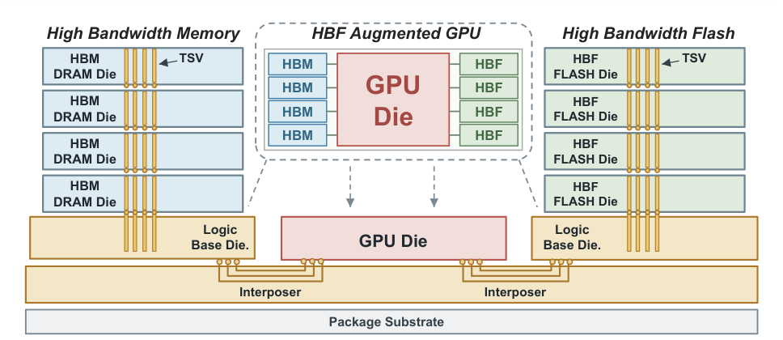

**Figure 1.** Overview of an HBF-augmented GPU package. The inset shows HBM and HBF stacks beside the GPU; cross-section shows DRAM and NAND dies, TSVs, microbumps, logic/base dies, the interposer, and package substrate.

**图 1。** HBF 增强 GPU 封装概览。插图展示 GPU 两侧的 HBM 与 HBF 堆栈；剖面展示 DRAM 和 NAND 裸片、硅通孔（TSV）、微凸点、逻辑/基底裸片、中介层及封装基板。

**Source:** p.3 S021

**Original:** Accel-Sim and GPGPU-Sim already model instruction execution, caches, interconnects, and warp timing [3,13]. HBF-Sim extends this path with HBF page, channel, and completion state while retaining the ordinary DRAM path. GPU cache structures and HBF page-tracking structures have distinct roles; the HBF cache-routing policy is described in Section 4.

**中文:** Accel-Sim 与 GPGPU-Sim 已经对指令执行、缓存、互连以及线程束时序建模 [3,13]。HBF-Sim 在保留普通 DRAM 路径的同时，为该路径增加 HBF 页、通道和完成状态。GPU 缓存结构与 HBF 页跟踪结构承担不同职责；HBF 的缓存路由策略见第 4 节。

**Source:** p.3 S022

**Original:** Consequently, studying HBF in this hierarchy requires a closed timing loop: GPU execution generates memory requests, HBF queues and services them under page and channel constraints, and their completion timing dictates when dependent GPU instructions can proceed. Capturing this bidirectional feedback is essential for understanding HBF performance, exposing critical limitations in existing simulation tools (§3.1).

**中文:** 因此，研究这一层次中的 HBF 需要一个时序闭环：GPU 执行产生内存请求，HBF 在页与通道约束下对其排队并提供服务，而请求的完成时刻决定了依赖这些请求的 GPU 指令何时能够继续执行。捕获这种双向反馈对于理解 HBF 性能至关重要，也揭示了现有模拟工具的关键局限（§3.1）。

## 3 Motivation / 3 研究动机

<!-- Source: p.3 S023 -->

### 3.1 Limitations of Existing Simulators / 3.1 现有模拟器的局限

<!-- Source: p.3 S024 -->

**Source:** p.3 S025

**Original:** Table 2 compares the capabilities of related works about GPU–HBF architectures. GPU timing covers instruction execution, caches, and request issue. NAND timing covers page reads and programs, while load/store flash access provides a memory-style interface. HBF simulation must connect these capabilities so that page service affects GPU execution, including write acknowledgements after programming.

**中文:** 表 2 比较了 GPU–HBF 架构相关工作的能力。GPU 时序涵盖指令执行、缓存与请求发射。NAND 时序涵盖页读取与编程，而加载/存储式闪存访问提供内存式接口。HBF 模拟必须将这些能力连接起来，使页服务能够影响 GPU 执行，其中也包括编程完成后才返回写确认。

**Source:** p.3 C003 · **Placed near:** p.3 S025

| 平台 / Platform | 可配置 GPU 时序 / Configurable GPU timing | NAND 页时序 / NAND page timing | 加载/存储式闪存访问 / Load/store flash access | HBF 请求与完成 / HBF request and completion |
| --- | --- | --- | --- | --- |
| GPGPU-Sim / Accel-Sim [3,13] | Yes / 是 | No / 否 | No / 否 | No / 否 |
| MQSim [32] | No / 否 | Yes / 是 | No / 否 | No / 否 |
| SimpleSSD (gem5 CPU) [4,11] | No / 否 | Yes / 是 | No / 否 | No / 否 |
| FEMU (BlackBox) [19] | No / 否 | Yes / 是 | No / 否 | No / 否 |
| Cylon [36] | No / 否 | Yes / 是 | Yes / 是 | No / 否 |
| HBF-Sim (ours / 本文) | Yes / 是 | Yes / 是 | Yes / 是 | Yes / 是 |

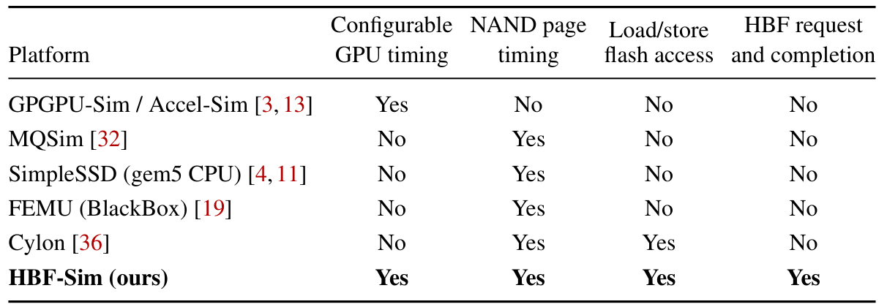

**Table 2.** Platform capabilities for GPU–HBF studies. Yes/No indicates support in the listed configurations.

**表 2。** 用于 GPU–HBF 研究的平台能力。Yes/No 表示表列配置是否支持相应能力。

**Source:** p.3 S026

**Original:** GPGPU-Sim and Accel-Sim [3, 13] model GPU execution and memory timing, but their base configurations lack NAND page operations. Increasing DRAM capacity and latency does not add page-buffer reuse or page-level coalescing. MQSim [32], SimpleSSD [11], and FEMU [19] provide flash-device timing. SimpleSSD integrates with a simulated CPU, while FEMU emulates a device for guest software. Cylon [36] supports load/store access to CXL-attached flash. The listed configurations do not connect simulated GPU requests to HBF page service and return completion dependencies to GPU execution.

**中文:** GPGPU-Sim 与 Accel-Sim [3,13] 对 GPU 执行和内存时序建模，但其基础配置缺少 NAND 页操作。增大 DRAM 容量并提高其延迟，并不能引入页缓冲区复用或页级合并。MQSim [32]、SimpleSSD [11] 和 FEMU [19] 提供闪存设备时序。SimpleSSD 与模拟 CPU 集成，FEMU 则为客户机软件仿真设备。Cylon [36] 支持通过加载/存储访问 CXL 连接的闪存。表中所列配置并未将模拟 GPU 的请求连接到 HBF 页服务，也没有将完成依赖关系反馈给 GPU 执行。

**Source:** p.3 S027

**Original:** A controller policy can change both the time needed to serve requests and when subsequent GPU requests reach HBF. For example, merging reads to the same page reduces the number of outstanding page operations. Under admission pressure, this can free controller capacity sooner and let waiting GPU requests proceed earlier. A replay with fixed arrival times keeps the original request schedule and misses this feedback, potentially underestimating the benefit of merging. Evaluating such policies therefore requires GPU request timing to respond to HBF service. Section 5.2 compares fixed-arrival replay with coupled GPU execution to demonstrate this effect.

**中文:** 控制器策略既可能改变请求服务所需的时间，也可能改变后续 GPU 请求到达 HBF 的时刻。例如，将同一页的读请求合并，可以减少未完成的页操作数量。在接纳压力下，这能更早释放控制器容量，使等待中的 GPU 请求提前推进。到达时间固定的重放会保持原有请求调度，从而遗漏这种反馈，并可能低估合并的收益。因此，评估这类策略时，GPU 请求时序必须能响应 HBF 服务。第 5.2 节通过比较固定到达时间的重放与耦合的 GPU 执行，展示这一影响。

**Source:** p.3 S028

**Original:** In summary, A GPU–HBF simulator needs both page-level media behavior and completion feedback to GPU execution. This requirement motivates the mapping, read, write, and tracing mechanisms in Section 4.

**中文:** 综上，GPU–HBF 模拟器既需要页级介质行为，也需要将完成信息反馈给 GPU 执行。这一要求促成了第 4 节的映射、读取、写入与轨迹机制。

### 3.2 Various R/W Patterns of HBF / 3.2 HBF 的多种读写模式

<!-- Source: p.3 S029 -->

**Source:** p.3 S030

**Original:** HBF must serve different access patterns within the same system. Table 3 summarizes representative data classes in LLM and AI workloads. Sequential weight reads require sustained data delivery. Repeated accesses to KV data, such as shared prefixes [12], make page reuse relevant, while appending KV data requires write aggregation and completion tracking. Scattered RAG-vector accesses can fetch a full NAND page for a small useful region, increasing read amplification.

**中文:** HBF 必须在同一系统内服务不同的访问模式。表 3 概括了 LLM 和 AI 工作负载中的代表性数据类别。顺序读取权重要求持续提供数据。对 KV 数据的重复访问，例如共享前缀 [12]，使页复用具有价值；追加 KV 数据则需要写聚合与完成跟踪。分散的检索增强生成（RAG）向量访问可能为了少量有效数据读取整个 NAND 页，从而增加读放大。

**Source:** p.3 C004 · **Placed near:** p.3 S030

| 类别 / Class | 模式 / Pattern | 规模 / Size | 建模重点 / Modeling focus |
| --- | --- | --- | --- |
| weights / 权重 | seq., read-only / 顺序、只读 | 100s GB / 数百 GB | bandwidth / 带宽 |
| precomputed KV / 预计算 KV | reuse reads / 复用读取 | 100s GB–TB / 数百 GB 至 TB 级 | page reuse / 页复用 |
| ephemeral KV / 临时 KV | append-writes / 追加写入 | 10s GB / 数十 GB | write ordering / 写入顺序 |
| RAG vectors / RAG 向量 | random gathers / 随机聚集访问 | 100s GB / 数百 GB | read amplification / 读放大 |

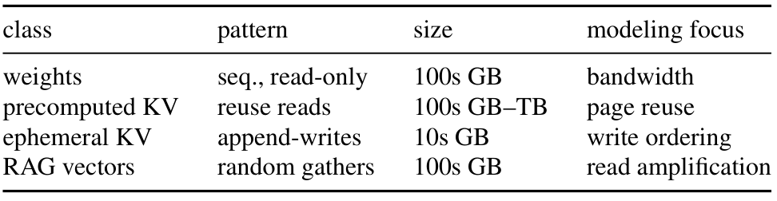

**Table 3.** LLM access patterns and HBF modeling focuses. These categories guide the configuration of our evaluation workloads.

**表 3。** LLM 访问模式与 HBF 建模重点。这些类别指导评估工作负载的配置。

**Source:** p.3–4 S031

**Original:** These patterns place different demands on the controller. Requests to the same page can share a page read or reuse buffered data. Requests to different pages need enough independent media resources to execute in parallel. When reads and writes overlap, a long page program can delay reads that need the same resources. A policy that helps one access pattern may therefore provide little benefit for another. Studying these effects requires control over address mapping, request coalescing, and media scheduling.

**中文:** 这些模式对控制器提出不同要求。同页请求可以共享一次页读取，或复用已缓冲的数据。不同页请求需要足够多的独立介质资源，才能并行执行。当读写重叠时，耗时较长的页编程可能延迟需要相同资源的读请求。因此，对一种访问模式有效的策略，对另一种模式可能收益甚微。研究这些影响，需要能够控制地址映射、请求合并和介质调度。

**Source:** p.4 S032

**Original:** We use controlled request streams to vary concurrency, locality, and write pressure separately. Keeping the request and completion semantics consistent allows us to compare policies under the same workload. Request traces connect GPU accesses to queueing, page service, and completion, helping explain whether a change reduces NAND work or shortens GPU execution. These representative categories guide the synthesis of our microbenchmarks, allowing us to isolate and study specific architectural mechanisms under controlled traffic conditions.

**中文:** 我们采用受控请求流，分别改变并发度、局部性和写压力。保持请求与完成语义一致，使我们能够在相同工作负载下比较不同策略。请求轨迹将 GPU 访问与排队、页服务和完成关联起来，有助于解释某项变化究竟减少了 NAND 工作量，还是缩短了 GPU 执行时间。这些代表性类别指导了微基准的合成，使我们能在受控流量条件下隔离并研究特定架构机制。

**Source:** p.4 S033

**Original:** In summary, A GPU–HBF simulator needs configurable mapping, read, and write policies under a common timing model. This requirement motivates an extensible design that supports different access patterns and exposes their effects on both media activity and GPU execution.

**中文:** 综上，GPU–HBF 模拟器需要在统一时序模型下提供可配置的映射、读取和写入策略。这一要求促使我们采用可扩展设计，以支持不同访问模式，并呈现它们对介质活动与 GPU 执行的影响。

## 4 HBF-Sim Simulator Design / 4 HBF-Sim 模拟器设计

<!-- Source: p.4 S034 -->

**Source:** p.4 S035

**Original:** HBF-Sim models two cooperating layers that determine HBF behavior: (i) the GPU–HBF interaction controller, which sits above the base die and governs the load/store contract between the GPU and HBF, and (ii) the page-based parallel stack storage, which organizes data placement, coalescing, and media access inside the HBF stacks. The former owns granularity alignment, address mapping, memory management, and flash management. The latter owns coalescing-based data storage and data retrieval. Figure 2 illustrates these functions in the GPU–HBF organization. Its upper view shows the GPU memory paths and the connections to independent HBF stacks. The expanded stack below separates request-tracking structures from data buffers and channel-owned NAND resources. Purple annotations identify the mapping, aggregation, and scheduling choices implemented on those structures.

**中文:** HBF-Sim 对共同决定 HBF 行为的两个协作层建模：（i）GPU–HBF 交互控制器，位于基底裸片之上，规定 GPU 与 HBF 之间的加载/存储交互约定；（ii）基于页的并行堆栈存储，组织 HBF 堆栈内部的数据放置、合并与介质访问。前者负责粒度对齐、地址映射、内存管理和闪存管理；后者负责基于合并的数据存储与数据读取。图 2 展示了这些功能在 GPU–HBF 组织中的位置。上部视图给出 GPU 内存路径及其与独立 HBF 堆栈的连接。下部展开的堆栈将请求跟踪结构、数据缓冲区以及通道拥有的 NAND 资源区分开来。紫色注释标明了在这些结构上实现的映射、聚合与调度选项。

**Source:** p.5 C005 · **Placed near:** p.4 S035

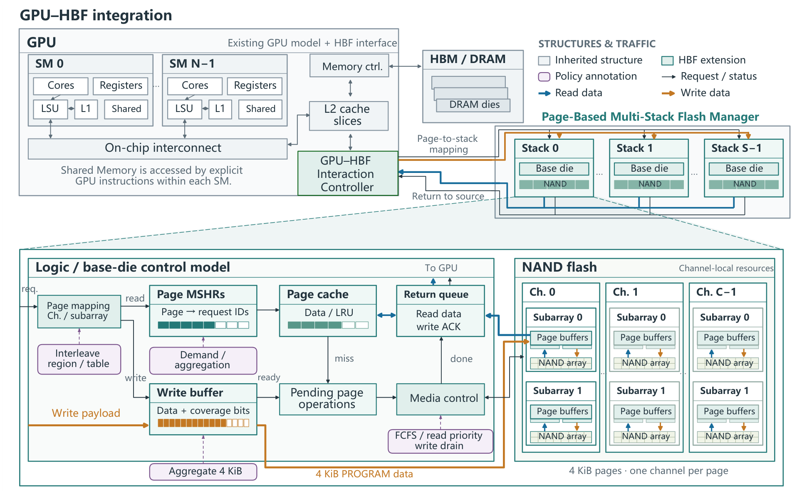

**Figure 2.** HBF-Sim architecture. The upper part shows GPU memory paths and independent HBF stacks. The lower part expands one stack into its control structures and channel-owned NAND resources. Rectangles denote modeled structures, while the figure’s policy annotations identify configurable methods. Thin arrows carry requests or control/status. Thick blue and orange arrows carry read and write data.

**图 2。** HBF-Sim 架构。上部展示 GPU 内存路径和独立的 HBF 堆栈。下部将一个堆栈展开为控制结构及通道拥有的 NAND 资源。矩形表示建模的结构，图中策略注释标识可配置的方法。细箭头传递请求或控制/状态信息；蓝色与橙色粗箭头分别传递读数据和写数据。

**Source:** p.4 S036

**Original:** HBF-Sim places an explicit boundary between GPU timing and HBF media timing. The GPU produces sector or cache-line requests and consumes completion events through load/store interfaces; the HBF system owns page, channel, and media state. GPU requests, HBF pages, and NAND resources are separated so that GPU timing, interface queueing, and media service remain distinguishable.

**中文:** HBF-Sim 在 GPU 时序与 HBF 介质时序之间划定了明确边界。GPU 通过加载/存储接口产生扇区或缓存行请求，并接收完成事件；HBF 系统负责页、通道与介质状态。GPU 请求、HBF 页和 NAND 资源被分别表示，以便区分 GPU 时序、接口排队和介质服务。

### 4.1 GPU–HBF Interaction Controller / 4.1 GPU–HBF 交互控制器

<!-- Source: p.4 S037 -->

**Source:** p.4 S038

**Original:** The interaction controller translates GPU accesses into HBF page operations. It identifies the page containing each request and assigns the request to a stack, channel, and subarray. Each request retains its source GPU partition so that the completion response returns to the correct requester.

**中文:** 交互控制器将 GPU 访问转换为 HBF 页操作。它识别每个请求所在的页，并将请求分配到一个堆栈、一个通道和一个子阵列。每个请求都保留其来源 GPU 分区信息，以便完成响应返回到正确的请求方。

#### 4.1.1 Cacheline-to-page Granularity Alignment / 4.1.1 缓存行到页的粒度对齐

<!-- Source: p.4 S039 -->

**Source:** p.4 S040

**Original:** GPU requests must be aligned to the page granularity used by HBF. The GPU emits 32 B sectors within 64 or 128 B cache-line transactions, while HBF reads and programs 4 KiB pages. The controller groups requests by page so the read and write modules can combine accesses to the same page. Let $B$ be the start of the configured HBF address range, $a$ a request address in that range, and $P = 4096\,\mathrm{B}$ the page size. We compute the zero-based logical page number as

**中文:** GPU 请求必须与 HBF 使用的页粒度对齐。GPU 在 64 B 或 128 B 缓存行事务中发出 32 B 扇区请求，而 HBF 读取和编程的单位是 4 KiB 页。控制器按页对请求分组，使读写模块能够合并对同一页的访问。令 $B$ 为配置的 HBF 地址范围起点，$a$ 为该范围中的请求地址，页大小为 $P=4096\,\mathrm{B}$。从零开始的逻辑页号计算如下：

**Source:** p.4 E001

$$
p(a)=\left\lfloor\frac{a-B}{P}\right\rfloor.
$$

**Source:** p.4 S041

**Original:** Thus, $a-B$ is a byte offset within the HBF range. For example, accesses at $B+64$ and $B+128$ both belong to page 0, while $B+4096$ belongs to page 1.

**中文:** 因此，$a-B$ 是 HBF 地址范围内的字节偏移量。例如，地址为 $B+64$ 和 $B+128$ 的访问都属于第 0 页，而 $B+4096$ 属于第 1 页。

#### 4.1.2 Channel-oriented Address Mapping / 4.1.2 面向通道的地址映射

<!-- Source: p.4 S042 -->

**Source:** p.4 S043

**Original:** A logical HBF system contains one or more independent stacks. Each stack exposes 1, 2, 4, 8, or 16 channels in the standard profiles. Configurations beyond 16 channels are supported as experimental extensions. GPU memory partitions do not create additional copies of a stack or multiply its bandwidth. The source subpartition is retained for return routing only. Total capacity is divided evenly into erase-block-aligned stack-local capacities. Page interleave or contiguous capacity slices select a stack. Stack-local addresses are restored before completion returns to the GPU. After admission, each request is assigned to one stack, one channel, and its fixed subarray resources. There is no cross-channel resource sharing.

**中文:** 一个逻辑 HBF 系统包含一个或多个独立堆栈。在标准配置档中，每个堆栈提供 1、2、4、8 或 16 个通道；超过 16 个通道的配置则作为实验性扩展受到支持。GPU 内存分区不会额外复制堆栈，也不会成倍增加其带宽。来源子分区信息仅用于返回路由。总容量均匀划分为各堆栈的本地容量，并按擦除块对齐。通过页交错或连续容量切片选择堆栈。完成信息返回 GPU 之前，会恢复堆栈本地地址。请求获准进入后，被分配到一个堆栈、一个通道及其固定的子阵列资源。通道之间不共享资源。

**Source:** p.4 S044

**Original:** We implement three placement policies. Page interleave distributes HBF-relative pages across channels. Contiguous placement assigns regions to selected channels. An explicit mapping table can place data classes such as weights and KV pages. The grouped placement evaluated in Section 6.1 uses this hook to rotate after every two adjacent pages. The mapping uses the address relative to the configured HBF base address. An abstract per-channel bandwidth credit models the host link. We limit outstanding operations per channel to model queue backpressure. The host-link abstraction is discussed in Section 7.

**中文:** 我们实现了三种数据放置策略。页交错将相对于 HBF 基址的页分布到各通道。连续放置将地址区域分配给选定通道。显式映射表则可放置权重和 KV 页等数据类别。第 6.1 节评估的分组放置利用这一接口，每两个相邻页之后轮换一次通道。映射使用相对于已配置 HBF 基址的地址。主机链路采用抽象的每通道带宽信用额度建模。我们限制每通道未完成操作数，以模拟队列反压。主机链路抽象见第 7 节。

### 4.2 Page-Based Multi-Stack Flash Manager / 4.2 基于页的多堆栈闪存管理器

<!-- Source: p.4 S045 -->

**Source:** p.4 S046

**Original:** We design the flash manager to use page-level parallelism across the channels and subarrays of each stack. The write module collects GPU stores into full pages. The read module combines requests to the same page and reuses buffered data when ordering permits. Both modules operate on 4 KiB NAND pages.

**中文:** 闪存管理器的设计旨在利用各堆栈通道及子阵列之间的页级并行性。写模块将 GPU 存储操作汇集成完整页。读模块合并同页请求，并在顺序约束允许时复用已缓冲的数据。两个模块均以 4 KiB NAND 页为操作单位。

#### 4.2.1 Merge-based Write Module / 4.2.1 基于合并的写模块

<!-- Source: p.5 S047 -->

**Source:** p.5 S048

**Original:** We use a per-page write buffer to combine GPU stores into full-page programs. The buffer tracks both the data and the byte positions covered by each store. A page is flushed when it is full or when buffer pressure requires space. It is also flushed when the configured deadline expires, when a same-page read requires ordering, or during an idle tail drain. The default strict timeout policy records an incomplete-page error and does not label the operation as a full-page program. The opt-in partial compatibility policy pads and programs a partial page while recording both the partial program and padding bytes. The policy is selected with `hbf_write_timeout_policy`. Flushes are serialized per page. While a page MSHR is in flight, later writes remain buffered and cannot overwrite the entry. Erase-before-write and sequential in-block allocation follow the HBF profile. The controller returns the write response only after programming completes. This non-posted completion propagates write backpressure to the GPU store path.

**中文:** 我们采用逐页写缓冲区，将 GPU 存储操作合并为整页编程。缓冲区同时跟踪数据及每次存储操作覆盖的字节位置。当页已填满，或缓冲区压力要求腾出空间时，会将该页刷出。此外，配置的截止时间到期、同页读取提出顺序要求，或空闲阶段排空尾部数据时，也会刷出该页。默认的严格超时策略会记录页不完整错误，而不会将该操作标记为整页编程。可选启用的部分页兼容策略会对部分页填充后编程，同时记录部分页编程及填充字节数。该策略通过 `hbf_write_timeout_policy` 选择。同一页的刷出操作串行执行。某页的 MSHR 处于在途状态时，后续写入仍保留在缓冲区内，不能覆盖该条目。写前擦除与块内顺序分配遵循 HBF 配置档。控制器仅在编程完成后返回写响应。这种非投递式完成方式将写反压传递到 GPU 存储路径。

**Source:** p.5 S049

**Original:** We use the union of written byte positions to determine whether a page is complete (Figure 3). Rewriting an already covered region does not bring an incomplete page closer to full coverage. A full page can be programmed when its resources are available. An incomplete page forced to flush follows the strict-error or opt-in padding path. The acknowledgement follows PROGRAM because a GPU store completes only after the data has been programmed.

**中文:** 我们根据已写入字节位置的并集，判断一页是否完整（图 3）。对已覆盖区域重复写入，并不会使不完整页更接近全覆盖。当资源可用时，完整页可以进行编程。被强制刷出的不完整页则进入严格报错路径，或显式启用的填充路径。确认响应位于 PROGRAM 之后，因为只有数据完成编程，GPU 存储操作才算完成。

**Source:** p.5 C006 · **Placed near:** p.5 S049

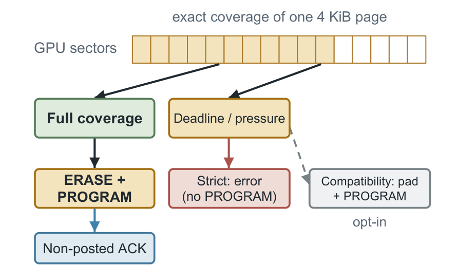

**Figure 3.** Page-based write aggregation. Incomplete pages trigger an error on flush or are padded in compatibility mode. The GPU receives a completion response only after the full page is written to NAND.

**图 3。** 基于页的写聚合。不完整页在刷出时触发错误，或在兼容模式下填充。只有整页写入 NAND 后，GPU 才收到完成响应。

#### 4.2.2 Page-grained Read Module / 4.2.2 页粒度读模块

<!-- Source: p.5 S050 -->

**Source:** p.5–6 S051

**Original:** We use page-keyed MSHRs to combine outstanding reads to the same page. Sector or cache-line requests to one 4 KiB page can share one NAND read. In demand mode, the first request dispatches as soon as the page is admitted. Later requests to that page merge with the inflight MSHR. In aggregation mode, the controller waits for a configured time window or byte threshold before issuing the page read. The aggregation wait is bounded by that configured window. Aggregation mode can reduce duplicate page reads for dense same-page traffic. Aggregation is an optional policy. The interface exposes these choices as `hbf_read_mode`, `hbf_read_agg_window`, and `hbf_read_agg_threshold`. The default aggregation threshold is one 4 KiB page.

**中文:** 我们采用以页为键的 MSHR，合并对同一页的未完成读请求。针对同一 4 KiB 页的扇区或缓存行请求，可以共享一次 NAND 读取。在按需模式下，第一个请求在该页获准进入后立即派发。后续同页请求与在途 MSHR 合并。在聚合模式下，控制器会等待配置的时间窗口或字节阈值，再发出页读操作。聚合等待时间受该配置窗口约束。对于密集的同页流量，聚合模式可以减少重复页读取。聚合是一项可选策略，接口通过 `hbf_read_mode`、`hbf_read_agg_window` 和 `hbf_read_agg_threshold` 暴露这些选项。默认聚合阈值为一个 4 KiB 页。

**Source:** p.6 S052

**Original:** Each read is scheduled on a subarray owned by the page’s channel. The scheduler checks subarray availability and a configurable limit on active operations before issuing a page operation. Each sub-array implements READ, PROGRAM, and ERASE states with configurable timings. The default profile uses $t_R=15\,\mu\mathrm{s}$, $t_{\mathrm{PROG}}=200\,\mu\mathrm{s}$, and $t_{\mathrm{BERS}}=2\,\mathrm{ms}$. Each subarray has two NAND page buffers. A buffered-page reread pays the buffer-hit latency instead of a full media read when ordering permits. A logic-die page cache provides LRU reuse across kernels and access windows.

**中文:** 每次读取都调度到该页所属通道拥有的某个子阵列上。在发出页操作前，调度器检查子阵列是否可用，以及当前活动操作数是否满足可配置的上限。每个子阵列均实现 READ、PROGRAM 和 ERASE 状态，并支持配置相应时序。默认配置档采用 $t_R=15\,\mu\mathrm{s}$、$t_{\mathrm{PROG}}=200\,\mu\mathrm{s}$ 和 $t_{\mathrm{BERS}}=2\,\mathrm{ms}$。每个子阵列配有两个 NAND 页缓冲区。在顺序约束允许时，重新读取已缓冲的页只需承担缓冲区命中延迟，而无需执行完整介质读取。逻辑裸片上的页缓存采用 LRU 策略，在不同内核和访问窗口之间复用数据。

### 4.3 GPU–HBF Request Lifecycle / 4.3 GPU–HBF 请求生命周期

<!-- Source: p.6 S053 -->

**Source:** p.6 S054

**Original:** We connect these modules through the read and write sequences shown in Figure 4. Time advances downward in the diagram. The vertical spacing shows event order rather than measured durations. In panel (a), the initial read is mapped to a stack and tracked by page, so later same-page requests can join the outstanding operation. Channel waiting precedes READ or page-buffer service, after which data returns to the source. Panel (b) shows the additional write dependency: same-page stores first build complete coverage, then the page waits for service and is programmed, with erasure if needed. The write acknowledgement is returned only afterward.

**中文:** 我们通过图 4 所示的读写时序将这些模块连接起来。图中时间向下推进；纵向间距表示事件顺序，而非测得的持续时间。在子图（a）中，初始读请求被映射到一个堆栈，并按页跟踪，使后续同页请求可以加入未完成操作。在 READ 或页缓冲区服务之前，请求先经历通道等待，随后数据返回来源。在子图（b）中，写操作多了一项依赖：同页存储操作首先形成完整覆盖，然后该页等待服务并进行编程，必要时先擦除。写确认仅在此后返回。

**Source:** p.6 C007 · **Placed near:** p.6 S054

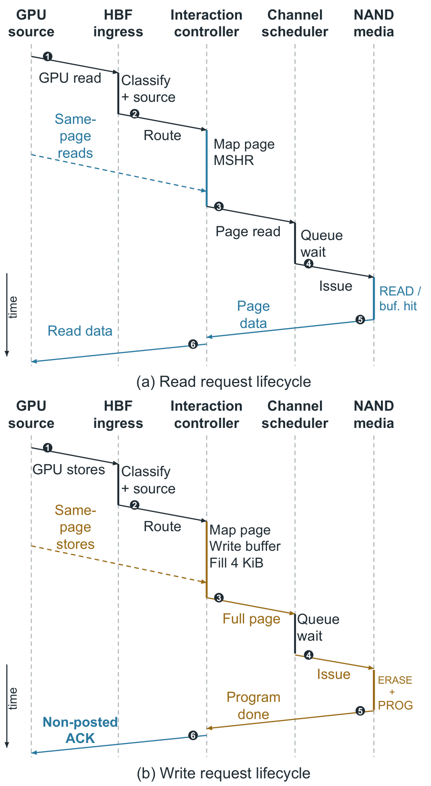

**Figure 4.** Request lifecycle through HBF-Sim. A GPU read or write request enters the interaction controller, is mapped to one stack and channel, and follows page tracking, queueing, and NAND service before read data or write status returns to the source GPU partition.

**图 4。** HBF-Sim 中的请求生命周期。GPU 读写请求进入交互控制器，被映射到一个堆栈和一个通道，然后经过页跟踪、排队及 NAND 服务，最后将读数据或写状态返回到来源 GPU 分区。

**Source:** p.6 S055

**Original:** Each request retains its source subpartition for return routing. The cube advances its controller, channel, and NAND state machines on the DRAM clock. Completed requests enter the source partition’s return path and then follow the existing interconnect. Cache fills are handled by the ordinary L2 fill path when a corresponding cache miss is pending. DRAM requests continue through the existing DRAM path.

**中文:** 每个请求保留其来源子分区信息，用于返回路由。HBF 立方体按 DRAM 时钟推进控制器、通道与 NAND 状态机。完成的请求进入来源分区的返回路径，然后沿既有互连返回。当存在对应的待处理缓存未命中时，缓存填充由普通 L2 填充路径处理。DRAM 请求继续沿既有 DRAM 路径执行。

**Source:** p.6 S056

**Original:** Clock domains and cost. The controller advances HBF media timers ($t_R$, $t_{\mathrm{PROG}}$, $t_{\mathrm{BERS}}$, page-buffer hits, and page-cache hits) with the DRAM clock used by the simulator. GPU-visible latency is converted to GPU core cycles when a request completes. Statistics retain both units and report the DRAM frequency and tick-to-µs conversion. The controller keeps one page-keyed MSHR map, one pending-page FIFO, one write-buffer map, and a set of busy subarrays. Only busy subarrays are advanced on each tick. The per-tick cost therefore follows the number of in-flight operations rather than the full array size. Scheduling scans the pending queue within the outstanding-request cap.

**中文:** **时钟域与开销。** 控制器使用模拟器的 DRAM 时钟，推进 HBF 介质计时器（$t_R$、$t_{\mathrm{PROG}}$、$t_{\mathrm{BERS}}$、页缓冲区命中与页缓存命中）。请求完成时，GPU 可见延迟会转换为 GPU 核心周期。统计结果保留两种单位，并报告 DRAM 频率及 tick 到微秒的换算关系。控制器维护一个以页为键的 MSHR 映射、一个待处理页 FIFO、一个写缓冲区映射和一组忙碌子阵列。每个 tick 只推进忙碌子阵列。因此，每 tick 的开销随在途操作数量变化，而不是随整个阵列规模变化。调度在未完成请求上限约束下扫描待处理队列。

### 4.4 Trace Generation / 4.4 轨迹生成

<!-- Source: p.6 S057 -->

**Source:** p.6–7 S058

**Original:** We implement request tracing to connect GPU accesses with controller decisions and media operations. Each record identifies the request state and the work performed to serve it.

**中文:** 我们实现请求跟踪，将 GPU 访问与控制器决策、介质操作关联起来。每条记录均标识请求状态，以及为该请求提供服务所执行的工作。

**Source:** p.6–7 S059

**Original:** State and accounting. We record each request’s identifier, operation, address, size, source, and arrival and completion times. Each request advances through INGRESS, MAPPED, optional write BUFFERED, QUEUED, MEDIAOP, RETURN, and COMPLETED states. GPU L2 and CUDA Shared Memory remain distinct from the HBF page cache and NAND page buffers. Bounded queues may delay a request but cannot change its owner. Device timers advance in DRAM-clock ticks. GPU-visible latency is recorded in core cycles. Read amplification is media bytes/requested bytes, while write accounting records coverage, programs, padding, and ordering errors.

**中文:** **状态与计量。** 我们记录每个请求的标识符、操作、地址、大小、来源以及到达和完成时间。每个请求依次经过 INGRESS、MAPPED、写操作可选的 BUFFERED、QUEUED、MEDIAOP、RETURN 和 COMPLETED 状态。GPU L2 与 CUDA 共享内存始终与 HBF 页缓存、NAND 页缓冲区区分开来。有界队列可能延迟请求，但不能改变其归属。设备计时器以 DRAM 时钟 tick 推进。GPU 可见延迟以核心周期记录。读放大定义为介质字节数与请求字节数之比；写入计量则记录覆盖情况、编程、填充及顺序错误。

**Source:** p.7 S060

**Original:** We expose configuration parameters for per-channel bandwidth, NAND timings, channel count and mapping, subarray count, page-cache and page-buffer sizes, write-buffer depth and deadline, placement, and media mode. Placement can be contiguous, page-interleaved, or selected by an explicit mapping table. Statistics include per-channel request and operation counts and link-stall ticks. They include first-request latency, aggregation wait, page-read count, requested bytes, media bytes, read amplification, and MSHR hits. They also include page-buffer and page-cache hits, partial-page programs, timeout flushes, idle drains, padding or strict-policy errors, read-after-write ordering, capacity utilization, and per-zone PEC spread.

**中文:** 我们提供以下配置参数：每通道带宽、NAND 时序、通道数量及映射、子阵列数量、页缓存与页缓冲区大小、写缓冲区深度与截止时间、数据放置以及介质模式。放置可以采用连续方式、页交错方式，或由显式映射表选择。统计信息包括各通道请求数、操作数及链路停顿 tick 数；还包括首请求延迟、聚合等待、页读取次数、请求字节数、介质字节数、读放大和 MSHR 命中。此外，还统计页缓冲区与页缓存命中、部分页编程、超时刷出、空闲排空、填充或严格策略错误、写后读顺序、容量利用率，以及各区带的编程/擦除次数（PEC）分散程度。

**Source:** p.7 S061

**Original:** The optional CSV trace records `sim_cycle`, `request_id`, `source_subpartition`, `op`, `address`, `page`, `channel`, `subarray`, `state`, and `bytes`. It also records `queue_depth`, `latency`, `cache_hit`, `mshr_hit`, and `error`. The trace file and trace detail are selected with `hbf_trace_file` and `hbf_trace_level`. The ordered 15-column schema is frozen as `hbf-trace-v1`. Validation rejects missing, added, or reordered columns. Full-system traces preserve GPU injection effects. Device-only replay can inject the same request stream without the GPU issue-rate limit.

**中文:** 可选的 CSV 轨迹记录 `sim_cycle`、`request_id`、`source_subpartition`、`op`、`address`、`page`、`channel`、`subarray`、`state` 和 `bytes`，并记录 `queue_depth`、`latency`、`cache_hit`、`mshr_hit` 和 `error`。轨迹文件与详细程度通过 `hbf_trace_file` 和 `hbf_trace_level` 选择。这套有固定顺序的 15 列模式定版为 `hbf-trace-v1`。验证会拒绝列缺失、列增加或列重排。全系统轨迹保留 GPU 注入行为的影响。仅设备重放可以在不受 GPU 请求发射速率限制的情况下，注入同一请求流。

### 4.5 Implementation / 4.5 实现

<!-- Source: p.7 S062 -->

**Source:** p.7 S063

**Original:** We implement HBF-Sim in C++ as an Accel-Sim extension and maintain the HBF source files in hbf/. The setup script applies the integration patch to a pinned simulator revision and copies the active cube, controller, media, and trace sources into the build tree. This keeps generated simulator files separate from the maintained HBF module.

**中文:** 我们用 C++ 将 HBF-Sim 实现为 Accel-Sim 扩展，并在 `hbf/` 中维护 HBF 源文件。设置脚本将集成补丁应用到固定版本的模拟器，并把实际使用的立方体、控制器、介质和轨迹源文件复制到构建目录中。这使生成的模拟器文件与持续维护的 HBF 模块相互分离。

**Source:** p.7 S064

**Original:** We instantiate one logical HBF system with the configured number of independent stack controllers. Each stack owns its channels, controller queues, page cache, FTL, and trace writer. The system layer owns address routing and fair return arbitration. The controller stores page-keyed MSHRs and per-page write buffers. It instantiates concrete subarray state lazily, advances only the active-subarray set, and skips the HBF tick when the complete system is idle. The same sources build through the Make and CMake paths.

**中文:** 我们实例化一个逻辑 HBF 系统，其中包含配置数量的独立堆栈控制器。每个堆栈拥有各自的通道、控制器队列、页缓存、FTL 和轨迹写出器。系统层负责地址路由与公平的返回仲裁。控制器保存以页为键的 MSHR 以及逐页写缓冲区。它按需实例化具体的子阵列状态，仅推进活动子阵列集合，并在整个系统空闲时跳过 HBF tick。同一套源代码可通过 Make 和 CMake 两种路径构建。

**Source:** p.7 S065

**Original:** The artifact scripts compile the validation kernels, create timestamped configurations, and store binary and trace hashes beside each run. The trace remapper changes only global addresses and writes a manifest with the input and output hashes. The device replay tool consumes the same request schema as the simulator and is used to separate HBF service from GPU injection.

**中文:** 配套实验脚本编译验证内核、生成带时间戳的配置，并为每次运行保存二进制文件与轨迹的哈希值。轨迹重映射器仅修改全局地址，并写出包含输入、输出哈希值的清单。设备重放工具使用与模拟器相同的请求模式，用于将 HBF 服务与 GPU 注入行为分离。

## 5 Platform Validation and Evaluation / 5 平台验证与评估

<!-- Source: p.7 S066 -->

**Source:** p.7 S067

**Original:** We evaluate request handling, timing feedback, page service, and resource scaling. We first check functional behavior and compare fixed-arrival replay with coupled GPU execution. We then cross-check page service with MQSim, measure media scaling, and run a Qwen3 decode trace. Finally, we measure simulator cost and addressable capacity. Section 6 uses the same platform to evaluate placement and read/write isolation policies.

**中文:** 我们评估请求处理、时序反馈、页服务和资源扩展特性。首先检查功能行为，并比较固定到达时间的重放与耦合的 GPU 执行。随后，通过 MQSim 交叉核对页服务，测量介质扩展特性，并运行 Qwen3 解码轨迹。最后，测量模拟器开销和可寻址容量。第 6 节使用同一平台评估数据放置与读写隔离策略。

### 5.1 Methodology and Functional Validation / 5.1 方法与功能验证

<!-- Source: p.7 S068 -->

**Source:** p.7 S069

**Original:** Unless otherwise specified, we use Accel-Sim with a 1.132 GHz GPU core clock and an 850 MHz DRAM clock. Scaling retains an 80-SM configuration. The placement and mixed-write studies use 8 shader clusters and 8 memory partitions. Default READ/PROGRAM/ERASE timings are 15/200/2000 µs. The placement diagnostic uses 20/40/80 DRAM ticks. These are model parameters rather than hardware measurements. Raw configurations, traces and binary hashes are retained.

**中文:** 除非另有说明，我们使用 GPU 核心时钟为 1.132 GHz、DRAM 时钟为 850 MHz 的 Accel-Sim。扩展性实验保持 80 个 SM 的配置。数据放置与混合写入研究使用 8 个着色器簇和 8 个内存分区。默认 READ/PROGRAM/ERASE 时序为 15/200/2000 µs。数据放置诊断采用 20/40/80 个 DRAM tick。这些是模型参数，而非硬件测量值。原始配置、轨迹和二进制文件哈希值均予保留。

**Source:** p.7 S070

**Original:** We measure request latency from request creation to completion return by the HBF controller, including waiting before controller acceptance. We report the 95th percentile (p95) of read and write request latencies in the read/write interference study. GPU execution time covers the entire workload, including write completion. Both request latency and GPU execution time are measured in GPU clock cycles.

**中文:** 请求延迟从请求创建时开始计量，到 HBF 控制器返回完成信息时结束，包括控制器接纳请求之前的等待。在读写干扰研究中，我们报告读写请求延迟的第 95 百分位数（p95）。GPU 执行时间覆盖整个工作负载，包括写完成。请求延迟和 GPU 执行时间均以 GPU 时钟周期计量。

**Source:** p.7 S071

**Original:** Our routing tests preserve all 64 request/completion pairs at 1–16 channels. The shared-staging probe produces 32 HBF requests, one page read and 31 MSHR hits. Demand and aggregation finish in 5,508 and 5,517 cycles. A remapped LUD trace preserves all 158 request/completion pairs. C++ coverage tests check repeated fragments and page boundaries. Successful strict-write traces require complete coverage before PROGRAM and acknowledgements after programming. These checks exercise different parts of the request path. Pairing request IDs with completion IDs detects lost or duplicate returns. The shared-staging probe checks that one page operation can serve multiple waiting requests. For writes, repeated fragments must not count as new byte coverage, and a complete page must be programmed before its acknowledgement is released. Our tests validate request handling in these workloads. Hardware calibration remains outside this evaluation.

**中文:** 在 1–16 个通道下，路由测试均保留了全部 64 对请求/完成事件。共享暂存探针产生 32 个 HBF 请求、一次页读取和 31 次 MSHR 命中。按需与聚合模式分别在 5,508 和 5,517 个周期后完成。重映射后的 LUD 轨迹保留了全部 158 对请求/完成事件。C++ 覆盖测试检查重复片段与页边界。成功的严格写入轨迹要求 PROGRAM 之前达到完整覆盖，并在编程之后返回确认。这些检查覆盖请求路径的不同环节。通过配对请求 ID 与完成 ID，可检测丢失或重复的返回。共享暂存探针检查一次页操作能否服务多个等待请求。对于写入，重复片段不能被计作新增字节覆盖，而且必须先完成整页编程，才能释放其确认响应。这些测试验证了所测工作负载中的请求处理；硬件校准仍不在本次评估范围之内。

### 5.2 MSHR Benefits and Timing Feedback / 5.2 MSHR 收益与时序反馈

<!-- Source: p.7 S072 -->

**Source:** p.7–8 S073

**Original:** We test whether a fixed device-input trace preserves the benefit of page-keyed MSHR merging when admission pressure changes. The closed-loop configuration lets GPU execution and upstream queues respond to HBF completions. The open-loop configuration freezes controller-ingress times from a source run. Both use the same C++ HBF controller, media model, admission limits and return credits. The replay driver retains source request order and enforces at most one admission per memory partition per DRAM tick, but does not execute GPU cores.

**中文:** 我们测试：当接纳压力发生变化时，固定的设备输入轨迹能否保留以页为键的 MSHR 合并所带来的收益。闭环配置允许 GPU 执行和上游队列响应 HBF 完成事件。开环配置则固定某次来源运行中的控制器入口时间。二者使用相同的 C++ HBF 控制器、介质模型、接纳限制和返回信用额度。重放驱动器保留来源请求顺序，并限制每个 DRAM tick 中每个内存分区最多接纳一个请求，但不执行 GPU 核心。

**Source:** p.8 S074

**Original:** We run 24 GPU configurations: 16 pages, 1 or 32 distinct 128 B entries per page, 32/128/4,096 admission slots, 1/15 µs reads, and merging on/off. Eight SMs and eight memory partitions use 1.132/0.850 GHz core/DRAM clocks. Four HBF channels, 32 subarrays and eight active slots are fixed. The logic-die cache is disabled and NAND page buffers are enabled. Every source replay reproduces its complete controller event trace exactly. We then replay each source into the opposite merging configuration, yielding 24 counterfactual runs with identical address/size multisets and conserved request/completion pairs.

**中文:** 我们运行 24 组 GPU 配置：16 个页，每页包含 1 或 32 个不同的 128 B 条目，接纳槽位数为 32/128/4,096，读取时序为 1/15 µs，以及开启/关闭合并。8 个 SM 和 8 个内存分区采用 1.132/0.850 GHz 的核心/DRAM 时钟。固定使用 4 个 HBF 通道、32 个子阵列和 8 个活动槽位。逻辑裸片缓存关闭，NAND 页缓冲区开启。每次来源重放均精确复现完整的控制器事件轨迹。随后，我们将每条来源轨迹重放到合并开关相反的配置中，得到 24 次反事实运行；这些运行具有相同的地址/大小多重集合，并保持请求/完成配对守恒。

**Source:** p.8 S075

**Original:** We compare the window from first HBF admission to last HBF completion. This interval is available in both GPU simulation and device-only replay. Our evaluation shows that fixed-arrival replay understates the benefit of merging under admission pressure (Figure 5). We use the input trace captured with merging disabled as the replay baseline. At 15 µs and 128 slots, the closed loop reduces this window from 87,703 to 34,101 cycles (61.1%). Frozen ingress instead gives 86,987 cycles (0.8% reduction), a 60.3-percentage-point difference in predicted benefit. The full GPU kernel correspondingly falls from 93,699 to 40,164 cycles. With 32 slots, the window reductions are 75.8% and 0.1%. With 4,096 slots, both predict 10.0%. The 1 µs controls exhibit the same pressure-dependent pattern. All sparse-input controls and reverse transfers are retained in the artifact.

**中文:** 我们比较从首个 HBF 请求获准进入，到最后一个 HBF 请求完成的时间窗口。GPU 模拟与仅设备重放均可获得这一时间区间。评估表明，在接纳压力下，固定到达时间的重放会低估合并收益（图 5）。我们使用关闭合并时捕获的输入轨迹作为重放基线。在 15 µs 读取时序和 128 个槽位下，闭环将该窗口从 87,703 缩短至 34,101 个周期，降幅为 61.1%。固定入口时间后，窗口却为 86,987 个周期，仅缩短 0.8%；二者预测收益相差 60.3 个百分点。完整 GPU 内核时间相应从 93,699 降至 40,164 个周期。使用 32 个槽位时，窗口降幅分别为 75.8% 和 0.1%；使用 4,096 个槽位时，二者均预测为 10.0%。1 µs 对照实验呈现相同的压力依赖模式。所有稀疏输入对照与反向迁移实验均保存在配套实验材料中。

**Source:** p.8 C008 · **Placed near:** p.8 S075

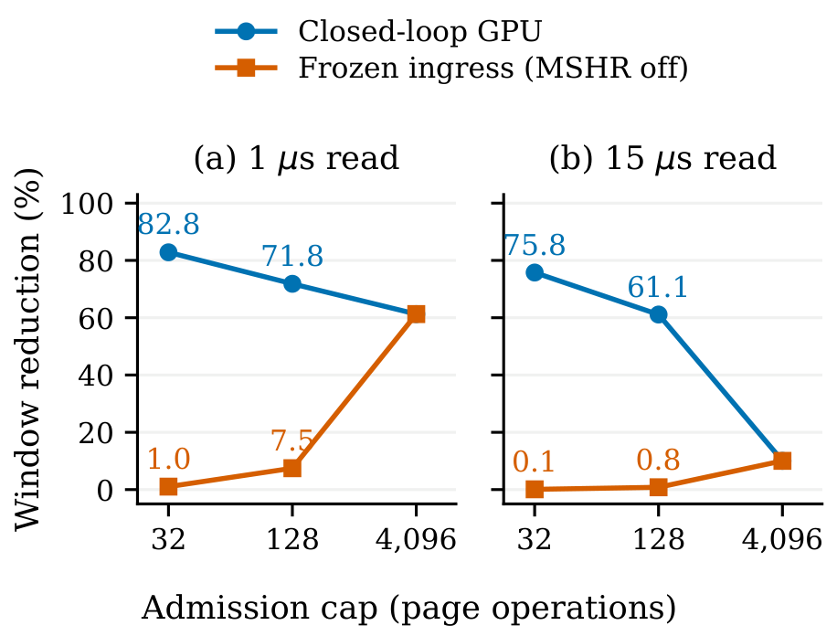

**Figure 5.** Frozen ingress understates MSHR benefits under admission pressure. HBF completion-window reduction relative to merging disabled, using 16 pages and 32 entries per page. Replay fixes the baseline’s ingress times.

**图 5。** 在接纳压力下，固定入口时间会低估 MSHR 收益。图中给出相对于关闭合并时的 HBF 完成窗口降幅，使用 16 个页、每页 32 个条目。重放固定基线的入口时间。

**Source:** p.8 S076

**Original:** Our traces explain this difference through request admission. At 128 slots, enabling merging contracts the closed-loop ingress span from 86,972 to 414 cycles: fewer distinct page operations occupy admission slots, allowing upstream GPU requests to advance. Frozen ingress retains the source run’s waiting even after merging is enabled. Conversely, disabling merging while replaying the merging-enabled trace changes the target window by only 1.8% at this point. The abstraction difference is directional. At 4,096 slots the source ingress schedules coincide and replay agrees. Our comparison shows that admission feedback affects the estimated benefit of controller policies under pressure.

**中文:** 轨迹从请求接纳角度解释了这一差异。在 128 个槽位下，开启合并将闭环入口时间跨度从 86,972 压缩到 414 个周期：占用接纳槽位的独立页操作减少，从而允许上游 GPU 请求向前推进。固定入口时间的重放即使开启合并，仍保留来源运行中的等待。反过来，在重放开启合并时得到的轨迹时关闭合并，该条件下目标窗口仅变化 1.8%。这种抽象差异具有方向性。在 4,096 个槽位下，来源入口调度一致，重放结果也一致。比较结果说明，在压力条件下，接纳反馈会影响对控制器策略收益的估计。

### 5.3 External Page-Service Cross-Check / 5.3 外部页服务交叉核对

<!-- Source: p.8 S077 -->

**Source:** p.8 S078

**Original:** We compare the HBF device driver with unmodified MQSim [32] (revision 51f0f2d), restricting the comparison to their common read-page service. Eight paired configurations use 64 unique 4 KiB pages, one or four channels with one serial die/subarray per channel, and 1/15 µs reads. Page arrivals are either 50 µs apart or a burst spaced by 10 ns. Each logical page is one eight-sector NVMe request in MQSim and 32 merged 128 B requests in HBF-Sim. Both service 256 KiB. HBF-Sim performs exactly 64 page operations. Data/page caches are disabled. MQSim uses ideal address mapping and no preconditioning. The read-only run avoids GC and write-management differences.

**中文:** 我们将 HBF 设备驱动器与未经修改的 MQSim [32]（版本 `51f0f2d`）比较，并将范围限定为二者共有的读页服务。8 组成对配置使用 64 个不同的 4 KiB 页、1 或 4 个通道、每通道一个串行裸片/子阵列，以及 1/15 µs 读取时序。页到达间隔为 50 µs，或以 10 ns 间隔突发到达。在 MQSim 中，每个逻辑页对应一个包含 8 个扇区的 NVMe 请求；在 HBF-Sim 中，则对应 32 个被合并的 128 B 请求。二者均服务 256 KiB 数据。HBF-Sim 恰好执行 64 次页操作。数据缓存/页缓存均关闭。MQSim 使用理想地址映射，不执行预处理。只读运行避开了垃圾回收和写入管理方面的差异。

**Source:** p.8 S079

**Original:** Nominal channel bandwidth is 192 GB/s in both models. MQSim uses a synthetic 192-byte channel at 1,000 MT/s and four 192 GB/s PCIe lanes to keep host bandwidth from dominating. These are comparison parameters, not a projected SSD. Native NVMe/ONFI processing remains in MQSim. HBF-Sim retains its bandwidth-credit link and GPU-sized fragments. We therefore compare logical arrival-to-completion windows, without equating the two device interfaces.

**中文:** 两个模型的标称通道带宽均为 192 GB/s。MQSim 使用一个速率为 1,000 MT/s、位宽为 192 字节的合成通道，以及 4 条各为 192 GB/s 的 PCIe 通道，以避免主机带宽成为主导瓶颈。这些参数仅用于比较，并不代表对某款 SSD 的设计预测。MQSim 保留原生 NVMe/ONFI 处理。HBF-Sim 保留其基于带宽信用额度的链路模型，以及 GPU 大小的请求片段。因此，我们比较逻辑请求从到达到完成的时间窗口，而不将两种设备接口视为等同。

**Source:** p.8 S080

**Original:** Our comparison shows similar scaling in both models, with an offset caused by their different interface models (Table 4). Increasing $t_R$ from 1 to 15 µs adds 896 µs with one channel and 224 µs with four in both models, matching $64\Delta t_R/C$. MQSim retains, for example, a 290 ns single-page ONFI command phase in this configuration. Its burst windows exceed HBF-Sim’s by 2.2% at 15 µs and about 33% at 1 µs. The isolated controls also retain an interface offset. Their long arrival gaps are excluded from claims of close agreement. This external check supports the implemented read-timing and parallel-service trends while exposing the scope of our link abstraction. It does not calibrate HBF silicon, GPU timing, or write behavior.

**中文:** 比较表明，两种模型具有相似的扩展趋势，但因接口模型不同而存在偏移（表 4）。将 $t_R$ 从 1 µs 增至 15 µs 时，两个模型在单通道下均增加 896 µs，在四通道下均增加 224 µs，与 $64\Delta t_R/C$ 一致。例如，在该配置中，MQSim 保留了 290 ns 的单页 ONFI 命令阶段。其突发完成窗口在 15 µs 时比 HBF-Sim 大 2.2%，在 1 µs 时大约高出 33%。独立请求对照同样保留接口偏移；对于结果高度一致的表述，不计入这些对照中过长的到达间隔。该外部核对支持了已实现的读时序与并行服务趋势，同时揭示了链路抽象的适用范围。它并未校准 HBF 芯片、GPU 时序或写入行为。

**Source:** p.8 C009 · **Placed near:** p.8 S080

| 通道 / Channels | $t_R$ (µs) | HBF-Sim (µs) | MQSim (µs) | 差异 / Difference |
| --- | --- | --- | --- | --- |
| 1 | 1 | 64.032 | 85.126 | +32.9% |
| 4 | 1 | 16.080 | 21.316 | +32.6% |
| 1 | 15 | 960.032 | 981.126 | +2.2% |
| 4 | 15 | 240.080 | 245.316 | +2.2% |

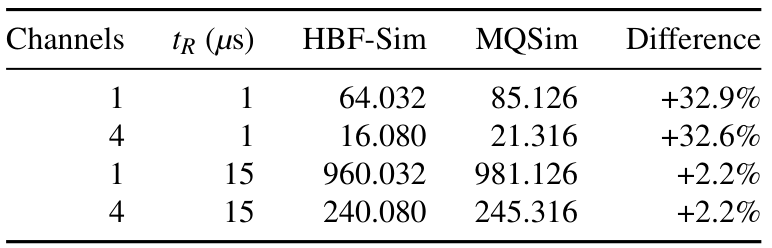

**Table 4.** External read-service comparison. Burst completion windows in µs. Difference is $(T_{\mathrm{MQSim}}/T_{\mathrm{HBF}}-1)$. The models retain their respective interface overheads. These differences are not errors against HBF silicon.

**表 4。** 外部读服务比较。突发完成窗口以 µs 计。差异定义为 $(T_{\mathrm{MQSim}}/T_{\mathrm{HBF}}-1)$。两个模型保留各自的接口开销；这些差异不是相对于 HBF 芯片的误差。

### 5.4 Media Resource Scaling / 5.4 介质资源扩展特性

<!-- Source: p.9 S081 -->

**Source:** p.9 S082

**Original:** We test media scaling with 1,024 lanes, each reading a different page to provide independent requests. Each 4 B load generates a 32 B sector request and one 4 KiB array read. Both cache shortcuts are disabled. We retain GPU backpressure and scale from 1 to 16 channels, with 32 subarrays and active slots per channel, 4,096 admission entries and default media timings.

**中文:** 我们使用 1,024 个线程通道测试介质扩展特性，每个线程通道读取不同的页，以提供相互独立的请求。每次 4 B 加载产生一个 32 B 扇区请求和一次 4 KiB 阵列读取。两类缓存捷径均关闭。我们保留 GPU 反压，将通道数从 1 扩展到 16；每通道配有 32 个子阵列和 32 个活动槽位，接纳条目为 4,096 个，介质时序采用默认值。

**Source:** p.9 S083

**Original:** Our evaluation shows that array-service bandwidth increases from 8.738 to 139.285 GB/s (15.94×), with 99.6– 99.99% media occupancy (Figure 6). At sixteen channels, 256 producers fill only half of the 512 slots. 512/1,024 producers deliver 138.291/139.285 GB/s. Doubling the stream to 2,048 pages/producers changes throughput by about 0.2%, while fixing total slots at 32 restores 8.738 GB/s. Array bandwidth counts internal page reads: the corresponding sixteen-channel GPU sector bandwidth is only 1.088 GB/s. Our fixed-slot control shows that the gain comes from additional media parallelism. Increasing the channel count alone does not improve throughput when the total number of active slots remains fixed. The producer-count controls check that the main sweep has enough outstanding work to occupy the added resources.

**中文:** 评估表明，阵列服务带宽从 8.738 增至 139.285 GB/s，提升 15.94 倍，介质占用率为 99.6–99.99%（图 6）。在 16 个通道下，256 个请求产生者只能填满 512 个槽位中的一半。512/1,024 个请求产生者分别提供 138.291/139.285 GB/s。将流规模加倍至 2,048 个页/请求产生者，吞吐量仅变化约 0.2%；将总槽位数固定为 32 后，带宽则回到 8.738 GB/s。阵列带宽统计的是内部页读取：对应的 16 通道 GPU 扇区带宽仅为 1.088 GB/s。固定槽位数的对照表明，收益来自新增的介质并行性。当活动槽位总数保持不变时，仅增加通道数并不能提高吞吐量。请求产生者数量的对照则验证了主参数扫描中存在足够多的未完成工作，能够占用新增资源。

**Source:** p.9 C010 · **Placed near:** p.9 S083

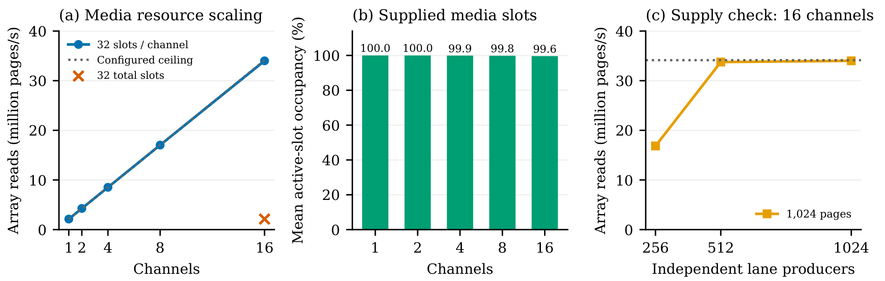

**Figure 6.** Media scaling with 32 subarrays and active slots per channel at 15 µs reads. Throughput counts array pages, not GPU payload bytes. Occupancy and producer-count controls check saturation.

**图 6。** 每通道配置 32 个子阵列和 32 个活动槽位、读取时序为 15 µs 时的介质扩展特性。吞吐量统计阵列页，而不是 GPU 有效负载字节。占用率和请求产生者数量对照用于检查饱和情况。

### 5.5 LLM Decode Workload / 5.5 LLM 解码工作负载

<!-- Source: p.9 S084 -->

**Source:** p.9 S085

**Original:** We use Qwen3-1.7B [26] to exercise the GPU–HBF path with a real pretrained language model. The standard Transformers implementation runs in BF16 with eager attention, batch size one, and thinking disabled. The model has 28 layers, hidden dimension 2,048, 16 query heads and eight KV heads. Native inference on an RTX 4090 processes a 27-token prompt and produces eight tokens using greedy decoding. We use Accel-Sim’s NVBit-based tracer [33] to capture the second decode forward pass after prefill, with a 29-token context, preserving all 1,819 GPU kernels across the full model. The native run supplies the input token and KV state for this captured step.

**中文:** 我们使用 Qwen3-1.7B [26]，通过真实的预训练语言模型运行 GPU–HBF 路径。标准 Transformers 实现采用 BF16、eager 注意力、批量大小 1，并关闭思考模式。该模型包含 28 层，隐藏维度为 2,048，具有 16 个查询头和 8 个 KV 头。在 RTX 4090 上原生推理时，模型处理一个 27 token 的提示，并通过贪心解码生成 8 个 token。我们使用 Accel-Sim 基于 NVBit 的轨迹采集器 [33]，捕获预填充之后的第二次解码前向传播，此时上下文包含 29 个 token，并保留整个模型的全部 1,819 个 GPU 内核。原生运行为捕获的这个步骤提供输入 token 和 KV 状态。

**Source:** p.9 S086

**Original:** The trace remapper translates only the recorded parameter allocations into the HBF address range, preserving offsets and shared-weight aliases. KV, activations and library scratch remain on the ordinary GPU-memory path. Replay uses an SM80 timing profile with eight SMs, eight memory partitions, and 1.410/1.512 GHz core/DRAM clocks. One HBF stack provides 16 channels, 512 total subarrays, 512 active-operation slots and 4,096 admission entries. READ/PROGRAM/ERASE timings are 15/200/2000 µs. MSHR merging and NAND page buffers are enabled. The logic-die page cache is disabled. This configuration is evaluated separately from the mechanism studies.

**中文:** 轨迹重映射器只将记录的参数内存分配映射到 HBF 地址范围内，同时保留偏移量和共享权重别名。KV、激活值和库临时工作区仍走普通 GPU 内存路径。重放采用 SM80 时序配置档，包含 8 个 SM、8 个内存分区，以及 1.410/1.512 GHz 的核心/DRAM 时钟。一个 HBF 堆栈提供 16 个通道、共 512 个子阵列、512 个活动操作槽位和 4,096 个接纳条目。READ/PROGRAM/ERASE 时序为 15/200/2000 µs。开启 MSHR 合并与 NAND 页缓冲区，关闭逻辑裸片页缓存。该配置与机制研究中的配置分开评估。

**Source:** p.9 S087

**Original:** Our simulator completes all 1,819 captured kernels. We report the final execution and traffic counters in Table 5. The sequence takes 352,434,530 GPU cycles (249.95 ms). The controller records 107,540,992 read requests and 107,540,992 read completions.

**中文:** 模拟器完成了捕获的全部 1,819 个内核。最终执行与流量计数见表 5。该序列耗时 352,434,530 个 GPU 周期，即 249.95 ms。控制器记录到 107,540,992 个读请求和 107,540,992 个读完成事件。

**Source:** p.9 C011 · **Placed near:** p.9 S087

| 指标 / Metric | 结果 / Result |
| --- | --- |
| 捕获 / 完成的 GPU 内核 / Captured / completed GPU kernels | 1,819 / 1,819 |
| GPU 内核序列时间 / GPU kernel-sequence time (ms) | 249.95 |
| HBF 读请求 / HBF read requests | 107,540,992 |
| HBF 控制器读完成 / HBF controller read completions | 107,540,992 |
| 返回的扇区字节 / Returned sector bytes | 3.441 GB |
| 阵列读取字节 / Array-read bytes | 3.441 GB |

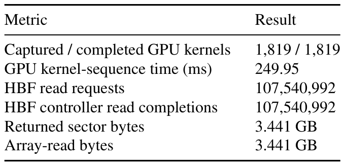

**Table 5.** Qwen3-1.7B decode execution and HBF traffic. Values are taken from final simulator counters. Time covers the GPU kernel sequence. Array bytes are page services minus NAND page-buffer hits, multiplied by 4,096 bytes. GB denotes $10^9$ bytes.

**表 5。** Qwen3-1.7B 解码执行与 HBF 流量。数值来自模拟器最终计数器。时间覆盖 GPU 内核序列。阵列字节数等于页服务次数减去 NAND 页缓冲区命中次数，再乘以 4,096 字节。GB 表示 $10^9$ 字节。

**Source:** p.9 S088

**Original:** This experiment demonstrates HBF-Sim’s capability to execute the complete GPU-kernel sequence of a captured Qwen3-1.7B decode step. Starting from cold simulated caches, the reported execution time focuses directly on the memory-bandwidth-bound GPU kernel execution during active token generation, with model weights residing in HBF while KV caches and activations remain in GPU memory.

**中文:** 该实验展示了 HBF-Sim 执行所捕获 Qwen3-1.7B 单次解码步骤完整 GPU 内核序列的能力。从冷态模拟缓存开始，所报告的执行时间直接聚焦于实际 token 生成阶段受内存带宽限制的 GPU 内核执行；模型权重驻留在 HBF 中，而 KV 缓存和激活值仍保留在 GPU 内存中。

### 5.6 Simulator Cost and Capacity / 5.6 模拟器开销与容量

<!-- Source: p.10 S089 -->

**Source:** p.10 S090

**Original:** We measure simulator cost with five alternating idle-path repetitions per mode. The median host times are 6.768/6.964 s and peak RSS of 58,832/59,016 KiB with HBF disabled/enabled. Both execute 181,707 cumulative cycles over 32 kernels. We also test a four-stack, 512 GiB address space with a sparse probe. It completes 20 sectors across five boundary/interior pages without mapping errors or eager metadata allocation. It tests addressing and capacity accounting, not full-capacity sustained performance.

**中文:** 我们对每种模式交替重复空闲路径测试 5 次，以测量模拟器开销。在关闭/开启 HBF 时，主机运行时间中位数分别为 6.768/6.964 s，峰值常驻内存集（RSS）分别为 58,832/59,016 KiB。两种模式均在 32 个内核上累计执行 181,707 个周期。我们还通过稀疏探针测试了一个四堆栈、512 GiB 的地址空间。该探针在 5 个边界/内部页上完成了 20 个扇区的访问，未出现映射错误，也未预先分配全部元数据。它验证的是寻址和容量计量，而非满容量下的持续性能。

## 6 HBF-Sim-based Optimization Cases / 6 基于 HBF-Sim 的优化案例

<!-- Source: p.10 S091 -->

**Source:** p.10 S092

**Original:** Having checked the mechanisms in Section 5, we use HBF-Sim to study two policy questions: how page placement affects read service and execution, and when resource isolation helps protect reads from writes. These cases compare static policies through the mapping and scheduling interfaces while retaining the GPU request/completion path. They use controlled GPU workloads. Their findings concern the tested access patterns and resource configurations.

**中文:** 在第 5 节检查相关机制后，我们使用 HBF-Sim 研究两个策略问题：页放置如何影响读服务与执行，以及资源隔离何时有助于保护读取免受写入干扰。这些案例通过映射与调度接口比较静态策略，同时保留 GPU 请求/完成路径。实验使用受控 GPU 工作负载，其发现适用于所测试的访问模式和资源配置。

### 6.1 Locality/Parallelism-Aware Placement / 6.1 感知局部性与并行性的数据放置

<!-- Source: p.10 S093 -->

**Source:** p.10 S094

**Original:** Page placement can reduce repeated page service and lower read-side page-service amplification. We first measure this benefit and its effect on kernel execution, then examine how placement affects subarray parallelism.

**中文:** 页放置可以减少重复页服务，降低读侧的页服务放大。我们首先测量这一收益及其对内核执行的影响，然后考察放置策略如何影响子阵列并行性。

**Source:** p.10 S095

**Original:** Policies and setup. We compare page interleave, two-page grouping, and contiguous placement through the address-mapping interface in Section 4. Figure 7 shows their channel assignments. Interleave rotates channels after each page, while grouped placement rotates after every two pages. Contiguous placement divides the configured capacity into channel-owned regions. Each mapping determines both the channel and subarray of a page and remains fixed throughout a run.

**中文:** **策略与设置。** 我们通过第 4 节的地址映射接口，比较页交错、两页分组和连续放置。图 7 展示了它们的通道分配。交错放置每页之后轮换一次通道，分组放置每两页之后轮换一次。连续放置则将配置容量划分为各通道拥有的区域。每种映射同时决定页所属的通道与子阵列，并在一次运行中保持不变。

**Source:** p.10 C012 · **Placed near:** p.10 S095

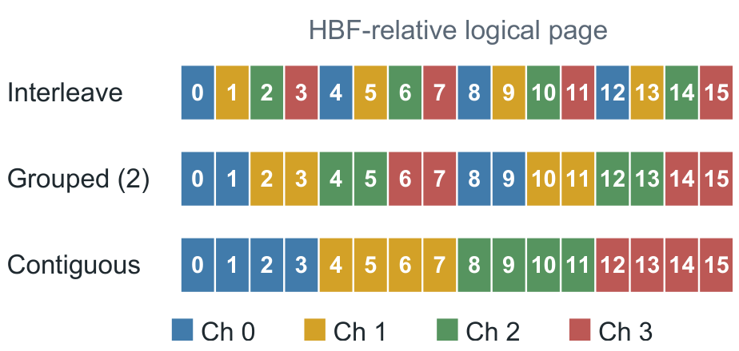

**Figure 7.** Channel assignments under three placement policies. Interleave rotates channels after each page; grouped placement rotates after every two pages. Contiguous placement assigns consecutive active pages to each channel.

**图 7。** 三种数据放置策略的通道分配。交错放置每页之后轮换一次通道，分组放置每两页之后轮换一次。连续放置为每个通道分配连续的活动页。

**Source:** p.10 S096

**Original:** The study covers nine configurations: three mappings and 1/8/32 distinct 128 B entries per page, with shortened read timing ($t_R=20$ DRAM ticks). We use a CUDA read microbenchmark with 16 pages, four channels, 32 total subarrays, eight active slots, and an admission cap of 256. MSHR merging and NAND page buffers are enabled; the logic-die page cache is disabled.

**中文:** 该研究涵盖 9 组配置：3 种映射，以及每页 1/8/32 个不同的 128 B 条目；读取时序被缩短为 $t_R=20$ 个 DRAM tick。我们使用一个 CUDA 读取微基准，包含 16 个页、4 个通道、共 32 个子阵列、8 个活动槽位，接纳上限为 256。MSHR 合并和 NAND 页缓冲区开启，逻辑裸片页缓存关闭。

**Source:** p.10 S097

**Original:** Reducing page-service amplification. With $B$ denoting requested read bytes, page-service amplification and array-read amplification are:

**中文:** **降低页服务放大。** 令 $B$ 表示请求读取的字节数，则页服务放大和阵列读放大分别为：

**Source:** p.10 E002

$$
A_s=\frac{4096N_{\mathrm{service}}}{B},\qquad A_a=\frac{4096N_{\mathrm{array}}}{B}.
$$

**Source:** p.10–11 S098

**Original:** $N_{\mathrm{service}}$ counts page services, including page-buffer hits, while $N_{\mathrm{array}}$ counts NAND array reads. Figure 8 shows that placement reduces page-service amplification as accesses become denser within each page. At 32 entries per page, interleave, grouped, and contiguous placement require 129, 108, and 75 page services, respectively. Contiguous placement lowers amplification from 8.0625 to 4.6875 relative to interleave, a 41.9% reduction.

**中文:** $N_{\mathrm{service}}$ 统计页服务次数，包括页缓冲区命中；$N_{\mathrm{array}}$ 统计 NAND 阵列读取次数。图 8 表明，随着每页内的访问更密集，数据放置能够降低页服务放大。当每页有 32 个条目时，交错、分组和连续放置分别需要 129、108 和 75 次页服务。相较于交错放置，连续放置将放大系数从 8.0625 降至 4.6875，降幅为 41.9%。

**Source:** p.10 C013 · **Placed near:** p.10–11 S098

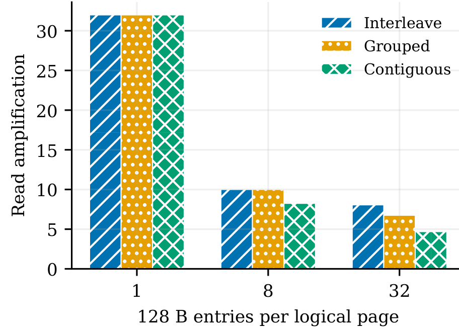

**Figure 8.** Page-service amplification under shortened timing ($t_R=20$ DRAM ticks). At 32 entries per page, contiguous placement reduces page-service amplification by 41.9% relative to interleave. Page services include NAND page-buffer hits.

**图 8。** 缩短时序（$t_R=20$ 个 DRAM tick）下的页服务放大。每页有 32 个条目时，相较于交错放置，连续放置将页服务放大降低 41.9%。页服务包括 NAND 页缓冲区命中。

**Source:** p.10–11 S099

**Original:** Effect on kernel execution. All three mappings perform 16 array reads at 32 entries per page; the remaining page services are served by the NAND page buffers. Thus, the reduction in page-service amplification leaves array work unchanged. Kernel time rises slightly from 6,505 cycles with interleave to 6,550 cycles with contiguous placement, an increase of 0.69%. The next experiment examines how the distribution of accesses across subarrays affects execution time.

**中文:** **对内核执行的影响。** 当每页有 32 个条目时，3 种映射均执行 16 次阵列读取，其余页服务由 NAND 页缓冲区完成。因此，页服务放大降低并未改变阵列工作量。内核时间从交错放置的 6,505 个周期略增至连续放置的 6,550 个周期，增加 0.69%。下一项实验考察访问在各子阵列间的分布如何影响执行时间。

**Source:** p.10–11 S100

**Original:** Resource conflicts and parallelism. We use a separate 36-run study with default read timing ($t_R=15\,\mu\mathrm{s}$), 64/128 active pages, 1/8 entries per page, and logical-page strides of 1/4/32. We compare built-in interleave, an explicit modulo-channel map, and active-page striping. For active pages $p_i=iD$, where $D$ is the page stride and $C$ is the channel count, explicit modulo assigns channel $p_i\bmod C$ and active-page striping assigns $i\bmod C$. The resource budget remains four channels, 32 total subarrays, and eight active slots, with an admission cap of 4,096. The two studies use different simulator binaries; policy comparisons are made within each study.

**中文:** **资源冲突与并行性。** 我们另行开展了 36 次运行的研究，使用默认读取时序 $t_R=15\,\mu\mathrm{s}$、64/128 个活动页、每页 1/8 个条目，以及 1/4/32 的逻辑页步长。我们比较内置交错、显式通道取模映射和活动页条带化。对于活动页 $p_i=iD$，其中 $D$ 为页步长，$C$ 为通道数，显式取模分配的通道为 $p_i\bmod C$，活动页条带化分配的通道为 $i\bmod C$。资源预算保持为 4 个通道、共 32 个子阵列和 8 个活动槽位，接纳上限为 4,096。两项研究使用不同的模拟器二进制文件；策略比较均在各自研究内部进行。

**Source:** p.11 S101

**Original:** The mappings also differ in their subarray assignments. For logical page $p$, built-in interleave uses $\lfloor p/C\rfloor$ as the channel-local page index, while explicit maps use $p$. The local subarray index is this value modulo the number of subarrays in the channel. The explicit modulo map therefore provides a control with the same channel assignments as interleave but a different subarray distribution.

**中文:** 这些映射的子阵列分配也不同。对于逻辑页 $p$，内置交错使用 $\lfloor p/C\rfloor$ 作为通道本地页索引，显式映射则使用 $p$。本地子阵列索引由该值对通道内子阵列数量取模得到。因此，显式取模映射提供了一组对照：它与交错放置的通道分配相同，但子阵列分布不同。

**Source:** p.11 S102

**Original:** For 64 pages, one entry per page and stride 32, active-page striping reduces kernel time from 1,092,373 to 277,353 cycles (3.94× speedup), with 64 array reads in both runs. READ traces show that striping spreads accesses over four subarrays instead of one, allowing more reads to proceed in parallel. At stride 4, the same policy change increases time from 141,530 to 277,353 cycles. Although requests become balanced across channels, they use four subarrays instead of eight, reducing the available parallelism. Table 6 shows the same trend across both working-set sizes and entry counts. With stride 1, both mappings use at least eight subarrays, enough to reach the eight-operation cap, and their execution times are similar.

**中文:** 在 64 个页、每页 1 个条目、步长 32 的条件下，活动页条带化将内核时间从 1,092,373 缩短至 277,353 个周期，加速比为 3.94 倍，且两次运行均有 64 次阵列读取。READ 轨迹表明，条带化将访问分散到 4 个子阵列，而非集中于 1 个，从而允许更多读取并行推进。在步长 4 时，同样的策略变化却将时间从 141,530 增加到 277,353 个周期。虽然请求在通道间变得均衡，但只使用 4 个子阵列而非 8 个，降低了可用并行性。表 6 表明，在两种工作集大小和两种条目数下，都存在相同趋势。当步长为 1 时，两种映射都使用至少 8 个子阵列，足以达到 8 个并发操作的上限，因此执行时间相近。

**Source:** p.11 C014 · **Placed near:** p.11 S102

| 页数 / Pages | 步长 / Stride | 子阵列 / Subarrays（I / S） | 内核加速比 / Kernel speedup（$E=1$） | 内核加速比 / Kernel speedup（$E=8$） |
| --- | --- | --- | --- | --- |
| 64 | 1 | 32 / 8 | 1.00 | 1.00 |
| 64 | 4 | 8 / 4 | 0.51 | 0.51 |
| 64 | 32 | 1 / 4 | 3.94 | 3.93 |
| 128 | 1 | 32 / 8 | 1.06 | 1.00 |
| 128 | 4 | 8 / 4 | 0.51 | 0.51 |
| 128 | 32 | 1 / 4 | 3.97 | 3.97 |

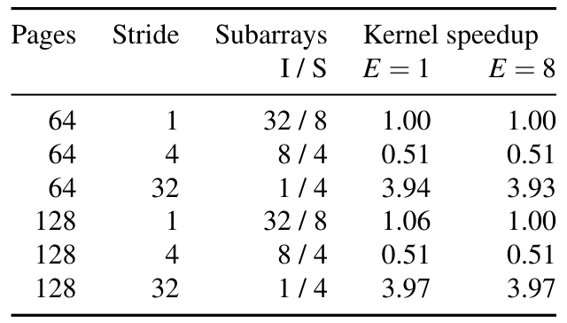

**Table 6.** Active-page striping (S) versus built-in interleave (I) under default timing. Speedup is kernel cycles of I divided by S. Values below one indicate a slowdown. E is the number of 128 B entries per page. Subarray counts are distinct resources used over a run, with identical counts for both E values. The concurrent-operation cap is eight.

**表 6。** 默认时序下，活动页条带化（S）与内置交错（I）的比较。加速比为 I 的内核周期数除以 S 的内核周期数，小于 1 表示减速。$E$ 为每页 128 B 条目的数量。子阵列数统计一次运行中使用的不同资源，两个 $E$ 值对应的数量相同。并发操作上限为 8。

**Source:** p.11 S103

**Original:** Design implication. Page placement can lower read-side page-service amplification. Its effect on execution time also depends on array work and the parallelism available across subarrays. Placement policies should therefore consider page-service reuse together with channel and subarray assignments. HBF-Sim’s mapping interface and request traces make both effects visible when evaluating static placement policies.

**中文:** **设计启示。** 页放置能够降低读侧页服务放大，其对执行时间的影响还取决于阵列工作量和子阵列间的可用并行性。因此，放置策略应同时考虑页服务复用、通道分配与子阵列分配。评估静态放置策略时，HBF-Sim 的映射接口和请求轨迹能够同时呈现这两类影响。

### 6.2 Protecting Reads from Write Interference / 6.2 保护读取免受写入干扰

<!-- Source: p.11 S104 -->

**Source:** p.11 S105

**Original:** Question and policies-2: When reads arrive during a long flash program, does read-priority scheduling provide adequate protection, or should reads receive separate resources? We compare shared FCFS, shared read priority, shared write drain, and static 1R/3W, 2R/2W and 3R/1W channel partitions using read priority within the partitioned configuration. Scheduling changes candidate selection. Partitioning changes the page-to-channel map. Neither interrupts an issued PROGRAM. Read and write pages are disjoint, and all configurations retain strict full-page writes and acknowledgements after programming.

**中文:** **问题与策略-2：** 当读请求在耗时较长的闪存编程期间到达时，读优先调度能否提供充分保护，还是应为读取分配独立资源？我们比较共享资源的先来先服务（FCFS）、共享资源的读优先、共享资源的写排空，以及静态的 1R/3W、2R/2W 和 3R/1W 通道分区，并在分区配置内使用读优先。调度改变候选操作的选择；分区改变页到通道的映射。二者都不会中断已发出的 PROGRAM。读页与写页互不重叠，所有配置均保持严格整页写入，并在编程之后返回确认。

**Source:** p.11 S106

**Original:** Matched experiment. The phase study holds four channels, four total subarrays and four active slots fixed. It varies writes of 4/16 pages and the nominal read-start delay, with matched read-only controls. Of 37 configurations, 36 complete and one violates the strict page-assembly deadline. The main deadline is 10,000 DRAM ticks (11.76 µs). The matched extended-deadline control uses 400 µs. The read stream contains 512 sector requests, and each written page contributes 128 sectors with complete byte coverage. We report creation-to-controller-return latencies for reads and writes, together with whole-kernel completion time.

**中文:** **匹配实验。** 到达相位研究固定使用 4 个通道、共 4 个子阵列和 4 个活动槽位，改变 4/16 页的写入量以及标称读取启动延迟，并设置相匹配的只读对照。在 37 组配置中，36 组完成，1 组违反了严格的页组装截止时间。主要实验的截止时间为 10,000 个 DRAM tick，即 11.76 µs；匹配的延长截止时间对照采用 400 µs。读流包含 512 个扇区请求，每个写入页贡献 128 个扇区，形成完整字节覆盖。我们报告读写请求从创建到控制器返回的延迟，以及整个内核的完成时间。

**Source:** p.11 S107

**Original:** Read benefit and write cost. With four written pages and a 100 µs read-start delay, 3R/1W reduces read p95 from 232,456 to 169,730 GPU cycles relative to shared read priority (27.0%). Kernel time increases from 776,097 to 911,850 cycles (17.5%), while write p95 increases from 226,715 to 905,889 cycles (4.00×). The reserved read resources reduce exposure to programming, while the single write channel limits write parallelism.

**中文:** **读取收益与写入代价。** 写入 4 个页、读取启动延迟为 100 µs 时，相较于共享读优先，3R/1W 将读 p95 从 232,456 降至 169,730 个 GPU 周期，降低 27.0%。内核时间从 776,097 增至 911,850 个周期，增加 17.5%；写 p95 从 226,715 增至 905,889 个周期，达到原来的 4.00 倍。预留的读资源减少了读取受到编程干扰的机会，而单个写通道限制了写并行性。

**Source:** p.11 S108

**Original:** The benefit changes with arrival phase (Figure 9). At zero nominal delay, 3R/1W increases read p95 from 118,999 to 152,968 cycles. At 50 µs it lowers p95 from 289,058 to 169,710 cycles. At 250 µs, shared read priority again has lower read p95. Priority can reorder pending work, but an already-issued program leaves residual blocking. Nominal launch delay and actual program overlap are therefore evaluated separately using request and media events.

**中文:** 收益随到达相位改变（图 9）。标称延迟为 0 时，3R/1W 将读 p95 从 118,999 增至 152,968 个周期。在 50 µs 时，它将 p95 从 289,058 降至 169,710 个周期。在 250 µs 时，共享读优先再次具有更低的读 p95。优先级可以重排待处理工作，但已发出的编程操作仍会留下残余阻塞。因此，标称启动延迟与实际编程重叠情况需要分别通过请求事件和介质事件评估。

**Source:** p.12 C015 · **Placed near:** p.11 S108

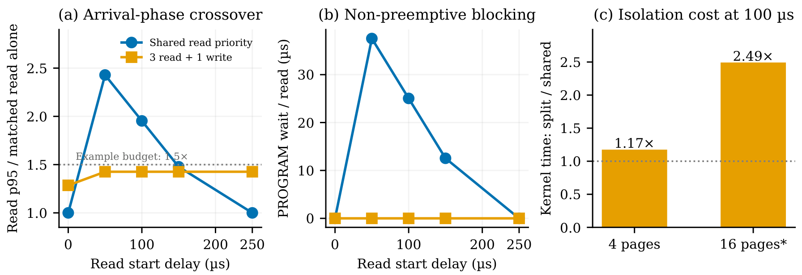

**Figure 9.** Read protection depends on arrival phase and resource allocation. (a) Read p95 is normalized to a matched read-only run. (b) Average time per read spent queued while its target subarray is executing PROGRAM. The average includes all read requests and is not added to kernel time. (c) Isolation changes whole-kernel time. The starred 16-page comparison uses a matched, extended 400 µs assembly deadline. The original isolated configuration is infeasible under the shorter deadline. The 1.5× line is an illustrative budget.

**图 9。** 读取保护取决于到达相位和资源分配。（a）读 p95 相对于匹配的只读运行归一化。（b）每个读请求因其目标子阵列正在执行 PROGRAM 而排队的平均时间。平均值包含所有读请求，且不叠加到内核时间上。（c）隔离会改变整个内核的时间。带星号的 16 页比较使用匹配且延长至 400 µs 的页组装截止时间。原始隔离配置在较短截止时间下不可行。1.5 倍线为示例预算。

**Source:** p.11 S109

**Original:** Design implication. HBF channel allocation should use read/write isolation selectively, balancing read-tail latency targets against write parallelism and whole-workload completion time. For an illustrative budget of read p95 at most 1.5× the matched read-only p95, the four-page sweep gives a concrete choice between shared read priority and 3R/1W. At 0, 150 and 250 µs, sharing satisfies the budget and finishes the kernel sooner. At 50 and 100 µs, only 3R/1W of these two options meets the budget. The 16-page deadline failure further shows why strict-write feasibility must be checked before ranking performance.

**中文:** **设计启示。** HBF 通道分配应选择性地采用读写隔离，在读取尾延迟目标、写并行性和整个工作负载完成时间之间权衡。以读 p95 不超过匹配只读 p95 的 1.5 倍作为示例预算，四页参数扫描为共享读优先与 3R/1W 提供了具体选择。在 0、150 和 250 µs 时，共享能够满足预算，且内核完成更快。在 50 和 100 µs 时，这两个选项中只有 3R/1W 满足预算。16 页实验中的截止时间失败进一步表明，在对性能排序之前，必须先检查严格写入是否可行。

## 7 Discussion / 7 讨论

<!-- Source: p.11 S110 -->

**Source:** p.11–12 S111

**Original:** HBF-Sim models page mapping, read coalescing, write aggregation, channel contention, and completion feedback to GPU execution. ECC, read retry, refresh, and thermal effects are not modeled in the current version. These mechanisms may affect tail latency and sustained bandwidth in real devices, but they do not invalidate the functionally consistent request/completion behavior or the semantically correct page-level interactions captured by our simulator. Since HBF hardware is unavailable, we check selected properties from the OCP specification [24] without hardware-calibrated measurements: requests access only channel-local resources, programming requires a complete 4 KiB page, and write acknowledgements follow programming (Section 5.1). We also perform timing experiments to examine page-service and resource-scaling trends. These evaluations demonstrate that HBF-Sim faithfully preserves the OCP-specified request/completion semantics, though they do not establish cycle-level accuracy against physical HBF silicon.

**中文:** HBF-Sim 对页映射、读合并、写聚合、通道竞争以及反馈给 GPU 执行的完成信息建模。当前版本未对纠错码（ECC）、读重试、刷新和热效应建模。这些机制可能影响真实设备的尾延迟与持续带宽，但不会否定模拟器捕获到的功能一致的请求/完成行为，以及语义正确的页级交互。由于 HBF 硬件尚不可用，我们在没有硬件校准测量的情况下，检查了 OCP 规范 [24] 中的若干属性：请求只能访问通道本地资源，编程要求完整的 4 KiB 页，写确认在编程之后返回（第 5.1 节）。我们还通过时序实验考察页服务与资源扩展趋势。这些评估表明，HBF-Sim 忠实保留了 OCP 规定的请求/完成语义，但并不能证明它相对于真实 HBF 芯片具有周期级准确性。

**Source:** p.12 S112

**Original:** Future work can extend the static policies evaluated here to adaptive placement and channel allocation based on access patterns. Transaction-level AXI/UCIe modeling would allow closer examination of protocol behavior beyond the current bandwidth-and-credit model. Hardware measurements, when available, could calibrate timing parameters and test whether the observed trade-offs hold on real devices.

**中文:** 未来工作可以将本文评估的静态策略扩展为基于访问模式的自适应数据放置与通道分配。事务级 AXI/UCIe 建模将使我们能够超越当前的带宽与信用额度模型，更细致地考察协议行为。硬件测量数据可获得后，可用于校准时序参数，并检验观测到的权衡是否同样存在于真实设备中。

## 8 Related Work / 8 相关工作

<!-- Source: p.12 S113 -->

**Source:** p.12 S114

**Original:** Device and interconnect models. Xerxes [2] studies scalable CXL fabrics, CXL-MQSim [35] studies CXL-enabled SSDs, and WARP [31] combines device emulation with real-device characterization. SwarmIO [14] emulates SSDs for GPU-initiated I/O. Sano et al. [28] use FPGA prototypes to study GPU graph processing with microsecond-latency CXL memory. FlashSim [17] and NANDFlashSim [10] model flash timing and media operations. Ramulator [16] and DRAMsim3 [20] model DRAM devices. These models address complementary device or interconnect questions. Their interfaces and media-management assumptions require examination when reused for an HBF tier.

**中文:** **设备与互连模型。** Xerxes [2] 研究可扩展 CXL 互连结构，CXL-MQSim [35] 研究支持 CXL 的 SSD，WARP [31] 将设备仿真与真实设备表征结合。SwarmIO [14] 为 GPU 发起的 I/O 仿真 SSD。Sano 等人 [28] 使用 FPGA 原型，研究基于微秒级延迟 CXL 内存的 GPU 图处理。FlashSim [17] 与 NANDFlashSim [10] 对闪存时序及介质操作建模。Ramulator [16] 与 DRAMsim3 [20] 对 DRAM 设备建模。这些模型研究互补的设备或互连问题。将其复用于 HBF 存储层时，需要检查其接口与介质管理假设。

**Source:** p.12 S115

**Original:** HBF architecture and systems studies. H3 [7] explores hybrid HBM–HBF inference, and HAVEN [8] targets approximate nearest-neighbor search. TileLens [9] studies memory layout and prefetching for large-granularity memory. FlashAccel [34] co-designs HBF hardware and software for LLM inference. FLINT [23] studies HBF-based inference and read coalescing. The full-stack characterization [21] and IEEE CAL study [30] examine HBF deployment trade-offs. Petrucci et al. [25] compare HBF and LPDDR capacity tiers using a roofline model. These architecture and application studies motivate reusable evaluation infrastructure. While these studies demonstrate HBF’s potential in specific workloads, their models lack closed-loop timing feedback between GPU execution pipelines and HBF media constraints.

**中文:** **HBF 架构与系统研究。** H3 [7] 探索混合 HBM–HBF 推理，HAVEN [8] 面向近似最近邻搜索。TileLens [9] 研究大粒度内存的数据布局与预取。FlashAccel [34] 针对 LLM 推理协同设计 HBF 硬件与软件。FLINT [23] 研究基于 HBF 的推理与读合并。全栈表征研究 [21] 和 IEEE CAL 研究 [30] 考察 HBF 部署中的权衡。Petrucci 等人 [25] 使用 Roofline 模型比较 HBF 与 LPDDR 容量层。这些架构与应用研究促使我们构建可复用的评估基础设施。尽管它们展示了 HBF 在特定工作负载中的潜力，其模型仍缺乏 GPU 执行流水线与 HBF 介质约束之间的闭环时序反馈。

## 9 Conclusion / 9 结论

<!-- Source: p.12 S116 -->

**Source:** p.12 S117

**Original:** This paper addresses the lack of an open and faithful simulation platform for exploring high-bandwidth flash in next-generation GPU big-memory systems. We present HBF-Sim, an extensible Accel-Sim-integrated framework that models the full GPU–HBF request/completion path for systematic design exploration. Our results show that HBF-Sim is functionally correct end to end, captures closed-loop effects that simpler models miss, and reproduces expected page-service and resource-scaling trends. Using HBF-Sim, we further evaluate the impact of page placement and resource isolation on performance, and identify two design implications for HBF systems. HBF-Sim thus provides an open foundation for reproducible HBF research before production hardware becomes available.

**中文:** 本文针对下一代 GPU 大内存系统中探索高带宽闪存时，缺乏开放且高保真模拟平台的问题，提出 HBF-Sim。它是一个与 Accel-Sim 集成的可扩展框架，对完整的 GPU–HBF 请求/完成路径建模，以支持系统性的设计探索。结果表明，HBF-Sim 在端到端功能上正确，能够捕获简单模型遗漏的闭环效应，并复现预期的页服务与资源扩展趋势。借助 HBF-Sim，我们进一步评估了页放置和资源隔离对性能的影响，并归纳出两点 HBF 系统设计启示。因此，在量产硬件可用之前，HBF-Sim 为可复现的 HBF 研究提供了开放基础。

## References / 参考文献

**Source:** p.13 S118

**Original:** [1] Keivan Alizadeh, Iman Mirzadeh, Dmitry Belenko, Karen Khatamifard, Minsik Cho, Carlo C. Del Mundo, Mohammad Rastegari, and Mehrdad Farajtabar. LLM in a flash: Efficient large language model inference with limited memory. arXiv:2312.11514, 2023.

**中文题名：** LLM in a Flash：有限内存下的高效大语言模型推理

**Source:** p.13 S119

**Original:** [2] Yuda An, Shushu Yi, Bo Mao, Qiao Li, Mingzhe Zhang, Diyu Zhou, Ke Zhou, Nong Xiao, Guangyu Sun, Yingwei Luo, and Jie Zhang. Xerxes: Extensive exploration of scalable hardware systems with CXL-based simulation framework. In Proceedings of the 24th USENIX Conference on File and Storage Technologies (FAST), pages 329–345. USENIX Association, 2026.

**中文题名：** Xerxes：利用基于 CXL 的模拟框架广泛探索可扩展硬件系统

**Source:** p.13 S120

**Original:** [3] Ali Bakhoda, George L. Yuan, Wilson W. L. Fung, Henry Wong, and Tor M. Aamodt. Analyzing CUDA workloads using a detailed GPU simulator. In Proceedings of the IEEE International Symposium on Performance Analysis of Systems and Software (ISPASS), 2009.

**中文题名：** 利用详细 GPU 模拟器分析 CUDA 工作负载

**Source:** p.13 S121

**Original:** [4] Nathan Binkert, Bradford Beckmann, Gabriel Black, Steven K. Reinhardt, Ali Saidi, Arkaprava Basu, Joel Hestness, Derek R. Hower, Tushar Krishna, Somayeh Sardashti, Rathijit Sen, Korey Sewell, Muhammad Shoaib, Nilay Vaish, Mark D. Hill, and David A. Wood. The gem5 simulator. ACM SIGARCH Computer Architecture News, 39(2):1–7, 2011.

**中文题名：** gem5 模拟器

**Source:** p.13 S122

**Original:** [5] CXL Consortium. Compute express link (CXL) specification 3.1, 2023.

**中文题名：** Compute Express Link（CXL）3.1 规范

**Source:** p.13 S123

**Original:** [6] Amir Gholami, Zhewei Yao, Sehoon Kim, Coleman Hooper, Michael W. Mahoney, and Kurt Keutzer. AI and Memory Wall. IEEE Micro, 44(3):33–39, 2024.

**中文题名：** 人工智能与内存墙

**Source:** p.13 S124

**Original:** [7] Minho Ha, Euiseok Kim, and Hoshik Kim. H3: Hybrid architecture using high bandwidth memory and high bandwidth flash for cost-efficient LLM inference. IEEE Computer Architecture Letters, 25(1):49–52, 2026.

**中文题名：** H3：利用高带宽内存与高带宽闪存实现低成本 LLM 推理的混合架构

**Source:** p.13 S125

**Original:** [8] Po-Kai Hsu, Weihong Xu, Qunyou Liu, Tajana Rosing, and Shimeng Yu. HAVEN: High-bandwidth flash augmented vector engine for large-scale approximate nearest-neighbor search acceleration. arXiv:2603.01175, https://arxiv.org/abs/2603.01175, 2026.

**中文题名：** HAVEN：利用高带宽闪存增强向量引擎，加速大规模近似最近邻搜索

**Source:** p.13 S126

**Original:** [9] Jae Hyung Ju, Euijun Chung, Hritvik Taneja, Anish Saxena, Shinnung Jeong, Hyesoon Kim, and Moinuddin K. Qureshi. Tilelens: Efficiently using large-granularity memory systems with transparent two-dimensional memory layout. arXiv:2607.04031, https://arxiv.org/abs/2607.04031, 2026.

**中文题名：** TileLens：通过透明的二维内存布局高效利用大粒度内存系统

**Source:** p.13 S127

**Original:** [10] Myoungsoo Jung, Ellis H. Wilson, David Donofrio, John Shalf, and Mahmut T. Kandemir. NANDFlashSim: Intrinsic latency variation aware NAND flash memory system modeling and simulation at microarchitecture level. In Proceedings of IEEE MSST, 2012.

**中文题名：** NANDFlashSim：感知固有延迟变化的微架构级 NAND 闪存系统建模与模拟

**Source:** p.13 S128

**Original:** [11] Myoungsoo Jung, Jie Zhang, Ahmed Abulila, Miryeong Kwon, Narges Shahidi, John Shalf, Nam Sung Kim, and Mahmut Kandemir. SimpleSSD: Modeling solid state drives for holistic system simulation. IEEE Computer Architecture Letters, 17(1):37–41, 2018.

**中文题名：** SimpleSSD：面向整体系统模拟的固态硬盘建模

**Source:** p.13 S129

**Original:** [12] Jordan Juravsky, Bradley Brown, Ryan Ehrlich, Daniel Y. Fu, Christopher Ré, and Azalia Mirhoseini. Hydragen: High-Throughput LLM Inference with Shared Prefixes. arXiv:2402.05099, https://arxiv.org/abs/2402.05099, 2024.

**中文题名：** Hydragen：利用共享前缀实现高吞吐 LLM 推理

**Source:** p.13 S130

**Original:** [13] Mahmoud Khairy, Zhesheng Shen, Tor M. Aamodt, and Timothy G. Rogers. Accel-sim: An extensible simulation framework for validated GPU modeling. In Proceedings of the 47th International Symposium on Computer Architecture (ISCA), 2020.

**中文题名：** Accel-Sim：面向经验证 GPU 建模的可扩展模拟框架

**Source:** p.13 S131

**Original:** [14] Hyeseong Kim, Gwangoo Yeo, and Minsoo Rhu. SwarmIO: Towards 100 Million IOPS SSD Emulation for Next-generation GPU-centric Storage Systems. arXiv:2604.06668, https://arxiv.org/abs/2604.06668, 2026.

**中文题名：** SwarmIO：面向下一代以 GPU 为中心的存储系统，迈向每秒一亿次 I/O 的 SSD 仿真

**Source:** p.13 S132

**Original:** [15] Seeyeon Kim, Juhyeong Jin, and Joo-Young Kim. Beyond capacity: Scalable moe llm inference via high-bandwidth flash with direct gpu and hbm paths, 2026.

**中文题名：** 超越容量：通过具有 GPU 直连与 HBM 路径的高带宽闪存，实现可扩展的混合专家 LLM 推理

**Source:** p.13 S133

**Original:** [16] Yoongu Kim, Weikun Yang, and Onur Mutlu. Ramulator: A fast and extensible DRAM simulator. IEEE Computer Architecture Letters, 15(1):45–49, 2016.

**中文题名：** Ramulator：快速且可扩展的 DRAM 模拟器

**Source:** p.13 S134

**Original:** [17] Youngjae Kim, Brendan Tauras, Aayush Gupta, and Bhuvan Urgaonkar. FlashSim: A simulator for NAND flash-based solid-state drives. In Proceedings of the 1st International Conference on Advances in System Simulation (SIMUL), pages 125–131, 2009.

**中文题名：** FlashSim：面向基于 NAND 闪存的固态硬盘的模拟器

**Source:** p.13 S135

**Original:** [18] Woosuk Kwon, Zhuohan Li, Siyuan Zhuang, Ying Sheng, Lianmin Zheng, Cody Hao Yu, Joseph Gonzalez, Hao Zhang, and Ion Stoica. Efficient Memory Management for Large Language Model Serving with PagedAttention. In Proceedings of the 29th Symposium on Operating Systems Principles, pages 611–626. ACM, 2023.

**中文题名：** 利用 PagedAttention 实现大语言模型服务的高效内存管理

**Source:** p.13–14 S136

**Original:** [19] Huaicheng Li, Mingzhe Hao, Michael Hao Tong, Swaminathan Sundararaman, Matias Bjørling, and Haryadi S. Gunawi. The CASE of FEMU: Cheap, accurate, scalable and extensible flash emulator. In Proceedings of the 16th USENIX Conference on File and Storage Technologies (FAST), pages 83–90. USENIX Association, 2018.

**中文题名：** FEMU 的 CASE：低成本、准确、可扩展且易于扩充的闪存仿真器

**Source:** p.14 S137

**Original:** [20] Shang Li, Zhiyuan Yang, Dhiraj Reddy, Ankur Srivastava, and Bruce Jacob. DRAMsim3: A cycle-accurate, thermal-capable DRAM simulator. IEEE Computer Architecture Letters, 19(2):106–109, 2020.

**中文题名：** DRAMsim3：支持热建模的周期精确 DRAM 模拟器

**Source:** p.14 S138

**Original:** [21] Zhuoran Li, Zhuohang Bian, Xin Huang, Yibo Zhao, Guangyu Sun, and Youwei Zhuo. HBF Sucks? a full-stack characterization of high-bandwidth flash for kv-centric LLM serving. arXiv:2608.11668, https://arxiv.org/abs/2608.11668, 2026.

**中文题名：** HBF 不行吗？面向以 KV 为中心的 LLM 服务的高带宽闪存全栈表征

**Source:** p.14 S139

**Original:** [22] Micron Technology. Micron 9550 SSD Series Technical Product Specification. https://www.micron.com/content/dam/micron/global/public/products/data-sheet/ssd/9550-nvme-ssd-tech-prod-spec.pdf, February 2025. Revision A, February 2025.

**中文题名：** Micron 9550 SSD 系列技术产品规格书

**Source:** p.14 S140

**Original:** [23] Geraldo F. Oliveira, Arash Tavakkol, Xiangyu Zhu, Ahmet Caner Yüzügüler, Vamanan Arulchelvan, Lukas Cavigelli, Renzo Andri, Mohammad Sadrosadati, Jia Xinglei, Onur Mutlu, Zhou Ke, Shai Bergman, and Ji Zhang. FLINT: Efficiently leveraging high bandwidth flash for capacity-scalable LLM inference acceleration. arXiv:2608.25062, https://arxiv.org/abs/2608.25062, 2026.

**中文题名：** FLINT：高效利用高带宽闪存，实现容量可扩展的 LLM 推理加速

**Source:** p.14 S141

**Original:** [24] Open Compute Project. OCP High Bandwidth Flash (HBF) High-Level Base Die Specification, Version 0.7.0. Open Compute Project specification page, 2026. SK hynix and SanDisk.

**中文题名：** OCP 高带宽闪存（HBF）基底裸片高层级规范，0.7.0 版

**Source:** p.14 S142

**Original:** [25] Vinicius Petrucci, Felippe Zacarias, and Vishal Tanna. Is High-Bandwidth Flash All You Need? In 3rd Workshop on Hot Topics in System Infrastructure (HotInfra), 2026.

**中文题名：** 高带宽闪存是否已足够？

**Source:** p.14 S143

**Original:** [26] Qwen Team. Qwen3-1.7B: Model card. https://huggingface.co/Qwen/Qwen3-1.7B. Accessed September 15, 2026.

**中文题名：** Qwen3-1.7B：模型卡

**Source:** p.14 S144

**Original:** [27] Samsung Electronics. Samsung NVMe SSD 983 DCT: Product Brief. https://semiconductor.samsung.com/resources/brochure/Data_Center_SSD_983_DCT.Product_Brief.pdf, July 2018. July 2018 edition.

**中文题名：** Samsung NVMe SSD 983 DCT：产品简介

**Source:** p.14 S145

**Original:** [28] Shintaro Sano, Yosuke Bando, Kazuhiro Hiwada, Hirotsugu Kajihara, Tomoya Suzuki, Yu Nakanishi, Daisuke Taki, Akiyuki Kaneko, and Tatsuo Shiozawa. GPU Graph Processing on CXL-Based Microsecond-Latency External Memory. In Proceedings of the SC ’23 Workshops of the International Conference on High Performance Computing, Network, Storage, and Analysis, pages 962–972. ACM, 2023.

**中文题名：** 在基于 CXL 的微秒级延迟外部内存上进行 GPU 图处理

**Source:** p.14 S146

**Original:** [29] Ying Sheng, Lianmin Zheng, Binhang Yuan, Zhuohan Li, Max Ryabinin, Beidi Chen, Percy Liang, Christopher Ré, Ion Stoica, and Ce Zhang. Flexgen: High-throughput generative inference of large language models with a single GPU. In Proceedings of ICML, 2023.

**中文题名：** FlexGen：使用单个 GPU 实现大语言模型的高吞吐生成式推理

**Source:** p.14 S147

**Original:** [30] Dowon Son, Yonggon Park, Hyunuk Cho, Hyungkyu Ham, Onur Mutlu, Sungjin Lee, Gwangsun Kim, and Jisung Park. Exploring high-bandwidth flash for modern LLM inference: Opportunities and challenges. IEEE Computer Architecture Letters, 25(2):251–254, 2026. arXiv:2608.13868.

**中文题名：** 探索面向现代 LLM 推理的高带宽闪存：机遇与挑战

**Source:** p.14 S148

**Original:** [31] Inho Song, Shoaib Asif Qazi, Javier Gonzalez, Matias Bjørling, Sam H. Noh, and Huaicheng Li. Characterizing and emulating FDP SSDs with WARP. In Proceedings of the 24th USENIX Conference on File and Storage Technologies (FAST), pages 347–362. USENIX Association, 2026.

**中文题名：** 使用 WARP 表征与仿真支持灵活数据放置（FDP）的 SSD

**Source:** p.14 S149

**Original:** [32] Arash Tavakkol, Juan Gómez-Luna, Mohammad Sadrosadati, Saugata Ghose, and Onur Mutlu. MQSim: A framework for enabling realistic studies of modern multi-queue SSD devices. In Proceedings of the 16th USENIX Conference on File and Storage Technologies (FAST), pages 49–66. USENIX Association, 2018.

**中文题名：** MQSim：支持真实研究现代多队列 SSD 设备的框架

**Source:** p.14 S150

**Original:** [33] Oreste Villa, Mark Stephenson, David Nellans, and Stephen W. Keckler. NVBit: A Dynamic Binary Instrumentation Framework for NVIDIA GPUs. In Proceedings of the 52nd Annual IEEE/ACM International Symposium on Microarchitecture, pages 372–383. ACM, 2019.

**中文题名：** NVBit：面向 NVIDIA GPU 的动态二进制插桩框架

**Source:** p.14 S151

**Original:** [34] Xinyu Wang, Yalong Xue, Xiaotian Sun, Xiaoyu Zhang, Xinjiang Zhang, Chunmeng Dou, Xueqi Li, and Xiaoming Chen. Flashaccel: Leveraging high-bandwidth flash (HBF) for high-throughput LLM inference. arXiv:2607.10186, https://arxiv.org/abs/2607.10186, 2026.

**中文题名：** FlashAccel：利用高带宽闪存（HBF）实现高吞吐 LLM 推理

**Source:** p.14 S152

**Original:** [35] Shao-Peng Yang, Minjae Kim, Sanghyun Nam, Juhyung Park, Jin-yong Choi, Eyee Hyun Nam, Eunji Lee, Sungjin Lee, and Bryan S. Kim. Overcoming the memory wall with CXL-enabled SSDs. In Proceedings of the USENIX Annual Technical Conference (ATC), pages 601–617. USENIX Association, 2023.

**中文题名：** 利用支持 CXL 的 SSD 突破内存墙

**Source:** p.14 S153

**Original:** [36] Dongha Yoon, Hansen Idden, Jinshu Liu, Berkay Inceisci, Sam H. Noh, and Huaicheng Li. Cylon: Fast and accurate full-system emulation of CXL-SSDs. In Proceedings of the 24th USENIX Conference on File and Storage Technologies (FAST), pages 313–327. USENIX Association, 2026.

**中文题名：** Cylon：快速且准确的 CXL-SSD 全系统仿真

## 术语对照 / Terminology

| English / 英文 | 中文译法 | 说明 |
| --- | --- | --- |
| HBF — high-bandwidth flash | 高带宽闪存 | 保留缩写 HBF；以闪存介质提供内存式访问接口。 |
| HBM — high-bandwidth memory | 高带宽内存 | 与 HBF 区分。 |
| memory wall | 内存墙 | 沿用 FlashAccel 译稿用语。 |
| GPU–HBF interaction controller | GPU–HBF 交互控制器 | 负责粒度对齐、地址映射及交互约定。 |
| stack / die / base die | 堆栈 / 裸片 / 基底裸片 | 区分堆栈与其内部裸片。 |
| channel-affine / channel-local | 与通道绑定的 / 通道本地的 | 强调资源归属及不可跨通道访问。 |
| cache line / sector / page | 缓存行 / 扇区 / 页 | GPU 请求粒度与 4 KiB NAND 页粒度分别保留。 |
| MSHR — miss status holding register | 未命中状态保持寄存器 | 正文保留 MSHR；该全称为术语释义，原稿未展开。 |
| page-keyed MSHR | 以页为键的 MSHR | 与同页请求合并对应。 |
| page buffer / page cache | 页缓冲区 / 页缓存 | 分别指 NAND 页缓冲区与逻辑裸片页缓存。 |
| read coalescing / read merging | 读合并 | 合并同页请求，与可选的定时聚合模式区分。 |
| write aggregation | 写聚合 | 汇集字节覆盖以形成整页。 |
| demand mode / aggregation mode | 按需模式 / 聚合模式 | 分别对应立即派发与等待窗口或阈值。 |
| non-posted write / completion | 非投递式写入 / 完成 | 写确认在 NAND 编程完成后返回。 |
| backpressure | 反压 | 下游资源限制反向约束上游推进。 |
| admission cap / slot | 接纳上限 / 接纳槽位 | 与活动介质操作槽位区分。 |
| closed loop / frozen ingress | 闭环 / 固定入口时间 | 是否保留完成时序对上游请求的反馈。 |
| page service / array read | 页服务 / 阵列读取 | 页服务包含 NAND 页缓冲区命中，阵列读取不包含。 |
| page-service amplification / array-read amplification | 页服务放大 / 阵列读放大 | 分别按页服务次数或阵列读取次数计算。 |
| page interleave / grouped / contiguous placement | 页交错 / 分组 / 连续放置 | 第 6.1 节比较的静态放置策略。 |
| active-page striping | 活动页条带化 | 按活动页序号分配通道。 |
| subarray | 子阵列 | 与通道数量、活动槽位数分别统计。 |
| PROGRAM / READ / ERASE | 编程 / 读取 / 擦除 | 状态名与轨迹字段保留原英文。 |
| write drain / idle tail drain | 写排空 / 空闲尾部排空 | 与页刷出相关，但含义依上下文区分。 |
| FCFS — first come, first served | 先来先服务 | 与读优先、资源分区比较。 |
| 1R/3W / 3R/1W | 1 读通道 / 3 写通道；3 读通道 / 1 写通道 | 表示静态通道资源分区。 |
| p95 / tail latency | 第 95 百分位数 / 尾延迟 | 保留 p95 与平均值之间的区别。 |
| FTL — flash translation layer | 闪存转换层 | 不能直接套用 SSD 的设备管理语义。 |
| PEC — program/erase count | 编程/擦除次数 | 用于描述区带磨损分布。 |
| KV cache | KV 缓存 | 首次展开为键值缓存。 |

## 阅读提示 / Reading Notes

原稿将功能验证、模型间交叉核对和真实硬件校准作了区分。阅读评估结果时，请保留其给出的指标口径：页服务与 NAND 阵列读取不同，内部页带宽与 GPU 有效负载带宽不同；第 5.5 节时间覆盖捕获的单个解码步骤的 GPU 内核序列。
