# HBF Sucks? 全文中英对照

**英文题名：** HBF Sucks? A Full-Stack Characterization of High-Bandwidth Flash for KV-Centric LLM Serving  
**中文题名：** HBF 真有那么糟吗？面向以 KV 为中心的 LLM 推理服务的高带宽闪存全栈特征分析  
**作者与机构：** Zhuoran Li、Zhuohang Bian、Xin Huang、Yibo Zhao、Guangyu Sun、Youwei Zhuo；北京大学、复旦大学。通讯作者为 Youwei Zhuo。  
**来源版本：** 用户桌面上的《HBF Sucks.pdf》，13 页；首页标注 arXiv:2608.11668v4，2026-09-14。  
**原文：** [本地 PDF](source/HBF_Sucks.pdf) · [arXiv 版本页](https://arxiv.org/abs/2608.11668v4) · [作者代码分支](https://github.com/pku-lemonade/TokenSim/tree/hbf)

> 沿用上一份 HBFSim（MBZUAI）的逐段中英对照格式，覆盖摘要、全文、六个发现、12 张原图、9 张原表、8 个编号公式，以及 28 条参考文献。英文与中文逐段配对；表格附完整中文转写；每张图表另有单独标记的“读图提示”。公式中英共用一份，避免改写符号。Source 标记可定位原 PDF 页码与稳定块编号。
>
> 阅读范围先固定：本文评估的是**路线图 HBF-1／HBF-2＋未修改的 Mooncake 式 KV 池化运行时**，使用 TokenSim、热模型及寿命预算；不能把结果理解成对所有 HBF 用途或已量产器件的实测结论。原文内部有少量口径问题，已在对应表图提示与翻译说明中保留并标注。

## 章节索引

- [摘要](#S003)
- [1 引言](#S006)
- [2 高带宽闪存](#S022)
- [2.1 HBF 的组织与堆叠](#S024)
- [2.2 HBF 代际：HBF-1 与 HBF-2](#S031)
- [2.3 HBF 的优势](#S037)
- [2.4 HBF 的限制](#S042)
- [3 背景](#S046)
- [3.1 智能体推理服务中的 KV 缓存与复用](#S048)
- [3.2 分页与池化的 KV 存储](#S053)
- [3.3 将 KV 卸载到 SSD](#S059)
- [4 评估方法](#S066)
- [4.1 模拟器与评估设置](#S067)
- [4.2 工作负载、模型与平台](#S070)
- [4.3 指标与统计处理](#S075)
- [4.4 热模型与耐久性模型](#S077)
- [5 更快的闪存何时有帮助：一个模型](#S080)
- [6 C1：读取 I/O 是服务瓶颈](#S089)
- [6.1 发现 1：HBF 以 GPU 容量与带宽为代价](#S091)
- [6.2 发现 2：基础裸片计算无法提高暴露比例](#S100)
- [7 C2：读取足以抵偿写入](#S107)
- [7.1 发现 3：SSD 式层次使 HBF 变成写密集层](#S109)
- [7.2 发现 4：SSD 批量写入对 HBF 帮助很小](#S116)
- [8 C3：读写性能能够持续](#S123)
- [8.1 发现 5：写密集流量使 HBF 过热并限制带宽](#S125)
- [8.2 发现 6：写密集 KV 池化使 HBF 更早耗尽寿命](#S132)
- [9 讨论与相关工作](#S138)
- [9.1 综合分析](#S139)
- [9.2 相关工作](#S142)
- [9.3 局限性](#S146)
- [10 结论](#S148)
- [参考文献](#S150)

## PDF 页码索引

- [PDF 第 1 页](#S001)
- [PDF 第 2 页](#S008)
- [PDF 第 3 页](#S029)
- [PDF 第 4 页](#S044)
- [PDF 第 5 页](#S066)
- [PDF 第 6 页](#S078)
- [PDF 第 7 页](#S090)
- [PDF 第 8 页](#S105)
- [PDF 第 9 页](#S106)
- [PDF 第 10 页](#S116)
- [PDF 第 11 页](#S129)
- [PDF 第 12 页](#S141)
- [PDF 第 13 页](#S157)

## 公式索引

- [E001 · Eq. (1)](#E001) — p.2，HBF 内部层级
- [E002 · Eq. (2)](#E002) — p.3，有效带宽由最紧的约束决定
- [E003 · Eq. (3)](#E003) — p.4，每个请求的 KV 容量
- [E004 · Eq. (4)](#E004) — p.4，KV 保存方向
- [E005 · Eq. (5)](#E005) — p.4，KV 加载方向
- [E006 · Eq. (6)](#E006) — p.6，HBF 的净收益与各项成本
- [E007 · Eq. (7)](#E007) — p.6，介质加速收益的上限
- [E008 · Eq. (8)](#E008) — p.6，每次写入所需的有效读取门槛

## 术语对照

| 原文用语 | 中文统一用语 | 定义／说明 | 原文变体 | 处理决定 |
| --- | --- | --- | --- | --- |
| HBF | 高带宽闪存 | High-Bandwidth Flash；接口更宽，但介质仍是 NAND。 | HBF, HBF-1/2/3 | 保留代际编号和路线图年份。 |
| near tier | 近端层 | 直接承担权重、活跃 KV 和准入容量的快速层。 | near tier, local tier | 本文为 HBM 或 GDDR7，不一律译成 HBM。 |
| far tier | 远端存储层 | 相对于近端层更慢、容量更大的层级。 | far tier, far-memory tier | 不必位于远端机器；HBF 可以在同一封装。 |
| secondary tier | 次级层 | 近端层之外的后备容量层。 | secondary tier, backing tier | backing tier 也译后备层，按上下文保留。 |
| KV cache | KV 缓存 | 推理保存的键和值状态。 | KV, key–value cache | 保留 KV，不与数据库键值对泛化混用。 |
| transient KV | 短暂 KV | 寿命随请求等状态结束而终止的 KV。 | transient KV, private decode KV | 私有解码 KV 按上下文明确说明。 |
| prefill | 预填充 | 并行处理提示并生成 KV 的阶段。 | prefill | 保留与解码的区别。 |
| decode | 解码 | 逐步自回归生成输出词元。 | decode, decoding | 不译为预填充。 |
| TTFT | 首词元时间 | time to first token。 | TTFT | 越低越好。 |
| TBT | 词元间隔时间 | time between tokens。 | TBT | 不擅自等同于上一份笔记中的 TPOT。 |
| end-to-end latency | 端到端延迟 | 从请求角度统计的整体耗时。 | E2E, end-to-end latency | 与累计连接器服务时间区分。 |
| SLO goodput | 满足 SLO 的有效吞吐 | 只计满足服务等级目标的有效完成量。 | goodput, maximum SLO goodput | 不与总吞吐混用；按原文保留评价口径。 |
| exposed fraction | 暴露比例 | 无法被其他工作重叠隐藏的次级层服务时间占比 $f$。 | exposed fraction, read-I/O exposure | 强调关键路径，不等于原始 I/O 耗时之和。 |
| critical path | 关键路径 | 其耗时会直接限制请求完成的路径。 | critical-path I/O | 与可异步隐藏的工作区分。 |
| reads per write | 每次写入对应的读取量 | 本文按有效读取字节／写入字节计算 $\rho$。 | reads/write, reads-per-write | 与 write/read ratio 互为倒数；不是操作次数。 |
| write amplification | 写放大 | 介质写入相对于有效数据写入的放大量 $A$。 | write amplification | 寿命比较中的单位写放大为有利假设。 |
| base die | 基础裸片 | 堆栈底部承担接口或管理逻辑的裸片。 | base die, base-die | 与核心 NAND 裸片区别。 |
| NMP | 近存储处理 | near-memory processing，本文特指基础裸片注意力引擎。 | NMP, base-die compute | 不把本实验推成对全部存内计算的否定。 |
| plane | 平面 | NAND 内部可并行操作的资源层级。 | plane | 不与页、块、存储体混用。 |
| bank | 存储体 | 页感测、页缓存和访问调度的资源单位。 | bank | 与通道、平面分别保留。 |
| program/erase | 编程／擦除 | NAND 写入与块擦除操作。 | P/E, program, erase | program 不是执行程序。 |
| thermal throttling | 热限流 | 达到温度约束后降低可用服务能力。 | throttling, plane throttling | 不擅自解释为单纯降低 GPU 频率。 |
| endurance | 耐久性 | 有限编程／擦除和写入预算。 | endurance, write budget, TBW | 寿命按本文负载与预算外推，不是故障实测。 |
| DWPD | 每日全盘写入次数 | Drive Writes Per Day。 | 3-DWPD, DWPD | 3 DWPD 表示每日可写三倍盘容量的额定预算。 |
| bucketing | 分桶 | 把多个 KV 写入合并成较大对象。 | bucket, write-batching | 与调度请求的连续批处理区分。 |
| admission | 准入 | 决定是否／何时让请求占用执行资源。 | admission, admission policy | 与介质读写调度区分。 |
| retention | 数据保持／保留 | 器件语境为数据保持；缓存策略语境为保留。 | retention, retained tokens | 按语境区分，避免把缓存淘汰与器件丢数据混同。 |

---

## 全文中英对照

**Source:** p.1 S001

**Original:** HBF Sucks? A Full-Stack Characterization of High-Bandwidth Flash for KV-Centric LLM Serving. Zhuoran Li¹; Zhuohang Bian¹; Xin Huang²; Yibo Zhao¹; Guangyu Sun¹; Youwei Zhuo¹,*. ¹School of Integrated Circuits, Peking University, Beijing, China. ²Fudan Institute of Systems for Advanced Computing, Fudan University, Shanghai, China. *Corresponding author. Emails: {zhuoranli, bianzhuohang26, yibozhao}@stu.pku.edu.cn; {gsun, youwei}@pku.edu.cn; huangxin25@m.fudan.edu.cn. arXiv:2608.11668v4 [cs.AR], 14 Sep 2026.

**中文:** HBF 真有那么糟吗？面向以 KV 为中心的 LLM 推理服务的高带宽闪存全栈特征分析。作者：Zhuoran Li¹、Zhuohang Bian¹、Xin Huang²、Yibo Zhao¹、Guangyu Sun¹、Youwei Zhuo¹,*。¹北京大学集成电路学院，中国北京；²复旦大学先进计算系统研究院，中国上海。*通讯作者。邮箱：{zhuoranli, bianzhuohang26, yibozhao}@stu.pku.edu.cn；{gsun, youwei}@pku.edu.cn；huangxin25@m.fudan.edu.cn。arXiv:2608.11668v4 [cs.AR]，2026 年 9 月 14 日。

**Source:** p.1 S002

**Original:** A Challenge to the Reader. Every clue is fairly presented below: the traces, models, code, and three necessary conditions. Mooncake-style KV offload fails all three—but HBF need not. This paper already supplies part of the solution. Can you complete the design—an HBF organization and runtime that accelerates critical-path reads, earns enough useful reads per write, sustains bandwidth within thermal and endurance limits, and delivers an end-to-end win?

**中文:** 给读者的一道挑战。下面已经把所有线索摆出来了：请求轨迹、模型、代码，以及三个必要条件。Mooncake 式 KV 卸载三个条件都没满足，但 HBF 本身未必如此。本文已经给出了一部分答案。你能补齐这个设计吗——设计一套 HBF 组织和运行时，让它加速关键路径上的读取，每次写入之后都能换来足够多的有效读取，在温度和耐久性限制内维持带宽，并最终获得端到端收益？

## 摘要 · Abstract

**Source:** p.1 S003

**Original:** Abstract

**中文:** 摘要

**Source:** p.1 S004

**Original:** A faster storage device should make serving faster. We find the opposite. High-Bandwidth Flash (HBF) stacks NAND behind a wide, package-local interface, promising flash-scale capacity with far lower read latency and higher bandwidth than an SSD. The obvious move is to keep an SSD-style Mooncake KV-offloading stack and swap in HBF underneath. We built that system and measured it: an extended TokenSim, four complete two-hour Qwen-Bailian production traces, five dense and mixture-of-experts models, and H100/B200 profiles. The upgrade backfires. Average end-to-end latency rises 2–5.5× and maximum SLO goodput falls 1.1–2.7× across H100 and B200, so the faster device yields a slower system. A cost-benefit model explains the paradox: a faster far tier pays off only when read I/O is the bottleneck, reads outweigh writes, and delivered bandwidth is sustainable. Transient KV violates all three at once. Buying flash through the package costs GPU near-tier capacity and bandwidth, while HBF’s own read/write latency barely matters: scaling it 3.75× moves latency less than 1%. Worse, the two-tier hierarchy keeps reuse in the near tier and hands HBF a relentless write-heavy stream. Writes outnumber reads on every trace, so a 3D-ICE model shows the stack hits its thermal limit well below peak bandwidth, and a TLC tier wears out sooner than the SSD pool it replaced. The device is fine; the drop-in deployment is not. HBF sucks as an SSD replacement for transient KV, but earns its place in LLM serving when used selectively with reuse-aware placement, write budgeting, and thermal coordination.

**中文:** 存储设备更快，推理服务理应也更快。我们发现，结果恰好相反。高带宽闪存（High-Bandwidth Flash，HBF）把 NAND 堆叠在封装内的宽接口之后，有望兼具闪存级容量，以及远低于 SSD 的读取延迟和更高的带宽。最直接的做法，是保留 SSD 式的 Mooncake KV 卸载栈，把底下的介质换成 HBF。我们构建了这样的系统，并通过扩展后的 TokenSim 进行评估：使用四份完整的、各两小时的 Qwen-Bailian 生产轨迹、五个稠密／混合专家模型，以及 H100／B200 配置。结果这次升级适得其反。在 H100 和 B200 上，平均端到端延迟达到基线的 2–5.5 倍，满足 SLO 的最大有效吞吐则降至原来的约 1/1.1–1/2.7；设备更快了，系统却更慢。一个成本收益模型解释了这个矛盾：更快的远端存储层，只有在读取 I/O 是瓶颈、读取足以抵偿写入、实际交付的带宽能够持续时才划算。短暂存活的 KV 同时违反了这三个条件。通过封装换取闪存容量，要牺牲 GPU 近端层的容量和带宽；HBF 自身的读写延迟却几乎不影响结果：将其改变 3.75 倍，端到端延迟的变化仍不足 1%。更糟的是，两级层次把可复用数据留在近端层，却把源源不断的写密集流量交给 HBF。每份轨迹的写入都多于读取，因此 3D-ICE 模型显示，堆栈在远低于峰值带宽时就触及温度上限；TLC 层也比被替换的 SSD 池更早耗尽寿命。问题不在设备本身，而在这种直接替换的部署方式。HBF 作为短暂 KV 的 SSD 替代品表现很糟，但如果配合考虑复用的数据放置、写入预算和温度协调，有选择地使用，它仍能在 LLM 推理服务中发挥作用。

**Source:** p.1 S005

**Original:** Keywords: large language models, KV cache, high-bandwidth flash, memory systems, storage systems, LLM serving

**中文:** 关键词：大语言模型、KV 缓存、高带宽闪存、存储层次系统、存储系统、LLM 推理服务。

## 1 引言 · 1 Introduction

**Source:** p.1 S006

**Original:** 1 Introduction

**中文:** 1 引言

**Source:** p.1 S007

**Original:** Large language model (LLM) inference stores a key and value vector for every retained token. The key–value (KV) cache grows with context length, batch size, and active requests, limiting concurrency and retained context. Paged allocation, quantization, and selective retention reduce waste or bytes per token [8, 15, 18, 28] but not the capacity limit. When the working set of prefixes and histories exceeds GPU memory, the system must place KV in a larger tier.

**中文:** 大语言模型（LLM）推理会为每个保留的词元存储一组键向量和值向量。键值（KV）缓存随上下文长度、批大小和活跃请求数增长，从而限制并发量和可保留的上下文。分页分配、量化和选择性保留可以减少浪费或降低每词元的字节数 [8, 15, 18, 28]，但无法消除容量限制。当需要保留的前缀和历史工作集超过 GPU 存储容量时，系统必须把 KV 放到容量更大的层级中。

**Source:** p.1–2 S008

**Original:** Modern serving systems offload reusable KV to a larger tier. Reuse comes from repeated dialogue, common prefixes in shared prompts and documents, and context revisited by agent workflows. Mooncake and related systems therefore extend the KV pool into CPU DRAM, remote memory, and SSDs [5, 20]. This offloading is standard and essential: without it, a capacity-limited server must reject requests or recompute evicted KV. It supplies the objects that larger tiers store and restore.

**中文:** 现代推理服务系统会把可复用的 KV 卸载到更大的存储层。复用来自重复对话、共享提示词和文档中的公共前缀，以及智能体工作流再次访问的上下文。因此，Mooncake 及相关系统把 KV 池扩展到 CPU DRAM、远端内存和 SSD [5, 20]。这种卸载已经是常规且必要的做法：没有它，容量受限的服务器就只能拒绝请求，或者重新计算已经淘汰的 KV。卸载机制也由此产生了需要由更大存储层保存和恢复的数据对象。

**Source:** p.2 S009

**Original:** High-Bandwidth Flash (HBF) connects stacked NAND to the accelerator through a wide memory interface. We base our evaluation on the HBF roadmap’s near-term organizations, HBF-1 (2028) and HBF-2 (2030) [11]. HBF-1 pairs package-local HBF with a GDDR7 near tier; HBF-2 shares package sites between HBM and HBF. These dates denote roadmap projections; HBF-3 follows in 2032.

**中文:** 高带宽闪存（HBF）通过宽存储接口，把堆叠 NAND 连接到加速器。本文依据 HBF 路线图中的近期组织进行评估，即 HBF-1（2028）和 HBF-2（2030）[11]。HBF-1 将封装内 HBF 与 GDDR7 近端层配对；HBF-2 则让 HBM 与 HBF 共享封装中的堆栈位置。这些年份是路线图预测，后续 HBF-3 预计在 2032 年出现。

**Source:** p.2 S010

**Original:** HBF studies demonstrate benefits for read-mostly objects and specialized data paths [7, 9]. We take the interface and management requirements directly from the OCP base-die specification: AXI over UCIe, page-oriented writes, and host-directed data layout [1]. We study HBF under an unmodified Mooncake-style SSD KV-pooling runtime: admission, retention, lookup, and KV save and restore remain unchanged while the backing tier and transport change. Faster flash service thus arrives with changes in near-tier capacity and bandwidth. The pooling policy determines which objects reach HBF; admission and queueing determine the serving outcome. Table 1 places this evaluation alongside recent HBF studies with other organizations and workloads.

**中文:** 已有 HBF 研究展示了它对以读为主的对象和专用数据路径的收益 [7, 9]。本文直接从 OCP 基础裸片规范中采用接口和管理要求，包括通过 UCIe 传输 AXI、以页为单位的写入，以及由主机指导的数据布局 [1]。我们研究的是未修改的 Mooncake 式 SSD KV 池化运行时：准入、保留、查找、KV 保存和恢复均不变，只改变后备层和传输方式。因此，闪存服务变快的同时，近端层的容量和带宽也发生变化。池化策略决定哪些对象会到达 HBF；准入和排队决定最终的服务表现。表 1 将本文与采用其他组织和工作负载的近期 HBF 研究并列比较。

#### 表 1 · 本文与其他 HBF 工作的比较

**Placed near:** p.2 S010  
**Source:** p.1 T001 · C013

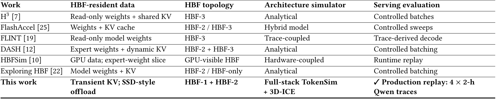

**Original:** Table 1: HBF topology and evaluation comparison [11].

**中文:** 表 1：HBF 拓扑及评估方法比较 [11]。

**中文表格：**

| 工作 | HBF 驻留数据 | HBF 拓扑 | 架构模拟方式 | 服务评估 |
| --- | --- | --- | --- | --- |
| H³ [7] | 只读权重＋共享 KV | HBF-3 | 解析模型 | 受控批次 |
| FlashAccel [25] | 权重＋KV 缓存 | HBF-2／HBF-3 | 混合模型 | 受控参数扫描 |
| FLINT [19] | 只读模型权重 | HBF-3 | 与轨迹耦合 | 轨迹导出的解码 |
| DASH [12] | 专家权重＋动态 KV | HBF-2＋HBF-3 | 解析模型 | 受控批处理 |
| HBFSim [10] | GPU 数据；专家权重片段 | GPU 可见 HBF | 与硬件耦合 | 运行时回放 |
| Exploring HBF [22] | 模型权重＋KV | HBF-2／全 HBF | 解析模型 | 受控批处理 |
| 本文 | 短暂 KV；SSD 式卸载 | HBF-1＋HBF-2 | 全栈 TokenSim＋3D-ICE | 4 份各 2 小时 Qwen 生产轨迹回放 |

**读图提示（辅助说明）：** 先看驻留数据和组织方式，再比较结果。FlashAccel 的权重／KV 放置、HBFSim 的 GPU 可见 HBF，以及本文 SSD 式瞬态 KV 卸载，并非相同系统。表中的 HBFSim [10] 对应上科大 Yanpeng Hu 等的论文，不能与上一份 MBZUAI HBFSim 笔记混为一篇。

**Source:** p.2 S011

**Original:** We evaluate this roadmap-constrained deployment under the same runtime, comparing complete HBF-1 and HBF-2 organizations against SSD baselines using TokenSim, four complete two-hour production traces, five dense and mixture-of-experts (MoE) models, and H100/B200 profiles. HBF is slower on every request metric: across H100 and B200, average end-to-end latency rises 2–5.5×, and maximum service-level objective (SLO) goodput falls 1.1–2.7×. Faster flash barely helps; changing HBF read/write latency by 3.75× moves average end-to-end latency by less than 1%. Table 3 summarizes the evaluation workloads, model profiles, and system organizations.

**中文:** 我们在相同运行时下，评估这一受路线图约束的部署方式。使用 TokenSim、四份完整的两小时生产轨迹、五个稠密／混合专家（MoE）模型，以及 H100／B200 配置，将完整的 HBF-1、HBF-2 组织与 SSD 基线比较。HBF 在每项请求指标上都更慢：在 H100 和 B200 上，平均端到端延迟达到基线的 2–5.5 倍，满足服务等级目标（SLO）的最大有效吞吐降至基线的约 1/1.1–1/2.7。更快的闪存几乎没有帮助；将 HBF 读写延迟改变 3.75 倍，平均端到端延迟变化不足 1%。表 3 汇总了评估工作负载、模型配置和系统组织。

**Source:** p.2 S012

**Original:** The measured behavior arises from the interaction between the SSD-style hierarchy and the roadmap package tradeoff. The hierarchy sends HBF transient and write-heavy KV, whose traffic exercises the physical limits of NAND. The boundary is simple: faster media helps only when secondary-tier service is on the request critical path (C1), later reads repay each flash write (C2), and delivered bandwidth is sustainable (C3). § 5 formalizes these as three necessary conditions, each with a falsifiable requirement tested by two findings. HBF helps only when all three hold at once, so failing any one sinks the substitution.

**中文:** 这种结果来自 SSD 式层次与路线图中的封装取舍共同作用。该层次交给 HBF 的，是短暂存活且写密集的 KV，恰好会触及 NAND 的物理限制。适用边界很简单：只有当次级层服务位于请求关键路径上（C1）、后续读取足以偿还每次闪存写入的成本（C2），并且实际带宽可持续（C3）时，更快介质才有帮助。第 5 节把它们形式化为三个必要条件；每个条件都有一个可证伪要求，并通过两个实验发现检验。HBF 要有收益，三个条件必须同时成立；任何一个失败，都足以让替换方案失去意义。

**Source:** p.2 S013

**Original:** Six findings form three matched pairs, each falsifying one condition:

**中文:** 六个发现分成三组，每组两个，分别证伪一个条件：

**Source:** p.2 S014

**Original:** C1—Read I/O is the serving bottleneck. Complete HBF-1 and HBF-2 gain flash capacity by reducing GPU near-tier capacity and bandwidth, so the near tier admits fewer requests while the flash service HBF accelerates is a small fraction of the critical path (Finding 1, § 6.1). Base-die attention compute cannot raise that fraction (Finding 2, § 6.2).

**中文:** C1——读取 I/O 是服务瓶颈。完整的 HBF-1 和 HBF-2 通过减少 GPU 近端层容量和带宽来换取闪存容量，因此近端层能同时接纳的请求更少；HBF 所加速的闪存服务却只占关键路径的一小部分（发现 1，第 6.1 节）。放在基础裸片上的注意力计算也无法提高这个比例（发现 2，第 6.2 节）。

**Source:** p.2 S015

**Original:** C2—Reads outweigh writes. The two-tier hierarchy serves reuse from the near tier and sends HBF a write-heavy cold stream, so writes outnumber reads on every trace (Finding 3, § 7.1). The SSD write-batching optimization that might lower their cost does not transfer (Finding 4, § 7.2).

**中文:** C2——读取足以抵偿写入。两级层次在近端层处理数据复用，把写密集的冷数据流送入 HBF，因此每份轨迹中写入都多于读取（发现 3，第 7.1 节）。原本可能降低写入成本的 SSD 批量写入优化，也无法直接迁移其收益（发现 4，第 7.2 节）。

**Source:** p.2 S016

**Original:** C3—Read/write Performance sustains. That stream drives the stack to its thermal limit well below peak bandwidth, forcing plane throttling (Finding 5, § 8.1). Its write volume also exhausts HBF’s endurance budget sooner than the capacity-matched SSD pool’s budget (Finding 6, § 8.2).

**中文:** C3——读写性能能够持续。这种流量会使堆栈在远低于峰值带宽时就触及温度上限，被迫限制平面工作（发现 5，第 8.1 节）。它的写入量还会让 HBF 比容量匹配的 SSD 池更早耗尽耐久性预算（发现 6，第 8.2 节）。

**Source:** p.2 S017

**Original:** HBF sucks as a drop-in SSD KV pool under this unmodified runtime. The result motivates selective, reuse-aware placement; this paper makes four contributions:

**中文:** 在这个未修改的运行时下，把 HBF 当成可直接替换 SSD 的 KV 池，表现确实很糟。这个结果促使我们有选择地、根据复用情况放置数据。本文有四项贡献：

**Source:** p.2 S018

**Original:** (1) A model of when a faster far-memory tier helps LLM serving, with three necessary conditions: read-I/O exposure, reads per write, and sustained bandwidth, evaluated on roadmap-derived HBF-1 and HBF-2 organizations. It separates media speed from changes in local capacity, bandwidth, and queueing.

**中文:** （1）建立一个模型，解释更快的远端存储层何时有助于 LLM 推理服务，并给出三个必要条件：读取 I/O 暴露程度、每次写入对应的读取量，以及持续带宽；在路线图导出的 HBF-1 和 HBF-2 组织上检验这些条件。模型把介质速度与本地容量、带宽和排队变化区分开。

**Source:** p.2 S019

**Original:** (2) Measurements showing why an SSD-style hierarchy sends HBF a write-heavy, low-reuse stream, using per-tier byte counters over four production traces.

**中文:** （2）利用四份生产轨迹上逐层记录的字节计数，展示 SSD 式层次为什么会把写密集、低复用的数据流送给 HBF。

**Source:** p.2 S020

**Original:** (3) A 3D-ICE thermal model and a write-endurance budget that turn HBF’s power and wear pressures into sourced, clearly bounded estimates.

**中文:** （3）建立 3D-ICE 热模型和写入耐久性预算，将 HBF 的功耗与磨损压力转化为有来源、边界明确的估计。

**Source:** p.2 S021

**Original:** (4) Requirements for a critical-path-aware, reuse-aware, write-budgeted, and thermally managed HBF KV tier.

**中文:** （4）提出 HBF KV 层所需的设计要求：感知关键路径、感知复用、限制写入预算，并进行热管理。

## 2 高带宽闪存 · 2 High-Bandwidth Flash

**Source:** p.2 S022

**Original:** 2 High-Bandwidth Flash

**中文:** 2 高带宽闪存

**Source:** p.2 S023

**Original:** We first describe the physical HBF device separately from the software path. The HBF roadmap supplies system organizations and projected generation dates [11]; HAVEN’s modeled NAND arrays supply device latency, energy, bandwidth, and package power [9]. The OCP base-die specification v0.7.0, dated August 3, 2026, defines the host interface and management responsibilities [1].

**中文:** 我们先将 HBF 的物理设备与软件路径分开介绍。HBF 路线图提供系统组织和预测的代际年份 [11]；HAVEN 中建模的 NAND 阵列提供设备延迟、能耗、带宽和封装功耗 [9]。2026 年 8 月 3 日的 OCP 基础裸片规范 v0.7.0 则定义了主机接口和管理职责 [1]。

### 2.1 HBF 的组织与堆叠 · 2.1 HBF Organization and Stacking

**Source:** p.2 S024

**Original:** 2.1 HBF Organization and Stacking

**中文:** 2.1 HBF 的组织与堆叠

**Source:** p.2 S025

**Original:** HBF stacks 3D NAND dies behind wide vertical or package-level interconnects. It also includes a base die or distributed peripheral circuits, many independently accessible NAND regions, and a package-level link to the GPU. Together, these components provide much more internal parallelism and interface bandwidth than a conventional SSD. The key distinction is simple: HBF changes how NAND connects to the processor; it does not change NAND into DRAM.

**中文:** HBF 将 3D NAND 裸片堆叠在宽的垂直互连或封装级互连之后。它还包括基础裸片或分布式外围电路、大量可独立访问的 NAND 区域，以及连接 GPU 的封装级链路。这些组件共同提供了远高于传统 SSD 的内部并行度和接口带宽。关键区别很简单：HBF 改变的是 NAND 连接处理器的方式，并没有把 NAND 变成 DRAM。

**Source:** p.2 S026

**Original:** The media hierarchy is

**中文:** 介质内部的层级关系如下。

**Source:** p.2 E001 · Eq. (1)

$$
\mathrm{stack}\to\mathrm{die}\to\mathrm{plane}\to\mathrm{block}\to\mathrm{page}\to\mathrm{cell}
$$

式（1）

**中文说明（辅助）：** 按原式依次为堆栈、裸片、平面、块、页、单元。它描述 NAND 层级，不能把每层都当成可独立并行的完整设备。

**Source:** p.2 S027

**Original:** Reads sense pages or subarrays. Programs are slower than reads, and erases use larger blocks. NAND lacks arbitrary in-place overwrites, so invalid pages require later reclamation. Aggregate bandwidth comes from concurrency across channels, dies, planes, and subarrays, not DRAM-like latency for each access.

**中文:** 读取需要对页或子阵列进行感测。编程比读取慢，而擦除以更大的块为单位。NAND 不支持任意原位覆盖，因此无效页要在之后回收。总带宽来自通道、裸片、平面和子阵列之间的并发，并不意味着单次访问具有 DRAM 级延迟。

**Source:** p.2 S028

**Original:** A representative stack integrates sixteen 128–256-layer NAND dies, through-silicon-via (TSV) arrays, and a base die. The base die concentrates mapping and management logic near the package, a natural control-logic location that also concentrates area and heat (Fig. 2) [11].

**中文:** 一个代表性的堆栈包含十六个 128–256 层 NAND 裸片、硅通孔（TSV）阵列，以及一个基础裸片。基础裸片把映射和管理逻辑集中到封装附近，自然适合放置控制逻辑，但也会集中面积占用和热量（图 2）[11]。

#### 图 2 · HBF 堆栈内部结构

**Placed near:** p.2 S028  
**Source:** p.3 F002 · C002

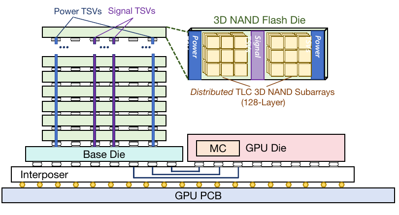

**Original:** Figure 2: Physical organization of an HBF package.

**中文:** 图 2：HBF 封装的物理组织。

**读图提示（辅助说明）：** 从下往上看：GPU PCB → 中介层 → 基础裸片 → 多层 NAND 裸片。Power TSVs 是供电硅通孔，Signal TSVs 是信号硅通孔，MC 是存储控制器。右上展开一个 NAND 裸片，展示分布式 TLC 子阵列。这里说明高带宽来自大量并行连接，NAND 本身仍需感测、编程和擦除。

**Source:** p.2–3 S029

**Original:** The OCP specification defines HBF as a non-coherent, memory-centric device using AXI over UCIe rather than NVMe. The host maps global addresses across independent channels; the base die maps channel-local addresses to NAND and handles ECC, bad blocks, and command scheduling [1, §§3–5]. OCP specifies 64-byte reads, with two page-cache buffers per bank and ordered NAND sensing within each bank. Cache hits can bypass sensing, while batch-read hints control dispatch [1, §5.3].

**中文:** OCP 规范将 HBF 定义为非一致性、以内存为中心的设备，采用通过 UCIe 传输的 AXI，而不是 NVMe。主机在独立通道间映射全局地址；基础裸片把通道内地址映射到 NAND，并负责 ECC、坏块和命令调度 [1，第 3–5 节]。OCP 规定以 64 字节为单位读取，每个存储体有两个页缓存缓冲区，且同一存储体中的 NAND 感测有序进行。缓存命中时可以绕过感测，批量读取提示则用于控制请求派发 [1，第 5.3 节]。

**Source:** p.3 S030

**Original:** OCP requires writes to accumulate a complete 4 KiB page and complete only after programming the core die. The host writes pages consecutively within a NAND block; a page-zero write triggers automatic block erase [1, §5.4]. OCP also permits an optional host-managed SRAM scratchpad [1, §11.3]. These mechanisms divide responsibility between the host and base die. Under the SSD-style pooling path, a later reuse still restores KV to the near tier before execution, so the pooling policy controls which reads reach NAND.

**中文:** OCP 要求先积累完整的 4 KiB 页才能写入，并且只有核心裸片完成编程后，写入才算完成。主机在 NAND 块内连续写页；对第零页的写入会自动触发块擦除 [1，第 5.4 节]。OCP 还允许设置可选的、由主机管理的 SRAM 暂存区 [1，第 11.3 节]。这些机制划分了主机与基础裸片的职责。在 SSD 式池化路径中，后续复用仍然需要先将 KV 恢复到近端层才能执行，因此池化策略决定哪些读取最终会访问 NAND。

### 2.2 HBF 代际：HBF-1 与 HBF-2 · 2.2 HBF Generations: HBF-1 and HBF-2

**Source:** p.3 S031

**Original:** 2.2 HBF Generations: HBF-1 and HBF-2

**中文:** 2.2 HBF 代际：HBF-1 与 HBF-2

**Source:** p.3 S032

**Original:** Our HBF-1 and HBF-2 profiles instantiate the HBF roadmap’s GDDR–HBF and HBM–HBF organizations [11]. Table 2 lists the modeled H100 instances. Table 3(c) also gives the B200 profiles. Stack counts, capacities, and service settings belong to these modeled profiles, while the organizations and generation dates come from the roadmap.

**中文:** 本文的 HBF-1 和 HBF-2 配置具体实现了路线图中的 GDDR–HBF 和 HBM–HBF 组织 [11]。表 2 列出了建模使用的 H100 实例，表 3(c) 还给出了 B200 配置。堆栈数量、容量和服务参数属于本文建模的配置；组织方式与代际年份则来自路线图。

#### 表 2 · H100 上建模的两代 HBF 配置

**Placed near:** p.3 S032  
**Source:** p.3 T002 · C014

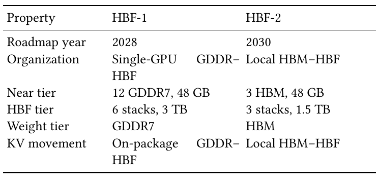

**Original:** Table 2: Modeled H100 instances of KAIST’s HBF-1/HBF-2 organizations.

**中文:** 表 2：KAIST HBF-1／HBF-2 组织在 H100 上的建模实例。

**中文表格：**

| 属性 | HBF-1 | HBF-2 |
| --- | --- | --- |
| 路线图年份 | 2028 | 2030 |
| 组织 | 单 GPU GDDR–HBF | 本地 HBM–HBF |
| 近端层 | 12 个 GDDR7，48 GB | 3 个 HBM，48 GB |
| HBF 层 | 6 堆栈，3 TB | 3 堆栈，1.5 TB |
| 权重所在层 | GDDR7 | HBM |
| KV 移动 | 封装内 GDDR–HBF | 本地 HBM–HBF |

**读图提示（辅助说明）：** 两种近端层都是 48 GB，但介质分别为 GDDR7 和 HBM；HBF-1 有 6 个 HBF 堆栈，HBF-2 有 3 个。这是本文实例化的参数表，不应把配置数值全当成路线图对未来产品的保证。

**Source:** p.3 S033

**Original:** 2.2.1 HBF-1. (2028) is a single GPU whose silicon interposer is filled entirely with HBF (Fig. 1a). The interposer can host only a few stacks, so once HBF takes those slots no room is left for HBM, and the fast near tier is pushed off the interposer to GDDR7 in BGA packages on the card PCB. HBF-1 thus buys package-local flash capacity by demoting its near tier from on-interposer HBM to slower off-interposer GDDR.

**中文:** 2.2.1 HBF-1。（2028）采用单 GPU，其硅中介层全部布置 HBF（图 1a）。中介层只能容纳少量堆栈，所以 HBF 占据这些位置后，就没有空间留给 HBM；快速近端层只能移出中介层，改用显卡 PCB 上 BGA 封装的 GDDR7。因此，HBF-1 是通过将近端层从中介层上的 HBM 降为中介层外较慢的 GDDR，来换取封装内闪存容量。

**Source:** p.3 S034

**Original:** 2.2.2 HBF-2. (2030) shares the interposer between HBM and HBF around one GPU (Fig. 1b). Our modeled equal split assigns half the stack sites to each tier, reducing near-tier capacity and bandwidth relative to an all-HBM package. HBM holds weights and active, write-heavy state while HBF holds long-context KV. One scheduler sees compute, HBM, and HBF over the local memory path, with package area and cooling shared by the two memory tiers.

**中文:** 2.2.2 HBF-2。（2030）在单个 GPU 周围，让 HBM 和 HBF 共享中介层（图 1b）。本文建模采用等分配置：两层各占一半堆栈位置，因此相对全 HBM 封装，近端层容量和带宽均下降。HBM 存储权重以及活跃、写密集的状态，HBF 存储长上下文 KV。一个调度器通过本地存储路径统一看到计算资源、HBM 和 HBF，两级存储共享封装面积和散热资源。

#### 图 1 · HBF-1 与 HBF-2 的封装布局

**Placed near:** p.3 S034  
**Source:** p.1 F001 · C001

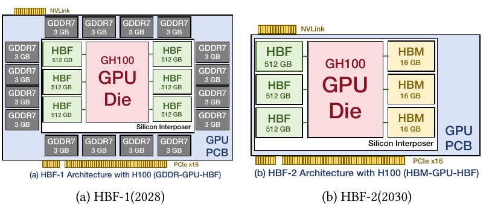

**Original:** Figure 1: Modeled layouts based on the KAIST HBF roadmap.

**中文:** 图 1：依据 KAIST HBF 路线图建立的布局模型。

**读图提示（辅助说明）：** 先看 HBF 占了什么位置。(a) 中介层全部给 HBF，原来的快速层转到板上的 GDDR7；(b) HBM 和 HBF 各占部分中介层位置。本文比较的不只是 SSD 换成更快的闪存，还包括近端层随封装一起改变。2028、2030 是路线图年份，图示不是已量产硬件实测。图内器件标注与表 2、表 3 的配置分别按原文保留，后续容量、带宽比较应查表 3(c)。

**Source:** p.3 S035

**Original:** 2.2.3 HBF-3: a later roadmap organization. The roadmap places a later HBF-3 generation in 2032, using an advanced interposer to co-package more HBM and HBF stacks alongside the GPU [11]. Our complete-organization evaluation focuses on the earlier HBF-1 and HBF-2 generations.

**中文:** 2.2.3 HBF-3：更晚的路线图组织。路线图将后续 HBF-3 代际安排在 2032 年，使用先进中介层，把更多 HBM、HBF 堆栈与 GPU 共同封装 [11]。本文对完整组织的评估，聚焦更早的 HBF-1 和 HBF-2。

**Source:** p.3 S036

**Original:** Because HBF-1 and HBF-2 change GPU organization and near-tier memory with the medium, a fair study needs two comparisons. The media-only comparison varies only secondary-tier latency, bandwidth, and capacity; the complete-architecture comparison evaluates the full organization. Without this separation, media service, local memory, interconnect, and package power are inseparable (Section 4).

**中文:** 因为 HBF-1 和 HBF-2 在改变介质的同时，也改变了 GPU 组织和近端存储，所以公平研究需要两类比较。只比较介质时，仅改变次级层的延迟、带宽和容量；比较完整架构时，则评估整个组织。如果不做这种区分，介质服务、本地存储、互连和封装功耗的影响就无法分开（第 4 节）。

### 2.3 HBF 的优势 · 2.3 Advantages of HBF

**Source:** p.3 S037

**Original:** 2.3 Advantages of HBF

**中文:** 2.3 HBF 的优势

**Source:** p.3 S038

**Original:** 2.3.1 Capacity and bandwidth. NAND provides much greater density than DRAM. A 512-GB HBF device paired with a 24-GB HBM stack yields a density ratio of ≈ 21.3.

**中文:** 2.3.1 容量与带宽。NAND 的密度远高于 DRAM。将一个 512 GB 的 HBF 设备与一个 24 GB 的 HBM 堆栈相比，密度比约为 21.3。

**Source:** p.3 S039

**Original:** HBF replaces the narrow PCIe/NVMe path with a wide package interface and exposes many NAND regions in parallel. The interface is only one bound on effective application bandwidth:

**中文:** HBF 用宽封装接口替代狭窄的 PCIe／NVMe 路径，并行暴露大量 NAND 区域。但接口带宽只是实际应用有效带宽的一项约束：

**Source:** p.3 E002 · Eq. (2)

$$
\begin{aligned} BW_{\mathrm{effective}}=\min(&BW_{\mathrm{interface}},BW_{\mathrm{array}},BW_{\mathrm{controller}},\\ &BW_{\mathrm{power}},BW_{\mathrm{thermal}},BW_{\mathrm{workload}}).\end{aligned}
$$

式（2）

**中文说明（辅助）：** 有效带宽取接口、阵列、控制器、功耗、温度和工作负载六类约束中的最小值。接口峰值只是其中一项。

**Source:** p.3 S040

**Original:** Peak bandwidth therefore requires enough independent reads, controller concurrency, and power headroom. The OCP specification makes the layout requirement explicit: the host interleaves data across channels and aligns bank accesses to expose parallelism [1, §§11.1–11.2].

**中文:** 因此，要达到峰值带宽，需要足够多的独立读取、控制器并发和功耗余量。OCP 规范明确给出了布局要求：主机应跨通道交错分布数据，并对齐存储体访问，以暴露并行性 [1，第 11.1–11.2 节]。

**Source:** p.3 S041

**Original:** 2.3.2 Shorter path and a cooperative hierarchy. HBF removes PCIe/NVMe command processing, host staging, and board links. Modern GDS- and Tutti-style SSD paths narrow this advantage, so we use a strong SSD baseline. In the intended cooperative hierarchy, HBM holds weights, active KV, and write-heavy state; HBF holds larger read-mostly reusable objects; and SSD keeps colder capacity. A NAND read remains slow, but die-, plane-, and channel-level parallelism provides high aggregate throughput when the runtime exposes concurrency.

**中文:** 2.3.2 更短的路径与协同层次。HBF 消除了 PCIe／NVMe 命令处理、经主机暂存和板级链路。现代 GDS 式和 Tutti 式 SSD 路径已经缩小了这方面的差距，因此本文采用较强的 SSD 基线。在预期的协同层次中，HBM 保存权重、活跃 KV 和写密集状态；HBF 保存更大、以读为主且可复用的对象；SSD 承担更冷的容量需求。单次 NAND 读取仍然很慢，但只要运行时能暴露足够并发，裸片级、平面级和通道级并行就能提供较高的总吞吐。

### 2.4 HBF 的限制 · 2.4 Limitations of HBF

**Source:** p.3 S042

**Original:** 2.4 Limitations of HBF

**中文:** 2.4 HBF 的限制

**Source:** p.3 S043

**Original:** The wide interface does not change NAND, so HBF inherits three device-level limits relative to HBM. First, latency: NAND reads and writes take on the order of microseconds, roughly two orders of magnitude longer than HBM accesses; programs are slower and more energy-intensive than reads [9]. Die-, plane-, and channel-level parallelism raises aggregate bandwidth but does not close this per-access gap.

**中文:** 宽接口没有改变 NAND，因此相对 HBM，HBF 继承了三项设备级限制。第一是延迟：NAND 读写耗时为微秒量级，比 HBM 访问大约长两个数量级；编程比读取更慢，也更耗能 [9]。裸片级、平面级和通道级并行能提高总带宽，却无法缩小单次访问的延迟差距。

**Source:** p.3–4 S044

**Original:** Second, endurance: flash cells tolerate finite program/erase cycles, and elevated temperature accelerates wear [2]. A write-heavy tier therefore degrades far faster than DRAM’s effectively unbounded write endurance.

**中文:** 第二是耐久性：闪存单元只能承受有限次编程／擦除循环，高温还会加速磨损 [2]。因此，写密集存储层退化的速度远高于写入耐久性近乎不受限的 DRAM。

**Source:** p.4 S045

**Original:** Third, power and thermals: per-stack HBF power is far higher than HBM. H3 assumes roughly 160 W per HBF cube, so six stacks can approach 960 W [7], potentially exceeding the GPU die’s peak power. Package-local HBF therefore creates a new power and thermal problem rather than inheriting HBM’s modest envelope.

**中文:** 第三是功耗与热问题：HBF 单堆栈功耗远高于 HBM。H3 假设每个 HBF 立方体约为 160 W，六个堆栈就可能接近 960 W [7]，甚至超过 GPU 裸片本身的峰值功耗。因此，封装内 HBF 带来的是新的功耗和散热问题，而不是沿用 HBM 相对温和的功耗范围。

## 3 背景 · 3 Background

**Source:** p.4 S046

**Original:** 3 Background

**中文:** 3 背景

**Source:** p.4 S047

**Original:** The preceding section introduced the physical HBF device and its roadmap organizations. This section explains how inference creates, reuses, and offloads KV state and why serving systems increasingly move it to a larger tier. It provides the software and storage context for the HBF deployment evaluated here.

**中文:** 上一节介绍了 HBF 物理设备及其路线图组织。本节解释推理如何产生、复用和卸载 KV 状态，以及推理服务系统为什么越来越多地将它移到容量更大的层级，为本文评估的 HBF 部署补充软件和存储背景。

### 3.1 智能体推理服务中的 KV 缓存与复用 · 3.1 KV Cache and Reuse in Agentic Serving

**Source:** p.4 S048

**Original:** 3.1 KV Cache and Reuse in Agentic Serving

**中文:** 3.1 智能体推理服务中的 KV 缓存与复用

**Source:** p.4 S049

**Original:** Agentic and conversational workloads dominate modern LLM deployments: multi-turn dialogue, tool-use loops, shared system prompts, and retrieval-augmented generation (RAG). They revisit tokens, reusing prompt prefixes and session histories across requests. Serving therefore depends less on raw compute than on memory capacity to retain useful prefixes and active histories and bandwidth to restore or stream them without stalling the GPU.

**中文:** 现代 LLM 部署主要面向智能体和对话负载，包括多轮对话、工具调用循环、共享系统提示词，以及检索增强生成（RAG）。这些负载会再次访问已有词元，在请求之间复用提示前缀和会话历史。因此，服务表现越来越依赖于存储容量能否保留有用前缀和活跃历史，以及带宽能否在不阻塞 GPU 的情况下恢复或流式读取它们，而不仅是原始算力。

**Source:** p.4 S050

**Original:** LLM inference has prefill and decode phases. Prefill processes prompt tokens in parallel and materializes KV state. A prefix-cache hit avoids recomputing the matched prompt but still requires locating and delivering its saved blocks to the GPU. Decode generates tokens autoregressively and repeatedly reads the retained KV history. Each transformer layer stores a key and value vector per token. For $N$ retained tokens, the unsharded per-request KV footprint is

**中文:** LLM 推理分为预填充和解码阶段。预填充并行处理提示词元，生成 KV 状态。前缀缓存命中可以避免重新计算已匹配的提示，但仍须定位保存下来的块，并把它们送到 GPU。解码以自回归方式生成词元，反复读取保留的 KV 历史。每个 Transformer 层都会为每个词元存储一组键和值。保留 $N$ 个词元时，未分片情况下，每个请求的 KV 占用由下式给出。

**Source:** p.4 E003 · Eq. (3)

$$
B_{\mathrm{KV/request}}=2NLH_{\mathrm{KV}}D_{\mathrm{head}}b,
$$

式（3）

**中文说明（辅助）：** $N$ 为保留词元数，$L$ 为层数，$H_{\mathrm{KV}}$ 为 KV 头数，$D_{\mathrm{head}}$ 为头维度，$b$ 为元素字节数；键和值各一份，因此乘 2。原式未做跨 GPU 分片。

**Source:** p.4 S051

**Original:** Here, $L$, $H_{\mathrm{KV}}$ , $D_{\mathrm{head}}$ , and $b$ denote layer count, KV-head count, head dimension, and bytes per element; the factor of two accounts for keys and values. Grouped-query and latent-attention designs reduce this footprint but do not remove the capacity problem.

**中文:** 其中，$L$、$H_{\mathrm{KV}}$、$D_{\mathrm{head}}$ 和 $b$ 分别表示层数、KV 头数、头维度和每个元素的字节数；系数 2 对应键和值。分组查询和潜在注意力设计可以减少占用，但无法消除容量问题。

**Source:** p.4 S052

**Original:** Unlike static shared weights, KV is generated online, grows during decode, and has request-, session-, and prefix-specific lifetimes. Stored prefixes matter only if later requests reuse them before eviction. Continuous batching adds pressure: admissions consume KV capacity, long requests retain blocks longer, and restoring offloaded state can delay execution. KV placement, reuse, and request scheduling must therefore be optimized together.

**中文:** KV 不同于静态共享权重：它在线生成，随解码增长，其寿命取决于请求、会话和前缀。保存前缀只有在之后的请求能于淘汰前复用它时才有意义。连续批处理会进一步增加压力：接纳新请求要消耗 KV 容量，长请求占用块的时间更长，恢复已卸载状态也可能推迟执行。因此，KV 放置、复用和请求调度必须联合优化。

### 3.2 分页与池化的 KV 存储 · 3.2 Paged and Pooled KV Storage

**Source:** p.4 S053

**Original:** 3.2 Paged and Pooled KV Storage

**中文:** 3.2 分页与池化的 KV 存储

**Source:** p.4 S054

**Original:** 3.2.1 PagedAttention. vLLM introduces PagedAttention and block-level KV allocation [15]. A block table maps each request’s logical KV blocks to non-contiguous physical blocks in GPU memory. On-demand allocation reduces fragmentation, supports continuous growth, and enables common-prefix sharing and copy-on-write without a large contiguous reservation.

**中文:** 3.2.1 PagedAttention。vLLM 引入了 PagedAttention 和块级 KV 分配 [15]。块表将每个请求的逻辑 KV 块映射到 GPU 存储中不连续的物理块。按需分配减少碎片，支持持续增长，也能在不预留大块连续空间的情况下实现公共前缀共享和写时复制。

**Source:** p.4 S055

**Original:** Two requests share exact-prefix KV when their token prefixes and model state match. The benefit grows with matched length but vanishes after eviction. System prompts and multi-turn dialogue create heavy reuse; independent API calls create little. The same admission policy can therefore yield very different read/write behavior across traces.

**中文:** 当两个请求的词元前缀和模型状态匹配时，它们可以共享精确前缀 KV。匹配越长，收益越大；但一旦数据被淘汰，收益就消失。系统提示词和多轮对话会产生大量复用，彼此独立的 API 调用则复用很少。因此，相同准入策略在不同轨迹上也可能产生截然不同的读写行为。

**Source:** p.4 S056

**Original:** 3.2.2 Mooncake and distributed KV pools. Paged allocation solves on-GPU layout but not capacity beyond HBM. Mooncake extends KV into a distributed, KV-cache-centric pool of CPU DRAM, SSDs, and network resources. It combines a transfer engine with KV-aware, SLO-aware scheduling that rejects work early under overload [20]. KV-cache-centric scheduling treats KV-block location, availability, reuse, and transfer cost as first-class state beyond request selection.

**中文:** 3.2.2 Mooncake 与分布式 KV 池。分页分配解决了 GPU 内部的布局问题，却不能解决超出 HBM 的容量问题。Mooncake 把 KV 扩展成以 KV 缓存为中心的分布式池，涵盖 CPU DRAM、SSD 和网络资源。它将传输引擎与感知 KV、感知 SLO 的调度相结合，在过载时尽早拒绝任务 [20]。这种以 KV 缓存为中心的调度，除了选择请求，还把 KV 块的位置、可用性、复用和传输成本作为需要直接管理的状态。

**Source:** p.4 S057

**Original:** SSD offloading is asynchronous and outside the write path. New KV lands in DRAM; after DRAM crosses a watermark, a background policy flushes or evicts it to SSD. A master node tracks per-object locations and promotes hot blocks back [14]. Flash writes are therefore scheduling decisions, separate from GPU compute. Save and load move KV in opposite directions:

**中文:** SSD 卸载采用异步方式，并置于写入路径之外。新的 KV 先进入 DRAM；DRAM 超过水位线后，后台策略再将它刷写或淘汰到 SSD。主节点跟踪每个对象的位置，并将热点块提升回来 [14]。因此，闪存写入是独立于 GPU 计算的调度决策。保存和加载沿相反方向移动 KV：

**Source:** p.4 E004 · Eq. (4)

$$
\mathrm{save}:\quad\mathrm{GPU\ HBM}\to\mathrm{cache\ tier},
$$

式（4）

**中文说明（辅助）：** save 将 GPU HBM 中的 KV 保存到缓存层。它是方向定义，不表示每次保存都同步阻塞推理。

**Source:** p.4 E005 · Eq. (5)

$$
\mathrm{load}:\quad\mathrm{cache\ tier}\to\mathrm{GPU\ HBM},
$$

式（5）

**中文说明（辅助）：** load 将缓存层中的 KV 恢复到 GPU HBM；命中卸载对象并不等于直接在闪存上完成注意力计算。

**Source:** p.4 S058

**Original:** Their imbalance is central to the write/read behavior quantified in Section 7.1.

**中文:** 二者的不平衡，是第 7.1 节量化的写／读行为的核心。

### 3.3 将 KV 卸载到 SSD · 3.3 SSD Offloading of KV

**Source:** p.4 S059

**Original:** 3.3 SSD Offloading of KV

**中文:** 3.3 将 KV 卸载到 SSD

**Source:** p.4 S060

**Original:** 3.3.1 Why SSD offloading helps. HBM and host DRAM are fast but capacity-limited. SSDs add larger, cheaper, replaceable capacity and retain prefixes over the longer reuse windows needed by long-context, multi-turn, RAG, and agent workflows.

**中文:** 3.3.1 SSD 卸载为什么有用。HBM 和主机 DRAM 速度快，但容量有限。SSD 提供更大、更便宜、可更换的容量，能够在长上下文、多轮对话、RAG 和智能体工作流所需的更长复用窗口中保留前缀。

**Source:** p.4 S061

**Original:** DeepSeek’s API documents a production disk-based context cache with persisted prefix units and cache-hit/miss token accounting [3]. Production traces show bimodal reuse: most occurs within minutes, but a long tail returns only after tens of minutes. Recency-only eviction therefore discards blocks that would still be reused [14]. SSD offloading is now standard and provides KV objects for larger tiers to store and restore.

**中文:** DeepSeek 的 API 文档描述了生产环境中的磁盘上下文缓存，包括持久化的前缀单元，以及命中／未命中词元的计数 [3]。生产轨迹显示出双峰式复用：大部分在几分钟内发生，但还有长尾要隔数十分钟才返回。因此，仅根据最近访问时间淘汰，会丢掉之后仍可能复用的块 [14]。SSD 卸载现已成为常规做法，也提供了需要由更大存储层保存和恢复的 KV 对象。

**Source:** p.4 S062

**Original:** 3.3.2 Modern offload paths. In a naive SSD path, data moves through host memory (GPU HBM → CPU I/O → NVMe → SSD). Submission overhead, extra copies, and fragmented small requests can then dominate media service (Fig. 3(a)).

**中文:** 3.3.2 现代卸载路径。在朴素的 SSD 路径中，数据经主机内存移动，即 GPU HBM → CPU I/O → NVMe → SSD。这时，请求提交开销、额外复制以及碎片化的小请求，可能比介质服务本身更耗时（图 3a）。

**Source:** p.4 S063

**Original:** Modern paths remove much of this cost (Fig. 3(b)). Linux io_uring uses shared queues to reduce system calls and context switches [16]. GPU Direct Storage (GDS) enables direct DMA between NVMe and GPU memory. Tutti moves object identification and completion to a GPU-side io_uring path, removing the CPU from each operation’s critical path [21].

**中文:** 现代路径消除了其中大量成本（图 3b）。Linux io_uring 使用共享队列，减少系统调用和上下文切换 [16]。GPU Direct Storage（GDS）允许 NVMe 与 GPU 存储直接进行 DMA。Tutti 把对象识别和完成处理移到 GPU 侧的 io_uring 路径，使 CPU 不再位于每次操作的关键路径中 [21]。

#### 图 3 · SSD KV 卸载的数据路径

**Placed near:** p.4 S063  
**Source:** p.5 F003 · C003

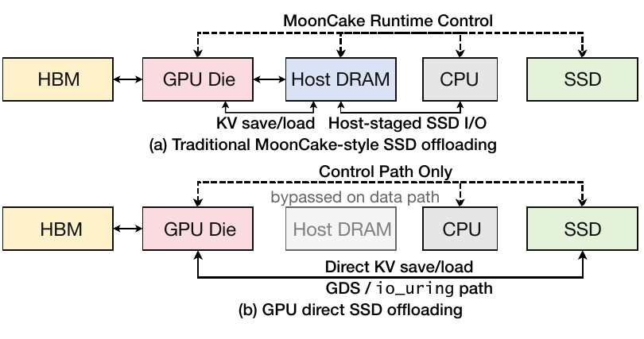

**Original:** Figure 3: SSD offloading of KV: host-staged path (a) versus GPU-direct path (b).

**中文:** 图 3：KV 的 SSD 卸载：经主机暂存的路径（a）与 GPU 直接路径（b）。

**读图提示（辅助说明）：** 上图的数据先经 Host DRAM，CPU 参与主机侧 I/O；下图由 GDS／io_uring 路径让 GPU 与 SSD 直接交换 KV。虚线是控制路径，实线是数据路径；“Control Path Only”不表示 CPU／主机在所有方面消失，而是主机暂存被数据路径绕过。因此，现代 SSD 基线本身已经能减少复制和提交开销。

**Source:** p.4 S064

**Original:** SSD offloading is therefore a strong, actively optimized baseline. Drives remain replaceable outside the accelerator package, and their controllers provide buffering, mapping, garbage collection, wear leveling, and bad-block management.

**中文:** 因此，SSD 卸载是一个已经很强、仍在持续优化的基线。SSD 位于加速器封装之外，仍可独立更换；它的控制器提供缓冲、映射、垃圾回收、磨损均衡和坏块管理。

**Source:** p.4 S065

**Original:** SSD remains off-package and bounded by the PCIe/NVMe link. HBF provides a higher-bandwidth, package-local alternative, as described in Section 2. We evaluate HBF by replacing or augmenting the SSD backing tier while preserving the KV-object path above.

**中文:** SSD 依然位于封装外，并受到 PCIe／NVMe 链路限制。如第 2 节所述，HBF 提供了封装内、带宽更高的替代方案。本文在保留上层 KV 对象路径的情况下，通过替换或补充 SSD 后备层来评估 HBF。

## 4 评估方法 · 4 Evaluation Methodology

**Source:** p.5 S066

**Original:** 4 Evaluation Methodology

**中文:** 4 评估方法

### 4.1 模拟器与评估设置 · 4.1 Simulator and Evaluation Setup

**Source:** p.5 S067

**Original:** 4.1 Simulator and Evaluation Setup

**中文:** 4.1 模拟器与评估设置

**Source:** p.5 S068

**Original:** We use an extended version of TokenSim 1 [26]. It models request arrival, prefill, decode, continuous batching, paged KV allocation, admission, preemption, recomputation, KV save/restore, tier transfers, queueing, and request-level latency. Our extensions add Mooncake-style lookup, hashed 16-token KV identifiers, object save/load events, SSD and HBF tiers, per-tier read/write counters, HBF-1/HBF-2 profiles, connector wait accounting, and SLO-oriented outputs. TokenSim’s original studies validate its serving behavior against real-machine configurations [26]; for our extensions, regression checks cover block/byte conservation, save/load ordering, deterministic replay, and per-tier counters. HBF service parameters are sourced or swept. The complete-architecture campaign instantiates the HBF roadmap’s HBF-1 (2028) and HBF-2 (2030), with the capacity and bandwidth settings in Table 3(c).

**中文:** 我们使用扩展版 TokenSim¹ [26]。它建模请求到达、预填充、解码、连续批处理、分页 KV 分配、准入、抢占、重计算、KV 保存／恢复、层间传输、排队和请求级延迟。本文扩展加入了 Mooncake 式查找、以 16 个词元为单位的哈希 KV 标识符、对象保存／加载事件、SSD 与 HBF 层、逐层读写计数器、HBF-1／HBF-2 配置、连接器等待时间统计，以及面向 SLO 的输出。TokenSim 原始研究用真实机器配置验证了服务行为 [26]；本文扩展的回归检查覆盖块／字节守恒、保存／加载顺序、确定性回放和逐层计数。HBF 服务参数取自已有来源，或进行扫描。完整架构评估采用路线图中的 HBF-1（2028）和 HBF-2（2030），容量与带宽设置见表 3(c)。

**Source:** p.5 S179

**Original:** Code (footnote 1): [https://github.com/pku-lemonade/TokenSim](https://github.com/pku-lemonade/TokenSim/tree/hbf)

**中文:** 代码（脚注 1）：[https://github.com/pku-lemonade/TokenSim](https://github.com/pku-lemonade/TokenSim/tree/hbf)

**Source:** p.5 S069

**Original:** We separate media sensitivity from complete architecture comparisons: the media-only view holds GPU organization and policy fixed while varying HBF latency, while complete HBF-1 and HBF-2 change the near tier to the roadmap’s GDDR/HBF and HBM/HBF organizations. HBF latency is swept over 8/80, 12/120, 20/200, and 30/300 μs read/write points. The connector uses 16-token hash blocks: prefix lookup matches consecutive identifiers from the prompt start, missing full blocks are saved during prefill after existing-block filtering, and a later matching request restores them before its missing suffix executes.

**中文:** 我们将介质敏感性与完整架构比较分开：只看介质时，固定 GPU 组织和策略，仅改变 HBF 延迟；完整的 HBF-1、HBF-2 比较则按路线图，将近端层改成 GDDR／HBF、HBM／HBF 组织。HBF 延迟扫描四组读／写参数：8/80、12/120、20/200 和 30/300 μs。连接器使用 16 词元哈希块：前缀查找从提示开头匹配连续标识符；预填充时，先过滤已经存在的块，再保存缺失的完整块；之后的请求若匹配这些块，则先恢复它们，再执行尚未命中的后缀。

### 4.2 工作负载、模型与平台 · 4.2 Workloads, Models, and Platforms

**Source:** p.5 S070

**Original:** 4.2 Workloads, Models, and Platforms

**中文:** 4.2 工作负载、模型与平台

**Source:** p.5 S071

**Original:** We use the four anonymized production-derived traces listed in Table 3 from the Aliyun Qwen-Bailian deployment [24]. Each contains a complete two-hour window with fixed request order, lengths, session structure, and 16-token KV identifiers. traceA mixes production traffic with conversational reuse. traceB contains short-output API/text traffic without multi-turn sessions, although shared prefixes still create cross-request reuse. coder contains code-oriented multi-turn context, and thinking combines long reasoning outputs with a smaller multi-turn population. A reused block is a unique hash identifier that appears in more than one request.

**中文:** 我们使用表 3 中列出的四份匿名生产衍生轨迹，来自阿里云 Qwen-Bailian 部署 [24]。每份都是完整的两小时窗口，固定请求顺序、长度、会话结构以及 16 词元 KV 标识符。traceA 混合了生产流量和对话复用；traceB 是短输出的 API／文本流量，没有多轮会话，但共享前缀仍会带来跨请求复用；coder 包含面向代码的多轮上下文；thinking 则将长推理输出与占比较小的多轮请求结合。所谓复用块，是在不止一个请求中出现的唯一哈希标识符。

**Source:** p.5 S072

**Original:** The five dense and MoE models listed in Table 3(b) supply the architectural parameters used by the current TokenSim profiles. For MoE models, the parameter count reports both total parameters and parameters activated per token.

**中文:** 表 3(b) 列出的五个稠密和 MoE 模型，提供当前 TokenSim 配置使用的架构参数。对于 MoE 模型，参数量同时报告总参数和每词元激活参数。

**Source:** p.5 S073

**Original:** We model the eight-GPU systems listed in Table 3(c) with tensor parallelism 8, pipeline and data parallelism 1, and expert parallelism for MoE models. The SSD tier uses 3.2-TB KIOXIA CM7-V drives with 14.0/6.75 GB/s sequential read/write bandwidth and 3 TB modeled usable capacity per drive [13]. The main SSD baseline is the conventional Mooncake connector in the simulator.

**中文:** 我们建模表 3(c) 中的八 GPU 系统：张量并行度为 8，流水线并行度和数据并行度均为 1，MoE 模型还采用专家并行。SSD 层使用 3.2 TB 的 KIOXIA CM7-V，每块顺序读／写带宽为 14.0/6.75 GB/s，建模可用容量为 3 TB [13]。主要 SSD 基线是模拟器中的常规 Mooncake 连接器。

#### 表 3 · 轨迹、模型和系统参数

**Placed near:** p.5 S073  
**Source:** p.5 T003 · C015

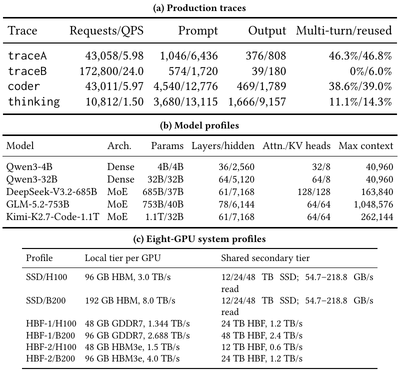

**Original:** Table 3: Evaluation workloads, models, and systems.

**中文:** 表 3：评估工作负载、模型与系统。

**中文表格：**

**(a) 生产轨迹**

| 轨迹 | 请求数／QPS | 提示长度（原表双值） | 输出长度（原表双值） | 多轮／被复用 |
| --- | --- | --- | --- | --- |
| traceA | 43,058／5.98 | 1,046／6,436 | 376／808 | 46.3%／46.8% |
| traceB | 172,800／24.0 | 574／1,720 | 39／180 | 0%／6.0% |
| coder | 43,011／5.97 | 4,540／12,776 | 469／1,789 | 38.6%／39.0% |
| thinking | 10,812／1.50 | 3,680／13,115 | 1,666／9,157 | 11.1%／14.3% |

**(b) 模型配置**

| 模型 | 架构 | 总参数／激活参数 | 层数／隐藏维度 | 注意力头／KV 头 | 最大上下文 |
| --- | --- | --- | --- | --- | --- |
| Qwen3-4B | 稠密 | 4B／4B | 36／2,560 | 32／8 | 40,960 |
| Qwen3-32B | 稠密 | 32B／32B | 64／5,120 | 64／8 | 40,960 |
| DeepSeek-V3.2-685B | MoE | 685B／37B | 61／7,168 | 128／128 | 163,840 |
| GLM-5.2-753B | MoE | 753B／40B | 78／6,144 | 64／64 | 1,048,576 |
| Kimi-K2.7-Code-1.1T | MoE | 1.1T／32B | 61／7,168 | 64／64 | 262,144 |

**(c) 八 GPU 系统配置**

| 配置 | 每 GPU 本地层 | 共享次级层 |
| --- | --- | --- |
| SSD／H100 | 96 GB HBM，3.0 TB/s | 12／24／48 TB SSD；读取 54.7–218.8 GB/s |
| SSD／B200 | 192 GB HBM，8.0 TB/s | 12／24／48 TB SSD；读取 54.7–218.8 GB/s |
| HBF-1／H100 | 48 GB GDDR7，1.344 TB/s | 24 TB HBF，1.2 TB/s |
| HBF-1／B200 | 96 GB GDDR7，2.688 TB/s | 48 TB HBF，2.4 TB/s |
| HBF-2／H100 | 48 GB HBM3e，1.5 TB/s | 12 TB HBF，0.6 TB/s |
| HBF-2／B200 | 96 GB HBM3e，4.0 TB/s | 24 TB HBF，1.2 TB/s |

**读图提示（辅助说明）：** (a) 给出原始两小时轨迹统计，实际实验再将到达时间缩放到不同 QPS；Prompt、Output 的斜杠两侧值照原表保留，表头未明确解释两者统计口径，不自行补成均值／P95。(b) 参数列按正文表示总参数／每词元激活参数。(c) 近端层参数按单 GPU 给出，次级层为八 GPU 共享总量，不能相互直接相加。注意 B200 的 HBF 容量与表 5 的容量匹配描述存在口径冲突，见表 5 提示。

**Source:** p.5 S074

**Original:** We evaluate offered loads from 0.05 to 32 QPS by rescaling request-arrival timestamps while preserving request order, contents, sessions, and KV-reuse relationships.

**中文:** 我们通过缩放请求到达时间戳，将输入负载从 0.05 QPS 扫描到 32 QPS，同时保留请求顺序、内容、会话和 KV 复用关系。

### 4.3 指标与统计处理 · 4.3 Metrics and Statistical Treatment

**Source:** p.5 S075

**Original:** 4.3 Metrics and Statistical Treatment

**中文:** 4.3 指标与统计处理

**Source:** p.5 S076

**Original:** We report TTFT, TBT, end-to-end latency, delivered request and token throughput, queueing and connector delay, KV hits, blocks and bytes read and written, the write/read ratio, prefix reuse, recomputation, and SLO goodput. For the architecture comparison we average each metric over the trace and model campaign at every system and latency point, because the question is how the complete SSD, HBF-1, and HBF-2 organizations behave, not how one favorable point behaves. The write/read ratio and prefix hit rate in Finding 3 come from the per-tier byte counters over a full two-hour replay of each trace, so they reflect fixed request contents and ordering rather than a sampled window. Zero-read runs are excluded from the ratio because it is undefined, and malformed result files are excluded. Throughout, we label every value as a measured simulator output, a sourced device parameter, or a modeled projection.

**中文:** 我们报告首词元时间（TTFT）、词元间隔时间（TBT）、端到端延迟、实际交付的请求和词元吞吐量、排队与连接器延迟、KV 命中、读写块数和字节数、写／读比、前缀复用、重计算，以及满足 SLO 的有效吞吐。对于架构比较，在每个系统配置和延迟点上，对整个轨迹与模型实验组的各项指标取平均，因为研究问题是完整的 SSD、HBF-1 和 HBF-2 组织表现如何，而不是某个有利点表现如何。发现 3 的写／读比和前缀命中率，来自每份轨迹完整两小时回放中的逐层字节计数器，反映固定的请求内容和顺序，而非抽样窗口。读取量为零的运行不纳入比值统计，因为比值没有定义；格式错误的结果文件也被排除。全文会明确区分：模拟器测得的输出、来自已有来源的器件参数，以及模型预测。

### 4.4 热模型与耐久性模型 · 4.4 Thermal and Endurance Models

**Source:** p.5 S077

**Original:** 4.4 Thermal and Endurance Models

**中文:** 4.4 热模型与耐久性模型

**Source:** p.5–6 S078

**Original:** Thermal and endurance models use the serving-trace measurements. For thermal behavior we build a 16-Hi HBF stack similar to HBM4, with 128-layer 3D-NAND TLC dies, and solve its steady-state heat flow with 3D-ICE [23]. We use read and write energy per 16-token KV block, matching the connector’s access granularity, and sweep sustained single-stack bandwidth to obtain dynamic power and peak temperature. We choose 80°C as the model’s safe junction temperature and use a throttling policy that closes the hottest, highest-traffic planes and redirects writes to cooler planes once the limit is reached. The OCP specification defines normal operation, light and severe throttling, and shutdown. Its throttling thresholds are configurable [1, §9].

**中文:** 热模型和耐久性模型使用服务轨迹中统计的测量值。热行为方面，我们构建了类似 HBM4 的 16 层裸片堆叠 HBF，每个裸片为 128 层 3D NAND TLC，并用 3D-ICE 求解稳态热流 [23]。读写能量以 16 词元 KV 块为单位，与连接器访问粒度一致；扫描单堆栈持续带宽，得到动态功耗和峰值温度。模型选择 80°C 作为安全结温；到达上限后，关闭最热且流量最高的平面，将写入转向较冷的平面。OCP 规范定义了正常运行、轻度与严重限流，以及关机状态；限流温度阈值可以配置 [1，第 9 节]。

**Source:** p.6 S079

**Original:** For endurance, we normalize the media-write volume from each two-hour, eight-H100 HBF-2 replay to a daily rate. The capacity-matched SSD reference has four KIOXIA CM7-V 3.2 TB drives [13]; its vendor 3-DWPD rating gives 38.4 TB/day. The HBF tier uses a deliberately favorable TLC endurance budget with unit write amplification, yielding 21.7 TB/day for a five-year target. We compare lifetimes by linear exhaustion of these write budgets under the measured trace traffic. OCP specifies a product-specific maximum P/E count and exposes the average P/E count to the host [1, §9].

**中文:** 耐久性方面，我们将每次两小时、八 H100 的 HBF-2 回放产生的介质写入量归一化为每日速率。容量匹配的 SSD 参考系统包含四块 KIOXIA CM7-V 3.2 TB SSD [13]；厂商给出的 3 DWPD 额定值，对应 38.4 TB/天。HBF 层采用有意偏有利的 TLC 耐久性预算，写放大设为 1，对应五年目标下 21.7 TB/天。我们按轨迹统计的流量，假设这些写入预算线性耗尽，据此比较寿命。OCP 为具体产品规定最大编程／擦除（P/E）次数，并向主机暴露平均 P/E 次数 [1，第 9 节]。

## 5 更快的闪存何时有帮助：一个模型 · 5 A Model of When Faster Flash Helps

**Source:** p.6 S080

**Original:** 5 A Model of When Faster Flash Helps

**中文:** 5 更快的闪存何时有帮助：一个模型

**Source:** p.6 S081

**Original:** At matched capacity, an HBF read is faster than an SSD read; that much is uncontested. The question is whether per-access speedup propagates to end-to-end request latency, or is absorbed by the rest of the serving pipeline. This is a system-level question; we formalize it with a single cost–benefit relation. We express the net change an HBF tier makes to end-to-end latency, relative to the SSD tier it replaces, as

**中文:** 容量匹配时，HBF 单次读取快于 SSD，这一点没有争议。问题在于，单次访问的加速能否传导到端到端请求延迟，还是会被服务流水线的其他部分吸收。这是系统级问题；我们用一个成本收益关系将其形式化。相对于被替换的 SSD 层，HBF 层对端到端延迟带来的净变化表示如下。

**Source:** p.6 E006 · Eq. (6)

$$
\begin{aligned}\Delta_{\mathrm{HBF}}={}&\underbrace{f\Delta t_{\mathrm{media}}}_{\text{critical-path I/O}}-\underbrace{C_{\mathrm{move}}}_{\text{movement/control}}-\underbrace{C_{\mathrm{pkg}}}_{\text{near-tier opportunity}}\\ &-\underbrace{C_{\mathrm{var}}}_{\text{throttle/variability}}-\underbrace{C_{\mathrm{life}}}_{\text{endurance/capacity}}.\end{aligned}
$$

式（6）

**中文说明（辅助）：** 五项依次是关键路径 I/O 收益、搬移／控制成本、近端层机会成本、限流／波动成本、耐久性／容量成本。原式注释保留英文；中文只解释各项，不改变量。

**Source:** p.6 S082

**Original:** Faster flash improves only the first term, and only in proportion to $f$ , the fraction of end-to-end time spent in exposed secondary-tier I/O. Everything else the HBF tier changes (the near tier it displaces, the traffic it must absorb, the heat it generates, the wear it takes) enters as a subtracted cost. The HBF tier is net-positive only when $\Delta_{\mathrm{HBF}}>0$ under target latency, throughput, power, capacity, and lifetime constraints. We make this concrete by converting each term into a measurable quantity, from which three necessary conditions emerge. Each condition is a falsifiable prediction: it states the value a term must take for HBF to help, while a paired finding measures the value it actually takes (Table 4).

**中文:** 更快的闪存只改善第一项，而且改善幅度还要乘以 $f$，即端到端时间中真正暴露出来的次级层 I/O 占比。HBF 层带来的其他变化——挤占的近端层、必须承受的流量、产生的热量以及承受的磨损——都作为成本扣除。只有在目标延迟、吞吐量、功耗、容量和寿命约束下满足 $\Delta_{\mathrm{HBF}}>0$，HBF 层才有净收益。我们把各项转化为可测量量，从中得到三个必要条件。每个条件都是一个可证伪预测：它说明某项必须达到什么值，HBF 才有帮助；相应的成对实验发现则测量该项实际是什么值（表 4）。

**Source:** p.6 S083

**Original:** C1: Read I/O is the serving bottleneck ($f$ must be large). We decompose end-to-end time as $T=T_{\mathrm{rest}}+t_{\mathrm{io}}$ , where $t_{\mathrm{io}}$ is the exposed, non-overlapped secondary-tier service and $T_{\mathrm{rest}}$ covers compute, near-tier service, batching, and queueing; $f=t_{\mathrm{io}}/T$ is the exposed fraction. To first order, the exposed term scales with per-access latency, so making the medium $k$× faster changes end-to-end time by

**中文:** C1：读取 I/O 是服务瓶颈，即 $f$ 必须足够大。我们将端到端时间拆为 $T=T_{\mathrm{rest}}+t_{\mathrm{io}}$；其中 $t_{\mathrm{io}}$ 是没有被其他工作重叠隐藏、真正暴露出来的次级层服务时间，$T_{\mathrm{rest}}$ 包括计算、近端层服务、批处理和排队；$f=t_{\mathrm{io}}/T$ 为暴露比例。在一阶近似下，暴露项随单次访问延迟缩放，因此将介质加速 $k$ 倍，端到端时间的变化如下。

**Source:** p.6 E007 · Eq. (7)

$$
\frac{\Delta T}{T}=f\left(1-\frac{1}{k}\right)\le f.
$$

式（7）

**中文说明（辅助）：** 介质快 $k$ 倍时，端到端可减少的比例受 $f$ 限制。关键是未被隐藏的 I/O 占比，而不是设备规格快了多少。

**Source:** p.6 S084

**Original:** The exposed fraction is a hard ceiling on any media improvement; even an infinitely fast tier ($k\to\infty$) cannot beat $f$ . Equation (7) is also invertible, so a media-latency sweep recovers $f$ from a serving measurement directly. §6.1 runs that $k=3.75\times$ sweep, and §6.2 asks whether moving compute into the device can enlarge $f$ .

**中文:** 暴露比例是任何介质优化都绕不过的硬上限；即使存储层无限快，即 $k\to\infty$，收益也无法超过 $f$。式（7）还可以反推，因此只需扫描介质延迟，就能直接从服务测量结果恢复 $f$。第 6.1 节进行了 $k=3.75$ 倍的扫描；第 6.2 节则考察将计算移入设备能否增大 $f$。

**Source:** p.6 S085

**Original:** C2: Reads outweigh writes ($\rho>\rho^{\star}$ ). A NAND program is spent the moment an object enters HBF; that cost is repaid only by later reads that benefit from the faster medium. Let $\rho$ be the useful read bytes returned per byte written at the flash tier, $S$ the exposed time each read byte saves, $A$ the write amplification, and $C$ a per-byte capacity and write-budget cost. Writing is net-positive only when $\rho S>AC$, i.e.

**中文:** C2：读取足以抵偿写入，即 $\rho>\rho^{\star}$。对象进入 HBF 的那一刻就必须付出 NAND 编程成本，只有后续确实从更快介质中受益的读取才能偿还。令 $\rho$ 为闪存层每写入一字节之后返回的有效读取字节数，$S$ 为每个读取字节节省的暴露时间，$A$ 为写放大，$C$ 为每字节对应的容量与写入预算成本。只有 $\rho S>AC$，写入才有净收益，也就是下式。

**Source:** p.6 E008 · Eq. (8)

$$
\rho>\rho^{\star}=\frac{AC}{S}.
$$

式（8）

**中文说明（辅助）：** 每写入一字节带来的有用读取量 $\rho$ 必须超过门槛 $\rho^{\star}$；$A$、$C$ 越大，门槛越高；每读取字节实际节省的暴露时间 $S$ 越大，门槛越低。

**Source:** p.6 S086

**Original:** Two facts push $\rho^{\star}$ above one: the write cost is paid unconditionally, while the repaying reads are speculative, and a single NAND program costs several reads in energy and wear. HBF therefore pays off only as a read-heavy tier. For transient KV the hierarchy is expected to deliver the opposite: the near tier retains the high-$\rho$ hot blocks and hands HBF the write-once tail. §7.1 measures the delivered $\rho$, and §7.2 asks whether the SSD write optimization that would lower $C$ transfers to HBF.

**中文:** 两个事实会把 $\rho^{\star}$ 推到 1 以上：写入成本必然先付出，之后用于偿还的读取却未必发生；同时，一次 NAND 编程在能量和磨损上的成本相当于多次读取。因此，HBF 只有作为以读为主的层级才划算。但对于短暂 KV，层次结构预计会产生相反结果：近端层留下高 $\rho$ 的热点块，把只写一次的长尾交给 HBF。第 7.1 节测量实际到达 HBF 的 $\rho$；第 7.2 节则考察原本能降低 $C$ 的 SSD 写入优化能否迁移过来。

**Source:** p.6 S087

**Original:** C3: Sustained bandwidth. The bandwidth a workload actually receives is the minimum of interface, array, controller, thermal, and endurance limits (Eq. (2)), which can fall well below the datasheet peak. Of these limits, a write-heavy KV stream is most likely to hit the thermal and endurance bounds. §8.1 measures the bandwidth a stack sustains before it overheats, and §8.2 measures the write volume it takes over its life.

**中文:** C3：持续带宽。工作负载实际拿到的带宽，受接口、阵列、控制器、温度和耐久性等限制中的最小值约束（式 2），可能远低于规格表峰值。在这些限制中，写密集 KV 数据流最容易触及温度与耐久性边界。第 8.1 节测量堆栈在过热前能够维持的带宽，第 8.2 节测量它在整个寿命中需要承担的写入量。

**Source:** p.6 S088

**Original:** These conditions are device-agnostic. $f$ , $\rho$, and sustained bandwidth characterize any package-local far tier (CXL-attached flash, other stacked NAND, or near-data flash), not only HBF. The rest of the paper tests them on the most demanding object for HBF, transient KV behind an SSD-style save/load connector, pairing two findings with each condition (Table 4).

**中文:** 这些条件并不依赖特定设备。$f$、$\rho$ 和持续带宽可以刻画任何封装附近的远端存储层，包括 CXL 连接的闪存、其他堆叠 NAND 或近数据闪存，而不只适用于 HBF。本文其余部分用最考验 HBF 的对象检验这些条件：通过 SSD 式保存／加载连接器管理的短暂 KV；每个条件对应两个发现（表 4）。

#### 表 4 · 三个条件与六个实验发现

**Placed near:** p.6 S088  
**Source:** p.6 T004 · C016

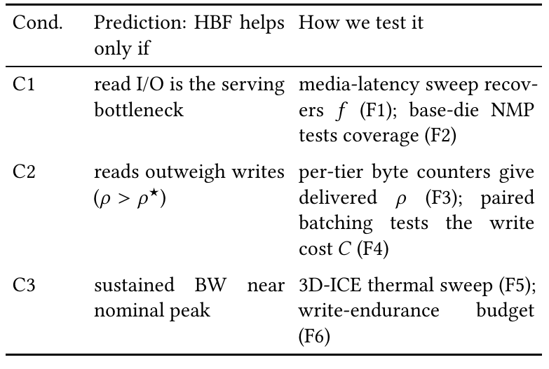

**Original:** Table 4: Each condition is a falsifiable prediction of the model in Eq. (6), tested by two findings for transient KV behind an SSD-style connector in §§6–8.

**中文:** 表 4：每个条件都是式（6）模型的一项可证伪预测；第 6–8 节用 SSD 式连接器后的短暂 KV，每个条件对应两个发现进行检验。

**中文表格：**

| 条件 | 预测：HBF 只有满足什么才有帮助 | 检验方法 |
| --- | --- | --- |
| C1 | 读取 I/O 是服务瓶颈 | 扫描介质延迟反推 $f$（发现 1）；基础裸片 NMP 检验覆盖率（发现 2） |
| C2 | 读取足以抵偿写入，即 $\rho>\rho^{\star}$ | 逐层字节计数器测实际 $\rho$（发现 3）；配对批处理实验检验写入成本 $C$（发现 4） |
| C3 | 持续带宽接近标称峰值 | 3D-ICE 热扫描（发现 5）；写入耐久性预算（发现 6） |

**读图提示（辅助说明）：** 表里的 F1–F6 指“发现 1–6”，不是“图 1–6”。C1 问加速的读取有没有落在关键路径；C2 问后续有用读取够不够偿还写入；C3 问峰值能不能在温度和寿命约束下持续提供。三个都是必要条件，满足某一个并不能单独保证整机获益。

## 6 C1：读取 I/O 是服务瓶颈 · 6 C1: Read I/O Is the Serving Bottleneck

**Source:** p.6 S089

**Original:** 6 C1: Read I/O Is the Serving Bottleneck

**中文:** 6 C1：读取 I/O 是服务瓶颈

**Source:** p.6–7 S090

**Original:** Condition C1 requires the exposed secondary-tier fraction $f$ to be large. Both findings in this section measure $f$ instead of assuming a value for it. Finding 1 recovers $f$ from a media sweep over a capacity-matched swap, and Finding 2 asks whether moving the compute into the device can raise it.

**中文:** 条件 C1 要求次级层暴露比例 $f$ 足够大。本节的两个发现都实际测量 $f$，而不是为它预设数值。发现 1 通过容量匹配替换下的介质扫描反推 $f$；发现 2 则考察把计算移入设备能否提高它。

### 6.1 发现 1：HBF 以 GPU 容量与带宽为代价 · 6.1 Finding 1: HBF Trades GPU Capacity and Bandwidth

**Source:** p.7 S091

**Original:** 6.1 Finding 1: HBF Trades GPU Capacity and Bandwidth

**中文:** 6.1 发现 1：HBF 以 GPU 容量与带宽为代价

**Source:** p.7 S092

**Original:** An HBF read is roughly an order of magnitude faster than an SSD read at matched capacity, so the swap should make requests faster. Condition C1 says that expectation holds only in proportion to $f$ , which no serving study has measured. Equation (7) is invertible, so a media-latency sweep recovers it while a capacity-matched swap answers what HBF delivers end to end.

**中文:** 容量匹配时，HBF 单次读取大约比 SSD 快一个数量级，因此直觉上替换应该让请求更快。条件 C1 表明，这种预期只有按 $f$ 的比例才成立，而此前的推理服务研究没有测量过它。式（7）可以反推，所以介质延迟扫描能够恢复 $f$；容量匹配替换则回答 HBF 最终带来什么端到端表现。

**Source:** p.7 S093

**Original:** Each HBF organization is paired with the SSD baseline of equal secondary-tier capacity, HBF-1 against SSD24 and HBF-2 against SSD12 (Table 3(c)). Both HBF generations give half of the GPU’s near tier to flash and hold equal near-tier capacity, differing in its technology (GDDR7 vs HBM3e); HBF-1 also carries twice the flash capacity and twice the flash bandwidth of HBF-2. The second control varies the medium, moving the read/write point from 30/300 to 8/80 μs, the $k=3.75\times$ change Eq. (7) needs to recover $f$ . Table 5 reports both sweeps for every GPU and retained model.

**中文:** 每种 HBF 组织都与次级层容量相同的 SSD 基线配对：HBF-1 对 SSD24，HBF-2 对 SSD12（表 3c）。两代 HBF 都把 GPU 近端层的一半位置让给闪存，近端层容量相同，但技术不同，分别是 GDDR7 和 HBM3e；HBF-1 的闪存容量和带宽还都是 HBF-2 的两倍。第二个控制实验改变介质，将读／写参数从 30/300 μs 改为 8/80 μs，正好形成式（7）反推 $f$ 所需的 $k=3.75$ 倍变化。表 5 报告这两类扫描在各 GPU 和保留模型上的结果。

**Source:** p.7 S094

**Original:** The sweep shows every HBF configuration worse than its SSD pair on every request metric, with mean end-to-end latency 2–5.5× the baseline, delivered throughput down 4–34%, and maximum SLO goodput down 1.1–2.7×; the H100 pairs sit at the severe end of each range and the B200 pairs at the mild end. Across models and traces every HBF curve rises above SSD12 and saturates at lower offered load (Figs. 5–7).

**中文:** 扫描表明，每个 HBF 配置在每项请求指标上都差于对应 SSD：平均端到端延迟是基线的 2–5.5 倍，实际吞吐下降 4–34%，满足 SLO 的最大有效吞吐降至原来的约 1/1.1–1/2.7。H100 配对处于各范围中恶化更严重的一端，B200 配对则相对较轻。各模型、各轨迹上的 HBF 曲线都高于 SSD12，并在更低的输入负载下饱和（图 5–7）。

#### 图 5 · 负载升高时的端到端延迟

**Placed near:** p.7 S094  
**Source:** p.8 F005 · C005

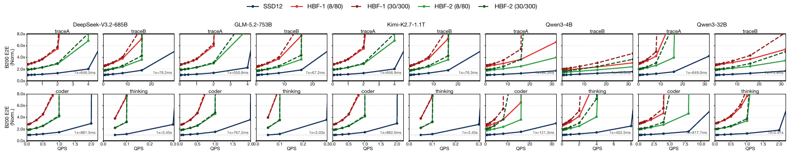

**Original:** Figure 5: End-to-end latency versus load on B200, normalized within each panel to the low-load SSD12 value (1×), across five models and four traces.

**中文:** 图 5：B200 上端到端延迟随负载的变化，覆盖五个模型、四份轨迹；每个小图均以本图低负载 SSD12 的数值归一化为 1 倍。

**读图提示（辅助说明）：** 每个大组是一种模型，组内为 traceA、traceB、coder、thinking。横轴 QPS 是输入请求率；纵轴是相对于该小图低负载 SSD12 的 E2E 倍数，越低越好。蓝色 SSD12、红色 HBF-1、绿色 HBF-2；8/80 和 30/300 分别是读／写延迟，单位 μs，不是实验运行时长。HBF 曲线更早陡升表示更早进入排队饱和；同代 HBF 的两组时序曲线接近，说明单独降低闪存延迟难以改变整体趋势。不同小图的 1 倍数值不同，不能把它们的纵轴当成同一个绝对延迟。

#### 图 6 · 实际词元吞吐量

**Placed near:** p.7 S094  
**Source:** p.8 F006 · C006

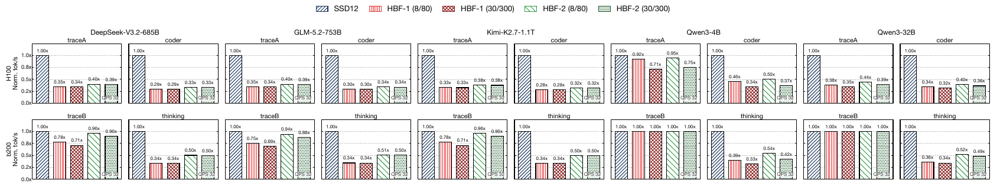

**Original:** Figure 6: Delivered token throughput normalized to SSD12 (1×) for H100 (top) and B200 (bottom), across five models and four traces.

**中文:** 图 6：在五个模型、四份轨迹上，实际词元吞吐量相对于 SSD12（1 倍）的归一化结果；上排为 H100，下排为 B200。

**读图提示（辅助说明）：** 这是实际完成的词元数／秒，纵轴越高越好；蓝色 SSD12 固定为 1。这里展示的是各小图所标负载（图中为 QPS 32）下的归一化点，不能把某根柱子的下降比例直接替代正文整个实验组的平均统计。H100 多个 HBF 柱子约为基线的三分之一，B200 的影响随模型、轨迹变化；要同时结合表 3 的近端层配置看。吞吐量与满足 SLO 的 goodput 也不是同一指标。

#### 图 7 · TTFT 与 TBT 分别受什么影响

**Placed near:** p.7 S094  
**Source:** p.8 F007 · C007

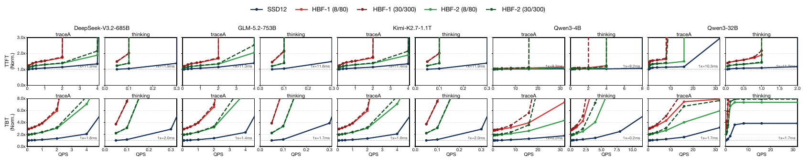

**Original:** Figure 7: Time-to-first-token (top) and time-between-tokens (bottom) versus load, normalized within each panel to the low-load SSD12 value (1×), for representative traces on five models.

**中文:** 图 7：五个模型上代表性轨迹的首词元时间（上排）和词元间隔时间（下排）随负载变化；每个小图均以本图低负载 SSD12 的值归一化为 1 倍。

**读图提示（辅助说明）：** 上排 TTFT 表示请求到首词元的时间，下排 TBT 表示相邻输出词元之间的时间；均越低越好。先在同一个模型、同一轨迹中比较蓝／红／绿曲线，再看负载增大时何时突然上升。TTFT 不明显变化并不代表解码体验不受影响，TBT 可能已明显恶化。每个小图都标出自己的 1 倍绝对值，因此不能跨图直接比较归一化数值。

#### 表 5 · B200 上相对 SSD 的性能变化

**Placed near:** p.7 S094  
**Source:** p.8 T005 · C017

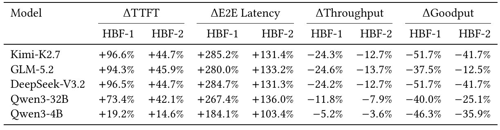

**Original:** Table 5: B200 HBF performance relative to capacity-matched SSD baselines. HBF-1 is normalized to SSD24 and HBF-2 to SSD12. Positive latency changes indicate slowdowns; negative throughput and goodput changes indicate losses.

**中文:** 表 5：B200 HBF 相对于容量匹配 SSD 基线的性能。HBF-1 按 SSD24 归一化，HBF-2 按 SSD12 归一化。延迟变化为正表示变慢；吞吐和有效吞吐变化为负表示损失。

**中文表格：**

| 模型 | TTFT HBF-1 | TTFT HBF-2 | E2E HBF-1 | E2E HBF-2 | 吞吐 HBF-1 | 吞吐 HBF-2 | 有效吞吐 HBF-1 | 有效吞吐 HBF-2 |
| --- | --- | --- | --- | --- | --- | --- | --- | --- |
| Kimi-K2.7 | +96.6% | +44.7% | +285.2% | +131.4% | −24.3% | −12.7% | −51.7% | −41.7% |
| GLM-5.2 | +94.3% | +45.9% | +280.0% | +133.2% | −24.6% | −13.7% | −37.5% | −12.5% |
| DeepSeek-V3.2 | +96.5% | +44.7% | +284.7% | +131.3% | −24.2% | −12.7% | −51.7% | −41.7% |
| Qwen3-32B | +73.4% | +42.1% | +267.4% | +136.0% | −11.8% | −7.9% | −40.0% | −25.1% |
| Qwen3-4B | +19.2% | +14.6% | +184.1% | +103.4% | −5.2% | −3.6% | −46.3% | −35.9% |

**读图提示（辅助说明）：** 百分比是相对变化，不是最终倍数。例如 Kimi-K2.7 的 HBF-1 E2E 为 +285.2%，即最终是基线的 3.852 倍；吞吐 −24.3%，即剩 75.7%。本表只列 B200。原文图注称 HBF-1／HBF-2 分别与 SSD24／SSD12 容量匹配，但表 3(c) 的 B200 共享 HBF 容量分别写 48／24 TB，而 H100 是 24／12 TB。两处不能直接对齐；这里完整保留原值与表述，不擅自更改基线，也不将其当作已经消除歧义的容量控制实验。

**Source:** p.7 S095

**Original:** The media sweep moves almost nothing. A $k=3.75\times$ improvement in raw media latency shifts mean end-to-end latency by 0.75% (HBF-1) and 0.88% (HBF-2), which inverts through Eq. (7) to $f=(\Delta T/T)/(1-1/k)\approx1\%$. The media change remains measurable elsewhere, moving throughput $\sim5\%$ and SLO goodput 14–23%.

**中文:** 介质扫描几乎不改变端到端结果。原始介质延迟改善 $k=3.75$ 倍，平均端到端延迟只变化 0.75%（HBF-1）和 0.88%（HBF-2）；通过式（7）反推，得到 $f=(\Delta T/T)/(1-1/k)\approx1\%$。介质变化在其他指标上仍可测到：吞吐变化约 5%，满足 SLO 的有效吞吐变化 14–23%。

**Source:** p.7 S096

**Original:** Why the faster medium loses. Media service does not reach the request’s critical path. On GLM-5.2, traceA, B200 at 32 QPS, HBF-1’s cumulative connector service time across all requests is 3.2× lower than SSD’s (399 vs 1,293 s), yet its average per-request end-to-end latency over the replay is 2.6× higher (4,386 vs 1,682 s) and its TBT doubles (Fig. 4). Across the campaign 4,741 matched pairs share that shape, so the bottleneck lies outside media service.

**中文:** 介质更快为什么反而输。介质服务没有进入请求的关键路径。以 GLM-5.2、traceA、B200、32 QPS 为例，HBF-1 在所有请求上累计的连接器服务时间仅为 SSD 的约 1/3.2，即 399 秒对 1,293 秒；但整个回放中单请求平均端到端延迟却是 SSD 的 2.6 倍，即 4,386 秒对 1,682 秒，TBT 也翻倍（图 4）。整个实验组中的 4,741 个匹配配对都呈现相同形态，因此瓶颈位于介质服务之外。

**Source:** p.7 S097

**Original:** Two comparisons locate it, and neither is a single-variable control. The HBF/SSD pair changes near-tier capacity and bandwidth together, halving both (96 to 48 GB and 3.0 to 1.5 TB/s on H100), so it prices the package trade without separating its two parts. The HBF-1/HBF-2 pair instead holds near-tier capacity fixed, and HBF-1 is 16–64% slower end to end despite carrying twice the flash capacity and bandwidth, so a strictly better flash tier does not recover the loss. What the swap degrades is the near tier that governs how many requests the server admits at once.

**中文:** 两类比较帮助定位瓶颈，但二者都不是单变量控制。HBF／SSD 配对同时改变近端层容量与带宽，均减半：H100 上从 96 GB 降至 48 GB、从 3.0 TB/s 降至 1.5 TB/s，因此它衡量了封装取舍的整体代价，却没有分开其中两部分。HBF-1／HBF-2 配对则固定近端层容量；尽管 HBF-1 有两倍闪存容量和带宽，其端到端仍慢 16–64%，所以更强的闪存层也无法补回损失。替换真正削弱的，是决定服务器能同时接纳多少请求的近端层。

#### 图 4 · 连接器更快，端到端却更慢

**Placed near:** p.7 S097  
**Source:** p.7 F004 · C004

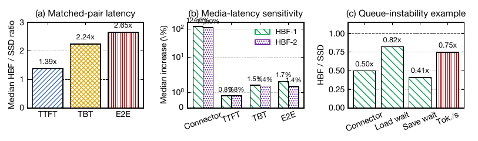

**Original:** Figure 4: A faster connector, a slower system: HBF cuts transfer time yet raises end-to-end latency because the smaller near tier destabilizes the queue.

**中文:** 图 4：更快的连接器，更慢的系统：HBF 缩短了传输时间，但更小的近端层使队列失稳，导致端到端延迟上升。

**读图提示（辅助说明）：** 分三步看。(a) 纵轴是 HBF／SSD 延迟比，大于 1 表示 HBF 更慢，TTFT、TBT、E2E 的中位比值分别为 1.39、2.24、2.65。(b) 改变介质延迟时，连接器服务时间敏感得多，而 E2E 只变化约 0.8%，说明被加速的这段时间并不是主要暴露瓶颈。(c) 是一个队列失稳示例，各项都按 HBF／SSD 比值画出；要看清横轴指标，等待时间下降也不等于最终吞吐改善。累计连接器服务时间与单请求平均 E2E 是不同统计量，不能直接相减；正文 GLM 示例见 S096。

**Source:** p.7 S098

**Original:** The result is a ceiling, not a tuning outcome. With $f\approx1\%$, a perfect zero-latency medium could remove at most one percent of the critical path, while the package trade that buys it costs 2–5.5× in end-to-end latency. In Eq. (6), $C_{\mathrm{pkg}}$ exceeds $f\Delta t_{\mathrm{media}}$ by two orders of magnitude. One alternative explanation is that $f$ is small only because the compute sits far from the data, which Finding 2 tests directly.

**中文:** 这个结果揭示的是收益上限，而不是调参不够好。当 $f\approx1\%$ 时，即使介质延迟为零，最多也只能消掉关键路径的约 1%；而换取它的封装取舍，却让端到端延迟达到基线的 2–5.5 倍。在式（6）中，$C_{\mathrm{pkg}}$ 比 $f\Delta t_{\mathrm{media}}$ 大两个数量级。另一种可能解释是：$f$ 小只是因为计算离数据太远；发现 2 会直接检验这一点。

#### 发现 1

**Source:** p.7 S099

**Original:** Finding 1 Replacing SSD with HBF sacrifices the near-tier capacity and bandwidth that govern admission, so faster flash does not improve end-to-end serving.

**中文:** 发现 1：用 HBF 替换 SSD，会牺牲决定准入能力的近端层容量和带宽，因此更快的闪存并没有改善端到端推理服务。

### 6.2 发现 2：基础裸片计算无法提高暴露比例 · 6.2 Finding 2: Base-Die Compute Cannot Raise the Exposed Fraction

**Source:** p.7 S100

**Original:** 6.2 Finding 2: Base-Die Compute Cannot Raise the Exposed Fraction

**中文:** 6.2 发现 2：基础裸片计算无法提高暴露比例

**Source:** p.7 S101

**Original:** Finding 1 leaves $f$ near 1%. One reading of that number is that the compute sits too far from the data, in which case moving the compute to the data should raise $f$ . The standard form of that move is a near-memory attention engine on the HBF base die, as HBM-PIM does for DRAM. We ask whether it does.

**中文:** 发现 1 得到的 $f$ 约为 1%。一种解释是计算离数据太远；如果如此，把计算移到数据旁边应该提高 $f$。这种做法的典型形式，是在 HBF 基础裸片上放一个近存储注意力引擎，就像 HBM-PIM 对 DRAM 所做的那样。我们检验它是否有效。

**Source:** p.7 S102

**Original:** We model an additional decode-attention engine on the base die under assumptions chosen to favor HBF. It is charged no area, power, or programmability penalty, and every eligible token hits at the device service time, so a negative result is a lower bound. The two modes differ in reach. The HBM engine accelerates all HBM-resident KV; the HBF engine reaches only KV already resident in HBF, and hot HBM-resident KV falls back to GPU attention. Table 6 lists the full configuration.

**中文:** 我们在基础裸片上额外建模了解码注意力引擎，并采用有利于 HBF 的假设：不计算面积、功耗或可编程性惩罚，所有符合条件的词元都按设备服务时间命中，因此负面结果仍是一个保守下界。两种模式的覆盖范围不同：HBM 引擎加速所有驻留 HBM 的 KV；HBF 引擎只能处理已经驻留 HBF 的 KV，热点 HBM KV 仍回退到 GPU 注意力计算。完整配置见表 6。

#### 表 6 · 近存储计算实验配置

**Placed near:** p.7 S102  
**Source:** p.9 T006 · C018

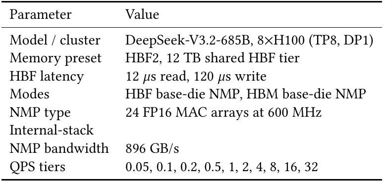

**Original:** Table 6: Finding 2 NMP configuration.

**中文:** 表 6：发现 2 的近存储处理（NMP）配置。

**中文表格：**

| 参数 | 数值 |
| --- | --- |
| 模型／集群 | DeepSeek-V3.2-685B，8×H100（TP8，DP1） |
| 存储预设 | HBF2，12 TB 共享 HBF 层 |
| HBF 延迟 | 读取 12 μs，写入 120 μs |
| 模式 | HBF 基础裸片 NMP；HBM 基础裸片 NMP |
| NMP 类型 | 24 个 FP16 乘加（MAC）阵列，600 MHz |
| 堆栈内部 NMP 带宽 | 896 GB/s |
| QPS 档位 | 0.05、0.1、0.2、0.5、1、2、4、8、16、32 |

**读图提示（辅助说明）：** 这里只有一个模型和八 H100 配置，不能把这些 NMP 结果说成五模型、两 GPU 平台全部验证。HBF 与 HBM 引擎的区别主要在可覆盖的 KV；原文还给 HBF 免去了面积、功耗和可编程性惩罚。

**Source:** p.7 S103

**Original:** Fig. 8(a) reports both engines. Averaged over the 40 sweep points, the HBM engine cuts decode-attention time by 42.84%, and it is stable across the whole sweep (42.78–42.86%). The HBF engine averages −0.03% on the same basis, that is, no benefit at all. Individual points swing from −29.05% to +20.49%, and it is slower than GPU attention at 16 of 40 points, turning positive only near saturation. The end-to-end effect is smaller again. Replacing the HBF engine with the much stronger HBM engine moves decode p50 by 0.39% and decode p99 by 0.82% on non-saturated points.

**中文:** 图 8(a) 报告两个引擎的结果。在 40 个扫描点上取平均，HBM 引擎将解码注意力耗时降低 42.84%，整个扫描范围内都很稳定，为 42.78–42.86%。同一口径下，HBF 引擎平均收益为 −0.03%，相当于完全没有收益。单点结果在 −29.05% 到 +20.49% 之间波动，40 个点中有 16 个比 GPU 注意力更慢，只有接近饱和时才转为正收益。端到端影响更小：在未饱和点上，把 HBF 引擎换成强得多的 HBM 引擎，解码 p50 仅变化 0.39%，p99 仅变化 0.82%。

**Source:** p.7 S104

**Original:** Two quantities account for this behavior. The first is coverage. A base-die engine sees only the cold KV the runtime has already placed in HBF, and the mean HBF-resident fraction is just 15.48% (Fig. 8(b)), so even a perfect HBF engine cannot touch the common HBM-resident case. Table 7 tracks residency and leverage across traces. thinking keeps only 4% of attention in HBF and sees essentially no benefit. traceA at 27% residency has the most eligible work, yet it is still net-negative, which brings in the second quantity, scale. The HBF path pays a 12 μs access on every step, and many low-load decode steps are too small to amortize it. The end-to-end numbers follow the same accounting, since MoE compute, expert communication, prefill, HBF transfers, and queueing are unchanged by either engine.

**中文:** 两个量解释了这个行为。第一是覆盖率：基础裸片引擎只能看到运行时已经放进 HBF 的冷 KV，平均 HBF 驻留比例只有 15.48%（图 8b），所以再完美的 HBF 引擎也处理不了常见的 HBM 驻留情况。表 7 按轨迹记录了驻留比例和可获收益。thinking 只有约 4% 的注意力工作在 HBF 中，几乎没有收益；traceA 的驻留比例约 27%，可处理的工作最多，却仍是净负收益，这就涉及第二个量：规模。HBF 路径每一步都要付出 12 μs 访问延迟，而低负载下许多解码步太小，无法摊薄它。端到端结果也遵循同样的核算：无论哪种引擎，MoE 计算、专家通信、预填充、HBF 传输和排队都没有改变。

#### 图 8 · 近存储注意力：算子收益如何被覆盖率稀释

**Placed near:** p.7 S104  
**Source:** p.9 F008 · C008

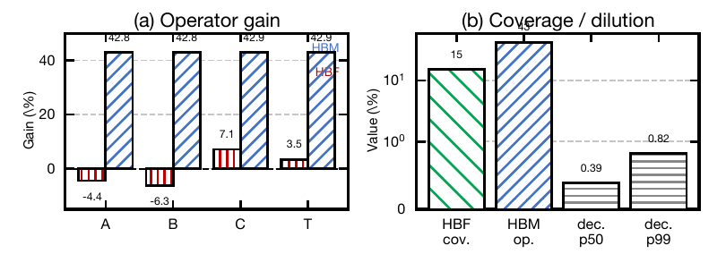

**Original:** Figure 8: Base-die NMP operator leverage, HBF coverage, and end-to-end dilution. A–T denote traceA, traceB, coder, and thinking.

**中文:** 图 8：基础裸片近存储处理（NMP）的算子加速作用、HBF 覆盖率，以及端到端收益的稀释。A–T 分别表示 traceA、traceB、coder 和 thinking。

**读图提示（辅助说明）：** 左图看算子：HBM-NMP 约有 42.8% 的注意力耗时收益，HBF-NMP 则可能为负，四份轨迹的平均值见表 7。右图混合展示不同量：HBF 覆盖率约 15%，HBM 算子收益约 43%，解码端到端 p50、p99 变化却只有 0.39%、0.82%；它们不是可以直接相加的同类指标。HBF 引擎只加速已放入 HBF 的冷 KV，既没有扩大覆盖率，也没有改变其他计算、通信和排队。右图采用压缩跨度的刻度，读柱高时应以标注数值为准。

#### 表 7 · 各轨迹的 NMP 收益与覆盖率

**Placed near:** p.7 S104  
**Source:** p.9 T007 · C019

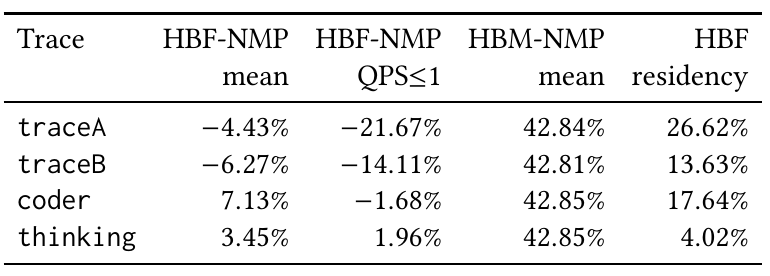

**Original:** Table 7: Per-trace NMP leverage and coverage.

**中文:** 表 7：各轨迹上的 NMP 可获收益和覆盖率。

**中文表格：**

| 轨迹 | HBF-NMP 平均收益 | HBF-NMP 在 QPS≤1 的收益 | HBM-NMP 平均收益 | HBF 驻留比例 |
| --- | --- | --- | --- | --- |
| traceA | −4.43% | −21.67% | 42.84% | 26.62% |
| traceB | −6.27% | −14.11% | 42.81% | 13.63% |
| coder | 7.13% | −1.68% | 42.85% | 17.64% |
| thinking | 3.45% | 1.96% | 42.85% | 4.02% |

**读图提示（辅助说明）：** HBF-NMP mean 是各扫描点上的平均算子耗时收益；QPS≤1 列只看低负载点；HBM-NMP mean 是对照引擎收益。正数表示节省，负数表示更慢，最后一列则是 HBF 驻留比例。不能把驻留比例当成端到端收益，也不能把负号理解为延迟降低。

**Source:** p.8 S105

**Original:** Moving compute into the device raises neither term of $f$ . It enlarges neither the resident fraction nor the per-step work, so C1 survives the intervention. The conclusion is not that base-die compute is useless but that it is the wrong lever for this bottleneck. It accelerates a small, cold, microsecond-latency slice, so base-die silicon is better spent on the control plane than on a general attention engine. The next condition turns to what a swap costs on the write side.

**中文:** 把计算移入设备，没有提高构成 $f$ 的两个因素：它既没有扩大驻留比例，也没有增大每步工作量，因此这次干预没有改变 C1 的判断。结论并非基础裸片计算毫无用处，而是它没有作用在这个瓶颈的关键位置。它加速的只是一小段冷数据、微秒延迟的工作，因此基础裸片的硅面积更适合用于控制平面，而不是通用注意力引擎。下一个条件转向替换方案在写入侧付出的成本。

#### 发现 2

**Source:** p.9 S106

**Original:** Finding 2 Base-die attention compute cannot overcome HBF’s limited KV coverage, so its silicon is better spent on control rather than general attention.

**中文:** 发现 2：基础裸片上的注意力计算无法克服 HBF 有限的 KV 覆盖率，因此其硅面积更适合用于控制，而不是通用注意力计算。

## 7 C2：读取足以抵偿写入 · 7 C2: Reads Outweigh Writes

**Source:** p.9 S107

**Original:** 7 C2: Reads Outweigh Writes

**中文:** 7 C2：读取足以抵偿写入

**Source:** p.9 S108

**Original:** Condition C2 requires HBF to be a read-heavy tier, $\rho>\rho^{\star}\gtrsim1$ (Eq. (8)). Finding 3 measures the reads-per-write the hierarchy delivers, and Finding 4 asks whether the standard SSD write optimization can lower the write cost $C$.

**中文:** 条件 C2 要求 HBF 成为以读为主的层级，满足 $\rho>\rho^{\star}\gtrsim1$（式 8）。发现 3 测量层次结构实际带来的每次写入对应读取量；发现 4 则考察常见 SSD 写入优化能否降低写入成本 $C$。

### 7.1 发现 3：SSD 式层次使 HBF 变成写密集层 · 7.1 Finding 3: SSD-Style Hierarchy Makes HBF Write-Heavy

**Source:** p.9 S109

**Original:** 7.1 Finding 3: SSD-Style Hierarchy Makes HBF Write-Heavy

**中文:** 7.1 发现 3：SSD 式层次使 HBF 变成写密集层

**Source:** p.9 S110

**Original:** Finding 1 showed the flash service sits off the critical path. Whether it earns its place is a separate question. Every byte HBF serves must first be written there, so C2 asks whether those writes are repaid by later reads. A hierarchy tuned for reuse could land on either side of that threshold.

**中文:** 发现 1 表明闪存服务不在关键路径上，但它是否仍值得占据这个位置，是另一个问题。HBF 返回的每个字节，都必须先写进去，因此 C2 要问的是：后来的读取能否偿还这些写入？一个为复用优化的层次结构，可能落在该门槛的任意一侧。

**Source:** p.9 S111

**Original:** We replay each of the four production traces for two hours and measure the write and read byte counts at the flash tier directly. Their ratio converts to the delivered $\rho$ that C2 tests. We also record the prefix hit rate, which separates cache effectiveness from flash-tier traffic.

**中文:** 我们将四份生产轨迹分别回放两小时，直接统计闪存层的写入和读取字节数。二者之比可换算为 C2 要检验的实际 $\rho$。同时记录前缀命中率，将缓存本身的有效性与闪存层流量区分开。

**Source:** p.9 S112

**Original:** Table 8 reports all three quantities. Every trace writes more to the flash tier than it reads back, from 1.14× (coder) to 4.90× (traceB), so $\rho$ ranges from 0.20 to 0.88, below break-even on every trace and several-fold below on the write-heaviest. The prefix hit rate is 38–53%, so reuse is found even where the flash tier reads little back.

**中文:** 表 8 报告了这三个量。每份轨迹写入闪存的量都多于读回的量：写／读比从 coder 的 1.14 倍到 traceB 的 4.90 倍，因此 $\rho$ 为 0.20–0.88，全部低于盈亏平衡门槛；写入最密集的轨迹更低了数倍。但前缀命中率仍为 38–53%，说明即使闪存层读回很少，系统依然找到了复用。

#### 表 8 · 闪存层实际读写比

**Placed near:** p.9 S112  
**Source:** p.9 T008 · C020

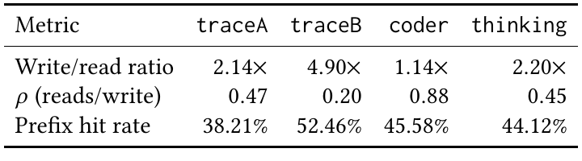

**Original:** Table 8: Flash-tier traffic over a full two-hour replay.

**中文:** 表 8：完整两小时回放中的闪存层流量。

**中文表格：**

| 指标 | traceA | traceB | coder | thinking |
| --- | --- | --- | --- | --- |
| 写入／读取字节比 | 2.14× | 4.90× | 1.14× | 2.20× |
| $\rho$：读取／写入字节比 | 0.47 | 0.20 | 0.88 | 0.45 |
| 前缀命中率 | 38.21% | 52.46% | 45.58% | 44.12% |

**读图提示（辅助说明）：** 第一行是写／读，第二行 ρ 是读／写，二者互为倒数；它们按字节计算，不是操作次数。四个 ρ 都低于 1，因此连“读回字节至少等于写入字节”都未达到。前缀命中率高不代表命中发生在 HBF：热点可由近端层提供，这正是 38–53% 命中率与 HBF 写多读少能同时成立的原因。

**Source:** p.9 S113

**Original:** Reuse distribution across blocks. The two observations reconcile through the reuse distribution, not the average. Reuse is extremely skewed. The top decile of unique blocks supplies 64% (traceA) to 95–100% (thinking, traceB) of all reuse reads, with Gini 0.80–1.0. Those hot blocks are the ones the near tier keeps resident, so those hits are served from HBM or GDDR, and what reaches HBF is the long cold tail, written once and rarely read again. traceB is the extreme, with only 6% of blocks ever reused, so almost everything it sends HBF is write-once and its ratio is highest. A cache tier that mostly writes is therefore the hierarchy doing its job, not a misconfiguration. It keeps reuse where it is fastest to serve and hands the tier that should hold read-mostly data a write-mostly stream.

**中文:** 块之间的复用分布。要让这两个观察一致起来，应该看复用分布，而不是平均值。复用高度倾斜：唯一块中最热的 10%，贡献了全部复用读取的 64%（traceA）到 95–100%（thinking、traceB），基尼系数为 0.80–1.0。近端层保留的恰好是这些热点块，所以命中由 HBM 或 GDDR 处理；到达 HBF 的则是冷数据长尾，写一次之后很少再读。traceB 最极端，只有 6% 的块曾被复用，因此送入 HBF 的几乎都是只写一次的数据，其写／读比最高。所以，一个主要承受写入的缓存层，恰恰说明层次结构在正常工作，并非配置错误：它把复用留在处理最快的地方，却把以写为主的数据流交给了本应存储以读为主数据的层级。

**Source:** p.9 S114

**Original:** Under save/restore pooling, $\rho$ depends on both object class and placement. Stable weights and static tensors support many reads per write ($\rho\gg1$), and shared-prefix KV can amortize one write over many requests. Private decode KV grows token by token and dies when the request finishes, leaving few opportunities for a later restore. The traces quantify cross-request reuse: The fraction of blocks ever reused across requests is 46.8%, 6.0%, 39.0%, and 14.3%. The pooling policy determines how much of that reuse reaches the flash tier. This is why H3 and HAVEN place stable, read-mostly objects in HBF [7, 9]. The problem is not that HBF cannot hold KV, but that the SSD-style hierarchy routes the least reusable KV to the device least able to absorb writes.

**中文:** 在保存／恢复式池化中，$\rho$ 同时取决于对象类别与放置位置。稳定权重和静态张量可以每写一次读很多次，即 $\rho\gg1$；共享前缀 KV 也可以用多个请求摊薄一次写入。请求私有的解码 KV 则逐词元增长，请求结束就失去用途，很少有后续恢复的机会。轨迹量化了跨请求复用：曾被不同请求复用的块占比分别为 46.8%、6.0%、39.0% 和 14.3%。池化策略决定这些复用中有多少会落到闪存层。这也解释了 H3 和 HAVEN 为什么把稳定、以读为主的对象放到 HBF [7, 9]。问题不是 HBF 不能存 KV，而是 SSD 式层次把最不容易复用的 KV，送给了最不擅长承受写入的设备。

#### 发现 3

**Source:** p.9 S115

**Original:** Finding 3 The two-tier hierarchy keeps reusable KV in the near tier and sends HBF a write-heavy cold stream whose writes are rarely repaid.

**中文:** 发现 3：两级层次把可复用 KV 留在近端层，却把写密集的冷数据流送入 HBF，这些写入很少得到后续读取的偿还。

### 7.2 发现 4：SSD 批量写入对 HBF 帮助很小 · 7.2 Finding 4: SSD Write-Batching helps little for HBF

**Source:** p.10 S116

**Original:** 7.2 Finding 4: SSD Write-Batching helps little for HBF

**中文:** 7.2 发现 4：SSD 批量写入对 HBF 帮助很小

**Source:** p.10 S117

**Original:** Finding 3 establishes $\rho$ under the unchanged pooling policy, so the remaining lever in Eq. (8) is the write cost $C$. SSD KV serving already has the standard tool for lowering it. Mooncake-style batching coalesces many small KV writes into large buckets, amortizing the drive’s slow per-operation I/O and turning scattered writes into near-sequential transfers. Whether that win is a property of the optimization or of the medium it was built for decides whether it carries onto HBF.

**中文:** 发现 3 确定了池化策略不变时的 $\rho$，因此式（8）剩下的调整手段是写入成本 $C$。SSD KV 服务已经有降低它的标准工具：Mooncake 式批处理将大量小 KV 写入合并到大桶中，摊薄每次操作缓慢的 I/O 成本，把分散写入变为接近顺序的传输。这个收益究竟来自优化本身，还是来自它针对的介质特征，决定了收益能否迁移到 HBF。

**Source:** p.10 S118

**Original:** We run the identical bucketing mechanism on both media over a shared traceA/traceB matrix, holding HBF’s random and sequential bandwidth equal so batching can help only by amortizing fixed write-operation latency. We compare three arms, no-batch, the Mooncake bucketed path, and a single-key control that pays the bucketing cost without grouping anything.

**中文:** 我们在共同的 traceA／traceB 实验矩阵上，对两种介质运行完全相同的分桶机制。将 HBF 随机带宽和顺序带宽设为相同，使批处理只能通过摊薄固定写操作延迟获益。比较三种方案：不批处理、Mooncake 分桶路径，以及一个单键控制组；该控制组要支付分桶成本，却不真正合并对象。

**Source:** p.10 S119

**Original:** Table 9 and Fig. 9(a) give the paired result. On SSD-12, request p50 falls by 8.9–21.1% at every block size. The same mechanism on HBF-2 recovers 2.69% overall, 5.2× smaller, and the benefit is concentrated at the smallest block, +9.2% at 16 tokens, fading to +0.72% at 128 and turning negative (−1.85%) at 512. The SSD gain is flat across block size; the HBF gain decays to zero and then costs.

**中文:** 表 9 和图 9(a) 给出配对结果。在 SSD-12 上，各种块大小下请求 p50 都降低了 8.9–21.1%。相同机制在 HBF-2 上总体只改善 2.69%，约为 SSD 收益的 1/5.2；收益集中在最小块：16 词元时为 +9.2%，128 词元时降至 +0.72%，512 词元时转为负值 −1.85%。SSD 在各种块大小下都保持收益；HBF 的收益则逐渐降到零，之后反而带来成本。

#### 表 9 · 批处理相对于不批处理的收益

**Placed near:** p.10 S119  
**Source:** p.10 T009 · C021

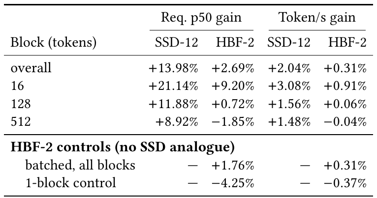

**Original:** Table 9: Paired batching benefit (batched vs. matched no-batch), SSD-12 vs. HBF-2 on the shared traceA/traceB matrix.

**中文:** 表 9：在共同的 traceA／traceB 实验矩阵中，SSD-12 与 HBF-2 的配对批处理收益；将批处理与匹配的不批处理方案比较。

**中文表格：**

| 块大小（词元）／汇总项 | 请求 p50 收益：SSD-12 | 请求 p50 收益：HBF-2 | 词元／秒收益：SSD-12 | 词元／秒收益：HBF-2 |
| --- | --- | --- | --- | --- |
| 总体（overall） | +13.98% | +2.69% | +2.04% | +0.31% |
| 16 | +21.14% | +9.20% | +3.08% | +0.91% |
| 128 | +11.88% | +0.72% | +1.56% | +0.06% |
| 512 | +8.92% | −1.85% | +1.48% | −0.04% |
| HBF-2 控制：批处理，全部块 | — | +1.76% | — | +0.31% |
| HBF-2 控制：单块控制组 | — | −4.25% | — | −0.37% |

**读图提示（辅助说明）：** 请求 p50 的 gain 为延迟降低百分比，词元／秒 gain 为吞吐提升百分比，均正值更好。“overall”和“batched, all blocks”是原表中不同汇总行，不能自行视为同一组平均；原文未在表中补充更细分母。单块控制组只付出分桶开销、不合并键，HBF 的 p50 为 −4.25%、吞吐 −0.37%，说明分桶本身有成本。

**Source:** p.10 S120

**Original:** Composition of the write cost. The contrast follows from what each medium’s write cost is made of. On SSD a write is dominated by high fixed per-operation overhead and a random-access penalty, and usable bandwidth is low relative to demand. Batching attacks all three at once, so its win is large and survives coarse blocks. Our HBF service model isolates fixed-overhead amortization: random and sequential bandwidth are equal, so bucketing gains no scattered-to-sequential bandwidth advantage. The only lever left is amortizing fixed operation latency, which pays off only when a bucket is dense with tiny blocks, about 94 blocks per bucket at 16 tokens but 4 at 512 (Fig. 9(b)). The single-key control makes that residue explicit. With the batching path enabled but no grouping it is worse than no-batch on every metric, because it pays bucketing overhead for no amortization.

**中文:** 写入成本的组成。差异来自两种介质的写入成本结构。在 SSD 上，每次操作的高固定开销和随机访问惩罚占主导，而且相对需求，可用带宽偏低。批处理同时改善这三点，所以收益大，块变粗之后仍然有效。本文 HBF 服务模型隔离出固定开销摊薄的效果：随机和顺序带宽相同，因此分桶没有“从分散变顺序”带来的带宽优势。唯一剩下的手段是摊薄固定操作延迟；这只有在桶中密集装入小块时才划算。16 词元时每桶约 94 块，512 词元时却只有 4 块（图 9b）。单键控制组将这个剩余收益显露出来：开启批处理路径却不合并对象时，各项指标都差于不批处理，因为付了分桶开销，却没有摊薄任何成本。

#### 图 9 · SSD 的批量写入收益为什么没迁移过来

**Placed near:** p.10 S120  
**Source:** p.10 F009 · C009

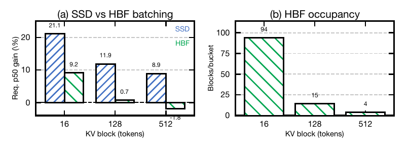

**Original:** Figure 9: Batching gain does not transfer from SSD to HBF. (a) Request-p50 reduction from Mooncake batching on SSD-12 vs. HBF-2 across KV block sizes; SSD gains hold everywhere while HBF fades to negative. (b) HBF-2 bucket occupancy collapses as blocks grow, removing the only latency HBF batching can amortize.

**中文:** 图 9：批处理收益没有从 SSD 迁移到 HBF。（a）不同 KV 块大小下，Mooncake 批处理使 SSD-12 与 HBF-2 请求 p50 降低的幅度；SSD 始终有收益，HBF 则逐步降到负收益。（b）块变大时，HBF-2 每桶容纳的块数急剧下降，削弱了 HBF 批处理唯一能够摊薄的延迟。

**读图提示（辅助说明）：** 左图纵轴为请求 p50 的降低比例，正值越大越好，负值表示更慢。SSD 在 16／128／512 词元块上分别改善约 21.1%／11.9%／8.9%；HBF 则为 9.2%／0.7%／−1.8%。右图给出原因：每桶约容纳 94／15／4 块。这个结论依赖本文把 HBF 随机、顺序带宽设为相同的服务模型；模型中只剩固定操作延迟可被摊薄，不能泛化为任何 HBF 批处理设计都没有用。

**Source:** p.10 S121

**Original:** SSD-style buckets amortize fixed I/O overhead. OCP specifies complete 4 KiB page writes and sequential programming. For maximum parallelism, banks within a die use the same page number [1, §§5.4, 11.2.2]. Larger buckets preserve the write-heavy stream. Their measured benefit is too small to rescue C2.

**中文:** SSD 式分桶摊薄的是固定 I/O 开销。OCP 规定必须写入完整的 4 KiB 页，并按顺序编程。要获得最大并行度，同一裸片中的各存储体应使用相同页号 [1，第 5.4、11.2.2 节]。更大的桶并不会改变流量以写为主的本质，测得的收益不足以让 C2 成立。

#### 发现 4

**Source:** p.10 S122

**Original:** Finding 4 SSD-style bucketing delivers little benefit under the evaluated HBF service model and leaves the write-heavy pooling stream unchanged.

**中文:** 发现 4：在本文评估的 HBF 服务模型下，SSD 式分桶收益很小，也没有改变池化流量以写为主的特点。

## 8 C3：读写性能能够持续 · 8 C3: Read/Write Performance Sustains

**Source:** p.10 S123

**Original:** 8 C3: Read/Write Performance Sustains

**中文:** 8 C3：读写性能能够持续

**Source:** p.10 S124

**Original:** Condition C3 requires the bandwidth the workload receives to stay near the datasheet peak. Finding 5 measures what an HBF stack sustains at run time, and Finding 6 measures what the write side costs over the device’s life.

**中文:** 条件 C3 要求工作负载实际得到的带宽能够接近规格表峰值。发现 5 测量 HBF 堆栈运行时能维持什么带宽；发现 6 则测量写入侧在整个设备寿命中的成本。

### 8.1 发现 5：写密集流量使 HBF 过热并限制带宽 · 8.1 Finding 5: Write-Heavy Traffic Overheats HBF and Throttles Bandwidth

**Source:** p.10 S125

**Original:** 8.1 Finding 5: Write-Heavy Traffic Overheats HBF and Throttles Bandwidth

**中文:** 8.1 发现 5：写密集流量使 HBF 过热并限制带宽

**Source:** p.10 S126

**Original:** Finding 3 established that the flash stream a KV hierarchy generates is write-heavy, and writes cost more power than reads. What sustained bandwidth an HBF stack can hold under that traffic is therefore open; the interface peak bounds it but does not answer it.

**中文:** 发现 3 已经确定，KV 层次产生的闪存流量以写为主，而写入功耗又高于读取。因此，这种流量下 HBF 堆栈究竟能维持多大带宽，仍是个问题；接口峰值只能给出上界，不能直接回答它。

**Source:** p.10 S127

**Original:** Thermal model and throttling policy. A 3D-ICE [23] model of a 16-Hi TLC stack, driven by the access energy of a 16-token KV block, sweeps sustained single-stack bandwidth (§4). The thermal policy in Section 4 closes the hottest, highest-traffic planes and redirects writes to cooler ones.

**中文:** 热模型与限流策略。用 16 词元 KV 块的访问能量驱动一个 16 层裸片堆叠 TLC 的 3D-ICE 模型 [23]，扫描单堆栈持续带宽（第 4 节）。第 4 节中的热策略会关闭最热且流量最高的平面，并把写入导向较冷的平面。

**Source:** p.10 S128

**Original:** Dynamic power scales linearly with bandwidth, and the stack hits the 80°C limit at only 202.27 GB/s and 53.72 W, far below interface peak, so it cannot run continuously above that point (Fig. 10(a)). In the replay, the unconstrained run holds peak bandwidth through a burst, while the thermal controller drops the constrained run to the 202 GB/s safe point and holds temperature near 80°C (Fig. 10(b)– (c)).

**中文:** 动态功耗随带宽线性增长；单堆栈在仅 202.27 GB/s、53.72 W 时就触及 80°C 上限，远低于接口峰值，因此无法长期运行在这个点以上（图 10a）。回放中，无约束运行可以在突发期间维持峰值带宽；热控制器则将受约束运行降到约 202 GB/s 的安全点，并将温度维持在 80°C 附近（图 10b–c）。

**Source:** p.10–11 S129

**Original:** Why the stack runs hot. Delivered bandwidth is not a constant. It varies in time as hot regions throttle and cool, and in space as the runtime steers traffic away from the hottest planes. The cause traces back to Finding 3. Because reuse stays in the near tier and writes dominate the flash stream at higher power per access, the device is pushed to its limit by exactly the write-heavy traffic the hierarchy sends it. A read-mostly workload at the same bandwidth would run cooler.

**中文:** 堆栈为什么这么热。实际交付带宽不是常数：随热点区域限流和冷却，它在时间上变化；随运行时绕开最热平面，它在空间上也变化。原因仍可追溯到发现 3：复用留在近端层，而单次访问功耗更高的写入占据闪存流量的主体，因此层次结构送来的写密集流量恰好把设备推到极限。同样带宽下，以读为主的工作负载温度会更低。

#### 图 10 · 温度怎样限制持续带宽

**Placed near:** p.10 S129  
**Source:** p.11 F010 · C010

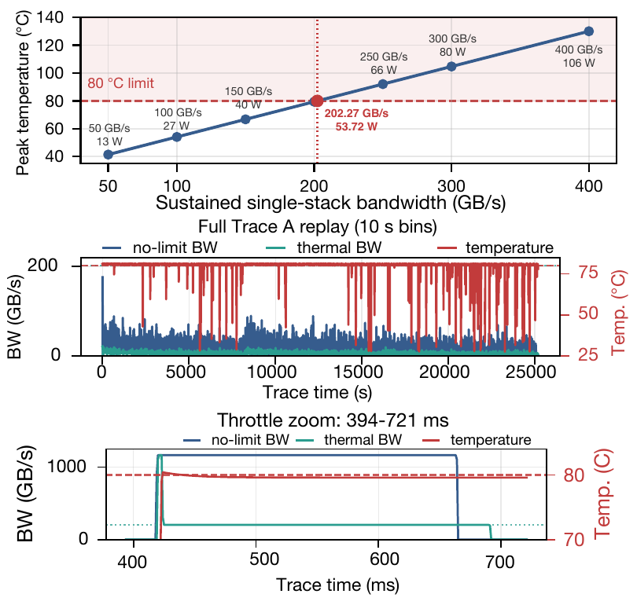

**Original:** Figure 10: (a) Dynamic power and peak temperature vs. single-stack bandwidth. (b) Full replay: thermal control caps delivered bandwidth. (c) Throttle zoom: temperature stays near 80°C while bandwidth is capped.

**中文:** 图 10：（a）动态功耗和峰值温度随单堆栈带宽的变化。（b）完整回放中，热控制限制实际交付带宽。（c）限流片段放大：带宽受到限制时，温度保持在 80°C 附近。

**读图提示（辅助说明）：** 上图横轴为单堆栈持续带宽，纵轴为峰值温度，点旁文字给出功耗。按本文 16-Hi TLC、16 词元访问能量和 80°C 策略建模，约 202.27 GB/s、53.72 W 就达到上限。中图比较完整回放的无热约束带宽、热约束带宽和温度；下图放大 394–721 ms 的突发片段。蓝／绿曲线要对照左侧带宽轴，红线要对照右侧温度轴。这里是 3D-ICE 模型结果，202 GB/s 并非所有 HBF 器件通用的实测上限。

**Source:** p.11 S130

**Original:** A scheduler that assumes a fixed flash bandwidth will mispredict service time and build queues it did not expect. The OCP specification likewise treats thermal state as part of the host contract: severe throttling halts data I/O while retaining maintenance service [1, §9.2]. The unchanged pooling runtime therefore needs more than a peak-bandwidth number to sustain its write-heavy stream.

**中文:** 如果调度器假定闪存带宽固定，就会误判服务时间，产生预期之外的排队。OCP 规范同样把热状态纳入主机接口约定：严重限流时停止数据 I/O，只保留维护服务 [1，第 9.2 节]。因此，未修改的池化运行时若想持续承受写密集流量，需要了解的不只是一个峰值带宽数字。

#### 发现 5

**Source:** p.11 S131

**Original:** Finding 5 Write-heavy KV traffic drives HBF into thermal throttling, making delivered bandwidth lower and less predictable than its rated peak.

**中文:** 发现 5：写密集 KV 流量使 HBF 进入热限流，实际交付带宽低于额定峰值，而且更难预测。

### 8.2 发现 6：写密集 KV 池化使 HBF 更早耗尽寿命 · 8.2 Finding 6: HBF Wears Out Sooner Under Write-Heavy KV Pooling

**Source:** p.11 S132

**Original:** 8.2 Finding 6: HBF Wears Out Sooner Under Write-Heavy KV Pooling

**中文:** 8.2 发现 6：写密集 KV 池化使 HBF 更早耗尽寿命

**Source:** p.11 S133

**Original:** Finding 5 measured what the write-heavy stream costs in the moment, when its power throttles delivered bandwidth. The same stream also has a cumulative cost. Every write spends part of a finite program/erase budget. We compare the trace-measured write volume against the HBF and capacity-matched SSD endurance budgets defined in Section 4.

**中文:** 发现 5 测量的是写密集流量的即时成本：功耗引发限流，降低实际带宽。同样的流量还有累计成本。每次写入都会消耗有限的编程／擦除预算。我们将轨迹中统计的写入量，与第 4 节定义的 HBF 和容量匹配 SSD 的耐久性预算比较。

**Source:** p.11 S134

**Original:** Every trace writes past both envelopes (48–140 TB/day), so under linear TBW exhaustion the nominal HBF tier lasts a constant 0.56× the SSD pool’s life across all four traces (Fig. 11). Coarsening KV blocks from 16 to 128 to 512 tokens raises the apparent prefix hit rate yet increases HBF write volume from 188 to 237 to 258 TB (1.38×).

**中文:** 每份轨迹的写入量都超过两种设备的预算范围，为 48–140 TB/天。因此，按总写入字节数（TBW）线性耗尽估算，四份轨迹上标称 HBF 层的寿命都只有 SSD 池的 0.56 倍（图 11）。将 KV 块从 16 词元增大到 128、再到 512，会提高表观前缀命中率，但 HBF 写入量也从 188 TB 增至 237 TB、再到 258 TB，达到原来的 1.38 倍。

#### 图 11 · 每日写入量与预计寿命

**Placed near:** p.11 S134  
**Source:** p.11 F011 · C011

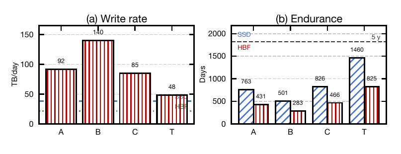

**Original:** Figure 11: KV write volume and endurance budget. A–T denote traceA, traceB, coder, and thinking.

**中文:** 图 11：KV 写入量和耐久性预算。A–T 分别表示 traceA、traceB、coder 和 thinking。

**读图提示（辅助说明）：** 左图是轨迹写入量按每日持续负载外推的速率，A／B／C／T 约为 92／140／85／48 TB/天；右图按固定 TBW 预算线性耗尽估算寿命，SSD 与 HBF 分别约为 763/431、501/283、826/466、1460/825 天。水平虚线标示五年目标。因为两种预算之比固定，HBF／SSD 的寿命比在所有轨迹中都约为 0.56。这是基于本文 TLC、单位写放大和持续负载假设的寿命估计，不能理解为真实硬件已经运行到损坏。

**Source:** p.11 S135

**Original:** Why the shortfall is structural. HBF is attached like memory but behaves like flash. OCP assigns ECC, bad-block handling, and write accumulation to the base die. Wear leveling can run in the base die or on the host [1, §§4.4, 5.4, 11.4]. Wear leveling distributes wear but leaves the pooling stream’s programming demand intact. Unlike an SSD’s internal reclamation machinery [4], OCP delegates live-data movement and reclamation to the host. Zone remapping requires invalid data and quiesced reads before rewriting [1, §11.4]. OCP specifies host refresh for data age and read-disturb counts, and 24-hour powered-on retention at 85°C [1, §§9, 11.5]. These responsibilities make write volume, wear distribution, and data lifetime explicit inputs to placement, rather than properties hidden by a peak-bandwidth number. Block granularity does not route around that state. Small blocks maximize the number of write operations. Larger blocks increase bytes written and write amplification: partial reuse can still require rewriting the entire block. Both keep the device on the wrong side of Eq. (8).

**中文:** 这种差距为什么具有结构性。HBF 像内存一样连接，却仍像闪存一样工作。OCP 把 ECC、坏块处理和写入积累交给基础裸片。磨损均衡可以在基础裸片或主机上运行 [1，第 4.4、5.4、11.4 节]；它能分散磨损，却不会减少池化流量的编程需求。不同于 SSD 内部的回收机制 [4]，OCP 将有效数据搬移与回收委托给主机。区域重新映射要求先让数据失效，并在重写前使读取静止 [1，第 11.4 节]。OCP 还要求主机根据数据年龄与读干扰计数执行刷新，并规定在 85°C 通电状态下保留数据 24 小时 [1，第 9、11.5 节]。这些职责使写入量、磨损分布和数据寿命成为数据放置必须显式考虑的输入，不能藏在峰值带宽数字背后。调整块粒度也绕不过这些状态：小块使写操作次数最多；大块则增加写入字节和写放大，因为即便只复用部分内容，也可能需要重写整个块。两种情况都让设备处于式（8）不划算的一侧。

**Source:** p.11 S136

**Original:** Our trace-driven endurance comparison shows that HBF wears out sooner than the capacity-matched SSD pool it replaces, exposing the endurance cost $C_{\mathrm{life}}$ in Eq. (6). Writing short-lived KV into HBF pays twice: programming must complete, and programs consume the endurance budget.

**中文:** 本文的轨迹驱动耐久性比较表明，HBF 比它替换的容量匹配 SSD 池更早耗尽寿命，暴露了式（6）中的耐久性成本 $C_{\mathrm{life}}$。将短命 KV 写入 HBF，要付两次代价：编程本身必须完成，而每次编程还会消耗耐久性预算。

#### 发现 6

**Source:** p.11 S137

**Original:** Finding 6 Under unchanged SSD-style KV pooling, HBF wears out sooner than the capacity-matched SSD pool: the measured write-heavy stream exhausts its endurance budget faster.

**中文:** 发现 6：在 SSD 式 KV 池化策略不变的情况下，HBF 比容量匹配的 SSD 池更早耗尽寿命，因为轨迹中统计的写密集流量更快地消耗了它的耐久性预算。

## 9 讨论与相关工作 · 9 Discussion and Related Work

**Source:** p.11 S138

**Original:** 9 Discussion and Related Work

**中文:** 9 讨论与相关工作

### 9.1 综合分析 · 9.1 Synthesis

**Source:** p.11 S139

**Original:** 9.1 Synthesis

**中文:** 9.1 综合分析

**Source:** p.11 S140

**Original:** The six findings falsify the three conditions of Section 5 in turn, and together they mark where HBF does help. An object belongs in HBF only when its restore delay is the serving bottleneck (C1), its reads outweigh its writes ($\rho>\rho^{\star}$ , C2), and the bandwidth it needs is sustainable under the package’s power and endurance budget (C3). Fig. 12 places representative object classes on the two axes that decide this (exposed stall and reads-per-write), with sustainable bandwidth shifting the boundary. Transient decode KV sits in the low-exposure, low-$\rho$ corner where all three conditions fail; weights and shared prefixes sit in the opposite corner, which is where H3 and HAVEN place their HBF-resident state.

**中文:** 六个发现依次证伪了第 5 节的三个条件，同时也指出 HBF 在哪里才有帮助。只有当对象恢复延迟确实是服务瓶颈（C1）、读取足以抵偿写入，即 $\rho>\rho^{\star}$（C2），并且所需带宽能在封装功耗与耐久性预算下持续提供（C3）时，它才适合放进 HBF。图 12 以两个决定性轴——暴露停顿和每次写入对应的读取量——放置代表性对象类别，再用持续带宽改变适用边界。短暂的解码 KV 位于低暴露、低 $\rho$ 的角落，三个条件均失败；权重和共享前缀则在相反的角落，这也正是 H3 和 HAVEN 放置 HBF 驻留状态的方向。

#### 图 12 · 哪类对象更适合放进 HBF

**Placed near:** p.11 S140  
**Source:** p.12 F012 · C012

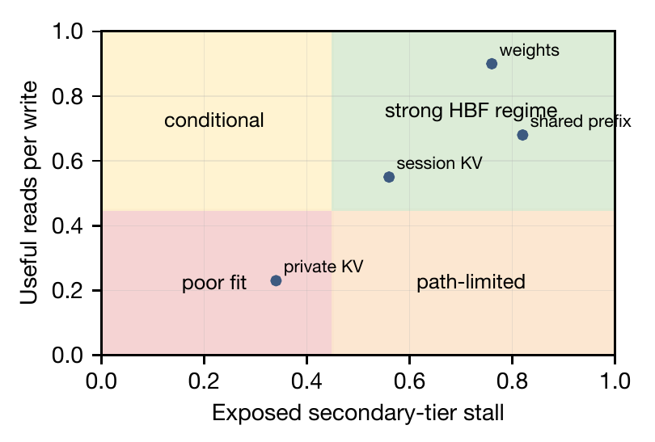

**Original:** Figure 12: Placement map implied by the findings: exposed stall (C1) against reads-per-write (C2), with sustainable bandwidth (C3) shifting the boundary.

**中文:** 图 12：由实验发现导出的放置图：横轴为暴露停顿（C1），纵轴为每次写入对应的读取量（C2）；持续带宽（C3）会移动适用边界。

**读图提示（辅助说明）：** 先看方向：越往右，次级层停顿越暴露在关键路径上；越往上，每次写入越能换来有用读取。权重、共享前缀偏右上，请求私有 KV 偏左下，会话 KV 在中间。它是概念示意，不能拿位置读出某类对象的实测收益或精确门槛。尤其要留意：原图纵轴标 0–1，而式（8）与正文要求 ρ 大于通常高于 1 的门槛；原文没有说明图中是否作了归一化。这里保留原图，只用它理解方向，不用纵轴刻度计算盈亏平衡。

**Source:** p.12 S141

**Original:** The three conditions use device-agnostic quantities: exposed critical-path fraction, reads per write, and sustained bandwidth. The same map therefore applies to other package-local far tiers such as CXL-attached or near-data flash, not only to HBF. The map gives the axes and the break-even rule of Eq. (8) rather than a calibrated boundary across the latency×bandwidth plane. A working runtime requires critical-path-aware access, reuse-aware admission, and thermal-aware write budgeting. The OCP specification reinforces this object-aware direction by describing separate weight and KV channels to manage endurance and capacity utilization [1, §13.3.3]. Our measurements establish why an unchanged SSD-style pool is a poor match.

**中文:** 这三个条件使用与设备无关的量：关键路径暴露比例、每次写入对应的读取量，以及持续带宽。因此，同一适用性图也能用于 CXL 连接的闪存、近数据闪存等其他封装附近的远端层，而不只适用于 HBF。图中提供的是坐标轴和式（8）的盈亏平衡规则，并不是在“延迟×带宽”平面上经过标定的精确边界。可用的运行时需要感知关键路径的访问、感知复用的准入，以及考虑温度的写入预算。OCP 规范提出分离权重通道和 KV 通道，以管理耐久性与容量利用率，也支持按对象特征设计的方向 [1，第 13.3.3 节]。本文的测量解释了为什么照搬 SSD 式池化并不匹配。

### 9.2 相关工作 · 9.2 Related Work

**Source:** p.12 S142

**Original:** 9.2 Related Work

**中文:** 9.2 相关工作

**Source:** p.12 S143

**Original:** KV-cache management. PagedAttention enables block allocation and prefix sharing [15], quantization and compaction shrink KV size [8, 18, 28], and Prompt Cache and CachedAttention reuse state across prompts [5, 6]. Mooncake, LMCache, Strata, and Tutti offload KV across CPU, SSD, and network tiers with GPU-assisted I/O [17, 20, 21, 27], and DeepSeek’s disk context cache evidences persisted prefix reuse [3]. We ask how this SSD-offload stack behaves when its backing medium moves into the accelerator package.

**中文:** KV 缓存管理。PagedAttention 支持块分配和前缀共享 [15]；量化与压缩整理可缩小 KV 占用 [8, 18, 28]；Prompt Cache 和 CachedAttention 在提示之间复用状态 [5, 6]。Mooncake、LMCache、Strata 和 Tutti 借助 GPU 辅助 I/O，在 CPU、SSD 和网络层之间卸载 KV [17, 20, 21, 27]；DeepSeek 的磁盘上下文缓存则表明持久化前缀复用已用于实践 [3]。本文研究的是：当后备介质移入加速器封装后，这套 SSD 卸载栈会如何表现。

**Source:** p.12 S144

**Original:** HBF. Prior studies explore HBF as either a read-mostly extension or the main GPU memory. H3 places read-only weights and shared precomputed KV in HBF while retaining generated state in HBM [7]; HAVEN stores a vector collection in HBF and reranks near the device [9]. FlashAccel adds six HBF stacks to an HBM-based GPU and reports throughput 2.54× that of its HBM-only baseline [25]. The POSTECH study evaluates both one HBM plus seven HBF stacks and an all-HBF configuration with eight HBF stacks. Weights and KV reside in flash; intermediate data use the retained HBM or base-die SRAM, respectively [22]. These configurations explore HBF as primary memory, distinct from the HBF roadmap’s GDDR–HBF and shared HBM–HBF organizations evaluated here. Our focus is the HBF-1/HBF-2 package tradeoff under an SSD-style KV hierarchy and production-trace replay. The studies thus address different organizations, data paths, and serving conditions.

**中文:** HBF。已有研究将 HBF 用作以读为主的扩展层，或 GPU 主存。H3 将只读权重和预计算的共享 KV 放入 HBF，把生成的状态保留在 HBM [7]；HAVEN 在 HBF 存储向量集合，并在设备附近重排序 [9]。FlashAccel 在基于 HBM 的 GPU 上增加六个 HBF 堆栈，报告吞吐达到纯 HBM 基线的 2.54 倍 [25]。POSTECH 的研究评估了一个 HBM 加七个 HBF 堆栈，以及八个 HBF 堆栈的全 HBF 配置：权重和 KV 都在闪存，中间数据分别使用保留的 HBM 或基础裸片 SRAM [22]。这些配置探索将 HBF 作为主存，与本文评估的路线图 GDDR–HBF、共享 HBM–HBF 组织不同。本文关注的是 SSD 式 KV 层次和生产轨迹回放下，HBF-1／HBF-2 的封装取舍。因此，这些研究面对的是不同的组织、数据路径和服务条件。

**Source:** p.12 S145

**Original:** Flash reliability. SSD controllers manage mapping, reclamation, and wear [4]. The OCP specification divides management between the base die and the host, which handles data movement and refresh [1, §§11.4–11.5]. NAND retention depends on wear and temperature [2].

**中文:** 闪存可靠性。SSD 控制器负责映射、回收和磨损管理 [4]。OCP 规范将管理职责划分给基础裸片与主机，后者负责数据搬移与刷新 [1，第 11.4–11.5 节]。NAND 数据保持能力取决于磨损和温度 [2]。

### 9.3 局限性 · 9.3 Limitations

**Source:** p.12 S146

**Original:** 9.3 Limitations

**中文:** 9.3 局限性

**Source:** p.12 S147

**Original:** The hardware profiles follow the HBF roadmap’s near-term organizations and the service parameters in Section 4. The architecture comparison measures the joint effect of the near tier and backing tier under the same pooling policy; the latency sweep isolates media-service sensitivity. Thermal and endurance results use the stated temperature policy and TLC write budget, while cost is expressed through package-resource trade-offs. We take the host/device contract directly from OCP to explain the layout, write-management, and sustained-service requirements of this deployment.

**中文:** 硬件配置遵循 HBF 路线图中的近期组织，以及第 4 节的服务参数。架构比较测量的是相同池化策略下近端层与后备层的共同影响；延迟扫描则隔离介质服务敏感性。热与耐久性结果使用文中明确给出的温度策略和 TLC 写入预算，成本则通过封装资源取舍表达。本文直接采用 OCP 主机／设备接口约定，解释这种部署对布局、写入管理和持续服务的要求。

## 10 结论 · 10 Conclusion

**Source:** p.12 S148

**Original:** 10 Conclusion

**中文:** 10 结论

**Source:** p.12 S149

**Original:** For the HBF roadmap organizations studied here—HBF-1 (2028) and HBF-2 (2030)— replacing an SSD KV tier with HBF does not improve LLM serving; under the same Mooncake-style runtime it makes serving worse. Our model explains why: a faster far tier helps only when read I/O is the serving bottleneck (C1), reads outweigh writes (C2), and its bandwidth is sustainable (C3), and all three fail for transient KV behind an SSD-style connector. HBF sucks as a drop-in SSD KV pool under this unmodified runtime: serving slows down, and the trace-driven endurance comparison shows that HBF wears out sooner than the capacity-matched SSD pool it replaces. The OCP specification defines page-write and layout rules and lifecycle controls. These reinforce the need to change the pooling policy and data path, not merely replace the backing medium.

**中文:** 对于本文研究的路线图组织 HBF-1（2028）和 HBF-2（2030），用 HBF 替换 SSD KV 层并不会改善 LLM 推理服务；在相同 Mooncake 式运行时下，反而使服务变差。模型解释了原因：更快的远端层只有在读取 I/O 是服务瓶颈（C1）、读取足以抵偿写入（C2）、带宽可持续（C3）时才有帮助；而 SSD 式连接器背后的短暂 KV 三个条件都不满足。在这个未修改的运行时下，把 HBF 当成可直接替换 SSD 的 KV 池，表现确实很糟：服务变慢，轨迹驱动的耐久性比较还显示，它比被替换的容量匹配 SSD 池更早耗尽寿命。OCP 规范规定了页写入与布局规则，以及生命周期控制。这些要求进一步表明，需要改变池化策略和数据路径，而不只是更换后备介质。

## 参考文献 · References

**Source:** p.12 S150

**Original:** References

**中文:** 参考文献

**Source:** p.12 S151

**Original:** [1] Chinnakrishnan Ballapuram and Dongsop Lee. 2026. High Bandwidth Flash (HBF) High-Level Base Die Specification. Open Compute Project Specification Version 0.7.0. Sandisk Corporation and SK hynix. August 3, 2026.

**中文:** [1] 中文题名：高带宽闪存（HBF）基础裸片高级规范。作者、年份、出版信息、页码及 DOI／网址保留上方英文书目，便于检索。

**Source:** p.12 S152

**Original:** [2] Yu Cai, Yixin Luo, Erich F. Haratsch, Ken Mai, and Onur Mutlu. 2015. Data Retention in MLC NAND Flash Memory: Characterization, Optimization, and Recovery. In Proceedings of the 21st IEEE International Symposium on High Performance Computer Architecture. 551–563. doi:10.1109/HPCA.2015.7056062

**中文:** [2] 中文题名：MLC NAND 闪存中的数据保持：特征分析、优化与恢复。作者、年份、出版信息、页码及 DOI／网址保留上方英文书目，便于检索。

**Source:** p.12 S153

**Original:** [3] DeepSeek. 2026. Context Caching on Disk. DeepSeek API Documentation. Accessed: 2026-07-15. https://api-docs.deepseek.com/guides/kv_cache/

**中文:** [3] 中文题名：磁盘上的上下文缓存。作者、年份、出版信息、页码及 DOI／网址保留上方英文书目，便于检索。

**Source:** p.12 S154

**Original:** [4] Eran Gal and Sivan Toledo. 2005. Algorithms and Data Structures for Flash Memories. Comput. Surveys 37, 2 (2005), 138–163. doi:10.1145/1089733.1089735

**中文:** [4] 中文题名：闪存的算法与数据结构。作者、年份、出版信息、页码及 DOI／网址保留上方英文书目，便于检索。

**Source:** p.12 S155

**Original:** [5] Bin Gao, Zhuomin He, Puru Sharma, Qingxuan Kang, Djordje Jevdjic, Junbo Deng, Xingkun Yang, Zhou Yu, and Pengfei Zuo. 2024. Cost-Efficient Large Language Model Serving for Multi-turn Conversations with CachedAttention. In 2024 USENIX Annual Technical Conference (USENIX ATC 24). USENIX Association, Santa Clara, CA, 111–126. https://www.usenix.org/conference/atc24/presentation/gao-bin-cost

**中文:** [5] 中文题名：CachedAttention：利用缓存注意力实现多轮对话的大语言模型低成本服务。作者、年份、出版信息、页码及 DOI／网址保留上方英文书目，便于检索。

**Source:** p.12 S156

**Original:** [6] In Gim, Guojun Chen, Seung-seob Lee, Nikhil Sarda, Anurag Khandelwal, and Lin Zhong. 2024. Prompt Cache: Modular Attention Reuse for Low-Latency Inference. In Proceedings of Machine Learning and Systems, P. Gibbons, G. Pekhimenko, and C. De Sa (Eds.), Vol. 6. 325–338. https://proceedings.mlsys.org/paper_files/paper/2024/file/a66caa1703fe34705a4368c3014c1966-Paper-Conference.pdf

**中文:** [6] 中文题名：Prompt Cache：通过模块化注意力复用实现低延迟推理。作者、年份、出版信息、页码及 DOI／网址保留上方英文书目，便于检索。

**Source:** p.12–13 S157

**Original:** [7] Minho Ha, Euiseok Kim, and Hoshik Kim. 2026. H3: Hybrid Architecture Using High Bandwidth Memory and High Bandwidth Flash for Cost-Efficient LLM Inference. IEEE Computer Architecture Letters 25, 1 (2026), 49–52. doi:10.1109/LCA.2026.3660969

**中文:** [7] 中文题名：H³：结合高带宽内存与高带宽闪存的低成本 LLM 推理混合架构。作者、年份、出版信息、页码及 DOI／网址保留上方英文书目，便于检索。

**Source:** p.13 S158

**Original:** [8] Coleman Hooper, Sehoon Kim, Hiva Mohammadzadeh, Michael W. Mahoney, Yakun Sophia Shao, Kurt Keutzer, and Amir Gholami. 2024. KVQuant: Towards 10 Million Context Length LLM Inference with KV Cache Quantization. In Advances in Neural Information Processing Systems (NeurIPS).

**中文:** [8] 中文题名：KVQuant：通过 KV 缓存量化实现一千万上下文长度的 LLM 推理。作者、年份、出版信息、页码及 DOI／网址保留上方英文书目，便于检索。

**Source:** p.13 S159

**Original:** [9] Po-Kai Hsu, Weihong Xu, Qunyou Liu, Tajana Rosing, and Shimeng Yu. 2026. HAVEN: High-Bandwidth Flash Augmented Vector Engine for Large-Scale Approximate Nearest-Neighbor Search Acceleration. arXiv:2603.01175 [cs.AR] https://arxiv.org/abs/2603.01175

**中文:** [9] 中文题名：HAVEN：面向大规模近似最近邻搜索加速的高带宽闪存增强向量引擎。作者、年份、出版信息、页码及 DOI／网址保留上方英文书目，便于检索。

**Source:** p.13 S160

**Original:** [10] Yanpeng Hu, Yiwei Yang, Yuanwu Zhu, Kexin Chu, Yusheng Zheng, Andi Quinn, and Wei Zhang. 2026. HBFSim: Fast and Faithful Simulation of High-Bandwidth Flash Under Real GPU Execution. arXiv:2609.09800v1 [cs.AR] https://arxiv.org/abs/2609.09800v1

**中文:** [10] 中文题名：HBFSim：真实 GPU 执行下快速且忠实的高带宽闪存模拟。作者、年份、出版信息、页码及 DOI／网址保留上方英文书目，便于检索。

**Source:** p.13 S161

**Original:** [11] Joungho Kim. 2026. HBF Technology, Workload Analysis and Roadmap. Presentation, TeraByte Interconnection and Package Laboratory, KAIST, February 10, 2026.

**中文:** [11] 中文题名：HBF 技术、工作负载分析与路线图。作者、年份、出版信息、页码及 DOI／网址保留上方英文书目，便于检索。

**Source:** p.13 S162

**Original:** [12] Seeyeon Kim, Juhyeong Jin, and Joo-Young Kim. 2026. Beyond Capacity: Scalable MoE LLM Inference via High-Bandwidth Flash with Direct GPU and HBM Paths. arXiv:2608.14333v1 [cs.AR] https://arxiv.org/abs/2608.14333v1

**中文:** [12] 中文题名：超越容量：通过具有 GPU、HBM 直接路径的高带宽闪存实现可扩展 MoE LLM 推理。作者、年份、出版信息、页码及 DOI／网址保留上方英文书目，便于检索。

**Source:** p.13 S163

**Original:** [13] KIOXIA America, Inc. 2024. KIOXIA SSDs for Supermicro Servers: Data Sheet. Version 1.0. https://americas.kioxia.com/content/dam/kioxia/en-us/business/ssd/oem/supermicro/asset/KIOXIA_Supermicro_SSD_Data_Sheet_Global.pdf

**中文:** [13] 中文题名：适用于 Supermicro 服务器的 KIOXIA SSD：数据手册。作者、年份、出版信息、页码及 DOI／网址保留上方英文书目，便于检索。

**Source:** p.13 S164

**Original:** [14] KVCache.AI Team. 2026. Mooncake SSD Offloading: Breaking Through Memory Limits to Expand KV Cache Capacity. Mooncake Design Documentation. Accessed: 2026-07-19. https://kvcache-ai.github.io/Mooncake/design/ssd-offload.html

**中文:** [14] 中文题名：Mooncake SSD 卸载：突破内存限制，扩展 KV 缓存容量。作者、年份、出版信息、页码及 DOI／网址保留上方英文书目，便于检索。

**Source:** p.13 S165

**Original:** [15] Woosuk Kwon, Zhuohan Li, Siyuan Zhuang, Ying Sheng, Lianmin Zheng, Cody Hao Yu, Joseph Gonzalez, Hao Zhang, and Ion Stoica. 2023. Efficient Memory Management for Large Language Model Serving with PagedAttention. In Proceedings of the 29th Symposium on Operating Systems Principles (Koblenz, Germany) (SOSP ’23). Association for Computing Machinery, New York, NY, USA, 611–626. doi:10.1145/3600006.3613165

**中文:** [15] 中文题名：利用 PagedAttention 实现大语言模型推理服务的高效存储管理。作者、年份、出版信息、页码及 DOI／网址保留上方英文书目，便于检索。

**Source:** p.13 S166

**Original:** [16] Linux Kernel Documentation. 2026. io_uring Subsystem Documentation. Accessed: 2026-07-15. https://docs.kernel.org/io_uring/

**中文:** [16] 中文题名：io_uring 子系统文档。作者、年份、出版信息、页码及 DOI／网址保留上方英文书目，便于检索。

**Source:** p.13 S167

**Original:** [17] Yuhan Liu, Yihua Cheng, Jiayi Yao, Yuwei An, Xiaokun Chen, Shaoting Feng, Yuyang Huang, Samuel Shen, Rui Zhang, Kuntai Du, and Junchen Jiang. 2025. LMCache: An Efficient KV Cache Layer for Enterprise-Scale LLM Inference. arXiv:2510.09665 [cs.DC] https://arxiv.org/abs/2510.09665

**中文:** [17] 中文题名：LMCache：面向企业级 LLM 推理的高效 KV 缓存层。作者、年份、出版信息、页码及 DOI／网址保留上方英文书目，便于检索。

**Source:** p.13 S168

**Original:** [18] Zirui Liu, Jiayi Yuan, Hongye Jin, Shaochen Zhong, Zhaozhuo Xu, Vladimir Braverman, Beidi Chen, and Xia Hu. 2024. KIVI: A Tuning-Free Asymmetric 2bit Quantization for KV Cache. In Proceedings of the 41st International Conference on Machine Learning (ICML).

**中文:** [18] 中文题名：KIVI：无需调参的 KV 缓存非对称 2 位量化。作者、年份、出版信息、页码及 DOI／网址保留上方英文书目，便于检索。

**Source:** p.13 S169

**Original:** [19] Geraldo F. Oliveira, Arash Tavakkol, Xiangyu Zhu, Ahmet Caner Yüzügüler, Vamanan Arulchelvan, Lukas Cavigelli, Renzo Andri, Mohammad Sadrosadati, Jia Xinglei, Onur Mutlu, Zhou Ke, Shai Bergman, and Ji Zhang. 2026. FLINT: Efficiently Leveraging High Bandwidth Flash for Capacity-Scalable LLM Inference Acceleration. arXiv:2608.25062v1 [cs.AR] https://arxiv.org/abs/2608.25062v1

**中文:** [19] 中文题名：FLINT：高效利用高带宽闪存，实现容量可扩展的 LLM 推理加速。作者、年份、出版信息、页码及 DOI／网址保留上方英文书目，便于检索。

**Source:** p.13 S170

**Original:** [20] Ruoyu Qin, Zheming Li, Weiran He, Jialei Cui, Feng Ren, Mingxing Zhang, Yongwei Wu, Weimin Zheng, and Xinran Xu. 2025. MOONCAKE: trading more storage for less computation — a KVCache-centric architecture for serving LLM chatbot. In Proceedings of the 23rd USENIX Conference on File and Storage Technologies (Santa Clara, CA, USA) (FAST ’25). USENIX Association, USA, Article 10, 16 pages.

**中文:** [20] 中文题名：MOONCAKE：以更多存储换取更少计算——面向 LLM 聊天机器人的 KVCache 中心架构。作者、年份、出版信息、页码及 DOI／网址保留上方英文书目，便于检索。

**Source:** p.13 S171

**Original:** [21] Shi Qiu, Yifan Hu, Xintao Wang, Wenhao Zhu, Jianqin Yan, Hao Chen, Kaiqiang Xu, Kai Chen, and Yiming Zhang. 2026. Tutti: Making SSD-Backed KV Cache Practical for Long-Context LLM Serving. arXiv:2605.03375 [cs.DC] https://arxiv.org/abs/2605.03375

**中文:** [21] 中文题名：Tutti：让基于 SSD 的 KV 缓存在长上下文 LLM 推理服务中实用化。作者、年份、出版信息、页码及 DOI／网址保留上方英文书目，便于检索。

**Source:** p.13 S172

**Original:** [22] Dowon Son, Yonggon Park, Hyunuk Cho, Hyungkyu Ham, Onur Mutlu, Sungjin Lee, Gwangsun Kim, and Jisung Park. 2026. Exploring High-Bandwidth Flash for Modern LLM Inference: Opportunities and Challenges. IEEE Computer Architecture Letters (2026). doi:10.1109/LCA.2026.3705817

**中文:** [22] 中文题名：探索现代 LLM 推理中的高带宽闪存：机遇与挑战。作者、年份、出版信息、页码及 DOI／网址保留上方英文书目，便于检索。

**Source:** p.13 S173

**Original:** [23] Arvind Sridhar, Alessandro Vincenzi, Martino Ruggiero, Thomas Brunschwiler, and David Atienza. 2010. 3D-ICE: Fast Compact Transient Thermal Modeling for 3D ICs with Inter-tier Liquid Cooling. Proceedings of the IEEE/ACM International Conference on Computer-Aided Design (ICCAD) (2010), 463–470. doi:10.1109/ICCAD.2010.5653749

**中文:** [23] 中文题名：3D-ICE：面向采用层间液冷的三维集成电路的快速紧凑瞬态热建模。作者、年份、出版信息、页码及 DOI／网址保留上方英文书目，便于检索。

**Source:** p.13 S174

**Original:** [24] Jiahao Wang, Jinbo Han, Xingda Wei, Sijie Shen, Dingyan Zhang, Chenguang Fang, Rong Chen, Wenyuan Yu, and Haibo Chen. 2025. KVCache Cache in the Wild: Characterizing and Optimizing KVCache Cache at a Large Cloud Provider. In Proceedings of the 2025 USENIX Annual Technical Conference. USENIX Association, 465–480. https://www.usenix.org/conference/atc25/presentation/wang-jiahao

**中文:** [24] 中文题名：真实环境中的 KVCache Cache：大型云服务商 KVCache Cache 的特征分析与优化。作者、年份、出版信息、页码及 DOI／网址保留上方英文书目，便于检索。

**Source:** p.13 S175

**Original:** [25] Xinyu Wang, Yalong Xue, Xiaotian Sun, Xiaoyu Zhang, Chunmeng Dou, Xueqi Li, and Xiaoming Chen. 2026. FlashAccel: Leveraging High-Bandwidth Flash for High-Throughput LLM Inference. arXiv:2607.10186 [cs.AR] https://arxiv.org/abs/2607.10186

**中文:** [25] 中文题名：FlashAccel：利用高带宽闪存实现高吞吐 LLM 推理。作者、年份、出版信息、页码及 DOI／网址保留上方英文书目，便于检索。

**Source:** p.13 S176

**Original:** [26] Feiyang Wu, Zhuohang Bian, Guoyang Duan, Tianle Xu, Junchi Wu, Teng Ma, Yongqiang Yao, Ruihao Gong, and Youwei Zhuo. 2025. TokenSim: Enabling Hardware and Software Exploration for Large Language Model Inference Systems. arXiv:2503.08415 [cs.DC] https://arxiv.org/abs/2503.08415

**中文:** [26] 中文题名：TokenSim：支持大语言模型推理系统的软硬件探索。作者、年份、出版信息、页码及 DOI／网址保留上方英文书目，便于检索。

**Source:** p.13 S177

**Original:** [27] Zhiqiang Xie, Ziyi Xu, Mark Zhao, Yuwei An, Vikram Sharma Mailthody, Scott Mahlke, Michael Garland, and Christos Kozyrakis. 2025. Strata: Hierarchical Context Caching for Long Context Language Model Serving. arXiv:2508.18572 [cs.DC] https://arxiv.org/abs/2508.18572

**中文:** [27] 中文题名：Strata：面向长上下文语言模型推理服务的分层上下文缓存。作者、年份、出版信息、页码及 DOI／网址保留上方英文书目，便于检索。

**Source:** p.13 S178

**Original:** [28] Yanqi Zhang, Yuwei Hu, Runyuan Zhao, John C.S. Lui, and Haibo Chen. 2025. DiffKV: Differentiated Memory Management for Large Language Models with Parallel KV Compaction. In Proceedings of the 19th USENIX Symposium on Operating Systems Design and Implementation (OSDI). USENIX Association.

**中文:** [28] 中文题名：DiffKV：通过并行 KV 压缩整理实现大语言模型的差异化存储管理。作者、年份、出版信息、页码及 DOI／网址保留上方英文书目，便于检索。

---

## 阅读提示（辅助说明）

1. **先把“快的是哪一段”分开。** 式（7）的 $f$ 是暴露在关键路径上的次级层服务比例。连接器累计耗时变短，不代表平均单请求 E2E 一定变短；发现 1 的实验证据见 [S093](#S093)–[S098](#S098)、[图 4](#F004)。
2. **三条条件串起六个发现。** C1：介质延迟扫描与 NMP 检验读取是否是真瓶颈；C2：闪存层字节统计与批量写入检验读取能否偿还写入；C3：热模型与 TBW 预算检验带宽及寿命能否维持。对应 [表 4](#T004)。
3. **别把命中率当成 HBF 的读取量。** 热点被近端层留下，整体前缀命中率高与 HBF 写多读少可以同时成立。[表 8](#T008) 的第一行是写／读，第二行是读／写，比较前先看清分子、分母。
4. **百分比和倍率分开读。** 表 5 的 +285.2% 是最终达到 3.852 倍；“寿命 0.56 倍”是剩余比例，不是下降 0.56 倍。NMP 负收益表示更慢，批处理 p50 的正收益表示延迟降低。
5. **结论带着配置和假设走。** NMP 实验仅用表 6 的 DeepSeek／八 H100 配置；热模型采用 80°C 阈值；耐久性使用单位写放大、固定预算和每日持续流量外推。这些都不是对真实 HBF 产品进行的故障或热实测。[S078](#S078)–[S079](#S079)、[S147](#S147) 给出了边界。
6. **与 FlashAccel 的结果放在相同前提下比较。** 本文主要看 SSD 式后备 KV 池，FlashAccel 等工作采用其他组织、数据对象和执行路径。这里的负结果不能直接推翻另一配置的正结果；要先对齐近端容量、驻留对象、I/O 路径和负载，见 [S144](#S144)。

原文口径冲突、提取修复及公式转写说明见 [translation_notes.md](translation_notes.md)。每个段落和图表的原页坐标见 [source_map.json](source_map.json)。
