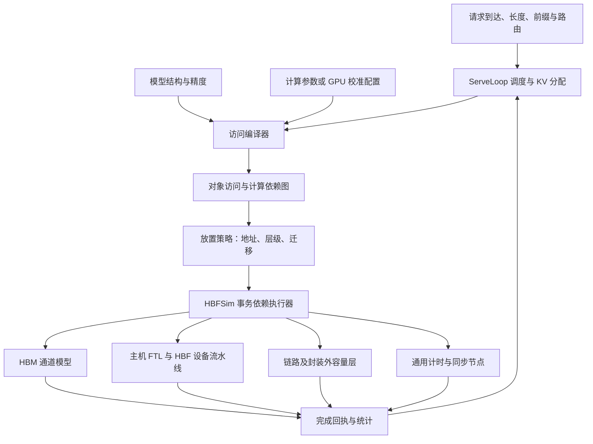

---
tags:
  - papers/computer-architecture
  - HBF
  - source-reading
aliases:
  - HBFSim-MBZUAI源码设计
date: 2026-10-26
---

# HBFSim（MBZUAI）源码设计解读

本文对照源码解释模拟器怎样把一次解码变成完成时间。代码阅读固定在两个快照：[HBFSim `9669a438`](https://github.com/FlashLabAE/HBFSim/tree/9669a4382b718537f4b4635e4b4bab7ced21f330)，[ServeLoop `ab1e6e0f`](https://github.com/FlashLabAE/ServeLoop/tree/ab1e6e0fd77a6fd6987c6db37f5e9dbb8979323b)。这是源码静态阅读，没有把仓库示例或论文实验重新运行；当前代码包含论文三种 FTL 之外的扩展，不能把当前默认配置直接当成论文配置。

## 一、先看完整边界：谁负责什么

### 1. 不是把模型真的跑一遍

论文常用的请求级路径不执行真实矩阵乘法和注意力计算，也不靠几百 GiB 的真实权重数值生成回答。它主要追踪四件事：

- **请求状态：** 哪些请求已到达，提示词处理到哪里，已生成多少词元。
- **数据状态：** 每层哪些权重和 KV 要读写，它们在哪层内存、占多少容量，何时失效。
- **设备状态：** 哪个平面在读、哪个通道在传输、写缓冲是否已满、哪些闪存块可以回收。
- **时间状态：** 计算与访问什么时候可以开始，什么时候完成，谁必须等谁。

因此，数据内容主要用对象身份、地址范围、字节量和有效性表示；推理计算用经声明或校准的时间模型表示。MoE 路由依赖实际数值，不能单靠结构推导，必须由轨迹提供，或者明确使用合成路由。

### 2. 源码拆成两个仓库

| 组件 | 负责内容 | 不负责什么 |
|---|---|---|
| ServeLoop 前端 | 模型描述、请求调度、KV 生命周期、访问编译、放置与 GPU 时间模型 | 不从逻辑地址自行猜测闪存平面及时序 |
| HBFSim 核心 | 事务依赖执行、设备排队、地址翻译、介质读写、GC 和磨损 | 不执行神经网络，不解释某个节点是某层注意力 |
| Python 客户端 | 保持与核心进程的会话、传递事务和接收回执 | 不替代物理设备模型 |

核心也支持配置化的原生对等内存控制器，能够管理驻留和后台迁移；这仍不意味着核心会执行模型或读取上层算子的语义标签。

**图中最重要的一条边是“完成回执 → 调度器”。** 内存访问变慢，会改变下一轮起点、可见的到达请求和 KV 压力，随后又改变下一轮批组成。

源码依据：[HBFSim 总体概念](https://github.com/FlashLabAE/HBFSim/blob/9669a4382b718537f4b4635e4b4bab7ced21f330/docs/concepts.md)，[ServeLoop 设计](https://github.com/FlashLabAE/ServeLoop/blob/ab1e6e0fd77a6fd6987c6db37f5e9dbb8979323b/docs/design.md)。

## 二、沿着一轮推理，逐层看它怎么工作

### 1. 调度器先决定这一轮处理谁

输入包括模型标识、请求到达时间、提示词和输出长度，还可以提供词元标识和专家路由。

调度器维护每个请求的处理位置。运行中的解码请求每轮通常处理一个词元；剩余词元预算和请求预算用于安排预填充分块。新请求可以插入，已完成请求可以退出，因此不是固定一组请求从头跑到尾。

KV 同时按块分配，记录有效词元和引用状态。容量不够时，按选定路径迁移冷 KV，或者抢占请求；没有后备层时，抢占可能丢弃 KV，之后重新计算提示词。不能只在统计表里把占用减掉，却不给实际移动或重算计费。

主循环很清楚：`next_schedule()` 产生计划，`compiler.compile()` 编译访问，`executor.execute()` 执行，再由 `complete()` 应用完成状态。

**这里的“模拟请求完成”：** 是已处理词元数、已输出词元数和时间等状态推进，不是产生真实回答文本。

源码位置：[engine.py 的运行循环](https://github.com/FlashLabAE/ServeLoop/blob/ab1e6e0fd77a6fd6987c6db37f5e9dbb8979323b/serveloop/engine.py#L626-L682)。

### 2. 编译器把模型结构变成对象访问图

假设一轮有两个解码请求，一个已有 4K 上下文，另一个已有 8K。编译器不需要算出注意力值，也能知道每层需要：

- 读取该层相关权重。
- 分别读取两请求已有上下文的 KV。
- 写入各自新增词元的 KV。
- 维护块表，处理其他算子、嵌入和输出头的访问。
- 加入算子间、路由可用时间和层间依赖。

权重能被同一批复用，因此不是把完整权重读取量再乘请求数。MoE 则先统计本批选中专家的并集，同一个专家被多条序列选中，也不等于要完整重读多份权重。

此时对象类似“某层某请求的 KV，偏移多少，读取多少字节”，**还没有绑定到 HBM 或 HBF**。这保证后续换放置策略时，比较的是同一份应用需求。

编译器会检查对象范围和字节量。其职责是描述访问需求，放置层不能为了得到更好结果就偷偷删掉一部分应访问的数据。

源码位置：[compiler.py](https://github.com/FlashLabAE/ServeLoop/blob/ab1e6e0fd77a6fd6987c6db37f5e9dbb8979323b/serveloop/compiler.py#L189)，[校准路径的访问编译](https://github.com/FlashLabAE/ServeLoop/blob/ab1e6e0fd77a6fd6987c6db37f5e9dbb8979323b/serveloop/gpu_compiler.py)。

### 3. 放置层决定读哪层，还要显式加入搬运

对象访问图进入放置层后，才映射成设备地址和事务。

- **活跃 KV 留 HBM：** 当前 KV 读取映射为 HBM 访问；溢出权重可以映射为 HBF 读取。
- **把 HBM 当缓存：** 命中直接读；缺失不仅要读 HBF，还要支付数据传输、HBM 写入和必要的脏数据写回。
- **预取或迁移：** 可以提前发起，但使用者必须等到数据真正可用，旧空间也不能在仍被读取时提前复用。

例如一次明确的补入过程，可以表示为：

`读 HBF → 跨层链路传输 → 写入 HBM → 后续消费者读 HBM`

这只是补入路径示例。直接从 HBF 服务的对等组织，不应凭空增加一次缓存补入；具体经过哪些链路，要以该放置图为准。

仓库的自定义策略示例中，页面达到复用阈值后才晋升到 HBM。补入写必须依赖刚才的 HBF 读，也要等被替换槽位的旧读者结束。后续缓存命中又必须依赖补入完成。**缓存的空间和时间正确性，都靠这些依赖表达。**

源码位置：[placement.py 的 map_batch](https://github.com/FlashLabAE/ServeLoop/blob/ab1e6e0fd77a6fd6987c6db37f5e9dbb8979323b/serveloop/placement.py#L1376)，[自定义缓存示例](https://github.com/FlashLabAE/HBFSim/blob/9669a4382b718537f4b4635e4b4bab7ced21f330/examples/05_custom_policy.py#L81-L121)。

### 4. 到达核心的最小单位是事务

核心类型 `SimulationTransaction` 主要包含：

| 字段 | 含义 |
|---|---|
| `id` | 唯一标识，其他事务可依赖它 |
| `target` | 访问目标，如 HBM、经过 FTL 的 HBF、静态闪存或链路 |
| `op` | 读或写 |
| `addr`、`bytes` | 地址范围和字节数 |
| `issue_ns` | 相对本批起点，最早可以发出的时间 |
| `dependencies` | 必须先完成的事务 |
| `duration_ns` | 仅通用计时节点可以使用的持续时间 |

常见目标中，`HBF_LOGICAL` 经过主机 FTL；`HBF_STATIC` 用于明确的只读物理布局，绕过动态映射；`D2D_*` 表示链路阶段；`BARRIER` 表示同步或计时。它们不是完全相同的访问成本。

**为什么要区分逻辑与静态 HBF：** 权重可以是固定只读布局；持续追加和释放的 KV 则可能需要动态映射。让两者经过相同的简化通路，会掩盖管理成本。

源码位置：[事务与目标类型](https://github.com/FlashLabAE/HBFSim/blob/9669a4382b718537f4b4635e4b4bab7ced21f330/src/physical/simulation_session.hpp#L38-L78)。

### 5. 事件驱动核心：先满足依赖，再竞争设备

`SimulationSession::run_batch()` 先校验全部输入：标识是否重复、地址是否越界、依赖是否存在、图里是否有环。确认合法后才修改设备状态。

随后按依赖构图，维护就绪队列。一个节点的最早就绪时间可以写成下面的辅助表达式：

$$
t_{\mathrm{ready},i}
=
\max\left(t_{\mathrm{batch}}+t_{\mathrm{issue},i},\ \max_{j\in\mathrm{pred}(i)}t_{\mathrm{finish},j}\right).
$$

这是对代码逻辑的说明，不是论文中的编号公式。没有前驱时，只需考虑本批起点和自身发出时间。

**就绪还不等于完成。** 就绪只代表依赖已经允许它进入设备，之后仍要等待设备资源。设备返回完成时间后，执行器更新后继节点的依赖计数，所有前驱都完成的节点才能进入就绪队列。

核心按事件和资源预约推进时间，不会为了模拟 100 ms 就在现实中睡眠 100 ms。一个访问算出了未来的完成时间，也不意味着其他独立访问只能等它完成后才调度；其他访问仍可使用独立资源或日历中的空闲区间。

源码位置：[run_batch 的校验、就绪队列与完成传播](https://github.com/FlashLabAE/HBFSim/blob/9669a4382b718537f4b4635e4b4bab7ced21f330/src/physical/simulation_session.cpp#L1184-L1450)。

### 6. 资源日历：模拟并行和排队的关键

每类有限资源都有忙闲区间。调用 `reserve(earliest, duration)`，就是在不早于指定时间的位置，寻找能容纳本次操作的最早空闲区间，再把它预约掉。

这比只记录“最后一次完成时间”更细。因为某个资源可能已被预约在较晚时刻使用，但前面还留着空隙；独立操作仍应有机会填进去。否则会虚构不必要的串行。

**简化例子，忽略命令与传输开销：** 两个页都需要 4 μs 感测。若落在同一个感测资源，第一项占 0–4 μs，第二项只能占 4–8 μs；若落在两个独立平面，可以同时感测，在约 4 μs 后再竞争共享传输通道。

所以两个逻辑上连续的页，在不同 FTL 下被放到哪里，会改变并行度。图 8 中“单平面块映射慢”，就是由下层资源竞争自然产生的，不是人为给块映射乘一个减速系数。

日历使用小数组和每叶 64 个区间的索引，利用最大空隙长度跳过不可能匹配的区域。它优化的是查找和存储开销，不是把所有 NAND 操作压成一个平均带宽公式。

源码位置：[ResourceTimeline](https://github.com/FlashLabAE/HBFSim/blob/9669a4382b718537f4b4635e4b4bab7ced21f330/src/physical/resource_calendar.hpp#L29-L110)。

### 7. HBF 读路径：4 μs 只是其中一段

一次未命中的逻辑读取，大致经过：

1. **主机地址翻译：** 从逻辑页号找到物理页。翻译信息不在缓存里时，还可能增加映射页访问。
2. **请求和命令传输：** 进入所属通道及调度资源。
3. **阵列感测：** 占用对应平面／bank 的感测资源，支付页读时间。
4. **内部数据通路：** 数据经过局部通路、页缓冲、通道、硅通孔、纠错和解码后的暂存。
5. **返回数据：** 占外部接口的发送资源，将需要的有效数据返回。

具体内部流水线由控制器和物理设备共同实现，不能只看名为 `HbfDevice` 的单个类。`HbfController` 并非只是一张地址表，它还组合了完整事务路径的资源调度。

每一步都有自己的日历。不同平面可以同时感测，却仍可能在同一通道、纠错引擎或接口处排队。纠错的发起吞吐和返回延迟也分开建模，不是把整个纠错延迟都视为独占资源。

**为什么局部小读也不一定便宜：** 主机可以读任意字节范围，但跨页时需要拆分；NAND 未命中仍以页为单位感测。外部返回按覆盖的 64 字节单位对齐，不意味着只读几十字节就只感测几十字节。

**为什么阵列可能比接口更早到顶：** 论文默认一个堆栈 256 个平面，按每平面每 4 μs 供出 4 KiB，粗略阵列吞吐为 0.26 TB/s，低于约 1.5 TB/s 的接口。所以继续加宽接口不一定改善解码。

源码位置：[分组读流水线](https://github.com/FlashLabAE/HBFSim/blob/9669a4382b718537f4b4635e4b4bab7ced21f330/src/host/hbf_controller.cpp#L9705-L9846)，[一般页读路径](https://github.com/FlashLabAE/HBFSim/blob/9669a4382b718537f4b4635e4b4bab7ced21f330/src/host/hbf_controller.cpp#L9849-L10138)。

### 8. HBF 写路径：接受写入不等于已经写进 NAND

逻辑写通常包含分配新物理页、合并部分页、发送数据、编程、发布新映射及使旧版本失效。旧块积累无效页后，才会进入回收。

物理设备检查页顺序，不能随意跳着编程。写到块的第 0 页时，默认路径执行自动擦除；复用块的擦除会增加物理 P/E 计数。显式安装的预擦除初始状态是另外的可选条件，不能与真实写入磨损混在一起。

当前代码区分三种“缓存”：

| 缓存或缓冲 | 所在层 | 作用 |
|---|---|---|
| 应用层 HBM 缓存 | 放置策略 | 缓存权重／KV，决定跨层补入与驱逐 |
| FTL 控制器元数据与写缓冲 | 默认预留在 HBM | 保存地址映射、合并部分页、暂存回收复制 |
| 设备侧缓存 | bank 解码页槽；另有可选设备 DRAM | 减少重复阵列读取或缓冲写入 |

论文实验额外假设每个 HBF 有容量为闪存 0.1% 的设备 DRAM；当前源码对应可配置的设备 DRAM，默认禁用，需要显式选择。不能把应用缓存、主机预留 HBM 和设备 DRAM 当成同一块空间。

写请求可能在进入缓冲时就得到应答，也可以配置为等到真正编程完成。比较延迟时必须知道是哪种完成语义。最后还要排空后台写入，否则会漏算已接受但未落盘的工作。

源码位置：[物理页顺序检查](https://github.com/FlashLabAE/HBFSim/blob/9669a4382b718537f4b4635e4b4bab7ced21f330/src/physical/hbf/hbf_device.cpp#L223-L257)，[主机与设备 DRAM 的配置边界](https://github.com/FlashLabAE/HBFSim/blob/9669a4382b718537f4b4635e4b4bab7ced21f330/docs/reference/host-hbf-management.md)。

### 9. GC 和 FTL 不能作为免费的管理开销

默认主机管理路径的垃圾回收需要：

`读取 HBF 中仍有效的页 → 写入预留 HBM 复制槽 → 从该槽读取 → 写到 HBF 新位置 → 更新映射并释放旧分配`

复制既产生闪存读写，也占 HBM 容量和带宽。复制槽在数据被目标消耗前不能复用；仍有编程、未发布映射或在途读取的块不能提前回收。

释放一个逻辑块、执行一次 GC、发生一次物理擦除是不同事件。当前模型中，主机回收先释放分配所有权，物理擦除由随后复用时的页 0 编程触发。寿命必须看实际擦除/P/E，不能拿 GC 调用次数替代。

论文重点比较页、连续区间和单平面块映射；当前代码又支持日志块、不同映射缓存和对象分段等组织。新增组织不改变“应计费的物理操作必须走同一设备资源”的原则。

源码位置：[GC 有效页搬移](https://github.com/FlashLabAE/HBFSim/blob/9669a4382b718537f4b4635e4b4bab7ced21f330/src/host/hbf_gc.cpp#L622-L777)，[映射实现说明](https://github.com/FlashLabAE/HBFSim/blob/9669a4382b718537f4b4635e4b4bab7ced21f330/docs/reference/hbf-mapping-organizations.md)。

### 10. HBM 为什么没有像 HBF 那样逐项展开

当前 HBM 使用聚合通道模型：地址映射到通道和伪通道，按突发对齐计算字节需求，考虑有限队列、带宽、平均访问延迟和读写切换。

连续 4 个伪通道形成共享服务组，按有限的通道传输量子调度，以减少事件数。主机控制器的元数据和缓冲访问也与应用共享相关 HBM 数据资源。

它不逐条展开完整的行激活、预充电和刷新命令。那些平均成本由访问延迟与效率参数近似。这样能保留“HBM 也会成为补入和管理流量的瓶颈”，又不会把整个研究变成昂贵的 DRAM 命令模拟。

因此适合分析 HBF 系统的容量和带宽竞争，不适合直接研究 DRAM 行命中策略或宣称命令级精确性。

源码位置：[HBM 模型边界](https://github.com/FlashLabAE/HBFSim/blob/9669a4382b718537f4b4635e4b4bab7ced21f330/docs/reference/model.md#hbm4)，[HBM 设备实现](https://github.com/FlashLabAE/HBFSim/blob/9669a4382b718537f4b4635e4b4bab7ced21f330/src/physical/hbm/hbm_device.cpp)。

### 11. GPU 计算时间如何与访存合在一起

前端有不同时间提供者：声明的计算能力模型、测试用线性模型、只测内存的路径，以及提供实测配置后使用的 GPU 校准路径。不能把所有模式都称为硬件校准。

当前校准编译器对每个算子先发固定开销节点，然后并行安排：

- 计算分支，持续时间来自拟合的计算参数。
- 访存分支，真实经过设备事务，之后加一次内核相对理想带宽的额外内存开销。

算子完成节点必须同时等这两个分支。可用下面的辅助近似式理解：

$$
T_{\mathrm{op}}\approx T_{\mathrm{fixed}}+
\max\left(T_{\mathrm{compute}},\ T_{\mathrm{memory,sim}}+\Delta T_{\mathrm{kernel}}\right).
$$

这是源码当前校准路径的结构化说明，不是论文编号公式。额外内存开销来自“拟合内存时间减参考理想传输时间”，不会把较慢 HBF 的延迟再乘一次校准系数。

**这也解释为什么不能把计算和全部读写时间简单相加。** 有些工作可重叠，最后由依赖图上的关键路径决定；具体重叠范围仍是该模型的假设，并非逐指令验证。

计算持续时间通过带 `duration_ns` 的 `BARRIER` 交给核心。核心只理解“依赖满足后占这么一段时间”，并不执行矩阵乘法，也不需要认识这个节点叫哪个 GPU 算子。

源码位置：[GPU 参数与额外访存开销](https://github.com/FlashLabAE/ServeLoop/blob/ab1e6e0fd77a6fd6987c6db37f5e9dbb8979323b/serveloop/gpu_profile.py#L196-L210)，[计算、访存分支与汇合](https://github.com/FlashLabAE/ServeLoop/blob/ab1e6e0fd77a6fd6987c6db37f5e9dbb8979323b/serveloop/gpu_compiler.py#L33-L108)。

### 12. 完成时间怎样反馈给下一轮

HBFSim 保持一个持久会话，跨批保留设备缓存、映射、有效页、磨损、后台操作和资源预约状态，不会每轮都把设备清空。

回执区分两条完成边界：

- **阻塞完成边界：** 当前这轮必须等待的工作完成了，前端可以继续安排下一轮。
- **全部已发工作边界：** 包括允许晚些完成的后台任务。它们仍然占资源，后续需要时还要等它们。

ServeLoop 通常把本轮最终完成节点作为阻塞边界，读取 `blocking_finish_ns`，更新请求和 KV 状态，再从这个时间出发安排下一轮。

若新请求在这一轮执行期间到达，下轮会看见它；如果这一轮因 HBF 变慢而延长，到达队列和容量压力也会跟着变化。这就是闭环。

**另一种模式需要分开：** 固定窗口只比较一段确定的访存需求在不同拓扑下的表现，不能自动视为完整请求闭环，也不能把纯访存窗口时间直接叫完整服务 TPOT。源码明确区分这些运行路径。

源码位置：[前端提交与完成反馈](https://github.com/FlashLabAE/ServeLoop/blob/ab1e6e0fd77a6fd6987c6db37f5e9dbb8979323b/serveloop/hbfsim.py#L204-L254)，[核心记录两个完成边界](https://github.com/FlashLabAE/HBFSim/blob/9669a4382b718537f4b4635e4b4bab7ced21f330/src/physical/simulation_session.cpp#L1569-L1668)。

## 三、读代码时最有用的对应关系

### 1. 推荐顺序

| 顺序 | 文件或入口 | 先找什么 |
|---|---|---|
| 1 | ServeLoop `engine.py` | 一轮怎样形成，什么时候应用完成状态 |
| 2 | `compiler.py`、`gpu_compiler.py` | 模型对象、KV、专家并集怎样变成访问图 |
| 3 | `placement.py` | 访问怎样分配到各层，怎样加迁移依赖 |
| 4 | HBFSim `simulation_session.hpp/.cpp` | 事务字段、就绪队列、完成传播 |
| 5 | `resource_calendar.hpp/.cpp` | 排队和重叠如何出现 |
| 6 | `hbf_controller.cpp`、`hbf_device.cpp` | 翻译、读流水线、顺序编程和设备状态 |
| 7 | `hbf_gc.cpp`、`hbf_mapping_policy.*` | 复制费用、映射和回收 |
| 8 | `hbm_device.cpp`、外部设备与链路 | 系统中其他共享瓶颈 |

### 2. 三种粒度不要混淆

- **KV 分配块：** 管理词元对应的 KV。通用前端描述中为 16 词元块；当前校准 FA2 路径在放置层明确要求 256 词元块，须看选定模式和配置。
- **应用层缓存行：** 论文通用缓存比较使用 4 MiB，一次补入可能覆盖很多页。
- **NAND 页和擦除块：** 默认页为 4 KiB，块包含多页，是闪存物理操作约束。

它们分别属于推理分配、跨层缓存和介质组织，不能因为都叫“块”就当成同一个单位。[当前校准路径的检查](https://github.com/FlashLabAE/ServeLoop/blob/ab1e6e0fd77a6fd6987c6db37f5e9dbb8979323b/serveloop/placement.py#L1395)。

### 3. 哪些结论由结构保证，哪些仍要靠验证

**结构上做了什么：** 依赖图约束先后；资源日历约束竞争；容量检查防止免费空间；搬移事务和元数据计费防止免费管理；持久会话保留跨轮状态；回执记录对象需求、物理字节、完成时间及输入版本。

**结构本身不能保证什么：** 参数是真实硬件值、路由是真实负载、GPU 拟合覆盖所有形状、预填充流量没有遗漏、未来 HBF 的热和寿命估计准确。还要检查参数来源、实测校准、留出验证和敏感性实验。

例如各页占用时间可以重叠，统计里的累计工作时间不能直接加成请求延迟；真正耗时应看起止时间与关键路径。代码的 `Breakdown` 类型也明确写出了这一点。

本文最值得把握的设计是：**让应用访问需求、放置决策、物理服务代价分别表达，再通过事务依赖和完成反馈连成一个因果系统。** 这样改策略时，收益与代价会同时落到同一套设备资源里。

[回到论文笔记](HBFSim-MBZUAI.md) · [全文中英对照](HBFSim_MBZUAI_中英对照.md)
