# HBFSim（MBZUAI）全文中英对照

**英文题名：** HBFSim: A Simulator for Exploring HBF in Memory Hierarchies for LLMs  
**中文题名：** HBFSim：用于探索大语言模型存储层次中 HBF 的模拟器  
**作者与机构：** Jinheng Li、Guosheng Wang、Hongchao Du、Shangyu Wu、Qiao Li、Chun Jason Xue；MBZUAI，阿联酋阿布扎比。  
**来源版本：** 用户提供的 11 页 PDF；首页标注 arXiv:2610.23503v1，2026-10-16；RACS ’26，DOI 10.1145/3848591.3856870。  
**原文：** [本文件夹保存的 PDF](source/HBFSim_MBZUAI.pdf)

> 本文为逐段中英对照阅读版，完整覆盖摘要、正文、讨论、结论、图表和 37 条参考文献。英文与中文按段落配对，Source 标记对应 PDF 页码和稳定块编号；跨栏、跨页段落已接续。9 张原图和 3 张原表放在相关讨论旁，表格另附中文转写。参考文献保留完整英文书目，补充中文题名。下文单独标记的“读图提示”是辅助说明，与作者原文分开。

## 章节索引

- [摘要](#S002)
- [1 引言](#S008)
- [2 背景](#S017)
- [2.1 LLM 推理服务的存储需求](#S018)
- [2.2 高带宽闪存](#S021)
- [2.3 HBM＋HBF 系统需要回答的问题](#S024)
- [3 HBFSim 设计](#S026)
- [3.1 推理服务前端](#S032)
- [3.2 存储策略](#S037)
- [3.3 器件引擎](#S039)
- [3.4 模拟速度](#S043)
- [3.5 校准与验证](#S047)
- [4 案例研究](#S050)
- [4.1 实验设置](#S052)
- [4.2 HBF 与其他容量层的比较](#S055)
- [4.3 需要多少 HBM，以及 HBM 应保存什么](#S059)
- [4.4 闪存地址转换与耐久性](#S069)
- [4.5 哪些 HBF 参数真正影响结果](#S075)
- [5 讨论](#S078)
- [6 相关工作](#S081)
- [7 结论](#S085)
- [参考文献](#S087)

## PDF 页码索引

- [PDF 第 1 页](#S001)
- [PDF 第 2 页](#S010)
- [PDF 第 3 页](#S023)
- [PDF 第 4 页](#S035)
- [PDF 第 5 页](#S045)
- [PDF 第 6 页](#S054)
- [PDF 第 7 页](#S060)
- [PDF 第 8 页](#S065)
- [PDF 第 9 页](#S073)
- [PDF 第 10 页](#S086)
- [PDF 第 11 页](#S124)（参考文献 [37] 的续页）

## 术语对照

| 原文统一用语 | 中文统一用语 | 首次定义／说明 | 原文变体 | 处理决定 |
| --- | --- | --- | --- | --- |
| HBF | 高带宽闪存 | High Bandwidth Flash | HBF | 保留 HBF；首次出现给出全称。 |
| HBM | 高带宽内存 | High Bandwidth Memory | HBM, HBM4 | 按代际保留 HBM4 等型号。 |
| capacity tier | 容量层 | 用于扩展存储容量的层级 | capacity tier, external tier | 外部层级仅在原文强调封装外位置时使用。 |
| peer mode | 并列模式 | HBM 与 HBF 独立寻址、共同构成地址空间 | peer mode | 统一译为并列模式。 |
| tiered mode | 分层模式 | HBM 作为 HBF／其他容量层的缓存 | tiered mode | 统一译为分层模式。 |
| weights first | 权重优先 | 先把权重放入 HBM | weights first | 与 KV 优先对应。 |
| KV first | KV 优先 | 运行中 KV、权重、保留前缀依次放入 HBM | KV first, KV-first | 保留 KV 缩写。 |
| prefill | 预填充 | 处理提示词并建立相应 KV 的阶段 | prefill, chunked prefill | chunked prefill 译为分块预填充。 |
| decode | 解码 | 逐步生成输出词元的阶段 | decode, decoding | 统一译为解码。 |
| TPOT | 输出词元平均耗时 | time per output token | TPOT | 越低越好；与吞吐量区别。 |
| TTFT | 首词元时间 | time to first token | time to first token | 保留其延迟含义。 |
| FTL | 闪存转换层 | flash translation layer | host FTL, host-managed FTL | host FTL 译为主机端 FTL。 |
| page-level mapping | 页级映射 | 每页一个映射表项 | page-level mapping | 不与页内偏移混淆。 |
| extent mapping | 区段映射 | 以连续页区间表示映射 | extent mapping, extent index | extent index 译为区段索引。 |
| block-level mapping | 块级映射 | 每逻辑块一个映射表项 | block-level mapping | 保留其单平面布局条件。 |
| GC | 垃圾回收 | garbage collection | GC | 主机端执行。 |
| wear leveling | 磨损均衡 | 均衡块的擦除磨损 | wear leveling, static wear leveling | 不与写放大混淆。 |
| P/E cycle | 编程／擦除循环 | program/erase cycle | P/E, program/erase | 保持原文次数与假设条件。 |
| write-back | 回写 | 将脏数据写回下一存储层 | write-back, writeback | eviction 统一译为淘汰。 |
| decayed LFU | 衰减 LFU | 定期衰减访问计数的最不常用替换 | decayed-LFU, decayed LFU | 保持与 LRU、FIFO 的区别。 |
| plane | 平面 | NAND 的内部并行资源 | plane, planes per die | 不译作页。 |
| bank | 存储体 | 页感测与页编程的服务资源 | bank | 与通道、裸片、平面分别保留。 |
| TSV | 硅通孔 | through-silicon via | TSVs | 保留 TSV 缩写。 |
| ECC | 纠错码 | error-correcting code | ECC | ECC engine 译为 ECC 引擎。 |

---

## 全文中英对照

**Source:** p.1 S001

**Original:** HBFSim: A Simulator for Exploring HBF in Memory Hierarchies for LLMs. Jinheng Li; Guosheng Wang; Hongchao Du; Shangyu Wu; Qiao Li; Chun Jason Xue. Mohamed bin Zayed University of Artificial Intelligence, Abu Dhabi, United Arab Emirates. Emails: jinheng.li@mbzuai.ac.ae; guosheng.wang@mbzuai.ac.ae; hongchao.du@mbzuai.ac.ae; shangyu.wu@mbzuai.ac.ae; qiao.li@mbzuai.ac.ae; jason.xue@mbzuai.ac.ae. arXiv:2610.23503v1 [cs.AR], 16 Oct 2026.

**中文:** HBFSim：用于探索大语言模型存储层次中 HBF 的模拟器。作者：Jinheng Li、Guosheng Wang、Hongchao Du、Shangyu Wu、Qiao Li、Chun Jason Xue。机构：穆罕默德·本·扎耶德人工智能大学（Mohamed bin Zayed University of Artificial Intelligence，MBZUAI），阿联酋阿布扎比。联系邮箱依作者顺序为：jinheng.li@mbzuai.ac.ae；guosheng.wang@mbzuai.ac.ae；hongchao.du@mbzuai.ac.ae；shangyu.wu@mbzuai.ac.ae；qiao.li@mbzuai.ac.ae；jason.xue@mbzuai.ac.ae。版本：arXiv:2610.23503v1 [cs.AR]，2026 年 10 月 16 日。

## 摘要 · ABSTRACT

**Source:** p.1 S002

**Original:** ABSTRACT

**中文:** 摘要

**Source:** p.1 S003

**Original:** High Bandwidth Flash (HBF) has recently emerged as a promising technology that provides terabyte-scale accelerator-local capacity at bandwidths approaching HBM, with a potential cost-per-bit advantage over HBM. However, its NAND foundation brings long latency, out-of-place updates, and finite write endurance directly into the accelerator memory hierarchy, making its effects on performance and lifetime difficult to predict. To study this emerging design space, we present HBFSim, an LLM-aware event-driven simulator for heterogeneous HBM+HBF memory systems that preserves application-level memory semantics while modeling flash-internal behavior. HBFSim models HBM, HBF with host-managed flash translation, and conventional capacity tiers in one simulation driven by a calibrated serving frontend. Using HBFSim, we study decoding of Llama-3.1-70B and Qwen3-235B-A22B under three workloads that differ in their input and output lengths. HBF serves data that does not fit in HBM 11.0–19.0× faster than host DRAM; HBM is better used to hold the running sequences’ KV cache than as a cache for HBF; and at a published peak load of Llama-3.1-70B, HBF lasts 2.0 to 6.9 years, in proportion to the stacks that share the KV writes. The artifact is available at https://github.com/FlashLabAE/HBFSim and will track public HBF device data as it becomes available.

**中文:** 高带宽闪存（High Bandwidth Flash，HBF）近期成为一种颇具潜力的技术：它能够在加速器本地提供 TB 级容量，带宽接近 HBM，每比特成本也可能优于 HBM。然而，其 NAND 基础将较长的访问延迟、异地更新和有限的写入耐久性直接带入加速器存储层次，使其对性能与寿命的影响难以预测。为研究这一新兴设计空间，我们提出 HBFSim：一个面向 LLM 的事件驱动模拟器，用于异构 HBM＋HBF 存储系统，在建模闪存内部行为的同时保留应用层访存语义。HBFSim 由经过校准的推理服务前端驱动，在同一次模拟中建模 HBM、采用主机管理地址转换的 HBF，以及常规容量层。我们使用 HBFSim，针对输入和输出长度不同的三种工作负载，研究 Llama-3.1-70B 与 Qwen3-235B-A22B 的解码。对于 HBM 放不下的数据，HBF 的服务速度比主机 DRAM 快 11.0–19.0 倍；与其将 HBM 用作 HBF 的缓存，不如用它保存运行中序列的 KV 缓存；在已公布的 Llama-3.1-70B 峰值负载下，HBF 的预计寿命为 2.0–6.9 年，并与分担 KV 写入的堆栈数量成正比。代码与实验产物位于 https://github.com/FlashLabAE/HBFSim ，并将在公开 HBF 器件数据出现后持续跟进。

**Source:** p.1 S004

**Original:** KEYWORDS: High Bandwidth Flash, Memory-system Simulation, LLM Workloads, KV Cache

**中文:** 关键词：高带宽闪存、存储系统模拟、LLM 工作负载、KV 缓存。

**Source:** p.1 S005

**Original:** CCS CONCEPTS: • Computing methodologies → Simulation tools; • Computer systems organization → Heterogeneous (hybrid) systems; • Information systems → Flash memory.

**中文:** CCS 分类：计算方法 → 模拟工具；计算机系统组织 → 异构（混合）系统；信息系统 → 闪存。

**Source:** p.1 S006

**Original:** This work is licensed under a Creative Commons Attribution-NonCommercial-NoDerivatives 4.0 International License. RACS ’26, November 17–20, 2026, Fukuoka, Japan © 2026 Copyright held by the owner/author(s). ACM ISBN 979-8-4007-3035-1/2026/11. https://doi.org/10.1145/3848591.3856870

**中文:** 本文采用知识共享“署名—非商业性使用—禁止演绎 4.0 国际”许可协议。RACS ’26，2026 年 11 月 17–20 日，日本福冈。© 2026，版权由所有者／作者持有。ACM ISBN：979-8-4007-3035-1/2026/11。DOI：https://doi.org/10.1145/3848591.3856870 。

**Source:** p.1 S007

**Original:** ACM Reference Format: Jinheng Li, Guosheng Wang, Hongchao Du, Shangyu Wu, Qiao Li, and Chun Jason Xue. 2026. HBFSim: A Simulator for Exploring HBF in Memory Hierarchies for LLMs. In International Conference on Resilience, AI and Cyber-Systems (RACS ’26), November 17–20, 2026, Fukuoka, Japan. ACM, New York, NY, USA, 11 pages. https://doi.org/10.1145/3848591.3856870

**中文:** ACM 参考文献格式：Jinheng Li、Guosheng Wang、Hongchao Du、Shangyu Wu、Qiao Li、Chun Jason Xue，2026。《HBFSim：用于探索大语言模型存储层次中 HBF 的模拟器》。载于韧性、人工智能与网络系统国际会议（International Conference on Resilience, AI and Cyber-Systems，RACS ’26），2026 年 11 月 17–20 日，日本福冈。ACM，美国纽约，共 11 页。https://doi.org/10.1145/3848591.3856870 。

## 1 引言 · 1 INTRODUCTION

**Source:** p.1 S008

**Original:** 1 INTRODUCTION

**中文:** 1 引言

**Source:** p.1 S009

**Original:** Memory capacity has emerged as a primary bottleneck in serving large language models (LLMs). Model weights occupy tens to hundreds of gigabytes, while key–value (KV) state grows linearly with context length and request concurrency, quickly exceeding accelerator memory capacity. For example, an 8B model serving eight concurrent 128K-context sessions can exhaust the HBM of a modern GPU (e.g., the 131 GiB of HBM3e on an NVIDIA H200), while long-context serving for 70B-class models may exceed the memory capacity of an entire eight-GPU node [5, 11, 17, 22]. High Bandwidth Flash (HBF) has recently emerged as a promising approach for extending accelerator-local memory capacity. SanDisk’s disclosed HBF design targets a 16-die, 512 GB flash stack that delivers up to 1.6 TB/s [24, 25], enabling multi-terabyte accelerator-local memory systems without host-memory accesses. The same disclosure targets 8–16× HBM capacity at similar cost and bandwidth, making capacity per dollar, rather than higher speed, the main motivation for HBF [24].

**中文:** 存储容量已成为大语言模型（LLM）推理服务的主要瓶颈。模型权重占用数十至数百 GB，而键值（KV）状态随上下文长度和请求并发数线性增长，很快就会超出加速器的存储容量。例如，一个 8B 模型同时服务八个 128K 上下文会话，就可能耗尽现代 GPU 的 HBM，例如 NVIDIA H200 上的 131 GiB HBM3e；70B 级模型的长上下文服务甚至可能超出整个八 GPU 节点的存储容量 [5, 11, 17, 22]。高带宽闪存（HBF）近期成为扩展加速器本地存储容量的一条潜在路径。SanDisk 已披露的 HBF 设计以 16 裸片、512 GB 闪存堆栈为目标，带宽最高为 1.6 TB/s [24, 25]，由此可以在不访问主机内存的情况下构建多 TB 的加速器本地存储系统。同一披露还提出，在成本与带宽相近的条件下，容量达到 HBM 的 8–16 倍。因此，推动 HBF 的主要动力是单位成本所能提供的容量，而非更高的速度 [24]。

**Source:** p.1–2 S010

**Original:** Unlike conventional DRAM expansion, HBF brings asymmetric read and write performance, page programming, flash translation layer (FTL) management, write amplification, and finite program/erase endurance into the accelerator memory hierarchy. Its effect on LLM serving is difficult to predict because no public HBF hardware is available for validation [28]. Nevertheless, system architects must decide on memory organization, placement policies, and provisioning before production devices become available. For example, moving read-only weights to HBF mainly exercises its read path and frees HBM for the growing KV cache, whereas placing mutable KV state in HBF creates program traffic and consumes write endurance. Therefore, it is necessary to study the performance of HBM+HBF memory hierarchies under realistic LLM serving workloads before committing to a design. Because such hardware is unavailable, a simulator is required to evaluate these trade-offs.

**中文:** 与常规 DRAM 扩容不同，HBF 将不对称的读写性能、页编程、闪存转换层（FTL）管理、写放大和有限的编程／擦除耐久性带入加速器存储层次。由于尚无公开的 HBF 硬件可用于验证，它对 LLM 推理服务的影响很难预测 [28]。尽管如此，系统架构师仍须在量产器件出现前决定存储组织、放置策略及资源配置。例如，将只读权重移至 HBF，主要利用其读取路径，并为不断增长的 KV 缓存释放 HBM；而把可修改的 KV 状态放入 HBF，会产生编程流量并消耗写入耐久性。因此，在确定设计前，有必要在真实的 LLM 推理服务工作负载下研究 HBM＋HBF 存储层次的性能。由于这类硬件尚不可用，需要模拟器来评估这些取舍。

**Source:** p.2 S011

**Original:** Existing simulators each cover one level of this hierarchy: DRAM simulators [14, 16] stop at the memory controller, SSD simulators [13, 29] put flash behind a storage interface, and LLM serving simulators [4, 10, 36] represent memory by capacity and bandwidth. None connects the placement of LLM data to both completion time and physical flash traffic.

**中文:** 现有模拟器各自只覆盖这一层次中的一个层级：DRAM 模拟器 [14, 16] 止于内存控制器，SSD 模拟器 [13, 29] 将闪存置于存储接口之后，LLM 推理服务模拟器 [4, 10, 36] 则用容量与带宽表示存储。它们都未将 LLM 数据的放置同时关联到完成时间与实际闪存流量。

**Source:** p.2 S012

**Original:** HBFSim addresses this limitation. It models HBM, HBF with a host-managed FTL, and conventional capacity tiers in one event system, coupled in a closed loop with a serving frontend whose scheduler and GPU compute are calibrated against measurements, and it accepts address-level traces as well as production request traces. Using HBFSim, we study decoding of Llama-3.1-70B and Qwen3-235B-A22B under three workloads that differ in their input and output lengths. We find that HBF serves the data that does not fit in HBM 11.0–19.0× faster than host DRAM; that HBM should hold the running sequences’ KV, because caching HBF with LRU or FIFO rereads nearly the whole working set once it exceeds HBM, and that KV should be written to HBF only when it must leave HBM; and that the FTL costs little on the read path as long as its layout keeps reads parallel, while HBF’s lifetime depends on the amount of KV that reaches flash. These findings connect HBF’s potential cost-per-bit advantage to measurable latency and wear rather than to a single capacity or bandwidth number.

**中文:** HBFSim 旨在弥补这一局限。它在同一个事件系统中建模 HBM、采用主机端 FTL 的 HBF，以及常规容量层，并与推理服务前端构成闭环；前端的调度器和 GPU 计算模型均依据实测校准，同时接受地址级轨迹和生产请求轨迹。我们使用 HBFSim，在输入、输出长度不同的三种工作负载下研究 Llama-3.1-70B 和 Qwen3-235B-A22B 的解码。结果表明，对于 HBM 放不下的数据，HBF 的服务速度为主机 DRAM 的 11.0–19.0 倍；HBM 应保存运行中序列的 KV，因为一旦工作集超过 HBM，使用 LRU 或 FIFO 将 HBM 用作 HBF 缓存，几乎会反复读取整个工作集；KV 也应仅在必须离开 HBM 时才写入 HBF。只要映射布局能保持读取并行性，FTL 在读取路径上的成本就很小；HBF 寿命则取决于有多少 KV 到达闪存。这些发现把 HBF 潜在的每比特成本优势，与可量化的延迟和磨损联系起来，而不是仅以某个容量或带宽数值衡量它。

**Source:** p.2 S013

**Original:** This paper makes the following contributions:

**中文:** 本文的贡献如下：

**Source:** p.2 S014

**Original:** • Workloads at two granularities. HBFSim takes fine-grained address-level traces, with one record per memory access, and coarse-grained request traces, which its frontend expands into the series of weight and KV accesses that each request causes.

**中文:** • 两种粒度的工作负载。HBFSim 接受细粒度的地址级轨迹，其中每条记录对应一次访存；也接受粗粒度请求轨迹，由前端将每个请求展开为其引起的一系列权重与 KV 访问。

**Source:** p.2 S015

**Original:** • A coupled and fast memory-system model. HBM, HBF with a host-managed FTL, and external tiers (host DRAM, CXL SSDs, and NVMe SSDs) share one timeline and interact as in a real system, for example through the FTL’s tables in HBM.

**中文:** • 相互耦合且快速的存储系统模型。HBM、带主机端 FTL 的 HBF，以及外部层级（主机 DRAM、CXL SSD 和 NVMe SSD）共享一条时间线，并像真实系统一样交互，例如通过保存在 HBM 中的 FTL 表发生交互。

**Source:** p.2 S016

**Original:** • Preliminary takeaways for HBF. Decoding Llama-3.1-70B and Qwen3-235B-A22B under three workloads yields five simple rules: HBF pays off only under capacity pressure; HBM should hold the running KV and HBF the weights, with KV written to flash only when it must leave HBM; generic cache replacement loses to this placement unless a step fits in HBM with room to spare; the FTL should preserve the flash array’s parallelism; and endurance, set by how much KV reaches flash, is a first-order constraint.

**中文:** • 对 HBF 的初步认识。三种工作负载下的 Llama-3.1-70B 与 Qwen3-235B-A22B 解码得到五条简单规律：HBF 只有在容量压力下才能体现价值；HBM 应保存运行中的 KV，HBF 保存权重，KV 仅在必须离开 HBM 时才写入闪存；除非单步工作集能够放入 HBM 且留有充足余量，否则通用缓存替换策略不如这种放置方式；FTL 应保持闪存阵列的并行性；耐久性由到达闪存的 KV 数量决定，是必须优先考虑的约束。

## 2 背景 · 2 BACKGROUND

**Source:** p.2 S017

**Original:** 2 BACKGROUND

**中文:** 2 背景

### 2.1 LLM 推理服务的存储需求 · 2.1 Memory Demand of LLM Serving

**Source:** p.2 S018

**Original:** 2.1 Memory Demand of LLM Serving

**中文:** 2.1 LLM 推理服务的存储需求

**Source:** p.2 S019

**Original:** A serving system’s memory holds the model weights, which every request reuses; the KV cache, the per-layer keys and values of every processed token, which decoding reads instead of recomputing; and activations, which are small by comparison. For Llama-3.1-70B a BF16 KV cache takes 320 KiB per token [5], 320 GiB for 1M tokens. Serving systems allocate KV in fixed-size blocks [11] and retain the blocks of finished requests so that later requests with the same prefix skip its prefill [22, 37], so the KV footprint grows beyond the active requests. Figure 1 shows the weights and the KV cache of 1M tokens, in one request or retained across many: for small models the KV cache dominates, every model from 70B up exceeds eight HBM4 stacks, and the newest open models, with 1.6T to 2.8T parameters, exceed even an eight-H200 node with their weights alone, while hybrid or compressed attention keeps their KV small.

**中文:** 推理服务系统的存储中保存三类数据：所有请求复用的模型权重；KV 缓存，即每个已处理词元在各层产生的键和值，解码时读取它们以避免重新计算；以及相比之下较小的激活数据。对于 Llama-3.1-70B，BF16 KV 缓存每个词元需要 320 KiB [5]，100 万词元即为 320 GiB。推理服务系统按固定大小的块分配 KV [11]，并保留已完成请求的块，使后续具有相同前缀的请求可以跳过相应的预填充 [22, 37]；因此，KV 占用会超出活跃请求本身。图 1 展示了权重与 100 万词元 KV 缓存的容量需求，这些词元既可以来自一个请求，也可以跨多个请求保留：对于小模型，KV 缓存占主导；从 70B 开始，所有模型的需求都超过八个 HBM4 堆栈；最新的开放模型参数量达 1.6T–2.8T，仅权重就超过一个八 H200 节点的容量，而混合注意力或压缩注意力会使其 KV 较小。

#### 图 1：权重与百万词元 KV 的容量需求

**Placed near:** p.2 S019  
**Source:** p.2 F001 · C001

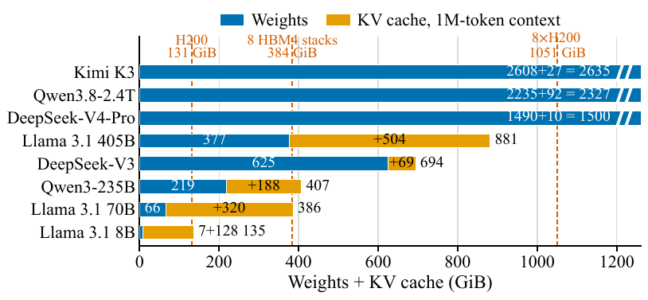

**Original:** Figure 1: Weights (one byte per parameter) and BF16 KV cache of a 1M-token context against the HBM of one H200, eight HBM4 stacks, and an eight-H200 node.

**中文:** 图 1：模型权重（每参数一字节）和 100 万词元上下文的 BF16 KV 缓存，与单个 H200、八个 HBM4 堆栈及一个八 H200 节点的 HBM 容量对比。

**读图提示（辅助说明）：** 蓝色为权重，橙色为 KV；三条容量参考线分别对应 131、384 和 1051 GiB。这里的百万词元可以来自单个请求，也可以跨请求保留，见 S019。

**Source:** p.2 S020

**Original:** The two phases of a request access this data differently. Prefill processes the prompt, produces its KV, and is usually compute-bound; chunked prefill lets it share a batch with decoding work [2]. Each decoding step generates one token per request: it reuses the weights across the batch, reads every running request’s KV, and appends one token’s KV per layer, so it is usually bound by memory bandwidth, and its traffic grows with model size, batch, and context. When weights and KV exceed HBM, systems offload to host DRAM or SSDs [15, 22, 26], at access costs set by the slower tier and its interconnect.

**中文:** 请求的两个阶段以不同方式访问这些数据。预填充处理提示词并生成其 KV，通常受计算能力限制；分块预填充使其能够与解码任务共用一个批次 [2]。每个解码步为每个请求生成一个词元：它在整个批次内复用权重，读取所有运行中请求的 KV，并在每层追加一个词元的 KV。因此，解码通常受存储带宽限制，其流量随模型规模、批量和上下文增长。权重与 KV 超过 HBM 容量时，系统会将数据卸载到主机 DRAM 或 SSD [15, 22, 26]，访问成本由较慢的层级及其互连决定。

### 2.2 高带宽闪存 · 2.2 High Bandwidth Flash

**Source:** p.2 S021

**Original:** 2.2 High Bandwidth Flash

**中文:** 2.2 高带宽闪存

**Source:** p.2 S022

**Original:** HBF stacks NAND flash dies on a logic base die and connects them to the accelerator through an HBM-like interface in the same package [24, 25]. The OCP HBF specification [19] defines stacks with up to 16 channels and three speed grades. For example, at speed grade 2 each channel carries 96 GB/s of payload, or about 1.5 TB/s per stack, and SanDisk targets 512 GB per stack. An HBF stack therefore offers 8-16 times the capacity of an HBM stack at a similar interface bandwidth.

**中文:** HBF 将 NAND 闪存裸片堆叠在逻辑基底裸片上，并通过同一封装内类似 HBM 的接口连接加速器 [24, 25]。OCP HBF 规范 [19] 定义了最多 16 个通道和三个速度等级。例如，速度等级 2 中每个通道承载 96 GB/s 的有效载荷，约为每堆栈 1.5 TB/s；SanDisk 则以每堆栈 512 GB 为目标。因此，在接口带宽相近时，HBF 堆栈能够提供 HBM 堆栈 8–16 倍的容量。

**Source:** p.2–3 S023

**Original:** However, HBF still behaves like NAND. A page read takes microseconds, compared to tens of nanoseconds of DRAM, so HBF reaches its bandwidth only with many reads in flight. Data is programmed, not overwritten: a page program takes tens of microseconds and occupies its bank, and a block must be erased before its pages are programmed again. The specification assigns address mapping, garbage collection (GC), and wear leveling to host software; the device itself performs neither GC nor copyback [19]. Each block tolerates a limited number of program/erase (P/E) cycles, and no P/E rating for HBF has been published. Host decisions thus shape both performance and lifetime: what the host places in HBF determines the traffic HBF sees, and the host’s flash translation layer (FTL) determines how many erases each write costs.

**中文:** 然而，HBF 仍具有 NAND 的行为特征。页读取耗时为微秒量级，而 DRAM 为数十纳秒，因此只有同时存在大量在途读取时，HBF 才能达到其带宽。数据通过编程写入，而非直接覆盖：一次页编程需要数十微秒，并占用其存储体；同一块中的页再次编程前，必须先擦除整个块。规范将地址映射、垃圾回收（GC）和磨损均衡交给主机软件，器件本身既不执行 GC，也不执行内部复制回写（copyback）[19]。每个块可承受的编程／擦除（P/E）循环数有限，且目前尚未公布 HBF 的 P/E 额定值。因此，主机端的决策同时塑造性能和寿命：主机将什么数据放入 HBF，决定 HBF 接收什么流量；主机端闪存转换层（FTL）则决定每次写入付出多少擦除成本。

### 2.3 HBM＋HBF 系统需要回答的问题 · 2.3 Questions for HBM+HBF Systems

**Source:** p.3 S024

**Original:** 2.3 Questions for HBM+HBF Systems

**中文:** 2.3 HBM＋HBF 系统需要回答的问题

**Source:** p.3 S025

**Original:** Before HBF hardware is available, system designers need to answer five questions. Is HBF a better capacity tier than host DRAM or SSDs? How much HBM should accompany it? Which data should stay in HBM, and should HBM act as a cache for HBF or as separately addressed memory? How should the FTL handle KV writes? How long will HBF last under serving traffic? The answers depend on each other through the serving loop: slower memory stretches decoding steps, which changes how requests are batched and therefore the memory traffic itself. Answering them requires running a real serving scheduler against memory models that include flash management, with the two coupled in a closed loop.

**中文:** 在 HBF 硬件可用之前，系统设计者需要回答五个问题：HBF 是否比主机 DRAM 或 SSD 更适合作为容量层？应搭配多少 HBM？哪些数据应留在 HBM 中，HBM 应作为 HBF 的缓存，还是作为独立寻址的存储？FTL 应如何处理 KV 写入？HBF 在推理服务流量下能使用多久？这些答案通过推理服务循环相互影响：较慢的存储会拉长解码步，进而改变请求的批次组织，也改变存储流量本身。要回答这些问题，需要让真实的推理服务调度器与包含闪存管理的存储模型交互，并将二者耦合成闭环。

## 3 HBFSim 设计 · 3 HBFSIM DESIGN

**Source:** p.3 S026

**Original:** 3 HBFSIM DESIGN

**中文:** 3 HBFSim 设计

**Source:** p.3 S027

**Original:** HBFSim is a closed-loop simulator of LLM serving on accelerator memory built from HBM, HBF, and other capacity tiers. Figure 2 shows its three layers. A serving frontend turns request traces into batches and the requests in each batch into memory accesses. A policy layer decides in which memory each object is stored and how data moves between tiers. A device engine executes the memory transactions on models of HBM, HBF, or external capacity tiers, and feeds the outcome of that work back to the frontend, which schedules the next batch based on the feedback. Slower memory therefore reshapes batching as it would on a real system: longer iterations let more requests queue before the next one starts, and when KV no longer fits, the scheduler moves some KV to a slower tier or preempts requests, which shrinks the batch. Three challenges shape this design.

**中文:** HBFSim 是面向 LLM 推理服务的闭环模拟器，其加速器存储由 HBM、HBF 及其他容量层组成。图 2 展示了其三个层次。推理服务前端将请求轨迹转成批次，再把批次中的请求转成访存操作。策略层决定每个对象保存在哪种存储中，以及数据如何在层间移动。器件引擎在 HBM、HBF 或外部容量层模型上执行存储事务，并把结果反馈给前端；前端再依据反馈调度下一个批次。因此，较慢的存储会像真实系统中那样重塑批次组织：更长的迭代使更多请求在下次迭代开始前进入队列；当 KV 放不下时，调度器会把部分 KV 移往较慢层级，或抢占请求，从而缩小批量。三个挑战决定了这种设计。

#### 图 2：推理服务、存储策略与器件引擎的闭环

**Placed near:** p.3 S027  
**Source:** p.3 F002 · C002

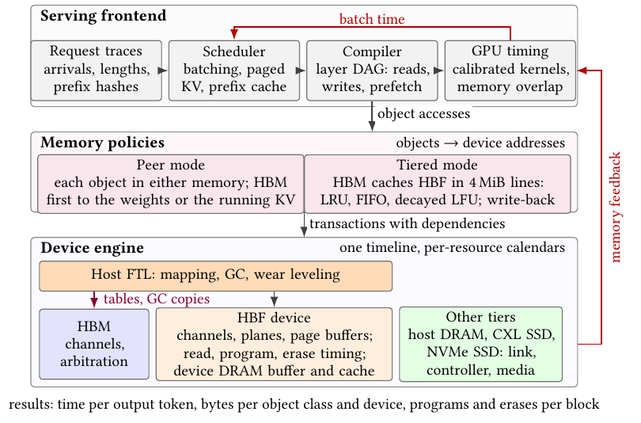

**Original:** Figure 2: HBFSim structure: three layers. Feedback from the device engine closes the loop to the scheduler, and the host FTL keeps its tables and GC copies in HBM.

**中文:** 图 2：HBFSim 的三层结构。器件引擎向调度器反馈结果，形成闭环；主机 FTL 将映射表和垃圾回收复制数据保存在 HBM 中。

**读图提示（辅助说明）：** 沿上到下阅读：请求轨迹 → 调度及算子访问 → 对象放置与事务依赖 → 器件时间线。批次耗时向上反馈，所以下一个批次会随存储性能变化。

**Source:** p.3 S028

**Original:** Workloads and device accesses differ in granularity and semantics. A serving system works with requests, weights, and KV blocks; HBM serves data bursts of tens of bytes; and HBF is accessed like memory but programs flash pages (e.g., 4 KiB) in order, erases whole flash blocks, and leaves its FTL to the host. Address-level traces preserve individual accesses but can only cover short runs, whereas production request traces cover long periods of serving but record no memory accesses.

**中文:** 工作负载与器件访问的粒度和语义不同。推理服务系统处理请求、权重和 KV 块；HBM 提供数十字节的突发传输；HBF 虽以类似内存的方式访问，却按顺序编程闪存页（例如 4 KiB），整块擦除，并把 FTL 留给主机。地址级轨迹保留单次访问，但只能覆盖短时间运行；生产请求轨迹则覆盖长时间推理服务，却不记录访存操作。

**Source:** p.3 S029

**Original:** The levels of the memory hierarchy are coupled. Existing simulators model one level in isolation, but in an HBM+HBF system the two levels jointly determine performance. What HBF must serve depends on what HBM can hold, and the traffic HBF generates in turn consumes HBM capacity and bandwidth. Placement decisions therefore shift load between the tiers rather than simply adding a slower level beneath HBM, so neither tier can be simulated independently.

**中文:** 存储层次中的各级相互耦合。现有模拟器孤立地建模某一层，但在 HBM＋HBF 系统中，两层共同决定性能。HBF 必须服务什么数据，取决于 HBM 能放下什么；HBF 产生的流量反过来又会消耗 HBM 的容量和带宽。因此，放置决策是在各层之间转移负载，而不只是简单地在 HBM 下面增加一层较慢的存储，任何一层都不能独立模拟。

**Source:** p.3 S030

**Original:** The number of events is huge. One decoding step of a 70B model reads tens of millions of flash pages, each passing through about a dozen shared resources, from the plane and flash channel to the TSVs and ECC engine. Because slower memory changes batching, these accesses must be simulated in a closed loop rather than replayed.

**中文:** 事件数量巨大。70B 模型的一个解码步会读取数千万个闪存页，每个页都要经过大约十余种共享资源，从平面和闪存通道到 TSV 与 ECC 引擎。由于较慢的存储会改变批次组织，这些访问必须在闭环中模拟，而不能仅作轨迹回放。

**Source:** p.3 S031

**Original:** As shown in Figure 2, layers in HBFSim communicate through narrow interfaces. The frontend describes work in terms of model objects such as weight tensors and KV blocks. Policies map objects to devices and emit transaction graphs with explicit dependencies. The engine contains no LLM-specific logic. This separation lets users change one layer, for example, add a caching policy or an FTL, without touching the others.

**中文:** 如图 2 所示，HBFSim 各层通过精简接口通信。前端使用权重张量、KV 块等模型对象描述工作；策略将对象映射到器件，并生成显式包含依赖关系的事务图；引擎不含 LLM 专属逻辑。这种分离允许用户修改某一层，例如增加缓存策略或 FTL，而无需触碰其他层。

### 3.1 推理服务前端 · 3.1 Serving Frontend

**Source:** p.3 S032

**Original:** 3.1 Serving Frontend

**中文:** 3.1 推理服务前端

**Source:** p.3 S033

**Original:** HBFSim accepts workloads at two granularities. In an address-level trace, a record is one memory access with optional data class, arrival time, and layer annotations; such traces are replayed directly. Detailed instruction-and-address tracing and cycle-level simulation incur substantial costs even for a small inference workload. For Qwen2.5-1.5B-Instruct (bfloat16, batch size 1), a 32-token prefill followed by two fixed-token decode steps required 43.4 minutes for trace collection on an RTX 4000 Ada with NVBit [30]. The resulting 1,030-kernel traces occupy 98.3 GiB uncompressed, or 7.46 GiB in the compressed format consumed by Accel-Sim2.0 [20]. Full trace-driven simulation already takes 19.9 wall-clock hours even for a small model. For larger models, both the trace size and simulation time would become prohibitively large, rendering this approach unrealistic.

**中文:** HBFSim 接受两种粒度的工作负载。在地址级轨迹中，每条记录对应一次访存，并可附带数据类别、到达时间和层标注；这类轨迹直接回放。即便推理工作负载很小，详细的指令与地址追踪、周期级模拟也会产生显著成本。对于 Qwen2.5-1.5B-Instruct（bfloat16，批量为 1），在 RTX 4000 Ada 上用 NVBit [30] 采集一个 32 词元预填充及随后两个固定词元解码步的轨迹，需要 43.4 分钟。得到的 1,030 个内核轨迹未经压缩时占 98.3 GiB，转换成 Accel-Sim2.0 [20] 使用的压缩格式后仍为 7.46 GiB。即使模型很小，完整的轨迹驱动模拟也已需要 19.9 小时实际运行时间。对于更大的模型，轨迹大小与模拟时间都会增长到难以承受，使这种方法不切实际。

**Source:** p.3 S034

**Original:** In a request-level trace, a record is one inference request: its arrival time, prompt and output lengths, and prefix hashes [22, 31]. It contains no detailed memory accesses. Which bytes an inference step touches does not depend on the values it computes, only on the model architecture and on which requests the scheduler runs with how many tokens (for MoE models, also on the routed experts, which depend on the values and are therefore an input, recorded or synthetic). The frontend, ServeLoop, therefore regenerates the accesses of every step. Its scheduler replays the trace with vLLM’s continuous batching and chunked prefill [2, 11, 35], including paged KV, prefix sharing, and preemption. A compiler turns each iteration into the byte ranges that every operator reads or writes in weight tensors, KV blocks, and embedding rows, leaving addresses and memories to the policies. A decoding step of Llama-3.1-70B under the workload with 32 sequences and 6K tokens of context becomes $1.8\times10^5$ such transactions.

**中文:** 在请求级轨迹中，每条记录对应一次推理请求，包含到达时间、提示词与输出长度，以及前缀哈希 [22, 31]，并不包含详细访存。一个推理步会访问哪些字节，并不取决于它计算出的数值，而取决于模型架构、调度器运行哪些请求及各请求处理多少词元；对于 MoE 模型，还取决于路由到哪些专家，而路由与数值有关，因此将实测或合成的专家路由作为输入。前端 ServeLoop 由此重新生成每步访问。其调度器采用 vLLM 的连续批处理与分块预填充 [2, 11, 35] 回放轨迹，包括分页 KV、前缀共享及抢占。编译器将每次迭代转成各算子在权重张量、KV 块及嵌入行中读写的字节区间，具体地址与存储归属则交给策略层。在 32 个序列、6K 上下文词元的工作负载下，Llama-3.1-70B 的一个解码步被转成 $1.8\times10^5$ 个此类事务。

**Source:** p.3–4 S035

**Original:** The generated accesses are verified at three levels. Batching: given the same service times, the scheduler forms the same batches as vLLM (Section 3.5). Addresses: the byte ranges and their order match 6,568 held-out warp streams captured with NVBit on an A100; the H200 we model has no capture, so its KV is read block by block, which changes the time per output token (TPOT) by at most 0.55% against the A100 order. Volume: the frontend counts each byte once, whereas prefill kernels refetch the same KV for other query heads or tiles, which GPU caches partly absorb, so prefill traffic is a lower bound.

**中文:** 生成的访问在三个层面得到验证。批次组织：给定相同的服务时间，调度器与 vLLM 形成相同批次（第 3.5 节）。地址：字节区间及其顺序与在 A100 上用 NVBit 采集、留作验证的 6,568 条 warp 访问流一致；所建模的 H200 没有采集轨迹，因此按块读取其 KV，与 A100 顺序相比，输出词元平均耗时（TPOT）最多变化 0.55%。流量：前端对每个字节只计数一次，而预填充内核会因不同查询头或计算分块而重新获取同一份 KV，其中部分重复读取由 GPU 缓存吸收，因此预填充流量是一个下界。

**Source:** p.4 S036

**Original:** HBFSim times every batch, prefill and decode alike, using an operator-level GPU model. It decomposes each batch into operators and computes each operator’s time from three components: a fixed overhead, a compute time, and a memory-access time. The compute time is derived from the operator’s FLOPs and a compute-throughput coefficient fitted to measured kernels. We obtain the memory-access time from HBFSim’s detailed simulation of HBM and HBF accesses, rather than an ideal-bandwidth assumption. To stay anchored to real GPU behavior, we fit each operator’s fixed overhead, compute throughput, and memory bandwidth from measured kernels to establish a baseline time. During simulation, we replace the baseline’s ideal memory time with the simulated access time, while retaining the measured kernel’s additional memory overhead beyond the GPU’s peak bandwidth. The batch time is then the sum of all operator times. This design ensures that HBF latency and bandwidth directly affect each operator’s memory time, and thus the batch time, while the compute portion stays tied to measured GPU performance.

**中文:** HBFSim 用算子级 GPU 模型为每个批次计时，预填充和解码均如此。它将批次拆成算子，并从固定开销、计算时间和访存时间三部分计算每个算子的耗时。计算时间来自算子的 FLOPs，以及用实测内核拟合的计算吞吐系数。访存时间由 HBFSim 对 HBM 与 HBF 访问的详细模拟给出，而非理想带宽假设。为使模型保持与真实 GPU 行为一致，我们依据实测内核拟合各算子的固定开销、计算吞吐和存储带宽，建立基准时间。模拟时，用模拟得到的访问时间替换基准中的理想访存时间，同时保留实测内核相对于 GPU 峰值带宽所体现的额外访存开销。随后将所有算子时间相加得到批次时间。这样，HBF 的延迟与带宽会直接影响每个算子的访存时间，进而影响批次时间，而计算部分仍与实测 GPU 性能相联系。

### 3.2 存储策略 · 3.2 Memory Policies

**Source:** p.4 S037

**Original:** 3.2 Memory Policies

**中文:** 3.2 存储策略

**Source:** p.4 S038

**Original:** HBFSim provides two ways to organize HBM and HBF. In peer mode, HBM and HBF form one address space, and each object is stored in one of them. HBM is filled in a priority order and the rest overflows to HBF: weights first places the weights, then KV blocks in address order, retained prefixes included; KV first places the running sequences’ KV, then the weights, then the retained prefixes. In tiered mode, HBM caches objects stored in the HBF or other capacity tier in 4 MiB lines with LRU, FIFO, or decayed-LFU [23] replacement; decayed LFU evicts the line with the fewest recent accesses and halves all access counts periodically, as in frequency-based replacement [23]. Dirty data is tracked at 4 KiB granularity, and dirty KV is written back either eagerly, while compute leaves the link idle [12], or only when its line is evicted. KV released before eviction is discarded without being written.

**中文:** HBFSim 提供两种组织 HBM 与 HBF 的方式。在并列模式（peer mode）中，HBM 与 HBF 构成同一地址空间，每个对象保存在其中之一。系统按优先级填充 HBM，其余对象溢出到 HBF：权重优先先放权重，再按地址顺序放 KV 块，其中包括保留的前缀；KV 优先先放运行中序列的 KV，再放权重，最后放保留的前缀。在分层模式（tiered mode）中，HBM 以 4 MiB 缓存行为单位，缓存 HBF 或其他容量层中的对象，使用 LRU、FIFO 或衰减 LFU [23] 进行替换；衰减 LFU 淘汰近期访问次数最少的行，并定期将所有访问计数减半，与基于频率的替换方式相同 [23]。脏数据按 4 KiB 粒度跟踪；脏 KV 既可在计算使链路空闲时积极回写 [12]，也可仅在缓存行被淘汰时回写。淘汰前已释放的 KV 直接丢弃，不再写入。

### 3.3 器件引擎 · 3.3 Device Engine

**Source:** p.4 S039

**Original:** 3.3 Device Engine

**中文:** 3.3 器件引擎

**Source:** p.4 S040

**Original:** HBM. An HBM stack follows the JEDEC organization of its generation, set by the number of channels and pseudo-channels and the pin rate. The following study uses HBM4 for analysis [8], with 32 channels of two pseudo-channels at 8 Gb/s per pin, or 2 TB/s per stack. Because our studies concern capacity tiers, HBFSim models HBM at the pseudo-channel level rather than at the command level of DRAM simulators such as Ramulator 2.0 [16]. Requests are split into pseudo-channel transfers, groups of four pseudo-channels share an arbitration queue and a service timeline, and an average access latency and a bandwidth efficiency account for row activation and refresh.

**中文:** HBM。HBM 堆栈遵循其代际的 JEDEC 组织方式，由通道数、伪通道数和引脚速率决定。下文使用 HBM4 进行分析 [8]：32 个通道，每通道两个伪通道，引脚速率为 8 Gb/s，即每堆栈 2 TB/s。由于研究关注容量层，HBFSim 在伪通道层面建模 HBM，而非像 Ramulator 2.0 [16] 等 DRAM 模拟器那样建模到命令级。请求被拆成伪通道传输，每四个伪通道共享仲裁队列与服务时间线，使用平均访问延迟和带宽效率表示行激活与刷新造成的影响。

**Source:** p.4 S041

**Original:** HBF. As in the OCP specification, the model separates the device from its host-side management. The device has independent transmit and receive timelines for each channel, ordered page sensing within each bank, page buffers, ECC, and TSV transfers. It programs the pages of a block in order and, as the specification requires, erases a block when its first page is written. The organization of flash into channels, dies, planes, and blocks and the timing of reads, programs, and erases follow MQSim [29]. We reimplemented them because MQSim’s FTL runs inside an SSD, whereas HBF’s runs on the host, and HBF operations must share one timeline with HBM and the serving frontend. Like an SSD, and beyond the specification, each stack has a device-managed DRAM that buffers writes until a page is full and caches recently read pages. The host runs the FTL. It maps logical pages to physical ones and runs garbage collection, which picks victim blocks by their number of valid pages with a small weight for wear; static wear leveling is implemented but switched off in our studies. Since the specification forbids the device from moving valid data, garbage collection reads live pages into a copy buffer in HBM and writes them back. We implemented three mappings and keep each one’s index in HBM. Page-level mapping has an 8-byte entry per 4 KiB page; the whole table lives in flash as translation pages, and HBM caches part of it. Extent mapping keeps a sorted list of runs of consecutive pages, 48 B per run. Both write by appending and spread consecutive pages over all planes. Block-level mapping has one entry per 1 MiB logical block and keeps the block in one physical block on one plane, each page at a fixed offset. We model two consequences: NAND programs a block’s pages in order, so a page whose predecessors have not been written yet waits in the device DRAM; and any write that is not an in-order append copies the whole block to a fresh one. We do not stripe blocks over planes, because a copy would then move a 1.5 GiB stripe. Every mapping gets 0.1% of the HBF capacity in HBM, 3.1 GiB of the 96 GiB of two HBM4 stacks, and its lookups compete with the application’s traffic: with page-level mapping, one Llama-3.1-70B decoding step at 2 HBM + 6 HBF issues $1.0\text{–}1.7\times10^7$ lookups, one per flash page read.

**中文:** HBF。按照 OCP 规范，模型将器件与主机端管理分开。器件为每个通道维护独立的发送和接收时间线，建模存储体内按序进行的页感测、页缓冲区、ECC 和 TSV 传输。它按顺序编程同一块中的页，并按规范要求，在写入块的第一页时擦除该块。通道、裸片、平面、块的闪存组织，以及读、编程、擦除时序遵循 MQSim [29]。我们重新实现了这些部分，因为 MQSim 的 FTL 位于 SSD 内部，而 HBF 的 FTL 位于主机；HBF 操作还必须与 HBM 和推理服务前端共享同一条时间线。与 SSD 类似、但超出了规范要求，每个堆栈还设有器件管理的 DRAM：它将写入缓冲到一页填满，并缓存近期读取的页。主机运行 FTL，执行逻辑页到物理页的映射与垃圾回收；垃圾回收主要依据有效页数量选择回收块，同时给予磨损程度较小权重。静态磨损均衡已实现，但在本研究中关闭。由于规范禁止器件自行移动有效数据，垃圾回收先将有效页读入 HBM 中的复制缓冲区，再将其写回。我们实现了三种映射，并将各自的索引放入 HBM。页级映射为每个 4 KiB 页设置一个 8 字节表项；完整映射表以转换页形式保存在闪存中，HBM 缓存其中一部分。区段映射保存连续页区间的有序列表，每个区段 48 B。二者均采用追加写，并将连续页分布到所有平面。块级映射为每个 1 MiB 逻辑块设置一个表项，把该块放入单一平面的一个物理块中，各页具有固定偏移。我们建模了两个后果：NAND 必须按序编程块中的页，因此其前驱页尚未写入时，某页须在器件 DRAM 中等待；任何非按序追加的写入，都会把整个块复制到一个新块。我们不跨平面条带化块，否则一次复制就要搬运一条 1.5 GiB 的条带。每种映射都获得相当于 HBF 容量 0.1% 的 HBM 空间，即两个 HBM4 堆栈共 96 GiB 中的 3.1 GiB；映射查找还会与应用流量竞争。在页级映射下，2 HBM＋6 HBF 配置中的一个 Llama-3.1-70B 解码步会发出 $1.0\text{–}1.7\times10^7$ 次查找，即每读取一个闪存页查找一次。

**Source:** p.4 S042

**Original:** Other tiers. Host DRAM, CXL SSDs, and NVMe SSDs share one model consisting of a link, a controller, and media queues. A CXL SSD adds a device-side DRAM cache with FIFO replacement.

**中文:** 其他层级。主机 DRAM、CXL SSD 与 NVMe SSD 共用一个由链路、控制器和介质队列构成的模型。CXL SSD 还加入了使用 FIFO 替换的器件端 DRAM 缓存。

### 3.4 模拟速度 · 3.4 Simulation Speed

**Source:** p.4 S043

**Original:** 3.4 Simulation Speed

**中文:** 3.4 模拟速度

**Source:** p.4 S044

**Original:** To make full-iteration simulation tractable, we combine coarse-grained HBM approximation with exact HBF acceleration. Only HBM is approximated: scheduling transfers per 4 KiB chunk and pseudo-channel rather than per 32-byte burst runs an all-HBM forward pass 24.8× faster (134.7× for sequential reads), while keeping batch completion times within 0.04%.

**中文:** 为使完整迭代模拟的开销可承受，我们结合粗粒度 HBM 近似与保持精确性的 HBF 加速。只有 HBM 使用近似：以 4 KiB 数据块和伪通道为单位调度传输，而不是逐个 32 字节突发传输，使全 HBM 前向执行的模拟速度达到原来的 24.8 倍，顺序读取时达到 134.7 倍，同时批次完成时间误差保持在 0.04% 以内。

**Source:** p.4–5 S045

**Original:** For HBF, the bottleneck is reserving roughly a dozen shared resources per page, as in SimpleSSD [9]; here we reduce per-reservation overhead without sacrificing accuracy. A first-fit calendar organizes each resource’s idle intervals into 64-interval leaves labeled with their maximum duration, so searches immediately bypass leaves with insufficient space. Multi-page reads are batched into groups of one page per plane to share stage-time calculations, reuse calendar lookup states across groups, and compute stride addresses from the first page, while the FTL updates free space only for planes whose state changes. Page grouping speeds up a Llama-3.1-70B batch (7.3M page reads) by 1.48×, and lazy FTL recounting accelerates ten write batches (3.2M page programs) by 1.55×. Every page still reserves all resources in strict order without pruning or rounding idle intervals, yielding bit-identical completion times across all 82,449 transactions in the batch.

**中文:** 对于 HBF，瓶颈与 SimpleSSD [9] 类似：每个页都要预留约十余种共享资源；我们在不牺牲准确性的前提下降低每次预留的开销。采用首次适配搜索的资源日历，将每种资源的空闲区间组织为每叶包含 64 个区间的结构，并标注叶内最大区间长度，从而在搜索时立即跳过没有足够空间的叶。多页读取按每平面一页分组，以共享阶段时间计算、跨组复用日历查找状态，并由第一页计算步长地址；FTL 则仅更新状态发生变化的平面的空闲空间。页分组使一个 Llama-3.1-70B 批次（7.3M 次页读取）的模拟加速 1.48 倍；FTL 延迟重计数使十个写入批次（3.2M 次页编程）的模拟加速 1.55 倍。每个页仍严格按顺序预留全部资源，不裁剪或舍入空闲区间，因此该批次全部 82,449 个事务的完成时间与原实现逐比特一致。

**Source:** p.5 S046

**Original:** Wall-clock time then tracks flash page reads at roughly $2.7\times10^5$ reads/s per core (Figure 3b); all 405 configurations in Section 4 took 80.0 core-hours on an Apple M2 Ultra and an M5 Pro.

**中文:** 由此，实际运行时间大致随闪存页读取数增长，速度约为每核每秒 $2.7\times10^5$ 次读取（图 3b）；第 4 节全部 405 种配置在 Apple M2 Ultra 和 M5 Pro 上合计消耗 80.0 核时。

#### 图 3：校准误差与模拟成本

**Placed near:** p.5 S046  
**Source:** p.5 F003 · C003

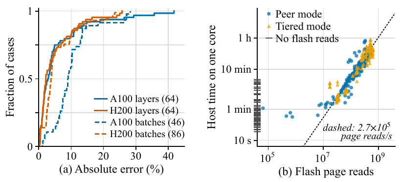

**Original:** Figure 3: Calibration and simulation cost. (a) Absolute error of predicted time for held-out layer shapes and for complete-request batches. (b) Host time of the 405 configurations of Section 4 against their flash page reads; configurations without flash reads sit on the vertical axis.

**中文:** 图 3：校准与模拟成本。(a) 留出验证的层形状和完整请求批次的预测时间绝对误差。(b) 第 4 节 405 种配置的主机运行时间与闪存页读取次数的关系；没有闪存读取的配置位于纵轴上。

**读图提示（辅助说明）：** 左图是误差的累计分布，越靠左越好；右图衡量模拟器自身运行成本，虚线约为每核每秒 270,000 次页读取，不是被模拟 HBF 的服务带宽。

### 3.5 校准与验证 · 3.5 Calibration and Validation

**Source:** p.5 S047

**Original:** 3.5 Calibration and Validation

**中文:** 3.5 校准与验证

**Source:** p.5 S048

**Original:** Three components are calibrated against hardware (Figure 3a). The scheduler is checked against vLLM 0.26’s: both receive the same requests and the same measured batch times, and over 282 batches in ten test cases with staggered arrivals, shared prefixes, prefix eviction, and preemption, they form the same batches with the same token ranges, prefix hits, and completion times. The operator model is fitted to kernel measurements: on an A100 and an H200 NVL we timed the Marlin GEMMs and FlashAttention-2 paged attention that vLLM uses with 8-bit weights, inside whole layers under CUDA graphs, over 525 shapes per GPU spanning batch, query, and context sizes, and fitted each operator’s fixed overhead, compute rate, and memory rate by least squares. We then predict 64 whole-layer shapes that never entered the fit: the mean absolute error is 5.8% on the A100 and 5.0% on the H200, and the largest, 41.8% on the A100, occurs in Llama-3.1-70B layers whose batch mixes long and short contexts. Finally we run complete requests on each GPU, from the embedding to the output head, and compare each batch’s time: predicted and measured batch times differ by 10.2% on average on the A100 (Llama-3.1-8B, 46 batches) and by 5.8% on the H200 (Llama-3.1-8B and Llama-3.1-70B, 86 batches); for Llama-3.1-70B on the H200, the time to first token differs by 9.3–13.6% and TPOT by 4.6–7.0%. The host DRAM path is fitted to measured pinned-memory copies between an H200 NVL and its host (issue time, bandwidth per direction, fixed latency).

**中文:** 三个组件依据硬件进行校准（图 3a）。调度器与 vLLM 0.26 的调度器对照：二者接收相同请求和相同实测批次时间，在十个测试用例的 282 个批次中，涵盖交错到达、共享前缀、前缀淘汰和抢占，二者形成相同批次，词元区间、前缀命中及完成时间也相同。算子模型根据内核测量拟合：在 A100 和 H200 NVL 上，我们测量 vLLM 处理 8 位权重时使用的 Marlin GEMM 与 FlashAttention-2 分页注意力，将完整层放在 CUDA graph 内执行；每种 GPU 覆盖 525 种形状，跨越不同批量、查询长度及上下文长度，再用最小二乘拟合各算子的固定开销、计算速率和存储速率。随后预测从未参与拟合的 64 种完整层形状：A100 上平均绝对误差为 5.8%，H200 上为 5.0%；最大误差为 A100 上的 41.8%，出现在批次混合长短上下文的 Llama-3.1-70B 层。最后，我们在每种 GPU 上运行从嵌入到输出头的完整请求，比较各批次时间：A100 上预测与实测批次时间平均相差 10.2%（Llama-3.1-8B，46 个批次），H200 上相差 5.8%（Llama-3.1-8B 和 Llama-3.1-70B，86 个批次）；对于 H200 上的 Llama-3.1-70B，首词元时间相差 9.3–13.6%，TPOT 相差 4.6–7.0%。主机 DRAM 路径则依据 H200 NVL 与主机之间的锁页内存复制测量进行拟合，包括发起时间、各方向带宽和固定延迟。

**Source:** p.5 S049

**Original:** HBM4 and HBF cannot be calibrated yet. Their interfaces follow the specifications; HBM’s access latency and bandwidth efficiency and HBF’s internal timing (4 μs page read, 75 μs program) and parallelism are assumptions users can replace. Every default parameter records its source, published, from the literature, or assumed; 18 of the 30 parameter groups are assumptions. The engine checks its own accounting on every run (programs by cause must sum to the physical programs; valid, invalid, and free pages to the capacity), the test suite compares HBM scheduling, HBF reads and writes, and GC against reference models, and every result records the hashes of its inputs, configuration, and binary.

**中文:** HBM4 和 HBF 目前尚无法校准。它们的接口遵循规范；HBM 的访问延迟、带宽效率，以及 HBF 的内部时序（页读取 4 μs、编程 75 μs）和并行度都是用户可以替换的假设。每个默认参数均记录来源：公开资料、文献或假设；30 组参数中有 18 组属于假设。引擎在每次运行时检查内部计量是否守恒，例如按成因划分的编程次数之和必须等于物理编程次数，有效、无效及空闲页之和必须等于总容量；测试套件将 HBM 调度、HBF 读写及 GC 与参考模型比较；每个结果还记录输入、配置与可执行文件的哈希值。

## 4 案例研究 · 4 CASE STUDIES

**Source:** p.5 S050

**Original:** 4 CASE STUDIES

**中文:** 4 案例研究

**Source:** p.5 S051

**Original:** We use HBFSim to answer the questions of Section 2.3 with two models and three workloads.

**中文:** 我们使用 HBFSim，结合两个模型和三种工作负载，回答第 2.3 节提出的问题。

### 4.1 实验设置 · 4.1 Setup

**Source:** p.5 S052

**Original:** 4.1 Setup

**中文:** 4.1 实验设置

**Source:** p.5 S053

**Original:** System. We model one accelerator package with eight memory stacks, each an HBM4 stack or an HBF stack (Table 1); we write 2 HBM + 6 HBF for a package of two HBM and six HBF stacks (2:6 in the figures, 2H6F in Table 3). We compare 1 HBM + 7 HBF, 2 HBM + 6 HBF, 4 HBM + 4 HBF, and 6 HBM + 2 HBF, whose HBM holds 43.4, 91.9, 188.9, and 285.9 GiB of data. The HBF stacks follow OCP speed grade 2, with 16 channels, one die per channel, 16 planes per die, and blocks of 256 pages of 4 KiB. Like an SSD, each HBF stack has a device DRAM of 0.1% of its flash that serves as write buffer and read cache. Unless noted otherwise, the host FTL uses page-level mapping and caches translation pages in 0.1% of the HBF capacity, reserved in HBM. We serve Llama-3.1-70B [5] with 8-bit weights (67.7 GiB) and a BF16 KV cache (320 KiB per token), and Qwen3-235B-A22B with FP8 weights (223.0 GiB for the 128 experts of each of its 94 MoE layers) and a BF16 KV cache (188 KiB per token); the figures label them 70B and 235B. Public traces carry no expert routes, so the 235B model routes every token to a uniformly random top-8 of its 128 experts, seeded by the token’s prefix; at 32 sequences a decode step reads 197.9 GiB of the 223 GiB of weights. GPU compute follows the H200 NVL operator profile (Section 3.5), which covers batches of up to 16; for larger batches we keep the per-FLOP and per-byte costs measured at 16.

**中文:** 系统。我们建模一个具有八个存储堆栈位置的加速器封装，每个位置安装一个 HBM4 或 HBF 堆栈（表 1）；用 2 HBM＋6 HBF 表示包含两个 HBM 和六个 HBF 堆栈的封装，在图中记为 2:6，在表 3 中记为 2H6F。我们比较 1 HBM＋7 HBF、2 HBM＋6 HBF、4 HBM＋4 HBF 和 6 HBM＋2 HBF，其 HBM 可保存的数据分别为 43.4、91.9、188.9 和 285.9 GiB。HBF 堆栈遵循 OCP 速度等级 2：16 个通道，每通道一个裸片，每裸片 16 个平面，每块含 256 个 4 KiB 页。与 SSD 类似，每个 HBF 堆栈具有相当于闪存容量 0.1% 的器件 DRAM，用作写缓冲和读缓存。除非另有说明，主机 FTL 使用页级映射，并在 HBM 中预留相当于 HBF 容量 0.1% 的空间缓存转换页。我们运行 Llama-3.1-70B [5]，使用 8 位权重（67.7 GiB）和 BF16 KV 缓存（每词元 320 KiB）；还运行 Qwen3-235B-A22B，使用 FP8 权重（94 个 MoE 层、每层 128 个专家，共 223.0 GiB）和 BF16 KV 缓存（每词元 188 KiB）；图中分别标为 70B 和 235B。公开轨迹没有专家路由，因此对 235B 模型，以词元前缀为随机种子，从每层 128 个专家中均匀随机选择 top-8；32 个序列时，一个解码步读取 223 GiB 权重中的 197.9 GiB。GPU 计算遵循 H200 NVL 算子配置（第 3.5 节），其测量覆盖的批量最大为 16；对于更大批量，保持批量 16 时测得的单位 FLOP 和单位字节成本。

#### 表 1：容量层器件参数

**Placed near:** p.5 S053  
**Source:** p.5 T001 · C010

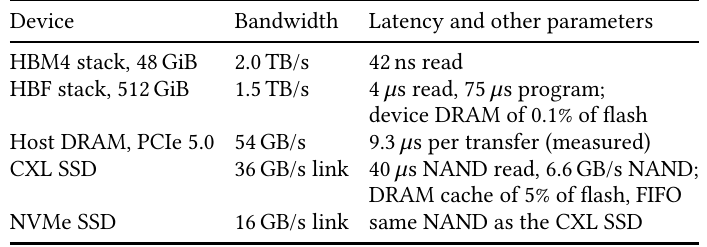

**Original:** Table 1: Memory devices of capacity tiers.

**中文:** 表 1：容量层使用的存储器件。

**中文表格：**

| 器件 | 带宽 | 延迟及其他参数 |
| --- | --- | --- |
| HBM4 堆栈，48 GiB | 2.0 TB/s | 读取 42 ns |
| HBF 堆栈，512 GiB | 1.5 TB/s | 读取 4 μs、编程 75 μs；器件 DRAM 为闪存容量的 0.1% |
| 主机 DRAM，PCIe 5.0 | 54 GB/s | 每次传输 9.3 μs，实测 |
| CXL SSD | 链路 36 GB/s | NAND 读取 40 μs、带宽 6.6 GB/s；DRAM 缓存为闪存容量的 5%，FIFO |
| NVMe SSD | 链路 16 GB/s | NAND 与 CXL SSD 相同 |

**读图提示（辅助说明）：** 下方为表格的中文转写；带宽、容量和时序均按原表保留。

**Source:** p.5–6 S054

**Original:** Workloads. A decode step reads the KV of every running sequence, so what distinguishes workloads is how much context the sequences hold and how that context was produced. We characterize a workload by its input:output length ratio and compare three (Table 2): long OUTPUT (2K prompt tokens, 6K output tokens), balanced (4K and 4K), and long INPUT (6K and 2K), 8K tokens per request in each. The public traces of Mooncake [22] and Qwen [31] are input-heavy (at most 29% of their requests have more than 62.5% of their tokens in the output), so no output-heavy workload can be drawn from them; their median request holds 5.5K–7.3K tokens. Prompts are private, so no KV is shared. We replay each workload through the scheduler with 32 sequences per batch and a prefix cache that retains 1M tokens (320 GiB of KV for Llama-3.1-70B, 188 GiB for Qwen3-235B-A22B). The first batch’s requests arrive spread over one request’s lifetime, so in the steady state the running sequences are at every stage of their lifetimes. Among the steps in which every batch slot is busy while requests wait and the prefix cache is full, we take the one whose running sequences hold the median context and install its state as replayed, each KV block at its replayed address. We then measure a short window instead of a full replay: each sequence prefills a private 16-token suffix, which resumes it as a running request and yields its first token, and decodes seven more; TPOT is the mean time of these seven decode steps. The three workloads hold 5.2K, 6.3K, and 7.3K tokens of context on average, so a step reads 51–71 GiB of KV for Llama-3.1-70B and 30–42 GiB for Qwen3-235B-A22B, 40% more under long INPUT than under long OUTPUT, and writes one token of KV per sequence.

**中文:** 工作负载。一个解码步会读取每个运行中序列的 KV，因此工作负载的区别在于序列保存了多少上下文，以及这些上下文是如何产生的。我们用输入与输出长度比表征工作负载，并比较三种情形（表 2）：长输出（2K 提示词、6K 输出词元）、均衡（4K 与 4K）和长输入（6K 与 2K），每种情形每请求均为 8K 词元。Mooncake [22] 与 Qwen [31] 的公开轨迹偏重输入：其中输出词元占比超过 62.5% 的请求至多为 29%，因此无法从中直接抽取偏重输出的工作负载；它们的请求中位长度为 5.5K–7.3K 词元。各请求提示词为私有内容，因此没有共享 KV。我们通过调度器回放每种工作负载，每批次 32 个序列，前缀缓存保留 1M（100 万）词元，相当于 Llama-3.1-70B 的 320 GiB KV，或 Qwen3-235B-A22B 的 188 GiB KV。首批请求的到达时间分散在一个请求的生命周期内，使稳态运行中的序列覆盖各个生命周期阶段。在每个批次槽位均忙碌、仍有请求等待且前缀缓存已满的各步中，选取运行中序列上下文处于中位水平的一步，并按回放结果恢复其状态，每个 KV 块放在其回放地址。随后测量一个短窗口，而非完整回放：每个序列先预填充一个私有的 16 词元后缀，以恢复为运行中请求并生成首词元，之后再解码七个词元；TPOT 为这七个解码步的平均耗时。三种工作负载平均保存 5.2K、6.3K 和 7.3K 上下文词元，因此每步读取 Llama-3.1-70B 的 51–71 GiB KV，或 Qwen3-235B-A22B 的 30–42 GiB KV；长输入比长输出多约 40%，每步还为每个序列写入一个词元的 KV。

#### 表 2：代表性解码步的工作负载

**Placed near:** p.5 S054  
**Source:** p.5 T002 · C011

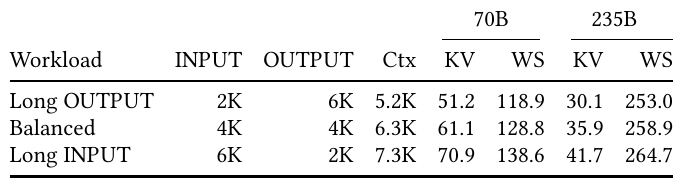

**Original:** Table 2: Workloads at the representative decode step: prompt and output tokens per request, mean context of the running sequences (Ctx), KV read per step (KV, GiB), and working set of weights and KV (WS, GiB).

**中文:** 表 2：代表性解码步的工作负载。INPUT、OUTPUT 为每请求的提示词与输出词元数；Ctx 为运行中序列的平均上下文；KV 为每步 KV 读取量，单位 GiB；WS 为权重与 KV 的工作集，单位 GiB。

**中文表格：**

| 工作负载 | 输入词元 | 输出词元 | 平均上下文 | 70B 每步 KV (GiB) | 70B 工作集 (GiB) | 235B 每步 KV (GiB) | 235B 工作集 (GiB) |
| --- | --- | --- | --- | --- | --- | --- | --- |
| 长输出 | 2K | 6K | 5.2K | 51.2 | 118.9 | 30.1 | 253.0 |
| 均衡 | 4K | 4K | 6.3K | 61.1 | 128.8 | 35.9 | 258.9 |
| 长输入 | 6K | 2K | 7.3K | 70.9 | 138.6 | 41.7 | 264.7 |

**读图提示（辅助说明）：** 输入加输出均为 8K，但代表性解码步的平均上下文不同。70B 与 235B 的 KV 每词元大小不同，不能只按模型参数总量推断 KV 大小。

### 4.2 HBF 与其他容量层的比较 · 4.2 HBF Versus Other Capacity Tiers

**Source:** p.6 S055

**Original:** 4.2 HBF Versus Other Capacity Tiers

**中文:** 4.2 HBF 与其他容量层的比较

**Source:** p.6 S056

**Original:** At 2 HBM + 6 HBF with weights first, the capacity tier serves 38–65 GiB of running KV per step for Llama-3.1-70B and 145–157 GiB for Qwen3-235B-A22B, whose 223 GiB of weights exceed HBM: 115 GiB of weights and all 30–42 GiB of running KV. We keep this placement and replace the six HBF stacks with host DRAM, a CXL SSD, or an NVMe SSD of the same capacity (Figure 4a). HBF decodes 11.0–14.4× faster than host DRAM, 16.1–21.3× faster than the CXL SSD, and 86.6–115.0× faster than the NVMe SSD for Llama-3.1-70B, and 18.6–19.0×, 66.8–154.1×, and 150.3–154.1× faster for Qwen3-235B-A22B. The step time is roughly the tier read divided by the tier’s bandwidth: six on-package HBF stacks serve 157 GiB in 0.17 s, PCIe-attached host DRAM in 3.2 s, and the NVMe SSD’s NAND at 6.6 GB/s in 26 s. The CXL SSD’s device DRAM (5% of its flash, 153.6 GiB) holds the spill of Llama-3.1-70B and of the first two Qwen3-235B-A22B workloads, so the CXL SSD stays within 1.5× of host DRAM there; the 157 GiB spill of long INPUT exceeds it and the CXL SSD is as slow as the NVMe SSD (26.0 s). We keep all 32 sequences in every system, so each tier serves the same spill; a real system would shrink the batch.

**中文:** 在 2 HBM＋6 HBF、权重优先的配置下，容量层每步为 Llama-3.1-70B 服务 38–65 GiB 运行中 KV，为 Qwen3-235B-A22B 服务 145–157 GiB 数据；后者的 223 GiB 权重超过 HBM 容量，其中包括 115 GiB 权重和全部 30–42 GiB 运行中 KV。保持这一放置方式，将六个 HBF 堆栈替换成同等容量的主机 DRAM、CXL SSD 或 NVMe SSD（图 4a）。对于 Llama-3.1-70B，HBF 解码分别比主机 DRAM、CXL SSD 和 NVMe SSD 快 11.0–14.4、16.1–21.3 和 86.6–115.0 倍；对于 Qwen3-235B-A22B，相应为 18.6–19.0、66.8–154.1 和 150.3–154.1 倍。单步时间近似为容量层读取量除以其带宽：六个封装内 HBF 堆栈在 0.17 s 内服务 157 GiB，经 PCIe 连接的主机 DRAM 需要 3.2 s，而 NVMe SSD 的 NAND 以 6.6 GB/s 服务时需要 26 s。CXL SSD 的器件 DRAM 相当于闪存的 5%，即 153.6 GiB，足以容纳 Llama-3.1-70B 和前两种 Qwen3-235B-A22B 工作负载的溢出数据，因此这些情况下 CXL SSD 的耗时不超过主机 DRAM 的 1.5 倍；长输入的 157 GiB 溢出量超过其缓存容量，CXL SSD 就与 NVMe SSD 一样慢，为 26.0 s。所有系统都保留全部 32 个序列，使各容量层服务相同的溢出量；真实系统则可能缩小批量。

#### 图 4：HBF 与其他容量层的 TPOT 比较

**Placed near:** p.6 S056  
**Source:** p.6 F004 · C004

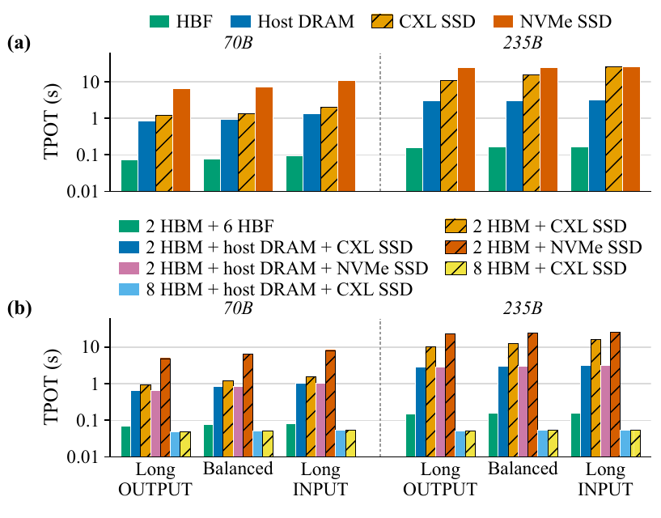

**Original:** Figure 4: Mean TPOT at the decode step of each workload (logarithmic axes). (a) HBF against the other capacity tiers at 2 HBM + 6 HBF, peer mode with the weights placed first in HBM. (b) The tiers as systems with eight stack sites: 2 HBM + 6 HBF, or 2 or 8 HBM with the HBF’s capacity off package as a CXL SSD or an NVMe SSD, alone or behind 256 GiB of host DRAM; KV placed first in HBM.

**中文:** 图 4：各工作负载代表性解码步的平均 TPOT，采用对数坐标。(a) 在 2 HBM＋6 HBF 配置、并列模式且 HBM 优先放权重时，将 HBF 与其他容量层比较。(b) 在八个堆栈位置下比较系统：2 HBM＋6 HBF，或者两个／八个 HBM 搭配封装外 CXL SSD 或 NVMe SSD，其容量与 HBF 相同；SSD 可以直接使用，也可以位于 256 GiB 主机 DRAM 之后；HBM 优先放 KV。

**读图提示（辅助说明）：** 柱子越低表示每个输出词元越快。上图主要替换容量层，下图还改变封装位置如何分配给 HBM，二者实验条件不同。

**Source:** p.6 S057

**Original:** An off-package tier occupies none of the package’s eight stack sites, which can then hold HBM. Figure 4b therefore compares seven systems on eight sites, all with KV first: 2 HBM + 6 HBF; 2 HBM with the HBF’s capacity off package as a CXL or NVMe SSD, alone or behind 256 GiB of host DRAM (one accelerator’s share of a 2 TiB server), leaving six sites empty; and 8 HBM with the CXL SSD, alone or behind host DRAM. With two HBM stacks, the weights that do not fit in HBM come from the tier in every step: 2 HBM + 6 HBF is 9.3–12.5× faster than 2 HBM + host DRAM + CXL SSD for Llama-3.1-70B and 19.1–19.5× for Qwen3-235B-A22B. Host DRAM holds the first 256 GiB of the tier, which covers both models’ weights, so the SSD behind it is never read and the NVMe and CXL variants coincide. The SSDs alone are 13.5–18.3× (CXL) and 70.8–98.0× (NVMe) slower than 2 HBM + 6 HBF for Llama-3.1-70B, and 66.9–99.3× and 154.3–157.2× for Qwen3-235B-A22B. With eight HBM stacks (384 GiB), both working sets fit, no step reads the off-package tier, and TPOT is 49–55 ms: 1.4–1.5× below 2 HBM + 6 HBF for Llama-3.1-70B and 2.9× below it for Qwen3-235B-A22B. An off-package tier thus wins only when the sites it frees go to HBM and the step fits in that HBM; then a cheap tier serves as well as a fast one.

**中文:** 封装外容量层不占用封装的8 个堆栈位置，这些位置可以转而安装 HBM。因此，图 4b 在八个位置的预算下比较七种系统，均采用 KV 优先：2 HBM＋6 HBF；两个 HBM，配以封装外 CXL 或 NVMe SSD，容量与 HBF 相同，SSD 可以直接使用，也可放在 256 GiB 主机 DRAM 之后（即一台 2 TiB 服务器分给一个加速器的份额），其余六个位置空置；以及 8 个 HBM，配以直接使用或位于主机 DRAM 之后的 CXL SSD。只有两个 HBM 堆栈时，HBM 放不下的权重每步都要从容量层读取：对于 Llama-3.1-70B，2 HBM＋6 HBF 比 2 HBM＋主机 DRAM＋CXL SSD 快 9.3–12.5 倍；对于 Qwen3-235B-A22B，快 19.1–19.5 倍。主机 DRAM 保存容量层前 256 GiB，能够覆盖两个模型的权重，因此后方 SSD 从未被读取，NVMe 与 CXL 变体的结果重合。直接使用 SSD 时，相比 2 HBM＋6 HBF，Llama-3.1-70B 的 CXL 方案慢 13.5–18.3 倍、NVMe 方案慢 70.8–98.0 倍；Qwen3-235B-A22B 相应慢 66.9–99.3 和 154.3–157.2 倍。若使用 8 个 HBM 堆栈（384 GiB），两个模型的工作集都能放下，每步均不读取封装外容量层，TPOT 为 49–55 ms；换言之，2 HBM＋6 HBF 的耗时分别为该全 HBM 配置的 1.4–1.5 倍（Llama-3.1-70B）和 2.9 倍（Qwen3-235B-A22B）。因此，只有将封装外容量层释放的位置用于 HBM，且单步工作集能够放入这些 HBM 时，封装外容量层方案才占优；此时，便宜的容量层也能达到快速容量层的效果。

**Source:** p.6 S058

**Original:** Takeaway 1: HBF is most valuable under memory-capacity pressure. It offers little benefit when the working set fits in HBM, but substantially outperforms offloading to CPU memory, CXL SSDs, and NVMe SSDs once spilling occurs, for example when Qwen3-235B-A22B serves 32 sequences whose 253–265 GiB working set exceeds the 188.9 GiB of HBM at 4 HBM + 4 HBF. Under a fixed stack budget, however, adding more HBM can hurt performance if the resulting loss of HBF bandwidth outweighs the reduction in spill traffic.

**中文:** 结论 1：HBF 在存储容量压力下最有价值。工作集能放入 HBM 时，它带来的收益很小；一旦发生溢出，它就明显优于卸载到 CPU 内存、CXL SSD 或 NVMe SSD。例如，Qwen3-235B-A22B 服务 32 个序列时，253–265 GiB 的工作集超过 4 HBM＋4 HBF 中 188.9 GiB 的 HBM 容量。不过，在堆栈总数固定时，若增加 HBM 导致的 HBF 带宽损失超过溢出流量减少所带来的收益，性能反而可能变差。

### 4.3 需要多少 HBM，以及 HBM 应保存什么 · 4.3 How Much HBM, and What Should It Hold?

**Source:** p.6 S059

**Original:** 4.3 How Much HBM, and What Should It Hold?

**中文:** 4.3 需要多少 HBM，以及 HBM 应保存什么

**Source:** p.6–7 S060

**Original:** Capacity and placement. We vary the split between HBM and HBF (Figure 5). In peer mode, HBM should give priority to the running sequences’ KV. The working set of Llama-3.1-70B (119–139 GiB) fits at 4 HBM + 4 HBF, where KV first and tiered mode reach the compute-bound 49–54 ms. At 2 HBM + 6 HBF, KV first takes 69–83 ms and weights first 75–95 ms, 4–14% more: it fills the HBM left after the weights with KV blocks in address order, retained prefixes included, and leaves 38–65 GiB of running KV in HBF per step, whereas KV first reads only weights from HBF (29–49 GiB). At 1 HBM + 7 HBF even KV first reads 8–28 GiB of running KV per step from HBF (89–98 ms). Under long OUTPUT, weights first still takes 75 ms at 4 HBM + 4 HBF, where the working set fits, because the added HBM fills with retained prefixes while 31 GiB of running KV per step still come from HBF. The working set of Qwen3-235B-A22B (253–265 GiB) exceeds HBM at all three splits. Its decode step is dominated by the 198 GiB of expert weights it reads, so KV first falls only gradually, from 163–170 ms at 1 HBM + 7 HBF and 152–160 ms at 2 HBM + 6 HBF to 115–128 ms at 4 HBM + 4 HBF, and weights first is 4–7% behind. At 1 HBM + 7 HBF the step takes only 7% longer than at 2 HBM + 6 HBF: seven HBF stacks serve the experts. The three workloads differ little: their contexts differ by 1K tokens, and TPOT follows (69, 76, and 83 ms with KV first at 2 HBM + 6 HBF): a step’s cost depends on how much context it reads, not on how it was produced.

**中文:** 容量与放置。我们改变 HBM 与 HBF 的堆栈配比（图 5）。在并列模式中，HBM 应优先保存运行中序列的 KV。Llama-3.1-70B 的工作集为 119–139 GiB，在 4 HBM＋4 HBF 时能够放下，此时 KV 优先与分层模式都达到受计算限制的 49–54 ms。在 2 HBM＋6 HBF 时，KV 优先耗时 69–83 ms，权重优先为 75–95 ms，后者高出 4–14%：它先放权重，再按地址顺序将包含保留前缀在内的 KV 块填入剩余 HBM，结果每步仍有 38–65 GiB 运行中 KV 位于 HBF；KV 优先则仅从 HBF 读取权重，为 29–49 GiB。在 1 HBM＋7 HBF 时，即便 KV 优先，每步也要从 HBF 读取 8–28 GiB 运行中 KV，耗时 89–98 ms。长输出工作负载下，即使工作集能放入 4 HBM＋4 HBF，权重优先仍需 75 ms，因为新增 HBM 被保留前缀填满，每步仍从 HBF 读取 31 GiB 运行中 KV。Qwen3-235B-A22B 的工作集为 253–265 GiB，在这三种配比下都超过 HBM。其解码步主要由 198 GiB 专家权重读取决定，因此 KV 优先的耗时只逐渐下降：1 HBM＋7 HBF 为 163–170 ms，2 HBM＋6 HBF 为 152–160 ms，4 HBM＋4 HBF 为 115–128 ms，权重优先则落后 4–7%。1 HBM＋7 HBF 的单步耗时仅比 2 HBM＋6 HBF 长 7%，因为七个 HBF 堆栈共同服务专家。三种工作负载差异很小：上下文相邻约差 1K 词元，TPOT 随之变化，例如 2 HBM＋6 HBF、KV 优先时分别为 69、76 和 83 ms；单步成本取决于读了多少上下文，而不取决于上下文如何产生。

#### 图 5：HBM/HBF 配比与数据放置策略

**Placed near:** p.6 S060  
**Source:** p.7 F005 · C005

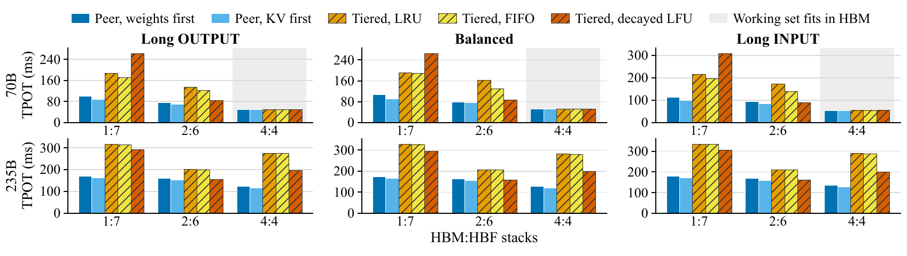

**Original:** Figure 5: Mean TPOT across HBM:HBF stack splits. Peer mode gives HBM first to the weights or to the running sequences’ KV; tiered mode replaces by LRU, FIFO, or decayed LFU and writes back on eviction.

**中文:** 图 5：不同 HBM:HBF 堆栈配比下的平均 TPOT。并列模式让 HBM 优先保存权重或运行中序列的 KV；分层模式使用 LRU、FIFO 或衰减 LFU 替换，并在淘汰时回写。

**读图提示（辅助说明）：** 上排为 70B，下排为 235B；三列对应长输出、均衡和长输入。浅灰背景表示工作集能够放入 HBM。比较时先固定模型、工作负载和堆栈配比，再比较同组策略柱。

**Source:** p.7 S061

**Original:** Tiered mode. Tiered mode matches peer mode with KV first when the working set fits in HBM and, with LRU or FIFO, is 1.7–2.2× slower for Llama-3.1-70B and 1.3–2.4× for Qwen3-235B-A22B when it does not. Each step reads the working set in the same order, a cyclic pattern larger than HBM, so LRU evicts almost every 4 MiB line before it is reused and the step rereads the whole working set from HBF, 117–137 GiB for Llama-3.1-70B and 231–243 GiB for Qwen3-235B-A22B, instead of only the spill. This is why 4 HBM + 4 HBF is slower than 2 HBM + 6 HBF for Qwen3-235B-A22B in tiered mode (275–291 against 201–211 ms): four HBF stacks serve the same reread instead of six. At 1 HBM + 7 HBF the single HBM stack, which also absorbs every refill as a write, becomes the limit at 1.4–1.6 TB/s of its 2.0.

**中文:** 分层模式。工作集能放入 HBM 时，分层模式与 KV 优先的并列模式相当；放不下时，使用 LRU 或 FIFO 的分层模式耗时为后者的 1.7–2.2 倍（Llama-3.1-70B）和 1.3–2.4 倍（Qwen3-235B-A22B）。每步按相同顺序读取工作集，形成大于 HBM 的循环访问模式，使 LRU 在几乎每个 4 MiB 缓存行被复用前就将其淘汰；因此每步要从 HBF 重读整个工作集，而不只是溢出部分：Llama-3.1-70B 为 117–137 GiB，Qwen3-235B-A22B 为 231–243 GiB。这解释了为何分层模式下，Qwen3-235B-A22B 的 4 HBM＋4 HBF 比 2 HBM＋6 HBF 更慢，分别为 275–291 ms 与 201–211 ms：同样的重读流量由四个而非六个 HBF 堆栈承担。在 1 HBM＋7 HBF 时，唯一的 HBM 堆栈还须将每次回填作为写入接收，因此在其 2.0 TB/s 峰值中的 1.4–1.6 TB/s 处成为瓶颈。

**Source:** p.7 S062

**Original:** Replacement. No policy wins everywhere. FIFO rereads the same bytes as LRU in another order: within 1% of LRU for Qwen3-235B-A22B and 1–20% faster for Llama-3.1-70B. Decayed LFU keeps the lines read most often: for Llama-3.1-70B at 2 HBM + 6 HBF it keeps the running KV in HBM and refills the weights every step, the division of KV first, and takes 84–90 ms, 37–48% less than LRU. At 1 HBM + 7 HBF, where the running KV (51–71 GiB) no longer fits, the same policy is the slowest, 261–308 ms, 1.4× LRU: it evicts its newest lines first. For Qwen3-235B-A22B it cuts LRU’s time by 7–10% at 1 HBM + 7 HBF and 22–31% at the next two splits but stays 1.0–1.8× above KV first: a newly filled line starts with a count of one, so the expert weights, which every step reads once, keep being evicted and refilled.

**中文:** 替换策略。没有一种策略在所有情况下都最好。FIFO 只是按另一种顺序重读与 LRU 相同的字节：Qwen3-235B-A22B 的结果与 LRU 相差不超过 1%，Llama-3.1-70B 则快 1–20%。衰减 LFU 保留最常被读取的缓存行：对于 2 HBM＋6 HBF 上的 Llama-3.1-70B，它把运行中 KV 留在 HBM，每步回填权重，形成与 KV 优先类似的划分，耗时 84–90 ms，比 LRU 少 37–48%。在 1 HBM＋7 HBF 时，运行中 KV 为 51–71 GiB，已无法放下，同一策略反而最慢，为 261–308 ms、LRU 的 1.4 倍，因为它先淘汰最新进入的缓存行。对于 Qwen3-235B-A22B，在 1 HBM＋7 HBF 时，它比 LRU 节省 7–10% 时间，在后两种配比下节省 22–31%，但耗时仍为 KV 优先的 1.0–1.8 倍：新填入的缓存行计数从 1 开始，因此每步只读一次的专家权重不断被淘汰并回填。

**Source:** p.7 S063

**Original:** Hot experts. The uniform router is the worst case for a cache. We therefore rerun Qwen3-235B-A22B with a Zipf router of exponent $\alpha$ (Figure 6), so that a step reads 64%, 46%, and 34% of the experts at $\alpha=1,1.5,2$ instead of 88%. At 4 HBM + 4 HBF, where $\alpha=1.5$ leaves 135–147 GiB in 188.9, decayed LFU takes 0.83–0.87 of the KV-first time and LRU 0.89–1.00; at $\alpha=2$ they take 0.78 and 0.81–0.83: the cache keeps every layer’s hot experts, whereas the address-ordered split keeps whole early layers and misses those of the late ones. At 2 HBM + 6 HBF the split still wins at every exponent: decayed LFU stays 1.07–1.10× above KV first, because the 26 whole layers in HBM save their cold experts too while the cache spends its remainder on cold lines that rarely recur, and LRU and FIFO 1.4–1.5× above.

**中文:** 热点专家。均匀路由是缓存最不利的情况。因此，我们用指数为 $\alpha$ 的 Zipf 路由器重新运行 Qwen3-235B-A22B（图 6），当 $\alpha=1,1.5,2$ 时，每步分别读取 64%、46% 和 34% 的专家，而非 88%。在 4 HBM＋4 HBF 时，$\alpha=1.5$ 使工作集降到 135–147 GiB，能够放入 188.9 GiB HBM；衰减 LFU 耗时为 KV 优先的 0.83–0.87，LRU 为 0.89–1.00；$\alpha=2$ 时，相应为 0.78 和 0.81–0.83。原因是缓存保留了每层的热点专家，而按地址顺序划分会完整保留较早的层，却遗漏后面层的热点专家。在 2 HBM＋6 HBF 时，所有指数下仍是显式划分占优：衰减 LFU 耗时始终为 KV 优先的 1.07–1.10 倍，因为 HBM 中完整保存的 26 层也省去了这些层冷门专家的读取，而缓存会将剩余空间用于很少再次访问的冷缓存行；LRU 和 FIFO 的耗时则为 KV 优先的 1.4–1.5 倍。

#### 图 6：专家访问偏斜对缓存策略的影响

**Placed near:** p.7 S063  
**Source:** p.7 F006 · C006

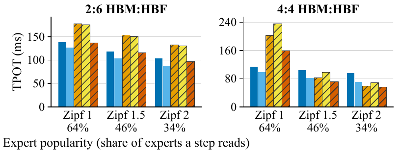

**Original:** Figure 6: Qwen3-235B-A22B under skewed expert popularity (balanced workload; legend as in Figure 5): a token’s top-8 experts are drawn with weight $(r+1)^{-\alpha}$ over a seeded per-layer rank $r$. Tick labels: share of the experts a step reads.

**中文:** 图 6：专家热度偏斜时的 Qwen3-235B-A22B，采用均衡工作负载，图例与图 5 相同。对每一层，通过随机种子确定排名 $r$，按权重 $(r+1)^{-\alpha}$ 抽取一个词元的 top-8 专家。横轴刻度同时标出单步读取的专家比例。

**读图提示（辅助说明）：** Zipf 指数越大，专家访问越集中；64%、46%、34% 是单步涉及的专家比例。左右两组分别为 2:6 和 4:4，不能把它们当成同一容量条件。

**Source:** p.7 S064

**Original:** When each mode wins. One quantity separates the two modes in Figures 5 and 6: the set a step reads against the HBM capacity. Peer mode with KV first wins whenever that set exceeds HBM, and the margin must be real: at $\alpha=1$ and 4 HBM + 4 HBF the 180 GiB set, 144 GiB of weights and 36 of KV, nominally fits in 188.9, yet FIFO rereads 193 GiB per step, the set in 4 MiB lines, and LRU 161. Tiered mode wins only when the set fits with room to spare and its reuse is spread across layers, which an address-ordered split cannot follow; where the set fits outright, the two modes are equal.

**中文:** 两种模式各自何时占优。图 5 与图 6 中，区分两种模式的量是单步读取集合与 HBM 容量之间的关系。只要该集合超过 HBM，KV 优先的并列模式就占优；而容量余量必须真实存在：当 $\alpha=1$、配置为 4 HBM＋4 HBF 时，180 GiB 的集合由 144 GiB 权重和 36 GiB KV 构成，名义上能放入 188.9 GiB HBM，但以 4 MiB 缓存行计量后，FIFO 每步重读 193 GiB，LRU 重读 161 GiB。只有当集合能够放下且留有充足余量，同时复用分散在不同层、按地址顺序划分无法追踪时，分层模式才占优；在工作集可以完整驻留时，两种模式相当。

**Source:** p.7–8 S065

**Original:** Takeaway 2: Under the evaluated workloads and 4 MiB cache-line configuration, the tested replacement policies incur substantial refill traffic when the active working set exceeds HBM capacity. None of the evaluated policies matches peer mode with KV first once the set a step reads exceeds HBM, and they beat it only when that set fits with room to spare, because none captures the distinct access patterns, mutability, and lifetimes of inference data. Effective HBF management therefore requires inference-aware placement and migration rather than generic cache replacement.

**中文:** 结论 2：在所评估工作负载和 4 MiB 缓存行配置下，只要活跃工作集超过 HBM 容量，所测替换策略就会产生大量回填流量。单步读取集合超过 HBM 后，没有一种受测策略能够达到 KV 优先并列模式的性能；只有在集合能够放下并留有充足余量时，它们才能超过后者。这是因为它们都未刻画推理数据在访问模式、可修改性及生命周期上的差异。因此，有效的 HBF 管理需要面向推理语义的放置与迁移，而非通用缓存替换。

**Source:** p.8 S066

**Original:** Batch size. We repeat the Qwen3-235B-A22B study in peer mode with KV first at batches of 8, 16, 32, and 64, each from its own replay (Figure 7). Throughput grows 2.1–3.0× from batch 8 to 64 at 6 HBM + 2 HBF and 2.9–3.5× at 2 HBM + 6 HBF and 1 HBM + 7 HBF, while TPOT grows from 37 ms to 67–117 ms and from 74–84 ms to 186–205 ms. The working set grows with the batch, to 283, 295, and 306 GiB at batch 64; only long OUTPUT still fits in the 285.9 GiB of 6 HBM + 2 HBF, its 520 tokens/s compare with 420 and 353 for the other two, and tiered mode with LRU, 67 ms where the working set fits, takes 503 and 672 ms once it exceeds HBM by 3% and 7%. With one to four HBM stacks the expert weights come from HBF in any case; the second pair of HBM stacks is worth 38% of throughput at batch 8 but 9% at batch 64.

**中文:** 批量大小。我们在 KV 优先的并列模式中，以 8、16、32 和 64 的批量重新研究 Qwen3-235B-A22B，每种批量都来自独立回放（图 7）。从批量 8 增加到 64 时，6 HBM＋2 HBF 的吞吐量达到批量 8 时的 2.1–3.0 倍，2 HBM＋6 HBF 和 1 HBM＋7 HBF 达到 2.9–3.5 倍；与此同时，TPOT 分别从 37 ms 增至 67–117 ms，从 74–84 ms 增至 186–205 ms。工作集随批量增长：批量 64 时，三种工作负载分别为 283、295 和 306 GiB。只有长输出仍能放入 6 HBM＋2 HBF 的 285.9 GiB HBM，其吞吐量为 520 词元/s，另两种分别为 420 和 353。使用 LRU 的分层模式在工作集放得下时耗时 67 ms，而工作集仅超出 HBM 3% 和 7% 时，就分别增加到 503 和 672 ms。只有一至四个 HBM 堆栈时，专家权重无论如何都需要从 HBF 读取；第二对 HBM 堆栈在批量 8 时带来 38% 的吞吐收益，批量 64 时仅带来 9%。

#### 图 7：批量、堆栈配比与解码吞吐

**Placed near:** p.8 S066  
**Source:** p.8 F007 · C007

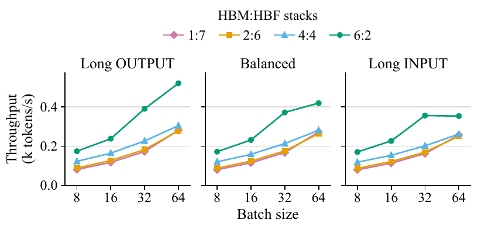

**Original:** Figure 7: Decode throughput of Qwen3-235B-A22B against the batch size, peer mode with KV first.

**中文:** 图 7：Qwen3-235B-A22B 的解码吞吐量随批量大小变化，采用 KV 优先的并列模式。

**读图提示（辅助说明）：** 三幅图分别对应三种工作负载；纵轴是千词元每秒，越高越好。正文同时报告 TPOT 增长，所以吞吐提升不能直接解读为单个请求延迟降低。

**Source:** p.8 S067

**Original:** Write path. A decode step writes too little KV to compare ways of writing it, so we also serve 112, 56, and 38 requests of the three workloads from an empty KV state at 2 HBM + 6 HBF (outputs capped at 8 tokens), which writes 46–47 GiB of KV per workload. Writing the KV that does not fit in HBM straight to HBF, writing all KV into HBM and to HBF when its line is evicted, and draining it to HBF in the background give the same mean request time within 1.5%, because prefill is compute-bound and each HBF stack buffers writes in its device DRAM. The background drain, however, writes 70–71 GiB to flash, 1.2–1.6× as much as write-back on eviction (45–60 GiB). In decode, KV first never programs an HBF page, while tiered mode with LRU programs 61,000–65,000 pages per step for Qwen3-235B-A22B as it evicts dirty KV.

**中文:** 写入路径。单个解码步写入的 KV 太少，无法有效比较写入方式，因此我们还在 2 HBM＋6 HBF 上，从空 KV 状态分别服务三种工作负载的 112、56 和 38 个请求，输出均限制为最多 8 个词元，每种工作负载写入 46–47 GiB KV。比较三种方式：将 HBM 放不下的 KV 直接写入 HBF；先把全部 KV 写入 HBM，缓存行淘汰时再写入 HBF；以及在后台将 KV 排出到 HBF。三者的平均请求时间差异在 1.5% 以内，因为预填充受计算限制，且每个 HBF 堆栈都在器件 DRAM 中缓冲写入。然而，后台排出向闪存写入 70–71 GiB，是淘汰时回写的 45–60 GiB 的 1.2–1.6 倍。解码期间，KV 优先从不编程 HBF 页；而使用 LRU 的分层模式会因淘汰脏 KV，使 Qwen3-235B-A22B 每步编程 61,000–65,000 页。

**Source:** p.8 S068

**Original:** Takeaway 3: KV data should be prioritized in HBM and moved to HBF only under capacity pressure. KV is continuously appended during decoding, making its placement a primary determinant of HBF write traffic. Allocating KV to HBF only when it must leave HBM incurs no performance loss in our experiments, whereas proactive migration creates avoidable writes for KV entries that may be freed shortly.

**中文:** 结论 3：KV 数据应优先保存在 HBM，仅在容量压力下移入 HBF。解码时持续追加 KV，使其放置位置成为 HBF 写入流量的主要决定因素。我们的实验中，仅在 KV 必须离开 HBM 时才将其分配到 HBF，不会造成性能损失；主动迁移则可能为即将释放的 KV 条目制造本可避免的写入。

### 4.4 闪存地址转换与耐久性 · 4.4 Flash Translation and Endurance

**Source:** p.8 S069

**Original:** 4.4 Flash Translation and Endurance

**中文:** 4.4 闪存地址转换与耐久性

**Source:** p.8 S070

**Original:** In decode, HBF mostly serves reads, so we ask what the FTL costs on the read path and how fast writes wear HBF.

**中文:** 解码期间，HBF 主要服务读取，因此我们研究 FTL 在读取路径上的成本，以及写入会以多快的速度磨损 HBF。

**Source:** p.8 S071

**Original:** Address translation. We compare the three mappings of Section 3.3 at 2 HBM + 6 HBF with weights first, so that the running KV is read from HBF (Figure 8). A decode step writes almost nothing, so we also run the prefill windows of Section 4.3 (46–47 GiB of new KV each). All three receive the same 3.1 GiB of HBM, but only page-level mapping uses a sizable part of it: 97–152 MiB of translation pages for the pages a decode step touches, against 0.9 MiB for the extent index and 10 MiB for the block index. Extent mapping stays within 0.5% of page-level mapping in decode and in prefill: KV is written and read in long runs, so one index entry serves many pages. Block-level mapping is 4.2–4.3× slower in decode (324–399 against 75–95 ms), because a block lies on one plane, which reads its 256 pages one after another in about 1.0 ms, whereas the other two mappings spread the same pages over all planes; prefill, which spends more of its time in compute, hides part of this and is 1.5× slower.

**中文:** 地址转换。我们在 2 HBM＋6 HBF、权重优先的条件下比较第 3.3 节的三种映射，使运行中 KV 从 HBF 读取（图 8）。解码步几乎不写入，因此还运行第 4.3 节的预填充窗口，每种产生 46–47 GiB 新 KV。三种映射均获得相同的 3.1 GiB HBM，但只有页级映射使用其中较大的一部分：为一个解码步所触及页面缓存的转换页为 97–152 MiB，相比之下，区段索引为 0.9 MiB，块索引为 10 MiB。区段映射在解码和预填充中的耗时与页级映射相差均不超过 0.5%，因为 KV 以长连续区间读写，一个索引条目就能服务许多页。块级映射的解码耗时为 324–399 ms，而页级映射为 75–95 ms，耗时为页级映射的 4.2–4.3 倍；因为一个块位于单一平面上，其 256 页需在约 1.0 ms 内逐页顺序读取，而另外两种映射将同样的页分散到所有平面。预填充中计算占比更大，能掩盖部分影响，因此耗时约为页级映射的 1.5 倍。

#### 图 8：页级、区段和块级映射的成本

**Placed near:** p.8 S071  
**Source:** p.8 F008 · C008

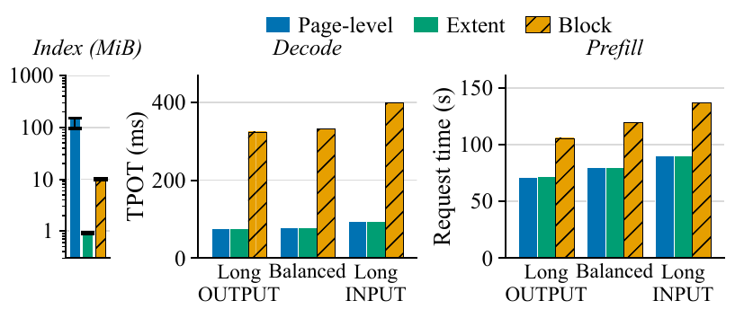

**Original:** Figure 8: Page-level, extent, and block mapping for Llama-3.1-70B at 2 HBM + 6 HBF, weights first: the index kept for the pages a decode step touches (bar: largest workload; whisker: smallest), decode TPOT, and request time in the prefill windows of Section 4.3.

**中文:** 图 8：Llama-3.1-70B 在 2 HBM＋6 HBF、权重优先下的页级、区段及块级映射：左图为解码步涉及页面所需保留的索引，柱高对应最大工作负载，须线对应最小工作负载；中图为解码 TPOT；右图为第 4.3 节预填充窗口的请求时间。

**读图提示（辅助说明）：** 左图单位是 MiB，并采用对数刻度；中图为 ms，右图为 s。区段映射索引小且保留平面并行性；块级映射索引较小，却使同一块的页在单平面串行读取。

**Source:** p.8 S072

**Original:** Takeaway 4: HBF mapping should preserve internal parallelism rather than maximize address granularity. Decode reads weights and KV in long sequential runs, so one translation serves many pages. An extent mapping that stripes each run across all planes matches a page-level table at a fraction of its memory, whereas a block-level mapping that keeps each block on a single plane serializes its page reads and slows decoding considerably.

**中文:** 结论 4：HBF 映射应保持内部并行性，而不是一味追求更粗的地址映射粒度。解码以长连续区间读取权重和 KV，因此一次地址转换能够服务许多页。将各区段条带化到全部平面的区段映射，只使用页表一小部分的内存就能达到页级映射的性能；而将每个块固定在单一平面的块级映射，会将页读取串行化，显著拖慢解码。

**Source:** p.8–9 S073

**Original:** Lifetime. A decode step writes one token of KV per sequence, so wear comes from new KV written into flash, and we estimate lifetime at a published peak load. TensorRT-LLM reaches 489 output tokens/s per H200 for Llama-3.3-70B, which has the architecture of Llama-3.1-70B, with 5,000-token prompts and 500-token outputs [18], 1.64 GiB/s of new KV per GPU. The published table has no Qwen3-235B-A22B, so we apply the same token rate to it; with 188 KiB of KV per token against 320 KiB, it writes 41% less. HBFSim measures the share of this KV that reaches HBF with weights first (87.5–100%) and replays each workload’s KV writes and releases (about 1 TiB, twice the stack’s capacity) through one HBF stack with garbage collection, which gives the flash bytes erased per written byte in steady state, the quantity that consumes P/E cycles. With either mapping this is 1.0 within 0.1%: KV is appended and freed in bulk, so one block with no valid page left is erased per MiB written. Block-level mapping programs 1.5–3.5% fewer pages, because pages that wait in the device DRAM for their block’s unwritten prefix are dropped when a sequence ends, but their block is still erased. Assuming 100,000 P/E cycles, as for the SLC NAND used in HBF designs [32], Table 3 gives the resulting lifetime: 24–83 months for Llama-3.1-70B and 40–141 months for Qwen3-235B-A22B, in proportion to the HBF stacks that share the writes and the same with either mapping: how long HBF lasts is set by how much KV reaches flash.

**中文:** 寿命。解码步为每个序列写入一个词元的 KV，因此磨损来自写入闪存的新 KV；我们使用已公布的峰值负载估算寿命。在每请求 5,000 个提示词和 500 个输出词元时，TensorRT-LLM 在每个 H200 上运行 Llama-3.3-70B 可达到每秒 489 个输出词元，该模型架构与 Llama-3.1-70B 相同 [18]；每 GPU 由此产生 1.64 GiB/s 新 KV。公布的表中没有 Qwen3-235B-A22B，因此我们对它使用相同词元速率；其每词元 KV 为 188 KiB，而非 320 KiB，写入量少 41%。HBFSim 测量权重优先时到达 HBF 的 KV 比例，为 87.5–100%；随后将各工作负载的 KV 写入与释放轨迹，约 1 TiB、相当于堆栈容量两倍，通过一个启用垃圾回收的 HBF 堆栈回放，由此得到稳态下每写入一字节对应的闪存擦除字节数，这才是消耗 P/E 循环的量。各种映射下这一比值都为 1.0，偏差在 0.1% 内：KV 以大块形式追加和释放，因此每写入 1 MiB，就擦除一个已无有效页的块。块级映射少编程 1.5–3.5% 的页，因为等待块内尚未写入前缀的页会在序列结束时从器件 DRAM 中丢弃，但其所在块仍会被擦除。假定耐久性为 100,000 次 P/E 循环，与 HBF 设计中所用 SLC NAND 相同 [32]，表 3 给出预计寿命：Llama-3.1-70B 为 24–83 个月，Qwen3-235B-A22B 为 40–141 个月；寿命与分担写入的 HBF 堆栈数成正比，各种映射得到的结果相同。HBF 能使用多久，由到达闪存的 KV 数量决定。

#### 表 3：假定峰值负载下的 HBF 寿命估计

**Placed near:** p.8 S073  
**Source:** p.8 T003 · C012

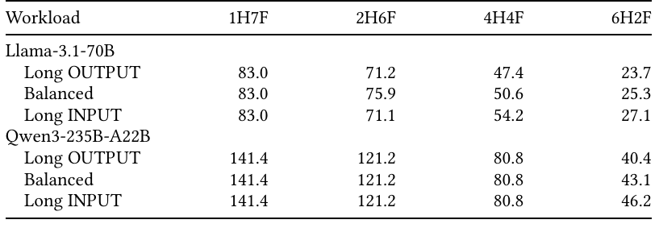

**Original:** Table 3: Estimated HBF lifetime in months at the published H200 peak load of Llama-3.3-70B (5,000-token prompts, 500-token outputs), with 100,000 P/E cycles.

**中文:** 表 3：在已公布的 H200 上 Llama-3.3-70B 峰值负载下，HBF 的预计寿命，单位为月；提示词 5,000 词元，输出 500 词元，假定耐久性为 100,000 次 P/E 循环。

**中文表格：**

| 模型／工作负载 | 1 HBM＋7 HBF | 2 HBM＋6 HBF | 4 HBM＋4 HBF | 6 HBM＋2 HBF |
| --- | --- | --- | --- | --- |
| Llama-3.1-70B／长输出 | 83.0 | 71.2 | 47.4 | 23.7 |
| Llama-3.1-70B／均衡 | 83.0 | 75.9 | 50.6 | 25.3 |
| Llama-3.1-70B／长输入 | 83.0 | 71.1 | 54.2 | 27.1 |
| Qwen3-235B-A22B／长输出 | 141.4 | 121.2 | 80.8 | 40.4 |
| Qwen3-235B-A22B／均衡 | 141.4 | 121.2 | 80.8 | 43.1 |
| Qwen3-235B-A22B／长输入 | 141.4 | 121.2 | 80.8 | 46.2 |

**读图提示（辅助说明）：** 1H7F 表示一个 HBM 加七个 HBF 堆栈，其他列依此类推。这里是全天候负载和理想磨损均衡等条件下的模型估计，Qwen 使用同一输出词元速率，见 S073、S079。

**Source:** p.9 S074

**Original:** Takeaway 5: HBF endurance is a first-order system constraint. Under baseline inference workloads, KV spill generates enough writes to make projected HBF lifetime a major challenge even when performance is acceptable. Practical HBF systems therefore require write reduction and endurance-aware management.

**中文:** 结论 5：HBF 耐久性是必须优先考虑的系统约束。在基准推理工作负载下，KV 溢出会产生足够多的写入，使预计 HBF 寿命即使在性能可接受时也成为重大挑战。因此，实用的 HBF 系统需要减少写入，并采用考虑耐久性的管理方法。

### 4.5 哪些 HBF 参数真正影响结果 · 4.5 Which HBF Parameters Matter?

**Source:** p.9 S075

**Original:** 4.5 Which HBF Parameters Matter?

**中文:** 4.5 哪些 HBF 参数真正影响结果

**Source:** p.9 S076

**Original:** The HBF specification is still a draft, so we ask which device parameters the results depend on, taking Llama-3.1-70B on the three workloads at 2 HBM + 6 HBF with KV first, where a step reads 29–49 GiB of weights from HBF (69–83 ms per token), and changing one parameter at a time (Figure 9).

**中文:** HBF 规范仍处于草案阶段，因此我们研究结果依赖哪些器件参数。使用 2 HBM＋6 HBF、KV 优先，在三种工作负载上运行 Llama-3.1-70B；此时每步从 HBF 读取 29–49 GiB 权重，每词元耗时 69–83 ms，并且每次只改变一个参数（图 9）。

#### 图 9：HBF 器件参数敏感性

**Placed near:** p.9 S076  
**Source:** p.9 F009 · C009

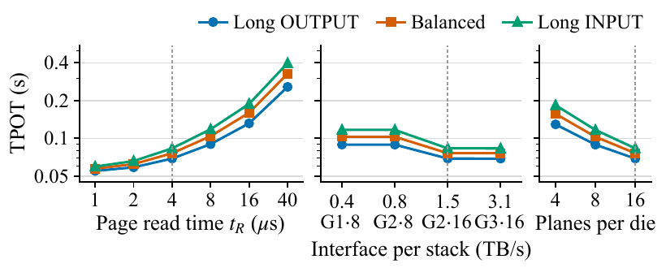

**Original:** Figure 9: TPOT of Llama-3.1-70B at 2 HBM + 6 HBF, KV first, when one HBF parameter changes (logarithmic axis). Dashed: default setting. Interface points give the OCP speed grade and channels per stack; 8-channel stacks have half the planes.

**中文:** 图 9：在 2 HBM＋6 HBF、KV 优先下，每次改变一个 HBF 参数时 Llama-3.1-70B 的 TPOT，采用对数坐标。虚线表示默认设置。接口参数点给出 OCP 速度等级和每堆栈通道数；8 通道堆栈的平面数减半。

**读图提示（辅助说明）：** 三组横轴依次改变页读取时间、接口配置和平面数。接口配置同时改变通道及平面数量时，应结合正文区分接口带宽与介质并行度的作用。

**Source:** p.9 S077

**Original:** Only the rate at which the flash array senses pages matters. Doubling the page read time to 8 μs raises TPOT by 30–42%, 16 μs by 91–126%, and the 40 μs of conventional NAND by 3.7–4.8×; halving the planes per die at equal capacity has the same effect as doubling the read time (29–40% for 8 planes, 87–121% for 4). The interface does not matter: speed grade 3 doubles grade 2’s 1.5 TB/s and changes TPOT by 0.1%, and grades 1 and 2 on 8 channels are equally 29–40% slower, only because their stacks have half the planes. A plane senses one 4 KiB page per read time, so a stack’s 256 planes deliver 0.26 TB/s at 4 μs, a sixth of the interface. The write side is invisible in decode, even without the device DRAM: with KV first a step appends its KV in HBM and programs no HBF page, so program times from 37.5 to 600 μs, write credits, and write timeout leave TPOT unchanged, and the thermal throttling ceiling adds at most 0.2%. For read-heavy decode, an HBF design should therefore spend on planes and read time before interface speed.

**中文:** 真正起作用的是闪存阵列感测页面的速率。页读取时间加倍至 8 μs，TPOT 增加 30–42%；增至 16 μs，增加 91–126%；采用常规 NAND 的 40 μs 时，则达到原来的 3.7–4.8 倍。在容量不变时，将每裸片平面数减半，与读取时间加倍有相同效果：8 个平面时增加 29–40%，4 个平面时增加 87–121%。接口没有明显影响：速度等级 3 将等级 2 的 1.5 TB/s 带宽加倍，却仅使 TPOT 变化 0.1%；采用 8 通道的等级 1 与等级 2 均慢 29–40%，也只是因为它们的堆栈平面数减半。每个平面每个读取周期感测一个 4 KiB 页，因此 256 平面堆栈在读取时间 4 μs 时仅提供 0.26 TB/s，约为接口带宽的六分之一。写入侧在解码中不体现影响，即使去掉器件 DRAM 也是如此：KV 优先使每步将新增 KV 追加到 HBM，不编程任何 HBF 页；因此，37.5–600 μs 的编程时间、写入信用额度和写入超时均不改变 TPOT，热节流上限最多使其增加 0.2%。因此，对于读取占主导的解码，HBF 设计应先把资源投入平面数与读取时间，再考虑接口速度。

## 5 讨论 · 5 DISCUSSION

**Source:** p.9 S078

**Original:** 5 DISCUSSION

**中文:** 5 讨论

**Source:** p.9 S079

**Original:** Limitations. Our case studies reproduce one decoding step per workload, seven tokens per running sequence, and one prefill window per workload for the write path and the mapping comparison, without garbage collection, so TPOT omits its interference with reads. We model one accelerator; tensor or pipeline parallelism would give each a share of the weights and KV. The studies combine an H200 compute profile, extended beyond its measured batch of 16, with HBM4 and HBF, a pairing that does not exist today, so HBF timing and endurance remain assumptions. The lifetime estimates apply a published serving load around the clock to the HBF write share and write amplification that HBFSim measures, and assume perfect wear leveling.

**中文:** 局限性。案例研究为每种工作负载重现一个代表性解码步，每个运行中序列继续生成七个词元；写入路径和映射比较则各使用一个预填充窗口，且不包含垃圾回收，因此 TPOT 没有计入 GC 对读取的干扰。我们只建模一个加速器；若采用张量或流水线并行，每个加速器只承担部分权重和 KV。研究将 H200 计算配置外推到其已测批量 16 之外，并与 HBM4、HBF 配对，这一组合目前并不存在，因此 HBF 时序和耐久性仍是假设。寿命估计将已公布的服务负载全天候施加到 HBFSim 测出的 HBF 写入比例及写放大上，并假设完美磨损均衡。

**Source:** p.9 S080

**Original:** Extending HBFSim. New memory policies use the policy interface, new FTL schemes the host mapping interface, new HBF generations the device configuration, and new models, traces, and GPUs their descriptors, importers, or operator profiles.

**中文:** 扩展 HBFSim。新的存储策略使用策略接口，新的 FTL 方案使用主机映射接口，新一代 HBF 使用器件配置，新的模型、轨迹和 GPU 则通过相应描述文件、导入器或算子配置接入。

## 6 相关工作 · 6 RELATED WORK

**Source:** p.9 S081

**Original:** 6 RELATED WORK

**中文:** 6 相关工作

**Source:** p.9 S082

**Original:** HBF and hybrid HBM–flash memory. H3 [7] and SK hynix [27] evaluate hybrid HBM+HBF organizations with projected device parameters. FlashAccel co-designs data layout and storage management for HBF [32]. Petrucci et al. compare HBF with LPDDR analytically and identify writes as the limit for offloading KV to flash [21]. HBFSim lets such designs be compared on the same workloads; our endurance results quantify the write problem they point out.

**中文:** HBF 与 HBM—闪存混合存储。H3 [7] 和 SK hynix [27] 依据预测器件参数评估混合 HBM＋HBF 组织。FlashAccel 针对 HBF 协同设计数据布局与存储管理 [32]。Petrucci 等人以解析方式比较 HBF 与 LPDDR，并指出写入是将 KV 卸载到闪存的限制因素 [21]。HBFSim 使这些设计能在相同工作负载上比较；我们的耐久性结果量化了他们指出的写入问题。

**Source:** p.9 S083

**Original:** Memory and storage simulators. Ramulator 2.0 [16] and DRAMsim3 [14] model DRAM at the command level. MQSim [29] and FEMU [13] model SSDs behind an NVMe interface, with mapping, GC, and wear leveling inside the device, and Cylon [34] emulates CXL SSDs with a DRAM cache in the device. HBFSim follows MQSim’s approach to the flash organization and Cylon’s device class for the CXL SSD, but treats HBF as memory with a host-side FTL whose metadata competes with the application in HBM.

**中文:** 内存与存储模拟器。Ramulator 2.0 [16] 和 DRAMsim3 [14] 在命令级建模 DRAM。MQSim [29] 和 FEMU [13] 建模 NVMe 接口后的 SSD，映射、GC 和磨损均衡均在器件内部；Cylon [34] 模拟带器件端 DRAM 缓存的 CXL SSD。HBFSim 沿用 MQSim 的闪存组织建模思路与 Cylon 的 CXL SSD 器件类别，但将 HBF 作为由主机端 FTL 管理的内存，FTL 元数据在 HBM 中与应用竞争资源。

**Source:** p.9 S084

**Original:** LLM serving simulators. Vidur [1], LLMServingSim [3], Frontier [6], and ASTRA-sim [33] simulate scheduling, computation, and communication for LLM inference, LLMCompass [36] adds operator-level modeling with mapping search, and GTSim [4] and Accel-Sim [10, 20] model GPU microarchitecture. They represent memory by its capacity and bandwidth; HBFSim models the devices at the transaction level, flash management included, under a validated scheduler.

**中文:** LLM 推理服务模拟器。Vidur [1]、LLMServingSim [3]、Frontier [6] 和 ASTRA-sim [33] 模拟 LLM 推理中的调度、计算与通信；LLMCompass [36] 加入带映射搜索的算子级建模；GTSim [4] 与 Accel-Sim [10, 20] 建模 GPU 微架构。它们以容量和带宽表示存储；HBFSim 则在经过验证的调度器驱动下，以事务级粒度建模器件，包括闪存管理。

## 7 结论 · 7 CONCLUSION

**Source:** p.9 S085

**Original:** 7 CONCLUSION

**中文:** 7 结论

**Source:** p.9–10 S086

**Original:** HBF could give accelerators an order of magnitude more memory, but only if systems use it in ways that suit flash. HBFSim lets researchers test these choices before hardware exists. Our case studies support five takeaways. HBF is most valuable under capacity pressure, where it keeps TPOT 11.0–19.0× lower than host DRAM and 86.6–154.1× lower than an NVMe SSD. Conventional cache replacement is a poor fit for HBM–HBF tiering: no policy matches peer mode with KV first once the set a step reads exceeds HBM, and a cache wins only when that set fits with room to spare. HBM should hold the running sequences’ KV and HBF the read-only weights; KV should move to HBF only when it must leave HBM. The mapping should preserve the flash array’s parallelism, which an extent index does at a fraction of a page table’s memory. Endurance is a first-order constraint: at a published peak load of Llama-3.1-70B, HBF lasts 2.0 to 6.9 years, in proportion to the stacks that share the KV writes. We release HBFSim so that others can replace our assumptions with measurements.

**中文:** HBF 可以为加速器提供高一个数量级的存储容量，但前提是系统按照适合闪存的方式使用它。HBFSim 使研究者能在硬件出现前测试这些选择。案例研究支持五条结论：HBF 在容量压力下最有价值，此时，主机 DRAM 的 TPOT 为 HBF 的 11.0–19.0 倍，NVMe SSD 为其 86.6–154.1 倍。传统缓存替换不适合 HBM—HBF 分层：只要单步读取集合超过 HBM，没有一种策略能够达到 KV 优先并列模式的性能；仅在集合能够放下且留有充足余量时，缓存才占优。HBM 应保存运行中序列的 KV，HBF 保存只读权重；KV 仅在必须离开 HBM 时才移入 HBF。映射应保持闪存阵列的并行性，区段索引能以页表一小部分的内存做到这一点。耐久性是必须优先考虑的约束：在已公布的 Llama-3.1-70B 峰值负载下，HBF 可使用 2.0–6.9 年，并与分担 KV 写入的堆栈数成正比。我们发布 HBFSim，使其他研究者能够用测量值替换这些假设。

## 参考文献 · REFERENCES

**Source:** p.10 S087

**Original:** REFERENCES

**中文:** 参考文献

**Source:** p.10 S088

**Original:** [1] Amey Agrawal, Nitin Kedia, Jayashree Mohan, Ashish Panwar, Nipun Kwatra, Bhargav S. Gulavani, Ramachandran Ramjee, and Alexey Tumanov. 2024. Vidur: A Large-Scale Simulation Framework for LLM Inference. In Proceedings of Machine Learning and Systems (MLSys).

**中文:** [1] 中文题名：Vidur：面向 LLM 推理的大规模模拟框架。作者、年份、出版载体、页码及 DOI／网址等书目信息保留上方原文，以便检索。

**Source:** p.10 S089

**Original:** [2] Amey Agrawal, Nitin Kedia, Ashish Panwar, Jayashree Mohan, Nipun Kwatra, Bhargav S. Gulavani, Alexey Tumanov, and Ramachandran Ramjee. 2024. Taming Throughput-Latency Tradeoff in LLM Inference with Sarathi-Serve. In 18th USENIX Symposium on Operating Systems Design and Implementation (OSDI ’24).

**中文:** [2] 中文题名：使用 Sarathi-Serve 调和 LLM 推理中的吞吐量—延迟取舍。作者、年份、出版载体、页码及 DOI／网址等书目信息保留上方原文，以便检索。

**Source:** p.10 S090

**Original:** [3] Jaehong Cho, Minsu Kim, Hyunmin Choi, Guseul Heo, and Jongse Park. 2024. LLMServingSim: A HW/SW Co-Simulation Infrastructure for LLM Inference Serving at Scale. In IEEE International Symposium on Workload Characterization (IISWC).

**中文:** [3] 中文题名：LLMServingSim：面向大规模 LLM 推理服务的软硬件协同模拟基础设施。作者、年份、出版载体、页码及 DOI／网址等书目信息保留上方原文，以便检索。

**Source:** p.10 S091

**Original:** [4] Yitong Ding, Jiawei Huang, Renyang Guan, Yangjie Zhou, Zihan Liu, Yu Feng, Shixuan Sun, Mingyi Guo, Jingwen Leng, and Jian Weng. 2026. GPU-Tile-Sim: A Tile-Centric GPU Simulation Framework for LLM Hardware-Software Co-Design. arXiv:2607.11262 [cs.DC] https://arxiv.org/abs/2607.11262

**中文:** [4] 中文题名：GPU-Tile-Sim：面向 LLM 软硬件协同设计、以计算块为中心的 GPU 模拟框架。作者、年份、出版载体、页码及 DOI／网址等书目信息保留上方原文，以便检索。

**Source:** p.10 S092

**Original:** [5] Abhimanyu Dubey, Abhinav Jauhri, Abhinav Pandey, Abhishek Kadian, Ahmad Al-Dahle, Aiesha Letman, Akhil Mathur, Alan Schelten, Amy Yang, Angela Fan, et al. 2024. The Llama 3 Herd of Models. arXiv preprint arXiv:2407.21783 (2024). https://arxiv.org/abs/2407.21783

**中文:** [5] 中文题名：Llama 3 模型家族。作者、年份、出版载体、页码及 DOI／网址等书目信息保留上方原文，以便检索。

**Source:** p.10 S093

**Original:** [6] Yicheng Feng, Xin Tan, Yangtao Deng, Yimin Jiang, Yibo Zhu, and Hong Xu. 2026. Frontier: Towards Comprehensive and Accurate LLM Inference Simulation. arXiv:2605.21312 [cs.DC] https://arxiv.org/abs/2605.21312

**中文:** [6] 中文题名：Frontier：迈向全面且准确的 LLM 推理模拟。作者、年份、出版载体、页码及 DOI／网址等书目信息保留上方原文，以便检索。

**Source:** p.10 S094

**Original:** [7] Minho Ha, Euiseok Kim, and Hoshik Kim. 2026. H3: Hybrid Architecture Using High Bandwidth Memory and High Bandwidth Flash for Cost-Efficient LLM Inference. IEEE Computer Architecture Letters 25, 1 (2026), 49–52. https://doi.org/10.1109/LCA.2026.3660969

**中文:** [7] 中文题名：H3：使用高带宽内存与高带宽闪存、实现高成本效益 LLM 推理的混合架构。作者、年份、出版载体、页码及 DOI／网址等书目信息保留上方原文，以便检索。

**Source:** p.10 S095

**Original:** [8] JEDEC. 2025. High Bandwidth Memory (HBM4) DRAM. Technical Report JESD270-4. JEDEC Solid State Technology Association.

**中文:** [8] 中文题名：高带宽内存（HBM4）DRAM。作者、年份、出版载体、页码及 DOI／网址等书目信息保留上方原文，以便检索。

**Source:** p.10 S096

**Original:** [9] Myoungsoo Jung, Jie Zhang, Ahmed Abulila, Miryeong Kwon, Narges Shahidi, John Shalf, Nam Sung Kim, and Mahmut Kandemir. 2018. SimpleSSD: Modeling Solid State Drives for Holistic System Simulation. IEEE Computer Architecture Letters 17, 1 (2018), 37–41.

**中文:** [9] 中文题名：SimpleSSD：面向整体系统模拟的固态硬盘建模。作者、年份、出版载体、页码及 DOI／网址等书目信息保留上方原文，以便检索。

**Source:** p.10 S097

**Original:** [10] Mahmoud Khairy, Zhesheng Shen, Tor M. Aamodt, and Timothy G. Rogers. 2020. Accel-Sim: An Extensible Simulation Framework for Validated GPU Modeling. In 47th ACM/IEEE Annual International Symposium on Computer Architecture (ISCA). 473–486. https://doi.org/10.1109/ISCA45697.2020.00047

**中文:** [10] 中文题名：Accel-Sim：面向经验证 GPU 建模的可扩展模拟框架。作者、年份、出版载体、页码及 DOI／网址等书目信息保留上方原文，以便检索。

**Source:** p.10 S098

**Original:** [11] Woosuk Kwon, Zhuohan Li, Siyuan Zhuang, Ying Sheng, Lianmin Zheng, Cody Hao Yu, Joseph E. Gonzalez, Hao Zhang, and Ion Stoica. 2023. Efficient Memory Management for Large Language Model Serving with PagedAttention. In Proceedings of the 29th Symposium on Operating Systems Principles. 611–626. https://doi.org/10.1145/3600006.3613165

**中文:** [11] 中文题名：利用 PagedAttention 实现大语言模型推理服务的高效内存管理。作者、年份、出版载体、页码及 DOI／网址等书目信息保留上方原文，以便检索。

**Source:** p.10 S099

**Original:** [12] Hsien-Hsin S. Lee, Gary S. Tyson, and Matthew K. Farrens. 2000. Eager Writeback—A Technique for Improving Bandwidth Utilization. In Proceedings of the 33rd Annual IEEE/ACM International Symposium on Microarchitecture (MICRO-33). 11–21.

**中文:** [12] 中文题名：积极回写：提高带宽利用率的一种技术。作者、年份、出版载体、页码及 DOI／网址等书目信息保留上方原文，以便检索。

**Source:** p.10 S100

**Original:** [13] Huaicheng Li, Mingzhe Hao, Michael Hao Tong, Swaminathan Sundararaman, Kshitij Doshi, and Haryadi S. Gunawi. 2018. The CASE of FEMU: Cheap, Accurate, Scalable and Extensible Flash Emulator. In 16th USENIX Conference on File and Storage Technologies (FAST). 83–90.

**中文:** [13] 中文题名：FEMU 的 CASE：低成本、准确、可扩展且易扩充的闪存模拟器。作者、年份、出版载体、页码及 DOI／网址等书目信息保留上方原文，以便检索。

**Source:** p.10 S101

**Original:** [14] Shang Li, Zhiyuan Yang, Dhiraj Reddy, Ankur Srivastava, and Bruce Jacob. 2020. DRAMsim3: A Cycle-Accurate, Thermal-Capable DRAM Simulator. IEEE Computer Architecture Letters (2020). https://doi.org/10.1109/LCA.2020.2973991

**中文:** [14] 中文题名：DRAMsim3：支持热建模的周期精确 DRAM 模拟器。作者、年份、出版载体、页码及 DOI／网址等书目信息保留上方原文，以便检索。

**Source:** p.10 S102

**Original:** [15] Di Liu, Meng Chen, Baotong Lu, Huiqiang Jiang, Zhenhua Han, Qianxi Zhang, Qi Chen, Chengruidong Zhang, Bailu Ding, Kai Zhang, Chen Chen, Fan Yang, Yuqing Yang, and Lili Qiu. 2024. RetrievalAttention: Accelerating Long-Context LLM Inference via Vector Retrieval. arXiv:2409.10516

**中文:** [15] 中文题名：RetrievalAttention：通过向量检索加速长上下文 LLM 推理。作者、年份、出版载体、页码及 DOI／网址等书目信息保留上方原文，以便检索。

**Source:** p.10 S103

**Original:** [16] Haocong Luo, Ataberk Olgun, Moocha Kim, Minesh Patel, Hasan Hassan, Saugata Ghose, and Onur Mutlu. 2024. Ramulator 2.0: A Modern, Modular, and Extensible DRAM Simulator. IEEE Computer Architecture Letters (2024). https://doi.org/10.1109/LCA.2023.3333759

**中文:** [16] 中文题名：Ramulator 2.0：现代、模块化且可扩展的 DRAM 模拟器。作者、年份、出版载体、页码及 DOI／网址等书目信息保留上方原文，以便检索。

**Source:** p.10 S104

**Original:** [17] NVIDIA. 2023. NVIDIA H200 Tensor Core GPU. https://www.nvidia.com/en-us/data-center/h200/.

**中文:** [17] 中文题名：NVIDIA H200 Tensor Core GPU。作者、年份、出版载体、页码及 DOI／网址等书目信息保留上方原文，以便检索。

**Source:** p.10 S105

**Original:** [18] NVIDIA. 2026. TensorRT-LLM Performance Overview. https://nvidia.github.io/TensorRT-LLM/performance/perf-overview.html.

**中文:** [18] 中文题名：TensorRT-LLM 性能概览。作者、年份、出版载体、页码及 DOI／网址等书目信息保留上方原文，以便检索。

**Source:** p.10 S106

**Original:** [19] Open Compute Project. 2026. OCP HBF Architecture Specification, Version 0.7.0. https://www.opencompute.org/documents/ocp-hbf-architecture-specification-v0-7-0-final-pdf.

**中文:** [19] 中文题名：OCP HBF 架构规范，版本 0.7.0。作者、年份、出版载体、页码及 DOI／网址等书目信息保留上方原文，以便检索。

**Source:** p.10 S107

**Original:** [20] Junrui Pan, Weili An, Cesar Avalos Baddouh, Christin David Bose, Ni Kang, Aaron Barnes, Ahmad Alawneh, Fangjia Shen, Yechen Liu, Anusuya Nallathambi, Atthin Chandrashekar, and Timothy G. Rogers. 2026. Architecting the Next Generation of Asynchronous, Distributed GPUs for the AI Era. https://doi.org/10.48550/arXiv.2608.22602 arXiv:2608.22602 [cs.AR]

**中文:** [20] 中文题名：面向 AI 时代的下一代异步、分布式 GPU 架构设计。作者、年份、出版载体、页码及 DOI／网址等书目信息保留上方原文，以便检索。

**Source:** p.10 S108

**Original:** [21] Vinicius Petrucci, Felippe Zacarias, and Vishal Tanna. 2026. Is High-Bandwidth Flash All You Need?. In 3rd Workshop on Hot Topics in System Infrastructure (HotInfra). https://hotinfra.org/2026/papers/hotinfra26-final83.pdf

**中文:** [21] 中文题名：高带宽闪存是否就是你所需要的全部？。作者、年份、出版载体、页码及 DOI／网址等书目信息保留上方原文，以便检索。

**Source:** p.10 S109

**Original:** [22] Ruoyu Qin, Zheming Li, Weiran He, Jialei Cui, Feng Ren, Mingxing Zhang, Yongwei Wu, Weimin Zheng, and Xinran Xu. 2025. Mooncake: Trading More Storage for Less Computation – A KVCache-centric Architecture for Serving LLM Chatbot. In Proceedings of the 23rd USENIX Conference on File and Storage Technologies. Traces released at https://github.com/kvcache-ai/Mooncake.

**中文:** [22] 中文题名：Mooncake：用更多存储换取更少计算——面向 LLM 聊天服务、以 KVCache 为中心的架构。作者、年份、出版载体、页码及 DOI／网址等书目信息保留上方原文，以便检索。

**Source:** p.10 S110

**Original:** [23] John T. Robinson and Murthy V. Devarakonda. 1990. Data Cache Management Using Frequency-Based Replacement. In Proceedings of the 1990 ACM SIGMETRICS Conference on Measurement and Modeling of Computer Systems. 134–142. https://doi.org/10.1145/98457.98523

**中文:** [23] 中文题名：采用基于频率的替换策略进行数据缓存管理。作者、年份、出版载体、页码及 DOI／网址等书目信息保留上方原文，以便检索。

**Source:** p.10 S111

**Original:** [24] SanDisk. 2025. High Bandwidth Flash (HBF) Fact Sheet. https://documents.sandisk.com/content/dam/asset-library/en_us/assets/public/sandisk/collateral/company/Sandisk-HBF-Fact-Sheet.pdf. Accessed 2026-07-26.

**中文:** [24] 中文题名：高带宽闪存（HBF）产品资料表。作者、年份、出版载体、页码及 DOI／网址等书目信息保留上方原文，以便检索。

**Source:** p.10 S112

**Original:** [25] SanDisk. 2025. Scaling Beyond the Wall: Inside SanDisk’s High Bandwidth Flash for AI. https://www.sandisk.com/company/newsroom/blogs/2025/scaling-beyond-the-wall-inside-sandisks-high-bandwidth-flash-for-ai. Accessed 2026-05-22.

**中文:** [25] 中文题名：突破容量墙：走近 SanDisk 面向 AI 的高带宽闪存。作者、年份、出版载体、页码及 DOI／网址等书目信息保留上方原文，以便检索。

**Source:** p.10 S113

**Original:** [26] Ying Sheng, Lianmin Zheng, Binhang Yuan, Zhuohan Li, Max Ryabinin, Beidi Chen, Percy Liang, Christopher Ré, Ion Stoica, and Ce Zhang. 2023. FlexGen: High-Throughput Generative Inference of Large Language Models with a Single GPU. In Proceedings of the 40th International Conference on Machine Learning (ICML).

**中文:** [26] 中文题名：FlexGen：使用单 GPU 实现大语言模型的高吞吐生成式推理。作者、年份、出版载体、页码及 DOI／网址等书目信息保留上方原文，以便检索。

**Source:** p.10 S114

**Original:** [27] SK hynix. 2026. H 3 : A Hybrid HBM+HBF Architecture for LLM Inference. International Solid-State Circuits Conference (ISSCC).

**中文:** [27] 中文题名：H3：面向 LLM 推理的 HBM＋HBF 混合架构。作者、年份、出版载体、页码及 DOI／网址等书目信息保留上方原文，以便检索。

**Source:** p.10 S115

**Original:** [28] SK hynix. 2026. SK hynix and Sandisk Begin Global Standardization of Next-Generation Memory ‘HBF’. https://news.skhynix.com/en/sk-hynix-and-sandisk-begin-global-standardization-ofnext-generation-memory-hbf/. Accessed 2026-07-26.

**中文:** [28] 中文题名：SK hynix 与 SanDisk 启动下一代存储 HBF 的全球标准化。作者、年份、出版载体、页码及 DOI／网址等书目信息保留上方原文，以便检索。

**Source:** p.10 S116

**Original:** [29] Arash Tavakkol, Juan Gómez-Luna, Mohammad Sadrosadati, Saugata Ghose, and Onur Mutlu. 2018. MQSim: A Framework for Enabling Realistic Studies of Modern Multi-Queue SSD Devices. In 16th USENIX Conference on File and Storage Technologies (FAST). 49–66.

**中文:** [29] 中文题名：MQSim：支持真实现代多队列 SSD 器件研究的框架。作者、年份、出版载体、页码及 DOI／网址等书目信息保留上方原文，以便检索。

**Source:** p.10 S117

**Original:** [30] Oreste Villa, Mark Stephenson, David Nellans, and Stephen W. Keckler. 2019. NVBit: A Dynamic Binary Instrumentation Framework for NVIDIA GPUs. In Proceedings of the 52nd Annual IEEE/ACM International Symposium on Microarchitecture.

**中文:** [30] 中文题名：NVBit：面向 NVIDIA GPU 的动态二进制插桩框架。作者、年份、出版载体、页码及 DOI／网址等书目信息保留上方原文，以便检索。

**Source:** p.10 S118

**Original:** [31] Jiahao Wang, Jinbo Han, Xingda Wei, Sijie Shen, Dingyan Zhang, Chenguang Fang, Rong Chen, Wenyuan Yu, and Haibo Chen. 2025. KVCache Cache in the Wild: Characterizing and Optimizing KVCache Cache at a Large Cloud Provider. In Proceedings of the 2025 USENIX Annual Technical Conference. 465–482. Traces released at https://github.com/alibaba-edu/qwen-bailian-usagetraces-anon.

**中文:** [31] 中文题名：真实环境中的 KVCache Cache：大型云服务商中的 KVCache Cache 特征分析与优化。作者、年份、出版载体、页码及 DOI／网址等书目信息保留上方原文，以便检索。

**Source:** p.10 S119

**Original:** [32] Xinyu Wang, Yalong Xue, Xiaotian Sun, Xiaoyu Zhang, Chunmeng Dou, Xueqi Li, and Xiaoming Chen. 2026. FlashAccel: Leveraging High-Bandwidth Flash for High-Throughput LLM Inference. arXiv:2607.10186 https://arxiv.org/abs/2607.10186

**中文:** [32] 中文题名：FlashAccel：利用高带宽闪存实现高吞吐 LLM 推理。作者、年份、出版载体、页码及 DOI／网址等书目信息保留上方原文，以便检索。

**Source:** p.10 S120

**Original:** [33] William Won, Jinsun Yoo, Tuan Ta, Moumita Dey, Andy Balogh, Pradosh Datta, Furkan Eris, Conor Green, Winston Liu, Changhai Man, et al. 2026. ASTRA-sim 3.0: Next-Level Distributed Machine Learning Simulations via High-Fidelity GPU and Infrastructure Modeling. arXiv:2606.10440 [cs.DC] https://arxiv.org/abs/2606.10440

**中文:** [33] 中文题名：ASTRA-sim 3.0：通过高保真 GPU 与基础设施建模推进分布式机器学习模拟。作者、年份、出版载体、页码及 DOI／网址等书目信息保留上方原文，以便检索。

**Source:** p.10 S121

**Original:** [34] Dongha Yoon, Hansen Idden, Jinshu Liu, Berkay Inceisci, Sam H. Noh, and Huaicheng Li. 2026. Cylon: Fast and Accurate Full-System Emulation of CXL-SSDs. In 24th USENIX Conference on File and Storage Technologies (FAST ’26). 313–327.

**中文:** [34] 中文题名：Cylon：快速且准确的 CXL-SSD 全系统模拟。作者、年份、出版载体、页码及 DOI／网址等书目信息保留上方原文，以便检索。

**Source:** p.10 S122

**Original:** [35] Gyeong-In Yu, Joo Seong Jeong, Geon-Woo Kim, Soojeong Kim, and Byung-Gon Chun. 2022. Orca: A Distributed Serving System for Transformer-Based Generative Models. In 16th USENIX Symposium on Operating Systems Design and Implementation (OSDI 22). 521–538.

**中文:** [35] 中文题名：Orca：面向基于 Transformer 的生成式模型的分布式推理服务系统。作者、年份、出版载体、页码及 DOI／网址等书目信息保留上方原文，以便检索。

**Source:** p.10 S123

**Original:** [36] Hengrui Zhang, August Ning, Rohan Baskar Prabhakar, and David Wentzlaff. 2024. LLMCompass: Enabling Efficient Hardware Design for Large Language Model Inference. In 51st ACM/IEEE Annual International Symposium on Computer Architecture (ISCA). 1080–1096. https://doi.org/10.1109/ISCA59077.2024.00082

**中文:** [36] 中文题名：LLMCompass：支持大语言模型推理的高效硬件设计。作者、年份、出版载体、页码及 DOI／网址等书目信息保留上方原文，以便检索。

**Source:** p.10–11 S124

**Original:** [37] Lianmin Zheng, Liangsheng Yin, Zhiqiang Xie, Chuyue Sun, Jeff Huang, Cody Hao Yu, Shiyi Cao, Christos Kozyrakis, Ion Stoica, Joseph E. Gonzalez, Clark Barrett, and Ying Sheng. 2024. SGLang: Efficient Execution of Structured Language Model Programs. In Advances in Neural Information Processing Systems 37.

**中文:** [37] 中文题名：SGLang：结构化语言模型程序的高效执行。作者、年份、出版载体、页码及 DOI／网址等书目信息保留上方原文，以便检索。

---

## 阅读提示（辅助说明）

1. **先区分这篇与上科大 HBFSim。** 本文是 MBZUAI 团队的事件驱动、闭环存储系统模拟器；此处的 GPU 计算耗时来自经实测校准的算子模型，见 [S036](#S036)、[S048](#S048)。
2. **把实测校准与器件假设分开。** 调度器和 A100/H200 算子经过验证；HBM4、HBF 的内部时序和部分参数仍是假设，见 [S049](#S049)。表 1 的 4 μs 读取时间也属于这些条件。
3. **读性能图前固定比较口径。** 图 4 两组比较的数据放置与封装位置条件不同；图 5、6 的缓存收益依赖工作集相对 HBM 的大小和专家热度；图 7 的吞吐上升伴随 TPOT 上升。对应 [S056](#S056)–[S066](#S066)。
4. **寿命是条件化估计。** 表 3 使用已公布的峰值词元速率、100,000 次 P/E 假设、全天候负载及理想磨损均衡；性能窗口不包含 GC 干扰，而寿命回放包含 GC，见 [S073](#S073)、[S079](#S079)。

提取、术语及版面处理说明见 [translation_notes.md](translation_notes.md)，段落与原图位置见 [source_map.json](source_map.json)。
