# HBFSim: Fast and Faithful Simulation of High-Bandwidth Flash Under Real GPU Execution

# HBFSim：真实 GPU 执行下高带宽闪存的快速、忠实模拟

## 文献信息 / Publication Information

- **Authors / 作者**：Yanpeng Hu¹*、Yiwei Yang²*、Yuanwu Zhu³、Kexin Chu⁴、Yusheng Zheng²、Andi Quinn²、Wei Zhang⁴。
- **Affiliations / 单位**：¹ ShanghaiTech University / 上海科技大学；² UC Santa Cruz / 加利福尼亚大学圣克鲁兹分校；³ University of Science and Technology of China / 中国科学技术大学；⁴ University of Connecticut / 康涅狄格大学。
- **Contacts / 联系方式**：huyp@shanghaitech.edu.cn；{yyang363, yzhen165, aquinn1}@ucsc.edu；zzyuanyi@mail.ustc.edu.cn；{kexin.chu, wei.13.zhang}@uconn.edu。
- **Author footnote / 作者脚注**：* Equal contribution. / * 同等贡献。
- **Version / 版本**：原文首页标注 arXiv:2609.09800v3 [cs.AR]，30 Sep 2026（2026 年 9 月 30 日），共 16 页。
- **Source / 来源**：本地 `/home/kurisu/Desktop/HBFSIM上科大.pdf`；包内留存[原文副本](source/HBFSim_原文.pdf)。以 PDF 正文首页作者栏为准（PDF 元数据作者列表漏列 Kexin Chu）。
- **Code / 代码**：<https://github.com/SlugLab/hbfsim/>（原文提供，本文未外部核验）。
- **Prepared / 整理日期**：2026 年 10 月 22 日。

## 阅读说明 / Reading Notes

本笔记按原文“摘要 → 第 1–9 节 → 参考文献”结构逐段排列，每段先英文原文，再中文译文。跨栏、跨页的同一段已合并；仅清理排版断词、连字及换行，并恢复数学上下标。正文不是摘要或节译，作者的主张、限定条件和引用编号均保留。图表作为浮动对象放在相关讨论处，原始位置以页码及 `source_map.json` 为准。

完整保留 6 幅图、2 张表、6 个编号公式和 47 条参考文献。图内英文标签保留原样，图题中英对照；表格双语重排并附原表截图。公式以 LaTeX 转写，并附原公式截图。参考文献保留原始英文著录信息，另附中文题名；中文题名用于理解，检索以英文为准。图片在同目录 `assets/`，移动笔记时请一并移动。

每块的 `Sxxx` 编号与 PDF 页码对应 `source_map.json` 中的原页坐标（PDF 点，原点在左上）。本文 HBFSim 与华东师范大学的 **HBF-Sim: An Extensible HBF Simulator for Large-scale GPU Memory Systems** 为不同论文。

## 目录 / Contents

- [Abstract / 摘要](#S001)
- [1 Introduction / 1 引言](#S004)
- [2 Background / 2 背景](#S011)
- [3 Motivation / 3 研究动机](#S020)
- [4 Design / 4 设计](#S034)
- [4.1 D1: An Explicit and Fail-Closed Boundary / 4.1 D1：显式且失败即拒绝的边界](#S037)
- [4.2 D2: Preserving GPU Asynchrony / 4.2 D2：保留 GPU 的异步性](#S041)
- [4.3 D3: A Closed-Loop Thermal Controller / 4.3 D3：闭环热控制器](#S045)
- [4.4 D4: Retention, Refresh, and Wear as Injected Latency / 4.4 D4：将数据保持、刷新和磨损转化为注入延迟](#S059)
- [4.5 D5: Capacity / 4.5 D5：容量](#S067)
- [4.6 D6: Speculative Prefetcher / 4.6 D6：推测式预取器](#S069)
- [5 Implementation / 5 实现](#S073)
- [6 Evaluation / 6 评估](#S081)
- [6.1 Experimental Setup / 6.1 实验设置](#S086)
- [6.2 EQ1: End-to-End Execution and Timing Fidelity / 6.2 EQ1：端到端执行与时序保真度](#S088)
- [6.3 EQ2: Thermal Coupling / 6.3 EQ2：热耦合](#S095)
- [6.4 EQ3: Capacity and Demand / 6.4 EQ3：容量与需求](#S107)
- [7 Related Work / 7 相关工作](#S115)
- [8 Discussion / 8 讨论](#S120)
- [9 Conclusion / 9 结论](#S125)
- [References / 参考文献](#S127)
- [术语对照 / Terminology](#terminology)

---

## Abstract / 摘要

<!-- PDF p.1 S001 -->

**Source / 原文定位：** PDF p.1 · S002

**Original / 英文原文：** High-Bandwidth Flash (HBF) places high-capacity NAND beside HBM to relieve the memory-capacity bottleneck of LLM inference, yet its system-level behavior cannot be evaluated before hardware becomes available. Cycle-level GPU simulators are too slow for production-scale models. Trace replay has a further shortcoming: it cannot capture the allocation, migration, and execution changes induced by different HBM–HBF configurations. Our key insight is that HBF need not be evaluated by simulating the GPU: only the program-visible effects of HBF need to be modeled. And only a real LLM workload running on real hardware can answer the arguments about HBF. Hence the modeled service has to be injected into that running program, and the injection must not destroy the GPU concurrency that would hide the original I/O latency.

**中文译文：** 高带宽闪存（High-Bandwidth Flash，HBF）将大容量 NAND 放在 HBM 旁边，以缓解 LLM 推理的内存容量瓶颈，但在硬件问世之前，无法评估其系统级行为。周期级 GPU 模拟器对于生产规模的模型而言过于缓慢。轨迹重放还有另一项不足：它无法捕捉不同 HBM–HBF 配置所引起的分配、迁移与执行变化。我们的关键认识是，评估 HBF 无须模拟 GPU，只需对 HBF 在程序层面可见的影响进行建模。而且，只有在真实硬件上运行真实的 LLM 工作负载，才能回应围绕 HBF 的争论。因此，必须将建模得到的服务注入正在运行的程序，同时不能破坏本来能够隐藏原有 I/O 延迟的 GPU 并发性。

---

**Source / 原文定位：** PDF p.1 · S003

**Original / 英文原文：** We present HBFSim, an open-source HBF simulator that executes LLM workloads on a real GPU while modeling HBF timing, thermal, and other behaviors online. HBFSim rewrites the PTX of the workload’s kernels and routes accesses inside a registered address range into the HBF simulator. It supports asynchronous TMA transfers and capacities beyond physical GPU memory. HBFSim leaves the model’s run unaffected across ordinary-memory, TMA, and capacity-mode tests. The delay it injects matches the delay requested to within 0.152%. We also design a coupled thermal module that puts HBF, HBM, and the GPU in one advanced package, which is important for answering how severe the hot throttling problem becomes after HBF runs for a long time. Experiments with Qwen3-30B show how package heating, HBM–HBF allocation, and shared MoE demand jointly constrain the design space of future HBF accelerators. The source code of HBFSim is available at https://github.com/SlugLab/hbfsim/.

**中文译文：** 我们提出 HBFSim，这是一款开源 HBF 模拟器：在真实 GPU 上执行 LLM 工作负载，同时在线建模 HBF 的时序、热及其他行为。HBFSim 重写工作负载内核的 PTX，并将已注册地址范围内的访问路由至 HBF 模拟器。它支持异步 TMA 传输以及超过 GPU 物理内存的容量。在普通内存、TMA 和容量模式测试中，HBFSim 均未改变模型的运行结果。其注入延迟与请求延迟之间的误差不超过 0.152%。我们还设计了耦合热模块，将 HBF、HBM 和 GPU 置于同一先进封装中，这对于回答 HBF 长时间运行后热节流问题会有多严重至关重要。Qwen3-30B 实验展示了封装升温、HBM–HBF 分配和共享 MoE 需求如何共同约束未来 HBF 加速器的设计空间。HBFSim 源代码见 https://github.com/SlugLab/hbfsim/。

---

## 1 Introduction / 1 引言

<!-- PDF p.1 S004 -->

**Source / 原文定位：** PDF p.1 · S005

**Original / 英文原文：** Serving a large language model (LLM) is limited more and more by memory bandwidth and memory capacity [32,46]. High-bandwidth memory (HBM), DRAM stacked inside the accelerator package, is what the industry built to serve that load. But HBM capacity does not keep up with the parameter counts of the models it serves, and HBM is held back by its high manufacturing cost and by its scarce supply [27,33].

**中文译文：** 大语言模型（LLM）服务越来越受到内存带宽和内存容量的限制 [32,46]。业界为满足这类负载而采用了高带宽内存（HBM），即堆叠在加速器封装内部的 DRAM。然而，HBM 容量的增长跟不上模型参数量的增长，而且 HBM 还受制于高昂的制造成本和紧张的供应 [27,33]。

---

**Source / 原文定位：** PDF p.1 · S006

**Original / 英文原文：** High-Bandwidth Flash (HBF) is a response to those limits. Sandisk and SK hynix introduced the HBF specification through the Open Compute Project (OCP) in August 2026, with Google and Tenstorrent taking part in validation [34]; it is the first open standard that defines stackable NAND flash as a memory tier inside the package of an xPU. HBF is not an interface upgrade of a conventional NVMe SSD, but a new near-memory architecture, in which NAND dies and the compute chip, a GPU, xPU, or NPU, are integrated in one package [4]. Sandisk’s first generation of HBF products will put HBF together with HBM and the GPU in one advanced package over UCIe [4, 34], reaching at least 8× the capacity of HBM at the same price with roughly the same read bandwidth [4,33]. What HBF makes new is the medium: the stacked die holds NAND rather than DRAM of HBM. Because the medium is NAND, HBF makes a write far more expensive than a read, and every write uses up part of the limited number of times a flash cell can be rewritten. Hence, the data suited to HBF is data written once and read many times: model weights, and the part of the key-value cache that several requests share, such as a system prompt every request repeats. HBF also inherits the latency of its medium: a NAND read takes on the order of microseconds, roughly two orders of magnitude longer than an HBM access [13,20]. The execution path of a transformer is predictable enough that an LLM can issue the reads it will need ahead of the computation that consumes them and hide HBF latency behind that computation [36, 41]. HBF is not a replacement for HBM; HBF is a new tier below HBM.

**中文译文：** 高带宽闪存（HBF）是对这些限制的回应。2026 年 8 月，Sandisk 和 SK hynix 通过开放计算项目（Open Compute Project，OCP）推出 HBF 规范，Google 和 Tenstorrent 参与验证 [34]；这是首个将可堆叠 NAND 闪存定义为 xPU 封装内存储层的开放标准。HBF 并非传统 NVMe SSD 的接口升级，而是一种新的近存架构：将 NAND 裸片与 GPU、xPU 或 NPU 等计算芯片集成于同一封装 [4]。Sandisk 的第一代 HBF 产品将通过 UCIe，把 HBF、HBM 和 GPU 集成在同一先进封装中 [4,34]，在相同价格下达到至少 8 倍于 HBM 的容量，同时具有大致相当的读取带宽 [4,33]。HBF 的新意在于介质：堆叠裸片中装的是 NAND，而非 HBM 中的 DRAM。由于介质是 NAND，HBF 的写入远比读取昂贵，而且每次写入都会消耗闪存单元有限的可重写次数。因此，适合放入 HBF 的数据是一次写入、多次读取的数据：模型权重，以及由多个请求共享的部分键值缓存，例如每次请求都会重复的系统提示词。HBF 同样继承了介质的延迟：一次 NAND 读取需要微秒量级的时间，比一次 HBM 访问约高两个数量级 [13,20]。Transformer 的执行路径具有足够的可预测性，使 LLM 能够在消费数据的计算开始前发出所需读取，并利用计算隐藏 HBF 延迟 [36,41]。HBF 不是对 HBM 的替代；它是位于 HBM 之下的一个新层级。

---

**Source / 原文定位：** PDF p.1,2 · S007

**Original / 英文原文：** Opinion on HBF splits into two opposing camps. SK hynix, Sandisk, and Joungho Kim of KAIST, widely known as the “father of HBM” [29], hold that HBF can take over a large part of the capacity problem that HBM carries today [7,14,21,34]. Micron and others hold the opposite, that NAND’s own limits will hold HBF back and leave it worse than the media already in use [31]. The first HBF devices for inference are expected to reach customers as samples in 2027, and the choices a system designer faces cannot wait for HBF silicon to arrive. Real parts that could settle the argument do not exist yet, so the questions left open and the disagreement both call for a simulator that favors neither side.

**中文译文：** 对 HBF 的看法分为两个对立阵营。SK hynix、Sandisk，以及被广泛称为“HBM 之父”的 KAIST 教授 Joungho Kim [29] 认为，HBF 能解决目前由 HBM 承担的很大一部分容量问题 [7,14,21,34]。Micron 等则持相反意见，认为 NAND 自身的局限将拖累 HBF，使其表现不及已经使用的介质 [31]。首批面向推理的 HBF 器件预计将在 2027 年以样片形式交付客户，但系统设计者面临的选择不能等到 HBF 芯片到来后再作决定。能够裁决这场争论的真实器件尚不存在，因此，未解的问题与观点分歧都要求有一款不偏向任何一方的模拟器。

---

**Source / 原文定位：** PDF p.2 · S008

**Original / 英文原文：** One simple idea for building an HBF simulator is to add an HBF module to a GPU simulator such as GPGPU-Sim [3, 18, 37]. Another idea is to add HBF latency into a replayed GPU trace. Both have a fatal flaw. The first cannot run a real LLM to completion in a practical amount of time [30], and only the result of a real workload settles the core objections raised about the latency of HBF. The second also suffers from excessive simulation time. Furthermore, the same static trace cannot dynamically simulate different HBF-to-HBM ratios and architectures, so the trace-simulation method cannot quickly explore the optimal HBF configuration for different workloads.

**中文译文：** 构建 HBF 模拟器的一种简单思路，是在 GPGPU-Sim 等 GPU 模拟器中加入 HBF 模块 [3,18,37]。另一种思路是在重放 GPU 轨迹时加入 HBF 延迟。这两种方案都有致命缺陷。第一种方案无法在实际可接受的时间内完整运行真实 LLM [30]，而只有真实工作负载的运行结果，才能解决围绕 HBF 延迟提出的核心质疑。第二种方案同样面临模拟时间过长的问题。此外，同一份静态轨迹无法动态模拟不同的 HBF/HBM 比例与架构，因此轨迹模拟方法无法快速探索不同工作负载下的最优 HBF 配置。

---

**Source / 原文定位：** PDF p.2 · S009

**Original / 英文原文：** We accordingly choose to run a real LLM model on a real GPU. Building this platform runs into many difficulties. First, earlier simulators have no interception point targeting HBF, because HBF is the first standard to package NAND, GPU, and DRAM—three different media—inside the same accelerator, and they are linked die to die over UCIe, so a device effect can only be written into the instruction stream of the program under test. Second, how long one access takes depends on the accesses that came before, while the timing model has to be evaluated inside the GPU code of the workload itself, and a GPU executes far out of order, so tracking a Tensor Memory Accelerator (TMA) instruction accurately and matching it to the real latency that belongs to it is very difficult. Third, HBF is NAND flash, which is sensitive to temperature, and it shares a package with a GPU that draws high power throughout the run, so the rate HBF sustains is set by temperature. We must simulate the thermal problem.

**中文译文：** 因此，我们选择在真实 GPU 上运行真实 LLM 模型。构建这一平台面临许多困难。首先，以往模拟器没有针对 HBF 的拦截点，因为 HBF 是首个将 NAND、GPU 和 DRAM 三种不同介质置于同一加速器内部的标准，且它们通过 UCIe 进行裸片间连接，因此只能将器件影响写入被测程序的指令流。其次，一次访问耗时多久取决于此前的访问，而时序模型又必须在工作负载自身的 GPU 代码中求值；GPU 的执行还高度乱序，因此，准确追踪张量内存加速器（Tensor Memory Accelerator，TMA）指令，并为其匹配真正应承担的延迟，非常困难。第三，HBF 使用对温度敏感的 NAND 闪存，并与运行期间持续高功耗的 GPU 共享封装，因此，HBF 能维持的速率由温度决定。我们必须模拟热问题。

---

**Source / 原文定位：** PDF p.2 · S010

**Original / 英文原文：** We present HBFSim, which is the first open-source HBF simulator with the workload under evaluation executing on a real GPU. The GPU layer is not simulated at all: the workload runs as usual on a real GPU, and rewritten PTX, the intermediate code NVIDIA’s compiler emits, routes accesses inside a registered address range into HBFSim. The workload on HBFSim is also real: Qwen3-30B runs under injected HBF timing and emits token identifiers identical to the baseline run.

**中文译文：** 我们提出 HBFSim，这是首款让被评估工作负载在真实 GPU 上执行的开源 HBF 模拟器。GPU 层完全不作模拟：工作负载照常运行在真实 GPU 上，经过重写的 PTX（NVIDIA 编译器生成的中间代码）把已注册地址范围内的访问路由至 HBFSim。HBFSim 上运行的工作负载也是真实的：Qwen3-30B 在注入 HBF 时序的条件下运行，并输出与基线运行完全一致的 token 标识符。

---

## 2 Background / 2 背景

<!-- PDF p.2 S011 -->

**Source / 原文定位：** PDF p.2 · S012

**Original / 英文原文：** HBF places NAND flash dies inside the accelerator package through the UCIe interface. The dies are stacked vertically: multiple layers of 3D NAND flash are joined by through-silicon vias (TSV) and micro-bumps [44]. A silicon interposer or another advanced packaging method places the stack and the compute chip in one package. The 16-die NAND stack gives HBF ∼3 TB/s of read bandwidth [4]. But NAND also gives HBF two main drawbacks. ➀ NAND wears out: a block of NAND tolerates a limited number of program/erase cycles and must be erased before it is rewritten [4]. Hence HBF cannot be written as many times as HBM, because continuous writing consumes its limited program/erase cycles. ➁ NAND is also slow next to DRAM: an HBF page read is estimated at ∼20 µs [13], against about 200 ns for one global-memory access on a GPU with HBM [25]. Either property would keep NAND out of a memory tier if the workload wrote often and needed each byte on demand. Fortunately, the workload characteristics of an LLM hide both drawbacks well. We make two observations:

**中文译文：** HBF 通过 UCIe 接口，将 NAND 闪存裸片置于加速器封装内部。裸片垂直堆叠：多层 3D NAND 闪存通过硅通孔（TSV）和微凸点连接 [44]。硅中介层或其他先进封装方式将堆栈与计算芯片置于同一封装。16 裸片 NAND 堆栈为 HBF 提供约 3 TB/s 的读取带宽 [4]。但 NAND 也使 HBF 具有两个主要缺点。➀ NAND 会磨损：一个 NAND 块只能承受有限次数的编程/擦除循环，且重写前必须先擦除 [4]。因此，HBF 无法像 HBM 那样被反复写入，因为持续写入会耗尽其有限的编程/擦除次数。➁ 与 DRAM 相比，NAND 也更慢：一次 HBF 页读取的估计延迟约为 20 µs [13]，而采用 HBM 的 GPU 一次全局内存访问约为 200 ns [25]。如果工作负载频繁写入，并要求每个字节都按需立即提供，任何一项缺点都足以使 NAND 无法成为内存层。幸运的是，LLM 的工作负载特征能够较好地隐藏这两个缺点。我们给出以下两个观察：

---

**Source / 原文定位：** PDF p.2 · S013

**Original / 英文原文：** Observation 1: Almost every byte an inference server moves through accelerator memory is read rather than written.

**中文译文：** 观察 1：推理服务器通过加速器内存搬运的几乎每个字节都是读取，而非写入。

---

**Source / 原文定位：** PDF p.2,3 · S014

**Original / 英文原文：** Decode is an important LLM inference stage bounded by memory bandwidth rather than arithmetic [46]. A large part of the bandwidth exchanged between HBM and the GPU is model weights. Once training is complete, model weights are written far fewer times than they are read [23,31,41]. A prefix of the key-value cache shared across requests, such as a system prompt every request repeats, likewise has far more reads than writes [16]. System prompts also account for a large share of the traffic in long-horizon agent runs. A talk at Hot Chips 2026 reports that about 93 percent of the bytes of a trillion-parameter model are read-only [1,17]. Our own calculation is less optimistic, but read-only bandwidth still accounts for 40 to 50 percent of all traffic for Kimi K3 with a 1M-token context. The derivation is not expanded here, for reasons of paper length and because this work focuses on the HBF simulator. In short, much of the bandwidth an existing LLM workload consumes does not need the repeated overwriting that HBM supports, and industry is paying for that. Cheap NAND media happen to suit data written once and read many times.

**中文译文：** 解码是 LLM 推理的重要阶段，其瓶颈是内存带宽而非算术运算 [46]。HBM 与 GPU 之间交换的带宽中，很大一部分用于模型权重。训练完成后，模型权重的写入次数远少于读取次数 [23,31,41]。由多个请求共享的键值缓存前缀，例如每个请求都会重复的系统提示词，也同样读多写少 [16]。在长时程智能体运行中，系统提示词也占据很大一部分流量。Hot Chips 2026 的一场报告指出，万亿参数模型中约 93% 的字节为只读 [1,17]。我们自己的计算没有这么乐观，但对于上下文为 1M token 的 Kimi K3，只读带宽仍占总流量的 40%–50%。出于篇幅限制，且本文重点是 HBF 模拟器，此处不展开推导。简言之，现有 LLM 工作负载消耗的大量带宽，并不需要 HBM 所支持的反复覆写能力，但业界仍在为这种能力付费。廉价 NAND 介质恰好适合一次写入、多次读取的数据。

---

**Source / 原文定位：** PDF p.3 · S015

**Original / 英文原文：** Observation 2: The predictable execution path of transformer inference leaves a long lead time for prefetching.

**中文译文：** 观察 2：Transformer 推理的执行路径可预测，为预取留下了较长的提前时间。

---

**Source / 原文定位：** PDF p.3 · S016

**Original / 英文原文：** Transformer decoding walks the layers in a fixed order, so which weights a token reads is settled before that token starts to compute. The architecture of an LLM leaves a large time gap for prefetching. By our calculation on an H100 SXM5 from NVIDIA [6,28], computing layer i leaves a lead time of about 130.2 µs for reading the weights of layer i + 1, which is 6.5 times the assumed ∼20 µs HBF page read latency [13].

**中文译文：** Transformer 解码按固定顺序遍历各层，因此，一个 token 将读取哪些权重，在它开始计算之前就已确定。LLM 的架构为预取留下了很大的时间间隔。根据我们对 NVIDIA H100 SXM5 的计算 [6,28]，计算第 $i$ 层时，为读取第 $i+1$ 层权重留出的提前时间约为 130.2 µs，是所假定约 20 µs HBF 页读取延迟的 6.5 倍 [13]。

---

**Source / 原文定位：** PDF p.3 · S017

**Original / 英文原文：** Better still, we find that architectures such as Google’s TPU and Huawei’s DaVinci NPU [11,12,24] leave a larger time window for HBF to prefetch weights than an NVIDIA GPU does. The reason is that an accelerator which orders transfers in the compiler predicts the data to prefetch better than a GPU that relies on run-time concurrency, and so issues a fetch earlier [11]. In short, the other main theoretical drawback of HBF, its very high latency next to HBM, can be hidden by prefetching early, so that the compute interval covers the I/O latency.

**中文译文：** 更有利的是，我们发现 Google TPU、华为 DaVinci NPU 等架构 [11,12,24]，为 HBF 预取权重提供的时间窗口比 NVIDIA GPU 更大。原因是，由编译器安排传输顺序的加速器，比依靠运行时并发的 GPU 更能预测需要预取的数据，因此可以更早发出读取 [11]。简言之，HBF 的另一个主要理论缺点——相对 HBM 很高的延迟——可以通过提前预取加以隐藏，使计算区间覆盖 I/O 延迟。

---

**Source / 原文定位：** PDF p.3 · S018

**Original / 英文原文：** We list several I/O paths that can serve accelerators in the foreseeable future. Table 1 shows that HBF, with its lower price, large capacity, and bandwidth close to HBM, would in theory play an important role in solving the memory wall problem of LLMs. We therefore decided to design an open-source, fast, and accurate HBF simulator to further explore how HBF behaves under various workloads.

**中文译文：** 我们列出了在可预见的未来能够服务于加速器的几种 I/O 路径。表 1 显示，HBF 凭借更低的价格、更大的容量和接近 HBM 的带宽，在理论上能够为解决 LLM 的内存墙问题发挥重要作用。因此，我们决定设计一款开源、快速且准确的 HBF 模拟器，以进一步探索 HBF 在不同工作负载下的行为。

---

**Source / 原文定位：** PDF p.2 · S019

**Original / 英文原文：** Table 1: Comparison of four I/O paths that can serve accelerators in the foreseeable future.

**中文译文：** 表 1：在可预见的未来可为加速器提供服务的四种 I/O 路径比较。

| 项目 / Metric | 第一代 HBF / 1st Generation HBF | HBM4 | eSSD (Kioxia GP1) | CXL 连接内存 / CXL-attached memory |
|---|---|---|---|---|
| 介质 / Medium | 3D NAND | DRAM | XL-FLASH Gen2 | DRAM |
| 容量 / Capacity | 512 GB/stack（每堆栈） | 64 GB/stack [10] | ∼2 TB/drive（每盘） | ∼0.1–2 TB/device（每设备） |
| 读取带宽 / Read bandwidth | 0.4–3.0 TB/s | ∼2 TB/s [10] | ∼14–28 GB/s | ∼30–60 GB/s |
| 接口 / Interface | UCIe | JEDEC 2048-bit bus/stack（每堆栈 2048 位总线） | PCIe 6.0 | CXL over PCIe |
| 读取延迟 / Read latency | ∼20 µs [13] | 10–100 ns | ∼10–100 µs | ∼1.7 µs from a GPU（从 GPU 访问）[35] |
| 读取粒度 / Read granularity | 64 B [4] | 32 B | 512 B | 64 B |
| 写入耐久度 / Write endurance | limited P/E cycles（有限编程/擦除次数） | near-unlimited（近乎无限） | 50 DWPD（每日全盘写入次数） | near-unlimited（近乎无限） |
| 断电数据保持 / Retention, unpowered | not guaranteed（不保证）[4] | none（无） | 3 months at 40 °C（40 °C 下 3 个月）[9] | none（无） |

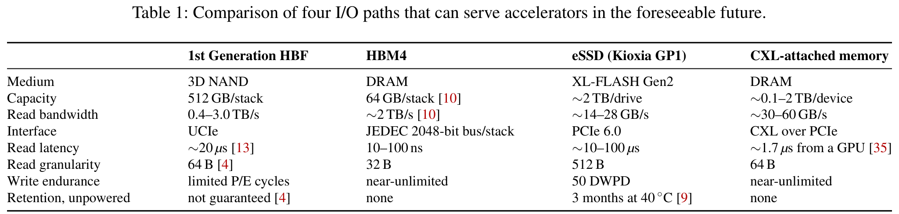

---

## 3 Motivation / 3 研究动机

<!-- PDF p.3 S020 -->

**Source / 原文定位：** PDF p.3 · S021

**Original / 英文原文：** We first think of placing an HBF module inside a GPU simulator such as GPGPU-Sim [3,18,30,37]. We find, however, that a simulator built that way cannot simulate HBF faithfully. Table 2 shows that cycle-level GPU simulators are too slow to finish one LLM inference run in acceptable time. The disagreements over HBF can be answered forcefully only on a real running LLM model. Beyond simulation time, the timing parameters of HBF have not been published: the specification defers every quantity with the dimension of time to each vendor’s product datasheet, leaving no parameters to fill in.

**中文译文：** 我们首先考虑将 HBF 模块放入 GPGPU-Sim 等 GPU 模拟器 [3,18,30,37]。然而，我们发现，以这种方式构建的模拟器无法忠实模拟 HBF。表 2 显示，周期级 GPU 模拟器过于缓慢，无法在可接受的时间内完成一次 LLM 推理。围绕 HBF 的分歧，只有在实际运行的 LLM 模型上才能得到有力回应。除模拟时间外，HBF 的时序参数尚未发布：规范将所有具有时间量纲的数值都交由各厂商产品数据手册规定，因此没有参数可直接填入。

---

**Source / 原文定位：** PDF p.3 · S022

**Original / 英文原文：** Table 2: Simulation time and instruction rate reported for cycle-level GPU simulators.

**中文译文：** 表 2：周期级 GPU 模拟器所报告的模拟时间和指令速率。

**Accel-Sim on lavaMD [8] / Accel-Sim 运行 lavaMD [8]**

| 指标 / Metric | 数值 / Value |
|---|---:|
| Wall-clock time, one thread / 单线程墙钟时间 | >5 days（天） |
| Slowdown against hardware, one thread / 单线程相对硬件减速 | 10,748,031× |
| Slowdown against hardware, 16 threads / 16 线程相对硬件减速 | 766,423× |

**Simulated warp instructions per second / 每秒模拟的 warp 指令数**

| 模拟器 / Simulator | 指令数 / Instructions per second |
|---|---:|
| Accel-Sim, trace mode / 轨迹模式 [18] | 12,500 |
| Accel-Sim, execution mode / 执行模式 [18] | 6,000 |
| GPGPU-Sim 3.x [3,18] | 3,000 |
| Accel-Sim 2.0 [30] | 27,500 |

**Simulated instructions per second / 每秒模拟的指令数**

| 模拟器 / Simulator | 指令数 / Instructions per second |
|---|---:|
| MGPUSim, four threads / 四线程 [37] | ≈27,000 |
| GPGPU-Sim, same machine / 同一机器 [37] | ≈800 |

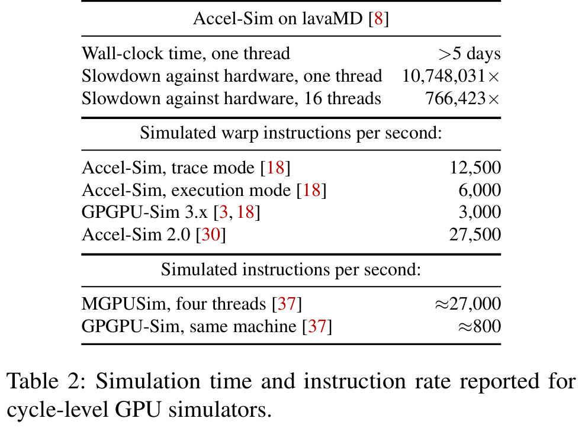

---

**Source / 原文定位：** PDF p.3 · S023

**Original / 英文原文：** We next think of driving an HBF simulator from a replayed GPU trace, and that construction does not work either. Trace mode is still slow: Table 2 shows 12,500 warp instructions per second, which cannot keep pace with the dynamic instruction count of one real LLM inference. More fundamentally, one trace corresponds to one HBM-to-HBF capacity split. Changing the split changes which tensors the inference framework keeps resident, how it partitions the KV cache, and whether migration kernels fire at all; none of those instructions appear in an already-recorded trace. A single trace therefore cannot explore different HBF-to-HBM ratios or architectures, and cannot quickly locate the optimal HBF configuration across workloads.

**中文译文：** 我们接着考虑以重放 GPU 轨迹来驱动 HBF 模拟器，但这种构造也行不通。轨迹模式仍然很慢：表 2 所示的速率为每秒 12,500 条 warp 指令，无法跟上一次真实 LLM 推理的动态指令数量。更根本的问题是，一份轨迹只对应一种 HBM/HBF 容量划分。改变划分比例，会改变推理框架使哪些张量常驻、如何划分 KV 缓存，以及是否触发迁移内核；这些指令都不会出现在一份已经记录好的轨迹中。因此，单份轨迹既不能探索不同 HBF/HBM 比例或架构，也不能快速定位跨工作负载的最优 HBF 配置。

---

**Source / 原文定位：** PDF p.3 · S024

**Original / 英文原文：** We therefore run the workload on a real GPU, so that the computation that may hide an HBF access comes from the hardware itself. A real GPU, however, leaves an experimenter no model to modify and no simulated clock to advance; the three challenges stated below follow from that decision.

**中文译文：** 因此，我们在真实 GPU 上运行工作负载，使可能隐藏 HBF 访问的计算来自硬件本身。然而，真实 GPU 没有可供实验者修改的模型，也没有可推进的模拟时钟；以下三个挑战都源于这一选择。

---

**Source / 原文定位：** PDF p.3 · S025

**Original / 英文原文：** Challenge 1: Traditional simulators have no interception point applied to HBF.

**中文译文：** 挑战 1：传统模拟器没有适用于 HBF 的拦截点。

---

**Source / 原文定位：** PDF p.3 · S026

**Original / 英文原文：** In the traditional simulator methodology, an interception point is a place outside the program under test through which every memory access must pass and where an experimenter can add waiting time. HBF is the first medium that places NAND, GPU, and DRAM in one heterogeneous package, and every access to HBF is served inside that package. Memory-tier emulators such as Cylon [45] and CXLMemSim [42] intercept in the host-side CPU and kernel. Block-device emulators such as FEMU [22] and SwarmIO [19] intercept in the host-side submission queue and driver. On a unified-memory APU, the interception point is host-side software that fills the page table [40]. External memory is intercepted on the link outside the package [35]. An access to HBF, issued by the GPU’s load/store units, passes through none of these places. The one route that remains is to instrument the code of the program under test [39].

**中文译文：** 在传统模拟器方法中，拦截点位于被测程序之外，所有内存访问必须经过该处，实验者也可以在该处增加等待时间。HBF 是首个将 NAND、GPU 和 DRAM 放入同一异构封装的介质，每次 HBF 访问都在封装内部获得服务。Cylon [45]、CXLMemSim [42] 等内存层仿真器在主机侧 CPU 与内核中拦截。FEMU [22]、SwarmIO [19] 等块设备仿真器在主机侧提交队列和驱动中拦截。对于采用统一内存的 APU，拦截点是主机侧填充页表的软件 [40]。外部内存的访问则在封装外部链路上拦截 [35]。由 GPU 加载/存储单元发出的 HBF 访问，不会经过上述任何位置。剩下的唯一路径，是对被测程序代码进行插桩 [39]。

---

**Source / 原文定位：** PDF p.3 · S027

**Original / 英文原文：** Challenge 2: Attributing a modeled delay to the instruction that should have paid it is difficult.

**中文译文：** 挑战 2：很难把建模得到的延迟归给真正应该承担它的那条指令。

---

**Source / 原文定位：** PDF p.3,4 · S028

**Original / 英文原文：** To answer Challenge 1 we intercept at the PTX level. PTX, Parallel Thread Execution, is NVIDIA’s virtual instruction set: the compiler emits it for a GPU kernel, and a backend turns it into the machine instructions the GPU executes. We insert the waiting time by rewriting memory instructions in PTX. However, PTX interception raises a doubt about where the delay is injected: the PTX text says only which instructions the program contains. How the hardware resolves dependences after issue, and at which instruction it stops, cannot be read from the PTX text. When a warp issues a memory instruction, the hardware sends the access out and marks the destination register as not yet returned in the scoreboard, the hardware table that records which register results have not come back. The warp then issues the instructions that follow immediately, without waiting for the value. A later ALU instruction that does not read the destination register executes as usual. When the consumer instruction reaches issue, the hardware has to read the destination register. The hardware finds the mark still in the scoreboard and stops at that instruction until the value returns. The latency itself occurs when the access is issued. Whether the program pays time for that latency is decided at the consumer, by whether the value has arrived. A wait inserted into the instruction stream becomes time the program spends waiting only when it sits at the consumer. A wait at the issue point makes the program wait for a stretch of time the hardware would not have waited. A rewrite sees only the instruction-issue front end, while a memory instruction acts on back-end execution that issue never sees. PTX fixes which instructions the program contains. The backend assigns the physical registers and schedules the instructions only after the rewrite. At the PTX level the physical registers have not been allocated and the instruction schedule has not been fixed. A rewrite therefore does not know what the chain of register dependences looks like. A rewrite also does not know which instructions lie between the load and its consumer. For example, a program contains LDG R8, then ..., then IMAD R9 R8 R5 R6. The ellipsis stands for the many instructions between the load and the multiply-add. The load is issued and the hardware issues past it. The multiply-add reads R8, so it stops at issue until the value arrives.

**中文译文：** 为回应挑战 1，我们在 PTX 层进行拦截。PTX（Parallel Thread Execution，并行线程执行）是 NVIDIA 的虚拟指令集：编译器为 GPU 内核生成 PTX，再由后端将其转为 GPU 执行的机器指令。我们通过重写 PTX 中的内存指令插入等待时间。然而，PTX 拦截带来了延迟注入位置的疑问：PTX 文本只说明程序包含哪些指令。硬件在发射后如何解决依赖、又会在哪条指令处停顿，都无法从 PTX 文本中读出。warp 发射一条内存指令时，硬件会发出访问，并在记分牌（scoreboard，即记录哪些寄存器结果尚未返回的硬件表）中，将目标寄存器标记为尚未返回。随后 warp 立即继续发射后续指令，无须等待该值。如果后续 ALU 指令不读取这个目标寄存器，就会照常执行。当消费该值的指令进入发射阶段时，硬件需要读取目标寄存器；发现记分牌中的标记仍在，就在该指令处停顿，直到数值返回。延迟本身发生于访问发出之时，但程序是否为这段延迟付出时间，要到消费点根据数值是否已到达来决定。插入指令流的等待，只有位于消费点，才会成为程序本应承担的等待时间。若在发射点等待，就会让程序等待一段硬件本来不会等待的时间。重写只能看到指令发射前端，而内存指令的作用发生在发射端不可见的后端执行阶段。PTX 确定程序包含哪些指令，后端则在重写完成后才分配物理寄存器并调度指令。在 PTX 层，物理寄存器尚未分配，指令调度尚未确定。因此，重写不知道寄存器依赖链的具体形态，也不知道加载指令与消费指令之间有哪些指令。例如，程序包含 `LDG R8`，接着是 `...`，然后是 `IMAD R9 R8 R5 R6`。省略号代表加载与乘加之间的许多指令。加载发出后，硬件继续向后发射。乘加读取 R8，因此会在发射时停顿，直到数值到达。

---

**Source / 原文定位：** PDF p.4 · S029

**Original / 英文原文：** The doubt has two parts. The first is the injection point. A rewrite that turns LDG R8 into a call that blocks stops the whole warp at that instruction. The warp sleeps through the modeled delay. Real hardware does not wait at that instruction. The ALU instructions that follow and do not read R8 execute as usual. Blocking at the issue point turns the whole modeled delay into time the program spends waiting. Real hardware turns into waiting only the part of the delay that outlasts the instructions in between. The doubt is exactly this: a rewrite holds the instruction sequence that the issue end sees, while the place where access latency becomes lost time is the hardware backend. Those two places are not the same place. The second is information. A rewrite cannot see the schedule that ptxas finally emits. The rewrite therefore does not know how many instructions lie between LDG R8 and IMAD R9 R8 R5 R6, nor how long those instructions take to run. How long the window between the load and its consumer is cannot be read from the PTX text.

**中文译文：** 这个疑问包含两部分。第一是注入点。若重写把 `LDG R8` 变成一次阻塞调用，整个 warp 就会停在该指令处，在建模延迟期间一直等待。真实硬件不会在这条指令处等待；后续不读取 R8 的 ALU 指令仍照常执行。在发射点阻塞，会把完整的建模延迟都变成程序的等待时间。真实硬件只会把超过中间指令执行时间的那部分延迟变成等待。疑问恰在于：重写所掌握的是发射端看到的指令序列，而访问延迟转化为时间损失的位置在硬件后端，这不是同一个地方。第二是信息。重写看不到 ptxas 最终生成的调度，因此既不知道 `LDG R8` 与 `IMAD R9 R8 R5 R6` 之间有多少条指令，也不知道执行它们需要多久。加载与消费点之间的窗口有多长，无法从 PTX 文本读出。

---

**Source / 原文定位：** PDF p.4 · S030

**Original / 英文原文：** The instructions between the load and its consumer decide how much of the latency is hidden. If both the real latency and the modeled latency fit inside that window, the two runs behave identically; if only the real latency fits, the simulated run stalls where the real run does not; if neither fits, the two stalls have different lengths. The Tensor Memory Accelerator (TMA) makes the simulation harder. TMA is a unit on NVIDIA GPUs that moves a whole tile of a multidimensional array asynchronously. In PTX, a TMA transfer is a single instruction; how many requests that transfer becomes, how it moves through L2 cache, and which CTAs receive its multicast are all decided by hardware below PTX. In other words, on an architecture as out-of-order and asynchronous as a GPU, keeping a simulation both accurate and cheap to run is very challenging.

**中文译文：** 加载与消费点之间的指令决定了能够隐藏多少延迟。如果真实延迟和建模延迟都能装进这个窗口，两次运行行为相同；如果只有真实延迟能装进窗口，模拟运行就会在真实运行不会停顿的地方停顿；如果两者都装不进去，两次停顿的时长就不同。张量内存加速器（TMA）进一步增加了模拟难度。TMA 是 NVIDIA GPU 上异步搬运多维数组完整数据块（tile）的单元。在 PTX 中，一次 TMA 传输只有一条指令；但该传输被拆成多少请求、如何经过 L2 缓存，以及哪些 CTA 接收其多播，都由 PTX 之下的硬件决定。换言之，对于 GPU 这样高度乱序且异步的架构，要兼顾模拟精度和较低运行成本，非常困难。

---

**Source / 原文定位：** PDF p.4 · S031

**Original / 英文原文：** Challenge 3: The medium of HBF is a stack of temperature-sensitive NAND flash that shares a package with the GPU, so the rate HBF sustains over a long run is set by temperature rather than by the nominal peak.

**中文译文：** 挑战 3：HBF 的介质是与 GPU 共享封装、对温度敏感的 NAND 闪存堆栈，因此长期运行时可维持的速率由温度决定，而非标称峰值。

---

**Source / 原文定位：** PDF p.4 · S032

**Original / 英文原文：** If HBF’s heat is not modeled, the wrong result is that the nominal peak bandwidth is read as a rate the device can hold. The three nominal bandwidths in the specification, 0.4 to 3.0 TB/s, need not be steady values in real use: the workload itself raises the temperature past the thresholds the specification defines, which throttles the device. HBF, HBM, and the GPU share one package, so the junction temperature—the temperature of the point inside a chip that actually produces the heat, which is higher than the average temperature of the package—sits above the average. The coupled heating of these three media, and the ceiling that coupling puts on the HBF rate, therefore have to be modeled. Temperature is not the only property of the NAND medium that determines what HBF delivers over a long run: retention loss, read disturb, and wear accumulate as the device is used, and the refresh the device performs to keep its data takes bandwidth the workload’s reads also need.

**中文译文：** 如果不建模 HBF 的热行为，就会错误地把标称峰值带宽当成器件可以持续保持的速率。规范中的三个标称带宽档位（0.4–3.0 TB/s）在实际使用中未必能稳定维持：工作负载本身会使温度超过规范定义的阈值，进而触发器件节流。HBF、HBM 和 GPU 共享封装，因此，结温——芯片内部真正发热位置的温度，高于封装平均温度——也高于平均值。因此，必须建模这三种介质的耦合发热及其对 HBF 速率施加的上限。温度并非决定 NAND 介质长期表现的唯一属性：随着器件使用，保持损失、读干扰和磨损会不断累积，而器件为了保存数据所执行的刷新，也会占用工作负载读取所需的带宽。

---

**Source / 原文定位：** PDF p.4 · S033

**Original / 英文原文：** To meet the three challenges above, we present the architecture of HBFSim. Section 4 answers Challenge 1 with D1 and D5, answers Challenge 2 with D2, and answers Challenge 3 with D3 and D4.

**中文译文：** 为应对以上三个挑战，我们提出 HBFSim 架构。第 4 节使用 D1 和 D5 回应挑战 1，使用 D2 回应挑战 2，使用 D3 和 D4 回应挑战 3。

---

## 4 Design / 4 设计

<!-- PDF p.4 S034 -->

**Source / 原文定位：** PDF p.4,5 · S035

**Original / 英文原文：** HBFSim closes the loop between a running GPU program and a modeled HBF device. The workload executes on an unmodified GPU software stack; a PTX pass rewrites only accesses for which it can preserve the program’s semantics. At run time, the generated helpers classify the effective address against explicit HBF ranges and route the HBF portion through a detailed reference path, which places each foreground media request into an online MQSim instance and returns the completion to its original ring ticket. That path consumes the same generation-stamped thermal state and the same deterministic refresh plan. This section first defines that execution boundary and then describes timing, temperature, retention, and capacity as one coupled system. Figure 1 shows where each part of that feedback loop executes.

**中文译文：** HBFSim 将正在运行的 GPU 程序与建模的 HBF 器件连接成闭环。工作负载在未经修改的 GPU 软件栈上执行；PTX 变换过程只重写能够保持程序语义的访问。运行时，生成的辅助函数根据显式 HBF 范围判断有效地址，并将 HBF 部分路由到详细参考路径。该路径把每个前台介质请求送入在线 MQSim 实例，再把完成结果返回给其原始环形队列票据。它使用同一份带代次标记的热状态，以及同一份确定性刷新计划。本节先定义这一执行边界，再将时序、温度、数据保持和容量作为一个耦合系统进行描述。图 1 展示了反馈闭环各部分的执行位置。

---

**Source / 原文定位：** PDF p.6 · S036

**Original / 英文原文：** Figure 1: HBFSim architecture.

**中文译文：** 图 1：HBFSim 架构。

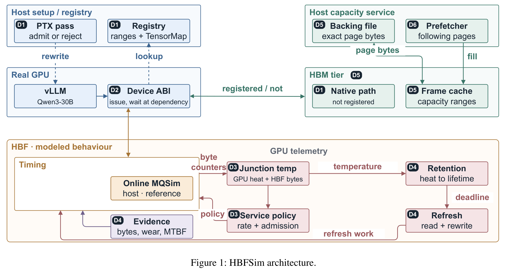

---

### 4.1 D1: An Explicit and Fail-Closed Boundary / 4.1 D1：显式且失败即拒绝的边界

<!-- PDF p.5 S037 -->

**Source / 原文定位：** PDF p.5 · S038

**Original / 英文原文：** Applications register virtual-address intervals as HBF timing or capacity ranges. Registration is intentionally explicit: neither a PTX instruction nor a TensorMap descriptor says which physical tier will back its address at run time. Each range records its base, length, access permissions, page geometry, stream, and backing-file offset. The runtime publishes a sorted immutable snapshot, and a device helper classifies the effective address produced by the executing instruction. An address outside every registered range follows the native HBM path. An in-range access is modeled only if the complete byte span and its permissions are valid; an ambiguous or partially out-of-range access fails rather than silently running as HBM.

**中文译文：** 应用将虚拟地址区间注册为 HBF 时序范围或容量范围。注册被有意设计为显式操作：无论 PTX 指令还是 TensorMap 描述符，都不会说明运行时其地址由哪个物理层提供支持。每个范围记录基址、长度、访问权限、页几何参数、流，以及后备文件偏移。运行时发布一个已排序的不可变快照，设备辅助函数据此分类正在执行的指令所产生的有效地址。落在所有已注册范围之外的地址沿原生 HBM 路径执行。范围内访问只有在完整字节跨度及其权限均有效时才会被建模；归属不明确或部分越界的访问会失败，而不会静默按 HBM 执行。

---

**Source / 原文定位：** PDF p.5 · S039

**Original / 英文原文：** This dynamic classification is essential for TMA operations. A TensorMap is a host-created descriptor whose base, dimensions, strides, box shape, element format, and out-of-bounds policy are values, not PTX constants. The runtime binds a hash of the exact 128-byte descriptor to a decoded and generation-stamped representation. At issue, HBFSim enumerates the tile’s effective element addresses and partitions it into HBM, HBF, and out-of-bounds bytes. Unicast and multicast use the same partition; multicast adds one tracked destination per selected cluster rank and completes its barrier only after both native TMA and every modeled HBF segment complete. Consequently, a tile that crosses the HBM–HBF boundary is modeled byte for byte rather than assigned wholesale to either tier.

**中文译文：** 这种动态分类对于 TMA 操作不可或缺。TensorMap 是在主机侧创建的描述符，其基址、维度、步长、数据盒形状、元素格式和越界策略都是运行时值，而非 PTX 常量。运行时将这份精确的 128 字节描述符的哈希值，绑定到已解码且带代次标记的表示。发射时，HBFSim 枚举 tile 中元素的有效地址，将其划分为 HBM、HBF 和越界字节。单播与多播使用相同的划分；多播为每个选中的 cluster rank 增加一个受追踪的目标，并且只有原生 TMA 与所有建模 HBF 片段均完成后，才完成其屏障。因此，跨越 HBM–HBF 边界的 tile 会按字节建模，而非被整体归入任意一个层级。

---

**Source / 原文定位：** PDF p.5 · S040

**Original / 英文原文：** The same principle limits coverage. The pass instruments PTX modules and records an admission artifact containing the original and transformed hashes, the helper ABI, and the instruction coverage. A precompiled cubin, the already-built code for one GPU architecture, has no PTX to rewrite, so HBFSim does not claim to observe it. We also measured the alternative: instrumenting the same run totally through NVBit [39], which rewrites at the SASS level and reaches kernels this pass cannot, costs more than ten times the run-time overhead of the PTX pass, which makes simulating some larger-parameter LLMs on HBF take too long. We therefore instrument at the PTX level. Exact runs are admitted only when every access required by the declared run contract is covered; otherwise the launch is refused and the reason is recorded. This turns incomplete instrumentation from an implicit source of optimistic results into an explicit experimental boundary.

**中文译文：** 同样的原则也限定了覆盖范围。该变换过程对 PTX 模块插桩，并记录一份准入产物，包含原始与变换后的哈希、辅助函数 ABI 和指令覆盖情况。预编译 cubin 是面向某个 GPU 架构构建好的代码，没有可供重写的 PTX，因此 HBFSim 不声称能够观察它。我们也测量了另一种方案：使用在 SASS 层重写、能够覆盖本 PTX 过程无法覆盖的内核的 NVBit [39]，对同一次运行进行完整插桩，其运行时开销超过 PTX 方案的十倍，使一些更大参数量 LLM 的 HBF 模拟耗时过长。因此，我们选择在 PTX 层插桩。只有声明的运行契约所要求的每次访问都被覆盖时，精确运行才会获准；否则拒绝启动并记录原因。这使插桩不完整从乐观结果的隐含来源，变成显式的实验边界。

---

### 4.2 D2: Preserving GPU Asynchrony / 4.2 D2：保留 GPU 的异步性

<!-- PDF p.5 S041 -->

**Source / 原文定位：** PDF p.5 · S042

**Original / 英文原文：** Split issue from consumption. The naive idea is to make the rewritten access wait in place: the program stops at the instruction that issues the access and sleeps through the modeled latency. Real hardware is the opposite: it issues a load and continues to issue the instructions that follow, as long as nothing later reads the register whose value has not returned. If the rewritten access waits in place, a single memory access stalls the whole warp at the issue point, so the instructions that could otherwise overlap the HBF access never issue. We therefore split issue from consumption. Issue is the moment the GPU sends a memory access out, and consumption is the moment a later instruction first reads the value the access returns. Splitting issue from consumption means handling the access at two separate places in the program. At issue, a rewritten access registers one record and continues. The record holds the modeled completion time of the rewritten access, and the design calls the record a device future. At consumption, the thread waits for the modeled completion time at the first instruction that actually reads the value.

**中文译文：** 将发射与消费分离。最直接的想法是让重写后的访问原地等待：程序停在发出访问的指令处，在建模延迟期间等待。真实硬件恰好相反：发出加载后，只要后续指令不读取尚未返回数值的寄存器，就继续发射后续指令。如果重写后的访问原地等待，一次内存访问就会使整个 warp 在发射点停顿，原本能够与 HBF 访问重叠的指令便根本无法发射。因此，我们将发射与消费分离。发射是 GPU 发出内存访问的时刻；消费是后续指令第一次读取该访问所返回数值的时刻。分离发射与消费，意味着在程序中两个不同位置处理该访问。发射时，重写后的访问注册一条记录，然后继续执行。该记录保存此次访问的建模完成时间，设计中将其称为 device future（设备端 future）。消费时，线程在第一条真正读取该数值的指令处等待建模完成时间。

---

**Source / 原文定位：** PDF p.5 · S043

**Original / 英文原文：** Placing the wait at the point of consumption puts the wait in the same place where the hardware itself stops. The scoreboard is the hardware table that tracks which register results have not yet come back. When a memory access is issued, the hardware marks the destination register as not yet returned in the scoreboard. The first instruction that reads that register finds the mark still there and stops.

**中文译文：** 把等待放在消费点，便使等待位置与硬件自身停顿的位置相同。记分牌是追踪哪些寄存器结果尚未返回的硬件表。内存访问发出时，硬件在记分牌中把目标寄存器标记为尚未返回。第一条读取该寄存器的指令发现标记仍在，就会停顿。

---

**Source / 原文定位：** PDF p.5 · S044

**Original / 英文原文：** An ordinary load or store allocates a small device future and continues; the first dependent use polls or waits for its modeled completion. The workload does not run ahead of the model: a synchronous consumer waits immediately, whereas a future or TMA object waits only at its architectural dependency. TMA issue creates a deferred object keyed by the barrier, CTA group, cluster, and generation. Native completion and modeled completion are conjunctive: neither alone releases the barrier. Every object has exactly one terminal transition, and stale generations, leaks, and faults are reported.

**中文译文：** 一次普通加载或存储分配一个小型 device future 后继续执行；第一次依赖性使用会轮询或等待其建模完成。工作负载不会跑在模型之前：同步消费者立即等待，而 future 或 TMA 对象只在其架构定义的依赖点等待。TMA 发射创建一个延迟对象，以屏障、CTA 组、cluster 和代次为键。原生完成与建模完成必须同时满足：单独任一完成都不会释放屏障。每个对象恰有一次终态转换；过期代次、泄漏和故障均会报告。

---

### 4.3 D3: A Closed-Loop Thermal Controller / 4.3 D3：闭环热控制器

<!-- PDF p.5 S045 -->

**Source / 原文定位：** PDF p.5 · S046

**Original / 英文原文：** The CUDA process owns the live device identity and publishes GPU temperature, power, a host-monotonic timestamp, and source status. The source can instead be an explicitly declared constant or hash-bound trace for deterministic experiments. Missing, stale, regressing, or failed telemetry terminates a thermal run; HBFSim never freezes the last good temperature. Host and GPU clock origins are never subtracted. Device code consumes only relative service and refresh debt.

**中文译文：** CUDA 进程掌握当前实际设备的身份，并发布 GPU 温度、功耗、主机单调时钟时间戳和数据源状态。为进行确定性实验，数据源也可以改为显式声明的常量或通过哈希绑定的轨迹。遥测缺失、过期、时间倒退或失败都会终止热模拟运行；HBFSim 绝不会把最后一次有效温度冻结后继续使用。主机与 GPU 时钟的时间原点绝不相减。设备代码只使用相对服务量与刷新欠账。

---

**Source / 原文定位：** PDF p.5,6 · S047

**Original / 英文原文：** Media activity, not a nominal power figure, is the source of HBF heat in HBFSim. Each read, program, and erase event that the media model schedules carries an energy under the event-based Joule energy model, $E_{\mathrm{NAND}} = E_{\mathrm{command}} + e_{\mathrm{byte}} \times \mathrm{bytes}$. Event energies accumulate in 10 ms bins. The binning applies a time-bin power integration: an event that spans more than one bin has its energy split across the bins in proportion to the time overlap. The power of node i in bin k is $P_{i,k} = E_{i,k}/\Delta t + P_{\mathrm{idle},i}$.

**中文译文：** 在 HBFSim 中，HBF 热量的来源是介质活动，而非某个标称功耗数字。介质模型调度的每个读取、编程和擦除事件，都依据基于事件的焦耳能量模型携带能量：$E_{\mathrm{NAND}} = E_{\mathrm{command}} + e_{\mathrm{byte}}\times\mathrm{bytes}$。事件能量以 10 ms 时间桶累积。分桶采用按时间桶进行的功率积分：跨越多个时间桶的事件，其能量按与各桶重叠的时长比例分摊。第 $k$ 个时间桶中节点 $i$ 的功率为 $P_{i,k}=E_{i,k}/\Delta t+P_{\mathrm{idle},i}$。

---

**Source / 原文定位：** PDF p.6 · S048

**Original / 英文原文：** HBFSim builds the package thermal operator offline with 3D-ICE 4.0 [47] from the material properties, the geometry, the grid, and the power sources. The temperature field then follows Fourier transient heat conduction, $C_v \partial T/\partial t = \nabla\cdot(k\nabla T)+q'''$, where q′′′ is the volumetric heat generation. Discretized on the grid, every thermal cell becomes an RC network node,

**中文译文：** HBFSim 根据材料属性、几何形状、网格和功率源，利用 3D-ICE 4.0 [47] 离线构建封装热算子。温度场随后遵循傅里叶瞬态热传导方程 $C_v\partial T/\partial t=\nabla\cdot(k\nabla T)+q'''$，其中 $q'''$ 为单位体积的发热率。将其在网格上离散化后，每个热单元成为一个 RC 网络节点：

---

**Source / 原文定位：** PDF p.6 · S049

**Equation (1) / 公式（1）**

$$
C_i\frac{dT_i}{dt}=P_i-\sum_jG_{ij}(T_i-T_j)-G_{i,\mathrm{sink}}(T_i-T_{\mathrm{sink}}),\tag{1}
$$

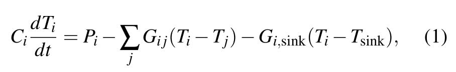

---

**Source / 原文定位：** PDF p.6 · S050

**Original / 英文原文：** where $G_{ij}$ is the conductance between neighboring cells and $G_{i,\mathrm{sink}}$ is the conductance from a cell to the heat sink. Conduction between two cells is Fourier’s law. At the heat sink the operator applies $-k\partial T/\partial n=h(T-T_{\mathrm{amb}})$, which is Newton’s law of cooling, or the Robin boundary condition in the finite-volume formulation. At a non-uniform bottom boundary the half-cell conduction and the convection form a series thermal resistance with equivalent boundary conductance $G_{\mathrm{eq}}=2khA/(\Delta z h+2k)$.

**中文译文：** 其中，$G_{ij}$ 是相邻单元之间的热导，$G_{i,\mathrm{sink}}$ 是单元到散热器的热导。两个单元之间的传导遵循傅里叶定律。在散热器处，算子使用 $-k\partial T/\partial n=h(T-T_{\mathrm{amb}})$，即牛顿冷却定律，或有限体积表述中的 Robin 边界条件。在非均匀底部边界，半单元传导与对流构成串联热阻，等效边界热导为 $G_{\mathrm{eq}}=2khA/(\Delta z h+2k)$。

---

**Source / 原文定位：** PDF p.6 · S051

**Original / 英文原文：** The GPU, the HBM, and the HBF share one conductance matrix G and one capacitance matrix C; heat from any of the three reaches the other two through that operator, not through three separately solved models averaged together. At every 10 ms step the runtime forms one package power vector from the measured GPU power and the modeled HBM and HBF power, with separate entries for the three media and the HBF layers. The division of labor between HBFSim and 3D-ICE is as follows: 3D-ICE solves the underlying thermal physics; HBFSim owns the energy balance of heat generation, heat transfer, heat storage, and heat dissipation across the three media in one real run, and returns the resulting package temperature to HBF request service. Offline, each heat source receives a 1 W unit step, and the Eigensystem Realization Algorithm (ERA) fits a reduced-order model to the recorded response. At run time the reduced-order model is a discrete state-space system,

**中文译文：** GPU、HBM 和 HBF 共享一个热导矩阵 $G$ 和一个热容矩阵 $C$；三者中任一个产生的热量，都通过该算子传到另外两者，而不是将三个独立求解的模型取平均。每隔 10 ms，运行时根据实测 GPU 功耗及建模的 HBM、HBF 功耗，形成一个封装功率向量，其中为三种介质和各 HBF 层分别设置条目。HBFSim 与 3D-ICE 的分工如下：3D-ICE 求解底层热物理；HBFSim 负责同一次真实运行中三种介质之间产热、传热、储热与散热的能量平衡，并将所得封装温度反馈给 HBF 请求服务。离线阶段，对每个热源施加 1 W 单位阶跃，由特征系统实现算法（Eigensystem Realization Algorithm，ERA）对记录的响应拟合降阶模型。运行时，该降阶模型是一个离散状态空间系统：

---

**Source / 原文定位：** PDF p.6 · S052

**Equation (2) / 公式（2）**

$$
\begin{aligned}x_{k+1}&=Ax_k+Bp_k+b,\\T_k&=Cx_k+Dp_k+d.\end{aligned}\tag{2}
$$

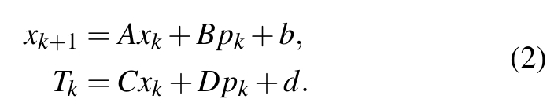

---

**Source / 原文定位：** PDF p.6 · S053

**Original / 英文原文：** The state $x_k$ is a reduced thermal state and not a physical grid temperature, and the reduced model is far smaller than the full-order operator.

**中文译文：** 状态 $x_k$ 是降阶热状态，而非物理网格温度；降阶模型远小于全阶算子。

---

**Source / 原文定位：** PDF p.6 · S054

**Original / 英文原文：** At steady state the reduced-order model gives the temperature change that one source produces at every node. Driving one source at a time with 1 W fills the thermal-resistance and cross-talk matrix $R_{ij}=\Delta T_i/P_j$, in K/W. The HBF hotspot temperature is the output of the thermal model, and the admission rate that the throttling state allows changes the media activity that generated the heat.

**中文译文：** 稳态下，降阶模型给出单个热源在各节点产生的温度变化。每次用 1 W 驱动一个热源，即可填充热阻及串扰矩阵 $R_{ij}=\Delta T_i/P_j$，单位为 K/W。HBF 热点温度是热模型的输出，而节流状态允许的准入速率又会改变产生热量的介质活动。

---

**Source / 原文定位：** PDF p.6 · S055

**Original / 英文原文：** It applies thermal service exactly once. If an unthrottled operation has service s and the controller publishes service fraction q in parts per million, the device uses

**中文译文：** 热服务缩放恰好只应用一次。如果未节流操作的服务时间为 $s$，控制器以百万分率发布服务比例 $q$，则设备使用：

---

**Source / 原文定位：** PDF p.6 · S056

**Equation (3) / 公式（3）**

$$
s_T=\left\lceil\frac{s\cdot10^6}{q}\right\rceil.\tag{3}
$$

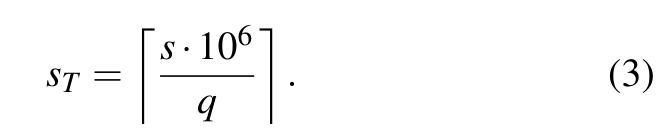

---

**Source / 原文定位：** PDF p.7 · S057

**Original / 英文原文：** The fraction is snapshotted before queue reservation. Thus a command admitted before a state transition retains its service and drains once; a later Severe state cannot retroactively strand it. Normal publishes $q=10^6$, Light publishes a profile value below $10^6$, Severe withholds new reservations, and Shutdown returns a distinct terminal link-shutdown status. A seqlock-style generation protects the mode, service, temperature, and admission fields from torn host–device reads.

**中文译文：** 该比例会在队列预留之前取快照。因此，状态转换前已获准的命令保留其服务量，并且仅排空一次；后续的 Severe 状态无法追溯性地将其搁置。Normal 发布 $q=10^6$；Light 发布配置文件中小于 $10^6$ 的值；Severe 暂停新的预留；Shutdown 则返回独立的终态链路关闭状态。类似 seqlock 的代次机制保护模式、服务量、温度和准入字段，防止主机与设备之间读到不一致的部分更新值。

---

**Source / 原文定位：** PDF p.7 · S058

**Original / 英文原文：** The thresholds RTT, LTT and STT drive a hysteretic state machine with four states: Normal, Light, Severe and Shutdown. The controller is constructed and publishes its first valid snapshot before the daemon’s readiness heartbeat, so no request can observe an uninitialized thermal policy.

**中文译文：** RTT、LTT 和 STT 阈值驱动一个带滞回的四状态机：Normal（正常）、Light（轻度）、Severe（严重）和 Shutdown（关闭）。控制器在守护进程发出就绪心跳之前完成构造并发布首个有效快照，因此任何请求都不会看到尚未初始化的热策略。

---

### 4.4 D4: Retention, Refresh, and Wear as Injected Latency / 4.4 D4：将数据保持、刷新和磨损转化为注入延迟

<!-- PDF p.7 S059 -->

**Source / 原文定位：** PDF p.7 · S060

**Original / 英文原文：** The difference from a conventional NAND simulator is not that HBFSim keeps these states; it is where the number those states produce ends up. A conventional NAND simulator keeps them too: a refresh consumes time inside the device, and the device latency the simulator reports grows. That device, however, sits behind a host interface, so however expensive a refresh is, it only moves a quantity inside the device, and the program does not change what it does next because of it. Here the loop closes because the running program pays for the refresh itself: a rise in temperature shortens the retention deadline, the shortened deadline forces refresh writes, those writes take bandwidth the workload’s own reads also use and endurance the device has to spend, and the next access the workload issues is injected with a longer delay. In a conventional simulator the chain temperature →retention deadline →forced refresh →bandwidth and endurance →a longer injected delay →a workload that feels it breaks at the second-to-last step: it can compute the same refresh traffic, but it cannot make the running program pay time for it.

**中文译文：** 与传统 NAND 模拟器的差异，不在于 HBFSim 保存了这些状态，而在于这些状态产生的数值最终作用于何处。传统 NAND 模拟器也保存这些状态：刷新在器件内部消耗时间，使模拟器报告的器件延迟增加。然而，该器件位于主机接口之后，因此，无论刷新多昂贵，都只是改变器件内部的一个量，程序不会因此改变接下来做什么。这里则形成了闭环，因为正在运行的程序会亲自承担刷新成本：温度上升缩短数据保持期限，期限缩短迫使刷新写入，这些写入既占用工作负载自身读取所需的带宽，又消耗器件耐久度，随后工作负载发出的下一次访问就会被注入更长延迟。对于传统模拟器，“温度 → 保持期限 → 强制刷新 → 带宽与耐久度 → 更长的注入延迟 → 感受到影响的工作负载”这条链会在倒数第二步断开：它能计算同样的刷新流量，却无法让正在运行的程序为此付出时间。

---

**Source / 原文定位：** PDF p.7 · S061

**Original / 英文原文：** Each registered block carries retention damage, a read-disturb count, a zone identifier, and current and maximum program/erase count (PEC). Retention lifetime follows an Arrhenius model anchored at the declared reference condition:

**中文译文：** 每个已注册块都携带数据保持损伤、读干扰计数、区域标识符，以及当前和最大编程/擦除计数（PEC）。数据保持寿命遵循以所声明参考条件为锚点的 Arrhenius 模型：

---

**Source / 原文定位：** PDF p.7 · S062

**Equation (4) / 公式（4）**

$$
L(T)=L_{\mathrm{ref}}\exp\!\left[\frac{E_{a,r}}{k_B}\left(\frac1T-\frac1{T_{\mathrm{ref}}}\right)\right].\tag{4}
$$

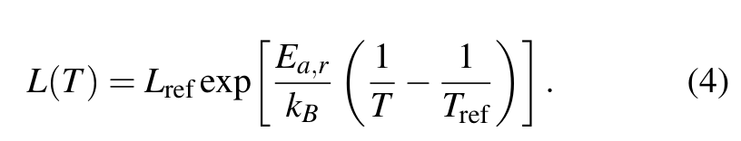

---

**Source / 原文定位：** PDF p.7 · S063

**Original / 英文原文：** Over a changing trajectory the controller accumulates

**中文译文：** 沿不断变化的温度轨迹，控制器累积：

---

**Source / 原文定位：** PDF p.7 · S064

**Equation (5) / 公式（5）**

$$
D\leftarrow D+a_t\frac{\Delta t}{L(T)},\tag{5}
$$

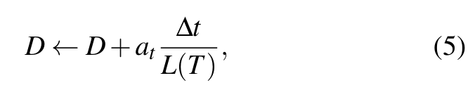

---

**Source / 原文定位：** PDF p.7 · S065

**Original / 英文原文：** where $a_t$ is a disclosed reliability-time acceleration used only to make validation runs practical. A block becomes eligible when damage reaches its lead threshold or its read-disturb limit. Eligibility never changes application bytes. The scheduler emits page-aligned read–rewrite pairs in a deterministic order: eligibility epoch, channel round robin, die round robin, zone, block, and page. It excludes refresh from a die while an application read occupies that die.

**中文译文：** 其中，$a_t$ 是明确披露的可靠性时间加速系数，只用于让验证运行在实践中可完成。当损伤达到其提前触发阈值，或达到读干扰上限时，一个块获得刷新资格。获得资格绝不改变应用字节。调度器按确定顺序发出页对齐的“读取–重写”对：获得资格的 epoch、通道轮转、裸片轮转、区域、块、页。当应用读取占用某个裸片时，该裸片不执行刷新。

---

**Source / 原文定位：** PDF p.7 · S066

**Original / 英文原文：** In the reference path, refresh uses a disjoint request-ID namespace and enters the same MQSim queues as foreground traffic. Its completion updates only background state; it cannot consume an application ticket. A block commits one PEC and clears its damage and disturb counters only after every read and rewrite quantum completes successfully. On failure, the counters remain and the work is eligible to retry. The host publishes the same plan as relative byte debt. An application admission atomically claims at most one refresh quantum and reserves the corresponding thermally scaled service before its own service. Host decay accounts separately for debt that would have drained in otherwise idle time. This representation avoids putting host timestamps into GPU queue tails while preserving refresh bytes, order, PEC, and contention with foreground traffic.

**中文译文：** 在参考路径中，刷新使用互不重叠的请求 ID 命名空间，并进入与前台流量相同的 MQSim 队列。其完成只更新后台状态，不能消费应用的票据。只有在每个读取和重写量子都成功完成之后，一个块才提交一次 PEC，并清零损伤与干扰计数器。失败时保留计数器，相关工作仍可重试。主机将同一计划发布为相对字节欠账。一次应用准入以原子方式最多认领一个刷新量子，并在自身服务之前预留经热状态缩放的对应服务。主机端衰减单独核算本来可以在空闲期间消化的欠账。这种表示避免把主机时间戳放进 GPU 队尾，同时保留刷新字节数、顺序、PEC 以及与前台流量的竞争关系。

---

### 4.5 D5: Capacity / 4.5 D5：容量

<!-- PDF p.7 S067 -->

**Source / 原文定位：** PDF p.7 · S068

**Original / 英文原文：** Timing ranges preserve their original address. Capacity ranges instead use a bounded HBM frame cache backed by a sparse host file. A miss hands a page to the host service, which reads or programs the media model and copies the frame; dirty eviction writes the exact bytes back. Refresh reads and rewrites through the backing abstraction without modifying payload contents, so the acceptance condition is an unchanged workload checksum, not merely a completed media request.

**中文译文：** 时序范围保留原始地址。容量范围则使用一个容量受限、由主机稀疏文件支撑的 HBM 页框缓存。缓存未命中会将页交给主机服务，后者读取或编程介质模型并复制页框；脏页驱逐会将精确字节写回。刷新通过后备存储抽象执行读取与重写，不修改有效载荷内容，因此验收条件是工作负载校验和保持不变，而不仅仅是介质请求完成。

---

### 4.6 D6: Speculative Prefetcher / 4.6 D6：推测式预取器

<!-- PDF p.7 S069 -->

**Source / 原文定位：** PDF p.7 · S070

**Original / 英文原文：** A dense LLM reads its weights in the same order on every token, so an HBF tier can fetch the pages a layer needs before that layer runs. Mixture-of-Experts routing removes that order: a token’s experts are chosen only after the preceding layer produces its output. D6 therefore predicts from the accesses already served: HBFSim fetches the pages that follow a served page fault. HBFSim exposes a prefetch interface so that a user can supply a policy of its own, and it also ships one simple default policy, the one described here.

**中文译文：** 稠密 LLM 对每个 token 都按相同顺序读取权重，因此 HBF 层可在某层运行前预先取回该层所需的页。混合专家（Mixture-of-Experts，MoE）路由打破了这一顺序：只有前一层产生输出后，才能确定一个 token 将使用哪些专家。因此，D6 根据已经服务的访问进行预测：HBFSim 取回已处理缺页之后的后续页。HBFSim 提供预取接口，允许用户提供自己的策略，同时也自带一个简单的默认策略，即此处所述策略。

---

**Source / 原文定位：** PDF p.7 · S071

**Original / 英文原文：** On a synthetic Mixture-of-Experts stream, 8 pages per expert, 256 frames and 1033 distinct pages, the share of accesses served without a media read rises from 17.97% to 89.16%, and the media reads an access still has to wait for fall by 86.79%, from 840 to 111. Total media reads rise from 840 to 979, or 16.55%, and that rise is not the cost of fetching early: 729 (83.99%) of the prefetcher’s 868 reads each replaced a read that would have happened anyway, issued earlier rather than in addition. Only the 139 reads that went unused add traffic—pages guessed at an expert boundary, or evicted before their access arrived—and 139 is exactly the rise.

**中文译文：** 对于一条合成 MoE 访问流，配置为每个专家 8 页、256 个页框和 1033 个不同页，无需介质读取即可服务的访问比例从 17.97% 升至 89.16%；访问仍须等待的介质读取从 840 次降至 111 次，下降 86.79%。介质读取总次数从 840 次增至 979 次，增幅 16.55%，但这并非提前读取本身的代价：预取器 868 次读取中的 729 次（83.99%），分别替代了一次本来就会发生的读取，只是提前发出，而非额外增加。只有未被使用的 139 次读取增加了流量——包括在专家边界猜测错误的页，以及访问到达前已被驱逐的页——而 139 恰好就是总增量。

---

**Source / 原文定位：** PDF p.7,8 · S072

**Original / 英文原文：** The speculative prefetcher builds no media plan and never enters the detailed timing path, so it adds no modeled latency, queueing, or contention. Entering the timing path is future work, and this paper claims no run-time performance benefit from D6.

**中文译文：** 推测式预取器不构建介质计划，也从不进入详细时序路径，因此不增加任何建模的延迟、排队或争用。接入时序路径属于未来工作，本文不声称 D6 带来了运行时性能收益。

---

## 5 Implementation / 5 实现

<!-- PDF p.8 S073 -->

**Source / 原文定位：** PDF p.8 · S074

**Original / 英文原文：** The implementation is 9,302 lines of C, C++ and CUDA under src/ and include/, with a further 3,250 lines added afterwards for the measured calibration work. Three parts are reused: the flash media model of MQSim, the CUDA call interception path of bpftime, and the inference frameworks themselves, whose source is not modified. The parts we add are the range table and its registration interface, the PTX rewriting pass, the shared control region and the interface across it, the calibrated timing model, the thermal and retention model, and the page cache and backing store of the capacity mode. Four dependencies are pinned by commit: bpftime, MQSim, llama.cpp, and vLLM. Patches are kept as separate files instead of being applied into the imported source trees, so those trees stay as they were fetched; each build artifact carries a record of the versions that went into it, and the launcher refuses to start a build that carries no such record or one whose record does not match. The GPU is an NVIDIA RTX PRO 6000 Blackwell Server Edition with driver 595.84, compute capability 12.0 — the version number CUDA uses to identify a GPU architecture generation — and 97,887 MiB of memory; the CUDA toolkit is 13.0.88, and PTX is assembled with the ptxas of CUDA 12.8. The flash and thermal reference device is a Dell DC NVMe CD8P E3.S 1.92 TB on PCIe 5.0 at 32 GT/s x4, attached to NUMA node 1; it supplies real flash and thermal behaviour and is not an HBF device. Section 6 describes the same machine.

**中文译文：** 实现包含 `src/` 与 `include/` 下的 9,302 行 C、C++ 和 CUDA 代码，之后又为实测校准工作增加了 3,250 行。复用了三个部分：MQSim 的闪存介质模型、bpftime 的 CUDA 调用拦截路径，以及推理框架本身（未修改其源码）。我们新增的部分包括范围表及其注册接口、PTX 重写过程、共享控制区及跨区接口、校准后的时序模型、热与数据保持模型，以及容量模式的页缓存和后备存储。四个依赖通过提交版本固定：bpftime、MQSim、llama.cpp 和 vLLM。补丁以独立文件保存，不直接应用到导入的源码树，因此源码树保持获取时的状态；每个构建产物携带所用版本的记录，若缺少记录或记录不匹配，启动器便拒绝启动。GPU 为 NVIDIA RTX PRO 6000 Blackwell Server Edition，驱动版本为 595.84，计算能力为 12.0（CUDA 用于标识 GPU 架构代际的版本号），内存为 97,887 MiB；CUDA 工具包版本为 13.0.88，PTX 由 CUDA 12.8 的 ptxas 汇编。闪存及热参考设备为 Dell DC NVMe CD8P E3.S 1.92 TB，使用 PCIe 5.0、32 GT/s x4，挂接于 NUMA 节点 1；它提供真实闪存与热行为参考，并非 HBF 器件。第 6 节使用的也是同一台机器。

---

**Source / 原文定位：** PDF p.8 · S075

**Original / 英文原文：** Host and device share one control region. It is carried in an anonymous memory file, a region of memory that has a file descriptor but no file on disk, which is then sealed against any change of size, mapped, and registered so that the device can reach it, which yields a device-side address for the same bytes. The seal is what makes the region usable from a GPU thread: the device side reaches the request ring and the completion slots at fixed offsets, and those offsets hold only if the size cannot change while the run is in progress. The other allocation route was not taken because it does not yield a file descriptor that can be mapped again after a change of process. A timed access reserves a request slot and, at the same index, the completion slot that will answer it. The reservation sequence number is written into the request and is also the ticket the caller keeps; a waiter consumes only the completion slot its own ticket names, so a completion is never taken by another access.

**中文译文：** 主机与设备共享一个控制区。它由匿名内存文件承载，即具有文件描述符但磁盘上没有对应文件的一段内存，随后被封印以禁止改变大小，再映射并注册供设备访问，由此获得指向同一字节区域的设备端地址。封印使 GPU 线程可以使用该区域：设备侧通过固定偏移访问请求环与完成槽，而只有运行期间大小不变，这些偏移才始终有效。没有采用另一种分配路径，是因为它无法提供在进程切换后再次映射所需的文件描述符。一次计时访问预留一个请求槽，以及相同索引处用于回复的完成槽。预留序号写入请求，同时也是调用者保留的票据；等待者只消费自身票据指定的完成槽，因此完成结果不会被其他访问取走。

---

**Source / 原文定位：** PDF p.8 · S076

**Original / 英文原文：** The daemon publishes its first heartbeat, a counter it updates to show that it is still running, only after the configuration, the timing engine and the dispatcher have been constructed. That first heartbeat is the readiness boundary: until it appears, no access is served. One-time initialisation is allowed 10 seconds, and from then on the heartbeat is updated at least once every 10 milliseconds. The device side does not subtract a host clock reading from a GPU clock reading, because the two clocks are not guaranteed to share a time origin. It records the last heartbeat value it observed together with the local GPU time at which that value changed, and decides from those two whether the daemon is still running; a run whose heartbeat stops ends rather than continuing untimed.

**中文译文：** 只有配置、时序引擎和分派器构建完成后，守护进程才发布第一次心跳；心跳是一个持续更新、用于表明自身仍在运行的计数器。第一次心跳就是就绪边界：在它出现之前，不会为任何访问提供服务。一次性初始化允许用时 10 秒，之后至少每 10 毫秒更新一次心跳。设备侧不将主机时钟读数与 GPU 时钟读数相减，因为二者不保证共享时间原点。它记录最近观察到的心跳值，以及该值变化时的 GPU 本地时间，并据此判断守护进程是否仍在运行；心跳停止后，运行会结束，而不会以不计时方式继续。

---

**Source / 原文定位：** PDF p.8 · S077

**Original / 英文原文：** Four kinds of time are counted separately: the delay the model asked for, the wait an access actually observed, the time the host spent serving it, and the part of wall-clock time that the modeled delay does not account for. They are carried in four counters, modeled_ns, wall_ns, service_ns and overhead_ns. The reason is that a simulator which applies its effects inside a real execution can be functionally correct and still spend more time in its own software path than the device latency it is modeling; a slowdown reported without that split says nothing about the device. Section 6 reports the split for every workload.

**中文译文：** 四类时间分别计数：模型请求的延迟、访问实际观察到的等待、主机提供服务所花时间，以及建模延迟无法解释的墙钟时间部分。它们对应四个计数器：`modeled_ns`、`wall_ns`、`service_ns` 和 `overhead_ns`。原因在于，将影响施加到真实执行过程中的模拟器，即使功能正确，也可能在自身软件路径上花费比所建模器件延迟更长的时间；若报告减速却不作这种拆分，就无法说明器件本身的表现。第 6 节为每个工作负载报告该拆分。

---

**Source / 原文定位：** PDF p.8 · S078

**Original / 英文原文：** Every failure ends the run, and nothing is downgraded silently. A request ends in one of eight states: PENDING, READY, IO_ERROR, COPY_ERROR, CHECKSUM_ERROR, TIMEOUT, UNSUPPORTED and DAEMON_LOST; the six error states among them end the run. When the dispatcher or the timing engine fails, two steps happen in a fixed order. A terminal error completion is first posted to the reserved ticket of every request that has been admitted, is in flight, or is still queued, and only then is the global failure word published. In that order, a waiter that observes the failure word also finds a terminal state in the completion slot its own ticket names, so no thread is left waiting on a completion that will never arrive. At clean exit or any terminal thermal state, HBFSim atomically replaces one canonical JSON summary. It contains the exact profile and SHA-256, telemetry source identity, temperature samples, every state transition, state residency, application and refresh bytes, debt disposition, damage, PEC, and terminal status. It also reports a sensitivity sweep rather than a single asserted lifetime. For failure activation energy $E_a$, interval hazard is

**中文译文：** 任何失败都会终止运行，绝不静默降级。请求最终处于八种状态之一：`PENDING`、`READY`、`IO_ERROR`、`COPY_ERROR`、`CHECKSUM_ERROR`、`TIMEOUT`、`UNSUPPORTED`、`DAEMON_LOST`；其中六种错误状态会终止运行。当分派器或时序引擎失败时，按固定顺序执行两步：首先，为每个已获准、正在执行或仍在排队的请求，将终态错误完成结果写入其预留票据；随后才发布全局失败标志字。按此顺序，观察到失败标志字的等待者，也必定能在自身票据指定的完成槽中找到终态，因此不会有线程一直等待永远无法到来的完成结果。在正常退出或任何热终态下，HBFSim 以原子方式替换一份规范化 JSON 摘要。摘要包含精确的配置文件及 SHA-256、遥测源身份、温度样本、每次状态转换、各状态驻留时间、应用及刷新字节数、欠账处理、损伤、PEC 和终止状态。它还报告敏感性扫描，而非断言一个单一寿命。对失效激活能 $E_a$，区间累计风险为：

---

**Source / 原文定位：** PDF p.8 · S079

**Equation (6) / 公式（6）**

$$
H(E_a)=\sum_i\frac{\Delta t_i}{M_{\mathrm{ref}}}\exp\!\left[\frac{E_a}{k_B}\left(\frac1{T_{\mathrm{ref}}}-\frac1{T_i}\right)\right],\tag{6}
$$

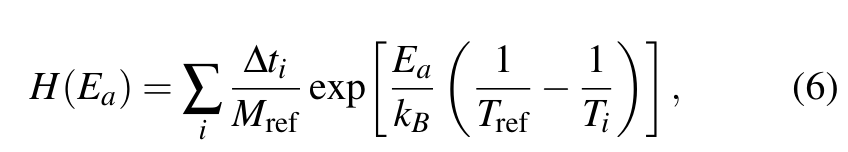

---

**Source / 原文定位：** PDF p.8 · S080

**Original / 英文原文：** with failure probability $1-e^{-H}$. Retention activation energy and whole-device failure activation energy are separate profile inputs. The result is therefore a reproducible, parameterized model outcome—not a claim that HBFSim measured the lifetime of unavailable HBF hardware.

**中文译文：** 相应失效概率为 $1-e^{-H}$。数据保持激活能与整个器件的失效激活能，是配置文件中彼此独立的输入。因此，结果是可复现、参数化的模型输出，而非声称 HBFSim 测出了尚未问世的 HBF 硬件寿命。

---

## 6 Evaluation / 6 评估

<!-- PDF p.8 S081 -->

**Source / 原文定位：** PDF p.8 · S082

**Original / 英文原文：** We evaluate HBFSim before HBF hardware becomes available. Our evaluation addresses three questions:

**中文译文：** 我们在 HBF 硬件问世之前评估 HBFSim。评估回答以下三个问题：

---

**Source / 原文定位：** PDF p.8,9 · S083

**Original / 英文原文：** • EQ1: Can HBFSim execute complete real LLM workloads transparently, preserving program results and synchronization, while applying modeled HBF latency accurately to the accesses it declares?

**中文译文：** EQ1：HBFSim 能否透明地执行完整的真实 LLM 工作负载，保持程序结果与同步语义，同时将建模 HBF 延迟准确施加于其声明覆盖的访问？

---

**Source / 原文定位：** PDF p.9 · S084

**Original / 英文原文：** • EQ2: How does package heating affect HBF service, and which component reaches its thermal limit first?

**中文译文：** EQ2：封装升温如何影响 HBF 服务？哪个部件最先达到热极限？

---

**Source / 原文定位：** PDF p.9 · S085

**Original / 英文原文：** • EQ3: How do the HBM–HBF mix and MoE routing together set the capacity a serving workload has?

**中文译文：** EQ3：HBM–HBF 组合与 MoE 路由如何共同决定服务工作负载可用的容量？

---

### 6.1 Experimental Setup / 6.1 实验设置

<!-- PDF p.9 S086 -->

**Source / 原文定位：** PDF p.9 · S087

**Original / 英文原文：** GPU experiments run on the machine of Section 5: an NVIDIA RTX PRO 6000 Blackwell Server Edition (compute capability 12.0, driver v595.84) with a Dell CD8P SSD. GDDR7 on the GPU is the platform’s actual memory and backs the logical fast tier through a page cache. Qwen3-30B-A3B runs under vLLM v0.15.1, and the simulator is built with CUDA 13.0. The Dell CD8P is the reference for the measured flash and host-paging path only. The full-order 3D-ICE package model is the reference the service simulation’s reduced model compared against, and the OCP specification supplies the HBF configuration constraints.

**中文译文：** GPU 实验在第 5 节所述机器上进行：NVIDIA RTX PRO 6000 Blackwell Server Edition（计算能力 12.0、驱动 v595.84），配备 Dell CD8P SSD。GPU 上的 GDDR7 是平台实际使用的内存，并通过页缓存为逻辑快速层提供支持。Qwen3-30B-A3B 在 vLLM v0.15.1 下运行，模拟器使用 CUDA 13.0 构建。Dell CD8P 只作为实测闪存与主机分页路径的参考。服务模拟中的降阶模型，以全阶 3D-ICE 封装模型作为对照参考；OCP 规范提供 HBF 配置约束。

---

### 6.2 EQ1: End-to-End Execution and Timing Fidelity / 6.2 EQ1：端到端执行与时序保真度

<!-- PDF p.9 S088 -->

**Source / 原文定位：** PDF p.9 · S089

**Original / 英文原文：** HBFSim injects modeled HBF service into a real GPU run: the workload must compute what it would compute without instrumentation, and each access must be charged to the tier it actually reaches. An access charged to the wrong tier misattributes service, and breaking barrier handling changes GPU synchronization semantics. Completing a run and modeling a run are different claims: completing means the model loads, prefill and decode run, the requested output tokens are produced, and the process ends normally; modeling completely would mean every access the run declares should be modeled actually is. The question therefore asks four things of one run on Qwen3-30B-A3B: that it completes, that it computes what it would have computed without instrumentation, that the accesses reaching the modeled tier are the ones the registration declares and the rest keep native semantics, and that the service injected into them is timely.

**中文译文：** HBFSim 将建模 HBF 服务注入真实 GPU 运行：工作负载必须算出与未插桩时相同的结果，且每次访问必须计入其实际到达的层级。将访问计入错误层级会误归服务，而破坏屏障处理会改变 GPU 同步语义。完成一次运行与对一次运行进行建模，是不同的主张：完成意味着模型成功加载、预填充与解码运行、生成所要求的输出 token，且进程正常结束；完整建模则意味着运行声明应被建模的每次访问，实际上都得到了建模。因此，对 Qwen3-30B-A3B 的一次运行，该问题要求满足四点：能够完成；计算结果与未插桩时相同；到达建模层的访问正是注册所声明的访问，其余访问保持原生语义；注入这些访问的服务在时序上准确。

---

**Source / 原文定位：** PDF p.9 · S090

**Original / 英文原文：** Under vLLM v0.15.1, the instrumented build runs Qwen3-30B-A3B end to end at a fixed 32-token prompt, seed 0 and output_len 8: a 60.988 s load, then 44.469 s of generation producing the eight requested output tokens; a TinyLlama run under llama.cpp takes ten 50 ms injections.

**中文译文：** 在 vLLM v0.15.1 下，插桩后的构建以固定的 32-token 提示词、随机种子 0 和 `output_len 8`，端到端运行 Qwen3-30B-A3B：加载耗时 60.988 s，随后生成耗时 44.469 s，产生要求的 8 个输出 token；在 llama.cpp 下的一次 TinyLlama 运行接受了十次各 50 ms 的注入。

---

**Source / 原文定位：** PDF p.9 · S091

**Original / 英文原文：** The instrumented run preserves the second and third of those four things: value, effective address, tier assignment and synchronization are unchanged, over 42 checks that cover ordinary and TMA accesses across seven launchable TMA templates, in-range and out-of-range addresses, HBM–HBF mixed boundaries and barrier-dependent completion. A 110 GiB logical range is mapped through a bounded 2 GiB page cache, and the 128 checksums over the first and last regions touched equal the baseline’s.

**中文译文：** 插桩运行保持了上述四点中的第二、第三点：在 42 项检查中，数值、有效地址、层级归属与同步均未改变。检查覆盖七种可启动的 TMA 模板中的普通访问与 TMA 访问、范围内与范围外地址、HBM–HBF 混合边界，以及依赖屏障的完成。110 GiB 的逻辑范围经容量受限的 2 GiB 页缓存映射，首次和最后触及区域上的 128 个校验和均与基线一致。

---

**Source / 原文定位：** PDF p.9 · S092

**Original / 英文原文：** The timing result is a difference between two delays rather than an absolute match: a 1,000 µs injection and a 200 µs injection, an 800 µs increment. Its six cells are TMA transfers at 256 B and 8192 B, and the records carry a constant 14.3–14.9 µs offset in a segment the reference model does not contain. The two transfer sizes are crossed with three frozen work levels, each an iteration count of an integer work loop injected into the probe kernel alongside the outstanding transfer: 0, 3335 and 9769 at 256 B, and 0, 3352 and 9787 at 8192 B. The two non-zero levels were chosen so the in-kernel arithmetic lands about 10 and 30 µs above the native transfer cost. Each cell is 36 paired blocks, and the reported cell measures 798,784.0 ns at 8192 B. The 0.152% is the error of that increment in the reported cell, not an absolute HBF latency error: what the difference demonstrates is the injection and the measurement, and no physical HBF latency was measured (Figure 2a).

**中文译文：** 时序结果检验的是两个延迟之差，而非绝对匹配：一次注入 1,000 µs，另一次注入 200 µs，两者增量为 800 µs。六个实验单元采用 256 B 和 8192 B 的 TMA 传输；记录中有一段参考模型未涵盖的路径，携带恒定的 14.3–14.9 µs 偏移。两种传输大小分别与三个固定计算量水平交叉，每个水平是在探测内核中、与尚未完成的传输并行插入的整数计算循环迭代次数：256 B 对应 0、3335、9769，8192 B 对应 0、3352、9787。两个非零水平被选为使内核内算术时间比原生传输成本分别高约 10 µs 和 30 µs。每个单元包含 36 个配对区块；文中报告的 8192 B 单元测得 798,784.0 ns。0.152% 指该单元所报告增量的误差，并非 HBF 绝对延迟误差：这个差分所证明的是注入和测量本身，并未测量任何物理 HBF 延迟（图 2a）。

---

**Source / 原文定位：** PDF p.9 · S093

**Original / 英文原文：** Figure 2c shows why the difference uses two large delays. The reference model predicts a duration that is the largest of three terms, only one of which carries the injected delay. Below a few hundred microseconds that term is not the largest, so a longer delay leaves the prediction unchanged and nothing is recovered; the difference then reflects run-to-run drift in the part of the pipeline the delay never reaches. The y axis of Figure 2(c) is the fraction of the requested delay that reappears in the measured duration: the mean over a cell’s 36 block pairs of the delayed transfer’s span minus the zero-delay transfer’s span, divided by that cell’s requested delay. The model predicts −692.4 and −751.1 ns for the two cells where it is most negative, against observed −681.8 and −923.6 ns. Five of the six negative points are not distinguishable from zero at their published 95% intervals. The 1,000 and 200 µs injections both sit above the work term, and their work terms are nearly equal, so the difference cancels them. Figure 2b gives that difference for each of the 216 measured transfers. The delivered increment has a median about 400 ns below the request, with the middle 90% of deliveries between −4800 and +4160 ns. All three panels measure the injection.

**中文译文：** 图 2c 解释了为何差分采用两个较大的延迟。参考模型预测的持续时间，是三个项中的最大值，只有其中一项携带注入延迟。低于数百微秒时，该项不是最大项，因此增加延迟不会改变预测值，也不会恢复出任何延迟；此时差分反映的是延迟根本没有作用到的流水线部分在不同运行间的漂移。图 2(c) 纵轴表示所请求延迟在实测时长中重新出现的比例：对一个单元的 36 对区块，求“带延迟传输跨度减去零延迟传输跨度”的均值，再除以该单元请求的延迟。对于预测最负的两个单元，模型预测值为 −692.4 ns 和 −751.1 ns，观测值分别为 −681.8 ns 和 −923.6 ns。六个负值点中，有五个在公布的 95% 区间内与零无法区分。1,000 µs 和 200 µs 注入均高于计算项，且两者计算项近乎相等，因此差分将其抵消。图 2b 给出 216 次实测传输各自的差分。实际交付增量的中位数比请求值低约 400 ns，中间 90% 的交付结果位于 −4800 ns 至 +4160 ns 之间。三个面板测量的都是注入本身。

---

**Source / 原文定位：** PDF p.10 · S094

**Original / 英文原文：** Figure 2: Timing-injection fidelity. Increment error by configuration (a), paired-error distribution (b), and normalized delay recovery (c).

**中文译文：** 图 2：时序注入的保真度。各配置的增量误差（a）、成对误差分布（b）以及归一化延迟恢复率（c）。

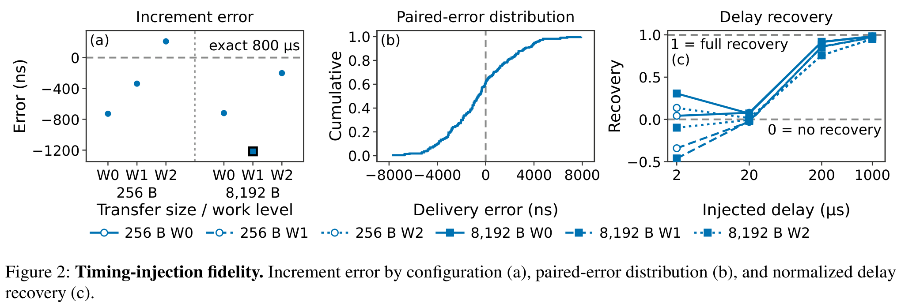

---

### 6.3 EQ2: Thermal Coupling / 6.3 EQ2：热耦合

<!-- PDF p.9 S095 -->

**Source / 原文定位：** PDF p.9 · S096

**Original / 英文原文：** An HBF stack shares one package with the HBM region and the compute die, so the stack’s own temperature does not decide how much read service it can sustain. The coupling has to be simulated transiently, and the binding component identified.

**中文译文：** HBF 堆栈与 HBM 区域及计算裸片共享一个封装，因此，仅凭堆栈自身温度，无法决定它可以持续提供多少读取服务。必须进行瞬态耦合模拟，并找出真正构成约束的部件。

---

**Source / 原文定位：** PDF p.9 · S097

**Original / 英文原文：** One HBF stack of 16 host channels is modeled at the 8-hi stack height Speed Grade 1 allows, with read power of 5 W idle plus $8.4\times10^{-11}$ J per byte, 37.256 W at 384 GB/s, driving a 3D-ICE package operator over the compute die, the HBM region and the eight HBF layers, stepped at 10 ms.

**中文译文：** 我们对一个具有 16 个主机通道的 HBF 堆栈建模，采用 Speed Grade 1 所允许的 8 层（8-hi）堆叠高度；读取功耗为 5 W 空闲功耗加每字节 $8.4\times10^{-11}$ J，在 384 GB/s 时为 37.256 W。该功耗驱动覆盖计算裸片、HBM 区域和八个 HBF 层的 3D-ICE 封装算子，步长为 10 ms。

---

**Source / 原文定位：** PDF p.9,10 · S098

**Original / 英文原文：** Three model assumptions fix the operating point. The 384 GB/s target is the per-cube maximum the OCP specification gives Speed Grade 1 in Table 4 (Speed Grades 2 and 3 raise it to 1.536 and 3.072 TB/s at a 16-hi stack height, which this work does not model); the host channel is 64 bits, the value the specification fixes; and the ECC engines per channel are provisioned so that error correction does not cap the rated bandwidth, a quantity the specification leaves open.

**中文译文：** 三个模型假设确定了工作点。384 GB/s 目标是 OCP 规范表 4 给出的 Speed Grade 1 单 cube 最大值（Speed Grade 2 和 3 在 16 层堆叠时将其提高到 1.536 和 3.072 TB/s，本文未建模这两种情况）；主机通道宽度取规范固定的 64 位；每通道的 ECC 引擎配备足够，使纠错不会限制额定带宽，而规范没有规定这一数量。

---

**Source / 原文定位：** PDF p.10 · S099

**Original / 英文原文：** Over horizons of 600, 3,600 and 86,400 s, five control policies—a baseline with no throttling, the hysteresis policy at two settings, a fixed admission cap, and a proportional-integral controller—each deliver the full 384.0 GB/s measured in the [30,60) s window, and none throttles: the seconds above the Severe and Shutdown thresholds are zero in every run, and the peak temperature is 79.8 ◦C, within $3\times10^{-5}$ K of what the thermal fit predicts.

**中文译文：** 在 600、3,600 和 86,400 s 的时间跨度内，五种控制策略——不节流基线、两组参数的滞回策略、固定准入上限和比例积分控制器——均在 [30,60) s 测量窗口中提供完整的 384.0 GB/s，且均未节流：每次运行高于 Severe 与 Shutdown 阈值的时间均为零；峰值温度为 79.8 °C，与热拟合预测值的差异不超过 $3\times10^{-5}$ K。

---

**Source / 原文定位：** PDF p.10 · S100

**Original / 英文原文：** Within the package-safe envelope evaluated here, the package’s thermal limit is reached at the compute die, not at HBF: 86.6 W at the 90 ◦C compute limit against 121.4 W at the HBM limit and 105.9 W at the HBF limit, both 105 ◦C. At the compute-die limit the eight HBF layers span 44.4 K, from 91.6 ◦C in layer 0 at the package base to 47.2 ◦C in layer 7 at the top (Figure 3).

**中文译文：** 在本文评估的封装安全范围内，封装首先在计算裸片处达到热极限，而非 HBF：计算部件达到 90 °C 极限时对应 86.6 W，HBM 达到其极限时对应 121.4 W，HBF 达到其极限时对应 105.9 W，后两者极限均为 105 °C。在计算裸片达到极限时，八个 HBF 层的温差为 44.4 K，从封装底部第 0 层的 91.6 °C 到顶部第 7 层的 47.2 °C（图 3）。

---

**Source / 原文定位：** PDF p.10 · S101

**Original / 英文原文：** Figure 3: Modeled HBF layer temperatures. Temperature of the hottest node in each of the eight HBF layers, over time (a) and across external heat loads (b), on one shared color scale.

**中文译文：** 图 3：建模得到的 HBF 各层温度。八个 HBF 层中每层最热节点随时间（a）及外部热负载（b）变化的温度，两个面板共用同一色标。

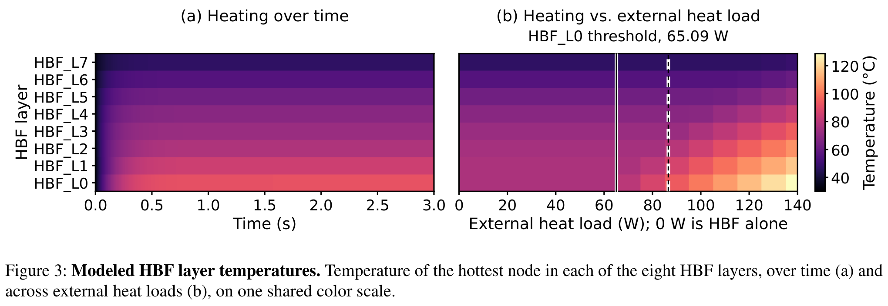

---

**Source / 原文定位：** PDF p.10 · S102

**Original / 英文原文：** In Figure 3, panel (a) is the first 3.0 s at the whole-package load, and panel (b) sweeps the external heat load from 0 to 140 W. Panels (a) and (b) are modeled predictions from a reconstructed thermal operator, not measurements of a running device. Panel (b) carries two marks: the solid line sits at 65.09 W, the load up to which layer 0 stays flat, and the dashed line sits at the whole-package operating point, the load at which the compute die reaches its 90 ◦C ceiling in this modeled scenario. Layer 7 is still flat at 130 W. At 0 W in panel (b) the HBF stack is the only heat source: the compute die and the HBM region add no heat there, while the stack’s own read power is present at every load.

**中文译文：** 图 3 中，面板（a）为整个封装负载下最初 3.0 s 的结果，面板（b）扫描 0–140 W 的外部热负载。（a）与（b）均为重建热算子得到的模型预测，而非对运行中器件的测量。面板（b）有两个标记：实线位于 65.09 W，直到该负载第 0 层温度仍保持平坦；虚线位于整个封装的工作点，即在所建模情景下计算裸片达到 90 °C 上限时的负载。第 7 层在 130 W 时仍保持平坦。在（b）的 0 W 处，HBF 堆栈是唯一热源：计算裸片和 HBM 区域均不额外产热，而堆栈自身的读取功耗在所有负载点都存在。

---

**Source / 原文定位：** PDF p.10,11 · S103

**Original / 英文原文：** Across seven compute phases, measured board power on the evaluation GPU (Figure 4) spans 314.988 to 431.370 W, and the GPU’s own sensor stays between about 46 and 52 ◦C. The board-power difference between the DRAM-resident and L2-resident halves of a phase rises approximately linearly with bandwidth and reaches 45.707 W at 383.649 GB/s. The least-squares line is drawn over all six bandwidth phases, including those that did not reach a plateau, so it describes the observations rather than a steady state taken from the plateau phases alone. No temperature here is a memory-chip temperature, since the card exposes none by any route and both NVML fields that might carry one were unavailable in all 3,877 samples. The panel (b) difference is not GDDR chip power: the two halves differ in where the buffer resides, so the difference contains whatever else changes with that residency. The 383.649 GB/s point is GDDR7 traffic through the card’s own memory system, not HBF service, and the modeled 384 GB/s HBF target shares only that value. Panel (a)’s board-power axis and the 0 to 140 W external heat load of Figure 3(b) are different quantities: one is a measured board draw, the other heat injected into a package model. 86.6 W keeps its meaning as the compute-die thermal limit reverse-solved at the 90 ◦C modeled ceiling, not a card power limit; the card’s own limits are 300 to 600 W.

**中文译文：** 在七个计算阶段中，评估 GPU 的实测板卡功耗（图 4）为 314.988–431.370 W，GPU 自身传感器读数保持在约 46–52 °C。同一阶段中数据驻留 DRAM 与驻留 L2 两个半段的板卡功耗差，随带宽近似线性增加，在 383.649 GB/s 时达到 45.707 W。最小二乘直线使用全部六个带宽阶段拟合，包括未达到平台期的阶段，因此描述的是观测结果，而非仅从平台期阶段得到的稳态。这里没有任何温度是内存芯片温度，因为该卡没有通过任何路径暴露这种温度；可能提供该值的两个 NVML 字段，在全部 3,877 个样本中均不可用。面板（b）的功耗差也不是 GDDR 芯片功耗：两个半段的区别在于缓冲区驻留位置，因此差值包含所有随驻留位置改变的因素。383.649 GB/s 点是经过该卡自身内存系统的 GDDR7 流量，并非 HBF 服务；它与建模的 384 GB/s HBF 目标只是在数值上相近。面板（a）的板卡功耗轴与图 3(b) 的 0–140 W 外部热负载是不同的量：前者是实测板卡功耗，后者是注入封装模型的热量。86.6 W 仍表示在模型的 90 °C 上限下反解得到的计算裸片热极限，而非板卡功率上限；该卡自身的功率限制为 300–600 W。

---

**Source / 原文定位：** PDF p.11 · S104

**Original / 英文原文：** Figure 4: Physical reference on the evaluation GPU. Board power against the GPU’s own temperature sensor (a) and measured DRAM bandwidth against the board-power difference between a phase’s DRAM-resident and L2-resident halves (b), over thirteen 300 s phases.

**中文译文：** 图 4：评估 GPU 上的物理参考测量。在十三个各持续 300 s 的阶段中，板卡功耗与 GPU 自身温度传感器读数的关系（a），以及实测 DRAM 带宽与同一阶段中数据驻留 DRAM 和驻留 L2 两个半段的板卡功耗差的关系（b）。

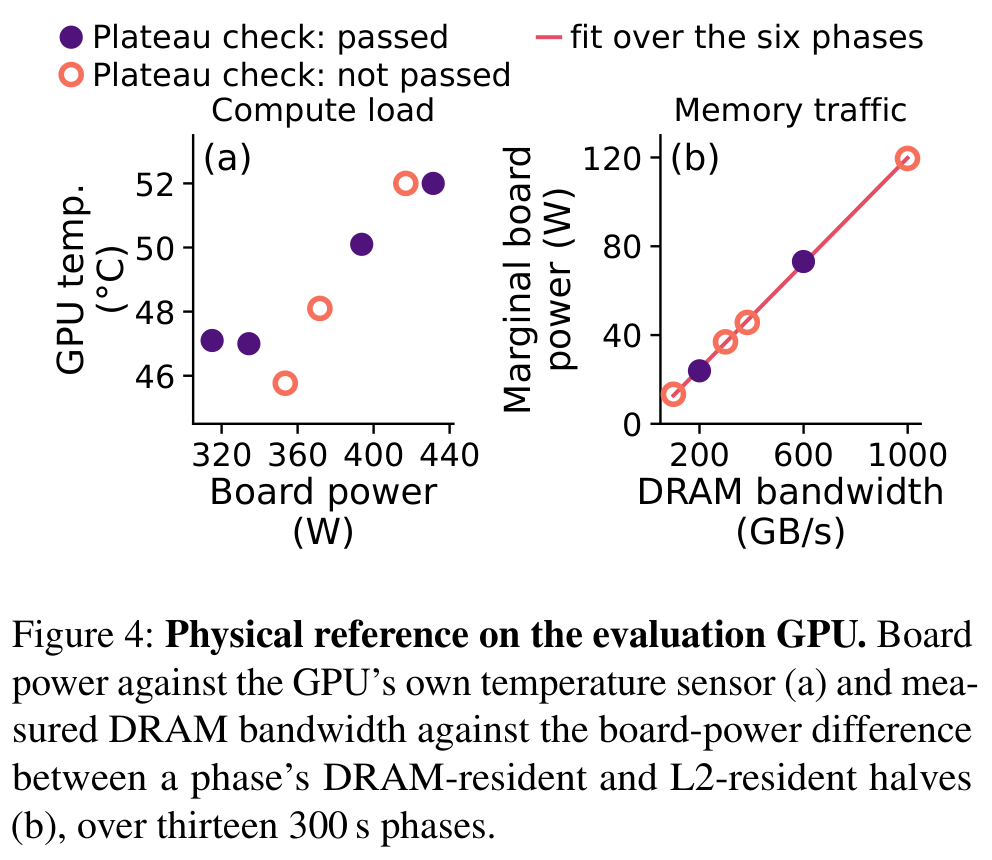

---

**Source / 原文定位：** PDF p.11 · S105

**Original / 英文原文：** The service simulation runs on a 224-state model. The 224-state model and the full-order model differ by one sample in where each applies its input; with that alignment, all eleven outputs across the three input shapes agree to 0.0308 K at worst, the step trace against its own 44.057 K swing, 0.0699% of it. At the first sample the two implementations are provably in the same state, 30.000 ◦C on all eleven channels, and the entire discrepancy at that sample equals the reduced model’s feedthrough term, $Du[0]$, to within $2.5\times10^{-14}$ K. Shifting the reduced model by that one sample lowers the first-sample discrepancy from 2.871, 0.7177 and 4.1406 K to 0.0159, 0.0040 and 0.0215 K, and 0.0215 K is the worst of the three traces. The 3D-ICE package operator is linear, so the agreement at the comparison’s own power level carries to other amplitudes of the same inputs. The comparison is model against model, not against silicon.

**中文译文：** 服务模拟使用一个 224 状态模型。224 状态模型与全阶模型在施加输入的位置上相差一个采样点；按此对齐后，三种输入形状下全部 11 个输出的最坏差异为 0.0308 K；相对于阶跃轨迹自身 44.057 K 的温度变化幅度，这相当于 0.0699%。在第一个采样点，可证明两个实现处于相同状态，11 个通道均为 30.000 °C；该点的全部差异等于降阶模型的直接馈通项 $Du[0]$，误差在 $2.5\times10^{-14}$ K 内。将降阶模型平移该一个采样点后，首次采样差异从 2.871、0.7177 和 4.1406 K 降至 0.0159、0.0040 和 0.0215 K，三条轨迹中最坏值为 0.0215 K。3D-ICE 封装算子是线性的，因此，在比较所用功率水平上的一致性，也适用于相同输入形状的其他幅度。这是模型与模型之间的比较，并非与硅芯片的比较。

---

**Source / 原文定位：** PDF p.11 · S106

**Original / 英文原文：** The three temperature limits are our own choices: 105 ◦C for HBF, the specification’s operating junction range; 105 ◦C for HBM, labelled TOPER in a Micron HBM3E brief that does not say which temperature TOPER is; and 90 ◦C for the compute die, NVIDIA’s published maximum for a GeForce RTX 5090 rather than the server part. The throttling triggers are configuration constants the specification leaves implementation specific. An existing approach [23] solves steady state for one stack outside the service simulator and throttles by turning off the hottest plane; the chain here is transient, whole-package, and coupled to the service side in a single run.

**中文译文：** 三个温度极限均由我们选择：HBF 为 105 °C，取自规范的工作结温范围；HBM 为 105 °C，取自 Micron HBM3E 简介中标为 TOPER 的值，但该简介未说明 TOPER 究竟是哪种温度；计算裸片为 90 °C，取自 NVIDIA 为 GeForce RTX 5090 公布的最大值，而非该服务器型号的最大值。节流触发点是配置常量，规范将其留给具体实现决定。已有方法 [23] 在服务模拟器之外求解单个堆栈的稳态，并通过关闭最热的 plane 节流；本文的链路则为瞬态、覆盖整个封装，并在同一次运行中与服务侧耦合。

---

### 6.4 EQ3: Capacity and Demand / 6.4 EQ3：容量与需求

<!-- PDF p.11 S107 -->

**Source / 原文定位：** PDF p.11 · S108

**Original / 英文原文：** Figure 5 gives three layouts under one package-area budget of 861.1 mm², the area the six-HBM reference layout occupies: A (six HBM stacks, no HBF), B (three HBM, two HBF) and C (one HBM, three HBF). The budget is a project assumption rather than an independently sourced package specification, and the three layouts are representative points rather than a sweep. Fitting inside the budget is a necessary condition on two-dimensional placement only: it settles nothing about routing, power delivery, PHY placement or manufacturability. A fills the budget exactly, B uses 837.7 mm² and C 754.2 mm²; B’s remaining 23.4 mm² is a strip 1.94 mm wide, too narrow for any device, so under a bounding-box measure B occupies 99.98% of the budget.

**中文译文：** 图 5 展示了在同一 861.1 mm² 封装面积预算下的三种布局，该预算等于六 HBM 参考布局所占面积：A（六个 HBM 堆栈、无 HBF）、B（三个 HBM、两个 HBF）和 C（一个 HBM、三个 HBF）。该预算是项目假设，而非来自独立来源的封装规范；三种布局是代表性点，而非全面扫描。满足面积预算只是在二维布局上的必要条件：它并不能解决布线、供电、PHY 放置或可制造性问题。A 恰好用满预算，B 使用 837.7 mm²，C 使用 754.2 mm²；B 剩余的 23.4 mm² 是宽 1.94 mm 的条带，窄到无法容纳任何器件，因此按包围盒度量，B 占预算的 99.98%。

---

**Source / 原文定位：** PDF p.11 · S109

**Original / 英文原文：** 512 GiB per HBF unit is the specification’s cube, while 36 GiB per HBM stack is the specification’s worked example [4], illustrative rather than normative, and the ranking below depends on that figure. Installed capacity rises from 216 GiB at A to 1,572 GiB at C, while HBM-resident key-value capacity falls from ∼1.72M tokens at A to ∼0.54M at B (Figure 5). Both token figures assume the complete 54.000 GiB expert set already resident in HBM, with the remainder of HBM holding key-value state, and both are an aggregate resident mix rather than one request’s context length.

**中文译文：** 每个 HBF 单元 512 GiB 对应规范中的 cube，而每个 HBM 堆栈 36 GiB 是规范中的计算示例 [4]，用于说明，并非强制规定；下文的排序依赖该数值。安装容量从 A 的 216 GiB 升至 C 的 1,572 GiB，但驻留 HBM 的键值缓存容量从 A 的约 1.72M token 降至 B 的约 0.54M token（图 5）。这两个 token 数均假设完整的 54.000 GiB 专家集合已常驻 HBM，HBM 剩余部分用于键值状态；两者表示的都是聚合驻留组合，而非单个请求的上下文长度。

---

**Source / 原文定位：** PDF p.11 · S110

**Original / 英文原文：** Figure 5: HBM–HBF capacity trade-offs. Installed capacity (a) and HBM-resident key-value capacity (b) for three layouts under a common package-area budget.

**中文译文：** 图 5：HBM–HBF 容量权衡。在共同封装面积预算下，三种布局的安装容量（a）和驻留 HBM 的键值缓存容量（b）。

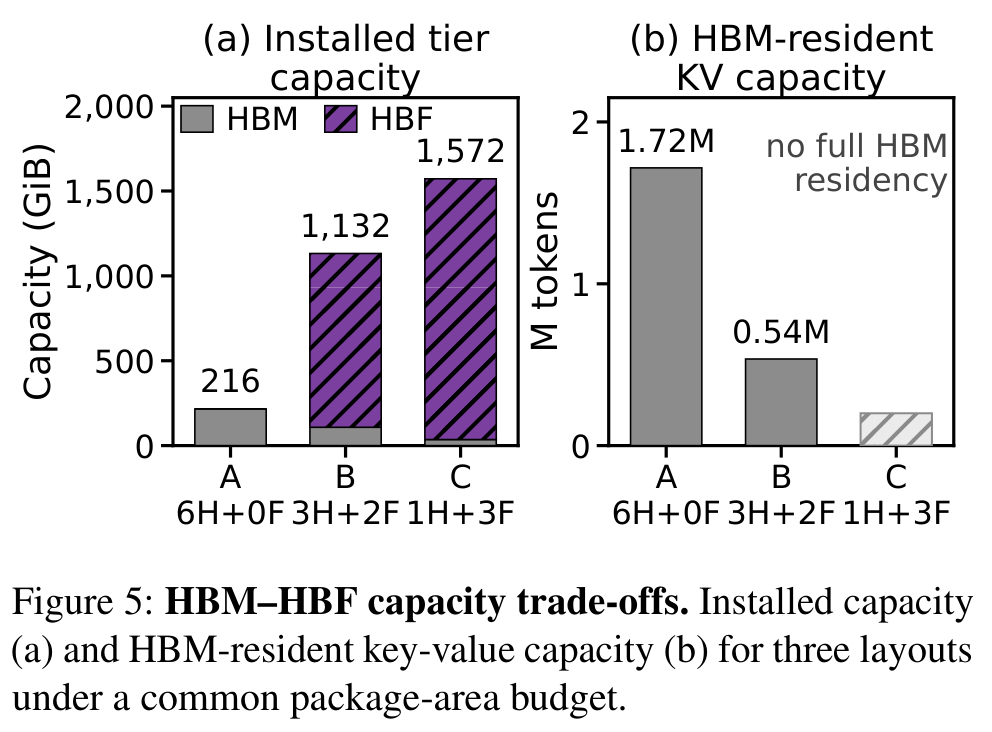

---

**Source / 原文定位：** PDF p.11,12 · S111

**Original / 英文原文：** At C the expert set does not fit in HBM. Of the 36 GiB per HBM stack, 5.0121 GiB is not available to the expert set: 2.8705 GiB of pinned non-expert weights, 2.0000 GiB of workspace plus safety reserve, 0.001 GiB of metadata, and 0.1406 GiB of transfer staging that exists only because an HBF unit is present. What remains at layout C is 30.9879 GiB, 57.4% of the 54.000 GiB expert set, at zero key-value state. The workspace and staging terms are assumptions in the generating code, not measured or device figures, and the pinned weights are the only term with a measured basis. Panel (b) draws C as a short neutral hatched marker rather than a token count, and that marker carries no key-value value. What is infeasible at C is full HBM residency for the expert set, not the configuration.

**中文译文：** 在 C 中，专家集合无法完整放入 HBM。每个 HBM 堆栈的 36 GiB 中，有 5.0121 GiB 不能用于专家集合：2.8705 GiB 固定驻留的非专家权重、2.0000 GiB 工作区与安全预留、0.001 GiB 元数据，以及仅因存在 HBF 单元才需要的 0.1406 GiB 传输暂存区。在键值状态为零时，布局 C 剩余 30.9879 GiB，仅为 54.000 GiB 专家集合的 57.4%。工作区和暂存区数值是生成代码中的假设，并非实测或器件参数；固定驻留权重是唯一具有测量依据的项。面板（b）用一个短小、中性的斜线阴影标记表示 C，而非 token 数，该标记不代表任何键值容量。C 中不可行的是让专家集合完整常驻 HBM，而非这一配置本身不可行。

---

**Source / 原文定位：** PDF p.12 · S112

**Original / 英文原文：** The same 5.0121 GiB is why the per-stack expert-residency threshold is 59.012 GiB rather than 54.000 GiB. At the other end of the same budget, MoE routing concentrates demand on a shared subset of experts, so HBF read demand per token falls with batch size.

**中文译文：** 同样的 5.0121 GiB 也解释了为何单堆栈专家驻留阈值为 59.012 GiB，而非 54.000 GiB。在相同预算的另一端，MoE 路由将需求集中到共享的专家子集，因此，随着批量大小增加，每个 token 对 HBF 的读取需求会下降。

---

**Source / 原文定位：** PDF p.12 · S113

**Original / 英文原文：** A captured Qwen3-30B-A3B routing trace at batches 1, 8 and 16 (48 expert layers, 128 experts, top-8) shows routing decisions growing exactly linearly, to 1, 8 and 16 times batch 1, while deduplicated demand events grow only to 2.487 and 3.584 times (Figure 6); the dashed line in the figure repeats the routing decisions as the no-reuse reference. These are event counts rather than media bytes, and only those three batch sizes were measured. This work does not measure the timing benefit of prefetching.

**中文译文：** 在批量大小为 1、8 和 16 时捕获的 Qwen3-30B-A3B 路由轨迹（48 个专家层、128 个专家、top-8）表明，路由决策数精确线性增长，分别为批量 1 的 1、8 和 16 倍，而去重需求事件仅增长到 2.487 和 3.584 倍（图 6）；图中虚线复现路由决策数，作为无复用参考。这些是事件计数，而非介质字节数，且仅测量了上述三种批量大小。本文没有测量预取的时序收益。

---

**Source / 原文定位：** PDF p.12 · S114

**Original / 英文原文：** Figure 6: MoE expert demand across batch sizes. Deduplicated demand events from a Qwen3-30B-A3B routing trace, normalized to batch 1, on logarithmic axes.

**中文译文：** 图 6：不同批量大小下的 MoE 专家需求。来自 Qwen3-30B-A3B 路由轨迹的去重需求事件，以批量大小 1 为基准归一化，横纵轴均采用对数坐标。

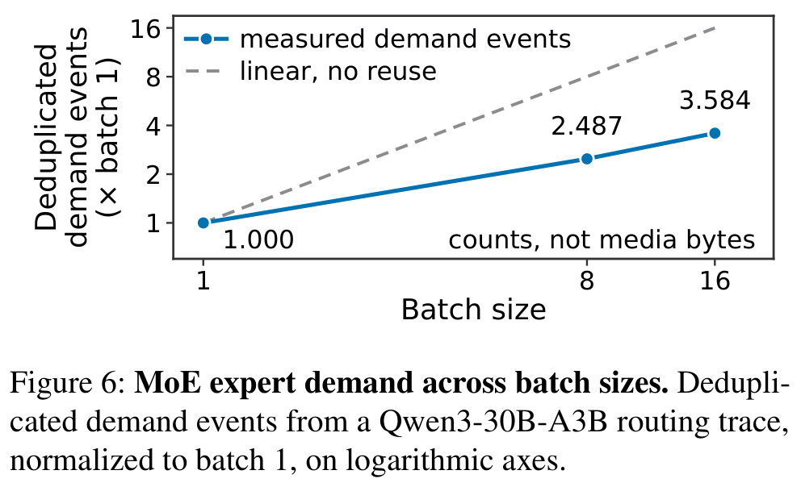

---

## 7 Related Work / 7 相关工作

<!-- PDF p.12 S115 -->

**Source / 原文定位：** PDF p.12 · S116

**Original / 英文原文：** Storage and flash simulators. MQSim [38] and SimpleSSD [15] model the flash medium together with the surrounding block device and host driver stack; both intercept at the host’s block device interface. HBFSim reuses the flash media model of MQSim and drives that media model in the opposite direction: the MQSim event queue is advanced on demand while the workload runs (Section 2). MQSim is therefore a component of HBFSim rather than a competitor: HBF-Sim charges the modeled time of a page read to one access made by a kernel that is executing on the GPU. HBFSim intercepts at the GPU’s instruction path, so the requests come from a workload that is executing. SwarmIO [19] emulates a drive that GPU threads read themselves, and meets the same conflict Challenge 2 states between a timing model that is accurate and the cost of evaluating that model at high request rates. The drive SwarmIO emulates is reached over NVMe submission queues and a PCIe link, so an emulator can act at a queue, a doorbell register or a replaceable driver layer. An HBF access is issued by the GPU’s own load/store units and is served inside the accelerator package, so the host side offers no queue, no doorbell register and no replaceable driver layer (Challenge 1).

**中文译文：** 存储与闪存模拟器。MQSim [38] 和 SimpleSSD [15] 将闪存介质与周围块设备及主机驱动栈一并建模；二者都在主机块设备接口处拦截。HBFSim 复用 MQSim 的闪存介质模型，并以相反方向驱动该模型：在工作负载运行时按需推进 MQSim 事件队列（第 2 节）。因此，MQSim 是 HBFSim 的组件，而非竞争者：HBFSim 将一次页读取的建模时间，计入正在 GPU 上执行的内核所发出的一次访问。HBFSim 在 GPU 指令路径上拦截，因此请求来自实际运行中的工作负载。SwarmIO [19] 仿真一个由 GPU 线程自行读取的驱动器，也面临挑战 2 中所述的矛盾：时序模型的准确性与高请求速率下模型求值成本之间的冲突。访问 SwarmIO 所仿真的驱动器需要经过 NVMe 提交队列和 PCIe 链路，因此仿真器可以在队列、门铃寄存器或可替换驱动层处介入。HBF 访问则由 GPU 自身加载/存储单元发出，在加速器封装内部获得服务，因此主机侧没有队列、门铃寄存器或可替换驱动层可供介入（挑战 1）。

---

**Source / 原文定位：** PDF p.12 · S117

**Original / 英文原文：** GPU simulation and GPU instrumentation. GPGPU-Sim [3] and Accel-Sim [18] run a modeled GPU, not the GPU on which the system will be deployed. eGPU [43] places code inside a running GPU kernel and is the direct predecessor of the instrumentation route HBFSim uses; HBFSim applies that ability to the timing and the capacity behaviour of a device that does not exist yet.

**中文译文：** GPU 模拟与 GPU 插桩。GPGPU-Sim [3] 和 Accel-Sim [18] 运行的是建模的 GPU，而非系统最终部署所用的 GPU。eGPU [43] 把代码放入正在运行的 GPU 内核中，是 HBFSim 所用插桩路线的直接前身；HBFSim 将这种能力用于尚不存在器件的时序与容量行为。

---

**Source / 原文定位：** PDF p.12 · S118

**Original / 英文原文：** Simulating a device that cannot be obtained. Three systems at other tiers simulate a device that cannot be obtained, and HBFSim differs from each on three axes. Cylon [45] emulates a CXL-attached solid-state drive presented as a byte-addressable memory tier, and acts on the CPU side through virtualization. CXLMemSim [42] simulates a pooled memory tier by attaching to an unmodified running program, observing memory accesses with hardware performance counters and kernel instrumentation, and injecting delay once per fixed interval of execution. FlashAccel [41] is a hardware–software co-design of an inference system built on HBF, evaluated with an event-driven simulator. The device HBFSim simulates is flash inside the accelerator package, read at 64 bytes and written at 4 KiB, with the wear and retention limits a DRAM pool does not have. Accesses are observed and delayed in rewritten intermediate code on the GPU, not at the virtual machine layer or in CPU performance counters. The third axis is the loop from temperature to reliability: none of the three makes temperature part of the device interface, whereas the HBF specification defines temperature as values the host reads, thresholds the host sets and states the host has to respond to. Temperature itself is not new to simulation: prior work extends architectural sampling to the thermal domain, because accurate estimation of thermal behaviour is itself time-consuming [2].

**中文译文：** 模拟无法获得的器件。在其他层级，有三个系统模拟无法获得的器件，HBFSim 与它们分别在三个维度上存在差异。Cylon [45] 仿真 CXL 连接的固态盘，将其呈现为可按字节寻址的内存层，并通过虚拟化在 CPU 侧介入。CXLMemSim [42] 附着于未经修改的运行中程序，使用硬件性能计数器与内核插桩观察内存访问，并在每个固定执行区间注入一次延迟，以模拟池化内存层。FlashAccel [41] 是基于 HBF 的推理系统软硬件协同设计，使用事件驱动模拟器评估。HBFSim 所模拟的是位于加速器封装内部的闪存，读取粒度为 64 字节，写入粒度为 4 KiB，并具有 DRAM 池没有的磨损与数据保持限制。访问是在 GPU 上重写后的中间代码中被观察和延迟，而非在虚拟机层或 CPU 性能计数器中处理。第三个维度是温度到可靠性的闭环：上述三个系统均未把温度作为器件接口的一部分，而 HBF 规范将温度定义为主机读取的数值、主机设置的阈值，以及主机必须响应的状态。温度本身并非模拟领域的新事物：已有工作将架构采样扩展到热领域，因为准确估计热行为本身也很耗时 [2]。

---

**Source / 原文定位：** PDF p.12,13 · S119

**Original / 英文原文：** Full-system simulation before the silicon exists. A full-system simulator that already supports a new memory technology is the obvious alternative to HBFSim, and the history of HBM support in gem5 [5] shows what such support consists of while the parts are still unavailable. The HBM configurations added to gem5 in September 2015 are timing values fed to the ordinary DDR controller; the commit message gives “Timing extrapolated from existing LPDDR configurations” as one of three sources for those values, and adds, “Will adjust once specs become available.” A memory controller written for HBM itself, with pseudo channels, arrived only in May 2022, six years after HBM2 shipped with the P100. Before the silicon exists, the answer a full-system simulator gives is therefore itself extrapolated from a neighbouring standard.

**中文译文：** 芯片问世之前的全系统模拟。一个已经支持新内存技术的全系统模拟器，是 HBFSim 的显而易见的替代方案；gem5 [5] 对 HBM 的支持历史，展示了当器件尚不可得时，这种支持实际上由什么构成。2015 年 9 月加入 gem5 的 HBM 配置，是输入普通 DDR 控制器的时序值；提交说明将“由现有 LPDDR 配置外推时序”列为这些数值的三个来源之一，并补充“规范发布后将作调整”。真正为 HBM 编写、支持伪通道的内存控制器直到 2022 年 5 月才出现，距 HBM2 随 P100 出货已过六年。因此，在芯片问世之前，全系统模拟器给出的答案本身，也是从相近标准外推得到的。

---

## 8 Discussion / 8 讨论

<!-- PDF p.13 S120 -->

**Source / 原文定位：** PDF p.13 · S121

**Original / 英文原文：** The calibrated curve is measured on a complete host paging path, a software route that presents an NVMe solid-state drive as memory through the device node /dev/vmem0. One access along that route carries a page fault, the driver, page-cache insertion and a user-space scan, so the profile is named an end-to-end vmem model rather than a media model. The curve is fitted at 1, 4, 16, 64, 256 and 512 pages, and past 512 pages continues on the slope of the last measured segment. Random, reverse, repeated and cross-operation accesses reset the burst length to one and are charged the single-page cost of 11,133 ns, so the non-linear rise measured between 64 and 512 pages shapes sequential bursts alone.

**中文译文：** 校准曲线是在完整主机分页路径上测得的：这是一条通过设备节点 `/dev/vmem0` 将 NVMe 固态盘呈现为内存的软件路径。沿此路径的一次访问包含缺页、驱动处理、页缓存插入和用户态扫描，因此该配置被称为端到端 vmem 模型，而非介质模型。曲线在 1、4、16、64、256 和 512 页处拟合，超过 512 页后沿最后一个实测区段的斜率继续延伸。随机、反向、重复及跨操作访问，会将突发长度重置为 1，并计入单页成本 11,133 ns；因此，在 64–512 页间测得的非线性增长只影响顺序突发访问。

---

**Source / 原文定位：** PDF p.13 · S122

**Original / 英文原文：** An HBF stack inside the package pays no page fault, no driver crossing and no page-cache insertion, and the second timing source is built for the difference: foreground requests enter an online MQSim media model on the host along the reference path. A question about the medium is therefore answered with the media model, and a question about a host-attached deployment with the calibrated end-to-end curve.

**中文译文：** 封装内部的 HBF 堆栈不承担缺页、跨驱动边界或页缓存插入成本，因此第二种时序源正是针对这一区别构建的：前台请求沿参考路径进入主机侧在线 MQSim 介质模型。因此，关于介质的问题由介质模型回答，关于主机连接部署的问题则由校准的端到端曲线回答。

---

**Source / 原文定位：** PDF p.13 · S123

**Original / 英文原文：** Coverage is a property of each run rather than a fixed ceiling. Kernels that arrive already built are covered at the level of the whole program, where injected modeled time enters the end-to-end time and the output is unchanged. Results therefore carry to accesses inside registered ranges of rewritable kernels, and widening that set is a question of registration and of the rewriting layer, not of the timing model.

**中文译文：** 覆盖范围是每次运行自身的属性，而非固定上限。以预构建形式到达的内核，在整个程序层面被覆盖：注入的建模时间进入端到端耗时，而输出不变。因此，结果适用于可重写内核中已注册范围内的访问；扩大这一集合属于注册与重写层的问题，而非时序模型的问题。

---

**Source / 原文定位：** PDF p.13 · S124

**Original / 英文原文：** Hardware parameters that move are data rather than code. The three synthetic timing profiles are conservative.json, nominal.json and aggressive.json; all three share a capacity of 1 TiB and differ in bandwidth, which ranges from 128 to 1,000 GB/s, while the published specification gives about 3.0 TB/s and 512 GB per stack [4], so re-anchoring the profiles to the published figures edits a data file. The thermal measurements come from one GPU and one Dell CD8P solid-state drive, since HBF parts cannot yet be obtained, and the simulated-warning profile crosses the configured GPU and SSD warning points at 30 s and 42 s by extrapolation, with no physical device taken there, so figures using that profile mark the two crossings as computed values. Retention deadlines follow the Arrhenius equation anchored on $E_a=1.04$ eV, measured for 3D NAND after 10,000 program/erase cycles [26]; a medium with a different activation energy moves every deadline and the refresh traffic each deadline forces, which is why a run reports a sweep over activation energy rather than one lifetime.

**中文译文：** 会变化的硬件参数以数据而非代码表示。三个合成时序配置为 `conservative.json`、`nominal.json` 和 `aggressive.json`；它们容量均为 1 TiB，带宽不同，范围为 128–1,000 GB/s，而公开规范给出每堆栈约 3.0 TB/s 和 512 GB [4]，因此，使配置重新对齐公开数值只需修改数据文件。由于尚无法获得 HBF 器件，热测量来自一块 GPU 和一块 Dell CD8P 固态盘；`simulated-warning` 配置通过外推，在 30 s 和 42 s 跨过所配置的 GPU 与 SSD 警告点，并未使任何物理器件真正达到这些状态，因此采用该配置的图会将两次越界标为计算值。数据保持期限遵循 Arrhenius 方程，其锚点激活能为 $E_a=1.04$ eV，来自经历 10,000 次编程/擦除循环后的 3D NAND 实测值 [26]；激活能不同的介质会改变每个期限及其强制产生的刷新流量，因此每次运行报告激活能扫描，而非一个单一寿命。

---

## 9 Conclusion / 9 结论

<!-- PDF p.13 S125 -->

**Source / 原文定位：** PDF p.13 · S126

**Original / 英文原文：** HBFSim is the first open-source HBF simulator with the workload under evaluation executing on a real GPU. HBF-Sim rewrites the workload’s PTX, routes accesses inside a registered address range into the simulator, and supports asynchronous TMA transfers and capacities beyond physical GPU memory. The modeled wait falls at the instruction that reads the returned value, not at the point of issue. The timing model is calibrated from measurements on real hardware rather than parameter-sheet values. A coupled thermal module puts HBF, HBM, and the GPU in one package, so junction temperature changes the service rate and the refresh traffic that the retention deadline forces. HBFSim leaves the model’s run unaffected across ordinary-memory, TMA, and capacity-mode tests. The delay HBFSim injects matches the delay requested to within 0.152%. A run whose addresses span 110 GiB through a 2 GiB page cache returns a checksum identical to a native run’s. Over horizons of 600, 3,600 and 86,400 s, five control policies sustain the full 384.0 GB/s without throttling. Within that envelope the modeled package reaches its thermal limit at the compute die, at 86.6 W, not at HBF. Under one package-area budget, installed capacity rises from 216 GiB in an all-HBM layout to 1,572 GiB in the most HBF-heavy one while the key-value state HBM can hold falls. In a captured Qwen3-30B routing trace, deduplicated expert demand grows to 2.487 and 3.584 times batch one at batches 8 and 16, while routing decisions grow linearly. Before HBF parts sample, HBFSim lets someone designing an inference system measure a capacity or placement decision under a real workload instead of assuming one.

**中文译文：** HBFSim 是首款让被评估工作负载在真实 GPU 上执行的开源 HBF 模拟器。HBFSim 重写工作负载的 PTX，将已注册地址范围内的访问路由至模拟器，并支持异步 TMA 传输以及超出 GPU 物理内存的容量。建模等待发生在读取返回数值的指令处，而非发射点。时序模型根据真实硬件测量校准，而非采用参数表数值。耦合热模块将 HBF、HBM 和 GPU 放在同一封装中，使结温改变服务速率，以及数据保持期限所强制产生的刷新流量。在普通内存、TMA 和容量模式测试中，HBFSim 均未改变模型的运行结果。HBFSim 注入的延迟与请求延迟之间的误差不超过 0.152%。一次通过 2 GiB 页缓存访问跨度 110 GiB 地址的运行，返回与原生运行相同的校验和。在 600、3,600 和 86,400 s 时间跨度内，五种控制策略均在不节流的情况下维持完整的 384.0 GB/s。在该范围内，建模封装首先在计算裸片处达到热极限，对应 86.6 W，而非在 HBF 处。在同一封装面积预算下，安装容量从全 HBM 布局的 216 GiB 升至 HBF 占比最高布局的 1,572 GiB，同时 HBM 可容纳的键值状态减少。在捕获的 Qwen3-30B 路由轨迹中，批量大小为 8 和 16 时，去重专家需求分别增至批量 1 的 2.487 倍和 3.584 倍，而路由决策数线性增长。在 HBF 样片问世之前，HBFSim 使推理系统设计者能够在真实工作负载下测量容量或放置决策的影响，而无须仅凭假设。

---

## References / 参考文献

<!-- PDF p.13 S127 -->

**Source / 原文定位：** PDF p.13 · S128

**Original / 英文原文：** [1] Anurag Agrawal and Radhakrishna Giduthuri. HBF in AI compute: A system architect’s view. Tutorial 1 (Memory technology), Hot Chips 2026, August 2026. https://hc2026.hotchips.org/.

**中文译文：** 题名译：AI 计算中的 HBF：系统架构师视角。

---

**Source / 原文定位：** PDF p.13 · S129

**Original / 英文原文：** [2] Ehsan K. Ardestani, Elnaz Ebrahimi, Gabriel Southern, and Jose Renau. Thermal-aware sampling in architectural simulation. In Proceedings of the 2012 ACM/IEEE International Symposium on Low Power Electronics and Design (ISLPED), pages 33–38, 2012. http://masc.soe.ucsc.edu/docs/islped12.pdf.

**中文译文：** 题名译：架构模拟中的热感知采样。

---

**Source / 原文定位：** PDF p.13 · S130

**Original / 英文原文：** [3] Ali Bakhoda, George L. Yuan, Wilson W. L. Fung, Henry Wong, and Tor M. Aamodt. Analyzing CUDA workloads using a detailed GPU simulator. In 2009 IEEE International Symposium on Performance Analysis of Systems and Software (ISPASS), pages 163–174, 2009.

**中文译文：** 题名译：使用详细 GPU 模拟器分析 CUDA 工作负载。

---

**Source / 原文定位：** PDF p.13,14 · S131

**Original / 英文原文：** [4] Chinnakrishnan Ballapuram and Dongsop Lee. High bandwidth flash (HBF) high-level base die specification, version 0.7.0. Open Compute Project specification, August 2026.

**中文译文：** 题名译：高带宽闪存（HBF）高层基底裸片规范，版本 0.7.0。

---

**Source / 原文定位：** PDF p.14 · S132

**Original / 英文原文：** [5] Nathan Binkert, Bradford Beckmann, Gabriel Black, Steven K. Reinhardt, Ali Saidi, Arkaprava Basu, Joel Hestness, Derek R. Hower, Tushar Krishna, Somayeh Sardashti, Rathijit Sen, Korey Sewell, Muhammad Shoaib, Nilay Vaish, Mark D. Hill, and David A. Wood. The gem5 simulator. ACM SIGARCH Computer Architecture News, 39(2):1–7, 2011. Source repository: https://github.com/gem5/gem5.

**中文译文：** 题名译：gem5 模拟器。

---

**Source / 原文定位：** PDF p.14 · S133

**Original / 英文原文：** [6] Aaron Grattafiori et al. The Llama 3 herd of models. arXiv:2407.21783, 2024. https://arxiv.org/abs/2407.21783.

**中文译文：** 题名译：Llama 3 模型家族。

---

**Source / 原文定位：** PDF p.14 · S134

**Original / 英文原文：** [7] Minho Ha, Euiseok Kim, and Hoshik Kim. H3: Hybrid architecture using high bandwidth memory and high bandwidth flash for cost-efficient LLM inference. IEEE Computer Architecture Letters, 25(1):49–52, 2026.

**中文译文：** 题名译：H³：使用高带宽内存与高带宽闪存实现高性价比 LLM 推理的混合架构。

---

**Source / 原文定位：** PDF p.14 · S135

**Original / 英文原文：** [8] Rodrigo Huerta and Antonio González. Parallelizing a modern GPU simulator. In 2nd Workshop on Computer Architecture Modeling and Simulation (CAMS), co-located with MICRO, 2024. https://arxiv.org/abs/2502.14691.

**中文译文：** 题名译：并行化现代 GPU 模拟器。

---

**Source / 原文定位：** PDF p.14 · S136

**Original / 英文原文：** [9] JEDEC Solid State Technology Association. Solid-state drive (SSD) requirements and endurance test method. JEDEC Standard JESD218B, revision of JESD218A of February 2011, March 2016.

**中文译文：** 题名译：固态盘（SSD）要求与耐久性测试方法。

---

**Source / 原文定位：** PDF p.14 · S137

**Original / 英文原文：** [10] JEDEC Solid State Technology Association. JEDEC and industry leaders collaborate to release JESD270-4 HBM4 standard: Advancing bandwidth, efficiency, and capacity for AI and HPC, April 2025. https://www.jedec.org/news/pressreleases/jedec%C2%AE-and-industry-leaders-collaborate-release-jesd270-4-hbm4-standard-advancing.

**中文译文：** 题名译：JEDEC 与行业领袖合作发布 JESD270-4 HBM4 标准：提升 AI 与 HPC 的带宽、效率和容量。

---

**Source / 原文定位：** PDF p.14 · S138

**Original / 英文原文：** [11] Norman P. Jouppi, Doe Hyun Yoon, Matthew Ashcraft, Mark Gottscho, Thomas B. Jablin, George Kurian, James Laudon, Sheng Li, Peter Ma, Xiaoyu Ma, Thomas Norrie, Nishant Patil, Sushma Prasad, Cliff Young, Zongwei Zhou, and David Patterson. Ten lessons from three generations shaped Google’s TPUv4i: Industrial product. In Proceedings of the 48th Annual International Symposium on Computer Architecture (ISCA), pages 1–14, 2021.

**中文译文：** 题名译：三代产品的十条经验塑造 Google TPUv4i：工业产品。

---

**Source / 原文定位：** PDF p.14 · S139

**Original / 英文原文：** [12] Norman P. Jouppi, Cliff Young, Nishant Patil, David Patterson, et al. In-datacenter performance analysis of a tensor processing unit. In Proceedings of the 44th Annual International Symposium on Computer Architecture (ISCA), pages 1–12, 2017.

**中文译文：** 题名译：数据中心内的张量处理单元性能分析。

---

**Source / 原文定位：** PDF p.14 · S140

**Original / 英文原文：** [13] Jae Hyung Ju, Euijun Chung, Hritvik Taneja, Anish Saxena, Shinnung Jeong, Hyesoon Kim, and Moinuddin K. Qureshi. TileLens: Efficiently using large-granularity memory systems with transparent two-dimensional memory layout. arXiv:2607.04031, 2026. https://arxiv.org/abs/2607.04031.

**中文译文：** 题名译：TileLens：利用透明二维内存布局高效使用大粒度内存系统。

---

**Source / 原文定位：** PDF p.14 · S141

**Original / 英文原文：** [14] Ilju Jung. KAIST professor joungho kim: “an era is coming in which HBF decides the memory winner”. THE ELEC, September 2025. https://www.thelec.kr/news/articleView.html?idxno=40242.

**中文译文：** 题名译：KAIST 教授 Joungho Kim：“由 HBF 决定内存赢家的时代即将到来”。

---

**Source / 原文定位：** PDF p.14 · S142

**Original / 英文原文：** [15] Myoungsoo Jung, Jie Zhang, Ahmed Abulila, Miryeong Kwon, Narges Shahidi, John Shalf, Nam Sung Kim, and Mahmut Kandemir. SimpleSSD: Modeling solid state drives for holistic system simulation. IEEE Computer Architecture Letters, 17(1):37–41, 2018. arXiv:1705.06419, https://arxiv.org/abs/1705.06419.

**中文译文：** 题名译：SimpleSSD：为整体系统模拟建模固态盘。

---

**Source / 原文定位：** PDF p.14 · S143

**Original / 英文原文：** [16] Jordan Juravsky, Bradley Brown, Ryan Ehrlich, Daniel Y. Fu, Christopher Ré, and Azalia Mirhoseini. Hydragen: High-throughput LLM inference with shared prefixes. arXiv:2402.05099, 2024. https://arxiv.org/abs/2402.05099.

**中文译文：** 题名译：Hydragen：通过共享前缀实现高吞吐 LLM 推理。

---

**Source / 原文定位：** PDF p.14 · S144

**Original / 英文原文：** [17] Patrick Kennedy. Oxmiq labs HBF in AI compute at hot chips 2026. ServeTheHome, August 2026. https://www.servethehome.com/oxmiq-labs-hbf-in-ai-compute-at-hot-chips-2026/.

**中文译文：** 题名译：Hot Chips 2026 上的 Oxmiq Labs：AI 计算中的 HBF。

---

**Source / 原文定位：** PDF p.14 · S145

**Original / 英文原文：** [18] Mahmoud Khairy, Zhesheng Shen, Tor M. Aamodt, and Timothy G. Rogers. Accel-Sim: An extensible simulation framework for validated GPU modeling. In Proceedings of the 47th Annual International Symposium on Computer Architecture (ISCA), 2020. https://people.ece.ubc.ca/aamodt/publications/papers/accelsim.isca2020.pdf.

**中文译文：** 题名译：Accel-Sim：用于经验证 GPU 建模的可扩展模拟框架。

---

**Source / 原文定位：** PDF p.14 · S146

**Original / 英文原文：** [19] Hyeseong Kim, Gwangoo Yeo, and Minsoo Rhu. SwarmIO: Towards 100 million IOPS SSD emulation for next-generation GPU-centric storage systems. arXiv:2604.06668, 2026. https://arxiv.org/abs/2604.06668.

**中文译文：** 题名译：SwarmIO：面向下一代 GPU 中心存储系统的每秒一亿次 I/O SSD 仿真。

---

**Source / 原文定位：** PDF p.14 · S147

**Original / 英文原文：** [20] Toshiyuki Kouchi, Mami Kakoi, Noriyasu Kumazaki, Akio Sugahara, Akihiro Imamoto, Yasufumi Kajiyama, Yuri Terada, Bushnaq Sanad, Naoaki Kanagawa, Takuyo Kodama, Ryo Fukuda, Hiromitsu Komai, Norichika Asaoka, Hidekazu Ohnishi, Ryosuke Isomura, Takaya Handa, Kensuke Yamamoto, Yuki Ishizaki, Yoko Deguchi, Atsushi Okuyama, Junichi Sato, Hiroki Yabe, Hua-Ling Cynthia Hsu, and Masahiro Yoshihara. A 128Gb 1-bit/cell 96-word-line-layer 3D flash memory to improve the random read latency with tProg = 75 µs and tR = 4 µs. IEEE Journal of Solid-State Circuits, 56(1):225–234, 2021.

**中文译文：** 题名译：一种 128 Gb、每单元 1 位、96 字线层的 3D 闪存：以 tProg = 75 µs、tR = 4 µs 改善随机读取延迟。

---

**Source / 原文定位：** PDF p.15 · S148

**Original / 英文原文：** [21] Dongjun Kwon. “father of HBM” professor joungho kim: “the HBF market will exceed HBM in 2038”. ET-News, February 2026. https://www.etnews.com/20260203000211.

**中文译文：** 题名译：“HBM 之父”Joungho Kim 教授：“HBF 市场将在 2038 年超过 HBM”。

---

**Source / 原文定位：** PDF p.15 · S149

**Original / 英文原文：** [22] Huaicheng Li, Mingzhe Hao, Michael Hao Tong, Swaminathan Sundararaman, Matias Bjørling, and Haryadi S. Gunawi. The CASE of FEMU: Cheap, accurate, scalable and extensible flash emulator. In 16th USENIX Conference on File and Storage Technologies (FAST), 2018. https://www.usenix.org/conference/fast18/presentation/li.

**中文译文：** 题名译：FEMU 的 CASE：廉价、准确、可扩展且可扩充的闪存仿真器。

---

**Source / 原文定位：** PDF p.15 · S150

**Original / 英文原文：** [23] Zhuoran Li, Zhuohang Bian, Xin Huang, Yibo Zhao, Guangyu Sun, and Youwei Zhuo. HBF sucks? a full-stack characterization of high-bandwidth flash for KV-centric LLM serving. arXiv:2608.11668, 2026. https://arxiv.org/abs/2608.11668.

**中文译文：** 题名译：HBF 很差吗？面向 KV 中心 LLM 服务的高带宽闪存全栈表征。

---

**Source / 原文定位：** PDF p.15 · S151

**Original / 英文原文：** [24] Heng Liao, Jiajin Tu, Jing Xia, and Xiping Zhou. DaVinci: A scalable architecture for neural network computing. Hot Chips 31 Symposium on High-Performance Chips, August 2019.

**中文译文：** 题名译：DaVinci：用于神经网络计算的可扩展架构。

---

**Source / 原文定位：** PDF p.15 · S152

**Original / 英文原文：** [25] Weile Luo, Ruibo Fan, Zeyu Li, Dayou Du, Qiang Wang, and Xiaowen Chu. Benchmarking and dissecting the Nvidia Hopper GPU architecture. In 2024 IEEE International Parallel and Distributed Processing Symposium (IPDPS), pages 656–667, 2024. arXiv:2402.13499, https://arxiv.org/abs/2402.13499.

**中文译文：** 题名译：NVIDIA Hopper GPU 架构的基准测试与剖析。

---

**Source / 原文定位：** PDF p.15 · S153

**Original / 英文原文：** [26] Yixin Luo, Saugata Ghose, Yu Cai, Erich F. Haratsch, and Onur Mutlu. HeatWatch: Improving 3D NAND flash memory device reliability by exploiting self-recovery and temperature awareness. In 2018 IEEE International Symposium on High Performance Computer Architecture (HPCA), pages 504–517, 2018. https://www.cs.cmu.edu/~yixinluo/index_files/heatwatch_hpca18.pdf.

**中文译文：** 题名译：HeatWatch：利用自恢复与温度感知提高 3D NAND 闪存器件可靠性。

---

**Source / 原文定位：** PDF p.15 · S154

**Original / 英文原文：** [27] Micron Technology, Inc. Quarterly report on Form 10-Q for the quarterly period ended may 28, 2026. U.S. Securities and Exchange Commission, 2026. Accession 0000723125-26-000015, filed June 25, 2026; https://www.sec.gov/Archives/edgar/data/723125/000072312526000015/mu-20260528.htm.

**中文译文：** 题名译：截至 2026 年 5 月 28 日季度的 Form 10-Q 季度报告。

---

**Source / 原文定位：** PDF p.15 · S155

**Original / 英文原文：** [28] NVIDIA Corporation. NVIDIA H100 Tensor Core GPU datasheet. Product datasheet, document 3440270, September 2024. https://resources.nvidia.com/en-us-gpu-resources/h100-datasheet-24306.

**中文译文：** 题名译：NVIDIA H100 Tensor Core GPU 数据手册。

---

**Source / 原文定位：** PDF p.15 · S156

**Original / 英文原文：** [29] Jongmin Paek. “father of HBM” aims to secure HBF patents. Asia Economy, English edition, February 2026. https://view.asiae.co.kr/en/article/2026021009235328565.

**中文译文：** 题名译：“HBM 之父”力争取得 HBF 专利。

---

**Source / 原文定位：** PDF p.15 · S157

**Original / 英文原文：** [30] Junrui Pan, Weili An, Cesar Avalos Baddouh, Christin David Bose, Ni Kang, Aaron Barnes, Ahmad Alawneh, Fangjia Shen, Yechen Liu, Anusuya Nallathambi, Atthin Chandrashekar, and Timothy G. Rogers. Architecting the next generation of asynchronous, distributed GPUs for the AI era. arXiv:2608.22602, 2026. https://arxiv.org/abs/2608.22602.

**中文译文：** 题名译：面向 AI 时代设计下一代异步分布式 GPU。

---

**Source / 原文定位：** PDF p.15 · S158

**Original / 英文原文：** [31] Vinicius Petrucci, Felippe Zacarias, and Vishal Tanna. Is high-bandwidth flash all you need? In HotInfra ’26, co-located with ISCA ’26, 2026. https://hotinfra.org/2026/papers/hotinfra26-final83.pdf.

**中文译文：** 题名译：高带宽闪存是否就是你所需要的全部？。

---

**Source / 原文定位：** PDF p.15 · S159

**Original / 英文原文：** [32] Reiner Pope, Sholto Douglas, Aakanksha Chowdhery, Jacob Devlin, James Bradbury, Anselm Levskaya, Jonathan Heek, Kefan Xiao, Shivani Agrawal, and Jeff Dean. Efficiently scaling transformer inference. In Proceedings of Machine Learning and Systems, volume 5, pages 606–624, 2023. arXiv:2211.05102, https://arxiv.org/abs/2211.05102.

**中文译文：** 题名译：高效扩展 Transformer 推理。

---

**Source / 原文定位：** PDF p.15 · S160

**Original / 英文原文：** [33] Sandisk Corporation. HBF fact sheet: Sandisk unveils the future of memory architecture for AI. Tech brief, July 2025. https://documents.sandisk.com/content/dam/asset-library/en_us/assets/public/sandisk/collateral/company/Sandisk-HBF-Fact-Sheet.pdf.

**中文译文：** 题名译：HBF 概览：Sandisk 揭示面向 AI 的未来内存架构。

---

**Source / 原文定位：** PDF p.15 · S161

**Original / 英文原文：** [34] Sandisk Corporation and SK hynix. Sandisk and SK hynix advance global standardization of high bandwidth flash with release of first OCP technical specification, August 2026. https://www.sandisk.com/company/newsroom/press-releases/2026/2026-08-03-Sandisk-and-sk-hynix-advance-global-standardization-of-hbf.

**中文译文：** 题名译：Sandisk 与 SK hynix 发布首份 OCP 技术规范，推进高带宽闪存全球标准化。

---

**Source / 原文定位：** PDF p.15 · S162

**Original / 英文原文：** [35] Shintaro Sano, Yosuke Bando, Kazuhiro Hiwada, Hirotsugu Kajihara, Tomoya Suzuki, Yu Nakanishi, Daisuke Taki, Akiyuki Kaneko, and Tatsuo Shiozawa. GPU graph processing on CXL-based microsecond-latency external memory. In Proceedings of the SC ’23 Workshops of the International Conference on High Performance Computing, Network, Storage, and Analysis (SC-W), 2023. https://arxiv.org/abs/2312.03113.

**中文译文：** 题名译：在基于 CXL 的微秒延迟外部内存上进行 GPU 图处理。

---

**Source / 原文定位：** PDF p.15 · S163

**Original / 英文原文：** [36] Ying Sheng, Lianmin Zheng, Binhang Yuan, Zhuohan Li, Max Ryabinin, Beidi Chen, Percy Liang, Christopher Ré, Ion Stoica, and Ce Zhang. FlexGen: High-throughput generative inference of large language models with a single GPU. In Proceedings of the 40th International Conference on Machine Learning (ICML), volume 202 of Proceedings of Machine Learning Research, pages 31094–31116, 2023. https://proceedings.mlr.press/v202/sheng23a.html.

**中文译文：** 题名译：FlexGen：使用单块 GPU 实现大语言模型高吞吐生成式推理。

---

**Source / 原文定位：** PDF p.15,16 · S164

**Original / 英文原文：** [37] Yifan Sun, Trinayan Baruah, Saiful A. Mojumder, Shi Dong, Xiang Gong, Shane Treadway, Yuhui Bao, Spencer Hance, Carter McCardwell, Vincent Zhao, Harrison Barclay, Amir Kavyan Ziabari, Zhongliang Chen, Rafael Ubal, José L. Abellán, John Kim, Ajay Joshi, and David Kaeli. MGPUSim: Enabling multi-GPU performance modeling and optimization. In Proceedings of the 46th International Symposium on Computer Architecture (ISCA), pages 197–209, 2019.

**中文译文：** 题名译：MGPUSim：支持多 GPU 性能建模与优化。

---

**Source / 原文定位：** PDF p.16 · S165

**Original / 英文原文：** [38] Arash Tavakkol, Juan Gómez-Luna, Mohammad Sadrosadati, Saugata Ghose, and Onur Mutlu. MQSim: A framework for enabling realistic studies of modern multi-queue SSD devices. In 16th USENIX Conference on File and Storage Technologies (FAST), 2018. https://www.usenix.org/conference/fast18/presentation/tavakkol.

**中文译文：** 题名译：MQSim：支持真实研究现代多队列 SSD 器件的框架。

---

**Source / 原文定位：** PDF p.16 · S166

**Original / 英文原文：** [39] Oreste Villa, Mark Stephenson, David Nellans, and Stephen W. Keckler. NVBit: A dynamic binary instrumentation framework for NVIDIA GPUs. In Proceedings of the 52nd Annual IEEE/ACM International Symposium on Microarchitecture (MICRO), pages 372–383, 2019. https://d1qx31qr3h6wln.cloudfront.net/publications/MICRO_2019_NVBit.pdf.

**中文译文：** 题名译：NVBit：面向 NVIDIA GPU 的动态二进制插桩框架。

---

**Source / 原文定位：** PDF p.16 · S167

**Original / 英文原文：** [40] Jacob Wahlgren, Gabin Schieffer, Ruimin Shi, Edgar A. León, Roger Pearce, Maya Gokhale, and Ivy Peng. Dissecting CPU-GPU unified physical memory on AMD MI300A APUs. In 2025 IEEE International Symposium on Workload Characterization (IISWC), 2025. arXiv:2508.12743, https://arxiv.org/abs/2508.12743.

**中文译文：** 题名译：剖析 AMD MI300A APU 上的 CPU–GPU 统一物理内存。

---

**Source / 原文定位：** PDF p.16 · S168

**Original / 英文原文：** [41] Xinyu Wang, Yalong Xue, Xiaotian Sun, Xiaoyu Zhang, Xinjiang Zhang, Chunmeng Dou, Xueqi Li, and Xiaoming Chen. FlashAccel: Leveraging high-bandwidth flash (HBF) for high-throughput LLM inference. arXiv:2607.10186, 2026. https://arxiv.org/abs/2607.10186.

**中文译文：** 题名译：FlashAccel：利用高带宽闪存（HBF）实现高吞吐 LLM 推理。

---

**Source / 原文定位：** PDF p.16 · S169

**Original / 英文原文：** [42] Yiwei Yang, Shri Vishakh Devanand, Brian Zhao, Yusheng Zheng, Pooneh Safayenikoo, Tanvir Ahmed Khan, and Andi Quinn. CXLMemSim: Practical performance simulation and characterization of CXL 3.0 memory systems. In Proceedings of the 35th International Symposium on High-Performance Parallel and Distributed Computing (HPDC), pages 567–569, 2026.

**中文译文：** 题名译：CXLMemSim：CXL 3.0 内存系统的实用性能模拟与表征。

---

**Source / 原文定位：** PDF p.16 · S170

**Original / 英文原文：** [43] Yiwei Yang, Tong Yu, Yusheng Zheng, and Andrew Quinn. eGPU: Extending eBPF programmability and observability to GPUs. In 4th Workshop on Heterogeneous Composable and Disaggregated Systems (HCDS), 2025. https://asplos.dev/pdf/bpftime_super.pdf.

**中文译文：** 题名译：eGPU：将 eBPF 可编程性与可观测性扩展至 GPU。

---

**Source / 原文定位：** PDF p.16 · S171

**Original / 英文原文：** [44] Yihan Yin, Yinlun Zhao, Zhixin Yun, Guanying Wu, Feng Zhu, Kai Tao, Shu Li, Fei Huang, Zhe Zhang, Shuangchen Li, and Hongzhong Zheng. Potential applications of HBF in LLM serving systems, August 2026. arXiv:2608.13127, https://arxiv.org/abs/2608.13127.

**中文译文：** 题名译：HBF 在 LLM 服务系统中的潜在应用。

---

**Source / 原文定位：** PDF p.16 · S172

**Original / 英文原文：** [45] Dongha Yoon, Hansen Idden, Jinshu Liu, Berkay Inceisci, Sam H. Noh, and Huaicheng Li. Cylon: Fast and accurate full-system emulation of CXL-SSDs. In 24th USENIX Conference on File and Storage Technologies (FAST), 2026. https://www.usenix.org/conference/fast26/presentation/yoon.

**中文译文：** 题名译：Cylon：快速、准确的 CXL-SSD 全系统仿真。

---

**Source / 原文定位：** PDF p.16 · S173

**Original / 英文原文：** [46] Zhihang Yuan, Yuzhang Shang, Yang Zhou, Zhen Dong, Zhe Zhou, Chenhao Xue, Bingzhe Wu, Zhikai Li, Qingyi Gu, Yong Jae Lee, Yan Yan, Beidi Chen, Guangyu Sun, and Kurt Keutzer. LLM inference unveiled: Survey and roofline model insights. arXiv:2402.16363, 2024. https://arxiv.org/abs/2402.16363.

**中文译文：** 题名译：揭示 LLM 推理：综述与 Roofline 模型洞见。

---

**Source / 原文定位：** PDF p.16 · S174

**Original / 英文原文：** [47] Kai Zhu, Darong Huang, Luis Costero, and David Atienza. 3D-ICE 4.0: Accurate and efficient thermal modeling for 2.5D/3D heterogeneous chiplet systems. In Proceedings of the 2026 Design, Automation & Test in Europe Conference (DATE), pages 1–7, 2026.

**中文译文：** 题名译：3D-ICE 4.0：面向 2.5D/3D 异构芯粒系统的准确高效热建模。

---

## 术语对照 / Terminology

| English | 中文与说明 |
|---|---|
| HBF / High-Bandwidth Flash | 高带宽闪存 |
| HBM / High-Bandwidth Memory | 高带宽内存 |
| NAND die / stack / cube | NAND 裸片 / 堆栈 / cube（规范中的容量与带宽单元） |
| PTX / Parallel Thread Execution | 并行线程执行；NVIDIA 虚拟指令集 |
| SASS / cubin | GPU 机器指令 / 预编译 GPU 二进制代码 |
| TMA / Tensor Memory Accelerator | 张量内存加速器 |
| TensorMap / tile / box shape | 张量映射描述符 / 数据块 / 数据盒形状 |
| warp / CTA / cluster | 线程束 / 协作线程数组（线程块）/ 线程块簇 |
| scoreboard | 记分牌；跟踪寄存器结果是否返回的硬件表 |
| issue / consumption / consumer | 发射 / 消费 / 消费者（读取返回值的指令或操作） |
| device future / deferred object | 设备端 future / 延迟对象 |
| barrier / generation | 屏障 / 代次（用于识别对象或快照版本） |
| fail-closed / admission | 失败即拒绝 / 准入 |
| effective address / registered range | 有效地址 / 已注册地址范围 |
| timing range / capacity range | 时序范围 / 容量范围 |
| ring ticket / completion slot | 环形队列票据 / 完成槽 |
| telemetry / heartbeat | 遥测 / 心跳 |
| junction temperature / hotspot | 结温 / 热点 |
| thermal conductance / capacitance | 热导 / 热容 |
| thermal operator / reduced-order model | 热算子 / 降阶模型 |
| ERA / Eigensystem Realization Algorithm | 特征系统实现算法 |
| thermal throttling / hysteresis | 热节流 / 滞回 |
| Normal / Light / Severe / Shutdown | 正常 / 轻度 / 严重 / 关闭（热控制状态名） |
| RTT / LTT / STT | 原文使用的热阈值缩写；本文未展开全称 |
| retention / refresh / read disturb | 数据保持 / 刷新 / 读干扰 |
| PEC / program/erase count | 编程/擦除计数 |
| wear / endurance / retention damage | 磨损 / 耐久度 / 数据保持损伤 |
| refresh quantum / byte debt | 刷新量子（一次调度的工作单位）/ 字节欠账 |
| Arrhenius model / activation energy | Arrhenius（阿伦尼乌斯）模型 / 激活能 |
| hazard / failure probability | 风险量（式 6 为区间累计风险）/ 失效概率 |
| HBM frame cache / backing file | HBM 页框缓存 / 后备文件 |
| dirty eviction / sparse file | 脏页驱逐 / 稀疏文件 |
| speculative prefetcher / MoE | 推测式预取器 / 混合专家 |
| deduplicated demand events | 去重需求事件（并非介质字节数） |
| wall-clock time / overhead | 墙钟时间 / 额外开销 |
| plateau / feedthrough term | 平台期 / 直接馈通项 |
| DWPD / P/E cycles | 每日全盘写入次数 / 编程-擦除循环 |
| UCIe / TSV / PHY | 通用芯粒互连 / 硅通孔 / 物理层 |
