---
tags:
  - papers/computer-architecture
  - on-device-LLM
  - sparse-inference
  - weight-offloading
aliases:
  - PowerInfer2
  - 手机端大模型稀疏推理
date: 2026-11-03
arxiv_id: "2406.06282v3"
source_version: "v3, 2024-12-12"
authors:
  - Zhenliang Xue
  - Yixin Song
  - Zeyu Mi
  - Xinrui Zheng
  - Yubin Xia
  - Haibo Chen
---

# PowerInfer-2

**论文：** PowerInfer-2: Fast Large Language Model Inference on a Smartphone，智能手机上的快速大语言模型推理。

**作者与版本：** 上海交通大学 IPADS 团队，Zhenliang Xue、Yixin Song 等；以下依据 2024 年 12 月 12 日的 arXiv v3，与本地 PDF 和中英对照稿一致。

这篇解决的是：**手机 DRAM 放不下全部模型权重时，如何利用 FFN 激活稀疏性，只读取需要的权重，并让 CPU、NPU 和 UFS 尽量同时工作。** 作者把 FFN 计算拆到神经元簇粒度，再配合冷热缓存、差异化加载和细粒度流水线。最大模型是 TurboSparse-Mixtral-47B，充分使用 OnePlus 12 的 19GB 应用可用内存时达到 11.68 tokens/s。

## 一、背景动机

### 1. 模型超过手机内存后，瓶颈不只是算力

手机本地推理有隐私、离线和低网络延迟等优势，但可用内存限制了模型规模。把一部分权重留在闪存，可以运行更大的模型，却会让每轮生成依赖 UFS 读取。

- **稠密读取太多：** 如果每生成一个 token 都搬运大量权重，UFS 带宽容易成为瓶颈。
- **稀疏读取太碎：** 利用激活稀疏性可以减少读取量，但神经元分散在不同位置，小块随机读取又不容易用满 UFS 带宽。
- **计算与 I/O 相互等待：** 权重没到，计算核就要等；只减少乘法数量，并不一定明显减少生成时间。

本文重点利用的是**激活稀疏性**：给定输入时，部分 FFN 中间神经元不产生有效贡献，相应权重不必全部参与本轮计算。不是把所有权重永久剪掉，也不意味着模型文件本身已经变小。[原文 §2.1、§2.4]

### 2. BoN 会让同一轮会话里的稀疏性发生变化

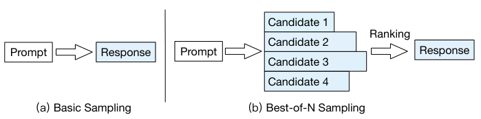
_原论文图 1：普通采样生成一条回答；Best-of-N 为同一个 prompt 生成多条候选回答，再排序选出最终回答。_

- **候选是什么：** 每个 candidate 是一条回答 token 序列。生成过程中是尚未完成的前缀，结束后是一份完整回答。
- **并行在哪里：** 不同候选之间可以并行，每条候选内部仍然自回归生成。一轮解码为每条仍在运行的候选各生成一个新 token。
- **为什么 batch 会变：** Best-of-4 开始有 4 条序列；某条先遇到 EOS 后退出，其余继续，有效 batch size 就从 4 变成 3，随后继续减小。这里不要求每一轮都按评分淘汰候选。

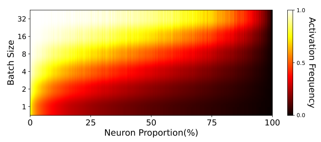
_原论文图 2：Bamboo-7B 第 10 层在不同 batch size 下的神经元激活频率。_

- **横轴：** 按激活频率排序的神经元比例，不是 token 位置。
- **纵轴：** batch size，图中从 1 到 32。
- **颜色：** 白色代表高频激活，红黑色代表低频激活。论文把“被 batch 中至少一个 token 激活”视作该神经元在这一批被激活。
- **观察：** batch 越大，各 token 激活集合取并集后覆盖的神经元通常越多，整体更稠密。作者报告高激活神经元比例从 batch=1 时不足 1%，增长到 batch=32 时约 75%。这不是每个 token 都激活了 75%。

因此，系统不能只针对 batch=1 做一份固定的 CPU/NPU 分工。BoN 的候选陆续结束后，批大小和稀疏模式会变化，合适的计算与缓存分配也会变化。[原文 §2.2]

### 3. 手机的 NPU 与 UFS，和 PC 上的 GPU、SSD 不一样

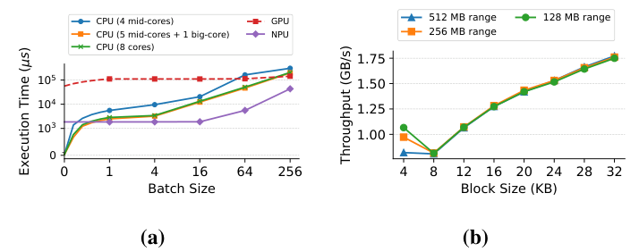
_原论文图 3：(a) 不同计算单元执行矩阵运算的耗时；(b) 不同读取块大小、地址范围下的 UFS 吞吐量。_

**先看图 3(a)：NPU 擅长大批量稠密运算，但不等于擅长细碎稀疏计算。**

- 测试矩阵大小为 14336×4096，横轴是 batch size，纵轴是执行时间，单位 μs。时间越低越好。
- 在大 batch 下，NPU 的稠密矩阵计算优势明显。作者的 7B INT4 预填充测量中，NPU 为 770 tokens/s，GPU 为 37 tokens/s，CPU 为 8 tokens/s。
- 只处理少量零散激活神经元时，CPU 更灵活。把 PC 上依赖 GPU 的稀疏方法直接搬到手机 NPU，不一定有效。
- 手机 GPU 还承担渲染任务。本文最终围绕 CPU/NPU 协同设计；这不是所有手机 GPU 都不适合推理的普遍结论。

**再看图 3(b)：读得少，不一定读得快。**

- **块大小影响吞吐：** 正文报告，顺序读从 4KB 时约 450 MB/s 增长到 512KB 时约 4 GB/s。
- **读取范围也重要：** 小块随机读跨越的地址范围越大，局部性变差，吞吐可能降低。
- **4KB 与 8KB 不能只按大小推断：** 图中 8KB 随机读的吞吐低于 4KB。这是后面把量化 bundle 拆成两次 4KB 读取的实测依据，不能套用“读块越大一定越快”。
- **负责 I/O 的核也重要：** 表 1 中，128MB 范围的 4KB 随机读取，大核为 1076.10 MB/s，中核为 1007.95 MB/s，小核为 761.87 MB/s。
- **并发存在代价：** 作者测试的 UFS 路径中，多核同时提交 I/O 会争用命令队列，性能最多下降 40%。因此设计中采用单个 I/O 线程配合多个计算线程。

**统一内存还有利用空间：** OnePlus 12 的实测中，CPU 单独执行矩阵计算约利用 43.9 GB/s，NPU 单独为 56 GB/s，两者协同达到 59.6 GB/s。这是实测聚合带宽，不能把两个单独结果直接相加。[原文 §2.3，表 1]

### 4. 已有方案搬到手机后，主要时间花在哪里

作者在 OnePlus 12 上将 Mistral-7B 的 50% FFN 权重卸载到闪存，测量 PowerInfer 与 LLMFlash。PowerInfer 原本没有闪存支持，这里是作者扩展后的版本。

| 系统 | 权重全驻内存时速度 | 卸载 50% FFN 后速度 | 卸载后的 I/O 开销占比 | CPU 利用率 |
|---|---:|---:|---:|---:|
| PowerInfer | 12.4 tokens/s | 1.4 tokens/s | 81.9% | 31% |
| LLMFlash | 12.9 tokens/s | 2.3 tokens/s | 76.7% | 41% |

**主要矛盾：** 少算一些神经元已经不够，仍需处理“小块读取慢”和“计算等待权重”两个问题。PowerInfer-2 因此同时改计算划分、缓存组织、存储布局和执行流水线。[原文 §2.4，表 2]

## 二、设计方案

### 1. 整体流程：先离线规划，再在线按簇执行

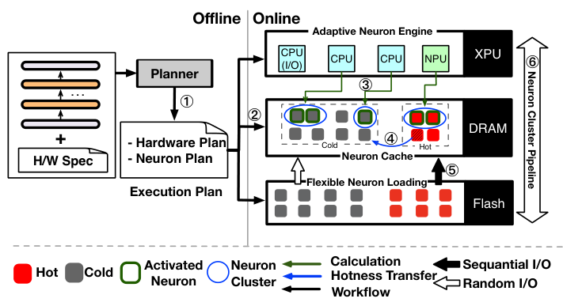
_原论文图 4：离线规划器生成硬件计划和神经元计划，在线引擎协调计算、缓存与闪存加载。_

一次执行可以按四步理解：

1. **离线分析模型和硬件：** 用超过 10M token 的 Wikipedia、RefinedWeb 数据分析激活频率，并测量 NPU、CPU 和 UFS 的性能，生成不同 batch 下的分簇与资源计划。
2. **运行时选择计算分工：** 根据 prefill/decode 和当前 batch，把适合稠密计算的热簇交给 NPU，把适合稀疏计算的冷簇交给 CPU。
3. **先查 DRAM 缓存：** 所需 FFN 权重在缓存中就直接用，不在缓存中则按其冷热属性、量化格式安排 UFS 读取。
4. **计算与 I/O 交错推进：** 某簇依赖的数据就绪后就执行，不要求整个矩阵的全部权重到齐。batch 改变时同步调整计算和冷热缓存比例。

- **红色／灰色方块：** 热／冷神经元。
- **绿色边框：** 当前激活的神经元。
- **蓝色圈：** 本次组织起来的神经元簇。
- **图里的箭头：** 区分数据加载、计算和热度迁移，不能把所有箭头都理解成 KV 搬运。[原文 §3、§5]

### 2. 神经元簇、KV block、bundle 分别是什么

**神经元簇是 FFN 的计算与调度单元。** 它包含同一 FFN 层中具有相似激活特征的一组神经元，簇大小会结合目标处理器和执行计划调整。NPU 倾向处理较大的稠密热簇，CPU 侧可以拆成较小的任务。

为了理解“一个神经元对应哪些权重”，可把门控 FFN 写成下面的解释式。这里采用列向量约定，仅用于帮助理解，不是论文新增的编号公式：

$$
y=W_{\mathrm{down}}\left[\phi(W_{\mathrm{gate}}x)\odot(W_{\mathrm{up}}x)\right].
$$

中间维度的第 i 个神经元，对应 Gate、Up 的第 i 行，以及 Down 的第 i 列。它们共同决定该中间通道对最终输出的贡献。实际实现若采用转置存储，物理行列方向会随之变化。

| 概念 | 组织的对象 | 主要用途 | 生命周期与访问特征 |
|---|---|---|---|
| 神经元簇 neuron cluster | FFN 中的一组神经元及其相关权重计算 | 决定计算粒度、CPU/NPU 分工和流水线推进 | 权重来自模型，激活状态随当前输入变化 |
| 神经元缓存 neuron cache | DRAM 中保留的权重等数据 | 减少从 UFS 反复加载权重 | 热冷 FFN 区可替换，固定区另行保留 |
| KV cache block | 若采用分页 KV 管理，通常组织若干 token 的 K/V 数据 | 分配、寻址、复用和回收注意力状态 | 与请求和上下文相关，生成过程中不断追加 |
| Gate–Up–Down bundle | 同一神经元位置对应的三组 FFN 权重 | 改善闪存布局和读取效率 | 磁盘布局与加载单元，不等于 KV block |

**不要把两种“阶段”混在一起：** prefill 和 decode 是整段推理的两个阶段；Attention 和 FFN 是每个 Transformer 层里的两个子模块。两大阶段都要经过各层的 Attention 和 FFN。

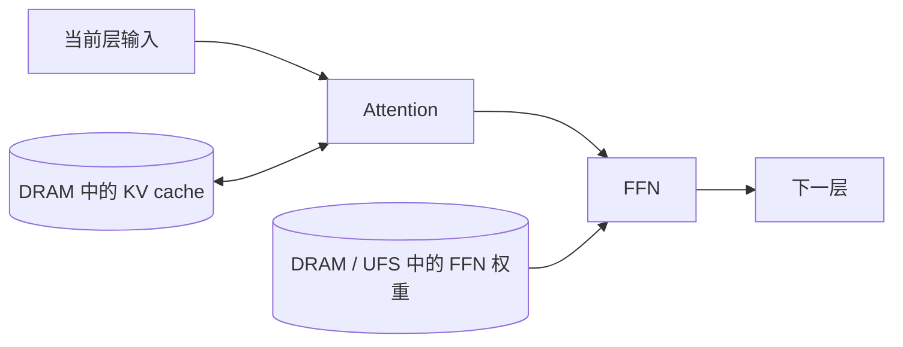

- **Prefill：** 处理 prompt，计算并保存各层 prompt token 的 K/V，同时执行各层 FFN。首次 prefill 主要是在建立 KV；有前缀复用或分块 prefill 时还会读取已有 KV。
- **Decode：** 每条运行序列每轮处理一个新 token。Attention 读取历史 K/V 并追加当前 token 的 K/V，之后继续执行 FFN。
- **神经元簇也用于 prefill：** 本文 prefill 把全部相关神经元合并为大簇，执行稠密运算；decode 才突出冷热划分和选择性计算。

因此，神经元簇与 KV block 可以同时存在，分别组织 FFN 计算和注意力状态，彼此不替代。上面对分页 KV 的解释是通用概念，论文没有据此声称实现了 PagedAttention。[原文 §3.1、§4.1–4.2；公式与 KV block 对比为阅读说明]

### 3. 两种工作流：prefill 用 NPU，decode 按冷热协同

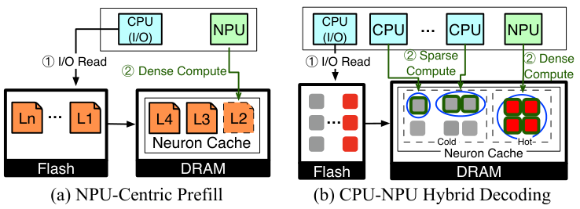
_原论文图 5：(a) NPU 主导的 prefill；(b) CPU/NPU 协同执行 FFN 的 decode。_

**图 5(a)：prefill 的激活并集趋于稠密。**

prompt 中多个 token 并行处理，虽然各 token 各自可能稀疏，但加在一起后大部分神经元都可能用到。此时逐 token 预测和小块随机读不划算，所以：

- NPU 执行大批量稠密矩阵计算，不依靠预测器逐个筛选激活神经元。
- CPU 大核负责顺序读取、异步预取下一层权重。
- 计算当前层时准备下一层，避免把全部读取和计算串行相加。

**图 5(b)：decode 把热部分做稠密计算，冷部分做选择性计算。**

- **热簇交给 NPU：** 即使仍包含部分未激活神经元，也以稠密矩阵运算利用 NPU。
- **冷簇交给 CPU：** 预测器判断哪些神经元可能激活，只计算需要的部分，使用 ARM Neon 向量化。
- **结果合并：** 两边完成后由 CPU 侧合并输出。对 Down 投影而言，各中间通道产生的是对输出的贡献，需要按对应关系累加，不能一概理解成把两块输出直接拼接。

正文给出的例子中，batch=1 时将一个 14336×4096 的 FFN 矩阵分为两个 7168×4096 部分，分别交给 NPU 和 CPU；CPU 又可拆成 512×4096 的任务。**这些是示例配置，不是任何模型、手机上都固定各分一半。**

**Attention 的原文差异：** 图 5 图注说注意力全部由 NPU 处理，但 §4.1.2 正文说按注意力头分给 CPU/NPU 并行处理。两处不一致，所以这里只能确认 Attention 有独立的稠密执行路径，不能仅凭该图断言所有注意力都固定在某一个处理器。[原文 §4.1.1–4.1.2]

### 4. batch 变化时，计算图和分配比例一起变化

BoN 中候选不断结束，系统通过序列的创建与完成跟踪有效 batch size。

- **batch 较大：** 激活更稠密，扩大 NPU 的热簇部分。正文示意约 70% 工作交给 NPU，30% 交给 CPU。
- **batch 降到 1：** 稀疏性提高，CPU 侧比例可增至约 50%。这不等于 CPU 必须计算其分区中的全部神经元，冷区仍使用预测器。
- **NPU 不能随意改算子形状：** 因而离线为不同 batch 和热簇比例准备静态计算图。
- **切图也要隐藏开销：** 运行时在 Attention 计算期间异步加载新图，典型图大小约 10KB，随后进入 FFN 时生效。10KB 指计算图，不是整块 FFN 权重。

离线规划还考虑“Attention 留出的预取时间是否够用”，因此热簇比例取决于激活分布、NPU 计算效率和 UFS 带宽，不能只按神经元频率排个序就结束。[原文 §4.1.3、§5]

### 5. 三个 DRAM 区域：KV 留在固定区，FFN 权重分冷热

**这就是本文对 KV cache 的安排。** §4.2 明确把缓存分成以下三类区域：

| 区域 | 保存内容 | 管理方式 | 是否参与 FFN 冷热替换 |
|---|---|---|---|
| 固定区 fixed region | 注意力权重和 KV cache | 在内存中保留；KV 随推理生成、追加 | 不按后两区的冷热 LRU 驱逐 |
| 热区 hot region | 面向 NPU 的 FFN 热神经元权重 | 按稠密簇组织，簇级 LRU | 是 |
| 冷区 cold region | 面向 CPU 的 FFN 冷神经元权重 | 单神经元管理，神经元级 LRU | 是 |

**“固定区”不表示 KV 的数值、有效长度固定。** 注意力权重可以预加载，而当前请求的 K/V 是处理 prompt 和生成 token 时算出来的。论文中“预加载并保留”的概括，不能理解为还没读取输入，就已经有了该输入的 KV。

**为什么 FFN 权重可以直接丢，KV 不能照搬同一策略：** 推理时权重不被修改，UFS 上留有原始副本。热区和冷区驱逐权重只需要释放内存，不必写回。KV 是当前请求产生的状态，随意丢弃会失去上下文，除非另行重算或采用专门的 KV 管理方法。

**可用内存怎么竞争：** 固定区、预测器、量化元数据和运行时先占一部分，剩余容量才能放 FFN 缓存。KV 变大，留给 FFN 权重的空间就可能变少，这是容量预算上的直接关系。

论文没有详细展开 KV 的分页块大小、量化、压缩、前缀共享、驱逐或卸载策略。因此可以说它**保留了常规 KV 使用路径，并重点优化 FFN 权重卸载**；不能把“模型超过 DRAM 仍能运行”扩展成“任意长上下文的 KV 也能免费放下”。

**冷热区会随 batch 调整：** 大 batch 扩大热区、缩小冷区；小 batch 为冷区腾出空间。被驱逐的仍然是对应 FFN 权重，不是把固定区中的历史 KV 一起当冷神经元淘汰。[原文 §4.2、§7.2.3]

### 6. 神经元簇流水线：打破矩阵屏障，保留数据依赖

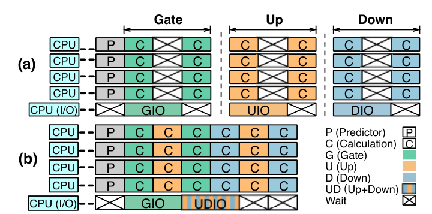
_原论文图 6：上图按完整矩阵依次执行，下图将 Gate、Up、Down 的簇级计算与 I/O 交错执行。_

图中是 4 个计算核加 1 个 I/O 核。每个矩阵假定有 8 个簇，其中 4 个在内存，另外 4 个在闪存。

- **图 6(a) 的问题：** 一边计算缓存中的 Gate，一边读取缺失 Gate，仍要等整个 Gate 矩阵阶段结束后才进入 Up。计算核会在矩阵边界出现空转，图中叉号就是等待。
- **图 6(b) 的做法：** 某簇对应的 Gate 已经完成，后续所需权重又在内存，就可以继续处理其 Up/Down 相关任务；其他簇的权重同时由 I/O 核读取。
- **为什么能提前推进：** 门控 FFN 的中间通道可以分开计算，各通道对最终输出的贡献随后合并。不必等所有通道都走完 Gate，才统一进入下一张矩阵。
- **仍有依赖：** 不能在输入或 Gate 结果没准备好时任意执行，更不是跨任意 Transformer 层乱序计算。

论文把一簇的执行划成五个阶段：

| 阶段 | 操作 | 由什么推进 |
|---|---|---|
| Pred | 预测对应神经元是否激活 | 计算线程 |
| GIO | 获取 Gate 权重，未命中时从 UFS 读取 | I/O 线程 |
| GC | 计算 Gate，得到实际门控结果 | 计算线程 |
| UDIO | 获取相应 Up/Down 权重 | I/O 线程 |
| UDC | 完成 Up/Down 相关计算，形成输出贡献 | 计算线程 |

多个簇在不同阶段交错运行，把一簇等待权重的时间用于计算其他已就绪簇。**收益来自缩短暴露在关键路径上的等待，并不意味着闪存读取本身变成了零成本。**[原文 §4.3]

### 7. 灵活加载：缓存命中先复用，未命中再按类型读取

**先区分三条路径：**

- **注意力权重：** 顺序加载并在推理期间保留。
- **FFN 热权重：** 使用较大、适合顺序读的组织，在 Attention 计算期间异步准备后续 FFN 所需数据。
- **FFN 冷权重：** 激活稀疏，按需进行小块随机读，配合预测器和实际 Gate 结果减少无效读取。

**为什么不把所有冷神经元也捆成大块：** 剔除热神经元后，同一 FFN 矩阵内剩余神经元的共同激活概率低于 20%。把它们一并读进来容易浪费带宽。

**但对应位置的 Gate、Up、Down 可以一起组织：** 三张矩阵相同神经元位置的相关性较高，作者测得约 80% 共同激活率。因此把对应权重按神经元位置排在一起，而不是始终按完整矩阵分开保存。这里的 80% 与上一段的低于 20% 比较的是不同对象，不矛盾。

| 格式 | 论文示例的权重布局 | 加载策略 |
|---|---|---|
| Mistral-7B-FP16 | 每份对应行／列约 8KB，Gate–Up–Down 合计 24KB | 一次较大随机读获取整个 bundle |
| INT4 示例 | 每张矩阵对应权重 2KB，加 FP16 scales 0.5KB，三份合计 7.5KB，对齐到 8KB | 拆成两次 4KB，先 Gate，再按需读 Up/Down |

**INT4 的两阶段读取：** 预测器认为需要时先读取 Gate 所在的 4KB；Gate 实际输出非零才继续读取 Up/Down 所在的 4KB。两次 4KB 符合实测 UFS 特性，也能避免部分预测为激活、实际 Gate 为零所造成的无效后续读取。

这里的 8KB、24KB 都是论文针对特定维度和格式的布局示例，不能当成所有模型统一的神经元大小。冷区按神经元管理缓存，与磁盘上把同位置的三份权重放在相邻 bundle 中，也属于不同层次的设计。[原文 §4.2、§4.4]

### 8. 离线计划与实现条件

- **模型侧分析：** 记录不同 batch 下的激活频率，形成热冷神经元划分。
- **设备侧分析：** 测量不同矩阵尺寸的 NPU 速度、CPU 稀疏计算能力、共享内存带宽及 UFS I/O 性能。
- **提前准备：** 神经元计划、硬件核分配和常用 batch 的 NPU 静态图，使在线阶段主要做选择与切换。
- **实现：** 在 PowerInfer 上增加约 12K 行 C++，Android 上实现，依赖包括 mlock 在内的特权系统 API，需要 root 权限。
- **移植性范围：** 作者认为无需修改内核，便于移植到其他系统，包括 iOS。这是设计层面的判断，不能写成已经在 iOS 上完成实测。[原文 §5–6]

## 三、实验结果

### 1. 平台、模型和比较条件

| 设备 | 物理 DRAM | 应用可用内存 | 存储 | SoC |
|---|---:|---:|---|---|
| OnePlus 12 | 24GB | 19GB | UFS 4.0 | Snapdragon 8 Gen 3 |
| OnePlus Ace 2 | 16GB | 11GB | UFS 3.1 | Snapdragon 8+ Gen 1 |

**五种模型：** Mistral(SiLU)-7B、稀疏 Qwen2-7B、Bamboo-7B、稀疏 Llama-13B、TurboSparse-Mixtral-47B。图中 Mixtral-47B 指最后这一稀疏模型，不能自动替换成未经处理的普通 Mixtral。

**四个基线：** llama.cpp 代表 CPU 路径，QNN 代表高通 NPU 推理引擎，MLC-LLM 代表移动 GPU 路径，LLMFlash 代表基于闪存和激活稀疏性的方案。LLMFlash 没有开源，作者依据其论文在 llama.cpp 中重现关键机制；这里比较的是该重实现。

**负载：** 多轮对话、代码生成、数学问题求解、角色扮演。prefill 测 128/512 token prompt；decode 使用最长 64 token prompt 和 1024 token 输出；另测 BoN。实验运行 10 次取平均。

**默认卸载比例：** 除 Ace 2 的 Mixtral-47B 至少卸载 75% FFN 权重外，图 7、8 中其他配置卸载 50% FFN 权重。这个比例的分母是 FFN 权重，不能写成总运行内存减少一半。[原文 §7.1–7.2，表 3]

### 2. 权重卸载后，解码速度提高多少

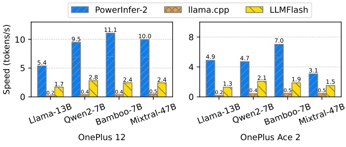
_原论文图 7：两款手机上不同模型的解码速度，单位 tokens/s。_

- **横轴：** 模型；左图 OnePlus 12，右图 OnePlus Ace 2。
- **纵轴：** 生成速度，越高越好。
- **比较条件：** 上节规定的 FFN 卸载比例，不能与全驻内存性能混用。

| OnePlus 12 模型 | PowerInfer-2 | llama.cpp | LLMFlash |
|---|---:|---:|---:|
| 稀疏 Llama-13B | 5.4 | 0.2 | 1.7 |
| 稀疏 Qwen2-7B | 9.5 | 0.4 | 2.8 |
| Bamboo-7B | 11.1 | 0.4 | 2.4 |
| TurboSparse-Mixtral-47B | 10.0 | 0.5 | 2.4 |

表中为图上保留一位小数的读数。论文正文报告 OnePlus 12 相对 llama.cpp 平均 24.6×、最高 27.8×，相对 LLMFlash 平均 3.84×、最高 4.63×；不能用图上的舍入读数要求精确复现全部倍数。Ace 2 对两者的平均加速分别为 14.1×、2.93×。

**为什么 47B 不一定比 7B 慢很多：** TurboSparse-Mixtral-47B 在文中每 token 约激活 3B 参数，与 Bamboo-7B 接近。实际需要计算、加载多少权重比总参数量更直接影响这一场景的速度，但总参数量仍影响模型存储和缓存容量需求。

表 4 给出 Bamboo-7B 的关键路径分解：

| 系统 | 计算占比 | I/O 占比 |
|---|---:|---:|
| PowerInfer-2 | 86.3% | 13.7% |
| LLMFlash | 23.3% | 76.7% |

这支持作者的解释：缓存、加载和流水线共同减少了关键路径上的 I/O 等待。占比变化不是单独某一项机制的消融结果。[原文 §7.2.1，图 7、表 4]

### 3. prefill 为什么也有大幅收益

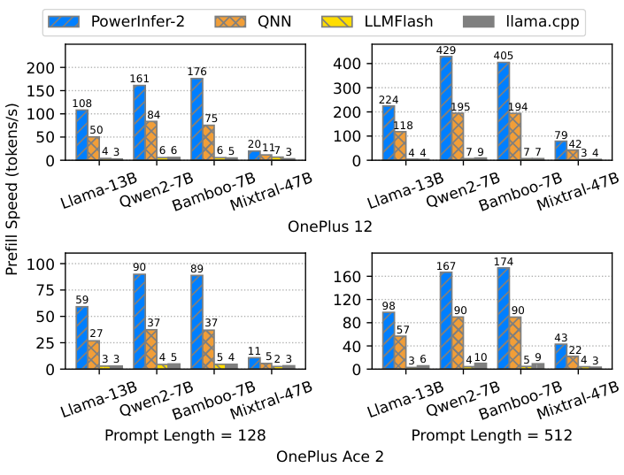
_原论文图 8：两款手机分别在 128、512 token prompt 下的预填充吞吐，单位 tokens/s。_

- **四个子图：** 按设备和 prompt 长度组合排列。
- **与 decode 区分：** 这里统计输入 token 的处理速度，不是输出 token 的生成速度。
- **512 token，OnePlus 12：** 正文报告相对 LLMFlash、llama.cpp、QNN 分别为 48.97×、44.23×、1.99×。图内不同模型的具体速度不同，不能把一个模型的柱高和总体倍数混在一起。

prefill 的批内激活更稠密。作者报告 TurboSparse-Mixtral 在 batch=128 时，神经元激活概率接近 99.99%，因此采用顺序加载与 NPU 稠密计算，而不是坚持逐神经元稀疏读取。

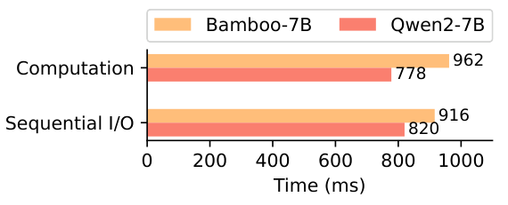
_原论文图 9：OnePlus 12、512 token prompt 下，Bamboo-7B 和 Qwen2-7B 的单层计算与顺序 I/O 时间。_

- **横轴：** 时间，单位 ms；橙色为 Bamboo，红色为 Qwen2。
- **图上数值：** Bamboo 的计算／I/O 为 962／916 ms；Qwen2 为 778／820 ms。
- **机制含义：** 两者量级接近，计算一层时预取下一层有机会大幅隐藏读取成本。
- **保留条件：** 正文将这一机制概括为完全隐藏 I/O；图中 Qwen2 的 I/O 略长于计算，因此不宜把“全部配置、任何输入下都零等待”作为结论。[原文 §7.2.2，图 8–9]

### 4. 只剩很少内存时，还能运行吗

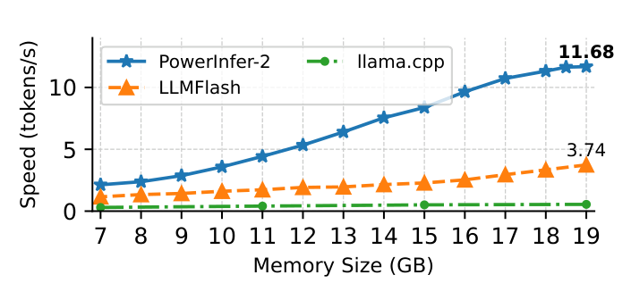
_原论文图 10：OnePlus 12 上，TurboSparse-Mixtral-47B 在 7–19GB 内存预算下的解码速度。_

- **横轴：** 应用可用内存预算，单位 GB；不是物理 DRAM 总容量。
- **纵轴：** 解码速度，单位 tokens/s。
- **结果：** 7GB 时 2.13 tokens/s；19GB 时 11.68 tokens/s。19GB 配置相对 LLMFlash 为 3.12×，相对 llama.cpp 为 21.2×。

7GB 配置的内存预算尤其值得拆开：

| 类别 | 论文报告的占用 |
|---|---:|
| 非 FFN 部分，脚注还包括 KV cache 等 | 1GB |
| 预测器权重 | 2.6GB |
| FFN 量化缩放因子 | 2.7GB |
| 运行时内存 | 300MB |
| 小计 | 约 6.6GB |
| 剩余神经元缓存 | 约 400MB |

400MB 仅能缓存约 1.8% 的 FFN 权重，激活神经元的权重大多需要从 UFS 加载。依靠细粒度流水线和读取组织，仍达到 LLMFlash 的 1.84×。

**读这张表时要注意：**

- 2.6GB 预测器与 2.7GB scales 都不能忽略。INT4 权重本体很小，不表示完整运行只需要“参数量×0.5 字节”。
- 论文把 KV 等归入该配置的 1GB 项，并没有给出任意上下文长度都只需 1GB 的保证。
- 11.68 tokens/s 是充分使用 19GB 的结果；图 7 默认卸载比例下正文给出的 9.96 tokens/s，是不同配置。[原文 §7.2.3、脚注 3]

### 5. 平均速度之外，还有任务差异和尾延迟

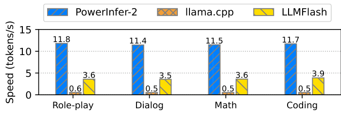
_原论文图 11：TurboSparse-Mixtral-47B 在 OnePlus 12 使用全部可用内存时的四类任务速度。_

角色扮演、对话、数学、代码分别约 11.8、11.4、11.5、11.7 tokens/s。说明这些任务的平均速度相近，但不能据此推断每个 token 的延迟也一致。

| 延迟统计，单位 ms | TurboSparse-Mixtral-47B | Bamboo-7B |
|---|---:|---:|
| 平均 | 99.76 | 90.32 |
| P50 | 97.42 | 86.88 |
| P90 | 116.16 | 115.02 |
| P99 | 140.56 | 162.02 |

表 5 的条件为卸载 50% FFN 权重、观察生成的 1024 token。它与图 11 的全部可用内存条件不同。

**为什么有尾延迟：** 不同 token 激活不同神经元。Mixtral 的平均缓存未命中率为 3.5%，P99 未命中率为 18.9%，个别 token 会触发更多随机读。

**单位核对：** 表里是延迟，不是速度。Mixtral 的 P99 延迟较均值增加约 40.9%；P90 延迟较均值增加约 16.4%。正文在此处交替使用速度与延迟，不能把延迟增加 16.4%直接写成速度下降同样比例。[原文 §7.2.4，图 11、表 5]

### 6. 权重全在内存时，还需要这套设计吗

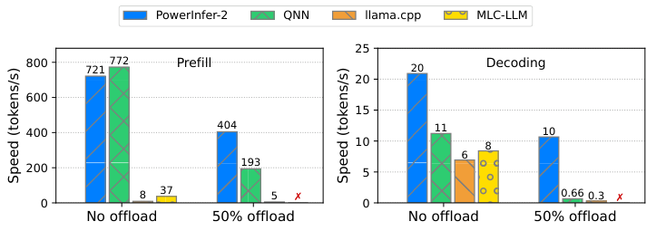
_原论文图 12：Bamboo-7B 的 prefill 与 decode，分别比较全驻内存和卸载 50% FFN 权重。_

- **左图是 prefill：** 全驻内存时，PowerInfer-2 约 721 tokens/s，QNN 约 772 tokens/s，主要体现 NPU 的稠密算力；开启卸载后 PowerInfer-2 仍约 404.6 tokens/s。
- **右图是 decode：** 全驻内存时 PowerInfer-2 约 20 tokens/s。正文报告相对 llama.cpp、MLC-LLM、QNN 分别快 2.24×、2.48×、1.86×，图上数字作了舍入。
- **带宽与稀疏共同起作用：** 不需要 UFS 读取时，CPU/NPU 并发和减少 FFN 有效计算仍有收益。
- **减内存的价值：** 卸载 50% FFN 后，内存减少约 1.5GB（40%），速度仍能与 llama.cpp、MLC-LLM 的全驻内存配置相近。40% 是该测量配置的总内存减少量，不等于所有模型都能省 40%。
- **红叉：** MLC-LLM 在该卸载配置下不支持运行，不能把失败当成一个接近零的有效速度。[原文 §7.3，图 12]

### 7. BoN 的 batch 变化，动态调整是否有用

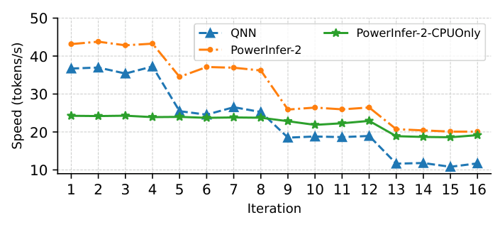
_原论文图 13：Bamboo-7B，所有模型参数驻内存，从四个候选逐渐减少到一个候选。_

- **横轴：** 解码迭代，每次为当前全部有效候选各生成一个 token。
- **变化设置：** 每 4 次迭代将 batch 减 1，因此 1–4、5–8、9–12、13–16 轮分别对应 batch=4、3、2、1。这是实验的规定变化轨迹，不能直接当成真实回答每 4 token 就恰好结束一条。
- **纵轴：** 生成速度 tokens/s，曲线的阶梯变化与并行候选数量减少有关，不能直接解释为单条回答突然变慢同样倍数。
- **初始阶段：** 正文报告 PowerInfer-2 相对 QNN、CPUOnly 分别为 1.84×、1.28×。
- **batch=1：** 相对 CPUOnly、QNN 分别为 1.1×、1.77×。稀疏性提高后，纯 NPU 的 QNN 反而低于 CPUOnly。

图里能直接看到混合方案在不同 batch 下都保持优势。正文还报告动态分派带来 1.42× 优势，但图 13 没有单独画出“固定分配的 PowerInfer-2”曲线，不能自行补出一条静态基线。[原文 §7.4，图 13]

### 8. 哪项优化贡献最大，是否依赖模型稀疏性

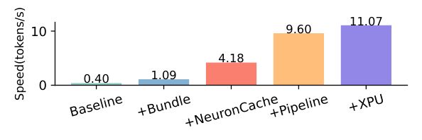
_原论文图 14：OnePlus 12、Bamboo-7B、卸载 50% FFN 权重下的累积消融。_

| 累积配置 | 图上速度，tokens/s | 相对上一步的比值，按图计算 |
|---|---:|---:|
| CPU Baseline | 0.40 | — |
| 加 Bundle | 1.09 | 约 2.73× |
| 再加 Neuron Cache | 4.18 | 约 3.83× |
| 再加 Pipeline | 9.60 | 约 2.30× |
| 再加 XPU | 11.07 | 约 1.15× |

**能读出的结论：** 在这一配置中，读取组织、缓存和流水线贡献了主要的绝对速度增长；最后 CPU/NPU 协同仍有约 15% 增益。不能据此说 NPU 对 prefill 或较大 batch 都只有 15% 价值。

**原文数字不一致：** §7.5 正文把缓存和流水线的增益写成 2.82×、1.29×，与图上相邻柱子的比值不一致。上表明确采用图上读数计算，不将正文倍数悄悄混入同一列。

SiLU 与 ReLU 模型的结果也说明稀疏性的重要性：

| 模型，卸载 50% FFN 权重 | PowerInfer-2 | LLMFlash | 论文报告加速 |
|---|---:|---:|---:|
| Mistral(SiLU)-7B | 5.3 tokens/s | 2.18 tokens/s | 2.4× |
| Bamboo-7B | 11.1 tokens/s | 2.4 tokens/s | 4.6× |

SiLU 场景仍有收益，但比高稀疏模型小。论文结合 CATS、CHESS 等近似稀疏化研究讨论其适用性，不能将 SiLU 的稀疏性直接等同于 ReLU 的天然精确零值，也不能认为任何未处理的模型都能直接获得相同加速。[原文 §7.2.5、§7.5，表 6、图 14]

### 9. 准确率与能耗的代价

**NPU 量化快，但粗粒度量化可能损失准确率。** QNN 使用逐通道量化，llama.cpp 使用每 32 个权重一组的量化。本文所用 NPU 路径不支持相同的分组量化，因此采用混合精度：离群权重用 INT8，其余采用 INT4 逐通道量化。

| 模型 | llama.cpp 四任务平均分 | QNN | PowerInfer-2 |
|---|---:|---:|---:|
| Qwen2-7B | 79.25 | 56.93 | 78.38 |
| Bamboo-7B | 70.12 | 63.26 | 68.35 |

表 7 的任务是 Arc-Challenge、Arc-Easy、MMLU、GSM8K。PowerInfer-2 更接近 llama.cpp，但仍有下降，不能写成所有任务上完全无损。QNN 的较低分数也意味着纯速度比较必须结合量化差异看。

能耗测量从 LMSYS-Chat-1M 随机抽取 100 个 prompt，统计端到端平均每输出 token 能耗：

| 指标 | PowerInfer-2 | QNN | llama.cpp |
|---|---:|---:|---:|
| 峰值功率 W | 5.095 | 5.133 | 4.065 |
| 每 token 能耗 J/token | 0.257 | 0.373 | 0.672 |

**更省电不等于瞬时功率最低：** PowerInfer-2 峰值功率与 QNN 接近，也高于这里的 llama.cpp；但完成生成更快，单位 token 能耗相对 QNN、llama.cpp 分别降低 31.1%、61.8%。这不是长期温控降频或整机续航测试。[原文 §7.6–7.7，表 7–8]

### 10. 这篇最值得带走的结论与适用边界

- **计算粒度要与存储粒度一起设计：** 只有稀疏算子，没有合适的读取布局与流水线，可能把省下的计算时间全部花在 UFS 等待上。
- **稠密与稀疏不必二选一：** 热部分做稠密计算，冷部分做选择性计算，可以更符合手机 CPU/NPU 各自的能力。
- **batch 是运行时变量：** 它会同时改变激活并集、CPU/NPU 分工、NPU 图形状和冷热缓存占比。
- **主要解决 FFN 权重容量与访问：** KV cache 仍占内存，本文没有提供完整的长上下文 KV 卸载方案，也没有把 neuron cluster 定义为 KV block。
- **高加速倍数有条件：** 模型稀疏性、FFN 卸载比例、内存预算、量化方式和基线实现都会影响结果。47B 的总参数规模不能单独解释速度。
- **端侧部署仍有门槛：** 本文实现需要 root，实验以两款高通 Android 手机为主，不能据此推出任意手机、任意 NPU、任意模型都能直接复现。

**原文与对照：** [原始 PDF](../../文献/powerinfer-2.pdf) · [arXiv v3](https://arxiv.org/abs/2406.06282v3) · [逐段中英对照](PowerInfer-2_中英对照.md) · [提取说明与原文差异](translation_notes.md)。文中图 1–14 均来自本地原论文裁剪图；表格数值来自对应原表，图上舍入读数和自行计算的比值已单独注明。KV block 对比、解释式和依赖关系说明为阅读辅助，不冒充论文新增实现。
