# PowerInfer-2: Fast Large Language Model Inference on a Smartphone

# PowerInfer-2：智能手机上的快速大语言模型推理

## 文献信息 / Publication Information

- **Authors / 作者**：Zhenliang Xue*、Yixin Song*、Zeyu Mi†、Xinrui Zheng、Yubin Xia、Haibo Chen。
- **Affiliation / 单位**：Institute of Parallel and Distributed Systems (IPADS), Shanghai Jiao Tong University / 上海交通大学并行与分布式系统研究所。
- **Author notes / 作者说明**：* 共同第一作者；† 通讯作者 Zeyu Mi，yzmizeyu@sjtu.edu.cn。
- **Version / 版本**：arXiv:2406.06282v3 [cs.LG]，12 Dec 2024 / 2024 年 12 月 12 日。
- **Link / 链接**：[该版本 arXiv 页面](https://arxiv.org/abs/2406.06282v3)。本文译稿依据本地 PDF，未混入其他版本。
- **Source / 来源**：用户提供的本地 `文献/powerinfer-2.pdf`，共 15 页；第 13–15 页包含参考文献。

## 阅读说明 / Reading Notes

沿用前面笔记的“英文原文 → 中文译文”逐段格式，覆盖摘要、正文第 1–9 节、全部图表图注、作者说明、脚注与 64 条参考文献。保留引文编号、数据、模型名称和作者的论断强度。跨栏／跨页段落已拼接，跨行断词、PDF 连字及版式空格已整理；每段附稳定来源编号和 PDF 页码。

14 幅原图与 8 张原表均有原始裁剪图，放在首次实质讨论附近；图内英文保留，图注中英对照，表格另提供带中英表头的可复制版本。参考文献保留完整英文著录，中文行提供题名与主要出版信息译文，作者及 URL 以相邻英文条目为准。原文存在的数值或表述差异已记录在 `translation_notes.md`，正文译文不作静默修正。

图片位于 `assets/`；移动笔记时请连同此目录一起移动。`source_map.json` 保存逐段来源和裁剪位置，`paper.md` 为本文件的兼容入口。

## 目录 / Contents

- [摘要 / Abstract](#abstract)
- [1 引言 / Introduction](#H1)
- [2 背景与动机 / Background and Motivation](#H2)
- [3 PowerInfer-2 概览 / PowerInfer-2 Overview](#H3)
- [4 在线推理的详细设计 / Detailed Design of Online Inference](#H4)
- [5 执行计划生成 / Execution Plan Generation](#H5)
- [6 实现 / Implementation](#H6)
- [7 评估 / Evaluation](#H7)
- [8 相关工作 / Related Work](#H8)
- [9 结论 / Conclusion](#H9)
- [脚注 / Footnotes](#footnotes)
- [参考文献 / References](#references)
- [术语对照 / Terminology](#terminology)
- [阅读提示](#reading-tips)

**页码索引：** [p.1](#S001) · [p.2](#S006) · [p.3](#S013) · [p.4](#S018) · [p.5](#S027) · [p.6](#S035) · [p.7](#S042) · [p.8](#S051) · [p.9](#S062) · [p.10](#S070) · [p.11](#S074) · [p.12](#S080) · [p.13](#R001) · [p.14](#R022) · [p.15](#R051)

---

## Abstract / 摘要

**Source:** p.1 · S001

**Original:** Large language models (LLMs) on smartphones enable real-time AI assistance and privacy-preserving, offline operation. However, resource constraints of smartphones limit current deployments to small language models (SLMs), significantly compromising their capabilities. This paper introduces PowerInfer-2, a smartphone-based framework that enables fast inference for LLMs exceeding the memory capacity. The key insight is decomposing matrix operations into neuron clusters as the basic processing unit, which enables flexible scheduling and efficient I/O-computation pipelining. PowerInfer-2 leverages this neuron-cluster-based design in both computation and storage. For computation, neuron clusters with dense activations are processed on NPU, while sparse clusters use CPU. The storage engine provides a fine-grained pipeline mechanism that coordinates cluster-level computation and I/O operations, enhanced by a segmented neuron cache to reduce I/O activities. PowerInfer-2 achieves up to a 27.8× speed increase compared to state-of-the-art frameworks. PowerInfer-2 is the first system to serve a 47B LLM on a smartphone, achieving 11.68 tokens/s. Notably, these performance improvements preserve model quality with negligible accuracy degradation.

**中文:** 智能手机上的大语言模型（LLM）能够提供实时 AI 辅助，并支持保护隐私的离线运行。然而，智能手机的资源约束使当前部署主要局限于小语言模型（SLM），显著削弱了模型能力。本文介绍 PowerInfer-2，这是一种面向智能手机的框架，能够对规模超过内存容量的 LLM 进行快速推理。其关键思路是将矩阵运算分解为神经元簇，并将其作为基本处理单元，从而实现灵活调度以及高效的 I/O 与计算流水线。PowerInfer-2 将这种基于神经元簇的设计同时用于计算和存储。在计算方面，激活稠密的神经元簇由 NPU 处理，稀疏神经元簇由 CPU 处理。存储引擎提供细粒度流水线机制，协调簇级计算与 I/O 操作，并通过分区神经元缓存进一步减少 I/O。与最先进的框架相比，PowerInfer-2 最高实现 27.8 倍加速。PowerInfer-2 是首个能够在智能手机上运行 47B LLM 的系统，生成速度达到 11.68 tokens/s。值得注意的是，这些性能提升能够保持模型质量，准确率下降可以忽略不计。

## 1 Introduction / 1 引言

**Source:** p.1 · S002

**Original:** Large Language Models (LLMs) have revolutionized our daily lives and work patterns through their remarkable ability to process and generate human-like text. While state-of-the-art LLMs such as GPT-4 [45] and Claude-3.5 [9] operate on powerful data center GPUs (e.g., NVIDIA H100 [42] and GB200 [43]), there is an increasingly growing interest in deploying LLMs directly on ubiquitous smartphones. This trend is evidenced by major tech companies’ recent initiatives in mobile LLM integration: Apple has launched Apple Intelligence [10], Google has introduced Gemini Nano for Pixel devices [22], and smartphone manufacturers including Samsung, Huawei, and OPPO have incorporated various LLM solutions into their smartphones [2,4,5]. The surge of interest in mobile LLM deployment stems from three key advantages: it enables instantaneous AI assistance across system functions by eliminating network latency, enhances user privacy through local data processing, and ensures reliable performance regardless of network conditions.

**中文:** 大语言模型（LLM）凭借出色的类人文本处理与生成能力，改变了我们的日常生活与工作方式。GPT-4 [45] 和 Claude-3.5 [9] 等先进 LLM 运行在强大的数据中心 GPU 上，例如 NVIDIA H100 [42] 和 GB200 [43]；与此同时，人们越来越希望将 LLM 直接部署到普及的智能手机上。大型科技公司近期推进移动端 LLM 集成的举措体现了这一趋势：苹果推出了 Apple Intelligence [10]，谷歌为 Pixel 设备引入了 Gemini Nano [22]，三星、华为和 OPPO 等手机厂商也将多种 LLM 方案集成到了智能手机中 [2,4,5]。移动端 LLM 部署受到广泛关注，主要源于三方面优势：消除网络延迟，为各类系统功能提供即时 AI 辅助；通过本地数据处理增强用户隐私；不依赖网络状况，提供可靠的性能。

**Source:** p.1 · S003

**Original:** However, mobile LLM deployment faces a critical challenge: due to smartphones’ limited computing and memory resources, only small language models (SLMs) can be deployed, significantly compromising model quality and capabilities. For example, Google’s Gemini Nano [22], specifically designed for smartphones, contains only 3.25B parameters and requires less than 2GB of memory, which is substantially smaller than models deployed on high-end PCs and servers (typically ranging from tens to hundreds of billions of parameters). This model size constraint severely limits the model’s capabilities, as larger models consistently demonstrate superior performance according to the “scaling law” [30].

**中文:** 然而，在移动端部署 LLM 面临一个关键挑战：智能手机的计算和内存资源有限，只能部署小语言模型（SLM），模型质量与能力因此显著受限。例如，专为智能手机设计的谷歌 Gemini Nano [22] 仅有 3.25B 参数，内存需求低于 2GB，远小于部署在高端 PC 和服务器上的模型，后者通常具有数百亿至数千亿参数。模型规模约束严重限制了模型能力，因为根据“缩放定律”[30]，更大的模型通常能表现出更强的性能。

**Source:** p.1 · S004

**Original:** To address these limitations, recent research focuses on system-level optimizations that leverage sparse activation patterns, with solutions like PowerInfer [51] and LLMFlash [7] demonstrating promising results in high-end PC environments. However, these PC-centric solutions suffer from severe execution speed degradation on smartphones (i.e., approximately 70% slower decoding speed for 7B models) due to two key hardware gaps between smartphones and high-end PCs:

**中文:** 为应对这些限制，近期研究聚焦于利用稀疏激活模式进行系统级优化，PowerInfer [51] 和 LLMFlash [7] 等方案已在高端 PC 环境中展示出良好效果。然而，由于智能手机与高端 PC 之间存在以下两项关键硬件差异，这些以 PC 为中心的方案在智能手机上的执行速度显著下降，例如 7B 模型的解码速度约降低 70%：

**Source:** p.1 · S005

**Original:** • The Sparse Computing Gap: Smartphones’ mobile NPUs, while offering superior performance for dense computations compared to mobile CPUs, lack dedicated hardware support for sparse operations and struggle with unstructured sparse computations. In contrast, high-end PCs’ discrete GPUs efficiently handle both dense and sparse matrix operations compared to CPUs. This hardware limitation significantly impacts the effectiveness of PowerInfer and LLMFlash’s sparse computation approaches on smartphones, as sparse computations are forced to run on CPUs. Such CPU-only execution not only underutilizes the NPU’s computational capabilities but also fails to fully exploit the high memory bandwidth available in smartphones’ unified memory architecture (UMA).

**中文:** • 稀疏计算差距：智能手机中的移动 NPU 虽然在稠密计算上优于移动 CPU，却缺少对稀疏运算的专用硬件支持，难以处理非结构化稀疏计算。相比之下，高端 PC 的独立 GPU 相较于 CPU，能够高效执行稠密和稀疏矩阵运算。这一硬件限制显著削弱了 PowerInfer 和 LLMFlash 的稀疏计算方法在智能手机上的效果，因为稀疏计算被迫在 CPU 上执行。这种仅使用 CPU 的执行方式，既未充分利用 NPU 的计算能力，也未充分发挥智能手机统一内存架构（UMA）提供的高内存带宽。

**Source:** p.1, p.2 · S006

**Original:** • The Storage Performance Gap: The Universal Flash Storage (UFS) in smartphones faces severe performance limitations compared to PC’s NVMe SSDs, achieving merely half the bandwidth for sequential reads (4GB/s vs. 7.5GB/s), while for random reads, this performance gap widens dramatically to 12× (100K IOPS vs. 1,200K IOPS). Consequently, despite its specialized I/O optimizations, LLMFlash still cannot overcome these fundamental storage bandwidth limitations, resulting in frequent computational unit idling during I/O operations.

**中文:** • 存储性能差距：与 PC 的 NVMe SSD 相比，智能手机中的通用闪存存储（UFS）具有明显的性能限制：顺序读取带宽仅约为前者的一半（4GB/s 对 7.5GB/s），而随机读取的性能差距进一步扩大至 12 倍（100K IOPS 对 1,200K IOPS）。因此，即便 LLMFlash 采用了专门的 I/O 优化，仍无法克服这些根本性的存储带宽限制，导致计算单元在 I/O 期间频繁空闲。

**Source:** p.2 · S007

**Original:** This paper presents PowerInfer-2, an LLM-serving framework that efficiently runs large language models on smartphones, achieving high inference speeds even for models exceeding available device memory. Unlike existing solutions primarily targeting high-end PC environments, PowerInfer-2’s core innovation lies in its fine-grained neuron cluster abstraction for mobile LLM inference. A neuron cluster represents a collection of neurons exhibiting the same activation pattern, and its neuron number is dynamically determined at runtime based on the target computing units. This fine-grained abstraction enables both optimal utilization of heterogeneous computing resources and efficient coordination between computation and I/O operations.

**中文:** 本文提出 PowerInfer-2，这是一种能够在智能手机上高效运行大语言模型的 LLM 服务框架，即使模型大小超过设备可用内存，也能实现较高推理速度。现有方案主要面向高端 PC 环境，而 PowerInfer-2 的核心创新是面向移动端 LLM 推理的细粒度神经元簇抽象。神经元簇由具有相同激活模式的多个神经元构成，其神经元数量在运行时根据目标计算单元动态确定。这一细粒度抽象既能充分利用异构计算资源，也能高效协调计算与 I/O 操作。

**Source:** p.2 · S008

**Original:** Based on the flexible neuron cluster abstraction, PowerInfer-2 provides two key principles that redesign LLM inference to address smartphone-specific hardware constraints (e.g., NPU-CPU heterogeneity, UFS limitations). First, given smartphones’ limited computing capabilities compared to PCs, it is crucial to maximize performance by intelligently distributing tasks between NPU and CPU based on their respective computational strengths. Specifically, PowerInfer-2’s Sparsity-Aware Adaptation simultaneously assigns neuron clusters of different sizes to NPUs for efficient dense matrix operations and CPUs for flexible sparse computations. This parallel execution not only maximizes computational throughput but also optimizes memory bandwidth utilization. Moreover, PowerInfer-2 redistributes the ratio of neuron clusters between NPU and CPU to dynamically adapt to changes in sparsity patterns across different batch sizes, which is a critical optimization overlooked by previous systems.

**中文:** 基于灵活的神经元簇抽象，PowerInfer-2 提出两项关键原则，重新设计 LLM 推理，以适应智能手机特有的硬件约束，例如 NPU–CPU 异构性与 UFS 限制。首先，相较于 PC，智能手机的计算能力有限，因此必须根据 NPU 和 CPU 各自擅长的计算类型合理分配任务，以最大化性能。具体而言，PowerInfer-2 的稀疏度感知适配机制同时向 NPU 和 CPU 分配不同大小的神经元簇：NPU 执行高效的稠密矩阵运算，CPU 执行灵活的稀疏计算。这种并行执行既提高计算吞吐量，也改善内存带宽利用率。此外，PowerInfer-2 会重新分配 NPU 与 CPU 之间的神经元簇比例，动态适应不同批量大小下稀疏模式的变化；这是以往系统忽略的一项关键优化。

**Source:** p.2 · S009

**Original:** The second principle, I/O-Aware Orchestration, addresses a fundamental challenge in mobile LLM inference: the mismatch between traditional matrix-based computation granularity and mobile storage performance. Conventional matrix-level operations often leave computing units idle while waiting for slow UFS I/O, severely underutilizing available computing resources. To solve this, PowerInfer-2 leverages its neuron cluster-based computation model to efficiently pipeline matrix operations, which brings two key benefits: First, it enables efficient overlap between computation and I/O, effectively hiding storage access latency. Second, it allows the system to choose specialized I/O access patterns for different neuron clusters, improving storage bandwidth utilization during inference.

**中文:** 第二项原则是 I/O 感知编排，它解决移动端 LLM 推理中的一个根本性问题：传统矩阵计算粒度与移动存储性能不匹配。常规矩阵级运算往往使计算单元在等待缓慢 UFS I/O 时处于空闲状态，未能充分利用可用计算资源。为此，PowerInfer-2 利用基于神经元簇的计算模型，对矩阵运算进行高效流水线处理，带来两项关键收益：首先，使计算与 I/O 高效重叠，有效隐藏存储访问延迟；其次，允许系统针对不同神经元簇选择专用 I/O 访问模式，提高推理期间的存储带宽利用率。

**Source:** p.2 · S010

**Original:** We implemented PowerInfer-2 by extending PowerInfer [51], adding 12K lines of code. PowerInfer-2 has been evaluated on two smartphones: OnePlus 12 and Ace 2, all featuring heterogeneous Qualcomm XPUs with 24GB and 16GB DRAM. Our system fundamentally breaks through the SLM constraints on smartphones, enabling deployment of large language models that were previously impossible to run on mobile devices. Specifically, PowerInfer-2 supports various LLM architectures and model sizes (from 7B to 47B). Our evaluation shows three key improvements: (1) Performance: 24.6× (up to 27.8×) over llama.cpp and 3.84× average speedup (up to 4.63×) over LLMFlash on OnePlus 12; (2) Model size: First system to run large models like TurboSparse-Mixtral-47B on mobile, at 11.68 tokens/s; (3) Memory: 40% less memory usage for 7B models while matching llama.cpp and MLC-LLM speed. Notably, these improvements maintain model quality with minimal accuracy impact.

**中文:** 我们通过扩展 PowerInfer [51] 实现了 PowerInfer-2，新增约 12K 行代码。PowerInfer-2 已在 OnePlus 12 和 Ace 2 两款智能手机上完成评估，二者均配备高通异构 XPU，DRAM 容量分别为 24GB 和 16GB。该系统突破了智能手机只能部署 SLM 的限制，使此前无法在移动设备上运行的大语言模型得以部署。具体而言，PowerInfer-2 支持多种 LLM 架构，模型规模覆盖 7B 至 47B。评估展示了三项主要改进：（1）性能：在 OnePlus 12 上，相对 llama.cpp 平均加速 24.6 倍，最高 27.8 倍；相对 LLMFlash 平均加速 3.84 倍，最高 4.63 倍。（2）模型规模：首次在移动端运行 TurboSparse-Mixtral-47B 等大型模型，速度达到 11.68 tokens/s。（3）内存：对于 7B 模型，在速度与 llama.cpp 和 MLC-LLM 相当的情况下，内存使用量减少 40%。这些改进保持了模型质量，对准确率的影响很小。

## 2 Background and Motivation / 2 背景与动机

### 2.1 LLM Inference Background / 2.1 LLM 推理背景

**Source:** p.2 · S011

**Original:** LLM inference operates in two distinct phases: prefill and decoding. In the prefill phase, the model processes the entire user prompt in parallel, producing the initial token. Subsequently, in the decoding phase, the model generates text through an autoregressive process, where each newly generated token becomes the input for producing the next one, continuing until either the desired output length is reached or an end-of-sequence (EOS) token is encountered.

**中文:** LLM 推理由两个不同阶段组成：预填充和解码。在预填充阶段，模型并行处理完整的用户提示词，生成首个 token。随后进入解码阶段，模型通过自回归过程生成文本：每个新生成的 token 都成为生成下一个 token 的输入，直到达到所需输出长度，或遇到序列结束（EOS）token。

**Source:** p.2 · S012

**Original:** Contemporary LLMs predominantly utilize a decoder-only transformer architecture, consisting of multiple transformer layers. Each layer incorporates an attention mechanism and a Feed-Forward Network (FFN). With the adoption of Group Query Attention [47] in recent models, the FFN component has become the dominant factor in model size, accounting for approximately 80% of total parameters in models like Llama3-8B, Qwen2-7B, and Mistral-7B. This dominance makes FFN design choices crucial for inference performance. Notably, ReLU-family activation functions [6, 48, 62] have gained prominence in this context: they not only achieve comparable model performance to non-ReLU alternatives, but also introduce significant sparsity characteristics [34,39,61], as many neurons naturally become inactive due to their negligible contribution to the final output.

**中文:** 当代 LLM 主要采用仅解码器 Transformer 架构，由多个 Transformer 层组成。每层包含注意力机制和前馈网络（FFN）。随着近期模型采用分组查询注意力 [47]，FFN 已成为模型规模的主要组成部分，在 Llama3-8B、Qwen2-7B 和 Mistral-7B 等模型中约占总参数量的 80%。这种主导地位使 FFN 设计对推理性能至关重要。ReLU 系列激活函数 [6,48,62] 在这一背景下受到关注：它们不仅能取得与非 ReLU 方案相当的模型性能，还表现出明显的稀疏性 [34,39,61]，因为许多神经元对最终输出贡献极小，会自然处于未激活状态。

### 2.2 LLM Inference with Dynamic Sparsity / 2.2 具有动态稀疏性的 LLM 推理

**Source:** p.2, p.3 · S013

**Original:** Prior works [7,37,50,51,62] have demonstrated that FFN block activations can be predicted before computation. PowerInfer [51], for instance, employs a static approach, distributing hot and cold neurons between GPU and CPU based on predicted activation patterns. However, this approach overlooks an important aspect of modern LLM deployments: the dynamic sparsity patterns introduced by advanced decoding strategies. While traditional methods generate tokens sequentially using basic sampling (Fig.1-a), recent innovations have introduced advanced decoding methods that generate and evaluate multiple candidate sequences in parallel. As illustrated in Fig.1-b, techniques such as Best-of-N (BoN) sampling [35, 49] generate multiple candidates and select the best response. Similar parallel generation strategies are also employed in Monte Carlo Tree Search (MCTS) [60] and mapreduce paradigms [64].

**中文:** 已有研究 [7,37,50,51,62] 表明，FFN 模块的激活情况可以在计算前预测。例如，PowerInfer [51] 采用静态方法，根据预测的激活模式，将热神经元与冷神经元分配到 GPU 和 CPU。但这一方法忽略了现代 LLM 部署中的一个重要方面：高级解码策略引入的动态稀疏模式。传统方法使用基本采样，按顺序生成 token（图 1(a)）；近期的高级解码方法则会并行生成和评估多个候选序列。如图 1(b) 所示，Best-of-N（BoN）采样 [35,49] 会生成多个候选，并选择最佳回答。蒙特卡洛树搜索（MCTS）[60] 和 map-reduce 范式 [64] 也采用了类似的并行生成策略。

**Figure 1 / 图 1**

**Source:** p.2 · F001 / C001；置于 S013 后。

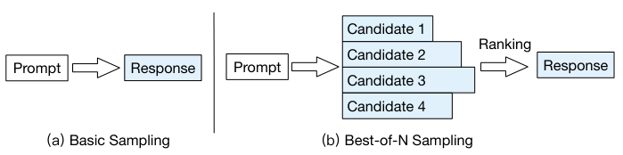

**Original caption:** Figure 1: Comparison of sampling strategies used in LLM inference. (a) Basic sampling generates a single response directly from the prompt. (b) Best-of-N sampling generates multiple candidate response sequences for one prompt, and selects the final response through a ranking process.

**中文图注:** 图 1：LLM 推理中采样策略的比较。（a）基本采样直接根据提示词生成单个回答。（b）Best-of-N 采样为一个提示词生成多个候选回答序列，再通过排序过程选择最终回答。

**Source:** p.3 · S014

**Original:** As shown in Fig.2, parallel token generation leads to dynamic sparsity patterns in neuron activations [Footnote 1](#N002) during inference. Our analysis uncovers two key insights that current LLM frameworks fail to exploit: First, while large batch sizes exhibit consistent “hot spots” of activated neurons, single-batch processing demonstrates higher sparsity with more dispersed, irregular activation patterns. Second, during decoding, the effective batch size exhibits dynamic fluctuations due to varying sequence termination points. The proportion of highly-activated neurons (depicted in white in Fig.2) demonstrates a dramatic correlation with batch size, escalating from less than 1% at batch size 1 to approximately 75% at batch size 32. These two insights not only indicate that an efficient inference system should exploit sparsity patterns between hot and cold neurons, but also needs to dynamically adapt to their shifting distributions.

**中文:** 如图 2 所示，并行 token 生成会在推理过程中带来动态变化的神经元激活稀疏模式[脚注 1](#N002)。我们的分析揭示了当前 LLM 框架未充分利用的两个关键现象：首先，大批量下会出现稳定的神经元激活“热点”，而批量大小为 1 时的稀疏性更高，激活模式更分散、更不规则。其次，在解码过程中，由于不同序列在不同位置结束，有效批量大小会动态波动。高频激活神经元的比例（图 2 中的白色部分）与批量大小显著相关：从批量大小为 1 时的不足 1%，上升到批量大小为 32 时的约 75%。这两个现象说明，高效推理系统不仅应利用冷热神经元之间的稀疏模式差异，还需要动态适应它们不断变化的分布。

**Figure 2 / 图 2**

**Source:** p.3 · F002 / C002；置于 S014 后。

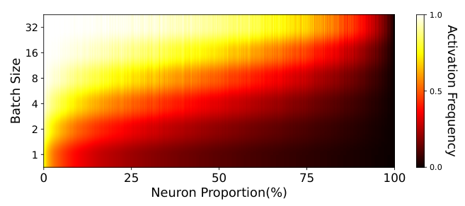

**Original caption:** Figure 2: Neuron activation patterns in layer 10 of Bamboo-7B under different batch sizes. The X-axis represents the proportion of neurons (sorted by activation frequency), and the Y-axis shows different batch sizes. Darker red indicates lower activation frequency.

**中文图注:** 图 2：不同批量大小下，Bamboo-7B 第 10 层的神经元激活模式。横轴为神经元比例，神经元按激活频率排序；纵轴为不同批量大小。红色越深，表示激活频率越低。

### 2.3 Mobile Hardware Characteristics / 2.3 移动硬件特性

**Source:** p.3 · S015

**Original:** Mobile devices present fundamentally different hardware characteristics from PCs, manifesting in two key aspects that directly impact LLM inference: (1) heterogeneous computing capabilities with distinct sparse computation characteristics, and (2) distinct storage architecture with unique I/O characteristics.

**中文:** 移动设备与 PC 的硬件特性存在根本差异，主要体现在直接影响 LLM 推理的两个方面：（1）异构计算能力，以及不同的稀疏计算特性；（2）不同的存储架构及其独特 I/O 特性。

#### 2.3.1 Computing Unit Characteristics / 2.3.1 计算单元特性

**Source:** p.3 · S016

**Original:** Unlike high-end PC environments where discrete GPUs consistently dominate LLM computations, smartphones feature multiple computing units (including CPU, GPU, NPU, etc.) with distinct performance characteristics, particularly in handling sparse computations. Taking OnePlus 12 (equipped with a Qualcomm Snapdragon 8 Gen 3 processor) as a case study, we analyze how each processor type handles dense versus sparse computations in LLM inference tasks.

**中文:** 在高端 PC 环境中，独立 GPU 始终主导 LLM 计算；而智能手机配有 CPU、GPU、NPU 等多个计算单元，它们具有不同的性能特性，在处理稀疏计算时尤其如此。我们以配备高通 Snapdragon 8 Gen 3 处理器的 OnePlus 12 为例，分析各种处理器在 LLM 推理任务中执行稠密与稀疏计算的表现。

**Figure 3 / 图 3**

**Source:** p.3 · F003 / C003；置于 S016 后。

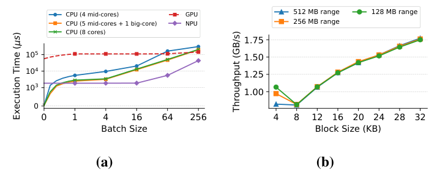

**Original caption:** Figure 3: (a) Comparison of execution times for matrix-vector multiplication operations with varying computational loads across CPU, GPU, and NPU platforms. The test involves multiplying a $14336\times4096$ matrix with vectors under different batch sizes. The X-axis represents the batch size while the Y-axis shows execution time. (b) Random read throughput performance for 4KB operations across different block sizes and data ranges. The X-axis depicts block size, while the Y-axis represents throughput.

**中文图注:** 图 3：（a）CPU、GPU 和 NPU 平台在不同计算负载下执行矩阵–向量乘法的时间比较。测试在不同批量大小下，将 $14336\times4096$ 矩阵与向量相乘。横轴为批量大小，纵轴为执行时间。（b）不同块大小和数据范围下，4KB 操作的随机读取吞吐表现。横轴为块大小，纵轴为吞吐量。

**Source:** p.3 · S017

**Original:** CPU’s Advantage in Sparse Computing. Mobile CPUs utilize big.LITTLE technology [11], combining high-performance “big” cores with high-efficiency “little” cores. The Snapdragon 8 Gen 3 features a 1+5+2 configuration: one big-core for peak performance, five mid-cores for balanced performance, and two little-cores for energy efficiency. Our experiments reveal that mobile CPUs, particularly the big and middle cores, excel at handling sparse matrix-vector computations. When handling sparse computations (matrices with batch size less than 1), six CPU cores demonstrate faster performance compared to NPUs and GPUs, as illustrated in Fig.3-a.

**中文:** CPU 在稀疏计算方面的优势。移动 CPU 采用 big.LITTLE 技术 [11]，将高性能“大核”与高能效“小核”结合。Snapdragon 8 Gen 3 采用 1+5+2 配置：一个大核提供峰值性能，五个中核兼顾性能，两个小核侧重能效。实验发现，移动 CPU，尤其是大核和中核，擅长处理稀疏矩阵–向量计算。如图 3(a) 所示，处理稀疏计算时（批量大小小于 1 的矩阵），六个 CPU 核心的执行速度快于 NPU 和 GPU。

**Source:** p.3, p.4 · S018

**Original:** NPU’s Dense Computing Strength. The Neural Processing Unit (NPU), while efficient for dense computations, shows limitations in sparse operations. As shown in Fig.3-a, NPUs excel at large batch processing, performing significantly faster than CPUs and GPUs at high batch sizes. Therefore, for a 7B INT4 model, NPU achieves a throughput of 770 tokens/s for the prefill phase [Footnote 2](#N003), significantly outperforming GPU’s 37 tokens/s and CPU’s 8 token/s. However, our implementation of sparse computation primitives on Qualcomm’s NPU actually performs slower than CPU implementations, which is stark contrast to PC platforms where GPUs excel at both dense and sparse computations.

**中文:** NPU 在稠密计算方面的优势。神经网络处理单元（NPU）能够高效执行稠密计算，但在稀疏运算上存在局限。如图 3(a) 所示，NPU 擅长大批量处理，在较大批量下明显快于 CPU 和 GPU。因此，对于 7B INT4 模型，NPU 在预填充阶段的吞吐量达到 770 tokens/s[脚注 2](#N003)，显著超过 GPU 的 37 tokens/s 和 CPU 的 8 token/s。然而，我们在高通 NPU 上实现的稀疏计算原语，实际运行速度反而慢于 CPU 实现；这与 PC 平台形成鲜明差别，后者的 GPU 同时擅长稠密与稀疏计算。

**Source:** p.4 · S019

**Original:** GPU’s Limited Role. Mobile GPUs show consistent performance limitations in our tests. Fig.3-a demonstrates that for matrix-vector operations, GPU consistently performs slower than both NPU and CPU, with only about 50% of GPU kernel time spent on actual computation. Moreover, since GPUs are primarily responsible for rendering tasks, utilizing them for inference would significantly impact the device’s rendering frame rate [32]. Therefore, due to these performance limitations and rendering resource contention, our private communications with mobile manufacturers reveal that they avoid using GPUs for LLM inference in production systems.

**中文:** GPU 的有限作用。移动 GPU 在我们的测试中始终表现出性能限制。图 3(a) 表明，对于矩阵–向量运算，GPU 一直慢于 NPU 和 CPU，而且 GPU 内核时间中只有约 50% 真正用于计算。此外，GPU 主要负责渲染任务，将其用于推理会显著影响设备的渲染帧率 [32]。因此，考虑到这些性能限制及渲染资源争用，根据我们与手机厂商的私下交流，他们会避免在生产系统中使用 GPU 执行 LLM 推理。

**Source:** p.4 · S020

**Original:** XPU and Memory Bandwidth Sharing. Smartphone’s unified memory architecture (UMA) also differs significantly from PC’s separate VRAM and storage design. Under this architecture, all processors share the same memory space, enabling efficient memory bandwidth sharing. Our measurements on OnePlus 12 running a 7B parameter model show that memory bandwidth varies significantly based on processor utilization. When performing matrix multiplication operations, CPU-only computations achieve 43.9GB/s bandwidth, while NPU-only computations reach 56GB/s. However, when coordinating both processors simultaneously, the aggregate memory bandwidth increases to 59.6GB/s. This suggests that mobile LLM inference frameworks should leverage heterogeneous processors simultaneously to maximize the utilization of shared memory bandwidth.

**中文:** XPU 与内存带宽共享。智能手机的统一内存架构（UMA）也明显不同于 PC 中显存和存储分离的设计。在这一架构下，所有处理器共享同一内存空间，可以高效共享内存带宽。我们在 OnePlus 12 上运行 7B 参数模型的测量结果表明，内存带宽会随处理器使用方式明显变化。执行矩阵乘法时，仅使用 CPU 可达到 43.9GB/s，仅使用 NPU 可达到 56GB/s；同时协调两类处理器时，聚合内存带宽提高到 59.6GB/s。这说明移动端 LLM 推理框架应同时利用异构处理器，以充分使用共享内存带宽。

#### 2.3.2 Storage I/O Characteristics / 2.3.2 存储 I/O 特性

**Source:** p.4 · S021

**Original:** The second key challenge arises from the fundamental differences between mobile and PC storage architectures. Mobile devices primarily use Universal Flash Storage (UFS), which exhibits markedly different I/O characteristics compared to the NVMe SSDs found in PCs. Through our comprehensive analysis of UFS 4.0, we identified four distinctive performance characteristics that significantly impact LLM inference:

**中文:** 第二项关键挑战源于移动端与 PC 存储架构的根本差异。移动设备主要使用通用闪存存储（UFS），其 I/O 特性与 PC 中的 NVMe SSD 明显不同。通过全面分析 UFS 4.0，我们发现四项会显著影响 LLM 推理的性能特性：

**Source:** p.4 · S022

**Original:** Block Size Impact. Read bandwidth varies significantly with block size. For sequential reads, bandwidth ranges from 450 MB/s with 4KB blocks to 4 GB/s with 512KB blocks. Random read performance shows similar variation, reaching 3.5 GB/s with 512KB blocks but dropping significantly with smaller blocks.

**中文:** 块大小的影响。读取带宽随块大小显著变化。顺序读取时，4KB 块的带宽为 450 MB/s，而 512KB 块可达到 4 GB/s。随机读取也呈现类似变化：512KB 块可达到 3.5 GB/s，但更小的块会使性能明显下降。

**Source:** p.4 · S023

**Original:** Data Range Sensitivity. Random read performance is highly sensitive to the scope of the read range. As shown in Fig.3-b, 4KB random reads within a 128MB range achieve 1 GB/s, while the same operations across a 512MB range drop below 850 MB/s. This characteristic is particularly pronounced for small block sizes, making data locality crucial for performance optimization.

**中文:** 对数据范围的敏感性。随机读取性能对读取范围的大小非常敏感。如图 3(b) 所示，在 128MB 范围内进行 4KB 随机读取可达到 1 GB/s，而在 512MB 范围内执行相同操作时，带宽降到 850 MB/s 以下。这一特征在小块读取时尤为明显，因此数据局部性对性能优化至关重要。

**Source:** p.4 · S024

**Original:** CPU Core Dependencies. Storage performance is tightly coupled with the CPU core handling I/O operations. As shown in Table 1, using a big-core (3.3GHz) achieves 1 GB/s for 4KB random reads, while a little-core (2.2GHz) only reaches 760 MB/s. This correlation stems from the CPU’s role in processing UFS driver operations, including interrupt handling and queue management.

**中文:** 对 CPU 核心的依赖。存储性能与负责 I/O 操作的 CPU 核心紧密相关。如表 1 所示，使用 3.3GHz 大核进行 4KB 随机读取可达到 1 GB/s，而 2.2GHz 小核只能达到 760 MB/s。这种相关性源于 CPU 需要处理 UFS 驱动操作，包括中断处理和队列管理。

**Table 1 / 表 1**

**Source:** p.4 · T001 / CT001；置于 S024 后。

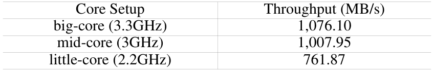

**Original caption:** Table 1: 4KB random read throughputs on 128MB data range with different core setups.

**中文图注:** 表 1：不同 CPU 核心配置下，在 128MB 数据范围内进行 4KB 随机读取的吞吐量。

**可复制表格 / Copyable table（原始数值不变）：**

| Core setup / 核心配置 | Throughput / 吞吐量 (MB/s) |
| --- | --- |
| big-core / 大核 (3.3GHz) | 1,076.10 |
| mid-core / 中核 (3GHz) | 1,007.95 |
| little-core / 小核 (2.2GHz) | 761.87 |

**Source:** p.4 · S025

**Original:** Limited Concurrency. Unlike NVMe SSDs with multiple command queues, UFS storage has a single command queue, limiting internal concurrency. Our tests show that using multiple cores for I/O operations can degrade performance by up to 40% due to command queue contention.

**中文:** 有限的并发性。NVMe SSD 具有多个命令队列，而 UFS 存储只有一个命令队列，内部并发性受限。测试表明，由于命令队列争用，使用多个核心执行 I/O 操作会使性能最多下降 40%。

### 2.4 Limitations of Existing Solutions / 2.4 现有方案的局限

**Source:** p.4 · S026

**Original:** These mobile hardware characteristics pose significant challenges for existing LLM inference frameworks. To quantitatively analyze the performance bottlenecks of existing solutions on mobile platforms, we implemented and evaluated both PowerInfer and LLMFlash on a OnePlus 12 smartphone running the Mistral 7B model. We set a small memory budget for the evaluation and offloaded 50% of FFN weights to flash storage. Since PowerInfer was originally designed without flash storage support, we extended its design to handle cases where model weights exceed available memory. Both systems use Asynchronous I/O (AIO) to access cold neurons stored in flash storage.

**中文:** 这些移动硬件特性给现有 LLM 推理框架带来显著挑战。为定量分析现有方案在移动平台上的性能瓶颈，我们在运行 Mistral 7B 模型的 OnePlus 12 智能手机上，实现并评估了 PowerInfer 和 LLMFlash。评估采用较小的内存预算，将 50% 的 FFN 权重卸载到闪存。由于 PowerInfer 原始设计不支持闪存，我们扩展了其设计，以处理模型权重超过可用内存的情况。两个系统都采用异步 I/O（AIO），访问存储在闪存中的冷神经元。

**Table 2 / 表 2**

**Source:** p.4 · T002 / CT002；置于 S026 后。

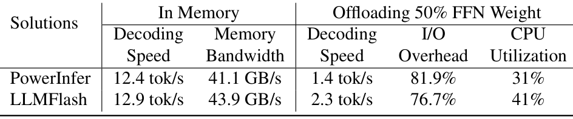

**Original caption:** Table 2: Decoding speeds and FFN performance in of Mistral 7B on existing methods w/wo offloading.

**中文图注:** 表 2：现有方法在有／无卸载条件下，运行 Mistral 7B 的解码速度与 FFN 性能。

**可复制表格 / Copyable table（原始数值不变）：**

| Solution / 方法 | In memory: decoding / 全驻内存解码 (tok/s) | In memory: bandwidth / 全驻内存带宽 (GB/s) | 50% offload: decoding / 卸载50%解码 (tok/s) | 50% offload: I/O overhead / I/O开销 | 50% offload: CPU utilization / CPU利用率 |
| --- | --- | --- | --- | --- | --- |
| PowerInfer | 12.4 | 41.1 | 1.4 | 81.9% | 31% |
| LLMFlash | 12.9 | 43.9 | 2.3 | 76.7% | 41% |

**Source:** p.4, p.5 · S027

**Original:** Our experimental results demonstrate severe performance degradation when offloading 50% of FFN weights to flash storage. As shown in Table 2, PowerInfer experiences a 89% decoding speed reduction, while LLMFlash suffers a 82% decline. This significant performance gap can be attributed to two fundamental challenges in the mobile computing environment. First, existing solutions’ computational strategies are heavily dependent on hardware-accelerated sparse operations. While this approach is effective on PC platforms with powerful GPUs, it becomes problematic on mobile devices where NPUs lack efficient sparse computation capabilities, ultimately forcing all sparse computations onto the CPU. Our measurements from Table 2 reveal that even with weights stored in memory, mobile memory bandwidth utilization reaches only approximately 43.9 GB/s due to CPU cores’ limited computing capabilities, which is far below 59.6GB/s when both NPU and CPU are fully engaged. Second, the significantly lower I/O bandwidth of mobile UFS storage (compared to PC’s NVMe SSDs) creates a major performance bottleneck, with I/O overhead accounting for 82% and 77% of total latency in PowerInfer and LLMFlash respectively. The slow I/O operations force computing units to frequently idle while waiting for I/O operations, with CPU utilization dropping to 41% during weight loading phases.

**中文:** 实验结果表明，将 50% 的 FFN 权重卸载到闪存后，性能严重下降。如表 2 所示，PowerInfer 的解码速度下降 89%，LLMFlash 下降 82%。这一显著性能差距可归因于移动计算环境中的两个根本性挑战。首先，现有方案的计算策略高度依赖硬件加速的稀疏运算。这种方法在配备强大 GPU 的 PC 上有效，但移动设备的 NPU 缺乏高效稀疏计算能力，最终所有稀疏计算都被迫交给 CPU。表 2 的测量表明，即使权重已存入内存，受 CPU 核心计算能力限制，移动内存带宽也仅约为 43.9 GB/s，远低于 NPU 与 CPU 充分协同工作时的 59.6GB/s。其次，与 PC 的 NVMe SSD 相比，移动 UFS 存储的 I/O 带宽明显更低，形成严重性能瓶颈：I/O 开销分别占 PowerInfer 和 LLMFlash 总延迟的 82% 和 77%。缓慢的 I/O 使计算单元在等待期间频繁空闲，权重加载阶段的 CPU 利用率降至 41%。

## 3 PowerInfer-2 Overview / 3 PowerInfer-2 概览

### 3.1 Neuron Cluster and Design Principles / 3.1 神经元簇与设计原则

**Source:** p.5 · S028

**Original:** This paper proposes neuron clusters as the basic unit for mobile LLM inference. A neuron cluster consists of a group of neurons from the same FFN layer that exhibit similar activation patterns. The cluster size is adaptively determined and categorized based on both hardware characteristics and activation frequencies: larger hot clusters comprising frequently activated neurons are allocated for NPU-accelerated dense computations, while smaller cold clusters containing rarely activated neurons are handled by CPU-driven sparse computations.

**中文:** 本文提出将神经元簇作为移动端 LLM 推理的基本单元。神经元簇由同一 FFN 层中具有相似激活模式的一组神经元组成。簇大小根据硬件特性与激活频率自适应确定并分类：由频繁激活神经元构成的较大热簇，被分配给 NPU 执行加速稠密计算；由较少激活神经元构成的较小冷簇，则由 CPU 执行稀疏计算。

**Source:** p.5 · S029

**Original:** PowerInfer-2 builds upon this abstraction with two design principles. First, Sparsity-Aware Adaptation maximizes hardware utilization through intelligent workload distribution. During prefill phase, the system leverages NPU for efficient dense operations. During decoding phase, it dynamically allocates workload between CPU and NPU based on sparsity patterns and batch sizes. Second, I/O-Aware Orchestration optimizes UFS storage access through fine-grained pipelining and differentiated I/O strategies for various types of LLM weights.

**中文:** PowerInfer-2 在这一抽象上建立了两项设计原则。第一，稀疏度感知适配通过合理分配工作负载，最大化硬件利用率。预填充阶段利用 NPU 高效执行稠密运算；解码阶段根据稀疏模式与批量大小，在 CPU 和 NPU 之间动态分配工作负载。第二，I/O 感知编排通过细粒度流水线，以及针对不同类型 LLM 权重的差异化 I/O 策略，优化 UFS 存储访问。

### 3.2 Overall Architecture / 3.2 总体架构

**Source:** p.5 · S030

**Original:** Fig.4 presents the overall architecture of PowerInfer-2, which consists of an offline planning phase and an online inference phase. Due to the dynamic sparsity patterns and heterogeneous computing characteristics of mobile platforms, the offline phase needs to analyze both model characteristics and hardware capabilities to generate optimized execution plans. During online inference, PowerInfer-2 proposes four techniques and mechanisms (§4) to deliver efficient inference on mobile devices.

**中文:** 图 4 展示了 PowerInfer-2 的总体架构，包括离线规划和在线推理两个阶段。由于移动平台存在动态稀疏模式和异构计算特性，离线阶段需要同时分析模型特征与硬件能力，以生成优化后的执行计划。在线推理阶段，PowerInfer-2 提出四项技术与机制（第 4 节），以在移动设备上实现高效推理。

**Figure 4 / 图 4**

**Source:** p.5 · F004 / C004；置于 S030 后。

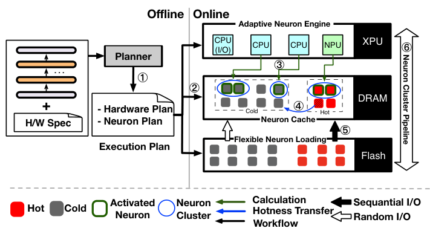

**Original caption:** Figure 4: The architecture overview of PowerInfer-2.

**中文图注:** 图 4：PowerInfer-2 的架构概览。

**Source:** p.5 · S031

**Original:** Offline Planning: The planner first conducts offline analysis by running the model to understand activation patterns across different batch sizes. It classifies neurons into hot clusters and cold clusters through a comprehensive process that considers both model characteristics and hardware capabilities. Based on this analysis, it generates an execution plan (Step ①) including a neuron plan that guides how to split neurons into clusters, and a hardware plan that guides how to configure the hardware resources for PowerInfer-2 (Step ②).

**中文:** 离线规划：规划器首先通过运行模型进行离线分析，了解不同批量大小下的激活模式。它综合考虑模型特征与硬件能力，将神经元划分为热簇和冷簇。基于这一分析，规划器生成执行计划（步骤①），其中包括指导神经元如何分簇的神经元计划，以及指导 PowerInfer-2 如何配置硬件资源的硬件计划（步骤②）。

**Source:** p.5 · S032

**Original:** Online Inference: During inference, an adaptive neuron engine (Step ③) efficiently orchestrates workload distribution between NPU and CPU based on the neuron plan and dynamic sparsity patterns. The engine implements two specialized strategies: During the prefill phase, it uses an NPU-centric approach where the NPU handles dense matrix operations while a dedicated CPU core performs parallel weight loading. For the decoding phase, the engine adopts a CPU-NPU hybrid strategy that optimally distributes workload - assigning hot neuron clusters to the NPU while delegating cold clusters to the CPU. Similar to PowerInfer and LLMFlash, the CPU side features an online predictor to minimize computation overhead by selectively calculating only those neurons predicted to be activated. To accommodate dynamic sparsity patterns, the engine continuously monitors and adjusts neuron cluster allocation between NPU and CPU as batch sizes evolve over time (Step ④).

**中文:** 在线推理：推理期间，自适应神经元引擎（步骤③）根据神经元计划与动态稀疏模式，高效编排 NPU 和 CPU 之间的工作负载分配。引擎采用两项专用策略：预填充阶段以 NPU 为中心，由 NPU 处理稠密矩阵运算，专用 CPU 核心并行加载权重；解码阶段采用 CPU–NPU 混合策略，将热神经元簇分配给 NPU、冷簇分配给 CPU，以优化工作负载分布。与 PowerInfer 和 LLMFlash 类似，CPU 侧配有在线预测器，仅选择性地计算预计会激活的神经元，以尽量减少计算开销。为适应动态稀疏模式，随着批量大小随时间变化，引擎会持续监测并调整 NPU 与 CPU 之间的神经元簇分配（步骤④）。

**Source:** p.5 · S033

**Original:** Prior to initiating inference computations, the computing engine retrieves neuron weights from a neuron cache specifically designed to exploit distinct access patterns of different LLM weights. For weights not present in the cache, PowerInfer-2 introduces an adaptive neuron loading mechanism that uses differentiated I/O strategies to maximize efficiency (Step ⑤). To mitigate the performance impact of random reads, PowerInfer-2 introduces a neuron cluster pipeline mechanism (Step ⑥). For instance, upon completing the processing of a neuron cluster from matrix A, CPU cores immediately transition to processing pre-cached neuron clusters from matrix B. This operation executes concurrently with ongoing I/O operations for matrix A’s in-flash neuron clusters, enabling optimal parallelization between computation and I/O operations.

**中文:** 开始推理计算前，计算引擎会从神经元缓存中获取神经元权重；该缓存专门利用不同 LLM 权重的访问模式差异。对于缓存中不存在的权重，PowerInfer-2 引入自适应神经元加载机制，使用差异化 I/O 策略提高效率（步骤⑤）。为减轻随机读取对性能的影响，PowerInfer-2 引入神经元簇流水线机制（步骤⑥）。例如，CPU 核心完成矩阵 A 中一个神经元簇的处理后，立即转去处理矩阵 B 中已预先缓存的神经元簇。该计算与矩阵 A 中闪存神经元簇尚在进行的 I/O 操作并发执行，从而充分并行化计算与 I/O。

## 4 Detailed Design of Online Inference / 4 在线推理的详细设计

### 4.1 Adaptive Neuron Engine / 4.1 自适应神经元引擎

**Source:** p.5 · S034

**Original:** PowerInfer-2 introduces an adaptive neuron engine that proposes flexible computation strategies based on different inference stages and dynamic sparsity, fully leveraging the computational capabilities of mobile XPUs.

**中文:** PowerInfer-2 引入自适应神经元引擎，根据不同推理阶段和动态稀疏性采用灵活计算策略，充分发挥移动 XPU 的计算能力。

#### 4.1.1 NPU-Centric Prefill / 4.1.1 以 NPU 为中心的预填充

**Source:** p.5, p.6 · S035

**Original:** In the prefill phase, all prompt tokens are processed concurrently. Even though individual tokens exhibit high sparsity and activate distinct neurons, the overall sparsity decreases significantly when aggregating these activations across the batch. Consequently, PowerInfer-2 merges all neurons into a large cluster during the prefill stage rather than using predictors to calculate activated neurons. Given NPU’s superior performance in large batch matrix operations compared to CPU, PowerInfer-2 primarily leverages NPU for prefill computations. Although CPU cores do not participate in matrix calculations during prefill, the neuron engine leverage a CPU core to load all weights sequentially from flash into memory.

**中文:** 预填充阶段会并发处理全部提示词 token。虽然单个 token 呈现较高稀疏性，并激活不同神经元，但将整个批次的激活情况汇总后，整体稀疏性会显著降低。因此，PowerInfer-2 在预填充阶段将所有神经元合并为一个大簇，而不使用预测器计算哪些神经元被激活。由于 NPU 在大批量矩阵运算上的性能优于 CPU，PowerInfer-2 主要利用 NPU 执行预填充计算。CPU 核心虽然不参与预填充阶段的矩阵计算，但神经元引擎会利用一个 CPU 核心，将全部权重从闪存顺序加载到内存。

**Source:** p.6 · S036

**Original:** Fig.5-a shows how CPUs and NPU work together for prefill-phase inference. The NPU processes all LLM layers sequentially via its powerful dense matrix operations. The NPU shares limited memory with the CPU, so the CPU preloads matrix weights into this shared memory before NPU computation. PowerInfer-2 uses a big-core to asynchronously preload weights for the next layer into the neuron cache. Since the prefill stage involves dense matrix calculations, sequential reads are used to load large data blocks, maximizing UFS’s I/O bandwidth.

**中文:** 图 5(a) 展示了 CPU 与 NPU 如何协同执行预填充推理。NPU 通过强大的稠密矩阵运算能力，依次处理所有 LLM 层。NPU 与 CPU 共享有限内存，因此 CPU 需要在 NPU 计算前，将矩阵权重预加载到共享内存中。PowerInfer-2 使用一个大核，将下一层的权重异步预加载到神经元缓存。由于预填充阶段执行稠密矩阵计算，系统通过顺序读取加载大数据块，以充分利用 UFS 的 I/O 带宽。

**Figure 5 / 图 5**

**Source:** p.6 · F005 / C005；置于 S036 后。

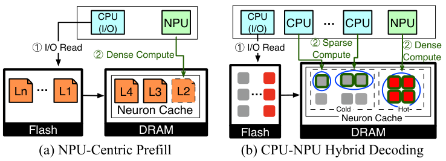

**Original caption:** Figure 5: Two computing workflows for prefill and decoding phases. (a) The prefill phase uses an NPU-centric workflow that leverages NPU for computation; (b) The decoding phase employs a CPU-NPU hybrid workflow for FFN computation where NPU handles dense computations for hot neurons while CPU cores process sparse computations for cold neurons, with their processing ratio automatically adjusting to match the dynamic sparsity patterns caused by varying batch sizes. The attention computation is handled entirely by NPU but not shown in the figure.

**中文图注:** 图 5：预填充和解码阶段的两种计算流程。（a）预填充阶段采用以 NPU 为中心的流程，利用 NPU 执行计算。（b）解码阶段的 FFN 计算采用 CPU–NPU 混合流程：NPU 对热神经元执行稠密计算，CPU 核心对冷神经元执行稀疏计算；处理比例自动调整，以适应批量大小变化引起的动态稀疏模式。注意力计算全部由 NPU 处理，未在图中显示。

#### 4.1.2 Hybrid CPU-NPU Decoding / 4.1.2 CPU–NPU 混合解码

**Source:** p.6 · S037

**Original:** During decoding, PowerInfer-2 adopts distinct strategies for attention and FFN computations (Fig.5-b). For attention blocks, which are inherently dense but relatively small, PowerInfer-2 partitions and distributes individual attention heads between CPU and NPU, with each XPU processing its assigned heads in parallel.

**中文:** 解码阶段，PowerInfer-2 对注意力与 FFN 计算采用不同策略（图 5(b)）。注意力模块本质上是稠密的，但规模相对较小；对此，PowerInfer-2 将不同注意力头划分并分配到 CPU 和 NPU，各个 XPU 并行处理分配给自己的注意力头。

**Source:** p.6 · S038

**Original:** For FFN blocks that dominate computation, PowerInfer-2 adopts a hybrid approach where NPU handles dense hot neurons while CPU processes sparse cold neurons. The neuron engine splits an FFN matrix along the neuron dimension (rows), with the split ratio dynamically adjusting based on batch size. For example, when batch size is 1, it divides a typical FFN matrix ($14336\times4096$) into two equal sub-matrices ($7168\times4096$) for NPU and CPU respectively. As batch size increases, the NPU portion grows larger to handle more dense computations. The NPU performs dense matrix multiplication on its portion, while CPU cores process cold neurons with a predictor-based approach [51]. The CPU further divides its workload into smaller chunks (e.g., $512\times4096$) for parallel processing, utilizing ARM Neon extensions for vectorized computation. After both XPUs complete their computations, the results are merged by the CPU side to form the final output.

**中文:** 对于占主导计算量的 FFN 模块，PowerInfer-2 采用混合方法：NPU 处理稠密的热神经元，CPU 处理稀疏的冷神经元。神经元引擎沿神经元维度（行）划分 FFN 矩阵，划分比例随批量大小动态调整。例如，批量大小为 1 时，它将一个典型的 FFN 矩阵（$14336\times4096$）划分为两个大小相同的子矩阵（$7168\times4096$），分别交给 NPU 和 CPU。随着批量大小增加，NPU 承担的部分扩大，以处理更多稠密计算。NPU 对自己的部分执行稠密矩阵乘法，CPU 核心则使用基于预测器的方法 [51] 处理冷神经元。CPU 进一步将工作负载划分为更小的块，例如 $512\times4096$，进行并行处理，并利用 ARM Neon 扩展执行向量化计算。两类 XPU 完成计算后，由 CPU 侧合并结果，形成最终输出。

#### 4.1.3 Dynamic CPU-NPU Adjustment / 4.1.3 动态 CPU–NPU 调整

**Source:** p.6 · S039

**Original:** To handle dynamic sparsity patterns efficiently, the adaptive neuron engine dynamically adjusts the CPU-NPU computation ratio based on runtime batch sizes. CPU cores monitor batch size changes by tracking the completion and creation of decoding sequences. For large batch sizes with multiple concurrent sequences, sparsity is low due to high neuron activation overlap. In this case, NPU handles most computations (about 70%) while CPU processes the remaining sparse part (about 30%). As sequences complete over time and batch size decreases, sparsity increases, shifting more workload to CPU cores (up to 50% for batch size 1) while NPU focuses on remaining hot neurons.

**中文:** 为高效处理动态稀疏模式，自适应神经元引擎根据运行时批量大小，动态调整 CPU–NPU 的计算比例。CPU 核心通过跟踪解码序列的完成与创建，监测批量大小变化。对于存在多个并发序列的大批量，神经元激活重叠较高，因此稀疏性较低。此时，NPU 负责大部分计算（约 70%），CPU 处理剩余的稀疏部分（约 30%）。随着序列逐渐完成、批量大小减小，稀疏性增加，更多工作负载转移到 CPU 核心；当批量大小为 1 时，CPU 最多承担 50%，NPU 则专注于剩余热神经元。

**Source:** p.6 · S040

**Original:** Given NPU’s static graph execution model, adjusting its computational load requires loading new computation graphs. During the offline phase, PowerInfer-2 prepares multiple NPU computation graphs, each optimized for a specific batch size and corresponding hot neuron ratio. These graphs differ in their operator shapes based on the number of participating neurons. When the engine detects the need for NPU load adjustment during runtime, it initiates an asynchronous graph loading process while NPU is computing the attention block. The new graph, typically only 10KB in size, is loaded into NPU memory and becomes active immediately after attention computation completes. This asynchronous loading mechanism completely overlaps with NPU computation, ensuring seamless transitions between different computational configurations without introducing additional overhead.

**中文:** 由于 NPU 采用静态图执行模型，调整其计算负载需要加载新的计算图。离线阶段，PowerInfer-2 会准备多个 NPU 计算图，分别针对特定批量大小和相应的热神经元比例进行优化。这些图的算子形状随参与计算的神经元数量而不同。运行时引擎检测到需要调整 NPU 负载时，会趁 NPU 正在计算注意力模块，启动异步图加载。新图通常仅为 10KB，加载到 NPU 内存后，在注意力计算完成时立即生效。异步加载与 NPU 计算完全重叠，使不同计算配置之间能够无缝切换，不引入额外开销。

### 4.2 In-Memory Neuron Cache / 4.2 内存中的神经元缓存

**Source:** p.6 · S041

**Original:** Efficient in-memory caching is crucial for optimizing inference performance by minimizing the frequency of I/O operations. While prior work like LLMFlash [7] proposes bundling co-activated neurons to reduce I/O operations, this approach faces two key limitations on mobile devices: First, it overlooks the skewed activation patterns where a small set of hot neurons dominates the connections, leading to redundant loading of these frequently activated neurons across different bundles. Second, our analysis shows that after excluding hot neurons, the co-activation probability among remaining neurons drops below 20%, making the bundling strategy ineffective for I/O reduction.

**中文:** 高效的内存缓存能够尽量减少 I/O 操作频率，对推理性能优化至关重要。LLMFlash [7] 等已有研究提出，将共同激活的神经元捆绑以减少 I/O，但这一方法在移动设备上存在两项关键局限：首先，它忽略了偏斜激活模式，即少量热神经元占据主要连接，导致这些高频激活神经元在不同捆绑组中被重复加载；其次，我们的分析表明，剔除热神经元后，剩余神经元之间的共同激活概率低于 20%，使捆绑策略难以有效减少 I/O。

**Source:** p.6, p.7 · S042

**Original:** To overcome these limitations, PowerInfer-2 implements a temperature-based caching strategy with two objectives: eliminating redundant loading by explicitly distinguishing hot and cold neurons, and optimizing cache efficiency for cold neurons through individual management rather than bundling, given their low co-activation probability. Specifically, the cache consists of three regions: (1) a fixed region for attention weights and KV cache that are preloaded and retained; (2) a hot region for NPU dense computations; and (3) a cold region for CPU sparse computations.

**中文:** 为克服这些局限，PowerInfer-2 实现了基于热度的缓存策略，具有两个目标：通过明确区分冷热神经元，消除重复加载；考虑到冷神经元的共同激活概率较低，对它们逐个管理而非捆绑，以优化缓存效率。具体而言，缓存分为三个区域：（1）固定区，用于预加载并保留注意力权重和 KV 缓存；（2）热区，用于 NPU 稠密计算；（3）冷区，用于 CPU 稀疏计算。

**Source:** p.7 · S043

**Original:** The hot and cold regions employ different organizational strategies. The hot region groups neurons into dense matrices, combining Gate, Up, and Down sub-matrices mentioned in §4.1.2 into a unified hot neuron cluster. In contrast, the cold region manages neurons individually. Both regions use LRU-based eviction, but at different granularities: cluster-level for the hot region and neuron-level for the cold region. Evicted weights from both regions are simply discarded from memory without being written back to storage.

**中文:** 热区与冷区采用不同组织策略。热区将神经元组织为稠密矩阵，把第 4.1.2 节提到的 Gate、Up、Down 子矩阵组合成统一的热神经元簇；冷区则逐个管理神经元。两个区域都采用基于最近最少使用（LRU）的驱逐策略，但粒度不同：热区为簇级，冷区为神经元级。从两区驱逐的权重都直接从内存丢弃，无需写回存储。

**Source:** p.7 · S044

**Original:** When batch sizes change, PowerInfer-2 dynamically adjusts the hot-cold region ratio. For larger batches, the hot region expands to support increased NPU computations, while the cold region shrinks by evicting the least active neurons via LRU policy. Conversely, for smaller batches, the hot region also discards the least active neuron clusters to make room for the cold region.

**中文:** 批量大小变化时，PowerInfer-2 动态调整热区与冷区的比例。较大批量下，热区扩大，以支持更多 NPU 计算；冷区通过 LRU 策略驱逐最不活跃的神经元，从而缩小。反之，较小批量下，热区也会丢弃最不活跃的神经元簇，为冷区腾出空间。

### 4.3 Neuron-Cluster-Level Pipeline / 4.3 神经元簇级流水线

**Source:** p.7 · S045

**Original:** Equipped with the neuron cache, I/O operations for uncached weights remain inevitable. While attention blocks and hot neurons benefit from efficient sequential reads, cold neurons require random I/O operations due to their sparse activation patterns. This results in significantly reduced bandwidth due to UFS’s poor random read performance, creating a major bottleneck that impacts systems like PowerInfer and LLMFlash on mobile devices (§2.4).

**中文:** 即使配备神经元缓存，对未缓存权重的 I/O 操作仍不可避免。注意力模块和热神经元可以受益于高效顺序读取，但冷神经元由于激活稀疏，需要随机 I/O。UFS 的随机读取性能较差，导致带宽显著降低，形成移动设备上 PowerInfer 和 LLMFlash 等系统的主要瓶颈（第 2.4 节）。

**Source:** p.7 · S046

**Original:** Therefore, PowerInfer-2 should hide I/O latency by overlapping computation with I/O operations. A straightforward approach is matrix-level overlapping: processing cached neurons while simultaneously loading uncached neurons from storage. However, this approach still has limitations. The system must wait for all neurons within a matrix to be available before proceeding to the next matrix, especially when some neurons require lengthy I/O operations. For example, as shown in Fig.6-a, with a matrix containing 8 neuron clusters (4 in memory, 4 in storage), CPU cores may still experience idle periods waiting for I/O completion, despite partial overlapping of computation and I/O.

**中文:** 因此，PowerInfer-2 需要通过计算与 I/O 重叠来隐藏 I/O 延迟。一个直接的方法是矩阵级重叠：一边处理已缓存神经元，一边从存储加载未缓存神经元。但这一方法仍有局限：必须等到矩阵中的全部神经元就绪后，才能进入下一个矩阵，尤其是某些神经元需要长时间 I/O 时。例如，图 6(a) 中一个矩阵有 8 个神经元簇，4 个在内存、4 个在存储中；即使计算与 I/O 部分重叠，CPU 核心仍可能出现等待 I/O 完成的空闲时段。

**Figure 6 / 图 6**

**Source:** p.7 · F006 / C006；置于 S046 后。

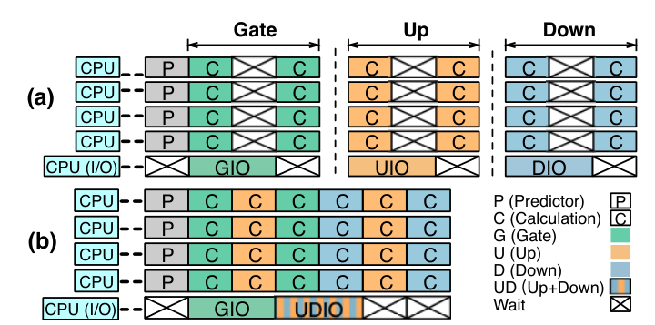

**Original caption:** Figure 6: Two types of pipelines that combine matrix-vector multiplications and I/O operations on five cores (4 calculation cores and 1 I/O cores). Assuming that there are 8 neuron cluster per matrix, 4 of them are in memory and the other 4 are in flash before the computation starts. (a) The matrix-level pipeline separates the pipeline into isolated matrix units; (b) The neuron-cluster-level pipeline in PowerInfer-2 breaks the matrix barrier and mixs their calculation and I/O operations in the neuron cluster granularity.

**中文图注:** 图 6：在五个核心上组合矩阵–向量乘法与 I/O 操作的两类流水线，其中包含 4 个计算核心和 1 个 I/O 核心。假设每个矩阵有 8 个神经元簇，计算开始前，4 个位于内存，另 4 个位于闪存。（a）矩阵级流水线将执行过程分为彼此隔离的矩阵单元。（b）PowerInfer-2 的神经元簇级流水线打破矩阵间屏障，在神经元簇粒度混合安排计算与 I/O。

**Source:** p.7 · S047

**Original:** To minimize I/O latency, PowerInfer-2 introduces a neuron-cluster-level pipeline that tightly integrates computation and I/O activities, following the I/O-Aware Orchestration principle. Concretely, PowerInfer-2 breaks down the barriers between matrix computations; as soon as one neuron cluster finishes computing, it immediately starts the computation of a neuron cluster in the next matrix that are in memory. This mechanism overlaps the I/O operations within neuron cluster computations from multiple matrices, effectively reducing waiting bubbles, as illustrated in Fig.6-b.

**中文:** 为尽量减少 I/O 延迟，PowerInfer-2 遵循 I/O 感知编排原则，引入紧密整合计算与 I/O 活动的神经元簇级流水线。具体而言，它打破了不同矩阵计算之间的屏障：一个神经元簇完成计算后，立即开始计算下一个矩阵中已在内存里的神经元簇。这样，多个矩阵的神经元簇计算便能与 I/O 操作重叠，有效减少等待气泡，如图 6(b) 所示。

**Source:** p.7 · S048

**Original:** PowerInfer-2 divides the execution process of a neuron cluster into 5 sequential stages, which are: determining whether the rows/columns of the Gate, Up, and Down matrices is activated through the predictor (Pred), reading the weights of the rows of the Gate matrix from storage (GIO), calculating the product of the rows of the Gate matrix and the input vector (GC), reading the rows/columns of the Up and Down matrices from storage (UDIO), and calculating the product of the rows/columns of the Up and Down matrices with the input vector respectively (UDC). PowerInfer-2 creates multiple computing threads and one I/O thread to handle the computations and I/O operations for these 5 stages, respectively. The specific number of these threads and the cores on which they will execute are determined by the offline planner.

**中文:** PowerInfer-2 将一个神经元簇的执行过程划分为 5 个顺序阶段：通过预测器判断 Gate、Up、Down 矩阵的相应行／列是否激活（Pred）；从存储读取 Gate 矩阵对应行的权重（GIO）；计算 Gate 矩阵对应行与输入向量的乘积（GC）；从存储读取 Up 和 Down 矩阵对应行／列的权重（UDIO）；分别计算 Up 和 Down 矩阵对应行／列与输入向量的乘积（UDC）。PowerInfer-2 创建多个计算线程和一个 I/O 线程，分别处理这 5 个阶段中的计算与 I/O。具体线程数及其运行核心由离线规划器确定。

### 4.4 Flexible Neuron Loading / 4.4 灵活的神经元加载

**Source:** p.7 · S049

**Original:** PowerInfer-2’s I/O-aware orchestration employs distinct I/O strategies for different weight types. For attention weights that are used densely during prefill, PowerInfer-2 loads them entirely into memory along with other parameters using sequential reads, and retains them in the attention region of the cache throughout inference. For FFN hot neurons, PowerInfer-2 also utilizes sequential reads but employs asynchronous preloading during attention computation to ensure immediate availability for FFN operations. For cold neurons that exhibit sparse activation patterns, PowerInfer-2 adopts an on-demand loading approach with small random reads.

**中文:** PowerInfer-2 的 I/O 感知编排针对不同权重类型采用不同 I/O 策略。对于预填充期间被稠密使用的注意力权重，PowerInfer-2 通过顺序读取，将其与其他参数一起完整加载到内存，并在整个推理期间保留在缓存的注意力区域。对于 FFN 热神经元，系统同样采用顺序读取，并在注意力计算期间异步预加载，以保证 FFN 运算开始时数据立即可用。对于激活稀疏的冷神经元，PowerInfer-2 则采用按需加载，以小块随机读取获取权重。

**Source:** p.7 · S050

**Original:** To further optimize cold neuron loading efficiency, PowerInfer-2 bundles correlated neurons across Gate, Up, and Down matrices. While neurons within a single FFN matrix rarely co-activate after removing hot neurons, corresponding neurons at the i-th position across these matrices show high correlation, with an 80% co-activation probability. Thus, PowerInfer-2 organizes storage by neuron position rather than matrix structure, storing weights of corresponding neurons from all three matrices as a single unit.

**中文:** 为进一步优化冷神经元加载效率，PowerInfer-2 将 Gate、Up、Down 矩阵之间相关的神经元捆绑。剔除热神经元后，同一 FFN 矩阵内的神经元很少共同激活，但这些矩阵中第 i 个位置对应的神经元具有很强相关性，共同激活概率为 80%。因此，PowerInfer-2 按神经元位置而非矩阵结构组织存储，将三个矩阵中对应神经元的权重作为一个整体存放。

**Source:** p.7, p.8 · S051

**Original:** PowerInfer-2 further introduces distinct I/O loading strategies for different models, considering their quantization methods and the inherent characteristics of UFS I/O. For unquantized models like Mistral-7B-FP16, where each neuron occupies 8KB, PowerInfer-2 performs single large random reads of 24KB to load the complete Gate-Up-Down bundle, maximizing I/O bandwidth efficiency. For 4-bit quantized models, each neuron bundle (Gate-Up-Down) requires 7.5KB (2KB int4 weights + 0.5KB FP16 scales per matrix). PowerInfer-2 aligns the bundle size to 8KB for storage efficiency, but strategically divides loading into two separate 4KB operations, as empirical measurements demonstrate superior bandwidth utilization compared to a single 8KB random read (§2.3.2).

**中文:** PowerInfer-2 还结合不同模型的量化方法与 UFS I/O 固有特性，采用不同的 I/O 加载策略。对于 Mistral-7B-FP16 这类未量化模型，每个神经元占 8KB；PowerInfer-2 通过一次 24KB 的较大随机读取，加载完整 Gate–Up–Down 捆绑组，以充分利用 I/O 带宽。对于 4 比特量化模型，每个 Gate–Up–Down 神经元捆绑组需要 7.5KB，即每个矩阵包含 2KB INT4 权重和 0.5KB FP16 缩放因子。PowerInfer-2 将捆绑组大小对齐到 8KB，以提高存储效率，但将加载拆成两次独立的 4KB 操作，因为实测表明，这比单次 8KB 随机读取具有更高的带宽利用率（第 2.3.2 节）。

**Source:** p.8 · S052

**Original:** Moreover, while these bundles show 80% co-activation rate, there is still a 20% chance that bundled neurons do not activate together. Loading the entire bundle at once could waste bandwidth. For 4-bit quantized models, PowerInfer-2 adopts a two-phase loading strategy where it first loads the Gate matrix weights (4KB) after predictor confirms activation, and only loads the Up/Down weights (4KB) if the Gate neuron output is non-zero. This approach minimizes unnecessary I/O operations while maintaining performance.

**中文:** 此外，虽然这些捆绑组具有 80% 的共同激活率，但仍有 20% 的概率，其内部神经元不会一起激活。一次性加载完整捆绑组可能浪费带宽。因此，对于 4 比特量化模型，PowerInfer-2 采用两阶段加载：预测器确认激活后，先加载 Gate 矩阵权重（4KB）；仅当 Gate 神经元输出非零时，再加载 Up/Down 权重（4KB）。该方法在保持性能的同时，尽量减少不必要的 I/O。

## 5 Execution Plan Generation / 5 执行计划生成

**Source:** p.8 · S053

**Original:** To enable efficient LLM inference across diverse mobile platforms, PowerInfer-2 employs a targeted offline planning phase that generates device-specific execution plans. This planning phase optimizes for different runtime scenarios and dynamic batch sizes, automatically adapting neuron assignments between NPU and CPU based on each device’s unique hardware capabilities.

**中文:** 为在不同移动平台上实现高效 LLM 推理，PowerInfer-2 采用有针对性的离线规划阶段，生成设备专用执行计划。该阶段针对不同运行时场景与动态批量大小进行优化，根据各设备独特的硬件能力，自动调整 NPU 与 CPU 之间的神经元分配。

**Source:** p.8 · S054

**Original:** Neuron Classification: The planner’s primary task is to analyze and classify neurons based on their activation patterns across different batch sizes and hardware I/O characteristics. This classification process involves: (1) running the model on a diverse dataset (10M+ tokens from Wikipedia and RefinedWeb), (2) tracking activation frequencies for each neuron under various batch sizes, (3) analyzing hardware-specific I/O patterns and computation speeds, and (4) categorizing neurons into hot clusters and cold clusters.

**中文:** 神经元分类：规划器的首要任务是根据不同批量大小下的激活模式，以及硬件 I/O 特性，分析并分类神经元。分类过程包括：（1）在多样化数据集上运行模型，数据来自 Wikipedia 和 RefinedWeb，超过 10M 个 token；（2）跟踪各种批量大小下每个神经元的激活频率；（3）分析硬件特定的 I/O 模式与计算速度；（4）将神经元划分为热簇与冷簇。

**Source:** p.8 · S055

**Original:** The classification considers two key factors: First, the inherent activation patterns of neurons under different batch sizes. Second, the hardware I/O capabilities of the target device. Since hot neurons are asynchronously prefetched during the previous attention block’s computation, PowerInfer-2 carefully balances the number of hot neurons based on the available I/O bandwidth and attention block computation time. This ensures that asynchronous I/O operations are completely hidden within the attention computation process.

**中文:** 分类考虑两个关键因素：第一，神经元在不同批量大小下固有的激活模式；第二，目标设备的硬件 I/O 能力。由于热神经元会在前一个注意力模块计算期间异步预取，PowerInfer-2 会依据可用 I/O 带宽与注意力模块计算时间，仔细权衡热神经元数量，以确保异步 I/O 操作完全隐藏在注意力计算过程中。

**Source:** p.8 · S056

**Original:** For example, during the prefill phase, dense activation patterns dominate, leading to NPU processing assignments. For the decoding phase, the planner performs detailed analysis across batch sizes (1-4). For larger batches (e.g., 3-4), more neurons are classified as hot clusters due to denser activation patterns. For smaller batches (1-2), more neurons are classified as cold clusters due to sparse activation patterns. These assignments are further refined based on the device’s specific I/O characteristics to optimize the overlap between computation and data movement.

**中文:** 例如，预填充阶段以稠密激活模式为主，因此分配给 NPU 处理。解码阶段，规划器针对 1–4 的批量大小进行详细分析。较大批量（例如 3–4）具有更稠密的激活模式，更多神经元被归为热簇；较小批量（1–2）激活更稀疏，更多神经元被归为冷簇。随后结合设备具体 I/O 特性进一步优化分配，使计算与数据移动更充分地重叠。

**Source:** p.8 · S057

**Original:** Batch-Adaptive Planning: Based on the neuron classification results, the planner prepares a series of execution strategies optimized for different batch sizes. These strategies include pre-generated static NPU computation graphs for common batch sizes, and I/O patterns tailored to each execution mode. This pre-planning enables the runtime system to quickly adapt its execution strategy when batch size changes occur, avoiding the overhead of real-time analysis while maintaining optimal performance across different inference phases.

**中文:** 批量自适应规划：根据神经元分类结果，规划器准备一系列针对不同批量大小优化的执行策略，包括为常见批量大小预先生成的静态 NPU 计算图，以及针对各执行模式定制的 I/O 模式。通过提前规划，运行时系统可在批量大小变化时迅速调整执行策略，避免实时分析开销，并在不同推理阶段维持优化后的性能。

**Source:** p.8 · S058

**Original:** Hardware-Aware Optimization: The planner also considers hardware capabilities when generating these batch-adaptive strategies. It profiles the target device’s NPU performance characteristics for different matrix sizes, CPU capabilities for sparse computation, memory bandwidth under various access patterns, and storage I/O performance for different access sizes. These hardware insights enable PowerInfer-2 to automatically adapt its execution strategy to different mobile platforms, ensuring optimal performance across diverse devices.

**中文:** 硬件感知优化：规划器在生成这些批量自适应策略时，也会考虑硬件能力。它测量目标设备 NPU 对不同矩阵大小的性能特征、CPU 的稀疏计算能力、不同访问模式下的内存带宽，以及不同访问大小下的存储 I/O 性能。这些硬件信息使 PowerInfer-2 能自动调整执行策略，适应不同移动平台，以在不同设备上实现优化后的性能。

## 6 Implementation / 6 实现

**Source:** p.8 · S059

**Original:** PowerInfer-2 is developed on top of PowerInfer [51], a state-of-the-art serving framework designed for sparsely-activated LLMs, by integrating an additional 12K lines of C++ code into PowerInfer [51]. Since PowerInfer-2 depends on privileged system APIs (e.g., mlock that locks pages in memory) that need the root permission, we built it on the Android [8] platform. Even though there is no need to alter the system kernel, a rooted Android system still provides us with considerable flexibility in developing and debugging our system. Furthermore, PowerInfer-2 is inherently designed with no modifications to the kernel, making it easily portable to other operating systems, including iOS [26] platform.

**中文:** PowerInfer-2 基于面向稀疏激活 LLM 的先进服务框架 PowerInfer [51] 开发，在 PowerInfer [51] 的基础上额外集成约 12K 行 C++ 代码。由于 PowerInfer-2 依赖需要 root 权限的特权系统 API，例如将页面锁定在内存中的 mlock，我们在 Android [8] 平台上实现了它。虽然无需修改系统内核，但获得 root 权限的 Android 系统仍为系统开发与调试提供了较大灵活性。此外，PowerInfer-2 的设计本身无需修改内核，因此易于移植到其他操作系统，包括 iOS [26] 平台。

## 7 Evaluation / 7 评估

### 7.1 Experimental Setup / 7.1 实验设置

**Source:** p.8 · S060

**Original:** Hardware. We evaluate on two OnePlus [44] smartphones representing different performance tiers: the high-end OnePlus 12 with flagship Snapdragon 8 Gen 3 SoC and the mid-end OnePlus Ace 2 with Snapdragon 8+ Gen 1 SoC. Details are listed in Table 3.

**中文:** 硬件。我们在两款代表不同性能档次的 OnePlus [44] 智能手机上评估系统：高端 OnePlus 12 配备旗舰 Snapdragon 8 Gen 3 SoC，中端 OnePlus Ace 2 配备 Snapdragon 8+ Gen 1 SoC。详细信息见表 3。

**Table 3 / 表 3**

**Source:** p.8 · T003 / CT003；置于 S060 后。

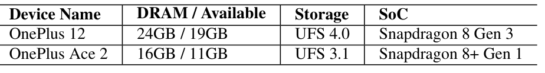

**Original caption:** Table 3: Hardware specifications of smartphones we used in the evaluation. “DRAM” is the physical memory size. “Available” is the maximum memory size that can be occupied by an application.

**中文图注:** 表 3：评估中使用的智能手机硬件规格。DRAM 表示物理内存容量；Available 表示单个应用最多可占用的内存容量。

**可复制表格 / Copyable table（原始数值不变）：**

| Device / 设备 | DRAM / 物理内存 | Available / 应用可用内存 | Storage / 存储 | SoC / 芯片 |
| --- | --- | --- | --- | --- |
| OnePlus 12 | 24GB | 19GB | UFS 4.0 | Snapdragon 8 Gen 3 |
| OnePlus Ace 2 | 16GB | 11GB | UFS 3.1 | Snapdragon 8+ Gen 1 |

**Source:** p.8 · S061

**Original:** Models: We choose five LLMs of varying architectures and sizes, namely Mistral(SiLU)-7B, sparse Qwen2-7B [59], Bamboo-7B [52], sparse Llama-13B [50], and TurboSparse-Mixtral-47B [52] (“Mixtral-47B” in figures for short).

**中文:** 模型：我们选择了五个架构与规模不同的 LLM，分别为 Mistral(SiLU)-7B、稀疏 Qwen2-7B [59]、Bamboo-7B [52]、稀疏 Llama-13B [50] 和 TurboSparse-Mixtral-47B [52]，其中后者在图中简称为“Mixtral-47B”。

**Source:** p.9 · S062

**Original:** Baselines: We compare PowerInfer-2 with four state-of-the-art LLM inference frameworks: llama.cpp [21], QNN [46], MLC-LLM [53], and LLMFlash [7]. These frameworks represent different approaches to on-device inference: llama.cpp is the most popular CPU-based framework that supports offloading weights to flash storage (via mmap), and serves as the backend for many other frameworks like Ollama [3]; QNN is Qualcomm’s commercial inference engine with sophisticated and proprietary NPU optimizations; and MLC-LLM leverages mobile GPUs for acceleration. LLMFlash is designed for high-end PC context and not open-sourced. Therefore we implemented LLMFlash’s key optimizations in llama.cpp based on the paper’s description, including sparsity prediction, row-column bundling, and neuron data caching.

**中文:** 基线：我们将 PowerInfer-2 与四个先进 LLM 推理框架比较：llama.cpp [21]、QNN [46]、MLC-LLM [53] 和 LLMFlash [7]。它们代表不同的端侧推理方式：llama.cpp 是最流行的 CPU 框架，支持通过 mmap 将权重卸载到闪存，也是 Ollama [3] 等许多框架的后端；QNN 是高通的商用推理引擎，包含复杂的专有 NPU 优化；MLC-LLM 则利用移动 GPU 加速。LLMFlash 面向高端 PC，且未开源。因此，我们依据论文描述，在 llama.cpp 中实现了 LLMFlash 的关键优化，包括稀疏性预测、行列捆绑和神经元数据缓存。

**Source:** p.9 · S063

**Original:** Workloads: We evaluate using representative real-world LLM tasks including multi-turn dialogue [54], code generation [14], math problem solving [18], and role play [55]. These tasks are top representatives of real-world LLM tasks on the HuggingFace platform. Our evaluation covers prefill performance with 128 and 512 token prompts, decoding performance with up to 64 token prompts and 1,024 token outputs, as well as Best-of-N (BoN) generation speed. All experiments are averaged over 10 runs to account for variance.

**中文:** 工作负载：我们使用具有代表性的真实 LLM 任务进行评估，包括多轮对话 [54]、代码生成 [14]、数学问题求解 [18] 和角色扮演 [55]。这些任务是 HuggingFace 平台上真实 LLM 任务的主要代表。评估覆盖 128 和 512 token 提示词的预填充性能、提示词最长 64 token 且输出 1,024 token 的解码性能，以及 Best-of-N（BoN）生成速度。为考虑波动，所有实验均运行 10 次并取平均值。

### 7.2 Offloading-Based Performance / 7.2 基于卸载的性能

**Source:** p.9 · S064

**Original:** In this section, we evaluate PowerInfer-2’s decoding and prefill performance across different models under memory-constrained conditions.

**中文:** 本节评估内存受限条件下，PowerInfer-2 在不同模型上的解码与预填充性能。

#### 7.2.1 Decoding Performance / 7.2.1 解码性能

**Source:** p.9 · S065

**Original:** We limit FFN weight placement in DRAM to 50% across all models, except for TurboSparse-Mixtral-47B on OnePlus Ace 2 which requires 75% offloading due to memory constraints. As shown in Fig.7, PowerInfer-2 demonstrates significant speedups across devices: on OnePlus 12, it achieves average speedups of 3.84× (up to 4.63×) over LLMFlash and 24.6× (up to 27.8×) over llama.cpp. Similarly, on OnePlus Ace 2, PowerInfer-2 delivers average speedups of 2.93× and 14.1× compared to LLMFlash and llama.cpp respectively.

**中文:** 我们将所有模型存放于 DRAM 中的 FFN 权重比例限制为 50%；例外是在 OnePlus Ace 2 上运行的 TurboSparse-Mixtral-47B，由于内存限制，需要卸载 75% 的权重。如图 7 所示，PowerInfer-2 在不同设备上均表现出显著加速：在 OnePlus 12 上，相对 LLMFlash 平均加速 3.84 倍、最高 4.63 倍；相对 llama.cpp 平均加速 24.6 倍、最高 27.8 倍。在 OnePlus Ace 2 上，相对 LLMFlash 和 llama.cpp 的平均加速比分别为 2.93 倍和 14.1 倍。

**Figure 7 / 图 7**

**Source:** p.9 · F007 / C007；置于 S065 后。

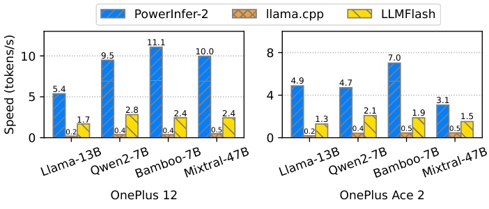

**Original caption:** Figure 7: Decoding speeds of PowerInfer-2, llama.cpp and LLMFlash. The Y axis is the generation speed (tokens/s). 50% model weights of FFN blocks are offloaded to flash storage for all models except TurboSparse-Mixtral-47B on OnePlus Ace 2, which requires offloading at least 75% of FFN weights.

**中文图注:** 图 7：PowerInfer-2、llama.cpp 和 LLMFlash 的解码速度。纵轴为生成速度，单位 tokens/s。除 OnePlus Ace 2 上的 TurboSparse-Mixtral-47B 需要卸载至少 75% 的 FFN 权重外，其余模型均将 FFN 模块的 50% 权重卸载到闪存。

**Source:** p.9 · S066

**Original:** When model size exceeds available DRAM, weight parameters must be dynamically swapped between flash storage and memory, introducing substantial I/O overhead. Although LLMFlash’s neuron cache mechanism achieves a 5.35× speedup compared to llama.cpp’s direct mmap approach, approximately 10% of activated neurons still require loading from flash storage, forcing computation to stall while waiting for random I/O completion.

**中文:** 模型大小超过可用 DRAM 时，权重参数必须在闪存与内存之间动态换入换出，引入大量 I/O 开销。虽然 LLMFlash 的神经元缓存机制相较于 llama.cpp 直接使用 mmap 的方法可实现 5.35 倍加速，但约 10% 的激活神经元仍需从闪存加载，计算因此被迫停顿，等待随机 I/O 完成。

**Source:** p.9 · S067

**Original:** PowerInfer-2 effectively addresses these challenges through two key innovations: (1) an efficient neuron-cluster-level pipeline that overlaps I/O operations with computation, and (2) flexible bundle loading that maximizes I/O throughput. These techniques effectively eliminate the I/O bottleneck, delivering superior performance across all evaluated models. As demonstrated in Table 4, our analysis of the critical path breakdown reveals that while LLMFlash suffers from significant I/O overhead (76.7%) due to frequent flash storage access with only 23.3% spent on actual computation, PowerInfer-2 dramatically reduces I/O overhead to just 13.7%, substantially improving overall system efficiency.

**中文:** PowerInfer-2 通过两项关键创新有效应对这些挑战：（1）高效的神经元簇级流水线，使 I/O 操作与计算重叠；（2）灵活的捆绑组加载，充分提高 I/O 吞吐量。这些技术有效消除了 I/O 瓶颈，使系统在全部评估模型上都具有更好性能。表 4 的关键路径分解表明，LLMFlash 因频繁访问闪存而具有较大的 I/O 开销，占比为 76.7%，实际计算仅占 23.3%；PowerInfer-2 则将 I/O 开销显著降低到 13.7%，大幅提高整体系统效率。

**Table 4 / 表 4**

**Source:** p.9 · T004 / CT004；置于 S067 后。

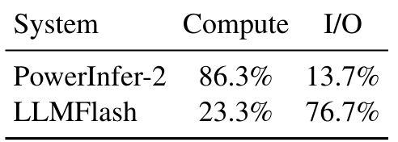

**Original caption:** Table 4: Time proportion comparison between Compute and I/O for Bamboo-7B.

**中文图注:** 表 4：Bamboo-7B 的计算与 I/O 时间占比比较。

**可复制表格 / Copyable table（原始数值不变）：**

| System / 系统 | Compute / 计算 | I/O |
| --- | --- | --- |
| PowerInfer-2 | 86.3% | 13.7% |
| LLMFlash | 23.3% | 76.7% |

**Source:** p.9 · S068

**Original:** The acceleration ratio of PowerInfer-2 varies across models due to differences in activated parameters. For instance, while TurboSparse-Mixtral-47B has 47B parameters in total, its mixture-of-expert architecture and high sparsity result in only about 3B activated parameters per token, similar to Bamboo-7B. This explains their comparable performance. At 9.96 tokens/s, TurboSparse-Mixtral-47B still has room for improvement through enlarged neuron cache, as discussed in §7.2.3. In contrast, Llama-13B’s lower sparsity leads to nearly 2× more activated parameters than Bamboo-7B, resulting in 2× slower performance.

**中文:** 由于激活参数量不同，PowerInfer-2 在不同模型上的加速比有所差异。例如，TurboSparse-Mixtral-47B 虽然总计有 47B 参数，但其混合专家架构和高稀疏性使每个 token 仅激活约 3B 参数，与 Bamboo-7B 接近，因此二者性能相近。TurboSparse-Mixtral-47B 当前为 9.96 tokens/s，通过扩大神经元缓存仍有进一步提升空间，详见第 7.2.3 节。相比之下，Llama-13B 的稀疏性较低，激活参数量接近 Bamboo-7B 的 2 倍，因而运行速度约慢 2 倍。

#### 7.2.2 Prefill Performance / 7.2.2 预填充性能

**Source:** p.9 · S069

**Original:** In this section, we evaluate PowerInfer-2’s prefill performance with 128 and 512 token prompts. Fig.8 shows the prompt processing speeds across different systems. With 512-token prompts, PowerInfer-2 achieves significant speedups: 48.97× over LLMFlash, 44.23× over llama.cpp, and 1.99× over QNN on OnePlus 12, while showing 29.98× and 16.67× improvements on OnePlus Ace 2. The results are similar for 128-token prompts, which reach up to 22.47× speedup over LLMFlash.

**中文:** 本节使用 128 和 512 token 的提示词，评估 PowerInfer-2 的预填充性能。图 8 展示不同系统的提示词处理速度。对于 512 token 提示词，PowerInfer-2 在 OnePlus 12 上相对 LLMFlash、llama.cpp 和 QNN 的加速比分别为 48.97 倍、44.23 倍和 1.99 倍；在 OnePlus Ace 2 上则实现 29.98 倍和 16.67 倍的提升。128 token 提示词也呈现类似结果，相对 LLMFlash 最高可达 22.47 倍加速。

**Figure 8 / 图 8**

**Source:** p.10 · F008 / C008；置于 S069 后。

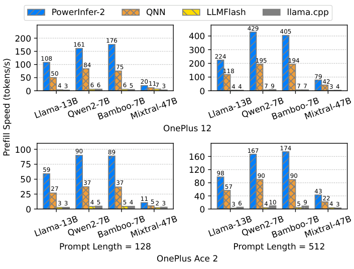

**Original caption:** Figure 8: Prefill speeds of PowerInfer-2, QNN, llama.cpp and LLMFlash in offloading scenarios at prompt lengths of 128 and 512 tokens. The X axis is the model. The Y axis is the prompt processing speed (tokens/s). The placement of weights in FFN blocks is the same as Fig.7.

**中文图注:** 图 8：卸载场景下，提示词长度为 128 和 512 token 时，PowerInfer-2、QNN、llama.cpp 和 LLMFlash 的预填充速度。横轴为模型，纵轴为提示词处理速度，单位 tokens/s。FFN 模块权重的放置方式与图 7 相同。

**Source:** p.9, p.10 · S070

**Original:** These performance gains stem from PowerInfer-2’s NPU-centric prefill and flexible neuron loading mechanism that preloads transformer layers using sequential I/O. The NPU demonstrates superior performance for large batch sizes compared to CPU and GPU. Additionally, PowerInfer-2 efficiently utilizes sequential I/O during prefill. As batch sizes increase, neuron activation probability approaches 99.99% in TurboSparse-Mixtral-47B with 128 batch size. Therefore, PowerInfer-2 sequentially loads entire transformer layers using sequential I/O, which is 3× faster than random I/O. Furthermore, weight loading is efficiently overlapped with computation through prefetching, where weights for the next layer are loaded while computing the current layer. As illustrated in Fig.9, I/O operations are completely overlapped with computation time through our pipelining strategy, effectively hiding I/O latency.

**中文:** 这些性能收益来自 PowerInfer-2 以 NPU 为中心的预填充，以及通过顺序 I/O 预加载 Transformer 层的灵活神经元加载机制。与 CPU 和 GPU 相比，NPU 在大批量下性能更强。此外，PowerInfer-2 在预填充期间高效利用顺序 I/O。随着批量大小增加，当 TurboSparse-Mixtral-47B 的批量大小为 128 时，神经元激活概率接近 99.99%。因此，PowerInfer-2 使用顺序 I/O 加载完整 Transformer 层，速度是随机 I/O 的 3 倍。通过预取，权重加载还能与计算高效重叠：计算当前层时，加载下一层权重。如图 9 所示，该流水线策略使 I/O 操作完全与计算时间重叠，从而有效隐藏 I/O 延迟。

**Figure 9 / 图 9**

**Source:** p.10 · F009 / C009；置于 S070 后。

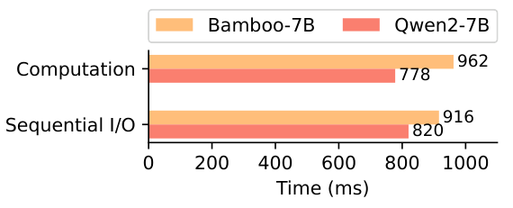

**Original caption:** Figure 9: Computation and sequential I/O time in a layer with prompt lengths of 512 tokens at the prefill stage of Bamboo-7B and Qwen2-7B on OnePlus 12. The X axis is time used in milliseconds.

**中文图注:** 图 9：OnePlus 12 上，Bamboo-7B 和 Qwen2-7B 在提示词长度为 512 token 的预填充阶段，单层计算与顺序 I/O 的时间。横轴为耗时，单位毫秒。

#### 7.2.3 Performance with Various Memory Capacities / 7.2.3 不同内存容量下的性能

**Source:** p.10 · S071

**Original:** In real-world scenarios, smartphones run multiple applications simultaneously [1], leading to varying available memory for LLM inference. We evaluate PowerInfer-2’s adaptability across memory capacities from 7GB to 19GB. Fig.10 shows the decoding speeds under different memory configurations for TurboSparse-Mixtral-47B.

**中文:** 在真实场景中，智能手机会同时运行多个应用 [1]，使 LLM 推理的可用内存不断变化。我们评估了 PowerInfer-2 在 7GB 至 19GB 内存容量下的适应性。图 10 展示了 TurboSparse-Mixtral-47B 在不同内存配置下的解码速度。

**Figure 10 / 图 10**

**Source:** p.10 · F010 / C010；置于 S071 后。

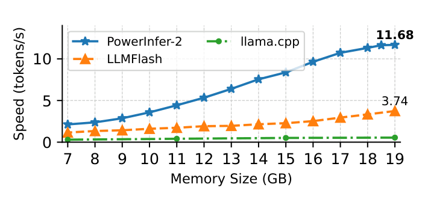

**Original caption:** Figure 10: Decoding speeds on various memory configurations with TurboSparse-Mixtral-47B on OnePlus 12.

**中文图注:** 图 10：OnePlus 12 上，TurboSparse-Mixtral-47B 在不同内存配置下的解码速度。

**Source:** p.10 · S072

**Original:** With only 7GB available memory, PowerInfer-2 achieves 2.13 tokens/s. The memory is allocated as follows: 1GB for non-FFN layer weights [Footnote 3](#N004), 2.6GB for predictor weights, 2.7GB for FFN weights’ quantization scales, and 300MB for runtime memory, totaling 6.6GB. The remaining 400MB is used for neuron cache, which only stores 1.8% of FFN weights. This small cache size means nearly all neurons must be fetched from flash storage for each token. Despite this limitation, PowerInfer-2 still outperforms LLMFlash by 1.84× through efficient neuron loading and neuron-cluster pipeline. PowerInfer-2’s decoding speed scales linearly with memory size up to 19GB, as I/O operations reduce proportionally with increased cache size. At maximum memory utilization (19GB), PowerInfer-2 reaches 11.68 tokens/s, which is 3.12× faster than LLMFlash and 21.2× faster than llama.cpp.

**中文:** 仅有 7GB 可用内存时，PowerInfer-2 可达到 2.13 tokens/s。内存分配如下：非 FFN 层权重占 1GB[脚注 3](#N004)，预测器权重占 2.6GB，FFN 权重量化缩放因子占 2.7GB，运行时内存占 300MB，合计 6.6GB。剩余 400MB 用作神经元缓存，只能存放 1.8% 的 FFN 权重。如此小的缓存意味着，几乎所有神经元在生成每个 token 时都需要从闪存获取。尽管如此，凭借高效神经元加载与神经元簇流水线，PowerInfer-2 的速度仍为 LLMFlash 的 1.84 倍。随着内存容量增加，缓存扩大，I/O 操作按比例减少；在内存增至 19GB 的过程中，PowerInfer-2 的解码速度随内存大小近似线性增长。当充分使用最大可用内存 19GB 时，PowerInfer-2 达到 11.68 tokens/s，分别为 LLMFlash 和 llama.cpp 的 3.12 倍与 21.2 倍。

#### 7.2.4 Decoding Consistency Analysis / 7.2.4 解码一致性分析

**Source:** p.10 · S073

**Original:** To evaluate PowerInfer-2’s performance consistency, we analyze decoding speeds across different tasks and examine token-level latency distribution. For task-level analysis, we measure decoding speeds across four representative tasks: role-play, multi-turn dialogue, math problem solving, and code generation. As shown in Fig.11, PowerInfer-2 maintains consistent performance with at least 11.4 tokens/s across all tasks, demonstrating robust handling of diverse workloads. Minor speed variations occur due to task-dependent differences in model activation sparsity.

**中文:** 为评估 PowerInfer-2 的性能一致性，我们分析不同任务的解码速度，并考察 token 级延迟分布。在任务层面，测量四类代表性任务：角色扮演、多轮对话、数学问题求解和代码生成。如图 11 所示，PowerInfer-2 在所有任务中均保持至少 11.4 tokens/s，展示了对不同工作负载的稳定处理能力。轻微速度差异源于不同任务对应的模型激活稀疏性差别。

**Figure 11 / 图 11**

**Source:** p.10 · F011 / C011；置于 S073 后。

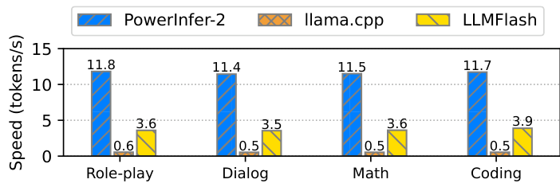

**Original caption:** Figure 11: Decoding performance on different downstream tasks of TurboSparse-Mixtral-47B on OnePlus 12. All available memory is used during decoding.

**中文图注:** 图 11：OnePlus 12 上，TurboSparse-Mixtral-47B 在不同下游任务中的解码性能。解码期间使用全部可用内存。

**Source:** p.10, p.11 · S074

**Original:** To analyze token-level latency distribution, we measured the average, 50th percentile (P50), 90th percentile (P90), and 99th percentile (P99) decoding speeds across 1,024 tokens for both TurboSparse-Mixtral-47B and Bamboo-7B models with 50% of their FFN weights in DRAM. TurboSparse-Mixtral-47B shows notable performance variations: the slowest 10% of tokens are generated 16.5% below average speed, while P99 latency is 40.9% slower than the mean. These variations arise from differing activation patterns between consecutive tokens. When tokens share activation patterns, they benefit from cached neurons, avoiding costly flash storage access. Our analysis reveals that while TurboSparse-Mixtral-47B maintains a low 3.5% average cache miss rate, the P99 miss rate reaches 18.9%. This significant variance in cache efficiency directly impacts token generation latency through increased neuron swapping between cache and flash storage.

**中文:** 为分析 token 级延迟分布，我们对 TurboSparse-Mixtral-47B 和 Bamboo-7B 两个模型生成的 1,024 个 token，测量平均值、第 50 百分位（P50）、第 90 百分位（P90）和第 99 百分位（P99）的解码速度；二者均将 50% 的 FFN 权重放在 DRAM 中。TurboSparse-Mixtral-47B 的性能波动较明显：最慢的 10% token 的生成速度比平均值低 16.5%，P99 延迟则比平均值慢 40.9%。这些波动来自连续 token 之间不同的激活模式。具有相同激活模式的 token 可复用已缓存神经元，避免高开销闪存访问。分析发现，TurboSparse-Mixtral-47B 的平均缓存未命中率仅为 3.5%，但 P99 未命中率达到 18.9%。这种缓存效率的显著波动会增加神经元在缓存与闪存之间的换入换出，直接影响 token 生成延迟。

**Table 5 / 表 5**

**Source:** p.11 · T005 / CT005；置于 S074 后。

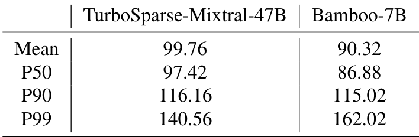

**Original caption:** Table 5: Decoding latencies of PowerInfer-2 in milliseconds when offloading 50% of FFN weights.

**中文图注:** 表 5：卸载 50% FFN 权重时，PowerInfer-2 的解码延迟，单位毫秒。

**可复制表格 / Copyable table（原始数值不变）：**

| Latency statistic / 延迟统计 (ms) | TurboSparse-Mixtral-47B | Bamboo-7B |
| --- | --- | --- |
| Mean / 均值 | 99.76 | 90.32 |
| P50 | 97.42 | 86.88 |
| P90 | 116.16 | 115.02 |
| P99 | 140.56 | 162.02 |

#### 7.2.5 SiLU-based LLM Performance / 7.2.5 基于 SiLU 的 LLM 性能

**Source:** p.11 · S075

**Original:** While PowerInfer-2 achieves its remarkable acceleration on ReLU-based models due to their naturally high activation sparsity, it can also effectively accelerate SiLU-based architectures, since recent studies (CATS [31] and CHESS [24]) have shown that SiLU-based LLMs also exhibit approximately 50% activation sparsity. As shown in Table 6, PowerInfer-2 achieves a 2.4× speedup on SiLU-based LLMs. Though more modest than the gains seen with ReLU-based models, this improvement validates the versatility of PowerInfer-2’s sparse computation mechanisms across different activation functions. The relatively lower speedup can be attributed to the fundamental characteristics of SiLU-based architectures, where a higher proportion of neurons remain active during inference, creating a performance bottleneck in neuron loading operations.

**中文:** PowerInfer-2 在 ReLU 模型上利用其天然较高的激活稀疏性取得显著加速，同时也能有效加速 SiLU 架构，因为近期研究 CATS [31] 和 CHESS [24] 表明，SiLU LLM 同样存在约 50% 的激活稀疏性。如表 6 所示，PowerInfer-2 在 SiLU LLM 上实现 2.4 倍加速。尽管收益低于 ReLU 模型，这仍验证了 PowerInfer-2 稀疏计算机制对不同激活函数的适用性。加速比较低可归因于 SiLU 架构本身的特征：推理时仍有更高比例的神经元保持激活，从而使神经元加载成为性能瓶颈。

**Table 6 / 表 6**

**Source:** p.11 · T006 / CT006；置于 S075 后。

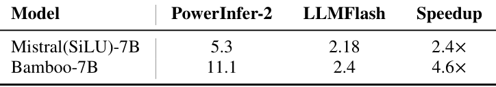

**Original caption:** Table 6: Generation speed (tokens/s) comparison for SiLU and ReLU-based LLMs when Offloading 50% FFN weights.

**中文图注:** 表 6：卸载 50% FFN 权重时，基于 SiLU 和 ReLU 的 LLM 的生成速度比较，单位 tokens/s。

**可复制表格 / Copyable table（原始数值不变）：**

| Model / 模型 | PowerInfer-2 (tokens/s) | LLMFlash (tokens/s) | Speedup / 加速比 |
| --- | --- | --- | --- |
| Mistral(SiLU)-7B | 5.3 | 2.18 | 2.4× |
| Bamboo-7B | 11.1 | 2.4 | 4.6× |

### 7.3 In-Memory Performance / 7.3 权重驻留内存时的性能

**Source:** p.11 · S076

**Original:** This section evaluates Bamboo-7B’s performance under sufficient memory conditions, comparing against llama.cpp (CPU), MLC-LLM (GPU) and QNN (NPU) on smartphones, as shown in Fig.12.

**中文:** 本节评估内存充足条件下 Bamboo-7B 的性能，并与智能手机上的 llama.cpp（CPU）、MLC-LLM（GPU）和 QNN（NPU）比较，如图 12 所示。

**Figure 12 / 图 12**

**Source:** p.11 · F012 / C012；置于 S076 后。

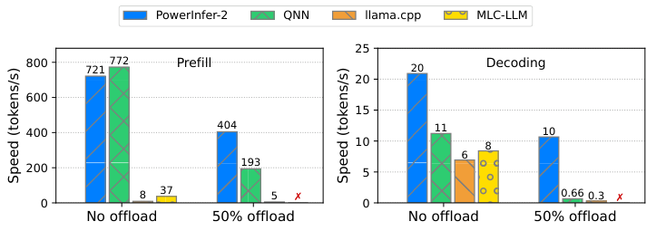

**Original caption:** Figure 12: Decoding speeds of PowerInfer-2, llama.cpp, and MLC-LLM on Bamboo-7B with different offloading setups. “50% offload” means 50% model weights of FFN blocks are offloaded to flash storage. “No offload” means all model parameters are resident in memory. A red label of “✗” indicates an execution failure due to the lack of weight offloading support.

**中文图注:** 图 12：在 Bamboo-7B 的不同卸载配置下，PowerInfer-2、llama.cpp 和 MLC-LLM 的解码速度。“50% offload”表示将 FFN 模块的 50% 权重卸载到闪存；“No offload”表示所有模型参数都驻留内存。红色“✗”表示因不支持权重卸载而执行失败。

**Source:** p.11 · S077

**Original:** For the prefill phase, PowerInfer-2 fully leverages NPU acceleration, achieving comparable performance to QNN with both systems exceeding 700 tokens/s, which is a 32× speedup over other frameworks. PowerInfer-2’s NPU-centric approach in prefill stage ensures maximum hardware utilization, though it is slightly slower than QNN due to mixed precision quantization used by PowerInfer-2, a deliberate trade-off for accuracy preservation (will be discussed in §7.6). With 50% FFN weight offloading, PowerInfer-2 maintains 404.6 tokens/s throughput, outperforming QNN through efficient pipelining that overlaps weight loading operations. The performance gap compared to the in-memory setup is primarily due to the additional I/O overhead from flash storage access.

**中文:** 预填充阶段，PowerInfer-2 充分利用 NPU 加速，性能与 QNN 相当：两者都超过 700 tokens/s，相对其他框架约有 32 倍加速。以 NPU 为中心的预填充方式能够充分利用硬件，不过 PowerInfer-2 因采用混合精度量化而略慢于 QNN；这是为保持准确率做出的有意权衡，将在第 7.6 节讨论。卸载 50% 的 FFN 权重后，PowerInfer-2 仍保持 404.6 tokens/s 的吞吐量，并凭借将权重加载重叠起来的高效流水线优于 QNN。与权重全部驻留内存时相比，性能差距主要来自闪存访问带来的额外 I/O 开销。

**Source:** p.11 · S078

**Original:** In the decoding phase, PowerInfer-2 demonstrates 2.24×, 2.48× and 1.86× speedups over llama.cpp, MLC-LLM and QNN respectively. This superior performance comes from: 1) concurrent CPU-NPU computation improving memory bandwidth utilization from 43.9GB/s to 59.6GB/s, and 2) leveraging the model’s activation sparsity to reduce FFN computations.

**中文:** 解码阶段，PowerInfer-2 相对 llama.cpp、MLC-LLM 和 QNN 的加速比分别为 2.24 倍、2.48 倍和 1.86 倍。优势源于两点：（1）CPU–NPU 并发计算，将内存带宽利用从 43.9GB/s 提高到 59.6GB/s；（2）利用模型激活稀疏性减少 FFN 计算。

**Source:** p.11 · S079

**Original:** When offloading 50% of FFN weights, PowerInfer-2 reduces memory usage by 1.5GB (40%) while maintaining performance comparable to llama.cpp and MLC-LLM. This demonstrates PowerInfer-2’s ability to optimize memory efficiency without compromising user experience, even for models that already fit in memory.

**中文:** 卸载 50% 的 FFN 权重时，PowerInfer-2 将内存使用量减少 1.5GB，即 40%，同时保持与 llama.cpp 和 MLC-LLM 相当的性能。这说明，即使模型本身能够装入内存，PowerInfer-2 仍可在不牺牲用户体验的情况下优化内存效率。

### 7.4 Best-of-N Sampling / 7.4 Best-of-N 采样

**Source:** p.11, p.12 · S080

**Original:** Best-of-N (BoN) sampling, where N different response sequences are generated for one prompt and the best one is selected, is widely utilized in LLM applications. We evaluated Best-of-4 sampling on Bamboo-7B using three configurations: PowerInfer-2, QNN, and PowerInfer-2-CPUOnly (PowerInfer-2 with CPU-only decoding). As shown in Fig.13, in the initial phase with all four samples generating simultaneously, PowerInfer-2 achieves 1.84× and 1.28× speedups over QNN and PowerInfer-2-CPUOnly respectively. As samples complete and N decreases, PowerInfer-2 maintains a 1.42× performance advantage through dynamic CPU-NPU task dispatching based on sparsity patterns. When N reduces to 1, increased sparsity causes QNN’s performance to drop below PowerInfer-2-CPUOnly. However, PowerInfer-2 still achieves 1.1× and 1.77× speedups over PowerInfer-2-CPUOnly and QNN respectively, benefiting from its hybrid CPU/NPU computation strategy.

**中文:** Best-of-N（BoN）采样会针对一个提示词生成 N 个不同回答序列，并选出最佳回答，已广泛用于 LLM 应用。我们在 Bamboo-7B 上评估 Best-of-4 采样，采用三种配置：PowerInfer-2、QNN，以及仅使用 CPU 解码的 PowerInfer-2-CPUOnly。如图 13 所示，最初四个候选同时生成时，PowerInfer-2 相对 QNN 和 PowerInfer-2-CPUOnly 的加速比分别为 1.84 倍和 1.28 倍。随着候选完成、N 减小，PowerInfer-2 根据稀疏模式动态分派 CPU–NPU 任务，保持 1.42 倍的性能优势。当 N 降至 1 时，稀疏性增加，使 QNN 性能低于 PowerInfer-2-CPUOnly；但得益于混合 CPU/NPU 计算策略，PowerInfer-2 相对 PowerInfer-2-CPUOnly 和 QNN 仍分别实现 1.1 倍和 1.77 倍加速。

**Figure 13 / 图 13**

**Source:** p.11 · F013 / C013；置于 S080 后。

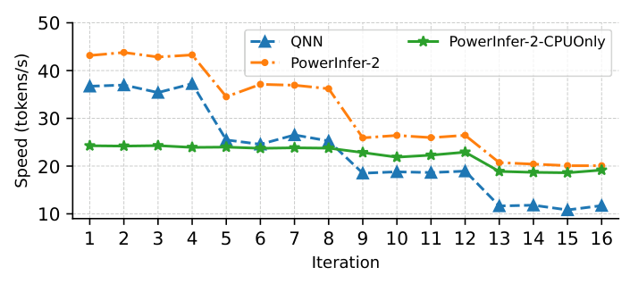

**Original caption:** Figure 13: Decoding speed curves of PowerInfer-2, QNN, and PowerInfer-2-CPUOnly on Bamboo-7B under the setting of Best-of-N (N=4). The batch size decreases by one every four iterations. X axis refers to iteration. Each iteration represents the generation of one token across N candidates in parallel. Y axis refers to the generation speed (tokens/s). All model parameters are resident in memory.

**中文图注:** 图 13：Best-of-N（N=4）设置下，PowerInfer-2、QNN 和 PowerInfer-2-CPUOnly 在 Bamboo-7B 上的解码速度曲线。每四次迭代，批量大小减少 1。横轴为迭代次数，每次迭代代表对 N 个候选并行生成一个 token；纵轴为生成速度，单位 tokens/s。所有模型参数均驻留内存。

### 7.5 Performance Breakdown / 7.5 性能分解

**Source:** p.12 · S081

**Original:** To quantify each optimization’s contribution, we conducted an ablation study by incrementally enabling optimizations. Starting from a baseline configuration, we progressively added Bundle, Neuron Cache, Neuron-Cluster-Level Pipeline, and XPU optimizations. Fig.14 shows the performance impact of each addition.

**中文:** 为量化各项优化的贡献，我们通过逐步启用优化开展消融研究。从基线配置开始，依次加入捆绑（Bundle）、神经元缓存（Neuron Cache）、神经元簇级流水线（Neuron-Cluster-Level Pipeline）及 XPU 优化。图 14 展示了每项新增优化的性能影响。

**Figure 14 / 图 14**

**Source:** p.12 · F014 / C014；置于 S081 后。

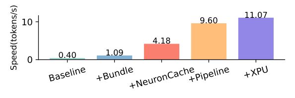

**Original caption:** Figure 14: Performance breakdown for decoding phase of the Bamboo-7B model on OnePlus 12, with 50% FFN weights offloaded to flash storage.

**中文图注:** 图 14：OnePlus 12 上，Bamboo-7B 在卸载 50% FFN 权重时，解码阶段的性能分解。

**Source:** p.12 · S082

**Original:** The baseline system utilizes CPU without any optimizations and achieves 0.4 tokens/s without optimizations. Adding Bundle optimization improves this to 1.1 tokens/s by increasing I/O efficiency through bundled memory access operations. Neuron Cache further brings a 2.82× speedup (4.181 tokens/s) by achieving a 95% cache hit rate, significantly reducing Flash I/O bandwidth pressure. Pipeline optimization adds another 1.29× improvement (9.60 tokens/s) through overlapped computation and memory access. Finally, XPU optimization provides an additional 15% gain (11.07 tokens/s) by utilizing both CPU and XPU for concurrent memory access.

**中文:** 基线系统仅使用 CPU，不采用任何优化，速度为 0.4 tokens/s。加入 Bundle 优化后，通过捆绑内存访问提高 I/O 效率，速度提高到 1.1 tokens/s。Neuron Cache 达到 95% 的缓存命中率，显著减轻闪存 I/O 带宽压力，进一步带来 2.82 倍加速，速度达到 4.181 tokens/s。Pipeline 通过重叠计算与内存访问，再带来 1.29 倍提升，达到 9.60 tokens/s。最后，XPU 优化利用 CPU 与 XPU 并发访问内存，额外提升 15%，达到 11.07 tokens/s。

### 7.6 Accuracy Evaluation / 7.6 准确率评估

**Source:** p.12 · S083

**Original:** We evaluate inference accuracy using OpenCompass [19], a widely-adopted benchmark suite, focusing on INT4 quantization which is the de facto standard in real-world mobile deployments [38, 56]. As shown in Table 7, PowerInfer-2 maintains comparable accuracy to llama.cpp across different models and tasks, while significantly outperforming QNN. The accuracy gap between frameworks stems from their different quantization approaches. QNN uses per-channel quantization (one scale per weight matrix row), which poorly handles weights with outlier values. llama.cpp achieves better accuracy by quantizing weights in groups of 32. Since NPUs don’t support group-wise quantization, PowerInfer-2 adopts a hybrid quantization approach that handles outlier weights in INT8 precision while applying INT4 per-channel quantization to remaining weights, effectively preserving accuracy while maintaining fast inference speed similar to QNN.

**中文:** 我们使用广泛采用的 OpenCompass [19] 基准套件评估推理准确率，重点关注 INT4 量化，因为它已成为真实移动部署中的事实标准 [38,56]。如表 7 所示，PowerInfer-2 在不同模型和任务上的准确率与 llama.cpp 相近，并显著优于 QNN。框架间的准确率差异源于量化方法不同：QNN 使用逐通道量化，即每个权重矩阵行对应一个缩放因子，难以处理带离群值的权重；llama.cpp 则将权重按每组 32 个进行量化，从而获得更好的准确率。由于 NPU 不支持分组量化，PowerInfer-2 采用混合量化：以 INT8 精度处理离群权重，其余权重使用 INT4 逐通道量化，在有效保持准确率的同时，实现接近 QNN 的快速推理。

**Table 7 / 表 7**

**Source:** p.12 · T007 / CT007；置于 S083 后。

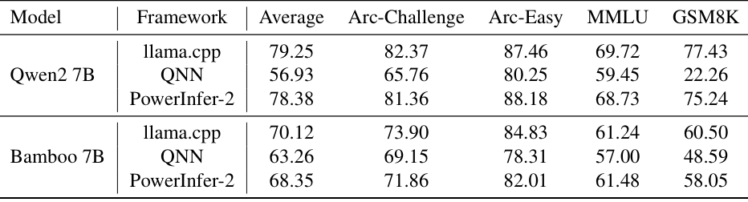

**Original caption:** Table 7: Comparison of LLM accuracy between different quantization methods on Bamboo 7B and Qwen2 7B models. The evaluation metrics include Arc Challenge [16], Arc Easy, MMLU [25], and GSM8K [17] benchmarks.

**中文图注:** 表 7：Bamboo 7B 和 Qwen2 7B 使用不同量化方法时的 LLM 准确率比较。评估包括 Arc Challenge [16]、Arc Easy、MMLU [25] 和 GSM8K [17] 基准。

**可复制表格 / Copyable table（原始数值不变）：**

| Model / 模型 | Framework / 框架 | Average / 平均 | Arc-Challenge | Arc-Easy | MMLU | GSM8K |
| --- | --- | --- | --- | --- | --- | --- |
| Qwen2 7B | llama.cpp | 79.25 | 82.37 | 87.46 | 69.72 | 77.43 |
| Qwen2 7B | QNN | 56.93 | 65.76 | 80.25 | 59.45 | 22.26 |
| Qwen2 7B | PowerInfer-2 | 78.38 | 81.36 | 88.18 | 68.73 | 75.24 |
| Bamboo 7B | llama.cpp | 70.12 | 73.90 | 84.83 | 61.24 | 60.50 |
| Bamboo 7B | QNN | 63.26 | 69.15 | 78.31 | 57.00 | 48.59 |
| Bamboo 7B | PowerInfer-2 | 68.35 | 71.86 | 82.01 | 61.48 | 58.05 |

### 7.7 Energy Consumption / 7.7 能耗

**Source:** p.12 · S084

**Original:** We evaluate the energy efficiency of PowerInfer-2 through evaluation of end-to-end energy consumption during inference. Our primary metric is Joules per token (J/token), which quantifies the average energy required to generate each output token. To ensure representative results, we randomly sampled 100 prompts from the lmsys/lmsys-chat-1m [63] dataset, which contains real-world user interactions collected from chatbot deployments. The mean energy consumption results are shown in Table 8. PowerInfer-2 demonstrates superior energy efficiency, achieving 0.257 J/token, which represents a 31.1% and 61.8% reduction in energy consumption compared to QNN and llama.cpp, respectively. This enhanced efficiency is attributed to PowerInfer-2’s ability to maintain similar peak power while achieving faster computation speeds, resulting in lower overall energy consumption.

**中文:** 我们通过测量推理期间的端到端能耗，评估 PowerInfer-2 的能效。主要指标为每 token 焦耳数（J/token），用于量化生成每个输出 token 所需的平均能量。为保证结果具有代表性，我们从 lmsys/lmsys-chat-1m [63] 数据集中随机抽取 100 个提示词；该数据集包含从聊天机器人部署中收集的真实用户交互。平均能耗结果见表 8。PowerInfer-2 具有更好的能效，每 token 耗能为 0.257 J，相对 QNN 和 llama.cpp 分别降低 31.1% 和 61.8%。这一能效提升来自 PowerInfer-2 能够在峰值功率相近的情况下提高计算速度，从而降低整体能耗。

**Table 8 / 表 8**

**Source:** p.12 · T008 / CT008；置于 S084 后。

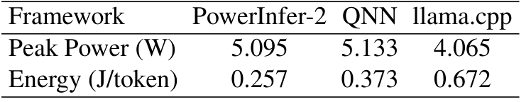

**Original caption:** Table 8: Energy consumption comparison between different frameworks.

**中文图注:** 表 8：不同框架的能耗比较。

**可复制表格 / Copyable table（原始数值不变）：**

| Metric / 指标 | PowerInfer-2 | QNN | llama.cpp |
| --- | --- | --- | --- |
| Peak Power / 峰值功率 (W) | 5.095 | 5.133 | 4.065 |
| Energy / 能耗 (J/token) | 0.257 | 0.373 | 0.672 |

## 8 Related Work / 8 相关工作

**Source:** p.12, p.13 · S085

**Original:** Resource-Efficient DNN/LLM Inference. The deployment of DNNs and LLMs on resource-constrained devices has gained significant traction recently [58]. While BAND [28] demonstrates the feasibility of running multiple compact DNNs on a single XPU, its methodology does not address the memory-flash hierarchy and cannot scale to accommodate LLMs due to their substantial computational demands. MLC-LLM [53] represents a significant advancement in enabling GPU-accelerated LLM deployment on mobile devices. Nevertheless, it is constrained by the requirement that models must fit entirely in memory. Although mllm-NPU [57] leverages on-device NPU, it lacks CPU-NPU co-processing and requires models to fit in memory, limiting its use for larger models. While STI [23] introduces pipeline mechanisms for I/O-compute overlapping, its capability is limited to BERT-scale models (0.33B parameters) on embedded devices, making it insufficient for modern LLMs that typically exceed 1B parameters. Various model compression techniques have emerged, including network pruning [27,40], knowledge distillation [29], and quantization [13,36], all aimed at reducing model memory footprints. These approaches complement PowerInfer-2 and can be integrated with it to further enhance the efficiency of LLM deployment on mobile devices.

**中文:** 资源高效的 DNN/LLM 推理。近期，在资源受限设备上部署 DNN 与 LLM 受到广泛关注 [58]。BAND [28] 展示了在单个 XPU 上运行多个紧凑型 DNN 的可行性，但其方法没有处理内存–闪存层次结构，且由于 LLM 具有较大的计算需求，无法扩展到 LLM。MLC-LLM [53] 推动了移动设备上的 GPU 加速 LLM 部署，但要求模型必须完整装入内存。mllm-NPU [57] 虽然利用端侧 NPU，却缺少 CPU–NPU 协同处理，同样要求模型装入内存，因此难以用于更大模型。STI [23] 引入了 I/O 与计算重叠的流水线机制，但仅支持嵌入式设备上的 BERT 规模模型，即 0.33B 参数，不足以支持通常超过 1B 参数的现代 LLM。此外，网络剪枝 [27,40]、知识蒸馏 [29] 和量化 [13,36] 等模型压缩方法，均旨在减少模型内存占用。它们与 PowerInfer-2 互补，可以结合使用，进一步提高移动端 LLM 部署效率。

**Source:** p.13 · S086

**Original:** Speculative Decoding. Speculative decoding accelerates inference by leveraging a smaller model to predict tokens in parallel [12,20,33]. The technique employs a smaller model (e.g., 1B) to generate candidate tokens, which are then validated in batch by a larger model (e.g., 13B). SpecInfer [41] demonstrates that this approach effectively reduces decoding iterations. While speculative decoding and sparse activation are orthogonal optimization strategies, their integration in memory-constrained XPU environments remains an open research challenge.

**中文:** 推测解码。推测解码利用较小模型并行预测 token，以加速推理 [12,20,33]。该技术先使用小模型，例如 1B 模型，生成候选 token，再交由大模型，例如 13B 模型，批量验证。SpecInfer [41] 表明，该方法能够有效减少解码迭代次数。虽然推测解码与稀疏激活是相互正交的优化策略，但如何在内存受限的 XPU 环境中整合二者，仍是开放的研究挑战。

## 9 Conclusion / 9 结论

**Source:** p.13 · S087

**Original:** This paper presents PowerInfer-2, a mobile-centric LLM inference framework that effectively runs LLMs on smartphones with limited memory. Evaluation demonstrates that PowerInfer-2 achieves up to 27.8× speedup over existing solutions while supporting models as large as 47B with minimal accuracy loss.

**中文:** 本文提出 PowerInfer-2，这是一种以移动端为中心的 LLM 推理框架，能够在内存有限的智能手机上有效运行 LLM。评估表明，PowerInfer-2 相对现有方案最高实现 27.8 倍加速，同时支持规模达 47B 的模型，且准确率损失很小。

## Footnotes / 脚注

**Source:** p.1 · N001

**Original:** *Co-first authors. †Corresponding author: Zeyu Mi (yzmizeyu@sjtu.edu.cn).

**中文:** * 表示共同第一作者。† 表示通讯作者 Zeyu Mi，邮箱为 yzmizeyu@sjtu.edu.cn。

**Source:** p.3 · N002

**Original:** 1A neuron is considered activated when triggered by at least one token in the batch.

**中文:** 脚注 1：当一个神经元被批次中至少一个 token 触发时，就认为该神经元被激活。

**Source:** p.3 · N003

**Original:** 2Qualcomm’s NPUs typically employ coarse-grained per-channel quantization that leads to accuracy degradation. This issue can be fixed by adopting a mixed-precision quantization approach inspired by AWQ [15,36], which preserves outlier weights while applying INT4 quantization to the remaining components, effectively maintaining model accuracy.

**中文:** 脚注 2：高通 NPU 通常采用粗粒度逐通道量化，会导致准确率下降。受 AWQ [15,36] 启发，采用混合精度量化可修复这一问题：保留离群权重，对其余部分使用 INT4 量化，从而有效维持模型准确率。

**Source:** p.10 · N004

**Original:** 3Including token embeddings, self-attention layers, KV cache, and the final language model head

**中文:** 脚注 3：包括 token 嵌入、自注意力层、KV 缓存以及最终语言模型输出头。

## References / 参考文献

**Source:** p.13 · R001

**Original:** [1] Multitasking the Android Way. https://android-developers.googleblog.com/2010/04/multitasking-android-way.html, 2010.

**中文:** [1] 以 Android 的方式进行多任务处理。2010 年。

**Source:** p.13 · R002

**Original:** [2] Huawei’s LLM on Mate 70 Series. https://www.huaweicentral.com/huawei-mate-70-series-launched-with-new-camera-design-5700mah-battery-generative-ai-and-more/, 2024.

**中文:** [2] 华为 Mate 70 系列上的 LLM。2024 年。

**Source:** p.13 · R003

**Original:** [3] Ollama: Get up and running with large language models locally. https://github.com/ollama/ollama, 2024.

**中文:** [3] Ollama：在本地快速运行大语言模型。2024 年。

**Source:** p.13 · R004

**Original:** [4] OPPO Announces Commitment to Making AI Phones Accessible to Everyone. https://www.oppo.com/en/newsroom/press/oppo-make-ai-phones-accessible/, 2024.

**中文:** [4] OPPO 宣布致力于让每个人都能使用 AI 手机。2024 年。

**Source:** p.13 · R005

**Original:** [5] Samsung’s LLM on Galaxy S24. https://www.samsung.com/global/galaxy/s24/, 2024.

**中文:** [5] 三星 Galaxy S24 上的 LLM。2024 年。

**Source:** p.13 · R006

**Original:** [6] Abien Fred Agarap. Deep Learning using Rectified Linear Units (ReLU), 2019.

**中文:** [6] 使用修正线性单元（ReLU）进行深度学习。2019 年。

**Source:** p.13 · R007

**Original:** [7] Keivan Alizadeh, Iman Mirzadeh, Dmitry Belenko, Karen Khatamifard, Minsik Cho, Carlo C Del Mundo, Mohammad Rastegari, and Mehrdad Farajtabar. LLM in a Flash: Efficient Large Language Model Inference with Limited Memory, 2024.

**中文:** [7] LLM in a Flash：内存受限条件下的高效大语言模型推理。2024 年。

**Source:** p.13 · R008

**Original:** [8] Android. Android 15. https://www.android.com/, 2024.

**中文:** [8] Android 15。2024 年。

**Source:** p.13 · R009

**Original:** [9] Anthropic. https://www.anthropic.com/news/claude-3-family, 2024.

**中文:** [9] Anthropic，Claude 3 系列在线资源。2024 年。

**Source:** p.13 · R010

**Original:** [10] Apple. Apple Intelligence. https://www.apple.com/apple-intelligence/, 2024.

**中文:** [10] Apple Intelligence。2024 年。

**Source:** p.13 · R011

**Original:** [11] ARM. Arm Big.LITTLE. https://www.arm.com/zh-TW/technologies/big-little, 2024.

**中文:** [11] Arm Big.LITTLE。2024 年。

**Source:** p.13 · R012

**Original:** [12] Tianle Cai, Yuhong Li, Zhengyang Geng, Hongwu Peng, Jason D. Lee, Deming Chen, and Tri Dao. Medusa: Simple LLM Inference Acceleration Framework with Multiple Decoding Heads. arXiv preprint arXiv:2401.10774, 2024.

**中文:** [12] Medusa：基于多个解码头的简洁 LLM 推理加速框架。arXiv:2401.10774，2024 年。

**Source:** p.13 · R013

**Original:** [13] Jerry Chee, Yaohui Cai, Volodymyr Kuleshov, and Christopher M De Sa. QuIP: 2-bit quantization of large language models with guarantees. Advances in Neural Information Processing Systems, 36, 2024.

**中文:** [13] QuIP：具有理论保证的大语言模型 2 比特量化。《Advances in Neural Information Processing Systems》，第 36 卷，2024 年。

**Source:** p.13 · R014

**Original:** [14] Mark Chen, Jerry Tworek, Heewoo Jun, Qiming Yuan, Henrique Ponde de Oliveira Pinto, Jared Kaplan, Harri Edwards, Yuri Burda, Nicholas Joseph, Greg Brockman, Alex Ray, Raul Puri, Gretchen Krueger, Michael Petrov, Heidy Khlaaf, Girish Sastry, Pamela Mishkin, Brooke Chan, Scott Gray, Nick Ryder, Mikhail Pavlov, Alethea Power, Lukasz Kaiser, Mohammad Bavarian, Clemens Winter, Philippe Tillet, Felipe Petroski Such, Dave Cummings, Matthias Plappert, Fotios Chantzis, Elizabeth Barnes, Ariel Herbert-Voss, William Hebgen Guss, Alex Nichol, Alex Paino, Nikolas Tezak, Jie Tang, Igor Babuschkin, Suchir Balaji, Shantanu Jain, William Saunders, Christopher Hesse, Andrew N. Carr, Jan Leike, Josh Achiam, Vedant Misra, Evan Morikawa, Alec Radford, Matthew Knight, Miles Brundage, Mira Murati, Katie Mayer, Peter Welinder, Bob McGrew, Dario Amodei, Sam McCandlish, Ilya Sutskever, and Wojciech Zaremba. Evaluating Large Language Models Trained on Code, 2021.

**中文:** [14] 评估在代码上训练的大语言模型。2021 年。

**Source:** p.13 · R015

**Original:** [15] Yidong Chen, Chen Zhang, Rongchao Dong, Haoyuan Zhang, Yonghua Zhang, Zhonghua Lu, and Jidong Zhai. MixQ: Taming Dynamic Outliers in Mixed-Precision Quantization by Online Prediction. In 2024 SC24: International Conference for High Performance Computing, Networking, Storage and Analysis SC, pages 1161–1175. IEEE Computer Society, 2024.

**中文:** [15] MixQ：通过在线预测抑制混合精度量化中的动态离群值。SC24 国际高性能计算、网络、存储与分析会议，第 1161–1175 页，2024 年。

**Source:** p.13 · R016

**Original:** [16] Peter Clark, Isaac Cowhey, Oren Etzioni, Tushar Khot, Ashish Sabharwal, Carissa Schoenick, and Oyvind Tafjord. Think you have solved question answering? try arc, the ai2 reasoning challenge. arXiv preprint arXiv:1803.05457, 2018.

**中文:** [16] 认为你已经解决了问答问题？试试 AI2 推理挑战 ARC。arXiv:1803.05457，2018 年。

**Source:** p.13 · R017

**Original:** [17] Karl Cobbe, Vineet Kosaraju, Mohammad Bavarian, Mark Chen, Heewoo Jun, Lukasz Kaiser, Matthias Plappert, Jerry Tworek, Jacob Hilton, Reiichiro Nakano, et al. Training verifiers to solve math word problems, 2021. URL https://arxiv.org/abs/2110.14168, 2021.

**中文:** [17] 训练验证器求解数学文字题。arXiv:2110.14168，2021 年。

**Source:** p.13 · R018

**Original:** [18] Karl Cobbe, Vineet Kosaraju, Mohammad Bavarian, Mark Chen, Heewoo Jun, Lukasz Kaiser, Matthias Plappert, Jerry Tworek, Jacob Hilton, Reiichiro Nakano, Christopher Hesse, and John Schulman. Training Verifiers to Solve Math Word Problems. arXiv preprint arXiv:2110.14168, 2021.

**中文:** [18] 训练验证器求解数学文字题。arXiv:2110.14168，2021 年。

**Source:** p.13 · R019

**Original:** [19] OpenCompass Contributors. OpenCompass: A Universal Evaluation Platform for Foundation Models. https://github.com/open-compass/opencompass, 2023.

**中文:** [19] OpenCompass：面向基础模型的通用评估平台。2023 年。

**Source:** p.13 · R020

**Original:** [20] Yichao Fu, Peter Bailis, Ion Stoica, and Hao Zhang. Break the Sequential Dependency of LLM Inference Using Lookahead Decoding, 2024.

**中文:** [20] 使用前瞻解码打破 LLM 推理的顺序依赖。2024 年。

**Source:** p.13 · R021

**Original:** [21] Georgi Gerganov. ggerganov/llama.cpp: Port of Facebook’s LLaMA model in C/C++. https://github.com/ggerganov/llama.cpp, 2024.

**中文:** [21] ggerganov/llama.cpp：以 C/C++ 移植 Facebook 的 LLaMA 模型。2024 年。

**Source:** p.14 · R022

**Original:** [22] Google. Get started with Gemini Nano on Android (on-device). https://ai.google.dev/gemini-api/docs/get-started/android_aicore, 2024.

**中文:** [22] 在 Android 设备端开始使用 Gemini Nano。2024 年。

**Source:** p.14 · R023

**Original:** [23] Liwei Guo, Wonkyo Choe, and Felix Xiaozhu Lin. STI: Turbocharge NLP Inference at the Edge via Elastic Pipelining. In Proceedings of the 28th ACM International Conference on Architectural Support for Programming Languages and Operating Systems, Volume 2, ASPLOS 2023, page 791–803, New York, NY, USA, 2023. Association for Computing Machinery.

**中文:** [23] STI：通过弹性流水线加速边缘 NLP 推理。ASPLOS 2023，第 2 卷，第 791–803 页，2023 年。

**Source:** p.14 · R024

**Original:** [24] Junhui He, Shangyu Wu, Weidong Wen, Chun Jason Xue, and Qingan Li. CHESS: Optimizing LLM Inference via Channel-Wise Thresholding and Selective Sparsification. arXiv preprint arXiv:2409.01366, 2024.

**中文:** [24] CHESS：通过逐通道阈值与选择性稀疏化优化 LLM 推理。arXiv:2409.01366，2024 年。

**Source:** p.14 · R025

**Original:** [25] Dan Hendrycks, Collin Burns, Steven Basart, Andy Zou, Mantas Mazeika, Dawn Song, and Jacob Steinhardt. Measuring massive multitask language understanding. arXiv preprint arXiv:2009.03300, 2020.

**中文:** [25] 衡量大规模多任务语言理解能力。arXiv:2009.03300，2020 年。

**Source:** p.14 · R026

**Original:** [26] iOS. iOS 17. https://www.apple.com/ios/ios-17/, 2024.

**中文:** [26] iOS 17。2024 年。

**Source:** p.14 · R027

**Original:** [27] Ajay Jaiswal, Shiwei Liu, Tianlong Chen, Zhangyang Wang, et al. The emergence of essential sparsity in large pre-trained models: The weights that matter. Advances in Neural Information Processing Systems, 36, 2024.

**中文:** [27] 大型预训练模型中关键稀疏性的涌现：真正重要的权重。《Advances in Neural Information Processing Systems》，第 36 卷，2024 年。

**Source:** p.14 · R028

**Original:** [28] Joo Seong Jeong, Jingyu Lee, Donghyun Kim, Changmin Jeon, Changjin Jeong, Youngki Lee, and Byung-Gon Chun. Band: coordinated multi-DNN inference on heterogeneous mobile processors. In Proceedings of the 20th Annual International Conference on Mobile Systems, Applications and Services, MobiSys ’22, page 235–247, New York, NY, USA, 2022. Association for Computing Machinery.

**中文:** [28] Band：异构移动处理器上的多 DNN 协同推理。MobiSys ’22，第 235–247 页，2022 年。

**Source:** p.14 · R029

**Original:** [29] Jaehun Jung, Peter West, Liwei Jiang, Faeze Brahman, Ximing Lu, Jillian Fisher, Taylor Sorensen, and Yejin Choi. Impossible distillation: from low-quality model to high-quality dataset & model for summarization and paraphrasing. arXiv preprint arXiv:2305.16635, 2023.

**中文:** [29] 不可能的蒸馏：从低质量模型获得用于摘要与释义的高质量数据集及模型。arXiv:2305.16635，2023 年。

**Source:** p.14 · R030

**Original:** [30] Jared Kaplan, Sam McCandlish, Tom Henighan, Tom B. Brown, Benjamin Chess, Rewon Child, Scott Gray, Alec Radford, Jeffrey Wu, and Dario Amodei. Scaling Laws for Neural Language Models, 2020.

**中文:** [30] 神经语言模型的缩放定律。2020 年。

**Source:** p.14 · R031

**Original:** [31] Je-Yong Lee, Donghyun Lee, Genghan Zhang, Mo Tiwari, and Azalia Mirhoseini. CATS: Contextually-Aware Thresholding for Sparsity in Large Language Models. arXiv preprint arXiv:2404.08763, 2024.

**中文:** [31] CATS：通过上下文感知阈值在大语言模型中实现稀疏性。arXiv:2404.08763，2024 年。

**Source:** p.14 · R032

**Original:** [32] Luchang Li, Sheng Qian, Jie Lu, Lunxi Yuan, Rui Wang, and Qin Xie. Transformer-Lite: High-efficiency Deployment of Large Language Models on Mobile Phone GPUs, 2024.

**中文:** [32] Transformer-Lite：在手机 GPU 上高效部署大语言模型。2024 年。

**Source:** p.14 · R033

**Original:** [33] Yuhui Li, Fangyun Wei, Chao Zhang, and Hongyang Zhang. EAGLE: Speculative Sampling Requires Rethinking Feature Uncertainty. arXiv preprint arXiv:2401.15077, 2024.

**中文:** [33] EAGLE：推测采样需要重新思考特征不确定性。arXiv:2401.15077，2024 年。

**Source:** p.14 · R034

**Original:** [34] Zonglin Li, Chong You, Srinadh Bhojanapalli, Daliang Li, Ankit Singh Rawat, Sashank J. Reddi, Ke Ye, Felix Chern, Felix Yu, Ruiqi Guo, and Sanjiv Kumar. The Lazy Neuron Phenomenon: On Emergence of Activation Sparsity in Transformers, 2023.

**中文:** [34] 懒惰神经元现象：Transformer 中激活稀疏性的涌现。2023 年。

**Source:** p.14 · R035

**Original:** [35] Hunter Lightman, Vineet Kosaraju, Yura Burda, Harri Edwards, Bowen Baker, Teddy Lee, Jan Leike, John Schulman, Ilya Sutskever, and Karl Cobbe. Let’s verify step by step. arXiv preprint arXiv:2305.20050, 2023.

**中文:** [35] 让我们逐步验证。arXiv:2305.20050，2023 年。

**Source:** p.14 · R036

**Original:** [36] Ji Lin, Jiaming Tang, Haotian Tang, Shang Yang, Wei-Ming Chen, Wei-Chen Wang, Guangxuan Xiao, Xingyu Dang, Chuang Gan, and Song Han. AWQ: Activation-aware Weight Quantization for On-Device LLM Compression and Acceleration. Proceedings of Machine Learning and Systems, 6:87–100, 2024.

**中文:** [36] AWQ：面向端侧 LLM 压缩与加速的激活感知权重量化。《Proceedings of Machine Learning and Systems》，第 6 卷，第 87–100 页，2024 年。

**Source:** p.14 · R037

**Original:** [37] Zichang Liu, Jue Wang, Tri Dao, Tianyi Zhou, Binhang Yuan, Zhao Song, Anshumali Shrivastava, Ce Zhang, Yuandong Tian, Christopher Re, and Beidi Chen. Deja Vu: Contextual Sparsity for Efficient LLMs at Inference Time, 2023.

**中文:** [37] Deja Vu：通过上下文稀疏性实现高效 LLM 推理。2023 年。

**Source:** p.14 · R038

**Original:** [38] Xudong Lu, Yinghao Chen, Cheng Chen, Hui Tan, Boheng Chen, Yina Xie, Rui Hu, Guanxin Tan, Renshou Wu, Yan Hu, et al. BlueLM-V-3B: Algorithm and System Co-Design for Multimodal Large Language Models on Mobile Devices. arXiv preprint arXiv:2411.10640, 2024.

**中文:** [38] BlueLM-V-3B：面向移动设备多模态大语言模型的算法与系统协同设计。arXiv:2411.10640，2024 年。

**Source:** p.14 · R039

**Original:** [39] Yuqi Luo, Chenyang Song, Xu Han, Yingfa Chen, Chaojun Xiao, Zhiyuan Liu, and Maosong Sun. Sparsing Law: Towards Large Language Models with Greater Activation Sparsity, 2024.

**中文:** [39] 稀疏化定律：迈向具有更高激活稀疏性的大语言模型。2024 年。

**Source:** p.14 · R040

**Original:** [40] Xinyin Ma, Gongfan Fang, and Xinchao Wang. LLM-Pruner: On the structural pruning of large language models. Advances in neural information processing systems, 36:21702–21720, 2023.

**中文:** [40] LLM-Pruner：大语言模型的结构化剪枝。《Advances in Neural Information Processing Systems》，第 36 卷，第 21702–21720 页，2023 年。

**Source:** p.14 · R041

**Original:** [41] Xupeng Miao, Gabriele Oliaro, Zhihao Zhang, Xinhao Cheng, Zeyu Wang, Rae Ying Yee Wong, Alan Zhu, Lijie Yang, Xiaoxiang Shi, Chunan Shi, Zhuoming Chen, Daiyaan Arfeen, Reyna Abhyankar, and Zhihao Jia. SpecInfer: Accelerating Generative Large Language Model Serving with Speculative Inference and Token Tree Verification, 2023.

**中文:** [41] SpecInfer：通过推测推理与 token 树验证加速生成式大语言模型服务。2023 年。

**Source:** p.14 · R042

**Original:** [42] NVIDIA. https://www.nvidia.com/en-us/data-center/h100/, 2024.

**中文:** [42] NVIDIA H100 在线资源。2024 年。

**Source:** p.14 · R043

**Original:** [43] NVIDIA. NVIDIA GB200. https://www.nvidia.com/en-us/data-center/gb200-nvl72, 2024.

**中文:** [43] NVIDIA GB200。2024 年。

**Source:** p.14 · R044

**Original:** [44] OnePlus. OnePlus Global. https://www.oneplus.com/global, 2024.

**中文:** [44] OnePlus 全球网站。2024 年。

**Source:** p.14 · R045

**Original:** [45] OpenAI. https://openai.com/gpt-4, 2023.

**中文:** [45] OpenAI GPT-4 在线资源。2023 年。

**Source:** p.14 · R046

**Original:** [46] Qualcomm. Qualcomm Neural Processing SDK. https://developer.qualcomm.com/software/qualcomm-neural-processing-sdk, 2023.

**中文:** [46] 高通神经处理 SDK。2023 年。

**Source:** p.14 · R047

**Original:** [47] Konstantinos I Roumeliotis, Nikolaos D Tselikas, and Dimitrios K Nasiopoulos. Llama 2: Early Adopters’ Utilization of Meta’s New Open-Source Pretrained Model. 2023.

**中文:** [47] Llama 2：早期采用者如何使用 Meta 新发布的开源预训练模型。2023 年。

**Source:** p.14 · R048

**Original:** [48] Noam Shazeer. GLU Variants Improve Transformer, 2020.

**中文:** [48] GLU 变体改进 Transformer。2020 年。

**Source:** p.14 · R049

**Original:** [49] Charlie Snell, Jaehoon Lee, Kelvin Xu, and Aviral Kumar. Scaling llm test-time compute optimally can be more effective than scaling model parameters. arXiv preprint arXiv:2408.03314, 2024.

**中文:** [49] 最优扩展 LLM 测试时计算可能比扩展模型参数更有效。arXiv:2408.03314，2024 年。

**Source:** p.14 · R050

**Original:** [50] Chenyang Song, Xu Han, Zhengyan Zhang, Shengding Hu, Xiyu Shi, Kuai Li, Chen Chen, Zhiyuan Liu, Guangli Li, Tao Yang, and Maosong Sun. ProSparse: Introducing and Enhancing Intrinsic Activation Sparsity within Large Language Models. arXiv preprint arXiv:2402.13516, 2024.

**中文:** [50] ProSparse：在大语言模型中引入并增强内在激活稀疏性。arXiv:2402.13516，2024 年。

**Source:** p.15 · R051

**Original:** [51] Yixin Song, Zeyu Mi, Haotong Xie, and Haibo Chen. PowerInfer: Fast Large Language Model Serving with a Consumer-grade GPU. In Proceedings of the ACM SIGOPS 30th Symposium on Operating Systems Principles, SOSP ’24, page 590–606, New York, NY, USA, 2024. Association for Computing Machinery.

**中文:** [51] PowerInfer：使用消费级 GPU 实现快速大语言模型服务。SOSP ’24，第 590–606 页，2024 年。

**Source:** p.15 · R052

**Original:** [52] Yixin Song, Haotong Xie, Zhengyan Zhang, Bo Wen, Li Ma, Zeyu Mi, and Haibo Chen. Turbo Sparse: Achieving LLM SOTA Performance with Minimal Activated Parameters. arXiv preprint arXiv:2406.05955, 2024.

**中文:** [52] Turbo Sparse：以最少激活参数实现 LLM 领先性能。arXiv:2406.05955，2024 年。

**Source:** p.15 · R053

**Original:** [53] MLC team. MLC-LLM. https://github.com/mlc-ai/mlc-llm, 2024.

**中文:** [53] MLC-LLM。2024 年。

**Source:** p.15 · R054

**Original:** [54] Lewis Tunstall, Edward Beeching, Nathan Lambert, Nazneen Rajani, Kashif Rasul, Younes Belkada, Shengyi Huang, Leandro von Werra, Clémentine Fourrier, Nathan Habib, Nathan Sarrazin, Omar Sanseviero, Alexander M. Rush, and Thomas Wolf. Zephyr: Direct Distillation of LM Alignment, 2023.

**中文:** [54] Zephyr：语言模型对齐的直接蒸馏。2023 年。

**Source:** p.15 · R055

**Original:** [55] Zekun Moore Wang, Zhongyuan Peng, Haoran Que, Jiaheng Liu, Wangchunshu Zhou, Yuhan Wu, Hongcheng Guo, Ruitong Gan, Zehao Ni, Man Zhang, Zhaoxiang Zhang, Wanli Ouyang, Ke Xu, Wenhu Chen, Jie Fu, and Junran Peng. RoleLLM: Benchmarking, Eliciting, and Enhancing Role-Playing Abilities of Large Language Models. arXiv preprint arXiv:2310.00746, 2023.

**中文:** [55] RoleLLM：对大语言模型角色扮演能力进行评测、激发与增强。arXiv:2310.00746，2023 年。

**Source:** p.15 · R056

**Original:** [56] Jie Xiao, Qianyi Huang, Xu Chen, and Chen Tian. Large Language Model Performance Benchmarking on Mobile Platforms: A Thorough Evaluation. arXiv preprint arXiv:2410.03613, 2024.

**中文:** [56] 移动平台上的大语言模型性能基准测试：全面评估。arXiv:2410.03613，2024 年。

**Source:** p.15 · R057

**Original:** [57] Daliang Xu, Hao Zhang, Liming Yang, Ruiqi Liu, Gang Huang, Mengwei Xu, and Xuanzhe Liu. Empowering 1000 tokens/second on-device llm prefilling with mllm-npu. arXiv preprint arXiv:2407.05858, 2024.

**中文:** [57] 利用 mllm-npu 在设备端实现每秒 1000 token 的 LLM 预填充。arXiv:2407.05858，2024 年。

**Source:** p.15 · R058

**Original:** [58] Mengwei Xu, Wangsong Yin, Dongqi Cai, Rongjie Yi, Daliang Xu, Qipeng Wang, Bingyang Wu, Yihao Zhao, Chen Yang, Shihe Wang, et al. A survey of resource-efficient LLM and multimodal foundation models. arXiv preprint arXiv:2401.08092, 2024.

**中文:** [58] 资源高效的 LLM 与多模态基础模型综述。arXiv:2401.08092，2024 年。

**Source:** p.15 · R059

**Original:** [59] An Yang, Baosong Yang, Binyuan Hui, Bo Zheng, Bowen Yu, Chang Zhou, Chengpeng Li, Chengyuan Li, Dayiheng Liu, Fei Huang, et al. Qwen2 technical report. arXiv preprint arXiv:2407.10671, 2024.

**中文:** [59] Qwen2 技术报告。arXiv:2407.10671，2024 年。

**Source:** p.15 · R060

**Original:** [60] Di Zhang, Xiaoshui Huang, Dongzhan Zhou, Yuqiang Li, and Wanli Ouyang. Accessing gpt-4 level mathematical olympiad solutions via monte carlo tree self-refine with llama-3 8b. arXiv preprint arXiv:2406.07394, 2024.

**中文:** [60] 利用 Llama-3 8B 的蒙特卡洛树自我改进，获得 GPT-4 水平的数学奥林匹克解答。arXiv:2406.07394，2024 年。

**Source:** p.15 · R061

**Original:** [61] Zhengyan Zhang, Yankai Lin, Zhiyuan Liu, Peng Li, Maosong Sun, and Jie Zhou. MoEfication: Transformer Feed-forward Layers are Mixtures of Experts. In Findings of ACL 2022, 2022.

**中文:** [61] MoEfication：Transformer 前馈层是混合专家。Findings of ACL 2022，2022 年。

**Source:** p.15 · R062

**Original:** [62] Zhengyan Zhang, Yixin Song, Guanghui Yu, Xu Han, Yankai Lin, Chaojun Xiao, Chenyang Song, Zhiyuan Liu, Zeyu Mi, and Maosong Sun. ReLU2 Wins: Discovering Efficient Activation Functions for Sparse LLMs, 2024.

**中文:** [62] ReLU² Wins：发现适用于稀疏 LLM 的高效激活函数。2024 年。

**Source:** p.15 · R063

**Original:** [63] Lianmin Zheng, Wei-Lin Chiang, Ying Sheng, Tianle Li, Siyuan Zhuang, Zhanghao Wu, Yonghao Zhuang, Zhuohan Li, Zi Lin, Eric. P Xing, Joseph E. Gonzalez, Ion Stoica, and Hao Zhang. LMSYS-Chat-1M: A Large-Scale Real-World LLM Conversation Dataset, 2023.

**中文:** [63] LMSYS-Chat-1M：大规模真实世界 LLM 对话数据集。2023 年。

**Source:** p.15 · R064

**Original:** [64] Zihan Zhou, Chong Li, Xinyi Chen, Shuo Wang, Yu Chao, Zhili Li, Haoyu Wang, Rongqiao An, Qi Shi, Zhixing Tan, Xu Han, Xiaodong Shi, Zhiyuan Liu, and Maosong Sun. LLM×MapReduce: Simplified Long-Sequence Processing using Large Language Models, 2024.

**中文:** [64] LLM×MapReduce：利用大语言模型简化长序列处理。2024 年。

## 术语对照 / Terminology

| English / 原文 | 中文译法 | 说明 |
| --- | --- | --- |
| PowerInfer-2 | PowerInfer-2 | 系统名称，不与 PowerInfer 混用 |
| LLM / large language model | 大语言模型 |  |
| SLM / small language model | 小语言模型 |  |
| neuron cluster | 神经元簇 | 簇大小可随执行单元和批量大小调整 |
| hot / cold neuron | 热／冷神经元 | 按激活频率区分 |
| Sparsity-Aware Adaptation | 稀疏度感知适配 |  |
| I/O-Aware Orchestration | I/O 感知编排 |  |
| adaptive neuron engine | 自适应神经元引擎 |  |
| neuron cache | 神经元缓存 |  |
| prefill / decoding | 预填充／解码 |  |
| FFN / feed-forward network | 前馈网络 |  |
| UMA / unified memory architecture | 统一内存架构 |  |
| UFS / Universal Flash Storage | 通用闪存存储 |  |
| XPU | 异构计算单元（统称） | 具体可指CPU、GPU、NPU等 |
| NPU / neural processing unit | 神经网络处理单元 |  |
| Best-of-N / BoN | Best-of-N 采样 | 从N个候选中择优 |
| offloading | 卸载 | 本文指将权重放入闪存并按需加载 |
| bundle / bundling | 捆绑组／捆绑 |  |
| Gate / Up / Down | Gate／Up／Down 矩阵 | 保留矩阵原名 |
| predictor | 预测器 |  |
| LRU / least recently used | 最近最少使用 |  |
| per-channel / group-wise quantization | 逐通道／分组量化 |  |
| outlier weight | 离群权重 |  |
| scaling law | 缩放定律 |  |
| speculative decoding | 推测解码 |  |
| tokens/s | 每秒 token 数 | 速度指标 |
| J/token | 每 token 焦耳数 | 能耗指标 |

## 阅读提示

以下是帮助定位原文差异的译者说明，不属于论文正文。

- 图 5 图注称注意力计算全部由 NPU 处理；第 4.1.2 节正文则描述 CPU 与 NPU 分配注意力头。两处均按原文翻译。
- 第 7.5 节正文给出的部分逐步加速倍数，与图 14 中相邻柱子的速度比值不一致。本文保留原文倍数及图中数值，未自行改算替换。
- 第 7.2.4 节叙述在“解码速度”和“延迟”之间切换；表 5 明确采用毫秒延迟，比较时应留意指标口径。
- 图 12 图注使用“解码速度”，而图内同时包含 Prefill 与 Decoding 两个子图。译稿保留两者。
- 11.68 tokens/s 对应第 7.2.3 节充分利用 19GB 可用内存的配置；约 9.96 tokens/s 对应前文指定 FFN 权重卸载比例的配置，不能直接视为同一设置。

更多提取、术语与核对说明见同目录 `translation_notes.md`。
