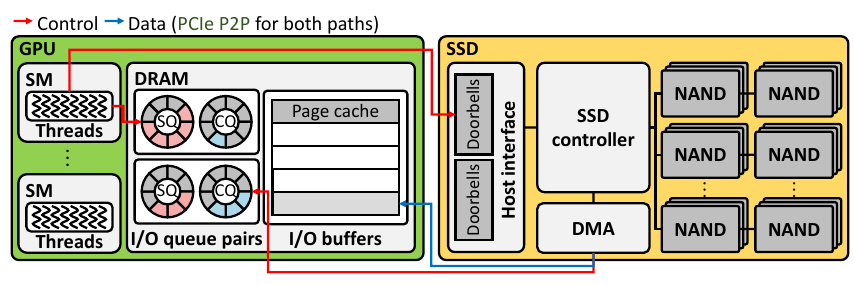
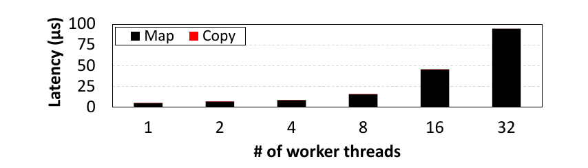
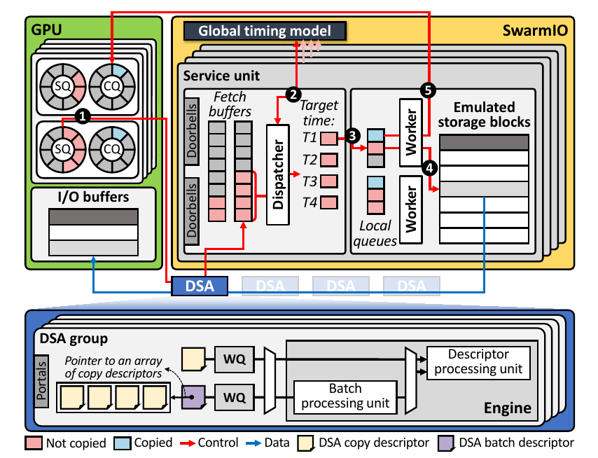
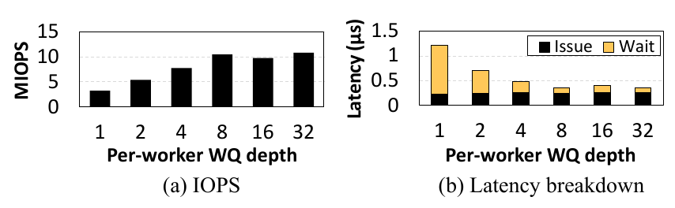
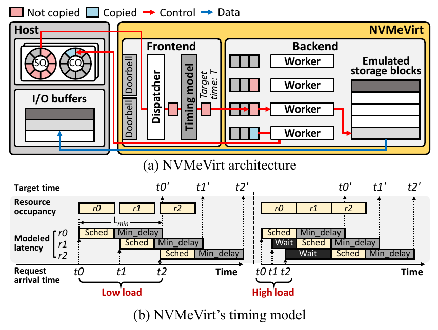
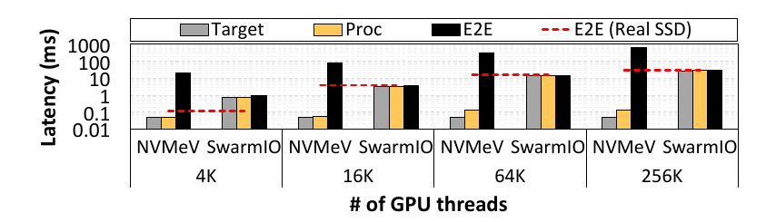
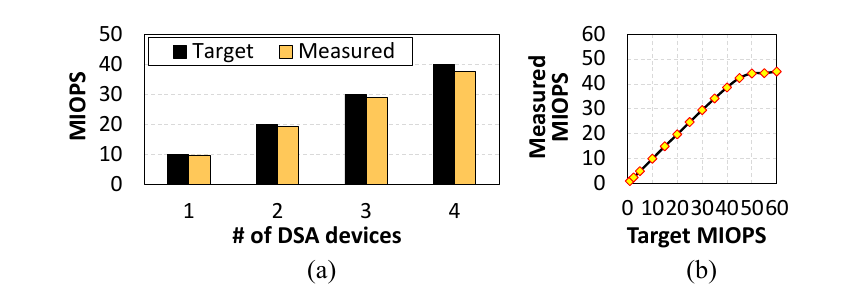
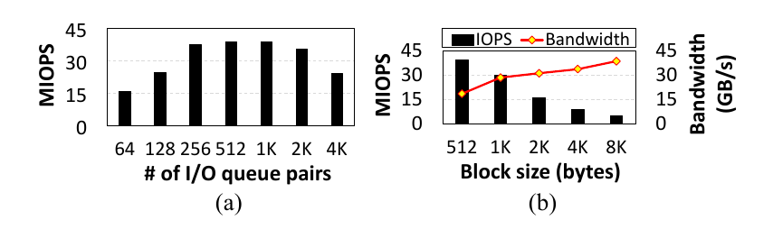
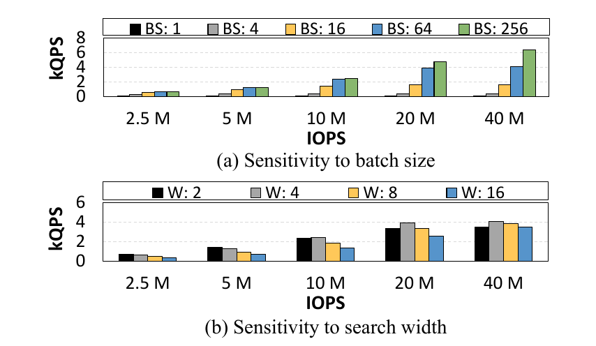

---
tags:
  - papers/computer-architecture
  - SSD
  - GPU-initiated-IO
  - emulation
aliases:
  - SwarmIO SSD 仿真器
arxiv_id: "2604.06668v1"
source_version: "v1, 2026-04-08"
authors:
  - Hyeseong Kim
  - Gwangoo Yeo
  - Minsoo Rhu
---

# SwarmIO

**论文** · SwarmIO: Towards 100 Million IOPS SSD Emulation for Next-generation GPU-centric Storage Systems

**作者与版本** · Hyeseong Kim、Gwangoo Yeo、Minsoo Rhu（KAIST），arXiv v1，2026 年 4 月 8 日。

**一句话理解** · 在真实 GPU 旁挂一块由软件实现的 NVMe SSD，把命令抓取、数据搬运、设备时序这三段都做快，然后改变虚拟 SSD 的 IOPS，观察真实应用的吞吐怎么变。

[原文 PDF](../../文献/SwarmIO.pdf) · [中英对照](SwarmIO_中英对照.md) · [arXiv v1](https://arxiv.org/abs/2604.06668v1) · [作者代码](https://github.com/VIA-Research/SwarmIO)

## 一、背景动机

### 1. GPU 一次能发出很多小读，SSD 需要按请求数跟上

向量检索遍历索引图时，下一步访问哪些节点依赖当前计算结果。很多查询并行后，会产生大量分散的小读。类似的访问模式也出现在推荐系统和部分智能体工作负载里。

**512 B 为什么重要。** 一个 128 维 FP32 向量就是 512 B。在这种粒度下，38.6 MIOPS 对应约 19.8 GB/s 的有效载荷。即使接口还有带宽，命令抓取、队列处理和完成通知也要在一秒内各做数千万次。这个换算只计算有效载荷，计算方式为 $38.6 \times 10^6 \times 512$ B/s。

  
*原论文图 1。GPU 显存承载 NVMe 队列和 I/O 缓冲区，GPU 与 SSD 通过 PCIe P2P 交互。*

- **控制路径** · GPU 把命令写入 SQ，再更新 doorbell。SSD 取命令，完成后写 CQ。
- **数据路径** · SSD 的 DMA 在设备和 GPU 缓冲区之间传输数据。CPU 可以负责初始化，稳定运行中的逐请求提交由 GPU 驱动。
- **要回答的问题** · 给真实应用一个更快的虚拟 SSD 后，应用能不能产生足够多的并发访问来用满它，原有应用参数是否还合适？[原文 §I、§II-A，PDF 第 1–2 页](../../文献/SwarmIO.pdf#page=1)

### 2. 为什么 NVMeVirt 能接上 GPU，却跑不出目标 IOPS

轨迹回放能研究固定请求流。真实应用会根据 I/O 返回结果继续计算和发请求，作者因此选择让 GPU 直接与一个裸机虚拟 NVMe 设备交互。NVMeVirt 提供了这条功能路径，性能上有三个瓶颈。

| 瓶颈 | 开销从哪里来 | 原文数据 |
| --- | --- | --- |
| 前端分发 | 单 dispatcher 依次轮询各 SQ，某个队列积压会拖慢后面的队列 | 图 3 关闭后端后，32 个 fio 线程的前端吞吐仍在约 4.6 MIOPS 饱和 |
| GPU 路径的搬运 | 前端逐条跨 PCIe 取 64 B 命令；后端用 CPU 复制时，逐次映射、解映射 GPU 缓冲区 | 图 4 的 512 B 微基准中，映射相关开销平均占 98.8%；32 worker 时单次搬运 94 μs |
| 共享时序状态 | 前端扩成多个 dispatcher 后，逐请求更新共享状态，每条命令都可能争同一把锁 | 图 14 中，逐请求更新在服务单元增加后很快停在约 10 MIOPS 量级 |

  
*原论文图 4。512 B 复制场景中，随 worker 数增长的主要是地址映射与解映射时间。*

**结果怎么影响模型。** BaM 512 B 随机读下，NVMeVirt 在 256K 个 GPU 线程时最高约 0.13 MIOPS。GPU 发出的请求大量堵在 SQ，时序模型只有在 dispatcher 取出命令后才看到它们。模型内部可能还按 50 μs 最小延迟计算，应用已经额外等了很久。由此可见，仿真器自身的排队会改变外部观测，还会改变模型看到的负载。[原文 §III、§VI-A、§VI-C，PDF 第 4–5、9–11 页](../../文献/SwarmIO.pdf#page=4)

## 二、设计方案

### 1. 一个服务单元怎样处理一次读请求

  
*原论文图 6。控制路径经过 dispatcher 和 worker，数据搬运交给 DSA。各服务单元共用设备时序状态。*

1. **取命令。** Dispatcher 轮询自己负责的 SQ doorbell，把新命令从 GPU 显存取到 CPU 内存的 fetch buffer。
2. **定时刻。** 全局时序模型按目标 SSD 的吞吐上限、最小延迟和资源占用状态，得到每条命令的目标完成时刻。
3. **入本地队列。** Dispatcher 把带着目标时刻的请求分发到本地 worker。
4. **搬数据。** 读请求的数据从 CPU DRAM 中的虚拟盘块通过 DSA 搬到 GPU 缓冲区。Worker 每轮限制新发起的搬运数量，再回头查看就绪请求。
5. **报完成。** 搬运完成并且到达模型规定的时刻后，worker 才把完成项写到 CQ。复制提前做好时可以继续等模型时刻，复制来不及做完时则会产生额外仿真延迟。

线上的 GPU 应用在真实硬件上发请求，虚拟 SSD 的存储空间由主机 DRAM 承载。设备的目标时序由模型产生，并通过真实时间里的 CQ 完成反馈给 GPU。[原文 §IV-A，PDF 第 5–6 页](../../文献/SwarmIO.pdf#page=5)

### 2. 前端的改动分别利用队列之间和队列内部的并行性

- **多 dispatcher 分管 SQ。** 队列对按服务单元分组，多个 dispatcher 可以同时处理各自的请求流。这减少了一个线程依次照看全部队列的压力。
- **同一个 SQ 合并抓取。** GPU warp 可用一次 doorbell 提交通往同一 SQ 的多条命令。Dispatcher 发现一批新命令后，把连续项合并成一次较大的搬运。设置 NVMe 的 CQR 位可要求队列使用物理连续内存。
- **用 DSA 搬运命令。** 单条 SQ 项 64 B。例如合并 64 项后，搬运请求的尺寸是 4 KB。合并提高了单次传输的效率，DSA 则承担跨 PCIe 的复制。端到端配置的前端在 DSA 上用同步、非批描述符提交，单次复制本身仍可以包含多条 NVMe 命令。

**合并取命令和后端描述符批处理是两件事。** 前者把同一 SQ 的连续命令放进一次大的复制，后者把多笔独立的数据复制装进一个 DSA 批描述符。一个读请求可以先作为合并抓取中的一条命令，随后作为后端批中的一笔搬运。[原文 §IV-B、§IV-C、§V，PDF 第 6–9 页](../../文献/SwarmIO.pdf#page=6)

### 3. DSA 后端如何压低每次小读的 CPU 成本

**直接用物理地址。** DSA 可以直接向 GPU 缓冲区搬运数据，省去 CPU worker 每笔 I/O 的虚拟地址映射和解映射。

**用批描述符提交，用异步隐藏等待。** Worker 在每线程上下文中复用描述符，批满或超时即提交。同时保留多个在途批次，搬运期间处理已到期的 I/O。提交超时保证低负载时未凑满的一批会发出去，等待超时控制何时轮询最早的在途批次。

  
*原论文图 8。在 DSA 批大小为 1 时，增大 WQ 深度主要压低 Wait，Issue 基本稳定。*

- **单 DSA 微基准。** 四个服务单元共用一个 DSA 设备。WQ 深度从 1 到 32，worker 吞吐达到原来的 3.3 倍。Worker 侧最高约 22.1 MIOPS，前后端并行时的平衡点约为 13.3 MIOPS。
- **共享引擎有代价。** 每个 DSA 组只有一个引擎，dispatcher 与 worker 各用一个 WQ。Worker 过于积极地提交大批次，也会占用前端取命令所需的引擎时间。图 9 中 worker 批从 1 增到 16，dispatcher 吞吐降到约原来的 1/1.9。
- **两种批大小的出处。** 单 DSA 微基准中，每个服务单元配一个 worker，批大小约 4 即可达到平衡点。端到端实验默认批大小是 16、WQ 深度是 32，因为 worker 还要做队列扫描和完成处理。[原文 §IV-C、§V，PDF 第 6–9 页](../../文献/SwarmIO.pdf#page=6)

### 4. 共用一份 SSD 时序，怎样避免每条命令都抢锁

假设 16 个 dispatcher 各拿到总吞吐的 $1/16$，请求又只集中在两个 dispatcher 上，即便这两个持有的 SQ 已经足以压满设备，模型仍只允许它们使用 $2/16$ 的目标吞吐。这是按 frontend 线程固定分配设备资源带来的误差。

**时序按设备资源记账。** 沿用 NVMeVirt 的简单时序模型，抽象实例被占用后，下一条访问需要等它空出来。低负载时主要体现最小延迟，高负载时资源等待自然进入模型延迟。

  
*原论文图 2。每项请求先占用抽象资源一段 Sched 时间，再加 Min_delay。重载时会多等资源释放。*

**每组命令只进一次临界区。** Dispatcher 先在锁外统计这一组命令合计会占用各资源多久，再加锁提交全局增量，随后按 SQ 顺序推算组内每请求的完成时刻。共享状态维持设备整体容量约束，聚合更新把争锁频率从每条一次降为每组一次。[原文 §II-C、§IV-D，PDF 第 3、8 页](../../文献/SwarmIO.pdf#page=8)

## 三、实验结果

### 1. 实验平台和对比口径

| 项目 | 设置 |
| --- | --- |
| 主机与 GPU | 单路 86 核 Intel Xeon 6787P、256 GB DDR5、4 个 DSA v2.0、NVIDIA H200 |
| 两种虚拟 SSD 的 CPU 和内存预算 | 均预留 33 核和 128 GB DRAM。NVMeVirt 为 1 dispatcher + 32 worker，SwarmIO 最多 16 个服务单元、每单元各 1 个 dispatcher 和 worker |
| 真实设备 | Solidigm D7-PS1010，1.92 TB PCIe Gen5。时序模型按 2.47 MIOPS 随机读峰值和 50 μs 最小延迟校准 |
| CPU I/O | fio + SPDK，32 个线程和 32 对队列，4 KB 随机读，改变每线程 I/O 深度 |
| GPU I/O | BaM，默认 512 B 随机读、256 对队列、深度 1,024、256K 个 GPU 线程 |

验证实验问的是**能否复现已有 SSD 表现**，扩展实验问的是**配置为更高速的虚拟 SSD 时，仿真器能否跟上**。两组实验使用不同目标速率。[原文 §V–VI，PDF 第 9–11 页](../../文献/SwarmIO.pdf#page=9)

### 2. 仿真准确性主要看应用实际等了多久

  
*原论文图 11。纵轴为对数刻度。Target 是模型目标，Proc 是仿真内部处理时间，E2E 是包含 SQ 排队的端到端延迟，红虚线为真实 SSD。*

- **吞吐误差。** 与 D7-PS1010 相比，SwarmIO 的平均相对 IOPS 误差为 fio **7.7%**、BaM **7.4%**。CPU 路径上 NVMeVirt 的 fio 误差为 1.2%，它的问题集中体现在 GPU 路径。
- **延迟误差。** GPU 路径中，SwarmIO 的平均端到端延迟相对误差为 **2.8%**。图 11 的线程数范围内，NVMeVirt 的 E2E 平均为真实 SSD 的 **21.8 倍**。
- **图中差距来自哪里。** NVMeVirt 取命令太慢，Target 长期停在 50 μs。Proc 超过 Target 说明后端也可能错过时刻，但更大的 E2E 与 Proc 差距来自命令在 SQ 内的等待。SwarmIO 让目标时刻随真实负载上升，并用 DSA 尽量赶上该时刻。[原文 §VI-A，PDF 第 9–10 页](../../文献/SwarmIO.pdf#page=9)

### 3. 平台上限、单项优化和扩展条件

  
*原论文图 12。左图增加 DSA 数量，右图固定四个 DSA 后调高设备时序模型的目标 IOPS。*

| 数值 | 对应实验 | 读法 |
| --- | --- | --- |
| **9.8 MIOPS** | 单 DSA、目标 10 MIOPS | BaM 下实测的完整路径 |
| **38.6 MIOPS** | 四 DSA、目标 40 MIOPS | 512 B GPU 随机读的实测峰值，第 VI-B 节对应 NVMeVirt 的 **303.9×** |
| **最高 45 MIOPS** | 目标继续提高 | 仿真吞吐仍会上升，但实测开始跟不上配置目标 |
| **52.6 MIOPS** | 分散调度 + DSA 取命令 + 合并抓取 | 图 13 的前端消融，关闭后端复制 |
| **3.6×** | 16 个服务单元、聚合更新对比逐请求更新 | 图 14 的时序模型消融，衡量减少共享锁竞争的收益 |
| **100 MIOPS** | 作者给出的扩展目标 | 推测双路、每路至少五个 DSA 可以达到，论文验证平台为单路四 DSA |

**为什么三个前端改动需要配合。** GPU 路径中只增加 dispatcher，仍有大量细碎 PCIe 读取，吞吐在约 1.5 MIOPS 处饱和。相比分散调度，单加 DSA 或单加合并抓取分别最多提高 2.8× 和 6.2×。两项一起用才能让大量小命令变成适合 DMA 的较大复制。前端能抓得快以后，共享时序更新又成为扩展瓶颈，图 14 的聚合更新处理的是这一段开销。

**原文倍数有两处写法。** 摘要与 §VI-B 给出 303.9×，引言贡献列表写 307.7×。上表采用 §VI-B 中与目标配置和实测吞吐一起出现的 303.9×。[引言，PDF 第 2 页](../../文献/SwarmIO.pdf#page=2) · [评估，PDF 第 10–11 页](../../文献/SwarmIO.pdf#page=10)

### 4. 队列数增加和请求变大，会从不同地方限制 IOPS

  
*原论文图 15。左图固定 2M GPU 线程，改变队列数。右图同时显示块大小变化时的 IOPS 和有效载荷带宽。*

- **队列数。** 到 1K 个队列对时，仿真仍接近峰值。到 2K 时只有 40 MIOPS 目标的 **88.9%**。原因是每个 dispatcher 仍要顺序查看分配给自己的多条 SQ。
- **块大小。** 512 B 达到 **38.6 MIOPS**，到 2 KB 降为 **15.1 MIOPS**。更大的块能让每次传输携带更多有效字节，因而 IOPS 降低时带宽仍会上升。
- **总线带宽。** 单独压力测试中，四个 DSA 向 GPU 搬运 8 KB 或更大的块时最高 **42.1 GB/s**。这是该平台跨 PCIe 控制器向 GPU 搬运的测量结果，GPU Gen5 ×16 单向理论峰值为 64 GB/s。[原文 §VI-D，PDF 第 11 页](../../文献/SwarmIO.pdf#page=11)

### 5. 向量检索能用掉多少额外 IOPS，取决于算法并发

CAGRA 的索引包含图结构和向量。作者让 GPU 在遍历时直接从 SSD 取数据，用 71.5 GB 的 BIGANN-100M 索引，把搜索可用显存限制到 2 GB，以近似更大部署中的显存与索引容量比。I/O 粒度设为 512 B，对应一个 128 维 FP32 向量的数据量。

  
*原论文图 16。上下两图各自固定一个参数，纵轴为每秒查询数的千倍单位 kQPS。*

| 设置 | 比较方式 | 结论 |
| --- | --- | --- |
| 上图，固定搜索宽度 4，批大小 4 | SSD 目标从 2.5 到 40 MIOPS | QPS 提升有限，小批量发不出足够多的并行 I/O |
| 上图，固定搜索宽度 4，批大小 256 | 同样提高目标 IOPS 16 倍 | QPS 为原来的 **9.7 倍** |
| 下图，固定批大小 64 | 不同搜索宽度分别选择达到至少 95% recall 所需的最少迭代数 | 5 MIOPS 及以下宽度 2 更快，10 MIOPS 及以上宽度 4 更快 |

**宽度为什么会随 SSD 变。** 搜索宽度更大，每轮可同时展开更多节点，达到同一召回率可能需要更少轮迭代。这样做会增加每轮读取的并行度。SSD 操作率较低时，更多节点的读取需要排队。SSD 操作率上升后，读操作能并行完成，减少迭代轮数的收益才有机会体现。这里的 **9.7×** 指盘上 CAGRA 的查询吞吐，原文测量到搜索这一环。[原文 §VII，PDF 第 11–12 页](../../文献/SwarmIO.pdf#page=11)

### 6. 使用这些结果时要保留的条件

- **真实设备验证范围。** 2.8% 来自一块 2.47 MIOPS 级 SSD 上的 GPU 随机读平均延迟校验。40 MIOPS 是更高速的配置目标，该区间的证据来自仿真平台自身的吞吐扩展实验。
- **介质行为的取舍。** 论文的简单时序模型以最大吞吐、最小延迟和抽象资源排队为核心。评估证据集中在随机读和平均延迟。引用这些结果时，应保留访问粒度、队列并发、设备校准和硬件平台。
- **和 FlashAccel 放在一起读。** FlashAccel 关心 HBF 作为 GPU 近端容量层时如何组织 LLM 权重和 KV。SwarmIO 关心 PCIe NVMe 设备如何向 GPU 提供大量细粒度访问，以及应用能否用掉增加的随机读 IOPS。两篇都需要沿着应用访问特征看存储收益，但对应的路径和指标分别是近端容量层的推理吞吐与盘上检索的 QPS。[SwarmIO 原文 §II、§V–VII](../../文献/SwarmIO.pdf#page=9) · [FlashAccel 中英对照](../FlashAccel/FlashAccel_中英对照.md)
