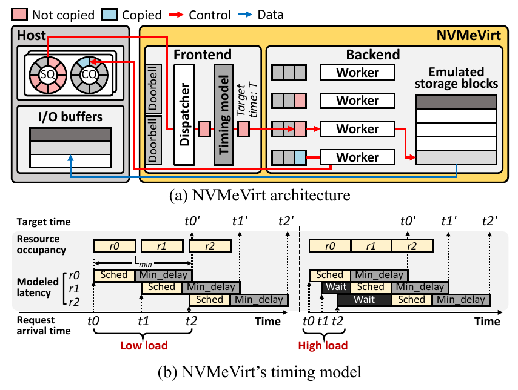
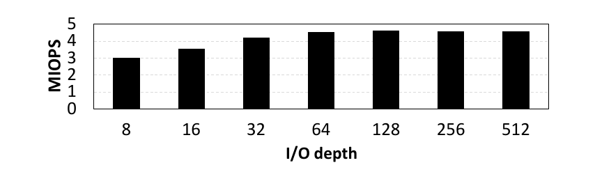

# SwarmIO：面向下一代 GPU 中心存储系统的高 IOPS SSD 仿真

**论文题名 / Paper title** · SwarmIO: Towards 100 Million IOPS SSD Emulation for Next-generation GPU-centric Storage Systems

**作者与版本 / Authors and version** · Hyeseong Kim、Gwangoo Yeo、Minsoo Rhu（KAIST），arXiv:2604.06668v1，2026 年 4 月 8 日，14 页。

**阅读方式 / Reading guide** · 每组先给英文释义，再给对应中文。节号和图号沿用 v1，页码以 PDF 文件为准。逐字原文、图 7 的 API 示例及完整参考文献可在原版查阅。[本地 PDF](../../文献/SwarmIO.pdf) · [arXiv v1](https://arxiv.org/abs/2604.06668v1) · [作者代码](https://github.com/VIA-Research/SwarmIO) · [三段式精读笔记](SwarmIO.md)

## 目录 / Contents

- [摘要 / Abstract](#abstract)
- [I 引言 / Introduction](#introduction)
- [II 背景 / Background](#background)
- [III 特征分析与动机 / Characterization and Motivation](#motivation)
- [IV SwarmIO 设计 / SwarmIO Design](#design)
- [V 实验方法 / Methodology](#methodology)
- [VI 实验评估 / Evaluation](#evaluation)
- [VII 案例研究 / Case Study](#case-study)
- [VIII 相关工作 / Related Work](#related-work)
- [IX 结论 / Conclusion](#conclusion)
- [术语 / Glossary](#glossary)

## 摘要 / Abstract

**English.** Fine-grained random reads from thousands of GPU threads create an I/O regime that conventional SSD emulators struggle to reproduce in real time. SwarmIO distributes command ingestion over CPU cores, uses Intel DSA to move both commands and data, and batches updates to a shared timing model. With a real GPU, it measures 38.6 million operations per second at a configured 40 MIOPS, or 303.9 times NVMeVirt in the corresponding random-read comparison. In the on-disk vector search example, raising the configured SSD rate from 2.5 to 40 MIOPS improves query throughput by 9.7 times in the batch-256 setting. [PDF pp. 1, 10, 12](../../文献/SwarmIO.pdf#page=1)

**中文。** 大量 GPU 线程同时发出细粒度随机读，形成了传统 SSD 仿真器难以实时复现的 I/O 模式。SwarmIO 把命令接收分散到多个 CPU 核，用 Intel DSA 搬运命令和数据，并批量更新共享时序模型。在真实 GPU 上，将 SSD 目标设为 40 MIOPS 时，实测为每秒 3,860 万次 I/O，对应随机读实验中为 NVMeVirt 的 303.9 倍。盘上向量搜索的批大小为 256 时，SSD 的配置速率从 2.5 提至 40 MIOPS，查询吞吐达到原来的 9.7 倍。

## I 引言 / Introduction

**English.** The paper links the growth of AI storage footprints with access patterns in retrieval, recommendation, and agent workflows. Sparse accesses can turn each query into many small requests, placing pressure on the device's operation rate. GPU threads can submit these requests directly and provide the concurrency to stress future devices. Existing SSDs and conventional emulators give researchers few ways to measure how a real application would respond to tens of millions of random reads per second. The authors use an emulated SSD alongside a real GPU so application behavior and I/O completions interact on the same wall clock. Their architectural goal is 100 MIOPS. [PDF pp. 1–2](../../文献/SwarmIO.pdf#page=1)

**中文。** 论文把 AI 数据规模增长与检索、推荐和智能体工作流中的访问模式联系起来。一次查询可能发出许多稀疏的小请求，因而设备每秒能处理的请求数成为关键。GPU 线程可直接提交这些请求，提供足以考验未来设备的并发度。现有 SSD 和传统仿真器很难回答真实应用面对数千万次每秒的随机读会如何变化。作者让虚拟 SSD 与真实 GPU 一起运行，应用和 I/O 完成事件在同一个真实时间轴上相互影响。架构目标是 100 MIOPS。

## II 背景 / Background

### II-A GPU 发起的存储 I/O / GPU-Initiated Storage I/O

**English.** GPU memory holds both NVMe queue pairs and I/O buffers. GPU threads place requests in a submission queue (SQ) and notify the controller via a doorbell. The device transfers payloads and posts completions to the completion queue (CQ). PCIe peer-to-peer traffic carries the control messages and the data. CPU-side setup can still exist, while GPU threads drive individual requests in steady state. [PDF p. 2](../../文献/SwarmIO.pdf#page=2)

**中文。** NVMe 队列对和 I/O 缓冲区都位于 GPU 显存。GPU 线程把请求放进提交队列（SQ），通过 doorbell 寄存器通知控制器。设备搬运数据，再向完成队列（CQ）写入完成项。控制消息和数据通过 PCIe 点对点传输。CPU 可以负责初始化，稳定运行中的逐条 I/O 由 GPU 线程驱动。

*Figure 1 · Control and data paths for GPU-initiated I/O. / 图 1 · GPU 发起 I/O 的控制路径与数据路径。*

### II-B SSD 仿真工具 / SSD Simulation and Emulation

**English.** Trace replay advances through recorded I/O and is limited in its ability to capture feedback from a running application. Full-system simulation can model more interactions at considerable runtime cost. An SSD emulator runs against a live system and can expose a virtual device on the host, provided that its implementation supports GPU peer traffic and can keep up with the requested I/O rate. [PDF pp. 2–3](../../文献/SwarmIO.pdf#page=2)

**中文。** 轨迹回放依次执行已经记录的 I/O，对应用运行时反馈的刻画有限。全系统模拟能建模更多交互，但耗时较高。SSD 仿真器与真实运行的系统交互，可以向主机暴露虚拟设备。要用于本文场景，它还需支持 GPU 点对点传输，并能跟上配置的 I/O 速率。

### II-C NVMeVirt

**English.** NVMeVirt exposes a software-defined PCIe NVMe device on a bare-metal host. One dispatcher polls the SQ doorbells, fetches commands, and calculates target completion times. Workers transfer payloads between the request buffers and CPU memory that backs the virtual storage. Completion is posted after the payload is copied and the target time has arrived. Its simple model schedules operations on abstract resources. Resource occupancy limits sustained throughput, and an added delay sets a floor on request latency. [PDF p. 3](../../文献/SwarmIO.pdf#page=3)

**中文。** NVMeVirt 在裸机主机上提供软件定义的 PCIe NVMe 设备。一个调度线程轮询 SQ doorbell、获取命令并计算目标完成时刻。工作线程在请求缓冲区与承载虚拟存储的 CPU 内存之间搬运数据。数据复制结束且到达目标时刻后才提交完成项。其简单时序模型把操作分配给抽象资源。资源占用限制持续吞吐，额外延迟用来设定请求延迟下限。

*Figure 2 · NVMeVirt's frontend and backend, and the effects of low and high load on scheduling. / 图 2 · NVMeVirt 的前后端，以及低负载和高负载下资源调度的区别。*

### II-D Intel 数据流加速器 / Intel Data Streaming Accelerator

**English.** DSA groups associate work queues (WQs) with engines. Software submits 64-byte descriptors through a work queue's portal. A copy descriptor describes one transfer, while a batch descriptor points to an array of operations. Physical-address descriptors let the emulator move data without mapping every GPU buffer into the CPU's virtual address space. [PDF pp. 3–4, 6](../../文献/SwarmIO.pdf#page=3)

**中文。** DSA 通过组把工作队列（WQ）和执行引擎关联起来。软件经由工作队列的 portal 提交 64 字节描述符。复制描述符描述一项搬运操作，批描述符指向一组操作。使用物理地址后，仿真器可直接搬运数据，省去把每个 GPU 缓冲区映射到 CPU 虚拟地址空间的过程。

## III 特征分析与动机 / Characterization and Motivation

### III-A 单调度线程的吞吐上限 / Frontend Scalability

**English.** With backend copies disabled, 32 fio threads perform 4 KB random reads through separate queues. Increasing the per-thread I/O depth from 8 to 512 drives the single NVMeVirt dispatcher to a plateau at about 4.6 MIOPS. Simultaneous arrivals across SQs still compete for one polling and dispatch loop. [PDF p. 4](../../文献/SwarmIO.pdf#page=4)

**中文。** 关闭后端数据复制后，32 个 fio 线程各用独立队列执行 4 KB 随机读。将每线程 I/O 深度从 8 增至 512 时，NVMeVirt 的单调度线程在约 4.6 MIOPS 处饱和。不同 SQ 同时到达的请求仍要争用同一个轮询和分发循环。

*Figure 3 · CPU-centric I/O reaches a frontend plateau even when the backend copy is disabled. / 图 3 · 关闭后端复制后，CPU 发起 I/O 仍然遇到前端吞吐上限。*

### III-B 小 PCIe 事务与地址映射 / Small Transfers and Address Mapping

**English.** With GPU-resident queues, even fetching an SQ entry involves PCIe traffic. Individual 64-byte command reads and small payload copies make inefficient use of the link. CPU workers also map and unmap the destination address for every copy. In the isolated 512-byte copy experiment, mapping and unmapping account for an average 98.8% of the transfer emulation latency. At 32 workers, the per-transfer latency reaches 94 μs. [PDF pp. 4–5](../../文献/SwarmIO.pdf#page=4)

**中文。** 队列位于 GPU 显存时，读取一项 SQ 命令也要经过 PCIe。逐条搬运 64 字节命令和复制小块数据都会降低链路利用率。CPU 工作线程还需为每次复制建立并解除目标地址映射。在独立的 512 字节复制实验中，映射和解映射平均占数据搬运仿真延迟的 98.8%。32 个工作线程下，单次搬运延迟达到 94 μs。

*Figure 4 · Cost of address mapping and data copying as worker count increases. / 图 4 · 随工作线程数增加，地址映射和数据复制开销的变化。*

**English.** In the BaM 512-byte random-read benchmark, the baseline peaks at about 0.13 MIOPS with 256K GPU threads. The real Solidigm D7-PS1010 is 16.6 times as fast at that point. Across the sweep of GPU thread counts in Figure 5, NVMeVirt incurs 17.4–63.7 times the latency of the physical drive. [PDF p. 5](../../文献/SwarmIO.pdf#page=5)

**中文。** 在 BaM 的 512 字节随机读实验中，GPU 线程达到 256K 时，基线吞吐最高约为 0.13 MIOPS。同一配置下，真实 Solidigm D7-PS1010 的吞吐为其 16.6 倍。图 5 所扫描的线程数范围内，NVMeVirt 的延迟为真实设备的 17.4–63.7 倍。

*Figure 5 · Baseline latency and throughput versus the physical SSD under GPU-initiated I/O. / 图 5 · GPU 发起 I/O 时，基线仿真器与真实 SSD 的延迟和吞吐。*

## IV SwarmIO 设计 / SwarmIO Design

### IV-A 服务单元 / Service Units

**English.** SwarmIO keeps the kernel-level virtual PCIe device abstraction and splits the work among service units. A dispatcher fetches commands for its assigned SQs, obtains target completion times from a global model, and passes requests to local worker queues. Each worker alternates between initiating a bounded amount of copy work and revisiting requests that may now be ready for completion. CQ notification requires both data readiness and expiration of the modeled delay. [PDF pp. 5–6](../../文献/SwarmIO.pdf#page=5)

**中文。** SwarmIO 保留内核虚拟 PCIe 设备的抽象，将工作划分给多个服务单元。调度线程从分配给自己的 SQ 获取命令，从全局模型取得目标完成时刻，再把请求交给本地工作队列。工作线程每轮先启动有限数量的复制，再回头检查已符合完成条件的请求。数据已经就绪且模型规定的时间已到，请求才会写入 CQ。

*Figure 6 · Service-unit pipeline, global timing model, and DSA work queues. / 图 6 · 服务单元的处理流程、全局时序模型和 DSA 工作队列。*

### IV-B 分散式分发和合并取命令 / Parallel Frontend

**English.** Partitioning queue pairs gives different dispatchers independent streams of work. Within an SQ, the dispatcher can fetch several adjacent entries with one transfer into a CPU-side fetch buffer. GPU warps often submit a set of commands with one doorbell update, and bursts across warps can leave many entries ready at once. SwarmIO sets the NVMe CQR bit so the queues are placed in physically contiguous memory. The parallel dispatchers address concurrency between queues, while coalesced fetching improves PCIe transfer efficiency within each queue. [PDF p. 6](../../文献/SwarmIO.pdf#page=6)

**中文。** 划分队列对后，各调度线程可独立处理分配到的请求流。在一个 SQ 内，调度线程可通过一次传输把连续多项命令取到 CPU 侧缓冲区。GPU 的一个 warp 常用一次 doorbell 更新提交多条命令，多 warp 的突发流量也会使多项命令同时就绪。SwarmIO 设置 NVMe 的 CQR 位，要求队列位于物理连续内存。并行分发利用队列间并发，合并取命令提升单个队列上的 PCIe 传输效率。

### IV-C1 DSA 异步搬运 / DSA Copy Offloading

**English.** DSA fetches commands from GPU memory and handles the worker-side payload copies. Workers submit batches asynchronously and can keep multiple batches in flight. A per-thread kernel API context retains descriptors and tracks outstanding work. A full batch can be submitted immediately, and a timeout flushes a partially filled batch when traffic is sparse. The thread can check for ready I/O completions during the transfer and defer polling the oldest DSA batch until a configured interval has elapsed. [PDF pp. 6–7，Figure 7](../../文献/SwarmIO.pdf#page=7)

**中文。** DSA 既从 GPU 显存获取命令，也负责工作线程的数据复制。工作线程异步提交描述符批次，可以同时保留多个在途批次。内核 API 为每线程保留描述符并跟踪未完成的搬运。一批凑满后可以立即提交，流量低时则由超时触发提交未满的一批。搬运期间线程可以处理已经就绪的 I/O 完成项，对最早在途 DSA 批次的轮询可延后至配置的时间间隔。

### IV-C2 单 DSA 微基准 / Tuning on One DSA Device

**English.** The microbenchmark pairs 4 KB GPU-to-CPU command fetches, each representing 64 SQ entries, with random 512-byte CPU-to-GPU payload transfers. At batch size 1, a worker WQ depth of 32 gives 3.3 times the throughput at depth 1, and average wait overhead drops by up to 9.8 times. Across four service units, aggregate worker throughput can reach about 22.1 MIOPS. Dispatchers and workers share an engine in each group, so larger worker batches can slow dispatcher fetching. The practical balanced point reported for the single-DSA microbenchmark is about 13.3 MIOPS. [PDF pp. 7–8](../../文献/SwarmIO.pdf#page=7)

**中文。** 微基准用从 GPU 到 CPU 的 4 KB 搬运表示命令抓取，每次对应 64 项 SQ 命令，并用从 CPU 到 GPU 的随机 512 字节搬运表示读取数据。批大小为 1 时，工作队列深度从 1 增至 32，吞吐达到原来的 3.3 倍，平均等待开销最多降至原来的约 1/9.8。四个服务单元的工作线程总吞吐最高约 22.1 MIOPS。由于每组的调度线程与工作线程共用一个引擎，工作线程使用更大的批可能拖慢命令获取。原文给出的单 DSA 微基准前后端平衡点约为 13.3 MIOPS。

*Figure 8 · Outstanding descriptor depth changes worker throughput mainly through wait time. / 图 8 · 在途描述符深度主要通过改变等待时间影响工作线程吞吐。*

*Figure 9 · Worker batch size changes both worker and dispatcher throughput on the shared DSA. / 图 9 · 工作线程的描述符批大小同时影响共用 DSA 的工作线程和调度线程吞吐。*

### IV-D 批量更新共享时序模型 / Aggregated Timing Model Updates

**English.** When traffic is skewed toward a subset of SQs, giving each dispatcher a fixed fraction of the SSD rate would strand modeled capacity on idle queues. SwarmIO shares one timing model across dispatchers. Each dispatcher prepares the cumulative occupancy increments for a coalesced fetch, applies them in one critical section, and computes completion times under the assumption that requests use each resource in SQ order. One lock acquisition covers the fetched set. [PDF p. 8](../../文献/SwarmIO.pdf#page=8)

**中文。** 当请求集中在少数 SQ 时，如果给每个调度线程分配固定比例的 SSD 吞吐，空闲队列的模型额度就无法被繁忙队列使用。SwarmIO 让调度线程共用一个时序模型。每个调度线程先为一组取回的命令计算资源累计占用增量，进入一次临界区提交这些增量，再按请求在 SQ 中的顺序推算各自的完成时刻。一组命令对应一次加锁。

## V 实验方法 / Methodology

**English.** The testbed has a single 86-core Intel Xeon 6787P, 256 GB DDR5, four DSA v2.0 devices, and an NVIDIA H200. A Solidigm D7-PS1010 serves as the physical reference. Both emulators receive 33 reserved cores and 128 GB of DRAM. NVMeVirt uses one dispatcher and 32 workers. SwarmIO uses up to 16 service units with one dispatcher, one worker, and one DSA group each. The end-to-end worker configuration has a WQ depth of 32 and a maximum DSA batch size of 16. [PDF p. 9](../../文献/SwarmIO.pdf#page=9)

**中文。** 测试平台配备单路 86 核 Intel Xeon 6787P、256 GB DDR5、四个 DSA v2.0 设备和 NVIDIA H200。真实设备参照为 Solidigm D7-PS1010。两种仿真器均预留 33 个 CPU 核和 128 GB DRAM。NVMeVirt 使用一个调度线程与 32 个工作线程。SwarmIO 最多使用 16 个服务单元，每个单元配一个调度线程、一个工作线程和一个 DSA 组。端到端实验的工作队列深度为 32，DSA 描述符最大批大小为 16。

| Benchmark / 基准 | Workload / 工作负载 | Parallelism / 并发设置 |
| --- | --- | --- |
| fio with SPDK / CPU 发起 | 4 KB random reads / 4 KB 随机读 | 32 threads and queue pairs, with per-thread outstanding I/O varied / 32 线程、32 个队列对，改变每线程在途 I/O 数 |
| BaM / GPU 发起 | 512 B random reads by default / 默认 512 B 随机读 | 256 queue pairs with 1,024 entries per queue and 256K GPU threads by default / 默认 256 个队列对、队列深度 1,024、256K 个 GPU 线程 |

## VI 实验评估 / Evaluation

### VI-A 和真实 SSD 校验 / Validation against a Physical SSD

**English.** The emulators are calibrated with a 50 μs latency floor and a 2.47 MIOPS peak random-read rate. SwarmIO's mean relative IOPS error against the physical drive is 7.7% in fio and 7.4% in BaM. For BaM average end-to-end latency, the reported mean relative error is 2.8%. At high load, the baseline's slow command fetching causes lengthy SQ waits, leaving its timing model with an artificially light observed load. [PDF pp. 9–10](../../文献/SwarmIO.pdf#page=9)

**中文。** 两个仿真器按 50 μs 的延迟下限和 2.47 MIOPS 的随机读峰值校准。相对真实 SSD，SwarmIO 在 fio 和 BaM 的 IOPS 平均相对误差分别为 7.7% 和 7.4%。BaM 平均端到端延迟的平均相对误差为 2.8%。高负载下，基线取命令过慢，导致请求长时间滞留在 SQ，时序模型看到的负载也比实际提交负载低。

*Figure 10 · Throughput of the two emulators and the physical SSD. / 图 10 · 两个仿真器与真实 SSD 的吞吐对比。*

*Figure 11 · Modeled target latency, internal processing time, and application-visible latency. / 图 11 · 模型目标延迟、仿真内部处理时间和应用可见延迟。*

### VI-B 扩展性 / Scalability

**English.** One DSA device reaches 9.8 MIOPS at a target of 10. With four devices, SwarmIO reaches 38.6 MIOPS at a target of 40, which Section VI-B reports as a 303.9-fold gain over NVMeVirt. At higher target settings, observed throughput can reach 45 MIOPS and no longer follows the configured rate reliably. The authors project that a dual-socket platform with at least five DSA devices per socket could support the 100 MIOPS goal. [PDF p. 10](../../文献/SwarmIO.pdf#page=10)

**中文。** 一个 DSA 设备在 10 MIOPS 目标下实测 9.8 MIOPS。四个设备在 40 MIOPS 目标下实测 38.6 MIOPS，第 VI-B 节报告其为 NVMeVirt 的 303.9 倍。再继续提高目标时可观测到最高 45 MIOPS，实测逐渐无法跟随配置速率。作者预计，双路且每路至少五个 DSA 设备的平台有望达到 100 MIOPS 的设计目标。

*Figure 12 · Scaling the DSA device count and sweeping the emulated SSD target. / 图 12 · 扩大 DSA 设备数量，以及改变虚拟 SSD 的目标速率。*

### VI-C 消融实验 / Ablation

**English.** For GPU I/O, distribution alone reaches about 1.5 MIOPS in the frontend-only experiment. Combining distribution, DSA command fetching, and coalescing reaches 52.6 MIOPS with backend transfers disabled. A separate experiment keeps the full emulation path and compares timing updates. With 16 service units, batched locking improves attainable throughput by 3.6 times relative to per-request locking at the same target. [PDF pp. 10–11](../../文献/SwarmIO.pdf#page=10)

**中文。** GPU 发起 I/O 的前端消融中，仅分散调度时上限约为 1.5 MIOPS。关闭后端搬运时，把分散调度、DSA 取命令和合并取命令结合起来，前端达到 52.6 MIOPS。另一组实验保留完整仿真路径，比较不同的时序模型更新方式。16 个服务单元时，批量加锁的吞吐为同目标下逐请求加锁的 3.6 倍。

*Figure 13 · Frontend-only throughput after enabling different combinations of optimizations. / 图 13 · 启用不同优化组合时，仅前端的吞吐。*

*Figure 14 · Per-request and aggregated timing updates as the service-unit count grows. / 图 14 · 服务单元数增加时，逐请求更新和聚合更新的表现。*

### VI-D 队列数与块大小 / Sensitivity to Queues and Block Size

**English.** With 2M GPU threads supplying requests, throughput remains near its peak up to 1K queue pairs. At 2K queues, it falls to 88.9% of the 40 MIOPS target as dispatchers have more queues to visit. Increasing the transfer size lowers the operation rate but raises byte throughput. SwarmIO delivers 15.1 MIOPS with 2 KB blocks. In a separate transfer stress test with four DSA devices, the paper reports 42.1 GB/s for GPU-bound transfers of 8 KB or more. [PDF p. 11](../../文献/SwarmIO.pdf#page=11)

**中文。** 当 2M 个 GPU 线程产生请求时，队列对数量增至 1K 仍能保持接近峰值的吞吐。增加到 2K 后，调度线程需要遍历更多队列，吞吐降至 40 MIOPS 目标的 88.9%。传输块变大后，每秒处理的操作数下降，按字节算的吞吐则上升。使用 2 KB 块时，SwarmIO 达到 15.1 MIOPS。原文另用四个 DSA 设备做传输压力测试，8 KB 及以上大小的 GPU 入向搬运最高为 42.1 GB/s。

*Figure 15 · Effects of queue count and request size on sustained IOPS and bandwidth. / 图 15 · 队列数和请求大小对持续 IOPS 及带宽的影响。*

## VII 案例研究 / Case Study

**English.** CAGRA searches a graph to find vectors close to a query. The authors modify it to read index data directly from the virtual SSD through GPU-initiated I/O. The BIGANN-100M index occupies 71.5 GB, and GPU memory available to search is capped at 2 GB to approximate a much larger deployment's memory-to-index ratio. A 512-byte I/O block matches the payload of a 128-dimensional FP32 vector. [PDF pp. 11–12](../../文献/SwarmIO.pdf#page=11)

**中文。** CAGRA 通过遍历图寻找接近查询向量的节点。作者接入 GPU 发起 I/O，让它从虚拟 SSD 直接读索引数据。BIGANN-100M 索引占 71.5 GB，搜索可用显存限制在 2 GB，以近似更大部署中的显存与索引容量比。一个 128 维 FP32 向量的数据量恰好对应 512 字节 I/O 块。

**English.** At search width 4, a batch of four queries generates too little concurrent I/O for the faster device to help much. With 256 queries per batch, a 16-fold increase in configured SSD IOPS yields a 9.7-fold increase in QPS. In a separate sweep at batch size 64, the authors select the minimum iteration count needed for at least 95% recall at each search width. Width 2 is faster at 5 MIOPS or less, while width 4 is faster at 10 MIOPS or more in the tested settings. [PDF p. 12](../../文献/SwarmIO.pdf#page=12)

**中文。** 搜索宽度固定为 4 时，批大小为 4 的查询产生的并发 I/O 有限，更高 SSD 速率带来的收益很小。批大小增至 256 后，SSD 配置 IOPS 提高到原来的 16 倍，QPS 提高到原来的 9.7 倍。在另一组批大小固定为 64 的实验中，作者为每个搜索宽度选择能达到至少 95% 召回率的最少迭代次数。在测试设置下，5 MIOPS 及以下时，宽度 2 更快。10 MIOPS 及以上时，宽度 4 更快。

*Figure 16 · CAGRA query throughput as SSD IOPS scale, sweeping batch size or search width. / 图 16 · 改变 SSD IOPS 时，CAGRA 查询吞吐随批大小或搜索宽度的变化。*

## VIII 相关工作 / Related Work

**English.** The authors place SwarmIO between storage-device modeling and GPU-centric I/O research. Tools such as FEMU and NVMeVirt provide virtual devices. FPGA platforms offer another path to SSD prototyping. BaM, GIDS, and GMT investigate how GPU applications can access storage or manage memory tiers. SwarmIO focuses on changing the emulated SSD's operation rate while running one of these GPU-side I/O approaches on actual hardware. [PDF p. 12](../../文献/SwarmIO.pdf#page=12)

**中文。** 作者将 SwarmIO 放在存储设备建模与 GPU 中心 I/O 研究的交叉位置。FEMU 与 NVMeVirt 等工具提供虚拟设备。FPGA 平台提供另一种 SSD 原型验证路径。BaM、GIDS 和 GMT 等研究探索 GPU 应用如何访问存储或管理内存层次。SwarmIO 关注如何在真实硬件运行 GPU 侧 I/O 的同时，改变虚拟 SSD 的请求处理速率。

## IX 结论 / Conclusion

**English.** Distributing command ingestion, offloading data movement, and amortizing shared model updates make real-time GPU-centric emulation practical at tens of millions of IOPS. This enables experiments on how application settings and future storage performance interact. Fidelity in the paper is checked against the D7-PS1010, and higher target rates are explored using the calibrated model and the emulator's measured throughput. [PDF pp. 9–12](../../文献/SwarmIO.pdf#page=9)

**中文。** 通过分散接收命令、卸载数据搬运和摊薄共享模型更新开销，可以在数千万 IOPS 的量级对 GPU 中心存储做实时仿真。这让研究者能够实验分析应用参数与未来存储性能之间的相互作用。论文用 D7-PS1010 校验仿真准确性，并通过时序模型和仿真器的实测速率探索更高目标。

**数值口径 / Reporting detail.** The abstract and Section VI-B give **303.9×** for the NVMeVirt comparison. The contribution list in Section I gives **307.7×**. The reported peak at a 40 MIOPS target is **38.6 MIOPS** in Section VI-B. / 摘要与第 VI-B 节写的是 **303.9×**，引言的贡献列表写的是 **307.7×**。第 VI-B 节中，40 MIOPS 目标对应的实测峰值是 **38.6 MIOPS**。[PDF pp. 1–2, 10](../../文献/SwarmIO.pdf#page=10)

## 术语 / Glossary

| Term | 中文 | 本文中的含义 |
| --- | --- | --- |
| IOPS / MIOPS | 每秒 I/O 操作数 / 百万 IOPS | 1 MIOPS = 1,000,000 次 I/O/s |
| SQ / CQ | 提交队列 / 完成队列 | NVMe 命令与完成项的队列 |
| Doorbell | 门铃寄存器 | 用于通知设备队列进展 |
| PCIe P2P | PCIe 点对点传输 | 用于 GPU 侧命令、完成项和数据的传输 |
| WQ | 工作队列 | DSA 接收搬运描述符的队列，与 NVMe 队列区分 |
| CQR | 队列物理连续性要求 | NVMe 控制器报告的能力位，用于约束队列内存布局 |
| QPS | 每秒查询数 | 案例中的应用吞吐，一次查询通常触发多笔 I/O |
| Recall | 召回率 | 在检索结果中找回真实 top-k 邻居的比例 |

**原文索引 / Source index** · [图 7 与内核 API，PDF 第 7 页](../../文献/SwarmIO.pdf#page=7) · [致谢与参考文献，PDF 第 13–14 页](../../文献/SwarmIO.pdf#page=13) · [arXiv HTML 原文](https://arxiv.org/html/2604.06668v1)
