# SwarmIO: Towards 100 Million IOPS SSD Emulation for Next-generation GPU-centric Storage Systems

# SwarmIO：迈向下一代 GPU 中心存储系统的 1 亿 IOPS SSD 仿真

## 文献信息 / Publication Information

- **Authors / 作者** · Hyeseong Kim, Gwangoo Yeo, Minsoo Rhu.
- **Version / 版本** · arXiv:2604.06668v1 [cs.AR]，8 Apr 2026 / 2026 年 4 月 8 日。
- **Source / 来源** · [本地原版 PDF，14 页](../../文献/SwarmIO.pdf)。

| Author / 作者 | Affiliation / 单位 | Email / 邮箱 |
| --- | --- | --- |
| Hyeseong Kim | KAIST / 韩国科学技术院 | hyeseong.kim@kaist.ac.kr |
| Gwangoo Yeo | KAIST / 韩国科学技术院 | gwangoo525@kaist.ac.kr |
| Minsoo Rhu | KAIST / 韩国科学技术院 | mrhu@kaist.ac.kr |

## 阅读说明 / Reading Notes

每组先列英文原文，再紧接对应中文。英文整理了 PDF 排版造成的换行、断词和数学下标。章节编号、引文、脚注和原文数值沿用 arXiv v1。16 幅图保留原图，图题逐条中英对照，图中标签、坐标轴、图例和图 7 的代码注释在图下译出。

插图在同目录的 `assets/` 下。[精读笔记](SwarmIO.md)

## 目录 / Contents

- [摘要 / Abstract](#abstract)
- [I. 引言 / Introduction](#sec-i)
- [II. 背景 / Background](#sec-ii)
- [III. 特征分析与动机 / Characterization and Motivation](#sec-iii)
- [IV. SwarmIO](#sec-iv)
- [V. 实验方法 / Methodology](#sec-v)
- [VI. 实验评估 / Evaluation](#sec-vi)
- [VII. 案例研究 / Case Study](#sec-vii)
- [VIII. 相关工作 / Related Work](#sec-viii)
- [IX. 结论 / Conclusion](#sec-ix)
- [致谢 / Acknowledgment](#ack)
- [脚注 / Footnotes](#footnotes)
- [参考文献 / References](#references)

---

## Abstract / 摘要

**English**

Abstract—GPU-initiated I/O has emerged as a key mechanism for achieving high-throughput storage access by leveraging massive GPU thread-level parallelism, while recent industry trends point toward SSDs optimized for ultra-high random-read IOPS. Together, these trends are enabling the emergence of IOPS-optimized, GPU-centric storage systems. Despite this momentum, no existing framework enables quantitative end-to-end evaluation of storage systems optimized for GPU-initiated I/O. While conventional SSD emulators provide a promising path toward end-to-end modeling in traditional storage systems, they face three key challenges in this GPU-centric setting: limited frontend scalability for ingesting massive request streams, high software overhead in emulating GPU-initiated I/O control and data paths, and excessive timing-model maintenance overhead at extremely high I/O request rates. We propose SwarmIO, an SSD emulator for massively parallel, GPU-centric storage. SwarmIO faithfully models IOPS-optimized SSDs at target performance levels of up to 40 MIOPS, achieving a 303.9× speedup over the state-of-the-art baseline SSD emulator under GPU-initiated I/O. We further demonstrate its utility through a vector search case study, showing that increasing SSD IOPS from 2.5 MIOPS to 40 MIOPS yields an average end-to-end speedup of up to 9.7×.

**中文**

GPU 发起的 I/O 借助 GPU 大规模线程级并行性，已成为实现高吞吐存储访问的重要机制。与此同时，近期产业趋势指向为超高随机读 IOPS 优化的 SSD。这两项趋势正共同推动面向 IOPS 优化、以 GPU 为中心的存储系统出现。尽管发展势头明显，现有框架中仍缺少能够对面向 GPU 发起 I/O 优化的存储系统进行定量端到端评估的工具。传统 SSD 仿真器为传统存储系统提供了一条有希望的端到端建模路径，但在以 GPU 为中心的场景下会遇到三个主要挑战：前端接收海量请求流时的扩展能力有限，仿真 GPU 发起 I/O 的控制路径和数据路径带来的软件开销较高，以及 I/O 请求速率极高时维护时序模型的开销过大。我们提出 SwarmIO，一款面向大规模并行、以 GPU 为中心的存储场景的 SSD 仿真器。SwarmIO 能以最高 40 MIOPS 的目标性能水平对 IOPS 优化型 SSD 进行高保真建模，在 GPU 发起 I/O 下，相对当前先进的基线 SSD 仿真器达到 303.9 倍的加速。我们还通过一个向量搜索案例验证其用途，结果显示，将 SSD 的 IOPS 从 2.5 MIOPS 提高到 40 MIOPS，可获得最高 9.7 倍的平均端到端加速。

## I. Introduction / I. 引言

**English**

The rapid growth of modern AI workloads has pushed runtime data footprints far beyond the capacity of GPU High Bandwidth Memory (HBM), making storage systems an essential component of the AI data pipeline. As applications evolve from simple generative queries to multi-stage, chain-of-thought agentic AI, the required Key-Value (KV) cache for massive context windows drives an unprecedented expansion in memory requirements. Given this landscape, storage is no longer merely a passive capacity layer, but is increasingly treated as an active, ephemeral memory tier for efficient large-scale AI deployments. To serve this role effectively, architectures such as the NVIDIA Inference Context Memory Storage Platform (CMX) have been introduced to act as an AI-native context tier, extending GPU memory across high-bandwidth networks [43]. This fundamental shift marks the collapse of the traditional memory-storage hierarchy, requiring NAND flash SSDs to operate at near-memory speeds to avoid computational stalling.

**中文**

现代 AI 工作负载的快速增长，使运行时的数据规模远超 GPU 高带宽内存（HBM）的容量，存储系统因而成为 AI 数据流水线的关键组成部分。随着应用从简单的生成式查询演进到多阶段、带思维链的智能体 AI，超大上下文窗口所需的键值（KV）缓存使内存需求以前所未有的幅度增长。在这一背景下，存储正日益被视为服务高效大规模 AI 部署的主动短期内存层，承担了超出传统被动容量层的职责。为了胜任这一职能，业界引入了 NVIDIA 推理上下文内存存储平台（CMX）等架构，将其作为面向 AI 的原生上下文层，通过高带宽网络扩展 GPU 内存 [43]。这一根本变化意味着传统的内存—存储层级界限正在消解，NAND 闪存 SSD 需要以接近内存的速度运行，避免计算停滞。

**English**

Among the evolving performance demands on storage, an emerging class of data-intensive applications introduces a new design objective: sustaining high random read I/O operations per second (IOPS) for massively parallel, fine-grained accesses. Datacenter-native AI applications such as retrieval-augmented generation (RAG) [27], recommendation systems [37], and agentic AI workflows [19] generate sparse, fine-grained accesses to large datasets. These workloads are driving the development of “GPU-centric” storage systems that prioritize fine-grained I/O parallelism, enabling GPUs to directly access storage via GPU-initiated I/O [50]. In this model, GPUs natively submit I/O requests on demand, bypassing the host CPU’s orchestration path entirely. However, although GPU-initiated I/O can generate tens to hundreds of millions of IOPS (MIOPS), traditional storage devices cannot sustain such extreme random-read throughput. For instance, even high-end enterprise-grade SSDs support only up to about 3 MIOPS [22], [36], [54], leaving current storage systems fundamentally unable to meet the massive, fine-grained IOPS demands of GPU-initiated I/O.

**中文**

存储性能需求不断演变，其中一类新兴的数据密集型应用提出了新的设计目标，即在大规模并行的细粒度访问下维持很高的随机读 IOPS。检索增强生成（RAG）[27]、推荐系统 [37] 以及智能体 AI 工作流 [19] 等数据中心原生 AI 应用，会对大型数据集发起稀疏的细粒度访问。这些负载正在推动「以 GPU 为中心」的存储系统发展。这类系统优先考虑细粒度 I/O 的并行性，并通过 GPU 发起 I/O 让 GPU 直接访问存储 [50]。在这种模式下，GPU 原生按需提交 I/O 请求，完全绕过主机 CPU 的编排路径。尽管 GPU 发起的 I/O 能产生数千万乃至数亿 IOPS，传统存储器件却无法持续承受如此高的随机读吞吐。例如，即使高端企业级 SSD 也仅支持约 3 MIOPS [22]、[36]、[54]，现有存储系统因而难以满足 GPU 发起 I/O 对海量细粒度 IOPS 的需求。

**English**

These limitations are motivating the development of next generation “ultra-high IOPS” storage architectures that prioritize IOPS over sequential bandwidth. Under initiatives such as NVIDIA’s StorageNext [40], industry leaders are rapidly developing IOPS-optimized SSD designs tailored for massively parallel, fine-grained 512-byte accesses from GPUs [4], [18], [26], [32], [38]–[40]. For example, the Kioxia GP Series, utilizing low-latency XL-FLASH [23], exemplifies this transition, targeting 10 MIOPS in 2026, with industry roadmaps projecting 100 MIOPS by 2027 using PCIe Gen6 and Gen7 interfaces [4], [18]. Despite this momentum, system designers and application developers face a classic chicken-and-egg problem: while ultra-high IOPS storage systems based on next-generation SSDs are on the horizon, their practical benefits cannot yet be evaluated because the hardware is not commercially available. Nevertheless, quantifying the benefits of employing these ultra-high IOPS storage devices on end-to-end application performance is critical for guiding future system development, motivating the need for a quantitative, end-to-end performance modeling approach.

**中文**

这些局限推动了下一代「超高 IOPS」存储架构的发展。这些架构把 IOPS 的优先级放在顺序带宽之上。在 NVIDIA StorageNext [40] 等计划下，业界领先厂商正加速开发专门针对 GPU 大规模并行 512 字节细粒度访问的 IOPS 优化型 SSD [4]、[18]、[26]、[32]、[38]–[40]。例如，采用低延迟 XL-FLASH [23] 的铠侠 GP 系列就体现了这一转变，其 2026 年目标为 10 MIOPS，产业路线图预计到 2027 年可使用 PCIe Gen6 和 Gen7 接口达到 100 MIOPS [4]、[18]。尽管发展很快，系统设计者和应用开发者仍面临一个先有鸡还是先有蛋的问题。基于下一代 SSD 的超高 IOPS 存储系统已经在望，但硬件尚未商用，实际收益还无法评估。量化这些器件对端到端应用性能的收益，是指导未来系统开发的重要环节，因此需要定量的端到端性能建模方法。

**English**

While cycle-level system simulators (e.g., gem5 [3] integrated with GPGPU-Sim [6], [17] and an SSD simulator [8], [59]) could, in principle, provide such insights, they are prohibitively slow and cannot evaluate full-system behavior within a reasonable wall-clock time. For instance, GPGPU-Sim achieves a simulation speed of only about 3 KIPS (kilo-instructions per second), which is far too slow to simulate even a simple AI model’s inference within a practical timeframe. A promising alternative is to develop a high-performance SSD emulator capable of sustaining hundreds of millions of IOPS in “real time” while operating alongside a real GPU. Such an emulation framework enables end-to-end evaluation of future GPU-centric storage systems integrated with ultra-high IOPS SSDs. Unfortunately, existing SSD emulators [20], [28], [33], [62] are inadequate for this regime as they face three key challenges. First, prior designs do not scale to tens or hundreds of millions of IOPS, as they were originally built for traditional CPU-based storage; their frontend architectures cannot efficiently ingest the massively parallel I/O request streams generated by GPUs, leading to severe queue buildup. Second, GPU-initiated I/O introduces distinct control and data paths that require software-mediated data movement between CPU-side emulated storage structures and GPU-resident I/O buffers, incurring significant overhead. Third, at such high request rates, per-request updates to the emulator’s timing model become a bottleneck, making it difficult to maintain high model fidelity at ultra-high IOPS.

**中文**

周期级系统模拟器理论上可以提供这类信息，例如把 gem5 [3]、GPGPU-Sim [6]、[17] 和 SSD 模拟器 [8]、[59] 集成起来。然而，这类工具运行过慢，无法在合理的实际时间内评估全系统行为。例如，GPGPU-Sim 的模拟速度仅约为每秒 3 千条指令（3 KIPS），即使对简单 AI 模型的一次推理，也难以在实际可接受的时间内完成模拟。一个有希望的替代方案，是开发能够和真实 GPU 同时运行、并「实时」维持数亿 IOPS 的高性能 SSD 仿真器。这种仿真框架可对集成超高 IOPS SSD 的未来 GPU 中心存储系统开展端到端评估。现有 SSD 仿真器 [20]、[28]、[33]、[62] 难以胜任这一场景，主要有三项挑战。首先，既有设计最初面向传统 CPU 存储，扩展不到数千万乃至数亿 IOPS。其前端架构难以高效接收 GPU 产生的大规模并行 I/O 请求流，造成严重的队列积压。其次，GPU 发起 I/O 具有不同的控制路径和数据路径，需要通过软件在 CPU 侧的虚拟存储结构与 GPU 侧 I/O 缓冲区之间搬运数据，开销很大。第三，在如此高的请求速率下，逐请求更新仿真器的时序模型会成为瓶颈，使超高 IOPS 下的高保真建模难以维持。

**English**

SwarmIO is designed to fill this critical gap by providing an IOPS-scalable SSD emulation framework with a fundamental goal of reaching 100 MIOPS[^1]. SwarmIO is built upon three key innovations that significantly advance the performance of prior SSD emulators. First, we accelerate the frontend of our emulator using a parallelism-aware architecture that adopts a distributed software design and incorporates a throughput-oriented request fetching mechanism leveraging NVMe protocol semantics. This approach enables request ingestion throughput to scale with request-level parallelism while substantially reducing queuing delays. Second, we leverage the Intel Data Streaming Accelerator (DSA) to offload SSD backend data copy operations, significantly reducing the overhead associated with emulating GPU-initiated I/O. Our proposal is co-designed with a DSA-aware, kernel-level API for high-throughput copy offloading, maximizing DSA utilization in a multi-threaded environment. Third, we introduce an aggregated timing model update mechanism that amortizes state management overhead across a group of requests while preserving high-fidelity timing emulation.

**中文**

为填补这一缺口，我们设计了 SwarmIO。它提供可扩展 IOPS 的 SSD 仿真框架，以达到 100 MIOPS 为基本目标[^1]。SwarmIO 建立在三项创新之上，显著推进了此前 SSD 仿真器的性能。第一，我们使用面向并行性的架构加速仿真器前端。该架构采用分布式软件设计，并借助 NVMe 协议语义实现面向吞吐的请求抓取机制，使接收速率随请求级并行度扩展，同时大幅降低排队延迟。第二，我们利用英特尔数据流加速器（DSA）卸载 SSD 后端的数据复制，显著降低仿真 GPU 发起 I/O 的开销。我们同时协同设计了一套感知 DSA 的内核级 API，用于高吞吐复制卸载，在多线程环境中尽量提高 DSA 利用率。第三，我们引入聚合时序模型更新机制，将状态管理开销摊到一组请求上，同时保持高保真的时序仿真。

**English**

We evaluate SwarmIO by first validating its modeling fidelity against an enterprise-grade 2.5 MIOPS SSD, and then demonstrating the scalability of its architecture. Although hardware constraints in our evaluation testbed cap the current emulation throughput at 40 MIOPS, this still represents a massive leap forward under extreme request parallelism unlocked with GPU-initiated I/O. We further show that SwarmIO enables end-to-end evaluation of AI applications that leverage GPU-initiated I/O, highlighting the need for GPU-centric storage systems capable of sustaining hundreds of millions of IOPS. Using vector search, a key component of RAG systems, as a case study, we quantify the end-to-end performance benefits of combining GPU-initiated I/O with ultra-high IOPS SSDs. We summarize the key contributions of this work:

**中文**

我们首先使用一款 2.5 MIOPS 的企业级 SSD 验证 SwarmIO 的建模保真度，随后展示其架构的扩展能力。测试平台的硬件限制使目前的仿真吞吐上限为 40 MIOPS，但面对 GPU 发起 I/O 所释放的极高请求并行度，这仍是显著进展。我们进一步表明，SwarmIO 支持端到端评估采用 GPU 发起 I/O 的 AI 应用，突显了能够持续提供数亿 IOPS 的 GPU 中心存储系统的需求。我们选取 RAG 的关键组件向量搜索作为案例，量化 GPU 发起 I/O 与超高 IOPS SSD 结合所带来的端到端性能收益。本文主要贡献如下。

**English**

- We propose SwarmIO, an IOPS-scalable NVMe SSD emulation framework that supports end-to-end modeling of GPU-centric storage systems with GPU-initiated I/O.

**中文**

- 我们提出 SwarmIO，一个可扩展 IOPS 的 NVMe SSD 仿真框架，支持对采用 GPU 发起 I/O 的 GPU 中心存储系统进行端到端建模。

**English**

- We demonstrate, on real GPU systems, that SwarmIO scales to 40 MIOPS, achieving a 307.7× speedup over a state-of-the-art SSD emulation framework.

**中文**

- 我们在真实 GPU 系统上展示了 SwarmIO 可扩展至 40 MIOPS，相对一款先进的 SSD 仿真框架实现 307.7 倍加速。

**English**

- We enable end-to-end analysis of GPU-centric storage systems with future IOPS-optimized SSDs, and demonstrate through a vector-search case study that increasing SSD IOPS from 2.5 MIOPS to 40 MIOPS yields an average 9.7× end-to-end system-level speedup.

**中文**

- 我们支持对搭载未来 IOPS 优化型 SSD 的 GPU 中心存储系统进行端到端分析，并通过向量搜索案例展示，将 SSD 的 IOPS 从 2.5 MIOPS 提高到 40 MIOPS，可获得平均 9.7 倍的端到端系统级加速。

## II. Background / II. 背景

### A. GPU-initiated Storage I/O / A. GPU 发起的存储 I/O

**English**

GPU-initiated I/O enables high-throughput, fine-grained, on-demand storage accesses from the GPU, meeting the needs of emerging applications with sparse and random data access patterns [5], [47], [50]. As illustrated in Figure 1, GPU-initiated I/O offloads the entire I/O stack to the GPU, including I/O queues for the control path and I/O buffers for the data path. Consequently, all communication with the storage device occurs via PCIe peer-to-peer (P2P) transfers between the GPU and SSD, allowing the entire I/O lifecycle to proceed without CPU intervention. This design minimizes CPU–GPU synchronization overhead and reduces I/O amplification by enabling GPU threads to directly submit I/O requests on demand. By leveraging GPU’s massive thread-level parallelism, GPU-initiated I/O can generate a large number of fine-grained I/O requests, fully stressing storage IOPS and PCIe bandwidth utilization beyond what traditional CPU-centric I/O can achieve for random accesses.

**中文**

GPU 发起 I/O 使 GPU 能高吞吐、细粒度地按需访问存储，满足具有稀疏和随机数据访问模式的新兴应用需求 [5]、[47]、[50]。如图 1 所示，GPU 发起 I/O 将整个 I/O 栈卸载到 GPU，包括控制路径的 I/O 队列以及数据路径的 I/O 缓冲区。因此，所有与存储设备的通信都通过 GPU 和 SSD 之间的 PCIe 点对点（P2P）传输进行，整个 I/O 生命周期可在没有 CPU 介入的情况下推进。GPU 线程能够直接按需提交 I/O 请求，从而尽量减少 CPU 与 GPU 之间的同步开销，并降低 I/O 放大。凭借 GPU 的大规模线程级并行性，这种方式能够生成大量细粒度的 I/O 请求，对存储 IOPS 和 PCIe 带宽利用率施加充分压力，超过传统 CPU 中心 I/O 在随机访问下所能达到的水平。

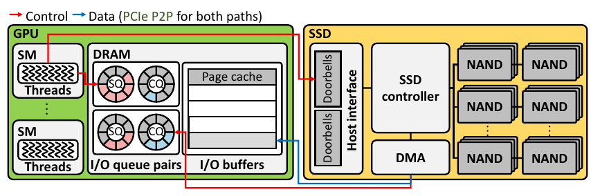

**Fig. 1:** GPU-initiated I/O.

**图 1。** GPU 发起的 I/O。

**图内标注** · Control＝控制路径，Data＝数据路径，两条路径都使用 PCIe P2P。SM＝流式多处理器，Threads＝线程，DRAM＝动态随机存取内存，SQ＝提交队列，CQ＝完成队列，I/O queue pairs＝I/O 队列对，Page cache＝页缓存，I/O buffers＝I/O 缓冲区，Doorbells＝门铃寄存器，Host interface＝主机接口，SSD controller＝SSD 控制器，DMA＝直接内存访问或图中的 DMA 引擎，NAND＝NAND 闪存，cc 为图中重复的控制器标记。

### B. SSD Simulation and Emulation Frameworks / B. SSD 模拟与仿真框架

**English**

SSD simulators. SSD simulators model storage I/O behavior, from the frontend host interface to the backend NAND flash device, within their own event time domains. Existing simulators generally fall into two categories. First, trace-driven approaches [59] replay timestamped I/O traces. Therefore, they lack closed-loop interaction with running systems, making it difficult to capture dynamic runtime behavior such as inter-request dependencies or interactions with host I/O stack components (e.g., the page cache). Second, full-system approaches [8], [59] integrate with full-system simulators [3] to enable detailed application-level characterization. However, these full-system simulators are not only slow but also ill-suited for studying GPU-initiated I/O; to the best of our knowledge, no existing full-system simulation framework models PCIe P2P between an SSD and a GPU.

**中文**

**SSD 模拟器。** SSD 模拟器在各自的事件时间域内刻画存储 I/O 行为，覆盖从前端主机接口到后端 NAND 闪存器件的各环节。既有模拟器大致分两类。第一类是轨迹驱动方法 [59]，按时间戳回放 I/O 轨迹。因此，它们缺少与运行中系统的闭环交互，难以捕获请求间依赖，或与主机 I/O 栈组件（例如页缓存）的交互等动态行为。第二类是全系统方法 [8]、[59]，它们与全系统模拟器 [3] 集成，以进行细致的应用级特征分析。但这些全系统模拟器运行缓慢，也很难用于研究 GPU 发起 I/O。据我们所知，现有全系统模拟框架尚未对 SSD 与 GPU 之间的 PCIe P2P 建模。

**English**

SSD emulators. In contrast, SSD emulators interact with running applications and can therefore provide end-to-end functional modeling, with several works [20], [28], [33], [62] also supporting performance modeling in the wall-clock time domain. However, existing frameworks often fall short in scalability and interoperability with GPU-initiated I/O. Some emulators [33] require device-driver modifications to intercept I/O requests and emulate storage I/O using a DRAM-backed virtual disk while rate-limiting requests to match target SSD’s performance. This approach is fundamentally incompatible with GPU-initiated I/O, which bypasses the host driver and uses a dedicated GPU-side I/O stack. Virtualization-based emulators [28], [62] instead present virtual SSDs to guest virtual machines via QEMU. However, they either incur significant context-switch overhead when trapping at MMIO operations [62] or lack support for the PCIe P2P transfers required by GPU-initiated I/O [28].

**中文**

**SSD 仿真器。** SSD 仿真器能和运行中的应用交互，因而可进行端到端的功能建模，其中若干工作 [20]、[28]、[33]、[62] 还支持实际时间域中的性能建模。然而，现有框架通常在扩展能力，以及与 GPU 发起 I/O 的互操作性方面有所不足。一些仿真器 [33] 需要修改设备驱动来拦截 I/O 请求，使用由 DRAM 承载的虚拟磁盘模拟存储 I/O，并限制请求速率以匹配目标 SSD 的性能。这种方法与 GPU 发起 I/O 在根本上不兼容，因为 GPU 发起 I/O 绕过主机驱动，使用专用的 GPU 侧 I/O 栈。基于虚拟化的仿真器 [28]、[62] 则通过 QEMU 向来宾虚拟机暴露虚拟 SSD，但它们或者在捕获 MMIO 操作时产生很大的上下文切换开销 [62]，或者缺少 GPU 发起 I/O 所需的 PCIe P2P 传输支持 [28]。

### C. NVMeVirt

**English**

Unlike prior SSD emulators, NVMeVirt [20] exposes a software-defined PCIe device directly through the kernel PCI subsystem, presenting a virtual SSD on a bare-metal host. This design enables the emulation of diverse storage environments, including those that require PCIe P2P transfers. As such, NVMeVirt is functionally capable of modeling GPU-initiated I/O. However, as detailed in Section III, it does not provide sufficient scalability to emulate future SSD IOPS targets, and the distinct control and data paths of GPU-initiated I/O further degrade achievable performance. We next describe the overall architecture and timing model of NVMeVirt.

**中文**

NVMeVirt [20] 与先前的 SSD 仿真器不同，它直接通过内核 PCI 子系统暴露软件定义的 PCIe 设备，为裸机主机提供虚拟 SSD。这一设计使其可以仿真多种存储环境，包括需要 PCIe P2P 传输的环境。因此，NVMeVirt 在功能上能够对 GPU 发起 I/O 建模。不过，如第 III 节所详述，它的扩展能力不足以仿真未来 SSD 的目标 IOPS，GPU 发起 I/O 独有的控制路径和数据路径还会进一步降低可达到的性能。下面介绍 NVMeVirt 的整体架构和时序模型。

**Fig. 2:** (a) High-level overview of NVMeVirt and (b) an example illustrating its timing model. The timing model derives a request’s target completion time when it is fetched by the dispatcher. Sched updates the modeled SSD resource availability to regulate sustained throughput (Tmax), while Min_delay enforces minimum per-request latency (Lmin).

**图 2。** (a) NVMeVirt 的整体架构，(b) 说明其时序模型的示例。 Dispatcher 抓取请求时，时序模型推导该请求的目标完成时刻。Sched 更新模型中的 SSD 资源可用性，以调节持续吞吐（Tmax）。Min_delay 则保证每个请求的最小延迟（Lmin）。

**图 2(a) 标注** · Host＝主机，Frontend＝前端，Backend＝后端，SQ/CQ＝提交队列/完成队列，I/O buffers＝I/O 缓冲区，Doorbell＝门铃寄存器，Dispatcher＝调度线程，Timing model＝时序模型，Target time: T＝目标时刻 T，Worker＝工作线程，Emulated storage blocks＝仿真的存储块。Not copied＝未复制，Copied＝已复制，Control＝控制路径，Data＝数据路径。

**图 2(b) 标注** · Target time＝目标时刻，Resource occupancy＝资源占用，Modeled latency＝模型延迟，Request arrival time＝请求到达时刻，Time＝时间，Low load＝低负载，High load＝高负载，Sched＝资源调度占用时间，Min_delay＝补足最小延迟的额外等待，Wait＝等待可用资源。r0–r2 是三条请求，t0–t2 是到达时刻，t0′–t2′ 是相应目标完成时刻，Lmin 是最小请求延迟。

**English**

Overall architecture. As shown in Figure 2(a), NVMeVirt consists of a “frontend” that models the host interface and a “backend” that emulates storage data transfers, implemented by a single dispatcher and multiple worker threads, respectively. The dispatcher polls submission queue (SQ) doorbells (i.e., software-defined NVMe registers exposed to the host for signaling I/O submissions), and sequentially fetches newly submitted requests when the doorbells are set. After fetching each request, it dispatches the request to one of the workers via its per-worker queue, where storage data transfers are emulated by deriving the target completion time of the request using NVMeVirt’s timing model. A worker scans all its local queue entries in each iteration and checks the status of each request. If a request is newly enqueued, the worker emulates the corresponding storage data transfer by copying data between the target I/O buffer and the emulated storage blocks, which is implemented by modeling the storage block address space in CPU memory. A worker posts completion of a request to the completion queue (CQ) only if the target completion time has already elapsed. Otherwise, the request remains copied but not yet completed. For such requests, the worker re-evaluates whether the target completion time has been elapsed in subsequent iterations.

**中文**

**整体架构。** 如图 2(a) 所示，NVMeVirt 包含用于建模主机接口的「前端」以及用于仿真存储数据传输的「后端」，分别由一个 dispatcher 和多个 worker 线程实现。Dispatcher 轮询提交队列（SQ）的门铃，即向主机暴露、用于通知提交 I/O 的软件定义 NVMe 寄存器，并在门铃更新时依次取回新提交的请求。对每条取出的请求，dispatcher 通过对应 worker 的队列将其分发，NVMeVirt 的时序模型给出用于仿真该次数据传输的目标完成时刻。Worker 在每轮迭代中扫描自身本地队列的全部条目，并检查各请求的状态。若请求刚进入队列，worker 在目标 I/O 缓冲区与仿真的存储块之间复制数据，仿真相应的存储数据传输。存储块地址空间由 CPU 内存承载。只有在目标完成时刻已到时，worker 才向完成队列（CQ）写入请求的完成项。否则，请求保持「已复制、尚未完成」的状态，worker 会在后续迭代中重新检查它的目标完成时刻是否已到。

**English**

Timing model. Among the timing models provided by NVMeVirt, we describe its simple timing model as a representative example. NVMeVirt captures SSD performance using two configurable parameters: maximum throughput (Tmax) and minimum latency (Lmin). It abstracts SSD hardware resources as a set of parallel scheduling instances (e.g., flash controllers and channels) and decomposes each I/O request into unit-sized operations (e.g., read from flash page) that are scheduled across these scheduling instances. By tracking scheduling instance availability (i.e., resource occupancy), the timing model regulates sustained throughput below the configured maximum throughput (Tmax), and each request is assumed to occupy its target instances for a fixed scheduling time (Sched), during which the instance is unavailable to others. Figure 2(b) illustrates this process assuming a single scheduling instance. Under high input load, if the target instance is occupied by preceding requests when a request arrives, scheduling is deferred until the instance becomes available; for example, the instance is occupied by request r0 when r2 arrives at t2. The target completion time is then derived by adding Sched and an additional delay (Min_delay) to enforce the configured minimum latency (Lmin). Under low input load, by contrast, a request is scheduled as soon as it arrives, and its target latency is simply the sum of the two delays, Sched and Min_delay.

**中文**

**时序模型。** NVMeVirt 提供多种时序模型，这里选取简单时序模型作为代表。NVMeVirt 用两个可配置参数描述 SSD 性能：最大吞吐（Tmax）和最小延迟（Lmin）。它将 SSD 硬件资源抽象为一组可并行的调度实例，例如闪存控制器和通道，并将每个 I/O 请求拆成单位粒度的操作，例如读取一个闪存页，再将操作调度到各实例。时序模型跟踪调度实例的可用性，即资源占用，使持续吞吐受配置的最大吞吐（Tmax）约束。模型假设，每个请求会占用对应实例一个固定的调度时长（Sched），这段时间内其他请求无法使用该实例。图 2(b) 用单个实例说明此过程。输入负载较高时，若一个请求到达时目标实例正被此前的请求占用，就推迟调度，直到实例可用。例如，r2 在 t2 到达时，实例仍由 r0 占用。随后，模型用 Sched 和补充延迟 Min_delay 推导目标完成时刻，使其满足所配置的最小延迟 Lmin。输入负载较低时，请求一到达即可调度，其目标延迟等于 Sched 与 Min_delay 之和。

### D. Intel Data Streaming Accelerator / D. 英特尔数据流加速器

**English**

The Intel Data Streaming Accelerator (DSA) [14], integrated into 4th-Gen Xeon Scalable Processors, accelerates data movement and transformation tasks. DSA is organized around groups, which are software-configurable units comprising work queues (WQs) and engines (blue box in [Figure 6](#fig-6)). Software offloads operations by issuing 64-byte work descriptors to specific WQs, with each descriptor occupying one WQ slot. Descriptors are issued via 64-byte writes to portals, which are MMIO regions mapped to specific WQs. WQs can operate in either shared mode, where multiple software clients share a queue, or dedicated mode, where a single client exclusively uses the queue and manages available descriptor slots itself. Engines fetch descriptors from any WQ within the same group and execute the corresponding operations in a pipelined manner. Among the supported descriptor types, our work uses memory copy and batch descriptors to offload copy operations during emulation, where batch descriptors allow an array of copy descriptors to be issued at once, amortizing descriptor issue overhead [24]. Each copy descriptor can use either physical addresses (PAs) and virtual addresses (VAs) to specify the source and destination locations.

**中文**

英特尔数据流加速器（DSA）[14] 集成在第 4 代 Xeon 可扩展处理器中，用于加速数据搬运和变换任务。DSA 按组组织，组是由软件配置的单元，包含工作队列（WQ）和执行引擎（[图 6](#fig-6) 蓝框）。软件向指定 WQ 提交 64 字节的工作描述符来卸载操作，每个描述符占用一个 WQ 槽位。描述符通过向 portal 执行 64 字节写入来提交。Portal 是映射到特定 WQ 的 MMIO 区域。WQ 可运行于共享模式，多个软件客户端共用一个队列，也可运行于专用模式，由一个客户端独占使用并自行管理可用的描述符槽位。执行引擎从同组内的任意 WQ 获取描述符，并以流水线方式执行对应操作。在多种受支持的描述符中，本文使用内存复制描述符与批描述符来卸载仿真过程中的复制。批描述符允许一次提交一组复制描述符，以摊薄描述符提交开销 [24]。每个复制描述符可用物理地址（PA）或虚拟地址（VA）指定源和目标的位置。

## III. Characterization and Motivation / III. 特征分析与动机

**English**

In this section, we characterize the limitations of existing SSD emulators in modeling future IOPS-optimized SSDs while supporting GPU-initiated I/O. We focus on NVMeVirt, as alternative emulators are incompatible with GPU-initiated I/O due to their reliance on host-system modifications or virtualization mechanisms. As we detail in this section, although NVMeVirt provides the functional foundation for modeling GPU-initiated I/O by presenting a software-defined, virtual PCIe device to the host, it cannot sustain the level of request-level parallelism required by future SSDs.

**中文**

本节分析既有 SSD 仿真器在支持 GPU 发起 I/O 的同时，对未来 IOPS 优化型 SSD 建模时的局限。我们主要分析 NVMeVirt，因为其他仿真器依赖主机系统修改或虚拟化机制，与 GPU 发起 I/O 不兼容。如下文所述，NVMeVirt 能向主机暴露软件定义的虚拟 PCIe 设备，为 GPU 发起 I/O 的建模提供功能基础，但无法维持未来 SSD 所需要的请求级并行度。

### A. Frontend Scalability Bottleneck / A. 前端扩展瓶颈

**English**

Modern SSDs adopt NVMe as the storage protocol because it is designed to fully exploit SSD throughput via a multi-queue I/O interface. An SSD controller includes a host interface layer (i.e., the frontend) that dispatches incoming requests and handles completions through I/O queue pairs. To fully leverage NVMe’s request-level parallelism within and across I/O queues, the frontend request ingestion bandwidth must not become a performance bottleneck. In practice, several works [15], [25], [34], [49] accelerate this layer using dedicated hardware to mitigate this bottleneck.

**中文**

现代 SSD 采用 NVMe 存储协议，旨在通过多队列 I/O 接口充分发挥 SSD 的吞吐能力。SSD 控制器包含主机接口层，也就是前端，通过 I/O 队列对分发传入请求和处理完成项。为了充分利用 NVMe 在队列内部和队列之间的请求级并行性，前端接收请求的带宽不能成为性能瓶颈。实践中，多项工作 [15]、[25]、[34]、[49] 用专用硬件加速这一层，以缓解瓶颈。

**English**

Limited dispatch throughput. Despite its importance, frontend performance scalability is often overlooked in existing software-based SSD emulators, which struggle to sustain highly concurrent I/O requests arriving across different SQs. In particular, NVMeVirt relies on a single dispatcher thread that sequentially polls the emulated doorbells of all SQs, which is similar to frontend designs commonly adopted in prior work [28]. When multiple SQ doorbells are updated simultaneously, the dispatcher fetches requests from a given SQ before proceeding to the next, thereby serializing I/O request processing. Consequently, the centralized frontend architecture exacerbates SQ queuing delays and prevents emulation throughput from scaling with the request-level parallelism exposed by the NVMe interface.

**中文**

**分发吞吐有限。** 尽管前端扩展能力很重要，既有基于软件的 SSD 仿真器往往忽略这项性能，因而很难持续处理来自多个不同 SQ 的高并发 I/O 请求。具体来说，NVMeVirt 依赖一个 dispatcher 线程依次轮询所有 SQ 的仿真门铃，这与此前工作 [28] 常采用的前端设计相似。当多个 SQ 的门铃同时更新时，dispatcher 先从一个 SQ 取请求，再处理下一个，导致请求处理串行化。因此，集中式前端加剧 SQ 排队延迟，使仿真吞吐无法随 NVMe 接口提供的请求级并行度扩展。

**English**

We use the fio [2] 4 KB random read benchmark to evaluate NVMeVirt’s scalability under traditional “CPU-centric” I/O. The dispatcher and worker threads are pinned to dedicated cores within a single CPU socket, while fio runs on the remaining cores in the same socket. Section V provides further details of our experimental setup. To isolate frontend dispatcher performance, we disable worker-side data transfer emulation, which we refer to as the backend (Figure 2(a)). We then stress the dispatcher by running 32 fio threads in parallel, each submitting I/O requests through its own dedicated SQ, while increasing the I/O depth from 8 to 512. A higher I/O depth denotes a larger number of outstanding requests per thread within its SQ, thereby increasing the submission pressure on NVMeVirt. As shown in Figure 3, the frontend dispatcher’s throughput plateaus at 4.6 MIOPS despite increasing I/O depth, well below the 10–100 MIOPS target range of future ultra-high IOPS SSDs. This limited frontend scalability fundamentally constrains achievable throughput to only a few MIOPS, regardless of how effectively backend data transfers are parallelized across multiple workers.

**中文**

我们使用 fio [2] 的 4 KB 随机读基准，评估 NVMeVirt 在传统「以 CPU 为中心」的 I/O 下的扩展性。Dispatcher 与 worker 分别绑定到同一个 CPU 插槽内的专用核，fio 在该插槽中剩余的核上运行。第 V 节补充了实验设置的细节。为了单独测量前端 dispatcher 性能，我们关闭 worker 侧的数据传输仿真，也就是图 2(a) 中的后端功能。随后并行运行 32 个 fio 线程向 dispatcher 施压。每个线程通过自己专用的 SQ 提交 I/O 请求，同时将 I/O 深度从 8 增加到 512。I/O 深度越高，每个线程可在自己的 SQ 中维持的未完成请求数就越多，从而对 NVMeVirt 施加更高的提交压力。如图 3 所示，即使继续增大 I/O 深度，前端 dispatcher 的吞吐也在 4.6 MIOPS 停滞，远低于未来超高 IOPS SSD 的 10–100 MIOPS 目标区间。无论后端数据传输在多个 worker 之间并行得多好，这一受限的前端扩展能力都将可达到的吞吐限制在数百万 IOPS。

**Fig. 3:** Frontend throughput of NVMeVirt under CPU-centric I/O with 32 fio threads.

**图 3。** 使用 32 个 fio 线程、在以 CPU 为中心的 I/O 下测得的 NVMeVirt 前端吞吐。

**图内标注** · 横轴 I/O depth＝I/O 深度。纵轴 MIOPS＝每秒百万次 I/O。

### B. Key Challenges with GPU-initiated I/O / B. GPU 发起 I/O 的关键挑战

**English**

Beyond modeling ultra-high IOPS SSDs, this work aims to provide an end-to-end emulation framework for GPU-initiated I/O. However, GPU-initiated I/O’s control and data paths differ fundamentally from those of traditional CPU-centric I/O, posing unique challenges for faithfully modeling this emerging storage paradigm for real time emulation.

**中文**

除了建模超高 IOPS SSD，本文还希望提供一个面向 GPU 发起 I/O 的端到端仿真框架。不过，GPU 发起 I/O 的控制路径和数据路径，与传统 CPU 中心 I/O 存在根本差别。为进行实时仿真并忠实刻画这一新兴存储模式，需要解决一些特有的挑战。

**English**

Small-block data transfers over PCIe. As described in Section II-C, NVMeVirt emulates storage data transfers by having worker threads copy data between the target I/O buffers and emulated storage blocks. Under traditional CPU-centric I/O, both ends of this copy reside in CPU memory. Under GPU-initiated I/O, however, both the I/O buffers and I/O queue pairs (SQ and CQ) reside in GPU memory (Figure 1), so each request requires data transfer over PCIe, introducing additional overhead in both the data and control paths. In the data path, applications using GPU-initiated I/O often exhibit fine-grained access granularity, typically below 8 KB [32], forcing workers to perform many small PCIe transfers (e.g., CPU-to-GPU copies for storage reads). In the control path, the dispatcher sequentially fetches even smaller 64-byte SQ entries allocated in GPU memory, resulting in fragmented PCIe transactions. Therefore, when combined with limited CPU thread-level parallelism, NVMeVirt fails to effectively utilize PCIe bandwidth, limiting achievable IOPS.

**中文**

**经 PCIe 传输小数据块。** 如第 II-C 节所述，NVMeVirt 由 worker 线程复制目标 I/O 缓冲区和仿真存储块之间的数据，以仿真存储数据传输。在传统 CPU 中心 I/O 下，复制的两端均位于 CPU 内存。在 GPU 发起 I/O 下，I/O 缓冲区和 I/O 队列对（SQ 和 CQ）都位于 GPU 显存（图 1），所以每个请求都需要经 PCIe 传输数据，给控制路径和数据路径都带来额外开销。在数据路径上，GPU 发起 I/O 的应用通常提供低于 8 KB [32] 的细粒度访问，worker 因而必须执行大量小 PCIe 传输，例如读请求中的 CPU 到 GPU 复制。在控制路径上，dispatcher 逐条抓取 GPU 显存中更小的 64 字节 SQ 项，造成 PCIe 事务碎片化。再加上 CPU 线程级并行度有限，NVMeVirt 无法有效利用 PCIe 带宽，进而限制可达到的 IOPS。

**English**

Address mapping overhead. Natively, GPU-initiated I/O allows SSDs to access GPU memory by exposing it in the host physical address (PA) space through a base address register (BAR) [42]. A GPU thread submits an NVMe command that specifies the target I/O buffer with a PA, and the SSD’s DMA engine uses that PA to perform P2P DMA to and from GPU memory. In NVMeVirt, however, data transfers are emulated in software using CPU worker threads. Upon receiving a request from the dispatcher, an NVMeVirt worker must map the target I/O buffer’s PA to a virtual address (VA) to access the GPU memory from the CPU. Because the target I/O buffer address differs across requests, workers must dynamically map and unmap it for each emulated data transfer using memremap() and memunmap(), incurring substantial latency overhead.

**中文**

**地址映射开销。** 原生的 GPU 发起 I/O 通过基地址寄存器（BAR）[42] 将 GPU 显存暴露到主机的物理地址（PA）空间，使 SSD 能访问 GPU 显存。GPU 线程提交 NVMe 命令时，用 PA 指定目标 I/O 缓冲区，SSD 的 DMA 引擎使用该 PA 经 P2P DMA 读写 GPU 显存。在 NVMeVirt 中，数据传输则由 CPU worker 线程用软件仿真。NVMeVirt worker 收到 dispatcher 的请求后，必须把目标 I/O 缓冲区的 PA 映射到虚拟地址（VA），以便 CPU 访问 GPU 显存。由于各请求的目标 I/O 缓冲区地址不同，worker 必须对每次仿真传输调用 `memremap()` 与 `memunmap()`，动态建立及解除映射，产生显著的延迟开销。

**English**

Because these functions modify page tables under internal kernel locks, this repeated mapping and unmapping by numerous worker threads creates a severe serialization bottleneck. To quantify the resulting overhead, we implement a microbenchmark that models NVMeVirt’s backend data transfer behavior under GPU-initiated I/O while assuming the frontend is not a performance bottleneck (i.e., a worker-only setup). Multiple CPU worker threads repeatedly map a target buffer, copy a random 512-byte block from the CPU-side emulated storage blocks to the GPU-side I/O buffer, and unmap the buffer. As shown in Figure 4, mapping and unmapping (Map) account for 98.8% of the total data transfer latency on average. Under heavy contention with 32 threads, the latency of emulating a single storage data transfer reaches 94 µs, limiting aggregate throughput to only 0.34 MIOPS (i.e., at most 32 parallel I/Os per 94 µs), far below the 3 MIOPS available in state-of-the-art SSDs [22], [36], [54].

**中文**

这些函数在内核内部锁保护下修改页表，多个 worker 反复建立和解除映射，由此产生严重的串行化瓶颈。为量化开销，我们实现了一个微基准，在假设前端没有性能瓶颈的条件下，也就是仅有 worker 的配置，刻画 GPU 发起 I/O 时 NVMeVirt 的后端数据传输行为。多个 CPU worker 线程反复执行映射目标缓冲区、从 CPU 侧仿真存储块复制一个随机的 512 字节块到 GPU 侧 I/O 缓冲区、解除缓冲区映射的流程。如图 4 所示，映射与解映射（Map）平均占总数据传输延迟的 98.8%。在 32 个线程的激烈竞争下，仿真单次存储数据传输的延迟达到 94 μs，将总吞吐限制在 0.34 MIOPS，也就是每 94 μs 至多 32 次并行 I/O，远低于先进 SSD 可提供的 3 MIOPS [22]、[36]、[54]。

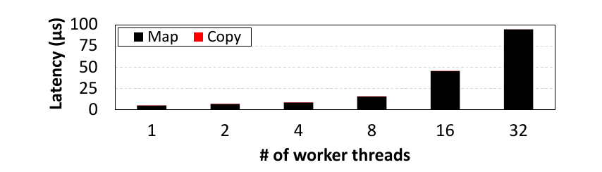

**Fig. 4:** Dynamic address mapping/unmapping overhead (Map) to prepare CPU thread-driven 512-byte random data copies (Copy) from CPU to GPU memory.

**图 4。** CPU 线程驱动从 CPU 内存向 GPU 显存随机复制 512 字节数据（Copy）时，为复制准备动态地址映射与解映射的开销（Map）。

**图内标注** · 横轴 # of worker threads＝worker 线程数。纵轴 Latency (μs)＝延迟（微秒）。图例 Map＝地址映射与解映射，Copy＝数据复制。

**English**

NVMeVirt vs. real SSD. Using the BaM [50] 512-byte random read benchmark on an NVIDIA H200 GPU [41], we evaluate NVMeVirt’s end-to-end performance under GPU-initiated I/O while varying the number of GPU threads submitting storage read I/Os. NVMeVirt’s timing model is configured to match that of a real Solidigm D7-PS1010 SSD. As shown in Figure 5, NVMeVirt achieves at most 0.13 MIOPS with 256K GPU threads, making it 16.6× slower than the same benchmark running on the real SSD. Overall, NVMeVirt incurs 17.4–63.7× higher latency than the physical SSD, failing to meet our real-time emulation requirements for next-generation GPU-centric storage systems.

**中文**

**NVMeVirt 与真实 SSD 的对比。** 我们使用 BaM [50] 的 512 字节随机读基准，在 NVIDIA H200 GPU [41] 上，评估 NVMeVirt 在 GPU 发起 I/O 下的端到端性能，改变提交存储读 I/O 的 GPU 线程数。NVMeVirt 的时序模型配置为匹配真实 Solidigm D7-PS1010 SSD。如图 5 所示，当 GPU 线程数为 256K 时，NVMeVirt 最高达到 0.13 MIOPS，同一基准在真实 SSD 上运行的吞吐是它的 16.6 倍。总体而言，NVMeVirt 的延迟为物理 SSD 的 17.4–63.7 倍，达不到我们对下一代 GPU 中心存储系统的实时仿真要求。

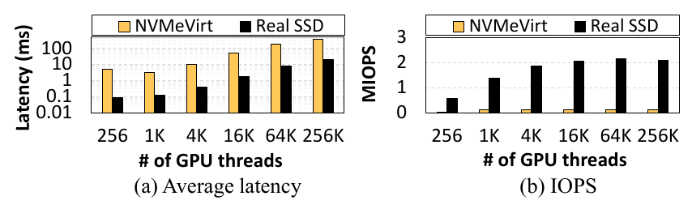

**Fig. 5:** (a) Average latency and (b) IOPS of NVMeVirt under GPU-initiated I/O, compared with those observed under a real SSD (Solidigm D7-PS1010), as the number of GPU threads submitting 512-byte random read I/O requests varies.

**图 5。** 改变提交 512 字节随机读 I/O 请求的 GPU 线程数，比较 GPU 发起 I/O 下 NVMeVirt 与真实 SSD（Solidigm D7-PS1010）的 (a) 平均延迟和 (b) IOPS。

**图内标注** · 两图横轴 # of GPU threads＝GPU 线程数。左图 Latency (ms)＝延迟（毫秒），Average latency＝平均延迟。右图 MIOPS＝每秒百万次 I/O。图例 Real SSD＝真实 SSD。

## IV. SwarmIO

**English**

In this section, we present SwarmIO, an IOPS-scalable SSD emulation framework for GPU-centric storage systems. Existing SSD emulators fail to faithfully model end-to-end performance of GPU-centric storage: some lack support for GPU-initiated I/O, while others (e.g., NVMeVirt) provide only functional modeling and suffer from non-scalable frontends and high CPU-driven data movement overheads. SwarmIO addresses these limitations with a distributed, high-throughput frontend design, hardware-accelerated data transfers, and a new timing model update mechanism that preserves emulation fidelity at extreme IOPS. Together, these techniques remove fundamental bottlenecks in prior emulators, significantly improving achievable IOPS for GPU-initiated I/O.

**中文**

本节介绍 SwarmIO，一套面向以 GPU 为中心的存储系统、可扩展 IOPS 的 SSD 仿真框架。现有 SSD 仿真器无法忠实地刻画这类系统的端到端性能。一部分工具不支持 GPU 发起 I/O，另一些工具（如 NVMeVirt）只提供功能建模，前端扩展能力受限，CPU 驱动的数据搬运开销也较高。SwarmIO 采用分布式高吞吐前端、硬件加速数据传输和新的时序模型更新机制来解决这些问题，在极高 IOPS 下保持仿真保真度。结合这些技术，SwarmIO 去除了以往仿真器的主要瓶颈，显著提高 GPU 发起 I/O 下可达到的 IOPS。

### A. High-level Overview / A. 整体概览

**English**

SwarmIO is implemented as a Linux kernel module and builds on NVMeVirt’s core mechanisms to provide a virtual SSD abstraction within the PCI subsystem. Prior work [20], [28] relies on centralized frontends and throughput-limited data transfer emulation. In contrast, SwarmIO introduces a distributed, IOPS-oriented architecture centered around a modular operational unit called the service unit (Figure 6).

**中文**

SwarmIO 实现为 Linux 内核模块，沿用 NVMeVirt 的核心机制，在 PCI 子系统中提供虚拟 SSD 抽象。以往工作 [20]、[28] 依赖集中式前端，数据传输仿真的吞吐受到限制。SwarmIO 引入一个面向 IOPS 的分布式架构，其核心是称为服务单元的模块化运行单元（图 6）。

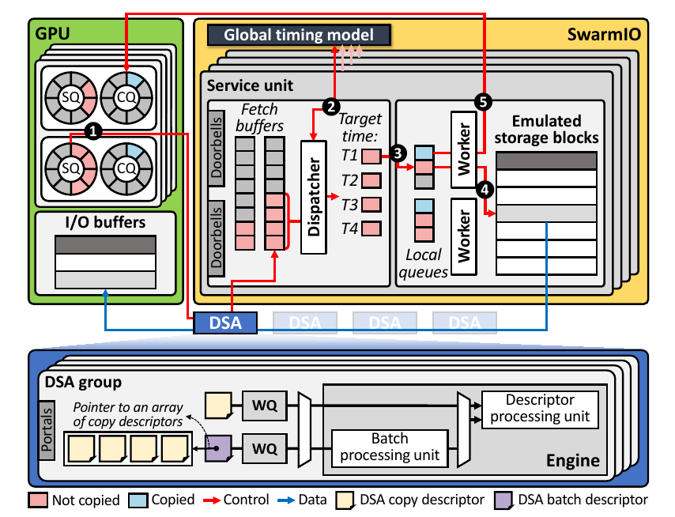

**Fig. 6:** High-level overview of SwarmIO.

**图 6。** SwarmIO 整体架构。

**架构标注** · Global timing model＝全局时序模型，Service unit＝服务单元，SQ/CQ＝提交队列/完成队列，Doorbells＝门铃寄存器，Fetch buffers＝命令抓取缓冲区，Dispatcher＝调度线程，Target time: T1–T4＝各请求的目标时刻，Local queues＝本地队列，Worker＝工作线程，Emulated storage blocks＝仿真的存储块，I/O buffers＝I/O 缓冲区。① 抓取请求，② 计算目标时刻，③ 分发到 worker 的本地队列，④ 搬运数据，⑤ 报告完成。图中 C 是完成通知。

**DSA 与图例** · DSA group＝DSA 组，Portals＝提交描述符的 MMIO 门户，WQ＝工作队列，Pointer to an array of copy descriptors＝指向复制描述符数组的指针，Descriptor processing unit＝描述符处理单元，Batch processing unit＝批处理单元，Engine＝执行引擎。Not copied＝未复制，Copied＝已复制，Control＝控制路径，Data＝数据路径，DSA copy descriptor＝DSA 复制描述符，DSA batch descriptor＝DSA 批描述符。

**English**

Each service unit adopts a producer–consumer model where a dispatcher (frontend) polls SQ doorbells to fetch requests, while multiple workers (backend) process storage data transfers in parallel and handle completions. Figure 6 depicts the execution flow within a service unit: the dispatcher first fetches enqueued requests from its assigned SQs (step ❶) and computes their target completion times by invoking a global timing model shared across all service units (step ❷). These timestamped requests (T1-4) are then distributed to the local queues of assigned workers (step ❸). Each worker operates in a continuous loop: it first performs storage data transfers for up to a predefined number of requests from its local queue (step ❹), and then re-evaluates the queue from the beginning to process completions for any “copy-done” requests whose target completion times have arrived (step ❺). This mechanism ensures that request completion is not delayed by a long sequence of preceding data transfers, thereby maintaining strict adherence to the timing model.

**中文**

每个服务单元采用生产者—消费者模型。一个 dispatcher（前端）轮询 SQ 门铃以获取请求，多个 worker（后端）并行处理存储数据传输和完成项。图 6 展示了一个服务单元的执行流程。Dispatcher 首先从分配给它的 SQ 取回已入队请求（步骤 ①），然后调用各服务单元共用的全局时序模型，计算请求的目标完成时刻（步骤 ②）。这些带有时间戳 T1–T4 的请求随后被分发到负责处理的 worker 本地队列（步骤 ③）。每个 worker 持续循环运行。先从本地队列取至多预设数量的请求，执行存储数据传输（步骤 ④）。随后从队列头部重新检查，对已完成复制且目标完成时刻已到的请求处理完成项（步骤 ⑤）。这一机制使请求的完成不会因其前面有一长串数据传输而推迟，从而严格遵循时序模型。

**English**

By partitioning I/O queue pairs across service units, we transform the centralized frontend into a distributed architecture. With coalesced request fetching, SwarmIO fully exploits NVMe request-level parallelism (Section IV-B). In addition, to reduce the software overhead of CPU-driven data copies, SwarmIO adopts DSA-accelerated storage I/O emulation (Section IV-C). It offloads both dispatcher-side request fetching and worker-side storage data transfers to Intel DSAs [14], and introduces a DSA-aware kernel-level API for high-throughput copy offloading in multi-threaded environments. Finally, while the global timing model shared across dispatchers enables consistent performance modeling, it also introduces a non-trivial design challenge: under high request rates, frequent updates to the shared timing state by all dispatchers can incur substantial serialization overhead. To address this challenge, we introduce aggregated timing model updates (Section IV-D), which minimize serialization across dispatchers by entering the critical section only once per set of requests. Together, these techniques enable SwarmIO to push achievable IOPS far beyond the limits of prior SSD emulators under massive request-level parallelism in GPU-centric storage systems.

**中文**

我们把 I/O 队列对划分给不同服务单元，将集中式前端变为分布式架构。加入合并抓取请求后，SwarmIO 可充分利用 NVMe 的请求级并行性（第 IV-B 节）。此外，为降低由 CPU 驱动数据复制的开销，SwarmIO 采用 DSA 加速存储 I/O 仿真（第 IV-C 节）。它把 dispatcher 侧的请求抓取和 worker 侧的存储数据传输都卸载到 Intel DSA [14]，同时引入支持 DSA 的内核级 API，服务于多线程环境中的高吞吐复制卸载。最后，dispatcher 共用全局时序模型，可以保持性能建模的一致性，也面临新的设计难题。在高请求速率下，所有 dispatcher 频繁更新共享时序状态会产生显著的串行化开销。为解决此问题，我们引入聚合时序模型更新（第 IV-D 节），每组请求只进入一次临界区，以尽量减少 dispatcher 之间的串行化。结合这些技术，在 GPU 中心存储系统的大规模请求级并行下，SwarmIO 可达到远超以往 SSD 仿真器上限的 IOPS。

### B. Parallelism-aware Frontend Architecture / B. 面向并行性的前端架构

**English**

Distributed dispatch architecture. To overcome frontend bottlenecks, SwarmIO partitions NVMe I/O queue pairs (SQ/CQ) across multiple service units, each led by a dedicated dispatcher thread (Figure 6), reducing the number of SQs handled by each dispatcher. This alleviates SQ queuing delay when a single dispatcher cannot keep up with requests submitted to tens to hundreds of SQs by multiple host (or GPU) threads. Each service unit is provisioned with dedicated compute resources, including worker threads and DSAs, as detailed in Section IV-C. This design ensures consistent performance across I/O request flows targeting different sets of I/O queues and scales flexibly by instantiating the optimal number of service units proportional to the target storage IOPS.

**中文**

**分布式分发架构。** 为解决前端瓶颈，SwarmIO 将 NVMe I/O 队列对（SQ/CQ）划分给多个服务单元，每个服务单元由一个专用 dispatcher 线程负责（图 6），从而减少每个 dispatcher 处理的 SQ 数量。当多个主机线程或 GPU 线程向数十到数百个 SQ 提交请求，单个 dispatcher 无法跟上时，这可以减轻 SQ 排队延迟。每个服务单元拥有专用计算资源，包括 worker 线程和 DSA，详见第 IV-C 节。这一设计使面向不同 I/O 队列组的请求流获得一致的性能，也可根据存储目标 IOPS 按比例配置合适数量的服务单元，灵活实现扩展。

**English**

Coalesced request fetching. Beyond inter-queue parallelism from distributed dispatching, SwarmIO exploits intra-queue parallelism via coalesced request fetching. Upon an SQ doorbell update, a dispatcher identifies newly enqueued entries and fetches multiple requests over a single transfer into a reserved CPU memory region, the fetch buffer (Figure 6). This optimization is particularly effective under GPU-initiated I/O for two reasons. First, coalesced request fetching naturally aligns with the submission semantics of GPU-initiated I/O where requests within a warp are submitted together to the same SQ via a single doorbell update [50]. Meanwhile, many warps interleave their accesses to SQ, causing a large number of requests to accumulate in each SQ and creating ample opportunity to fetch these requests at once. Second, because request fetching in GPU-initiated I/O requires GPU-to-CPU data transfer, coalesced fetching can merge multiple small PCIe transactions, provided that SQ entries are physically contiguous. To enable this, SwarmIO sets the Contiguous Queues Required (CQR) [44] bit to ‘1’ in the emulated controller register, as defined by the NVMe specification, ensuring that all entries within each SQ/CQ are allocated contiguously in physical memory. By merging multiple PCIe transactions, SwarmIO amortizes transaction overhead and improves transfer efficiency. Together with distributed dispatching, coalesced fetching enables SwarmIO to efficiently handle bursty I/O submissions while maintaining a highly parallel and scalable frontend design.

**中文**

**合并抓取请求。** 除了通过分布式分发利用队列间并行性，SwarmIO 还通过合并抓取利用队列内并行性。SQ 门铃更新后，dispatcher 找出刚入队的条目，在一次传输中抓取多条请求，放入主机内存中预留的抓取缓冲区（图 6）。这一优化在 GPU 发起 I/O 下尤其有效，原因有两个。首先，合并抓取天然符合 GPU 发起 I/O 的提交语义。一个 warp 中的请求通过一次门铃更新，一起提交到同一 SQ [50]。多个 warp 对 SQ 的交错访问又会让各 SQ 累积大量请求，提供一次抓取多条请求的机会。其次，GPU 发起 I/O 中抓取请求需要从 GPU 搬数据到 CPU。如果 SQ 条目物理连续，合并抓取就可以合并多个小 PCIe 事务。为做到这一点，SwarmIO 按 NVMe 规范 [44] 将仿真控制器寄存器中的「要求队列连续」（CQR）位设置为 1，使每个 SQ/CQ 的各条目位于物理地址连续的内存中。通过合并多笔 PCIe 事务，SwarmIO 摊薄事务开销，提高传输效率。合并抓取与分布式分发结合，使 SwarmIO 高效处理突发 I/O 提交，并保持前端的并行性和扩展能力。

### C. DSA-accelerated Storage I/O Emulation / C. DSA 加速的存储 I/O 仿真

#### 1) Design Principles for DSA-efficient Data Movement / 1) 高效利用 DSA 搬运数据的设计原则

**English**

Rethinking data transfers with DSA. Despite improved frontend scalability for parallel request ingestion, software-mediated data transfers over PCIe in GPU-initiated I/O remain a major performance bottleneck, as discussed in Section III-B. To address this, we propose hardware-accelerated data movement using Intel DSA, which offloads data transfers from the CPU and enables total IOPS to scale beyond CPU processing limits. Importantly, offloading worker-side copies to DSA eliminates address mapping overhead, as DSA operates directly on PAs without requiring VA mappings. While NVMeVirt utilizes the legacy Crystal Beach DMA (CBDMA) engine to accelerate data transfers, its support is limited to naïvely offloading worker-side transfers via a synchronous issue-and-wait model. We confirmed that this approach provides minimal practical benefit in reducing PCIe transfer latency. Moreover, prior studies [24], [65] show that even with DSA, such synchronous, per-request offloading fails to amortize the software overheads in preparing and issuing individual copy descriptors. This limitation is more severe for CBDMA, which incurs higher offloading overheads than DSA.

**中文**

**用 DSA 重新设计数据传输。** 虽然前端扩展能力改善后可以并行接收请求，但如第 III-B 节所述，GPU 发起 I/O 时通过软件经 PCIe 传输数据依旧是主要性能瓶颈。为解决这个问题，我们提出用 Intel DSA 加速数据搬运，把传输从 CPU 卸载到硬件，使总 IOPS 可以超出 CPU 处理能力的限制。重要的是，把 worker 侧的复制卸载到 DSA 可以消除地址映射开销，因为 DSA 可直接使用物理地址（PA），无需建立虚拟地址（VA）映射。NVMeVirt 虽然使用较旧的 Crystal Beach DMA（CBDMA）引擎加速传输，但它仅支持在 worker 侧用简单的同步「提交后等待」模式卸载传输。我们确认这种方法对减小 PCIe 传输延迟的实际帮助很小。此前研究 [24]、[65] 还表明，即使使用 DSA，这种同步、逐请求的卸载也无法摊薄准备及提交各复制描述符的软件开销。CBDMA 的卸载开销高于 DSA，因此问题更严重。

**English**

SwarmIO is carefully designed to overcome these limitations by enabling highly parallel data transfers that exploit key architectural features of DSA (Section II-D). First, workers use descriptor batching and asynchronous offloading to maximize DSA utilization. Each worker receives requests from the dispatcher via its local queue. Rather than issuing copy descriptors for each request, it collects multiple requests, up to a predefined maximum batch size, into a single DSA batch descriptor (purple in Figure 6) to amortize the overhead of issuing copy descriptors. In addition, SwarmIO maintains multiple in-flight batch descriptors via asynchronous offloading to overlap CPU-thread-side computation with DSA-side data movement, while exploiting the DSA engine’s pipelined execution to overlap data transfers across batch descriptors. Second, SwarmIO extends DSA acceleration not only to worker-side data transfer emulation but also to dispatcher-side request fetching. Combined with coalesced request fetching, this creates a significant opportunity to improve transfer efficiency by enabling each P2P DMA transaction to fetch up to tens of KB. Together, these techniques enable SwarmIO’s frontend to sustain tens of MIOPS, which would not be achievable without either technique (see Section VI-C for an ablation study). Overall, our DSA-accelerated data transfers effectively mitigate software overhead and establish high-throughput control and data paths for storage I/O emulation.

**中文**

SwarmIO 利用 DSA 的主要架构特性（第 II-D 节）实现高度并行的数据传输，以克服这些限制。首先，worker 使用描述符批处理和异步卸载，尽量提高 DSA 利用率。每个 worker 通过本地队列接收 dispatcher 交给它的请求。它收集多条请求，数量不超过预设的批大小上限，将它们放入一个 DSA 批描述符（图 6 中的紫色项），以摊薄提交复制描述符的开销。SwarmIO 还通过异步卸载同时保留多个在途批描述符，让 CPU 线程侧计算与 DSA 侧数据搬运重叠，同时利用 DSA 引擎的流水线执行，使不同批描述符的数据传输彼此重叠。其次，SwarmIO 把 DSA 加速扩展到 worker 侧存储数据传输仿真和 dispatcher 侧请求抓取。结合合并抓取，一次 P2P DMA 事务可取回多达数十 KB 的数据，有较大空间提高传输效率。这两项技术共同使 SwarmIO 前端能维持数千万 IOPS，缺少任一项都无法达到该水平（消融实验见第 VI-C 节）。总体而言，DSA 加速有效缓解了软件开销，为存储 I/O 仿真提供高吞吐控制路径和数据路径。

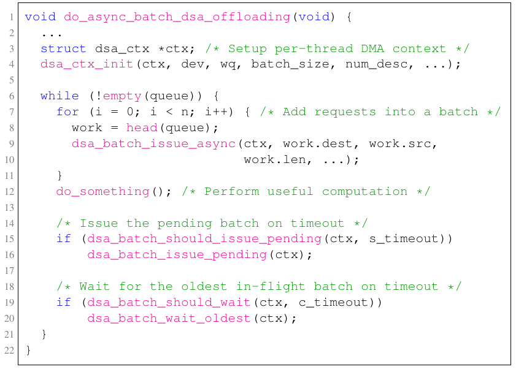

**Fig. 7:** An example asynchronous, batched data transfer workflow using our DSA-aware kernel-level offloading API.

**图 7。** 使用我们为 DSA 设计的内核级卸载 API，实现异步批量数据传输流程的示例。

**代码注释与变量** · 第 3 行 Setup per-thread DMA context＝初始化每线程 DMA 上下文。第 7 行 Add requests into a batch＝把请求加入一个批次。第 12 行 Perform useful computation＝执行其他有用的计算。第 14 行 Issue the pending batch on timeout＝提交超时后发出待提交批次。第 18 行 Wait for the oldest in-flight batch on timeout＝等待超时后检查最早发出的在途批次。`ctx`＝线程上下文，`dev`＝设备，`wq`＝工作队列，`batch_size`＝最大批大小，`num_desc`＝描述符数量，`work.dest`／`work.src`／`work.len`＝复制的目标地址／源地址／长度，`s_timeout`／`c_timeout`＝提交／检查完成的超时阈值。

**English**

DSA-aware kernel-level API for copy offloading. To fully unlock DSA’s potential, SwarmIO requires a high-performance kernel-level programming interface for offloading data transfers because it is implemented as a kernel module. The standard Linux DMA Engine API [31] exposes diverse DMA controllers via “hardware-agnostic” abstractions. While this abstraction simplifies DMA usage, it fails to fully exploit DSA’s capabilities for three key reasons. First, the DMA Engine API does not expose DSA-specific features. For example, although the DSA device driver (idxd) provides low-level device control, the DMA Engine API exposes little beyond idxd_dma_submit_memcpy(), which supports only non-batched offloading of a single copy. Second, the default API solely relies on interrupt-driven notifications, even though DSA also supports polling. This interrupt-based design hinders latency-sensitive completion handling, even though SwarmIO requires timely request completions to preserve timing model fidelity. While polling preserves low latency, it incurs additional CPU overhead; however, this cost can be effectively hidden by issuing requests up to DSA’s maximum concurrency, overlapping them with useful computation, and polling only when necessary. Finally, because the API does not maintain per-thread offloading context (e.g., preallocated descriptor arrays and per-descriptor status), each thread must repeatedly allocate and program DSA descriptors for every request. This incurs unnecessary control path overhead and prevents full utilization of the multi-threaded execution environment.

**中文**

**支持 DSA 复制卸载的内核级 API。** SwarmIO 实现为内核模块，要充分释放 DSA 的潜力，需要高性能的内核编程接口来卸载数据传输。标准 Linux DMA Engine API [31] 通过与硬件无关的抽象提供对多种 DMA 控制器的访问。虽然抽象简化了 DMA 的使用，但由于三个主要原因，该 API 无法充分利用 DSA。第一，DMA Engine API 没有公开 DSA 专用功能。例如，虽然 DSA 设备驱动 `idxd` 提供底层设备控制，DMA Engine API 除了 `idxd_dma_submit_memcpy()` 之外几乎没有提供更深的能力。该函数只支持非批量卸载单次复制。第二，默认 API 完全依赖中断通知，而 DSA 也支持轮询。中断方式妨碍了对延迟敏感的完成处理，但 SwarmIO 要及时报告完成，才能保持时序模型的保真度。轮询能保持低延迟，但会增加 CPU 开销。在 DSA 最大并发能力范围内提交请求，使其与有用的计算重叠，并只在需要时轮询，可以有效隐藏这部分开销。最后，因为 API 未维护每线程卸载上下文，例如预分配的描述符数组和各描述符状态，线程须为每个请求反复分配、设置 DSA 描述符。这会增加控制路径开销，并妨碍充分利用多线程执行环境。

**English**

To address these challenges, we design a DSA-aware kernel-level API that streamlines copy offloading in multi-threaded environments. As shown in Figure 7, the API operates via a per-thread offloading context (i.e., struct dsa_ctx in line 3). During initialization (dsa_ctx_init in line 4), each thread configures its dedicated context (ctx) by specifying (1) the target DSA WQ (wq), (2) the maximum batch size (batch_size), and (3) the descriptor count (num_desc), denoting the per-thread WQ depth (i.e., the maximum number of in-flight descriptors maintained in the WQ) for asynchronous offloading. The API also preallocates descriptors for reuse across requests and provides interfaces for directly programming DSA descriptors, including their use as batch descriptors. A representative asynchronous workflow enabled by our API is as follows:

**中文**

为应对这些挑战，我们设计了支持 DSA 的内核级 API，简化多线程环境中的复制卸载。如图 7 所示，API 通过每线程卸载上下文运行，即第 3 行的 `struct dsa_ctx`。在第 4 行 `dsa_ctx_init` 初始化时，每个线程指定参数，为其配置专用上下文 `ctx`。参数包括 (1) 目标 DSA 工作队列 `wq)，(2) 最大批大小 `batch_size`，以及 (3) 描述符总数 `num_desc`。最后一个参数表示异步卸载时的每线程 WQ 深度，也就是 WQ 可维持的最大在途描述符数量。API 还预分配描述符供多个请求复用，并提供直接设置 DSA 描述符的接口，包括把描述符用作批描述符。一种有代表性的异步流程如下。

**English**

1) Batch descriptor construction (line 7–11): A thread collects multiple copy operations into a single batch descriptor, and the API transparently issues the batch descriptor once the maximum batch size is reached (i.e., i ≥ batch_size).

**中文**

1. **构造批描述符（第 7–11 行）。** 线程把多个复制操作收集到一个批描述符。当达到最大批大小，也就是 `i ≥ batch_size` 时，API 自动提交该批描述符。

**English**

2) Computation pipelining (line 12): Instead of busy-waiting, the thread performs useful computation while DSA processes data transfers. For instance, after issuing new batch descriptors, SwarmIO workers re-evaluate their local queues to process requests whose copies have completed and target completion times have been reached.

**中文**

2. **计算流水线化（第 12 行）。** DSA 处理数据传输时，线程执行有用的计算，减少忙等。例如，发出新批描述符后，SwarmIO 的 worker 重新检查本地队列，处理已搬运完毕且已到目标完成时刻的请求。

**English**

3) Timeout-driven issue (line 15–16): To ensure forward progress under low load, the thread explicitly issues the current batch when pending entries remain and the configured timeout expires, as tracked by the DSA context.

**中文**

3. **超时触发提交（第 15–16 行）。** 为保证低负载时请求也能推进，当仍有待提交的条目且 DSA 上下文跟踪的配置时限到期时，线程显式提交当前批次。

**English**

4) Timeout-driven waiting (line 19–20): Once sufficient time has elapsed, the thread polls for completion of the oldest in-flight batch, thereby reducing unnecessary blocking.

**中文**

4. **超时触发等待（第 19–20 行）。** 经过足够长的时间后，线程轮询最早的在途批次是否已经完成，从而减少不必要的阻塞。

**English**

Through this concurrent workflow, SwarmIO amortizes the overhead of issuing copy descriptors and overlaps useful computation with DSA-orchestrated data transfers, thereby overcoming the limitations of baseline NVMeVirt, which primarily relies on CPU thread-level parallelism for data transfers.

**中文**

借助这一并发流程，SwarmIO 摊薄提交复制描述符的开销，让有用计算与 DSA 执行的数据传输重叠，克服了基线 NVMeVirt 主要依赖 CPU 线程级并行来传输数据的局限。

#### 2) DSA Configuration Tuning via Microbenchmarking / 2) 通过微基准调优 DSA 配置

**English**

Microbenchmark. To validate our API design and identify optimal DSA configurations for SwarmIO, this subsection characterizes DSA performance using a microbenchmark that models GPU-initiated I/O. At a high level, our microbenchmark fetches groups of I/O requests from the SQ (GPU→CPU), followed by the corresponding storage I/O operations (CPU→GPU), with the goal of identifying the design points that maximize the throughput of frontend and backend of SwarmIO. The microbenchmark utilizes our service unit abstraction that mirrors SwarmIO’s design. In each service unit, the (frontend) dispatcher performs sequential 4 KB GPU→CPU transfers to model coalesced fetching of 64 requests, while the (backend) workers perform strided 512-byte CPU→GPU transfers to model random 512-byte storage reads. Each service unit is mapped to a DSA group with one engine and two WQs, as shown in Figure 6. Our microbenchmark instantiates four service units over a single DSA device to fully exploit the maximum of four DSA groups supported by our device. Although the dispatcher and workers operate independently in this microbenchmark, our goal is to identify the operating point that balances frontend and backend IOPS while maximizing overall system-level IOPS. Because one 4 KB dispatcher transfer drives 64 worker-side transfers in SwarmIO, we focus on maximizing worker IOPS; accordingly, we use asynchronous, batched offloading to DSA for workers and synchronous, non-batched offloading for the dispatcher. We limit total dispatcher IOPS to 20 MIOPS (counting each 4 KB transfer as 64 I/O requests) and seek to maximize total worker IOPS up to this threshold.

**中文**

**微基准。** 为验证 API 设计并确定 SwarmIO 的最佳 DSA 配置，本小节用刻画 GPU 发起 I/O 的微基准分析 DSA 性能。总体来说，微基准从 SQ 成组抓取 I/O 请求（GPU→CPU），然后执行相应的存储 I/O 操作（CPU→GPU），目的是确定使 SwarmIO 前端和后端吞吐最大化的配置。微基准利用与 SwarmIO 设计一致的服务单元抽象。各服务单元中，前端 dispatcher 执行顺序的 4 KB GPU→CPU 传输，模拟合并抓取 64 条请求。后端 worker 执行有地址步距的 512 字节 CPU→GPU 传输，模拟随机的 512 字节存储读取。如图 6 所示，每个服务单元映射到一个 DSA 组，组内有一个执行引擎和两个 WQ。微基准在单个 DSA 设备上实例化四个服务单元，充分利用该设备所支持的最多四个 DSA 组。尽管 dispatcher 和 worker 在该微基准中独立运行，我们希望找到平衡前后端 IOPS、同时使系统级 IOPS 最大化的工作点。在 SwarmIO 中，一次 4 KB dispatcher 传输对应 64 次 worker 侧传输，所以我们着重最大化 worker IOPS。为此，worker 对 DSA 使用异步、批量卸载，dispatcher 则使用同步、非批量卸载。我们把 dispatcher 的总 IOPS 限制在 20 MIOPS，每次 4 KB 传输按 64 次 I/O 请求计数，并力求在此阈值内最大化 worker 总 IOPS。

**English**

Effect of asynchronous and batched offloading. Figure 8(a) shows the benefits of SwarmIO’s asynchronous copy offloading by showing total worker IOPS as a function of per-worker WQ depth, assuming a DSA batch size of 1 and one worker per service unit. Compared to a per-worker WQ depth of one (effectively equivalent to synchronous offloading), total worker IOPS increases by 3.3× at a WQ depth of 32. This improvement is primarily driven by a significant reduction in wait time for a copy descriptor to complete (Wait in Figure 8(b), reduced by up to 9.8× on average), enabled by overlapping multiple DSA-side data transfers, while copy-descriptor issue latency (Issue) remains nearly unchanged.

**中文**

**异步和批量卸载的效果。** 图 8(a) 在假定 DSA 批大小为 1 且每个服务单元有一个 worker 的条件下，展示 worker 总 IOPS 随每 worker WQ 深度的变化，以说明 SwarmIO 异步复制卸载的收益。与每 worker WQ 深度为 1（实际上等价于同步卸载）相比，WQ 深度为 32 时，worker 总 IOPS 达到原来的 3.3 倍。主要原因是 DSA 侧多个数据传输重叠，显著缩短等待复制描述符完成的时间。图 8(b) 中 Wait 的平均值最多降至原来的约 1/9.8，而提交复制描述符的延迟 Issue 几乎不变。

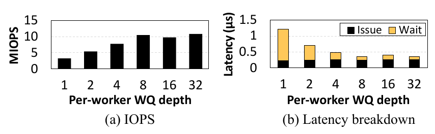

**Fig. 8:** Effect of SwarmIO’s asynchronous copy offloading on (a) worker throughput and (b) the resulting worker-side latency breakdown as the per-worker WQ depth varies.

**图 8。** 改变每 worker 的 WQ 深度时，SwarmIO 异步复制卸载对 (a) worker 吞吐以及 (b) worker 侧延迟构成的影响。

**图内标注** · Per-worker WQ depth＝每个 worker 的工作队列深度。左图纵轴 MIOPS＝每秒百万次 I/O。右图 Latency (μs)＝延迟（微秒），Latency breakdown＝延迟构成，Issue＝提交描述符的耗时，Wait＝等待描述符完成的耗时。

**English**

Figure 9(a) further highlights our batch descriptor scheme’s effectiveness. To maximize concurrency across configurations, we partition each DSA group’s maximum WQ depth (i.e., 32 descriptors) among the workers in the corresponding service unit while varying the number of workers per unit. We make two key observations. First, batching substantially improves offloading efficiency, saturating total worker IOPS at approximately 22.1 MIOPS. Second, a single worker thread (i.e., single CPU core) per service unit is sufficient to achieve peak performance by maximizing both per-worker WQ depth and batch size. These results confirm that our API enables high-throughput copy offloading with fewer CPU threads (cores) by hiding data transfer latency via asynchronous offloading and amortizing copy descriptor issue overhead through batching.

**中文**

图 9(a) 进一步突出了批描述符方案的效果。为了让各配置的并发度最大化，我们在改变每服务单元的 worker 数量时，把每个 DSA 组的最大 WQ 深度，也就是 32 个描述符的额度，分给相应服务单元的各个 worker。得到两项观察。第一，批处理显著提高卸载效率，worker 总 IOPS 在约 22.1 MIOPS 处饱和。第二，每个服务单元只需一个 worker 线程，也就是一个 CPU 核，通过充分增大每 worker 的 WQ 深度与批大小，即可达到峰值性能。结果证实，我们的 API 可以用较少 CPU 线程或 CPU 核实现高吞吐的复制卸载，通过异步卸载隐藏数据传输延迟，并通过批处理摊薄提交复制描述符的开销。

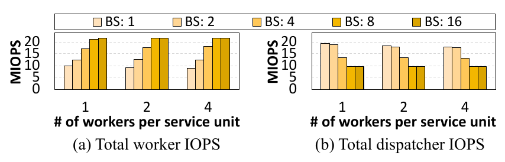

**Fig. 9:** Effect of DSA’s batch size (BS) on (a) total worker throughput and (b) total dispatcher throughput across four service units instantiated on a single DSA device.

**图 9。** 在同一个 DSA 设备上实例化四个服务单元时，DSA 批大小（BS）对 (a) worker 总吞吐和 (b) dispatcher 总吞吐的影响。

**图内标注** · BS＝批大小，# of workers per service unit＝每个服务单元的 worker 数。Total worker IOPS＝worker 总 IOPS，Total dispatcher IOPS＝dispatcher 总 IOPS。

**English**

Dispatcher vs. worker interference. Although our microbenchmark is configured to achieve 20 MIOPS of dispatcher throughput, the realized throughput gradually degrades as the batch size increases (Figure 9(b), showing a 1.9× reduction when the worker batch size increases from 1 (non-batched) to 16). This degradation arises because the dispatcher and workers within a service unit share the same DSA engine; thus, aggressive worker offloading with large WQ depths and batch sizes can delay dispatcher progress. Consequently, the effective throughput across all service units is bounded by the lower of total dispatcher and worker throughput, reaching at most 13.3 MIOPS in practice. We therefore use 13.3 MIOPS as a per-DSA throughput target for configuring SwarmIO under GPU-initiated I/O; specifically, one worker per service unit with a batch size of around 4 is sufficient to saturate peak DSA performance and achieve this 13.3 MIOPS target.

**中文**

**Dispatcher 与 worker 的相互干扰。** 微基准中的 dispatcher 吞吐配置为 20 MIOPS，但随着批大小加大，实际吞吐逐渐下降。图 9(b) 显示，worker 批大小由 1（非批量）加到 16 时，dispatcher 吞吐降至原来的约 1/1.9。这是因为一个服务单元中的 dispatcher 与 worker 共用同一个 DSA 引擎，worker 用较大的 WQ 深度和批大小大量卸载时，会拖慢 dispatcher 的进度。因此，所有服务单元的有效吞吐受 dispatcher 总吞吐和 worker 总吞吐中较低者所限，实际最多达到 13.3 MIOPS。为此，在配置用于 GPU 发起 I/O 的 SwarmIO 时，我们把 13.3 MIOPS 设为单 DSA 目标。具体而言，一个服务单元只需一个 worker，批大小约为 4，即可达到 DSA 的峰值并实现 13.3 MIOPS 目标。

### D. Aggregated Timing Model Updates / D. 聚合时序模型更新

**English**

SwarmIO’s timing model builds on top of NVMeVirt’s simple timing model (Section II-C), parameterized by maximum throughput and minimum latency. However, SwarmIO’s distributed frontend architecture introduces additional system design considerations for properly updating the timing model across multiple dispatchers.

**中文**

SwarmIO 的时序模型建立在 NVMeVirt 的简单时序模型（第 II-C 节）之上，使用最大吞吐和最小延迟作为参数。SwarmIO 的分布式前端架构带来了额外的系统设计问题，即如何让多个 dispatcher 正确地更新时序模型。

**English**

Global timing model. One possible design point is to use a local timing model per dispatcher, with each of the N timing models configured to sustain 1/N of the target throughput. While this approach simplifies the design by eliminating inter-dispatcher dependencies, it cannot faithfully model skewed request distributions in which I/O requests are concentrated in only a subset of SQs and are therefore handled by only a few dispatchers. Even if each active SQ is heavily loaded enough for a real SSD to achieve high IOPS through sufficient intra-queue parallelism, the emulator with local timing models remains constrained by the aggregate capacity of only the few active timing models. Consequently, we propose a global timing model shared across dispatchers so that it can capture the global system load faithfully. With such design, the timing model’s internal state, such as SSD resource availability, is shared across dispatchers and must therefore be updated consistently to avoid race conditions. To this end, we protect the shared state with a lock, serializing timing model updates across dispatchers on a per-request basis. However, this design introduces a tension between frontend scalability and serialization overhead: sustaining high frontend IOPS requires multiple dispatchers, but at high request rates, those dispatchers contend more frequently for the shared lock, increasing serialization overhead and threatening scalability.

**中文**

**全局时序模型。** 一种可能的设计是给每个 dispatcher 配置各自的局部时序模型，N 个模型中的每一个维持目标吞吐的 1/N。这消除了 dispatcher 之间的依赖，简化了设计，但无法忠实建模有倾斜的请求分布。这种情况下，请求集中在一小部分 SQ，只由少数 dispatcher 处理。即使每个活跃 SQ 的负载足够高，借助队列内并行性足以让真实 SSD 达到高 IOPS，采用局部时序模型的仿真器也会受到少数活跃模型总容量的限制。为此，我们提出由 dispatcher 共用一个全局时序模型，以忠实反映整体系统负载。这一设计中，时序模型的内部状态（如 SSD 资源的可用性）由 dispatcher 共享，必须以一致的方式更新以避免竞态。因此，我们用锁保护共享状态，将各 dispatcher 的时序模型更新按请求串行化。这一设计造成前端扩展能力和串行化开销之间的矛盾。达到高前端 IOPS 需要多个 dispatcher，而在高请求速率下，这些 dispatcher 会更频繁地争用共享锁，增加串行化开销并削弱扩展能力。

**English**

Aggregated timing model updates. To resolve this tension, we propose aggregated timing model updates, which preserve scalability by mitigating serialization overhead while preserving timing model semantics. Combined with our dispatcher’s coalesced request fetching feature, this design allows each dispatcher to enter the critical section of timing model update once per fetched set of requests rather than once per request, as in the original design. Specifically, after fetching a set of requests, a dispatcher first computes the corresponding state updates (i.e., aggregate scheduling-time increment for each scheduling instance in Figure 2(b)), assuming back-to-back scheduling of requests on their target instances. It then acquires the lock and applies these updates in a single step, thereby amortizing serialization overhead. Finally, each request’s completion time is determined by assuming that requests are assigned to scheduling instances in the order in which they appear in the SQ.

**中文**

**聚合时序模型更新。** 为解决这一矛盾，我们提出聚合时序模型更新，减少串行化开销，以保持扩展能力和原时序模型语义。配合 dispatcher 的合并抓取功能，每个 dispatcher 针对抓取的一组请求只需进入一次更新时序模型的临界区。原设计对每个请求都要进入一次。具体而言，抓取一组请求后，dispatcher 首先计算相应的状态更新，即图 2(b) 中各调度实例的总调度时间增量。计算时假定组内请求在目标实例上首尾相接地调度。随后获取锁，一次应用这些更新，以摊薄串行化开销。最后，假定请求按它们在 SQ 中出现的顺序分配到调度实例，计算各请求的完成时刻。

## V. Methodology / V. 实验方法

**English**

System configurations. We conduct our experiments on a server with an Intel Xeon 6787P 86-core single-socket CPU and 256 GB of DDR5 DRAM. The CPU includes four DSA devices (v2.0), and we configure each DSA device into four DSA groups, each with one engine and two WQs. Each WQ is set to a maximum depth of 32 and operates in dedicated mode, as SwarmIO uses DSA exclusively within the kernel. The server contains an NVIDIA H200 GPU [41] for GPU-initiated I/O and a 1.92 TB Solidigm D7-PS1010 PCIe Gen5 SSD [54], which we use to validate the performance modeling fidelity of SwarmIO on a modern enterprise-grade SSD.

**中文**

**系统配置。** 我们在一台服务器上进行实验。该服务器配有单路 86 核 Intel Xeon 6787P CPU 和 256 GB DDR5 DRAM。CPU 包含四个 DSA v2.0 设备，每个设备划分为四个 DSA 组，每组包含一个执行引擎和两个 WQ。每个 WQ 的最大深度设为 32，运行于专用模式，因为 SwarmIO 在内核内独占使用 DSA。服务器还配备一张 NVIDIA H200 GPU [41] 用于 GPU 发起 I/O，以及一块 1.92 TB 的 Solidigm D7-PS1010 PCIe Gen5 SSD [54]，用于在现代企业级 SSD 上校验 SwarmIO 性能建模的保真度。

**English**

We reserve 33 CPU cores and 128 GB of DRAM for SSD emulation in both the baseline NVMeVirt and the proposed SwarmIO systems. In both designs, all dispatcher and worker threads are pinned to separate CPU cores. NVMeVirt uses one dispatcher and 32 workers, whereas SwarmIO uses up to 16 service units, each consisting of one dispatcher and one worker, with each service unit paired with a DSA group. In SwarmIO, a single worker per service unit, combined with asynchronous batched offloading, suffices to saturate DSA performance. By default, each worker uses an offloading batch size of 16, larger than the batch size of 4 used in Section IV-C, because end-to-end emulation introduces additional worker-side tasks beyond data transfer, slightly reducing the batch descriptor issue rate compared to our microbenchmark. Each worker maintains a WQ depth of 32, while the dispatcher uses synchronous, non-batched offloading for request fetching.

**中文**

基线 NVMeVirt 与所提出的 SwarmIO 均为 SSD 仿真预留 33 个 CPU 核和 128 GB DRAM。两种设计中，所有 dispatcher 和 worker 线程都分别绑定到不同的 CPU 核。NVMeVirt 使用一个 dispatcher 和 32 个 worker。SwarmIO 最多使用 16 个服务单元，每个服务单元有一个 dispatcher 和一个 worker，并与一个 DSA 组配对。在 SwarmIO 中，每个服务单元配置一个 worker，结合异步批量卸载即可用满 DSA。默认情况下，每个 worker 的卸载批大小为 16，大于第 IV-C 节的 4。这是因为端到端仿真引入了数据传输以外的 worker 侧任务，相较微基准，批描述符的提交速率略有下降。每个 worker 维持 32 的 WQ 深度，dispatcher 则采用同步、非批量卸载来抓取请求。

**English**

Benchmarks. We evaluate random storage read benchmarks using fio (v3.38) [2] for CPU-centric I/O and BaM [50] for GPU-initiated I/O. For compatibility with our Linux kernel version (v6.16.10), we use a patched BaM implementation based on commit 315fadf. We use fio with a 4 KB I/O size and the SPDK engine (v25.09) [57]. In fio, we scale request-level parallelism by increasing the I/O depth while fixing the number of fio threads at 32. With SPDK, each fio thread uses a dedicated I/O queue pair, resulting in 32 queue pairs, each with a queue depth of 1,024. We use BaM with a default I/O size of 512 bytes, 256 I/O queue pairs, matching the maximum supported by the D7-PS1010 SSD, and a queue depth of 1,024. This configuration supports on the order of 100K concurrent requests. Accordingly, we set the default number of GPU threads to 256K.

**中文**

**基准测试。** 我们使用 fio v3.38 [2] 和 BaM [50] 评估随机存储读，前者用于 CPU 中心 I/O，后者用于 GPU 发起 I/O。为了兼容 Linux 内核版本 v6.16.10，我们使用基于提交 `315fadf` 的 BaM 补丁版本。fio 使用 4 KB I/O 和 SPDK v25.09 引擎 [57]。在 fio 中，我们固定线程数为 32，通过增大 I/O 深度来扩展请求级并行性。使用 SPDK 时，每个 fio 线程有一个专用 I/O 队列对，因此共有 32 个队列对，队列深度各为 1,024。BaM 的默认 I/O 大小为 512 字节，使用 256 个 I/O 队列对，等于 D7-PS1010 SSD 所支持的最大数量，并使用 1,024 的队列深度。该配置支持约 100K 量级的并发请求。据此，我们将默认 GPU 线程数设为 256K。

## VI. Evaluation / VI. 实验评估

**English**

In this section, we first validate SwarmIO’s ability to capture the performance characteristics of a modern PCIe Gen5 SSD (Section VI-A), and then evaluate its scalability to next-generation IOPS levels (Section VI-B). Next, we quantify the contribution of each proposed optimization to SwarmIO’s achievable IOPS (Section VI-C). Finally, we present sensitivity studies to further characterize its performance across a range of I/O stack configurations (Section VI-D).

**中文**

本节首先验证 SwarmIO 刻画现代 PCIe Gen5 SSD 性能特征的能力（第 VI-A 节），然后评估其扩展到下一代 IOPS 水平的能力（第 VI-B 节）。接着，我们量化每项优化对 SwarmIO 可达到 IOPS 的贡献（第 VI-C 节）。最后，通过敏感性实验，进一步刻画其在多种 I/O 栈配置下的性能（第 VI-D 节）。

### A. Emulator Validation / A. 仿真器验证

**English**

We first validate SwarmIO against a real SSD by profiling the performance characteristics of the D7-PS1010 using the fio and BaM benchmarks. We then execute the same benchmarks on NVMeVirt and SwarmIO, with their timing models calibrated to reproduce the D7-PS1010’s characteristics, specifically a minimum latency of 50 µs and a peak random-read throughput of 2.47 MIOPS.

**中文**

我们首先用 fio 和 BaM 刻画 D7-PS1010 的性能，以真实 SSD 校验 SwarmIO。然后在 NVMeVirt 和 SwarmIO 上执行相同基准，并校准两者的时序模型，以复现 D7-PS1010 的特征，具体为 50 μs 的最小延迟和 2.47 MIOPS 的随机读峰值吞吐。

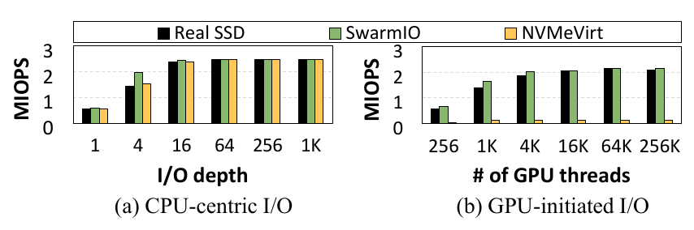

**Fig. 10:** Sustained IOPS under (a) CPU-centric I/O (fio) and (b) GPU-initiated I/O (BaM) for SwarmIO and NVMeVirt, compared with a real SSD (Solidigm D7-PS1010).

**图 10。** SwarmIO 与 NVMeVirt 在 (a) CPU 中心 I/O（fio）和 (b) GPU 发起 I/O（BaM）下的持续 IOPS，并与真实 SSD（Solidigm D7-PS1010）比较。

**图内标注** · (a) CPU-centric I/O＝以 CPU 为中心的 I/O，I/O depth＝I/O 深度。(b) GPU-initiated I/O＝GPU 发起的 I/O，# of GPU threads＝GPU 线程数。两图纵轴为 MIOPS。图例中的 Real SSD＝真实 SSD。

**English**

Throughput. As shown in Figure 10, SwarmIO effectively captures the IOPS characteristics of a commodity SSD under both CPU-centric I/O and GPU-initiated I/O. The average relative IOPS error is 7.7% for fio and 7.4% for BaM, indicating close alignment with the real SSD in both settings. Although SwarmIO exhibits slightly higher IOPS under light input loads (e.g., at I/O depths below 16 in fio and with fewer than 4K GPU threads in BaM), it closely matches the SSD IOPS under highly parallel conditions, which is typical of future IOPS-optimized SSD use cases. NVMeVirt is also sufficiently accurate to capture the SSD IOPS in CPU-centric I/O, with an average relative IOPS error of 1.2% for fio. However, under GPU-initiated I/O, it fails to reach the configured target IOPS regardless of the degree of GPU thread-level parallelism, due to the bottlenecks discussed in Section III-B.

**中文**

**吞吐。** 如图 10 所示，SwarmIO 能有效刻画商用 SSD 在 CPU 中心 I/O 和 GPU 发起 I/O 下的 IOPS 特征。fio 的平均相对 IOPS 误差为 7.7%，BaM 为 7.4%，表明两种设置均与真实 SSD 接近。在轻负载下，例如 fio I/O 深度小于 16 时，或者 BaM 使用少于 4K GPU 线程时，SwarmIO 的 IOPS 略高于真实设备。在高并行度条件下，这是未来 IOPS 优化型 SSD 的典型应用场景，SwarmIO 与真实 SSD 的 IOPS 很接近。NVMeVirt 也能较准确地刻画 CPU 中心 I/O 下的 SSD IOPS，fio 的平均相对误差为 1.2%。然而，由于第 III-B 节的瓶颈，在 GPU 发起 I/O 下，无论 GPU 线程级并行度多高，NVMeVirt 都无法达到配置的目标 IOPS。

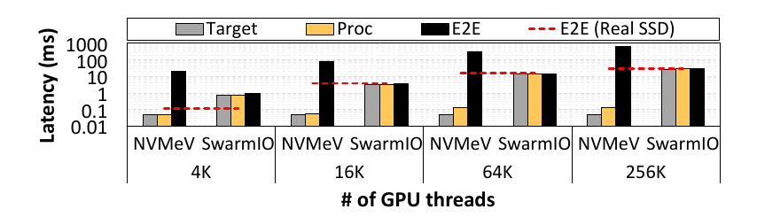

**Fig. 11:** Average target completion latency from the timing model (Target), request processing time to meet the target (Proc), and end-to-end latency (E2E) of NVMeVirt and SwarmIO under GPU-initiated I/O. The red dotted line denotes the end-to-end latency measured on the real SSD.

**图 11。** 在 GPU 发起 I/O 下，NVMeVirt 与 SwarmIO 的平均目标完成延迟（时序模型给出的 Target）、为达到目标所需的请求处理时间（Proc），以及端到端延迟（E2E）。红色点线表示真实 SSD 实测的端到端延迟。

**图内标注** · Latency (ms)＝延迟（毫秒），# of GPU threads＝GPU 线程数。Target＝目标完成延迟，Proc＝处理时间，E2E＝端到端延迟，E2E (Real SSD)＝真实 SSD 的端到端延迟。横轴中 NVMeV 是 NVMeVirt 的缩写。

**English**

Latency. NVMeVirt’s limited frontend scalability causes requests to be fetched at a rate far below the submission rate under high load, thereby incurring substantial SQ queuing delays. GPU-initiated I/O further exacerbates this bottleneck. Figure 11 illustrates the average target completion latency (Target), internal request processing time used to realize Target (Proc), and end-to-end latency including SQ queuing delay (E2E) for NVMeVirt and SwarmIO under GPU-initiated I/O. Because the single dispatcher becomes the bottleneck in NVMeVirt, the timing model remains in the “low-load” mode shown in Figure 2(b) regardless of the true system load, and thus always derives Target as the configured minimum latency of 50 µs. As the number of GPU threads increases, Proc gradually deviates from Target, reaching up to 2.7× higher, suggesting that NVMeVirt’s backend cannot sustain that degree of request-level parallelism and thus fails to meet the target completion time. E2E also greatly exceeds Proc, indicating that SQ queuing delay dominates the overall latency in NVMeVirt. Consequently, NVMeVirt’s E2E is on average 21.8× higher than that of the real SSD (E2E (Real SSD)), showing that SQ queuing delay severely undermines modeling fidelity. In contrast, SwarmIO prevents the dispatchers from becoming a bottleneck, allowing its timing model to derive target completion latencies that closely match with the target SSD’s average completion latency at each input load level. In addition, DSA-accelerated data transfers allow the workers to satisfy these target latencies, keeping SwarmIO’s end-to-end latency remains close to that of the real SSD, with an average relative error of 2.8%.

**中文**

**延迟。** 由于 NVMeVirt 的前端扩展能力有限，高负载下请求抓取速率远低于请求提交速率，产生显著的 SQ 排队延迟。GPU 发起 I/O 进一步加剧了这一瓶颈。图 11 对 NVMeVirt 和 SwarmIO 展示了 GPU 发起 I/O 下的平均目标完成延迟（Target）、为实现 Target 所需的内部请求处理时间（Proc），以及包含 SQ 排队延迟的端到端延迟（E2E）。在 NVMeVirt 中，单个 dispatcher 成为瓶颈，导致时序模型无论实际系统负载如何，都一直处于图 2(b) 所示的「低负载」模式，从而始终将 Target 推导为配置的最小延迟 50 μs。随着 GPU 线程数增加，Proc 逐渐偏离 Target，最高达到其 2.7 倍，说明 NVMeVirt 后端无法维持这样的请求级并行度，因而无法在目标完成时刻完成。E2E 也远超 Proc，说明 SQ 排队延迟主导了 NVMeVirt 的总体延迟。因此，NVMeVirt 的 E2E 平均为真实 SSD 的 21.8 倍（E2E (Real SSD)），显示 SQ 排队延迟严重损害建模保真度。SwarmIO 避免了 dispatcher 成为瓶颈，使时序模型得到的目标完成延迟，在各输入负载下都与目标 SSD 的平均完成延迟接近。此外，DSA 加速的数据传输让 worker 可以满足这些目标延迟，使 SwarmIO 的端到端延迟接近真实 SSD，平均相对误差为 2.8%。

### B. Scalability / B. 扩展性

**English**

We next evaluate the scalability of SwarmIO. As shown in Figure 12(a), under GPU-initiated I/O, SwarmIO achieves up to 9.8 MIOPS with a single DSA device, compared to the 10 MIOPS target. This is close to the practical peak DSA performance under dispatcher–worker interference reported in Section IV-C, i.e., the minimum of dispatcher and worker throughput when both operate concurrently. To scale beyond a single DSA device, we increase the number of DSA devices and, accordingly, the total number of service units. Specifically, each DSA device serves four service units, each mapped to a dedicated DSA group. With four DSA devices (the maximum available in our server), SwarmIO achieves up to 38.6 MIOPS at a 40 MIOPS target, corresponding to a 303.9× speedup over NVMeVirt. It is worth pointing out that SwarmIO is not limited to emulating only the maximum performance supported by the DSA devices. Using four DSA devices, it can flexibly scale the target performance to emulate storage across a range of operating points, as shown in Figure 12(b), where we increase the target IOPS of the timing model in 5 MIOPS increments starting from 5 MIOPS. SwarmIO sustains more than 96.6% of the configured target IOPS up to 40 MIOPS. Beyond this point, it can still reach up to 45 MIOPS but no longer consistently matches the configured target. While SwarmIO is currently limited to 40 MIOPS, this limit is primarily imposed by the available DSA resources on our evaluation platform, rather than by an architectural limitation of SwarmIO. Given its scalable design, we expect SwarmIO to reach 100 MIOPS targets under a scale-up configuration, assuming a dual-socket platform provisioned with at least five DSA devices per socket.

**中文**

接下来我们评估 SwarmIO 的扩展性。如图 12(a) 所示，GPU 发起 I/O 时，使用单个 DSA 设备的 SwarmIO 最高达到 9.8 MIOPS，对应的目标为 10 MIOPS。这接近第 IV-C 节报告的 dispatcher 和 worker 相互干扰下的 DSA 实际峰值，即两者并发运行时吞吐的较低值。为扩展到单个 DSA 设备以上，我们增加 DSA 设备以及相应的服务单元总数。具体来说，每个 DSA 设备服务四个服务单元，各单元映射到专用 DSA 组。使用四个 DSA 设备，也就是服务器能够提供的最大数量时，SwarmIO 在 40 MIOPS 的目标下最高达到 38.6 MIOPS，相对 NVMeVirt 的加速为 303.9 倍。值得指出的是，SwarmIO 也能仿真低于 DSA 设备所支持最高性能的目标。使用四个 DSA 设备，它可以灵活缩放目标性能，在一系列工作点仿真存储。图 12(b) 以 5 MIOPS 为起点，每次将时序模型的目标 IOPS 增加 5 MIOPS。目标在 40 MIOPS 以内时，SwarmIO 可持续达到配置目标的 96.6% 以上。再提高目标，实测仍可达到最高 45 MIOPS，却无法持续匹配配置目标。SwarmIO 目前受限于 40 MIOPS，这一上限主要由评估平台上可用的 DSA 资源造成，SwarmIO 的架构仍可继续扩展。考虑到架构的扩展能力，我们预计在纵向扩展配置下，也就是双路平台每路配备至少五个 DSA 设备时，SwarmIO 可达到 100 MIOPS 的目标。

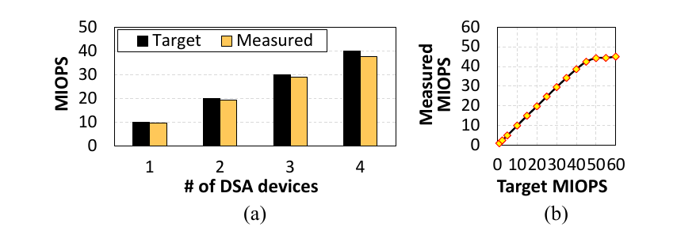

**Fig. 12:** SwarmIO’s (a) peak IOPS as the number of DSA devices increases, and (b) sustained IOPS with four DSA devices when the target IOPS is scaled in 5 MIOPS increments.

**图 12。** (a) DSA 设备数增加时 SwarmIO 的峰值 IOPS，(b) 使用四个 DSA 设备、每次将目标增加 5 MIOPS 时的持续 IOPS。

**图内标注** · 左图 # of DSA devices＝DSA 设备数量，Target＝目标值，Measured＝实测值，纵轴为 MIOPS。右图 Target MIOPS＝目标 MIOPS，Measured MIOPS＝实测 MIOPS。

### C. Ablation Study / C. 消融实验

**English**

We conduct ablation studies to quantify the impact of each proposed optimization on frontend scalability and to demonstrate the effectiveness of aggregated timing model updates.

**中文**

我们开展消融实验，量化各项优化对前端扩展能力的影响，并验证聚合时序模型更新的效果。

**English**

Frontend performance. Figure 13 shows how frontend throughput, excluding backend data transfers, improves as we add the following features to the baseline NVMeVirt (Base): (D) a distributed architecture with 16 dispatchers, (A) DSA-accelerated request fetching with synchronous offloading, and (C) coalesced request fetching that allows up to 1,024 requests within an SQ to be fetched at once. Our analysis shows that, under CPU-centric I/O, the distributed design with coalesced fetching (D+C) alone, without DSA-accelerated request fetching, is sufficient to saturate the throughput supported by 32 CPU threads, reaching up to 6.5 MIOPS at an I/O depth of 16 or higher. Under GPU-initiated I/O, the distributed design alone does not scale beyond 1.5 MIOPS. Adding either DSA-accelerated request fetching (D+A) or coalesced fetching (D+C) to the distributed-only design improves frontend scalability, delivering speedups of up to 2.8× and 6.2×, respectively. Importantly, combining both optimizations with the distributed design (D+A+C) increases frontend throughput to at most 52.6 MIOPS, corresponding to a 537.2× speedup over the baseline. This speedup is particularly pronounced because large PCIe P2P DMA operations improve transfer efficiency, while our high-throughput offloading API and DSA’s pipelined processing effectively hide data transfer latency. Together, these results show that the proposed techniques work synergistically to improve frontend performance.

**中文**

**前端性能。** 图 13 展示在排除后端数据传输时，向 NVMeVirt 基线（Base）添加下列功能后，前端吞吐如何改善：(D) 使用 16 个 dispatcher 的分布式架构，(A) 同步卸载、由 DSA 加速抓取请求，(C) 合并抓取请求，在一个 SQ 内最多一次取回 1,024 条请求。分析表明，在 CPU 中心 I/O 下，无需用 DSA 加速，分布式架构和合并抓取（D+C）已足以用满 32 个 CPU 线程提供的吞吐，I/O 深度达到 16 或以上时最高约为 6.5 MIOPS。在 GPU 发起 I/O 下，仅使用分布式架构时，性能扩展不到 1.5 MIOPS 以上。在分布式架构上分别添加 DSA 加速抓取（D+A）或合并抓取（D+C），可改善前端扩展能力，最高分别获得 2.8 倍和 6.2 倍加速。两项优化与分布式架构结合（D+A+C），可将前端吞吐提高到最多 52.6 MIOPS，相对基线获得 537.2 倍加速。加速尤其显著，是因为大的 PCIe P2P DMA 操作提高了传输效率，而高吞吐卸载 API 和 DSA 的流水线处理又有效隐藏了数据传输延迟。结果表明，这些技术共同发挥作用，提高了前端性能。

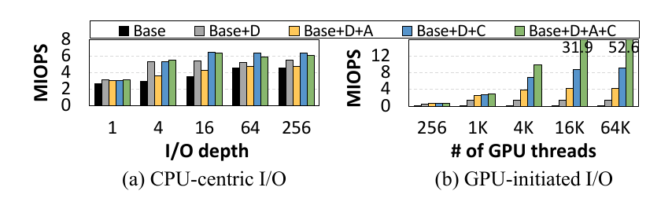

**Fig. 13:** Effect of SwarmIO’s optimizations on baseline NVMeVirt frontend performance (Base) by adding (D) a distributed architecture with 16 dispatchers, (A) DSA-accelerated request fetching, and (C) coalesced request fetching.

**图 13。** 在 NVMeVirt 基线（Base）上添加 SwarmIO 优化对前端性能的影响。 (D) 使用 16 个 dispatcher 的分布式架构，(A) DSA 加速抓取请求，(C) 合并抓取请求。

**图内标注** · Base＝基线，Base+D＝基线加分布式架构，Base+D+A＝进一步加 DSA 抓取，Base+D+C＝进一步加合并抓取，Base+D+A+C＝三项全开。(a) CPU-centric I/O＝CPU 中心 I/O，I/O depth＝I/O 深度。(b) GPU-initiated I/O＝GPU 发起 I/O，# of GPU threads＝GPU 线程数。纵轴为 MIOPS。

**English**

Aggregated timing model updates. In addition, we evaluate the effectiveness of our aggregated timing model updates. In Figure 14, we scale the number of service units, along with the corresponding number of DSA groups, and set the target IOPS accordingly, i.e., 10 MIOPS for every four service units. We then measure the achievable IOPS for designs with and without aggregated timing model updates. Without aggregated updates, per-request timing model updates incur increasing contention as the number of dispatchers grows, preventing performance from scaling beyond 10 MIOPS. In contrast, aggregated timing model updates substantially reduce serialization overhead across dispatchers. With 16 service units, SwarmIO scales to sustain the target of 40 MIOPS, achieving a 3.6× speedup over the baseline design.

**中文**

**聚合时序模型更新。** 我们另行评估这种更新机制的效果。在图 14 中，我们扩展服务单元数量及相应的 DSA 组数量，并相应配置目标 IOPS，每四个服务单元对应 10 MIOPS。随后，测量使用与未使用聚合时序模型更新的设计能达到的 IOPS。采用逐请求更新时，随着 dispatcher 增多，时序模型更新的竞争越来越大，使性能无法扩展到 10 MIOPS 以上。采用聚合时序模型更新可显著减少 dispatcher 之间的串行化开销。使用 16 个服务单元时，SwarmIO 可扩展并维持 40 MIOPS 目标，获得相对基线设计 3.6 倍的加速。

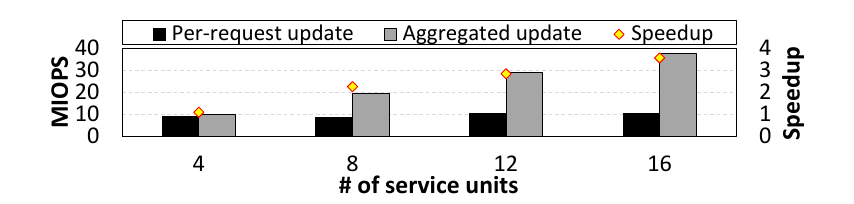

**Fig. 14:** Effect of SwarmIO’s aggregated timing model updates relative to the baseline per-request updates on achievable IOPS under GPU-initiated I/O, while varying the number of service units sharing a global timing model.

**图 14。** GPU 发起 I/O 时，改变共用全局时序模型的服务单元数量，比较 SwarmIO 的聚合时序模型更新和基线的逐请求更新对可达到 IOPS 的影响。

**图内标注** · 横轴 # of service units＝服务单元数量。左纵轴 MIOPS＝每秒百万次 I/O，右纵轴 Speedup＝加速比。图例 Per-request update＝逐请求更新，Aggregated update＝聚合更新，Speedup＝加速比。

### D. Sensitivity Study / D. 敏感性实验

**English**

We further examine the robustness and practical limits of SwarmIO under different I/O system configurations. Specifically, we study the impact of the number of I/O queues and the SSD block size (i.e., I/O granularity). The former is important because future IOPS-optimized SSDs may require a wider NVMe host interface to fully exploit internal parallelism, while the latter matters because the optimal I/O size can vary across applications. We use the BaM benchmark because GPU-initiated I/O naturally exercises both dimensions by scaling the number of GPU threads to utilize more I/O queues and by varying the I/O size via the GPU-side I/O buffer size.

**中文**

我们进一步考察 SwarmIO 在不同 I/O 系统配置下的稳健性和实际上限。具体来说，我们分析 I/O 队列数量和 SSD 块大小即 I/O 粒度的影响。前者重要，是因为未来 IOPS 优化型 SSD 可能需要更宽的 NVMe 主机接口来充分利用内部并行性。后者重要，是因为各应用适宜的 I/O 粒度可能不同。我们使用 BaM 基准，因为 GPU 发起 I/O 可以自然地沿这两个维度调整，通过增加 GPU 线程数来使用更多 I/O 队列，并通过改变 GPU 侧 I/O 缓冲区大小来调整 I/O 大小。

**English**

Number of I/O queues. Figure 15(a) shows the robustness of SwarmIO’s performance modeling across various I/O queue counts, with requests submitted by 2M GPU threads. SwarmIO sustains near-peak performance up to 1K queues, enabled by our throughput-optimized frontend architecture combining distributed dispatching with coalesced request fetching via DSA acceleration. Given an I/O depth of 1K, this is sufficient for 1M GPU threads to enqueue requests simultaneously. Beyond 1K queues, achievable IOPS falls below the target (e.g., reaching only 88.9% of the 40 MIOPS target at 2K queues) because the sequential overhead of processing many SQs begins to constrain frontend dispatch throughput.

**中文**

**I/O 队列数。** 图 15(a) 展示由 2M 个 GPU 线程提交请求时，SwarmIO 的性能建模在不同 I/O 队列数下的稳健性。直到 1K 个队列，SwarmIO 都能维持接近峰值的性能，得益于为吞吐优化的前端架构，它结合分布式分发与 DSA 加速的合并抓取。I/O 深度为 1K 时，这足以让 1M 个 GPU 线程同时将请求入队。超过 1K 个队列后，可达到的 IOPS 低于目标，例如在 2K 个队列时仅达到 40 MIOPS 目标的 88.9%。原因是串行处理许多 SQ 的开销开始限制前端分发吞吐。

**English**

Block size. Figure 15(b) shows overall performance as the block size varies. As the block size increases, achievable IOPS drops from the peak at 512 bytes. For example, SwarmIO achieves 15.1 MIOPS with 2 KB blocks. We attribute this limit to practical platform constraints when DSA devices transfer data to a peer PCIe device (i.e., GPU) across distinct PCIe controllers to which the devices are attached. As the block size increases, transfer efficiency improves, and the achievable bandwidth correspondingly rises, but only up to about 40 GB/s. Specifically, through stress testing with four DSA devices, we find that the aggregate DSA bandwidth for copying data to a PCIe Gen 5 ×16 GPU reaches up to 42.1 GB/s at I/O sizes of 8 KB and above, still well below the GPU’s theoretical unidirectional PCIe bandwidth of 64 GB/s. Nevertheless, SwarmIO achieves at least 44.6% of the theoretical peak bandwidth for I/O sizes greater than 1 KB, a level that no modern enterprise-grade SSD provides at such I/O sizes. Moreover, according to the StorageNext roadmap [32], [39], [40], future IOPS-optimized SSDs are expected to target ultra-high IOPS at 512-byte granularity, and our emulator sustains 38.6 MIOPS at this operating point.

**中文**

**块大小。** 图 15(b) 展示不同块大小下的总体性能。块大小增大时，可达到的 IOPS 从 512 字节处的峰值下降。例如，使用 2 KB 块时 SwarmIO 达到 15.1 MIOPS。我们把此限制归因于实际平台的约束，DSA 设备与对等 PCIe 设备（GPU）连接在不同的 PCIe 控制器上，传输需跨这些控制器。块变大时，传输效率提高，可达到的带宽随之增大，上限约为 40 GB/s。具体而言，通过用四个 DSA 设备做压力测试，我们发现，向 PCIe Gen 5 ×16 GPU 复制数据时，I/O 大小为 8 KB 及以上可达到最高 42.1 GB/s 的 DSA 总带宽，仍远低于 GPU 理论单向 PCIe 带宽 64 GB/s。不过，对大于 1 KB 的 I/O，SwarmIO 至少达到理论峰值带宽的 44.6%，这是现代企业级 SSD 在这些 I/O 大小下尚无法提供的带宽水平。此外，根据 StorageNext 路线图 [32]、[39]、[40]，未来 IOPS 优化型 SSD 预计将在 512 字节粒度实现超高 IOPS，我们的仿真器在该工作点可维持 38.6 MIOPS。

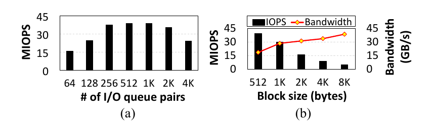

**Fig. 15:** Sensitivity of SwarmIO’s sustained IOPS to (a) the number of I/O queue pairs and (b) I/O block size under GPU-initiated I/O with 2M threads.

**图 15。** 用 2M 个线程发起 GPU I/O 时，SwarmIO 持续 IOPS 对 (a) I/O 队列对数量和 (b) I/O 块大小的敏感性。

**图内标注** · # of I/O queue pairs＝I/O 队列对数，Block size (bytes)＝块大小（字节），Bandwidth (GB/s)＝带宽（GB/s）。图例 IOPS＝每秒 I/O 操作数，Bandwidth＝带宽。

## VII. Case Study: Scaling Up GPU-centric Storage Systems with Future IOPS-optimized SSDs / VII. 案例研究：利用未来 IOPS 优化型 SSD 扩展 GPU 中心存储系统

**English**

As introduced in Section I, GPU-initiated I/O is a promising mechanism for data-intensive applications with highly parallel, sparse, and random access patterns. To understand the end-to-end benefits of combining next generation, ultra-high IOPS-optimized SSDs with GPU-initiated I/O in such applications, we conduct a case study on GPU-accelerated, on-disk vector search [9], [52], [58], [60], [61].

**中文**

正如第 I 节所述，对于具有高度并行、稀疏且随机访问模式的数据密集型应用，GPU 发起 I/O 是一种有前景的机制。为了了解在这类应用中，将下一代超高 IOPS 优化型 SSD 与 GPU 发起 I/O 结合所带来的端到端收益，我们开展 GPU 加速盘上向量搜索的案例研究 [9]、[52]、[58]、[60]、[61]。

**English**

GPU-accelerated, on-disk vector search. As a representative case study, we focus on vector search, a core component of RAG systems for retrieving data (e.g., documents or images, that is semantically relevant to a query in the embedding space). We utilize CAGRA [45], a GPU-accelerated vector search algorithm based on graph-based approximate nearest neighbor search (ANNS). In graph-based ANNS, dataset vectors are indexed as a graph, and the CAGRA search traverses the graph toward nodes closer to the query to identify the top-k nearest vectors. Upon visiting a node corresponding to a dataset vector, the algorithm (1) computes the distances between the query and the node’s neighbors, (2) sorts the results by distance, and (3) iteratively extends the search by proceeding to the closest, unvisited nodes until the configured maximum number of iterations is reached.

**中文**

**GPU 加速的盘上向量搜索。** 作为代表性案例，我们聚焦向量搜索。向量搜索是 RAG 系统的核心组件，用于检索与查询在嵌入空间中语义相关的数据，如文档或图像。我们使用 CAGRA [45]，一个 GPU 加速的、基于图的近似最近邻搜索（ANNS）向量搜索算法。在基于图的 ANNS 中，数据集向量以图的形式建立索引，CAGRA 朝与查询向量更接近的节点遍历图，以找到最近的 top-k 个向量。访问一个数据集向量所对应的节点时，算法 (1) 计算查询与该节点各邻居的距离，(2) 按距离排序结果，(3) 不断选取距离最近且尚未访问的节点来扩展搜索，直到达到配置的最大迭代次数。

**English**

We consider an on-disk vector search scenario [9], [52], [58], [60], [61] in which the entire vector index (i.e., both the graph structure and vector data) cannot fit in GPU or CPU memory. To enable direct SSD access from the GPU, we integrate GPU-initiated I/O with CAGRA so that the GPU can read index data directly from the SSD. We use the BIGANN-100M dataset [53], whose CAGRA index occupies 71.5 GB. To emulate a larger-scale deployment, we evaluate a downscaled configuration in which the GPU memory available for CAGRA search is limited to 2 GB. This preserves approximately the same GPU memory-to-index ratio as a 144 GB H200 GPU serving a 5 TB index, a practical scale for vector search over billions of vectors [51].

**中文**

我们考虑盘上向量搜索场景 [9]、[52]、[58]、[60]、[61]，其中完整向量索引，包括图结构和向量数据，放不进 GPU 或 CPU 内存。为让 GPU 直接访问 SSD，我们将 GPU 发起 I/O 集成到 CAGRA，使 GPU 能够直接从 SSD 读索引数据。我们使用 BIGANN-100M 数据集 [53]，它的 CAGRA 索引占 71.5 GB。为模拟更大规模的部署，我们评估了一个缩小的配置，将 CAGRA 搜索可用的 GPU 内存限制为 2 GB。这样可近似保持一张 144 GB H200 GPU 服务 5 TB 索引时的显存与索引容量比。后者是对数十亿向量进行向量搜索时的一个实际规模 [51]。

**English**

Implication of future IOPS-optimized SSDs. We measure CAGRA search throughput, i.e., queries per second (QPS), while varying SSD IOPS using SwarmIO. In this experiment, we set the block size to 512 bytes, corresponding to the 128-dimensional FP32 vector size. As shown in Figure 16(a), increasing SSD IOPS provides little benefit at a small batch size (BS) of 4 because the CAGRA search generates insufficient parallel storage I/O to utilize the additional IOPS. As batch size increases, however, the benefit of higher SSD IOPS becomes clear. Scaling SSD IOPS by 16×, from 2.5 to 40 MIOPS, yields a 9.7× end-to-end speedup of CAGRA search at a batch size of 256. In other words, higher storage IOPS enables larger batch sizes by allowing more vector fetches from storage to proceed in parallel, thereby improving QPS.

**中文**

**未来 IOPS 优化型 SSD 的影响。** 我们用 SwarmIO 改变 SSD IOPS，并测量 CAGRA 搜索吞吐，即每秒查询数（QPS）。本实验将块大小设为 512 字节，对应一个 128 维 FP32 向量的大小。如图 16(a) 所示，批大小（BS）为 4 时，更高的 SSD IOPS 收益很小，因为 CAGRA 搜索产生的并行存储 I/O 不足以利用额外的 IOPS。随着批大小增加，更高 SSD IOPS 的收益变得明显。将 SSD IOPS 从 2.5 MIOPS 提到 40 MIOPS，即扩大 16 倍时，批大小为 256 的 CAGRA 搜索获得 9.7 倍端到端加速。换言之，更高的存储 IOPS 让更多来自存储的向量抓取同时进行，支持更大的批大小并提高 QPS。

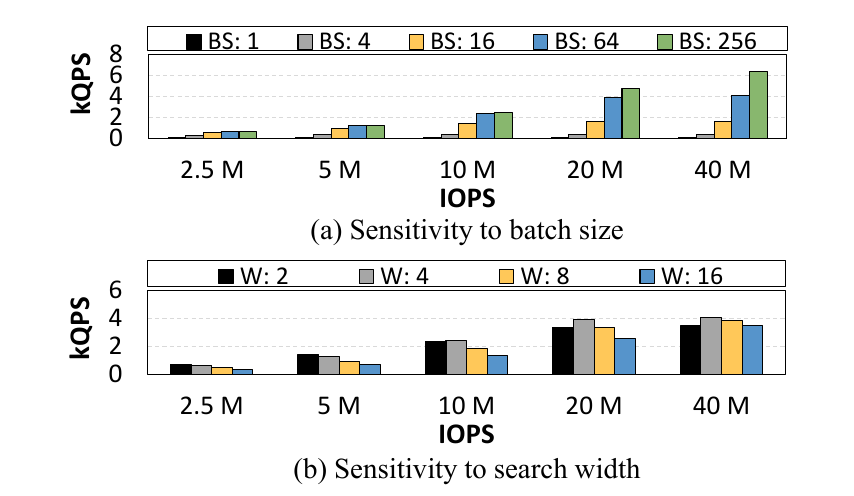

**Fig. 16:** End-to-end performance of on-disk CAGRA search when scaling SwarmIO target IOPS from 2.5 to 40 MIOPS: (a) sensitivity to batch size (BS) at search width 4, and (b) sensitivity to search width (W) at batch size 64.

**图 16。** 将 SwarmIO 的目标 IOPS 从 2.5 MIOPS 提高到 40 MIOPS 时，盘上 CAGRA 搜索的端到端性能。 (a) 将搜索宽度设为 4，考察对批大小（BS）的敏感性。(b) 将批大小设为 64，考察对搜索宽度（W）的敏感性。

**图内标注** · IOPS＝每秒 I/O 操作数，kQPS＝每秒千次查询。(a) Sensitivity to batch size＝对批大小的敏感性，BS＝批大小。(b) Sensitivity to search width＝对搜索宽度的敏感性，W＝搜索宽度。

**English**

Looking forward: the need for IOPS-aware algorithmic shifts. Increasing search width through beam search [45], [58], which expands the search frontier by visiting multiple graph nodes in parallel at each iteration, allows the algorithm to explore more nodes per iteration and can potentially reduce the total number of search iterations needed to reach a target accuracy. In ANNS, recall is the primary accuracy metric and is defined as the fraction of ground-truth top-k neighbors included in the retrieved results. We first profile CAGRA search offline by varying the search width and identifying, for each search width, the minimum number of search iterations required to guarantee at least 95% recall. We then apply the corresponding iteration count for each search width and measure QPS while varying both search width and SSD IOPS. As shown in Figure 16(b), the optimal search width (W) depends on the provisioned IOPS. For example, a search width of 2 is optimal at 5 MIOPS or below, whereas a search width of 4 becomes faster at 10 MIOPS or above. This result suggests that future ultra-high IOPS SSDs can shift the optimal algorithmic configuration for maximizing end-to-end performance, highlighting the need for IOPS-aware algorithmic shifts in data-intensive applications running on next generation GPU-centric storage systems.

**中文**

**展望：需要根据 IOPS 调整算法。** 通过束搜索 [45]、[58] 增加搜索宽度，可以在每轮迭代并行访问多个图节点，扩展搜索前沿。这使算法能在每轮探索更多节点，并有可能减少达到目标准确度所需的总迭代轮数。在 ANNS 中，主要准确度指标是召回率，定义为返回结果包含的真实 top-k 最近邻所占的比例。我们先对 CAGRA 搜索做离线分析，改变搜索宽度，为每种宽度找出保证至少 95% 召回率所需的最少搜索迭代次数。随后使用各宽度对应的迭代次数，在同时调整搜索宽度和 SSD IOPS 的条件下测量 QPS。如图 16(b) 所示，最优搜索宽度 W 取决于所配置的 IOPS。例如，当 IOPS 为 5 MIOPS 或以下时，搜索宽度 2 最好。当 IOPS 为 10 MIOPS 或以上时，搜索宽度 4 更快。结果表明，未来超高 IOPS SSD 可能改变端到端性能最佳的算法配置，突显了在下一代 GPU 中心存储系统上运行的数据密集型应用，需要根据 IOPS 调整算法。

## VIII. Related Work / VIII. 相关工作

**English**

There exists a large body of prior work on SSD performance modeling, and numerous prior studies have also explored GPU-centric storage systems, which represent the primary target environments for SwarmIO. We briefly summarize the most relevant studies below.

**中文**

此前有大量关于 SSD 性能建模的研究，也有许多研究探索以 GPU 为中心的存储系统。这两类系统是 SwarmIO 的主要目标环境。下面简要回顾最相关的研究。

**English**

SSD performance modeling. Prior work on SSD performance modeling spans both simulation and emulation. Several studies [1], [8], [12], [13], [16], [21], [59] develop detailed SSD simulators for modeling SSD’s internal device-level behavior, while integrating them into full-system simulation environments. While effective for modeling internal SSD behavior, they do not support real-time modeling of GPU-centric storage systems. Prior emulators [20], [28], [33], [62] instead expose software-defined SSDs to systems for end-to-end evaluation. FEMU [28] adopts a QEMU-based virtualization approach, while NVMeVirt [20] presents a software-defined PCI NVMe device to the host system and supports versatile storage emulation environments. Recent studies further extend SSD emulation to emerging interfaces and device classes [11], [55], [63], [66], but still primarily target conventional CPU-centric storage settings rather than GPU-centric storage systems. Some prior works [15], [25], [64] utilize FPGA-based platforms for SSD prototyping. While they offer hardware acceleration with native PCIe connectivity, they require specialized hardware and expertise. A growing body of work uses these modeling frameworks to study real-world applications whose performance depends on SSD designs not yet commercially available [7], [30], [35], [46], [67]. SwarmIO broadens this line of work by enabling performance modeling for a new class of applications with next generation ultra-high IOPS demands in GPU-centric storage environments.

**中文**

**SSD 性能建模。** 以往对 SSD 性能建模的工作涵盖模拟和仿真。多项研究 [1]、[8]、[12]、[13]、[16]、[21]、[59] 开发了详尽的 SSD 模拟器，刻画 SSD 内部器件级行为，并将它们集成到全系统模拟环境。这些方法能有效刻画内部行为，却无法实时建模 GPU 中心存储系统。以往的仿真器 [20]、[28]、[33]、[62] 向系统暴露软件定义的 SSD，以进行端到端评估。FEMU [28] 采用基于 QEMU 的虚拟化方法。NVMeVirt [20] 向主机系统提供软件定义的 PCI NVMe 设备，并支持多种存储仿真环境。近期研究进一步把 SSD 仿真扩展到新兴接口与设备类别 [11]、[55]、[63]、[66]，但仍主要面向传统 CPU 中心存储场景。部分工作 [15]、[25]、[64] 使用基于 FPGA 的平台构建 SSD 原型，支持原生 PCIe 连接和硬件加速，同时需要专用硬件和专业知识。越来越多的研究使用这些建模框架研究现实应用，其性能依赖尚未商用的 SSD 设计 [7]、[30]、[35]、[46]、[67]。SwarmIO 延伸了这条研究路线，在 GPU 中心存储环境中，为具有下一代超高 IOPS 需求的新型应用提供性能建模。

**English**

GPU-centric storage systems. Numerous prior studies explore GPU-centric storage systems to meet the high random-access IOPS demands of data-intensive workloads. BaM [50] enables high-IOPS GPU-initiated I/O for fine-grained random accesses. GIDS [47] applies GPU-initiated I/O to GNN training with sparse and irregular accesses, and GMT [5] proposes a GPU-orchestrated memory hierarchy spanning GPU memory, host memory, and SSDs. Other studies propose GPU-centric file systems [29], [48] or extend GPU-initiated I/O with asynchronous execution to overlap I/O and computation [10], [56]. There is also a growing industry trend toward satisfying the IOPS demand of such systems at the storage-device level [40]. Our work stands apart from this literature by focusing on end-to-end performance modeling of GPU-centric storage systems while enabling flexible scaling of storage IOPS.

**中文**

**以 GPU 为中心的存储系统。** 众多研究探索 GPU 中心存储系统，以满足数据密集型工作负载对随机访问高 IOPS 的需求。BaM [50] 支持高 IOPS 的 GPU 发起 I/O，用于细粒度随机访问。GIDS [47] 将 GPU 发起 I/O 用于访问稀疏且不规则的图神经网络训练。GMT [5] 提出由 GPU 编排的内存层次，覆盖 GPU 显存、主机内存和 SSD。还有研究提出 GPU 中心文件系统 [29]、[48]，或用异步执行扩展 GPU 发起 I/O，使 I/O 与计算重叠 [10]、[56]。产业界也日益倾向于在存储设备层面直接满足这类系统的 IOPS 需求 [40]。我们的工作着眼于 GPU 中心存储系统的端到端性能建模，同时允许灵活调整存储 IOPS。

## IX. Conclusion / IX. 结论

**English**

GPU-initiated I/O introduces a fundamentally different operating regime for storage systems, where massive numbers of GPU threads generate fine-grained requests at extreme rates. Existing SSD emulation frameworks are not designed to handle this level of parallelism and IOPS, limiting their effectiveness in studying emerging GPU-centric workloads. We present SwarmIO, an SSD emulation framework that sustains tens of millions of IOPS while preserving accurate end-to-end behavior. Our evaluation shows that it closely matches real SSD performance and enables scalable exploration of GPU-centric storage. SwarmIO provides a practical foundation for studying IOPS-intensive workloads and highlights the growing importance of storage scalability in GPU-centric computing.

**中文**

GPU 发起 I/O 为存储系统引入了根本不同的运行模式，大量 GPU 线程以极高的速率生成细粒度请求。现有 SSD 仿真框架的设计难以处理这一水平的并行度和 IOPS，限制了它们研究新兴 GPU 中心工作负载的能力。我们提出 SSD 仿真框架 SwarmIO，它在保留准确端到端行为的同时，可维持每秒数千万次 I/O。评估表明，它能贴近真实 SSD 的性能，并支持可扩展地探索以 GPU 为中心的存储。SwarmIO 为研究 IOPS 密集型工作负载提供了实用基础，并突显了存储扩展能力在 GPU 中心计算中日益重要。

## Acknowledgment / 致谢

**English**

This work was supported in part by SK hynix, which provided funding for the study and design of SwarmIO, and in part by Institute of Information & Communications Technology Planning & Evaluation(IITP) grant funded by the Korea government(MSIT) (No.RS-2024-00438851, (SW Starlab) High-performance Privacy-preserving Machine Learning System and System Software), (No.RS-2025-02264029, Implementation and Validation of an AI Semiconductor-Based Data Center Composable Cluster Infrastructure, 30%), which provided the computing infrastructure (CPU and GPU) used in this study.

**中文**

这项研究部分得到 SK hynix 的支持，该公司为 SwarmIO 的研究和设计提供资金。研究还部分得到韩国政府科学技术信息通信部（MSIT）资助的韩国信息通信技术规划与评价院（IITP）项目支持，项目号为 RS-2024-00438851（SW Starlab，高性能隐私保护机器学习系统及系统软件）和 RS-2025-02264029（基于 AI 半导体的数据中心可组合集群基础设施的实现与验证，30%）。这些项目提供了本研究使用的计算基础设施（CPU 和 GPU）。

## Footnotes / 脚注

[^1]: **English** · SwarmIO is open-sourced at <https://github.com/VIA-Research/SwarmIO>. **中文** · SwarmIO 已开源，代码见 <https://github.com/VIA-Research/SwarmIO>。

## References / 参考文献

**[1] English**

N. Agrawal, V. Prabhakaran, T. Wobber, J. D. Davis, M. Manasse, and R. Panigrahy, “Design tradeoffs for ssd performance,” in USENIX Annual Technical Conference (ATC), 2008.

**中文**

N. Agrawal, V. Prabhakaran, T. Wobber, J. D. Davis, M. Manasse, and R. Panigrahy。《SSD 性能的设计取舍》。USENIX 年度技术大会（ATC），2008 年。

**[2] English**

J. Axboe, “Flexible I/O Tester,” 2024. [Online]. Available: <https://github.com/axboe/fio>

**中文**

J. Axboe。《灵活 I/O 测试器》。2024 年。 [原文所列在线地址](https://github.com/axboe/fio)。

**[3] English**

N. Binkert, B. Beckmann, G. Black, S. K. Reinhardt, A. Saidi, A. Basu, J. Hestness, D. R. Hower, T. Krishna, S. Sardashti, R. Sen, K. Sewell, M. Shoaib, N. Vaish, M. D. Hill, and D. A. Wood, “The gem5 Simulator,” ACM SIGARCH Computer Architecture News, 2011.

**中文**

N. Binkert, B. Beckmann, G. Black, S. K. Reinhardt, A. Saidi, A. Basu, J. Hestness, D. R. Hower, T. Krishna, S. Sardashti, R. Sen, K. Sewell, M. Shoaib, N. Vaish, M. D. Hill, and D. A. Wood。《gem5 模拟器》。《ACM SIGARCH 计算机体系结构新闻》，2011 年。

**[4] English**

R. Bolt, “High IOPS SSDs for AI Use Cases,” Flash Memory Summit (FMS), 2025.

**中文**

R. Bolt。《面向 AI 使用场景的高 IOPS SSD》。闪存峰会（FMS），2025 年。

**[5] English**

C.-H. Chang, J. Han, A. Sivasubramaniam, V. Sharma Mailthody, Z. Qureshi, and W.-m. Hwu, “GMT: GPU Orchestrated Memory Tiering for the Big Data Era,” in Proceedings of the International Conference on Architectural Support for Programming Languages and Operating Systems (ASPLOS), 2024.

**中文**

C.-H. Chang, J. Han, A. Sivasubramaniam, V. Sharma Mailthody, Z. Qureshi, and W.-m. Hwu。《GMT：面向大数据时代的 GPU 编排内存分层》。编程语言和操作系统架构支持国际会议（ASPLOS），2024 年。

**[6] English**

W. W. Fung, I. Sham, G. Yuan, and T. M. Aamodt, “Dynamic Warp Formation and Scheduling for Efficient GPU Control Flow,” in Proceedings of the International Symposium on Microarchitecture (MICRO), 2007.

**中文**

W. W. Fung, I. Sham, G. Yuan, and T. M. Aamodt。《用于高效 GPU 控制流的动态 Warp 组建与调度》。国际微架构研讨会（MICRO），2007 年。

**[7] English**

N. M. Ghiasi, M. Sadrosadati, H. Mustafa, A. Gollwitzer, C. Firtina, J. Eudine, H. Mao, J. Lindegger, M. B. Cavlak, M. Alser, J. Park, and O. Mutlu, “Megis: High-performance, energy-efficient, and low-cost metagenomic analysis with in-storage processing,” in Proceedings of the International Symposium on Computer Architecture (ISCA), 2024.

**中文**

N. M. Ghiasi, M. Sadrosadati, H. Mustafa, A. Gollwitzer, C. Firtina, J. Eudine, H. Mao, J. Lindegger, M. B. Cavlak, M. Alser, J. Park, and O. Mutlu。《Megis：利用存储内处理实现高性能、高能效、低成本的宏基因组分析》。国际计算机体系结构研讨会（ISCA），2024 年。

**[8] English**

D. Gouk, M. Kwon, J. Zhang, S. Koh, W. Choi, N. S. Kim, M. Kandemir, and M. Jung, “Amber: Enabling Precise Full-system Simulation with Detailed Modeling of All SSD Resources,” in Proceedings of the International Symposium on Microarchitecture (MICRO), 2018.

**中文**

D. Gouk, M. Kwon, J. Zhang, S. Koh, W. Choi, N. S. Kim, M. Kandemir, and M. Jung。《Amber：通过细致建模全部 SSD 资源，实现精确的全系统模拟》。国际微架构研讨会（MICRO），2018 年。

**[9] English**

H. Guo and Y. Lu, “Achieving Low-Latency Graph-Based Vector Search via Aligning Best-First Search Algorithm with SSD,” in Proceedings of the USENIX Symposium on Operating Systems Design and Implementation (OSDI), 2025.

**中文**

H. Guo and Y. Lu。《将最佳优先搜索算法与 SSD 特性对齐，实现低延迟图向量搜索》。USENIX 操作系统设计与实现研讨会（OSDI），2025 年。

**[10] English**

J. Han, A. Sivasubramaniam, C.-H. Chang, V. S. Mailthody, Z. Qureshi, and W.-M. Hwu, “Asynchrony and GPUs: Bridging this Dichotomy for I/O with AGIO,” in Proceedings of the International Conference on Architectural Support for Programming Languages and Operating Systems (ASPLOS), 2026.

**中文**

J. Han, A. Sivasubramaniam, C.-H. Chang, V. S. Mailthody, Z. Qureshi, and W.-M. Hwu。《异步与 GPU：用 AGIO 弥合 GPU I/O 的异步性鸿沟》。编程语言和操作系统架构支持国际会议（ASPLOS），2026 年。

**[11] English**

K. Han, H. Gwak, D. Shin, and J. Hwang, “ZNS+: Advanced Zoned Namespace Interface for Supporting In-Storage Zone Compaction,” in Proceedings of the USENIX Symposium on Operating Systems Design and Implementation (OSDI), 2021.

**中文**

K. Han, H. Gwak, D. Shin, and J. Hwang。《ZNS+：支持存储内区压缩整理的高级分区命名空间接口》。USENIX 操作系统设计与实现研讨会（OSDI），2021 年。

**[12] English**

J. He, S. Kannan, A. C. Arpaci-Dusseau, and R. H. Arpaci-Dusseau, “The unwritten contract of solid state drives,” in Proceedings of the Twelfth European Conference on Computer Systems, 2017.

**中文**

J. He, S. Kannan, A. C. Arpaci-Dusseau, and R. H. Arpaci-Dusseau。《固态硬盘不成文的契约》。第十二届欧洲计算机系统会议，2017 年。

**[13] English**

Y. Hu, H. Jiang, D. Feng, L. Tian, H. Luo, and S. Zhang, “Performance impact and interplay of ssd parallelism through advanced commands, allocation strategy and data granularity,” in Proceedings of the International Conference on Supercomputing, 2011.

**中文**

Y. Hu, H. Jiang, D. Feng, L. Tian, H. Luo, and S. Zhang。《高级命令、分配策略和数据粒度对 SSD 并行性能的影响与相互作用》。超级计算国际会议，2011 年。

**[14] English**

Intel, “Intel Data Streaming Accelerator (Intel DSA),” 2022. [Online]. Available: <https://www.intel.com/content/www/us/en/products/docs/accelerator-engines/data-streaming-accelerator.html>

**中文**

Intel。《英特尔数据流加速器（Intel DSA）》。2022 年。 [原文所列在线地址](https://www.intel.com/content/www/us/en/products/docs/accelerator-engines/data-streaming-accelerator.html)。

**[15] English**

M. Jung, “OpenExpress: Fully Hardware Automated Open Research Framework for Future Fast NVMe Devices,” in USENIX Annual Technical Conference (ATC), 2020.

**中文**

M. Jung。《OpenExpress：面向未来高速 NVMe 设备的全硬件自动化开放研究框架》。USENIX 年度技术大会（ATC），2020 年。

**[16] English**

M. Jung, W. Choi, S. Gao, E. H. Wilson III, D. Donofrio, J. Shalf, and M. T. Kandemir, “Nandflashsim: High-fidelity, microarchitecture-aware nand flash memory simulation,” ACM Trans. Storage, 2016.

**中文**

M. Jung, W. Choi, S. Gao, E. H. Wilson III, D. Donofrio, J. Shalf, and M. T. Kandemir。《Nandflashsim：高保真、感知微架构的 NAND 闪存模拟》。《ACM 存储会刊》，2016 年。

**[17] English**

M. Khairy, Z. Shen, T. M. Aamodt, and T. G. Rogers, “Accel-Sim: An Extensible Simulation Framework for Validated GPU Modeling,” in Proceedings of the International Symposium on Computer Architecture (ISCA), 2020.

**中文**

M. Khairy, Z. Shen, T. M. Aamodt, and T. G. Rogers。《Accel-Sim：用于经校验 GPU 建模的可扩展模拟框架》。国际计算机体系结构研讨会（ISCA），2020 年。

**[18] English**

C. Kim, “Beyond SSD : SK Hynix AIN Family Redefining Storage as the Core Enabler of AI at Scale presented by SK Hynix,” Open Compute Project (OCP) Global Summit, 2025.

**中文**

C. Kim。《超越 SSD：SK hynix AIN 系列将存储重新定义为大规模 AI 的核心支撑（SK hynix 演讲）》。开放计算项目全球峰会（OCP），2025 年。

**[19] English**

J. Kim, B. Shin, J. Chung, and M. Rhu, “The cost of dynamic reasoning: Demystifying ai agents and test-time scaling from an ai infrastructure perspective,” in Proceedings of the International Symposium on High-Performance Computer Architecture (HPCA), 2026.

**中文**

J. Kim, B. Shin, J. Chung, and M. Rhu。《动态推理的代价：从 AI 基础设施视角解析 AI 智能体与测试时扩展》。国际高性能计算机体系结构研讨会（HPCA），2026 年。

**[20] English**

S.-H. Kim, J. Shim, E. Lee, S. Jeong, I. Kang, and J.-S. Kim, “NVMeVirt: A Versatile Software-defined Virtual NVMe Device,” in Proceedings of the Conference on File and Storage Technologies (FAST), 2023.

**中文**

S.-H. Kim, J. Shim, E. Lee, S. Jeong, I. Kang, and J.-S. Kim。《NVMeVirt：通用的软件定义虚拟 NVMe 设备》。文件与存储技术会议（FAST），2023 年。

**[21] English**

Y. Kim, B. Tauras, A. Gupta, and B. Urgaonkar, “Flashsim: A simulator for nand flash-based solid-state drives,” in 2009 First International Conference on Advances in System Simulation, 2009.

**中文**

Y. Kim, B. Tauras, A. Gupta, and B. Urgaonkar。《FlashSim：面向 NAND 闪存固态硬盘的模拟器》。2009 年首届系统模拟进展国际会议，2009 年。

**[22] English**

KIOXIA, “KIOXIA CM9-V Series (2.5-inch),” 2025. [Online]. Available: <https://americas.kioxia.com/en-us/business/ssd/enterprise-ssd/cm9-v.html>

**中文**

KIOXIA。《铠侠 CM9-V 系列（2.5 英寸）》。2025 年。 [原文所列在线地址](https://americas.kioxia.com/en-us/business/ssd/enterprise-ssd/cm9-v.html)。

**[23] English**

——,        “KIOXIA        XL-FLASH,”        2025.      [Online].     Available: <https://kr.kioxia.com/content/dam/kioxia/shared/business/memory/xlflash/asset/KIOXIA_XL-FLASH_Infographic.pdf>

**中文**

KIOXIA。《铠侠 XL-FLASH》。2025 年。 [原文所列在线地址](https://kr.kioxia.com/content/dam/kioxia/shared/business/memory/xlflash/asset/KIOXIA_XL-FLASH_Infographic.pdf)。

**[24] English**

R. Kuper, I. Jeong, Y. Yuan, R. Wang, N. Ranganathan, N. Rao, J. Hu, S. Kumar, P. Lantz, and N. S. Kim, “A Quantitative Analysis and Guidelines of Data Streaming Accelerator in Modern Intel Xeon Scalable Processors,” in Proceedings of the International Conference on Architectural Support for Programming Languages and Operating Systems (ASPLOS), 2024.

**中文**

R. Kuper, I. Jeong, Y. Yuan, R. Wang, N. Ranganathan, N. Rao, J. Hu, S. Kumar, P. Lantz, and N. S. Kim。《现代英特尔 Xeon 可扩展处理器中数据流加速器的定量分析和使用指南》。编程语言和操作系统架构支持国际会议（ASPLOS），2024 年。

**[25] English**

J. Kwak, S. Lee, K. Park, J. Jeong, and Y. H. Song, “Cosmos+ OpenSSD: Rapid Prototype for Flash Storage Systems,” ACM Transactions on Storage, 2020.

**中文**

J. Kwak, S. Lee, K. Park, J. Jeong, and Y. H. Song。《Cosmos+ OpenSSD：闪存存储系统的快速原型》。《ACM 存储会刊》，2020 年。

**[26] English**

J. Lee and R. Stenfort, “FADU: Pushing the Storage Frontier: Next-Generation SSDs for Tomorrow’s Datacenters,” Flash Memory Summit (FMS), 2025.

**中文**

J. Lee and R. Stenfort。《FADU：拓展存储前沿，为未来数据中心打造下一代 SSD》。闪存峰会（FMS），2025 年。

**[27] English**

P. Lewis, E. Perez, A. Piktus, F. Petroni, V. Karpukhin, N. Goyal, H. Küttler, M. Lewis, W.-t. Yih, T. Rocktäschel, S. Riedel, and D. Kiela, “Retrieval-Augmented Generation for Knowledge-Intensive NLP Tasks,” in Proceedings of the International Conference on Neural Information Processing Systems (NeurIPS), 2020.

**中文**

P. Lewis, E. Perez, A. Piktus, F. Petroni, V. Karpukhin, N. Goyal, H. Küttler, M. Lewis, W.-t. Yih, T. Rocktäschel, S. Riedel, and D. Kiela。《面向知识密集型自然语言处理任务的检索增强生成》。国际神经信息处理系统会议（NeurIPS），2020 年。

**[28] English**

H. Li, M. Hao, M. H. Tong, S. Sundararaman, M. Bjørling, and H. S. Gunawi, “The Case of FEMU: Cheap, Accurate, Scalable and Extensible Flash Emulator,” in Proceedings of the Conference on File and Storage Technologies (FAST), 2018.

**中文**

H. Li, M. Hao, M. H. Tong, S. Sundararaman, M. Bjørling, and H. S. Gunawi。《FEMU：低成本、准确、可规模化且易扩展的闪存仿真器》。文件与存储技术会议（FAST），2018 年。

**[29] English**

S. Li, Y. E. Zhou, Y. Xue, Y. Xu, and J. Huang, “Managing Scalable Direct Storage Accesses for GPUs with GoFS,” in Proceedings of the ACM Symposium on Operating Systems Principles (SOSP), 2025.

**中文**

S. Li, Y. E. Zhou, Y. Xue, Y. Xu, and J. Huang。《用 GoFS 管理可扩展的 GPU 直接存储访问》。ACM 操作系统原理研讨会（SOSP），2025 年。

**[30] English**

S. Li, F. Tu, L. Liu, J. Lin, Z. Wang, Y. Kang, Y. Ding, and Y. Xie, “Ecssd: Hardware/data layout co-designed in-storage-computing architecture for extreme classification,” in Proceedings of the International Symposium on Computer Architecture (ISCA), 2023.

**中文**

S. Li, F. Tu, L. Liu, J. Lin, Z. Wang, Y. Kang, Y. Ding, and Y. Xie。《ECSSD：面向极端分类的硬件与数据布局协同设计存储内计算架构》。国际计算机体系结构研讨会（ISCA），2023 年。

**[31] English**

Linux Kernel Organization, “DMAEngine documentation,” 2026. [Online]. Available: <https://www.kernel.org/doc/html/latest/driver-api/dmaengine/index.html>

**中文**

Linux Kernel Organization。《DMAEngine 文档》。2026 年。 [原文所列在线地址](https://www.kernel.org/doc/html/latest/driver-api/dmaengine/index.html)。

**[32] English**

V. S. Mailthody, “Advancing Memory and Storage Architectures for Next-Gen AI Workloads,” Flash Memory Summit (FMS), 2025.

**中文**

V. S. Mailthody。《推进下一代 AI 工作负载的内存与存储架构》。闪存峰会（FMS），2025 年。

**[33] English**

K. T. Malladi, M. Awasthi, and H. Zheng, “FlexDrive: A Framework to Explore NVMe Storage Solutions,” in Proceedings of the International Conference on High Performance Computing and Communications; International Conference on Smart City; International Conference on Data Science and Systems (HPCC/SmartCity/DSS), 2016.

**中文**

K. T. Malladi, M. Awasthi, and H. Zheng。《FlexDrive：探索 NVMe 存储解决方案的框架》。高性能计算与通信国际会议、智慧城市国际会议、数据科学与系统国际会议（HPCC/SmartCity/DSS），2016 年。

**[34] English**

Marvell, “Marvell Bravera SC5 SSD Controllers,” 2021. [Online]. Available: <https://www.marvell.com/content/dam/marvell/en/public-collateral/storage/marvell-ssd-mv-ss1331-1333-product-brief.pdf>

**中文**

Marvell。《Marvell Bravera SC5 SSD 控制器》。2021 年。 [原文所列在线地址](https://www.marvell.com/content/dam/marvell/en/public-collateral/storage/marvell-ssd-mv-ss1331-1333-product-brief.pdf)。

**[35] English**

K. K. Matam, G. Koo, H. Zha, H.-W. Tseng, and M. Annavaram, “Graphssd: Graph semantics aware ssd,” in Proceedings of the International Symposium on Computer Architecture (ISCA), 2019.

**中文**

K. K. Matam, G. Koo, H. Zha, H.-W. Tseng, and M. Annavaram。《GraphSSD：感知图语义的 SSD》。国际计算机体系结构研讨会（ISCA），2019 年。

**[36] English**

Micron, “9550 NVMe SSD,” 2024. [Online]. Available: <https://www.micron.com/products/storage/ssd/data-center-ssd/9550-ssd>

**中文**

Micron。《9550 NVMe SSD》。2024 年。 [原文所列在线地址](https://www.micron.com/products/storage/ssd/data-center-ssd/9550-ssd)。

**[37] English**

M. Naumov, D. Mudigere, H.-J. M. Shi, J. Huang, N. Sundaraman, J. Park, X. Wang, U. Gupta, C.-J. Wu, A. G. Azzolini, D. Dzhulgakov, A. Mallevich, I. Cherniavskii, Y. Lu, R. Krishnamoorthi, A. Yu, V. Kondratenko, S. Pereira, X. Chen, W. Chen, V. Rao, B. Jia, L. Xiong, and M. Smelyanskiy, “Deep Learning Recommendation Model for Personalization and Recommendation Systems,” in arxiv.org, 2019.

**中文**

M. Naumov, D. Mudigere, H.-J. M. Shi, J. Huang, N. Sundaraman, J. Park, X. Wang, U. Gupta, C.-J. Wu, A. G. Azzolini, D. Dzhulgakov, A. Mallevich, I. Cherniavskii, Y. Lu, R. Krishnamoorthi, A. Yu, V. Kondratenko, S. Pereira, X. Chen, W. Chen, V. Rao, B. Jia, L. Xiong, and M. Smelyanskiy。《面向个性化和推荐系统的深度学习推荐模型》。arXiv，2019 年。

**[38] English**

C. J. Newburn and W.-m. Hwu, “Storage Implications for the New Generation of AI Applications,” SNIA Developer Conference (SDC), 2025.

**中文**

C. J. Newburn and W.-m. Hwu。《新一代 AI 应用对存储的影响》。SNIA 开发者大会（SDC），2025 年。

**[39] English**

C. J. Newburn and V. S. Mailthody, “Technical Paths to the New Era of GPU-initiated Storage,” Open Compute Project (OCP) Global Summit, 2025.

**中文**

C. J. Newburn and V. S. Mailthody。《迈向 GPU 发起存储新时代的技术路径》。开放计算项目全球峰会（OCP），2025 年。

**[40] English**

C. Newburn, P. Prabhu, and V. S. Mailthody, “StorageNext for AI: How to Eliminate the Memory Wall for GenAI and LLM Workloads,” NVIDIA GTC, 2025. [Online]. Available: <https://www.nvidia.com/en-us/on-demand/session/gtc25-s73012/>

**中文**

C. Newburn, P. Prabhu, and V. S. Mailthody。《面向 AI 的 StorageNext：如何消除生成式 AI 和 LLM 工作负载的内存墙》。NVIDIA GTC，2025 年。 [原文所列在线地址](https://www.nvidia.com/en-us/on-demand/session/gtc25-s73012/)。

**[41] English**

NVIDIA, “NVIDIA H200 GPU,” 2024. [Online]. Available: <https://www.nvidia.com/en-us/data-center/h200/>

**中文**

NVIDIA。《NVIDIA H200 GPU》。2024 年。 [原文所列在线地址](https://www.nvidia.com/en-us/data-center/h200/)。

**[42] English**

——, “GPUDirect RDMA,” 2026. [Online]. Available: <https://docs.nvidia.com/cuda/pdf/GPUDirect_RDMA.pdf>

**中文**

NVIDIA。《GPUDirect RDMA》。2026 年。 [原文所列在线地址](https://docs.nvidia.com/cuda/pdf/GPUDirect_RDMA.pdf)。

**[43] English**

——, “NVIDIA CMX Context Memory Storage Platform,” 2026. [Online]. Available: <https://www.nvidia.com/en-us/data-center/ai-storage/cmx/>

**中文**

NVIDIA。《NVIDIA CMX 上下文内存存储平台》。2026 年。 [原文所列在线地址](https://www.nvidia.com/en-us/data-center/ai-storage/cmx/)。

**[44] English**

NVM Express, “NVM Express Base Specification,” 2026. [Online]. Available: <https://nvmexpress.org/specification/nvm-express-base-specification/>

**中文**

NVM Express。《NVM Express 基础规范》。2026 年。 [原文所列在线地址](https://nvmexpress.org/specification/nvm-express-base-specification/)。

**[45] English**

H. Ootomo, A. Naruse, C. Nolet, R. Wang, T. Feher, and Y. Wang, “Cagra: Highly parallel graph construction and approximate nearest neighbor search for gpus,” in Proceedings of the International Conference on Data Engineering (ICDE), 2024.

**中文**

H. Ootomo, A. Naruse, C. Nolet, R. Wang, T. Feher, and Y. Wang。《CAGRA：面向 GPU 的高并行图构建与近似最近邻搜索》。数据工程国际会议（ICDE），2024 年。

**[46] English**

X. Pan, E. Li, Q. Li, S. Liang, Y. Shan, K. Zhou, Y. Luo, X. Wang, and J. Zhang, “InstAttention: In-Storage Attention Offloading for Cost-Effective Long-Context LLM Inference,” in Proceedings of the International Symposium on High-Performance Computer Architecture (HPCA), 2025.

**中文**

X. Pan, E. Li, Q. Li, S. Liang, Y. Shan, K. Zhou, Y. Luo, X. Wang, and J. Zhang。《InstAttention：通过存储内注意力卸载实现高性价比的长上下文 LLM 推理》。国际高性能计算机体系结构研讨会（HPCA），2025 年。

**[47] English**

J. B. Park, V. S. Mailthody, Z. Qureshi, and W.-m. Hwu, “Accelerating Sampling and Aggregation Operations in GNN Frameworks with GPU Initiated Direct Storage Accesses,” in Proceedings of the VLDB Endowment (PVLDB), 2024.

**中文**

J. B. Park, V. S. Mailthody, Z. Qureshi, and W.-m. Hwu。《使用 GPU 发起的直接存储访问加速 GNN 框架中的采样与聚合》。《VLDB 基金会会刊》（PVLDB），2024 年。

**[48] English**

S. Qiu, W. Liu, Y. Hu, J. Yan, Z. Shen, X. Yao, R. Chen, G. Zhang, and Y. Zhang, “GeminiFS: A Companion File System for GPUs,” in Proceedings of the Conference on File and Storage Technologies (FAST), 2025.

**中文**

S. Qiu, W. Liu, Y. Hu, J. Yan, Z. Shen, X. Yao, R. Chen, G. Zhang, and Y. Zhang。《GeminiFS：配合 GPU 使用的文件系统》。文件与存储技术会议（FAST），2025 年。

**[49] English**

Y. Qiu, W. Yin, and L. Wang, “A high-performance and scalable nvme controller featuring hardware acceleration,” IEEE Transactions on Computer-Aided Design of Integrated Circuits and Systems, 2022.

**中文**

Y. Qiu, W. Yin, and L. Wang。《支持硬件加速的高性能、可扩展 NVMe 控制器》。《IEEE 集成电路与系统计算机辅助设计会刊》，2022 年。

**[50] English**

Z. Qureshi, V. S. Mailthody, I. Gelado, S. Min, A. Masood, J. Park, J. Xiong, C. J. Newburn, D. Vainbrand, I.-H. Chung, M. Garland, W. Dally, and W.-m. Hwu, “GPU-Initiated On-Demand High-Throughput Storage Access in the BaM System Architecture,” in Proceedings of the International Conference on Architectural Support for Programming Languages and Operating Systems (ASPLOS), 2023.

**中文**

Z. Qureshi, V. S. Mailthody, I. Gelado, S. Min, A. Masood, J. Park, J. Xiong, C. J. Newburn, D. Vainbrand, I.-H. Chung, M. Garland, W. Dally, and W.-m. Hwu。《BaM 系统架构中由 GPU 发起的按需高吞吐存储访问》。编程语言和操作系统架构支持国际会议（ASPLOS），2023 年。

**[51] English**

M. Shen, M. Umar, K. Maeng, G. E. Suh, and U. Gupta, “Hermes: Algorithm-System Co-design for Efficient Retrieval-Augmented Generation At-Scale,” in Proceedings of the International Symposium on Computer Architecture (ISCA), 2025.

**中文**

M. Shen, M. Umar, K. Maeng, G. E. Suh, and U. Gupta。《Hermes：通过算法与系统协同设计实现高效的大规模检索增强生成》。国际计算机体系结构研讨会（ISCA），2025 年。

**[52] English**

J. Shim, J. Oh, H. Roh, J. Do, and S.-W. Lee, “Turbocharging Vector Databases Using Modern SSDs,” in Proceedings of the VLDB Endowment (PVLDB), 2025.

**中文**

J. Shim, J. Oh, H. Roh, J. Do, and S.-W. Lee。《用现代 SSD 加速向量数据库》。《VLDB 基金会会刊》（PVLDB），2025 年。

**[53] English**

H. V. Simhadri, G. Williams, M. Aumüller, M. Douze, A. Babenko, D. Baranchuk, Q. Chen, L. Hosseini, R. Krishnaswamny, G. Srinivasa, S. J. Subramanya, and J. Wang, “Results of the NeurIPS’21 Challenge on Billion-Scale Approximate Nearest Neighbor Search,” in Proceedings of Machine Learning Research (PMLR), 2021.

**中文**

H. V. Simhadri, G. Williams, M. Aumüller, M. Douze, A. Babenko, D. Baranchuk, Q. Chen, L. Hosseini, R. Krishnaswamny, G. Srinivasa, S. J. Subramanya, and J. Wang。《NeurIPS 2021 十亿规模近似最近邻搜索挑战结果》。《机器学习研究会议论文集》（PMLR），2021 年。

**[54] English**

Solidigm, “D7-PS1010,” 2024. [Online]. Available: <https://www.solidigm.com/products/data-center/d7/ps1010.html>

**中文**

Solidigm。《D7-PS1010》。2024 年。 [原文所列在线地址](https://www.solidigm.com/products/data-center/d7/ps1010.html)。

**[55] English**

I. Song, M. Oh, B. S. J. Kim, S. Yoo, J. Lee, and J. Choi, “ConfZNS: A Novel Emulator for Exploring Design Space of ZNS SSDs,” in Proceedings of the ACM International Conference on Systems and Storage (SYSTOR), 2023.

**中文**

I. Song, M. Oh, B. S. J. Kim, S. Yoo, J. Lee, and J. Choi。《ConfZNS：用于探索 ZNS SSD 设计空间的新型仿真器》。ACM 系统与存储国际会议（SYSTOR），2023 年。

**[56] English**

Z. Song, J. Zhang, J. Sun, M. Sun, Z. Yang, Z. Zhang, X. Chen, F. Wu, H. Tang, and Z. Wang, “CAM: Asynchronous GPU-Initiated, CPU-Managed SSD Management for Batching Storage Access,” in Proceedings of the International Conference on Data Engineering (ICDE), 2025.

**中文**

Z. Song, J. Zhang, J. Sun, M. Sun, Z. Yang, Z. Zhang, X. Chen, F. Wu, H. Tang, and Z. Wang。《CAM：面向批量存储访问的异步 GPU 发起、CPU 管理的 SSD 管理机制》。数据工程国际会议（ICDE），2025 年。

**[57] English**

SPDK, “SPDK: NVMe Driver,” 2026. [Online]. Available: <https://spdk.io/doc/nvme.html>

**中文**

SPDK。《SPDK：NVMe 驱动》。2026 年。 [原文所列在线地址](https://spdk.io/doc/nvme.html)。

**[58] English**

S. J. Subramanya, Devvrit, R. Kadekodi, R. Krishaswamy, and H. V. Simhadri, “DiskANN: Fast Accurate Billion-point Nearest Neighbor Search on a Single node,” in Proceedings of the International Conference on Neural Information Processing Systems (NeurIPS), 2019.

**中文**

S. J. Subramanya, Devvrit, R. Kadekodi, R. Krishaswamy, and H. V. Simhadri。《DiskANN：单节点上的快速、准确的十亿点最近邻搜索》。国际神经信息处理系统会议（NeurIPS），2019 年。

**[59] English**

A. Tavakkol, J. Gómez-Luna, M. Sadrosadati, S. Ghose, and O. Mutlu, “MQSim: A Framework for Enabling Realistic Studies of Modern Multi-Queue SSD Devices,” in Proceedings of the Conference on File and Storage Technologies (FAST), 2018.

**中文**

A. Tavakkol, J. Gómez-Luna, M. Sadrosadati, S. Ghose, and O. Mutlu。《MQSim：支持真实刻画现代多队列 SSD 的研究框架》。文件与存储技术会议（FAST），2018 年。

**[60] English**

B. Tian, H. Liu, Y. Tang, S. Xiao, Z. Duan, X. Liao, H. Jin, X. Zhang, J. Zhu, and Y. Zhang, “Towards High-throughput and Low-latency Billion-scale Vector Search via CPU/GPU Collaborative Filtering and Re-ranking,” in Proceedings of the Conference on File and Storage Technologies (FAST), 2025.

**中文**

B. Tian, H. Liu, Y. Tang, S. Xiao, Z. Duan, X. Liao, H. Jin, X. Zhang, J. Zhu, and Y. Zhang。《通过 CPU/GPU 协同过滤和重排序实现高吞吐、低延迟的十亿规模向量搜索》。文件与存储技术会议（FAST），2025 年。

**[61] English**

M. Wang, W. Xu, X. Yi, S. Wu, Z. Peng, X. Ke, Y. Gao, X. Xu, R. Guo, and C. Xie, “Starling: An I/O-Efficient Disk-Resident Graph Index Framework for High-Dimensional Vector Similarity Search on Data Segment,” Proceedings of the ACM on Management of Data, 2024.

**中文**

M. Wang, W. Xu, X. Yi, S. Wu, Z. Peng, X. Ke, Y. Gao, X. Xu, R. Guo, and C. Xie。《Starling：面向数据分段上高维向量相似性搜索的 I/O 高效盘上图索引框架》。《ACM 数据管理会刊》，2024 年。

**[62] English**

J. Yoo, Y. Won, J. Hwang, S. Kang, J. Choi, S. Yoon, and J. Cha, “VSSIM: Virtual Machine based SSD Simulator,” in Proceedings of the Symposium on Mass Storage Systems and Technologies (MSST), 2013.

**中文**

J. Yoo, Y. Won, J. Hwang, S. Kang, J. Choi, S. Yoon, and J. Cha。《VSSIM：基于虚拟机的 SSD 模拟器》。海量存储系统与技术研讨会（MSST），2013 年。

**[63] English**

D. Yoon, H. Idden, J. Liu, B. Inceisci, S. H. Noh, and H. Li, “Cylon: Fast and accurate full-system emulation of cxl-ssds,” in 24th USENIX Conference on File and Storage Technologies (FAST 26), 2026.

**中文**

D. Yoon, H. Idden, J. Liu, B. Inceisci, S. H. Noh, and H. Li。《Cylon：快速、准确的 CXL SSD 全系统仿真》。第 24 届 USENIX 文件与存储技术会议（FAST 26），2026 年。

**[64] English**

L. Yu, Y. Lu, M. Mandava, E. Richter, V. S. Mailthody, S. W. Min, W.-m. Hwu, and D. Chen, “Fssd: Fpga-based emulator for ssds,” in 2023 33rd International Conference on Field-Programmable Logic and Applications (FPL), 2023.

**中文**

L. Yu, Y. Lu, M. Mandava, E. Richter, V. S. Mailthody, S. W. Min, W.-m. Hwu, and D. Chen。《FSSD：基于 FPGA 的 SSD 仿真器》。第 33 届现场可编程逻辑及应用国际会议（FPL），2023 年。

**[65] English**

Y. Yuan, R. Wang, N. Ranganathan, N. Rao, S. Kumar, P. Lantz, V. Sanjeepan, J. Cabrera, A. Kwatra, R. Sankaran, I. Jeong, and N. S. Kim, “Intel Accelerators Ecosystem: An SoC-Oriented Perspective : Industry Product,” in Proceedings of the International Symposium on Computer Architecture (ISCA), 2024.

**中文**

Y. Yuan, R. Wang, N. Ranganathan, N. Rao, S. Kumar, P. Lantz, V. Sanjeepan, J. Cabrera, A. Kwatra, R. Sankaran, I. Jeong, and N. S. Kim。《英特尔加速器生态：面向 SoC 的视角（工业产品）》。国际计算机体系结构研讨会（ISCA），2024 年。

**[66] English**

Q. Zhang, J. Wang, Y. Zhou, P. Xu, K. Lu, J. Wan, F. Wu, and T. Lu, “Cemu: Enabling full-system emulation of computational storage beyond hardware limits,” in Proceedings of the International Conference on Architectural Support for Programming Languages and Operating Systems (ASPLOS), 2026.

**中文**

Q. Zhang, J. Wang, Y. Zhou, P. Xu, K. Lu, J. Wan, F. Wu, and T. Lu。《CEMU：突破硬件限制的计算存储全系统仿真》。编程语言和操作系统架构支持国际会议（ASPLOS），2026 年。

**[67] English**

C. Zou and A. A. Chien, “Assasin: Architecture support for stream computing to accelerate computational storage,” in Proceedings of the International Symposium on Microarchitecture (MICRO), 2022.

**中文**

C. Zou and A. A. Chien。《ASSASIN：用流式计算加速计算存储的架构支持》。国际微架构研讨会（MICRO），2022 年。
