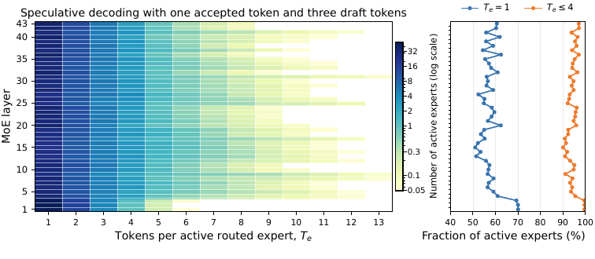
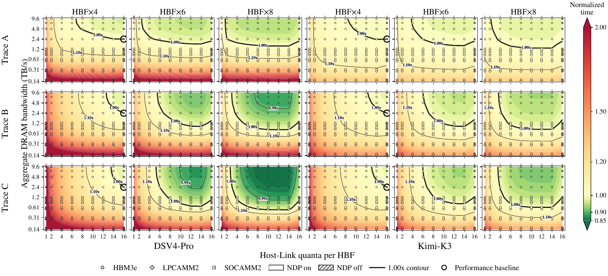
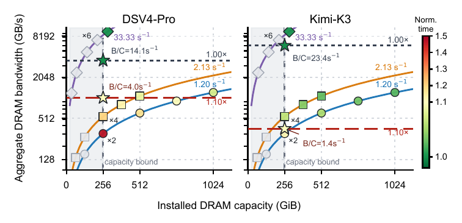
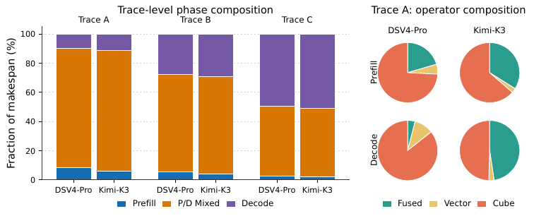

# Trillion-Parameter MoE in a Box：权重搬到 HBF 后，内存怎么配

论文：Trillion-Parameter MoE in a Box: Decoupling Memory Provisioning with High-Bandwidth Flash  
作者：Pengfei Xia、Tuo Hao、Shengwei Li、Jinjing Chen、Shiru Wei、Wenjun Zou、Rui Zhang、Hui Zang，华为技术有限公司  
版本：arXiv:2609.15636v1，2026 年 9 月 14 日

## 一、背景动机

### 1. 一种低并发场景：单机容纳万亿参数 MoE

- **部署目标**：整个模型放在一台紧凑的一体机里，并发通常只有 1–8。冷 prefill、命中缓存后的增量 prefill、推测验证、decode 都用同一套硬件。
- **容量压力来自哪里**：DSV4-Pro 的量化权重为 865 GB，Kimi-K3 为 1560 GB。即使每个 token 只激活少量专家，整套权重仍需要留在机器里，轮到某个专家时才有参数可读。
- **为什么考虑 HBF**：每个封装提供 512 GB，读取带宽 1.6 TB/s，能容纳大量只读权重。模型不必全挤在昂贵的 HBM 里。

### 2. 权重与运行时状态需要的资源不一样

| 对象 | 主要受什么影响 | 本文的放置位置 |
|---|---|---|
| 模型权重 | 模型总规模决定容量，专家激活与复用决定传输量 | HBF |
| 运行时状态，如 KV / 注意力状态 | 并发、上下文长度和注意力组织 | DRAM 状态层 |
| 中央计算 | 算子与批处理行为 | 中央计算 die |

- **容量差别很大**：1M-token 上下文、单序列时，DSV4-Pro 的持久状态为 4.66 GB，Kimi-K3 为 28.99 GB。八并发时，权重仍分别占总常驻数据的 95.9% 和 87.1%。
- **带宽需求也不同**：权重经常读一遍只处理少量 token；状态可以通过压缩、稀疏注意力和推测验证减少重复读取。同样叫“存储”，两类数据需要的带宽与容量比例差很多。

补充知识：**带宽容量比 B/C** 表示每秒能搬运多少倍自身容量的数据。HBM3e 为 1200 GB/s ÷ 36 GB ≈ 33.3 s⁻¹。保存 TB 权重时容量很紧；权重迁走后，状态层可能用不满这么高的 B/C。

### 3. 核心问题：沿用 HBM 的配置方式，会把资源配多

- **问题 1（状态层）**：权重已经放进 HBF，剩下的 DRAM 只保存状态，还需要 HBM 级的带宽容量比吗？
- **问题 2（HBF 链路）**：HBF 封装越多，内部读带宽越大，连接计算 die 的外部链路也必须等比例加宽吗？
- **直接影响**：如果两边都按峰值配，状态内存和 HBF 链路会一起争夺计算 die 的边缘资源，给封装和布线增加压力。

## 二、设计方案

### 1. 改进机会

- **权重容量与状态带宽解耦**：HBF 负责把权重装下，DRAM 按实际状态工作集配置，不再跟着模型总参数量增长。
- **内部读带宽与对外传输带宽解耦**：内部需要一定并行度才能持续供数，但外部链路只要跟上实际激活专家的数据需求即可。
- **多 token 复用一次状态读取**：推测验证一次处理多个有效 token。Kimi-K3 示例中，验证有效 token 数由 1 增至 6，状态流量变化不到 0.1%，算术强度却从 182.3 升至 1092.9 FLOP/B。

### 2. 系统概览

- **计算的部分（固定中央算力）**：中央计算 die 固定为 FP8 450 TFLOP/s，M 维分块固定为 16，集中观察存储配置怎样改变完成时间。
- **DRAM 的部分（保存动态状态）**：扫描 HBM3e、LPCAMM2、SOCAMM2 的模块数量。先保证状态放得下，再寻找带宽够用的位置。
- **HBF 的部分（权重常驻、带宽部分暴露）**：每个封装 512 GB、内部读带宽 1.6 TB/s。每份外部链路提供 96 GB/s，每封装扫描 1–16 份，观察何时继续加宽已没有明显收益。
- **近数据计算的部分（处理低复用专家）**：HBF 可选配 FP8 引擎，在靠近权重的位置处理复用度低的专家，减少向中央计算 die 搬运权重的压力；设计空间同时考察开启与关闭两种情况。

### 3. 为什么低并发 MoE 对权重供给敏感

- **路由后的计算不够密**：SPEED-Bench 编码会话的路由轨迹显示，16 个有效 token 平均激活 51.6 个专家，其中 57.8% 的专家只分到一个 token。
- **权重复用少**：加载一份专家权重，只给一个或几个 token 用，搬运的成本很难摊薄。给计算单元继续加算力，也要等权重先到。
- **阶段不同，压力不同**：prefill 和混合阶段可以把更多 token 合在一起交给专家，decode 的 token 少，权重链路更容易成为瓶颈。

### 4. 找两个“够用点”

- **状态带宽拐点**：HBF 链路先给足，逐步增加 DRAM 带宽；完成时间开始明显变平的位置，就是状态带宽基本够用的位置。
- **HBF 链路拐点**：DRAM 带宽先给足，逐步增加每个 HBF 的外部链路；继续加宽已不怎么变快，说明主机带宽基本够用。
- **两个拐点基本独立**：外部链路严重不足时，把 DRAM 带宽加到 9.6 TB/s 也救不了；状态层只有 0.14 TB/s 时，HBF 链路开满也救不了。两边都过了缺资源的区域后，就可以分别配置。

图 2 的读法：越绿表示完成时间越短，越红表示越慢。纵轴是 DRAM 总带宽，横轴是每个 HBF 的链路份额。目标是落在 1.10 倍等值线内、同时靠近左下角，少花资源又把完成时间控制住。

## 三、实验结果

平台：LLMServingSim 2.0 与模型算子分析，结合实测路由轨迹及多轮 agent 服务轨迹。  
模型：DSV4-Pro、Kimi-K3。  
负载：三条轨迹分别为 32、29、52 轮，缓存命中率 94.1%、94.6%、96.6%；每条复制为八个会话，使用连续批处理、分块 prefill 和推测验证。  
归一化基线：HBM3e×2＋HBF×4，HBF 对外带宽全开、近 HBF 计算关闭。基线的 2.4 TB/s 状态带宽已在饱和区，用它比较完成时间。容量可行性另外检查。  
目标：完整多轮对话完成时间不超过基线的 1.10 倍，即最多增加 10%。

### 1. 状态层不需要照搬 HBM 的带宽容量比

- **效果 1（B/C 要求降低）**：在共同的 256 GB 状态层容量下限处，DSV4-Pro 与 Kimi-K3 分别需要约 4.0、1.4 s⁻¹，达到 1.10 倍目标。HBM3e 为 33.3 s⁻¹，约高出 8–24 倍。
- **效果 2（实际模块怎么选）**：DSV4-Pro 用 LPCAMM2×4 虽有 256 GB，带宽仍不够；×8 提供 512 GB、1.09 TB/s，才达到目标。Kimi-K3 对状态带宽要求更低，LPCAMM2×4 已处于边界上。
- **容量先过关**：八条 Kimi-K3 百万 token 序列，持久状态约 232 GB，计入服务开销后进入 256 GB 级别。HBM3e×6 只有 216 GB，带宽再高也装不下。

### 2. HBF 内部带宽不必全部送到计算 die

- **效果 3（外部链路减少）**：六个 HBF、每个四份链路，单封装对外 384 GB/s，六个合计 2.304 TB/s。相比参考配置的 4×16×96=6.144 TB/s，减少 62.5%；配合合适的 LPDDR 级状态层，两模型在各轨迹上仍满足 1.10 倍目标。
- **两个比例怎么读**：384 GB/s ÷ 1.6 TB/s=24%，是单封装的内部带宽暴露比例；62.5% 则是六封装方案的总外部带宽相对四封装基线减少的比例。
- **效果 4（加封装也能提速）**：四个 HBF 各十六份链路，与八个 HBF 各八份链路，总外部带宽同为 6.14 TB/s。在 DSV4-Pro 的 Trace C 上，前者约为 1.05–1.10 倍完成时间，后者进入约 0.90 倍区域。封装数量还增加内部读带宽、plane 并行和可用近 HBF 算力。

### 3. decode 比例会改变链路需求

- **效果 5（拐点随轨迹变化）**：纯 decode 的完成时间占比从 Trace A 的约 11%，增至 B 的约 28%、C 的约 50%。decode 越多，权重复用越少，HBF 链路拐点越往右移。
- **模型也有差别**：prefill 的 Cube 时间占比约 63–74%；decode 中，DSV4-Pro 仍约 86% 为 Cube，Kimi-K3 则约 48% 为 Fused、50% 为 Cube。算子构成与注意力组织不同，最终对中央 DRAM 带宽的敏感程度也不同。

### 效果明显的原因分析

- **原配置把两种需求绑在一起**：为了容纳权重买来的高带宽内存，在权重迁走后仍留下大量用不满的状态带宽。
- **内部并行仍然有用**：多几个 HBF 可以更充分地并行读取，外部链路只需把真正要用的数据送出去。
- **推测验证提高了读取价值**：同一批注意力状态支撑更多有效 token，降低了状态带宽压力。

### 局限性分析

- 并发主要为 1–8，扩大批量后专家复用和权重带宽需求会变化。
- 结果来自固定算力下的设计空间模拟，实际芯片还要计入利用率、功耗与调度开销。
- 有机基板封装是否可行，还取决于 die 放置、布线、传输距离、信号完整性与供电设计。

### 对技术路线二的启发

- **先明确数据对象**：本篇给权重配置 HBF，给 KV 等运行状态配置 DRAM；你的 KV 进入 HBF 的方案，需要按 KV 的读写特征重新寻找带宽与容量工作点。
- **评估要固定硬件预算**：研究预取时固定 HBM/HBF 容量、内部读带宽、对外带宽与并行度，再比较预取开关。加 HBF 封装本身也能变快，硬件扩容的收益要单独记录。
- **增加混合阶段负载**：测试里保留冷 prefill、prefix 命中、decode 和推测验证，并报告各阶段占比。相同上下文长度，阶段构成不同，带宽瓶颈也会不同。

来源定位：模型与工作集见表 1、p.1–2；系统参数与方法见 p.2；性能分布见图 2、p.2–3；B/C 见图 3、§3.1；外部带宽见 §3.2；轨迹与算子构成见图 4、§3.3；封装见 §3.4。比值计算使用论文给出的参数。
