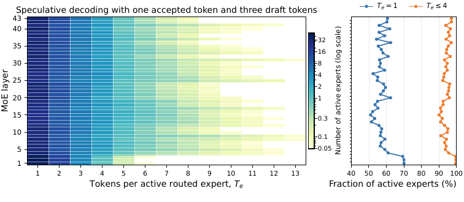
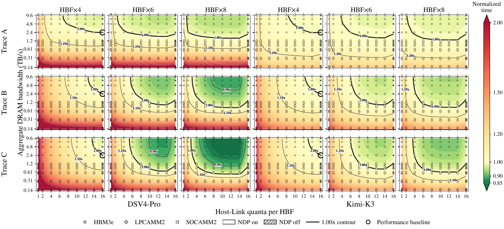
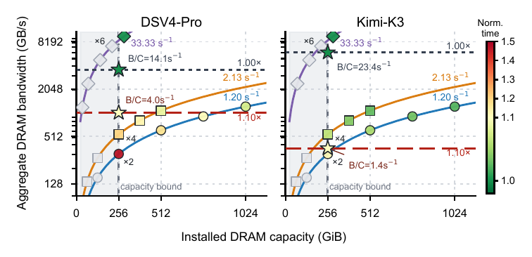
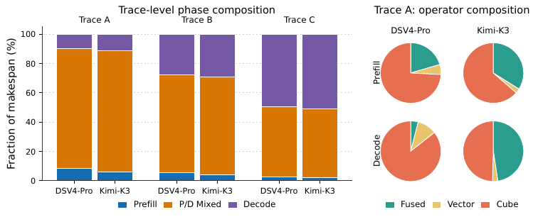

# Trillion-Parameter MoE in a Box: Decoupling Memory Provisioning with High-Bandwidth Flash

# 盒中万亿参数 MoE：利用高带宽闪存解耦存储资源配置

作者：Pengfei Xia、Tuo Hao、Shengwei Li、Jinjing Chen、Shiru Wei、Wenjun Zou、Rui Zhang、Hui Zang。

单位：Huawei Technologies Co., Ltd.（华为技术有限公司）。

本地版本：arXiv:2609.15636v1，2026-09-14，共 4 页。

英文原文与中文译文逐段排列；正文、公式、图表、脚注和参考文献按本地 PDF 版本整理。图内英文保留，图注提供中文译文。

## Abstract / 摘要

**原文 / Original · p.1**

An MoE appliance for trillion-parameter models at low concurrency must host terabytes of weights on one node and serve prefill and decode with fixed resources. Combining operator analysis of two trillion-parameter MoE models, a measured expert routing trace, and agentic serving traces over multiple turns, we explore a design space spanning High-Bandwidth Flash (HBF) and DRAM configurations, bandwidth exposure, and near-data compute. We find that state bandwidth and HBF transport form two largely orthogonal knees and address two provisioning questions. Q1: Once weights move to HBF, what bandwidth-to-capacity ratio does DRAM require? With a 256-GB floor for the state tier, both models meet a 1.10× completion time target at ratios of only 1.4–4.0 s−1 , roughly an order of magnitude below HBM3e’s 33.3 s−1 . Q2: As HBF internal bandwidth scales with capacity, must bandwidth to the host scale proportionally? Six HBF packages expose 384 GB/s per package to the host, 2.30 TB/s aggregate and 62.5% below the 6.14 TB/s full exposure reference, while more packages reduce required bandwidth per package at the same target.

**中文**

面向低并发场景的万亿参数 MoE 一体机，需要在单节点容纳 TB 级权重，并用固定资源完成 prefill 和 decode。本文结合两个万亿参数 MoE 模型的算子分析、实测专家路由轨迹及多轮 agent 服务轨迹，探索涵盖 HBF 与 DRAM 配置、带宽对外暴露及近数据计算的设计空间。我们发现状态带宽与 HBF 传输带宽形成两个基本正交的性能拐点，并回答两个配置问题。Q1：权重迁入 HBF 后，DRAM 需要多大的带宽容量比？以 256 GB 为状态层容量下限，两种模型仅需 1.4–4.0 s⁻¹ 就能满足完成时间不超过基线 1.10 倍的目标，较 HBM3e 的 33.3 s⁻¹ 低约一个数量级。Q2：当 HBF 内部带宽随容量扩展时，对主机的带宽是否必须同步等比例增长？六个 HBF 封装各向主机提供 384 GB/s，总计 2.30 TB/s，比 6.14 TB/s 全暴露参考配置低 62.5%；增加封装数量，还能在相同目标下继续降低每个封装所需的主机带宽。

**原文 / Original · p.1**

Index Terms—High-bandwidth flash, mixture-of-experts, LLM inference, memory hierarchy, compact inference systems

**中文**

关键词：高带宽闪存、混合专家、大语言模型推理、存储层次、紧凑推理系统。

## 1. Introduction / 引言

**原文 / Original · p.1**

Datacenter LLM serving commonly relies on continuous batching and Prefill–Decode disaggregation so that large request pools can amortize model residency and independently provision the two phases [1]. We study a different deployment regime: a compact, low-concurrency trillion-parameter MoE appliance. The entire model must remain resident in one node, concurrency is typical 1–8, and cold prefill, cache-hit incremental prefill, speculative verification, and decode must share one fixed resource set.

**中文**

数据中心的 LLM 服务通常采用连续批处理与 prefill/decode 分离，让大规模请求池分摊模型常驻开销，并分别配置两个阶段的资源 [1]。本文研究另一种部署方式：紧凑、低并发的万亿参数 MoE 一体机。整个模型必须常驻一个节点，典型并发为 1–8，冷 prefill、命中缓存后的增量 prefill、推测验证与 decode 共用一套固定资源。

**原文 / Original · p.1**

In this regime, the first-order challenge is model residency. Quantized trillion-parameter MoE weights occupy TB scale [2], [3], making an HBM-only appliance difficult to scale within a compact system. High-Bandwidth Flash (HBF) provides a high density tier well matched to the read-dominant access pattern of model weights, offering hundreds of GB per package and TB/s-class read bandwidth [4], [5], [6]. HBF makes trillion-parameter residency practical in a compact node; once weights are separated from runtime state, however, DRAM provisioning and HBF bandwidth delivery must both be reconsidered.

**中文**

这种场景首先面临模型常驻问题。量化后的万亿参数 MoE 权重达到 TB 规模 [2]、[3]，使仅用 HBM 的紧凑一体机难以扩展。HBF 是高密度存储层，与权重以读为主的访问模式适配，可提供每封装数百 GB 容量与 TB/s 级读取带宽 [4]–[6]。HBF 使单个紧凑节点常驻万亿参数成为可能；但权重与运行时状态分离后，DRAM 配置与 HBF 带宽供给都需要重新考虑。

**原文 / Original · p.1**

An HBM-centric organization couples resources driven by different workload behaviors: weight capacity by model size, weight delivery by expert activation and reuse, and runtime-state demand by context length and attention behavior. Once weights move to HBF, DRAM no longer scales with model residency. And as model scale grows, more HBF packages host weights and their aggregate internal bandwidth grows, so proportional exposure would make host I/O scale with model size as well.

**中文**

以 HBM 为中心的组织方式，把由不同负载行为驱动的资源绑在一起：权重容量由模型规模决定，权重传输由专家激活与复用决定，运行时状态需求由上下文长度与注意力行为决定。权重迁入 HBF 后，DRAM 不再随模型常驻规模增长。随着模型变大，更多 HBF 封装保存权重，其总内部带宽也随之增长；若对外等比例暴露带宽，主机 I/O 也会被迫随模型规模扩展。

**原文 / Original · p.1**

This separation leads to two provisioning questions. Q1: Once weights move to HBF, what bandwidth-to-capacity ratio does the state-storage DRAM require? Q2: As HBF internal bandwidth scales with capacity, must host-facing bandwidth scale proportionally? Prior HBF studies cover device characterization, HBM–HBF placement, system integration, and direct HBF data paths [7], [5], [6], [8]. This work quantifies the state-tier and host-transport provisioning knees that emerge after model weights reside in HBF.

**中文**

由此产生两个配置问题。Q1：权重迁入 HBF 后，保存状态的 DRAM 应采用什么带宽容量比？Q2：HBF 内部带宽随容量增长时，面向主机的带宽是否必须等比例增长？已有 HBF 工作覆盖器件特性、HBM–HBF 数据放置、系统集成和直接 HBF 数据通路 [7]、[5]、[6]、[8]。本文量化权重常驻 HBF 后出现的状态层与主机传输配置拐点。

**原文 / Original · p.1**

We explore a design space covering HBF and DRAM configurations, HBF bandwidth exposure, and near-data compute. With model weights in HBF, both models meet a 1.10× completion time target at DRAM bandwidth-to-capacity ratios of 4.0 and 1.4 s−1 for DSV4-Pro and Kimi-K3, respectively, well below HBM3e’s 33.3 s−1 . An LPCAMM2×8 tier reaches the required bandwidth at 1.09 TB/s, whereas similar 256-GB configurations fall short for DSV4-Pro. For HBF, six packages remain within 10% of the high bandwidth reference with 384 GB/s exposed per package, or 2.30 TB/s in aggregate, 62.5% below the 6.14 TB/s reference. More packages increase aggregate internal bandwidth and reduce required host bandwidth per package at the same target.

**中文**

本文探索 HBF 与 DRAM 配置、HBF 带宽暴露及近数据计算的设计空间。权重放入 HBF 后，DSV4-Pro 与 Kimi-K3 分别只需 4.0 和 1.4 s⁻¹ 的 DRAM 带宽容量比，即可满足 1.10 倍完成时间目标，远低于 HBM3e 的 33.3 s⁻¹。LPCAMM2×8 提供 1.09 TB/s，达到所需带宽；而容量约 256 GB 的类似配置无法满足 DSV4-Pro。HBF 方面，六个封装各暴露 384 GB/s，合计 2.30 TB/s，比 6.14 TB/s 参考值低 62.5%，仍将完成时间控制在高带宽基线的 10% 以内。更多封装可以增加总内部带宽，在相同目标下减少每个封装需要提供的主机带宽。

## Table 1 / 表 1：模型架构与存储特征

**原文 / Original · p.1**

TABLE 1. Model architecture and memory characteristics.

**中文**

表 1：模型架构与存储特征。

| Metric / 指标 | DSV4-Pro | Kimi-K3 |
|---|---|---|
| Total / activated parameters 总参数 / 激活参数 | 1.6T / 49B | 2.8T / 104B |
| Layers 层数 | 61 | 93 |
| Routed experts 路由专家 | 384, Top-6 | 896, Top-16 |
| Expert core dims 专家核心维度 | 7168 → 3072 → 7168 | 3584 → 3072 → 3584 |
| Attention 注意力 | 30 CSA + 31 HCA | 69 KDA + 24 Gated MLA |
| Quantized weights 量化权重 | 865.0 GB | 1560.0 GB |
| State, 1M tokens, B=1 状态容量 | 4.66 GB | 28.99 GB |

## 2. Workload and Design Space / 负载与设计空间

**原文 / Original · p.1**

We use DSV4-Pro [2] and Kimi-K3 [3] as representative trillion-parameter MoE workloads. As summarized in Table 1, both models combine TB-scale weights with sparse expert activation and long-context attention, but differ substantially in MoE and attention organization.

**中文**

本文用 DSV4-Pro [2] 与 Kimi-K3 [3] 作为代表性万亿参数 MoE 负载。如表 1，两者均结合 TB 级权重、稀疏专家激活和长上下文注意力，但 MoE 与注意力组织方式明显不同。

**原文 / Original · p.2**

Weight and runtime state have different scaling behavior. At a 1M-token context, persistent state occupies only 4.66 GB for DSV4-Pro and 28.99 GB for Kimi-K3. At concurrency eight, weights account for 95.9% and 87.1% of total residency. The TB-scale capacity requirement of an appliance is thus imposed primarily by model weights; the DRAM left after weight migration serves a smaller dynamic-state working set. This separation motivates Q1: the bandwidth-to-capacity ratio appropriate for state storage need not inherit that of the memory selected to host the model.

**中文**

权重与运行时状态具有不同的扩展规律。在 1M-token 上下文下，DSV4-Pro 持久状态仅占 4.66 GB，Kimi-K3 占 28.99 GB。并发为 8 时，权重分别占总常驻数据的 95.9% 与 87.1%。因此，一体机的 TB 级容量需求主要由权重造成；权重迁出后，DRAM 只服务更小的动态状态工作集。这引出了 Q1：为状态存储选择的带宽容量比，不必继承原先用于容纳模型的存储器的比例。

**原文 / Original · p.2**

Sparse routing makes weight traffic difficult to reuse. A router trace from a SPEED-Bench code [9] session shows that 16 effective tokens activate 51.6 experts on average, with 57.8% of activated experts receiving one token (Figure 1). Routed-expert execution often operates with a small effective M dimension, limiting weight reuse and making decode sensitive to weight delivery, the behavior behind Q2.

**中文**

稀疏路由使权重流量难以复用。来自 SPEED-Bench 编码会话 [9] 的路由轨迹显示，16 个有效 token 平均激活 51.6 个专家，其中 57.8% 的激活专家只收到一个 token，如图 1。路由专家执行时有效 M 维度通常很小，权重复用有限，decode 因而对权重供给敏感，这正是 Q2 背后的原因。

**原文 / Original · p.2**

Fig. 1. Per-layer routed-expert occupancy of DSV4-Flash [2].

**中文**

图 1：DSV4-Flash 各层的路由专家占用情况 [2]。图中 Tₑ 表示每个活跃路由专家接收的 token 数。

**原文 / Original · p.2**

Dynamic-state traffic is less bandwidth intensive. Compression and sparsity reduce attention state traffic, while speculative verification increases computation per state read. For example, Kimi-K3’s absorbed MLA core reads about 9.7 GB of latent KV per layer at batch size 8 and a 1M-token sequence length; increasing effective tokens per verification step from 1 to 6 changes state traffic by less than 0.1%, while arithmetic intensity rises from 182.3 to 1092.9 FLOP/B.

**中文**

动态状态流量的带宽需求相对较低。压缩与稀疏减少注意力状态流量，推测验证则提高每次状态读取对应的计算量。例如，在 batch size=8、序列长度为 1M token 时，Kimi-K3 的 absorbed MLA 核心每层读取约 9.7 GB 潜在 KV；将每次验证的有效 token 数从 1 提高到 6，状态流量变化小于 0.1%，算术强度却从 182.3 提高到 1092.9 FLOP/B。

**原文 / Original · p.2**

System model. We model the appliance as a central compute die connected to a DRAM state tier and multiple HBF packages hosting model weights. The compute die is held fixed at 450 TFLOP/s FP8 throughput with an M dimension partition of 16 as modeling constants, isolating memory-system effects. The state tier sweeps three representative module points (HBM3e: 36 GB, 1.2 TB/s per stack; SOCAMM2: 128 GB, 153.6 GB/s per module; LPCAMM2: 64 GB, 136.5 GB/s per module), whose bandwidth-to-capacity ratios are 33.3, 1.20, and 2.13 s−1 . Each modeled HBF provides 512 GB and Bint = 1.6 TB/s read bandwidth, with 16 NAND dies, 96 planes per die, 4 KB pages, and tR = 4 µs [6], [4], modeling page granularity, die–plane parallelism, and read amplification. Part of Bint is exposed as Bext , defining the exposure ratio ηexp = Bext /Bint . We sweep Bext in host-link quanta of 96 GB/s (1–16 per HBF); at 16 GT/s one quantum equals one x64-equivalent payload group at 75% efficiency. Optionally, each HBF may carry an FP8 engine (8 × 1024 MAC/cycle at 1 GHz, 16.8 MB LHB [5]) for low-use routered experts.

**中文**

系统模型：一体机由中央计算 die、DRAM 状态层和多个保存模型权重的 HBF 封装组成。计算 die 固定为 FP8 450 TFLOP/s，M 维分块固定为 16，以隔离存储系统影响。状态层考察三个代表性模块配置：HBM3e 每堆栈 36 GB、1.2 TB/s；SOCAMM2 每模块 128 GB、153.6 GB/s；LPCAMM2 每模块 64 GB、136.5 GB/s，带宽容量比分别为 33.3、1.20 和 2.13 s⁻¹。每个 HBF 提供 512 GB、内部读取带宽 B_int=1.6 TB/s，含 16 个 NAND die、每 die 96 个 plane，页大小 4 KB、t_R=4 μs [6]、[4]，模型考虑页粒度、die/plane 并行和读放大。将部分内部带宽作为 B_ext 对外暴露，定义暴露比例 η_exp=B_ext/B_int。以每份 96 GB/s 的主机链路份额扫描 B_ext，每 HBF 取 1–16 份；在 16 GT/s 下，一份相当于按 75% 效率计算的一组 x64 等效有效载荷链路。每个 HBF 还可选配 FP8 引擎，规格为 1 GHz、8×1024 MAC/cycle、16.8 MB LHB [5]，处理复用度低的路由专家。

**原文 / Original · p.2**

Methodology. We enumerate DRAM technology and count, HBF count ({1, 2, 4, 6, 8, 10, 12}), host-link quanta per HBF, and near-HBF compute ({Off, On}), removing designs that violate weight capacity, runtime-state capacity, or execution constraints. Completion time denotes the end-to-end completion time of a complete multi-turn conversation. Evaluation uses three multi-turn agentic traces with distinct execution compositions: Trace A is more mixed and prefill-heavy (32 turns, 68K–261K-token contexts, 94.1% cache-hit rate), Trace B combines cached contexts with a larger decode share (29 turns, 18K–106K-token inputs, 94.6% hit rate), and Trace C has the largest pure-decode fraction (52 turns, 18K–141K-token inputs, 96.6% hit rate). Each trace is replicated into 8 sessions with mean 100 ms exponential inter-arrival gaps. Serving is modeled with LLMServingSim 2.0 [10], using continuous batching, chunked prefill beyond 8,192 tokens, and speculative verification with 6 effective tokens per step and acceptance length 4.27 [11]. Routed-expert occupancy is modeled by a Pólya-urn calibrated on the SPEED-Bench traces and instantiated with each model’s expert count and Top-K .

**中文**

方法：枚举 DRAM 技术与模块数量、HBF 数量 {1,2,4,6,8,10,12}、每个 HBF 的主机链路份额，以及近 HBF 计算开关，剔除违反权重容量、运行时状态容量或执行约束的配置。完成时间定义为一次完整多轮对话的端到端完成时间。评估使用三组执行构成不同的多轮 agent 轨迹：Trace A 更偏向混合阶段与 prefill，32 轮、上下文 68K–261K token、缓存命中率 94.1%；Trace B 的 decode 占比更高，29 轮、输入 18K–106K token、命中率 94.6%；Trace C 的纯 decode 占比最高，52 轮、输入 18K–141K token、命中率 96.6%。每条轨迹复制成 8 个会话，会话到达间隔服从均值 100 ms 的指数分布。使用 LLMServingSim 2.0 [10] 建模服务过程，采用连续批处理，对超过 8192 token 的 prefill 分块，每步推测验证包含 6 个有效 token、接受长度为 4.27 [11]。专家占用通过在 SPEED-Bench 轨迹上校准的 Pólya urn 模型建模，并按各模型专家数量和 Top-K 实例化。

## 3. Evaluation / 评估

**原文 / Original · p.2**

All times are normalized to a DRAM-bandwidth-saturated reference, circled in Figure 2: HBM3e×2 with HBF×4 at full host exposure and near-HBF execution off. Its 2.4 TB/s aggregate state bandwidth lies in the saturated region, where additional DRAM bandwidth yields little improvement; we use this point to define 1.00× and the 1.10× provisioning contour, a target allowing up to 10% completion-time degradation. The figure spans aggregate DRAM bandwidth (vertical) and per-HBF host-link quanta (horizontal) over both models, three HBF counts, and three traces; markers show realizable HBM3e/LPCAMM2/SOCAMM2 points, with hatching denoting near-HBF execution off. Vertical sweeps expose the state-bandwidth knee at sufficient host exposure; horizontal sweeps expose the HBF host-link knee at sufficient state bandwidth.

**中文**

所有时间均归一化到 DRAM 带宽已经饱和的参考配置，即图 2 中圈出的配置：HBM3e×2、HBF×4、主机带宽全暴露、关闭近 HBF 执行。其总状态带宽为 2.4 TB/s，处于继续增加 DRAM 带宽收益很小的饱和区域。以此定义 1.00 倍基线，以及允许完成时间最多增加 10% 的 1.10 倍配置等值线。图中纵轴为 DRAM 总带宽，横轴为每个 HBF 的主机链路份额，覆盖两个模型、三种 HBF 数量和三条轨迹。标记表示实际可实现的 HBM3e、LPCAMM2、SOCAMM2 配置，斜线表示关闭近 HBF 执行。在主机带宽充足时沿纵向扫描，揭示状态带宽拐点；在状态带宽充足时沿横向扫描，揭示 HBF 主机链路拐点。

**原文 / Original · p.2**

The dominant structure in every panel is an L-shaped iso-performance landscape. Completion time degrades sharply when either resource falls into its severely starved region, roughly one to two host-link quanta per HBF or 0.14– 0.31 TB/s of DRAM, and the two legs of the L barely interact: raising DRAM bandwidth to 9.6 TB/s cannot rescue a one-quantum design, and opening all sixteen quanta cannot rescue a 0.14 TB/s state tier. We describe the two knees as largely orthogonal: after one resource leaves its severely starved region, additional bandwidth in that dimension has little effect on the knee of the other. The goal of provisioning is therefore the lower-left knee of the 1.10× contour, the lowest-resource operating point at which neither bandwidth dimension is substantially over-provisioned.

**中文**

每个子图的主要结构都是 L 形等性能分布。当任一资源进入严重不足区间时，完成时间急剧恶化：约为每个 HBF 只有 1–2 份主机链路，或 DRAM 带宽仅 0.14–0.31 TB/s。L 的两条边几乎不相互补偿：将 DRAM 带宽升至 9.6 TB/s，救不了只有一份链路的设计；开放全部十六份链路，也救不了只有 0.14 TB/s 的状态层。两个拐点因而基本正交：某一资源离开严重不足区间后，继续增加该维带宽，对另一维拐点的影响很小。资源配置目标因此是 1.10 倍等值线左下方的拐点，即两个带宽维度均不过量配置的最低资源工作点。

**原文 / Original · p.3**

Fig. 2. Completion-time landscape over state-tier bandwidth and per-HBF host-link bandwidth. Contours are normalized to the circled DRAM-bandwidth-saturated reference.

**中文**

图 2：状态层带宽和每个 HBF 主机链路带宽构成的完成时间分布。等值线以圈出的 DRAM 带宽饱和配置为基准归一化。

## 3.1. The State-Tier Knee Sits Far Below HBM / 状态层拐点远低于 HBM 带宽

**原文 / Original · p.2**

Reading the vertical direction at adequate exposure (≥ 8 quanta), the landscape is steep below 0.61 TB/s, moderate up to 1.2 TB/s, and nearly flat beyond: the worst-case state-bandwidth threshold for the 1.10× target sits around 1 TB/s, while all HBM3e rows (2.4–9.6 TB/s) lie deep in the saturated region. An HBM-inherited state tier is thus massively over-provisioned once weights move to HBF, and the LPDDR rows already straddle the knee.

**中文**

在主机暴露带宽足够，即至少八份链路时，纵向看性能分布：低于 0.61 TB/s 时变化陡峭，到 1.2 TB/s 前变化适中，之后接近平坦。满足 1.10 倍目标的最坏情况状态带宽阈值约为 1 TB/s，而所有 HBM3e 配置，即 2.4–9.6 TB/s，都处于深度饱和区。因此，权重迁入 HBF 后，照搬原 HBM 配置会严重过量；LPDDR 配置已经跨越所需拐点。

**原文 / Original · p.3**

Fig. 3. State-tier bandwidth–capacity provisioning for Trace A at HBF×4.

**中文**

图 3：HBF×4 下 Trace A 的状态层带宽—容量配置。

**原文 / Original · p.3**

Figure 3 quantifies this at HBF×4 on Trace A by placing every feasible module count on its technology’s bandwidth– capacity curve. Two constraints structure the space. First, capacity: the first feasible module-count point lies in the 256-GB class (shaded bound), which excludes HBM3e×6 (216 GB) despite its 7.2 TB/s. It is set by the stricter Kimi-K3 case, where a 1M-token sequence occupies about 29 GB of persistent state and eight concurrent sequences require about 232 GB before serving overhead. Second, performance: at the 256-GB provisioning floor, the 1.10× performance boundary corresponds to bandwidth-to-capacity ratios of 4.0 s−1 for DSV4-Pro and 1.4 s−1 for Kimi-K3 (star markers), versus 33.3 s−1 for HBM3e, an 8×–24× relaxation.

**中文**

图 3 在 HBF×4、Trace A 下量化这一现象，将每个可行模块数量映射到对应技术的带宽—容量曲线上。设计空间受两个约束影响。首先是容量：第一个可行模块数量位于 256 GB 级别，即阴影边界；HBM3e×6 虽有 7.2 TB/s，但容量只有 216 GB，因此被排除。该下限由需求更严格的 Kimi-K3 决定：1M-token 序列的持久状态约 29 GB，八条并发序列在计入服务开销前就需要约 232 GB。其次是性能：在 256 GB 容量下限处，DSV4-Pro 与 Kimi-K3 的 1.10 倍性能边界分别对应 4.0 和 1.4 s⁻¹ 带宽容量比，即图中星形标记；相比 HBM3e 的 33.3 s⁻¹，要求放宽了 8–24 倍。

**原文 / Original · p.3**

Because each device has a fixed bandwidth-to-capacity ratio r_dev, bandwidth demand translates into excess capacity: C_install ≥ max(C_min, B_1.10/r_dev). LPCAMM2×4 and SOCAMM2×2 meet the capacity floor, yet for DSV4-Pro they remain outside the 1.10× line (SOCAMM2×2 at ≈ 1.5×): their ratios of 2.13 and 1.20 s⁻¹ undershoot the required 4.0 s⁻¹ at that capacity, so LPCAMM2 reaches the boundary only at ×8 (512 GB, 1.09 TB/s). Kimi-K3 requires less bandwidth: LPCAMM2×4 already sits at the boundary, and both ×8 LPDDR configurations lie within it. The state tier is sized by the knee, capacity first and then aggregate bandwidth; the ratio of the weight-hosting memory no longer enters the decision.

**中文**

由于每种器件的带宽容量比 r_dev 固定，带宽需求会转化为额外的安装容量：C_install≥max(C_min,B_1.10/r_dev)。LPCAMM2×4 与 SOCAMM2×2 都满足容量下限，但对 DSV4-Pro 仍落在 1.10 倍等值线之外，其中 SOCAMM2×2 约为 1.5 倍。它们的比例分别是 2.13 和 1.20 s⁻¹，低于该容量下所需的 4.0 s⁻¹，因此 LPCAMM2 直到 ×8，即 512 GB、1.09 TB/s，才达到边界。Kimi-K3 带宽需求较低，LPCAMM2×4 已在边界上，两种 ×8 的 LPDDR 配置都在边界内。状态层应先满足容量，再按性能拐点配置总带宽；原先容纳权重的存储器的带宽容量比不再参与这一决策。

## 3.2. Host Bandwidth Need Not Track Internal Bandwidth / 主机带宽无需随内部带宽等比例扩展

**原文 / Original · p.3**

Reading the horizontal direction, time improves steeply from one to two to four quanta per HBF, the knee sits at four to eight quanta depending on model and trace, and from twelve to sixteen quanta the contours are flat: exposing the full 1.6 TB/s internal bandwidth is unnecessary. Concretely, at HBF×6 with four quanta per HBF each package exposes 4 × 96 = 384 GB/s, ηexp = 0.24, or 2.30 TB/s in aggregate, 62.5% below the 6.14 TB/s full-exposure reference (4 HBF × 16 quanta per HBF × 96 GB/s per quantum); yet with an LPDDR-class state tier both models remain at or inside the 1.10× boundary across traces.

**中文**

横向看性能分布，每个 HBF 的链路从一份增加到两份、四份时，时间明显改善；依模型和轨迹不同，拐点位于四到八份之间；十二到十六份区间的等值线已经平坦，因此没有必要暴露全部 1.6 TB/s 内部带宽。具体而言，HBF×6、每个 HBF 四份链路时，每封装对外带宽为 4×96=384 GB/s，η_exp=0.24，总计 2.30 TB/s，比 6.14 TB/s 的全暴露参考值，即 4×16×96 GB/s，低 62.5%。配合 LPDDR 级状态层，两个模型在各条轨迹上仍处于 1.10 倍边界以内或边界上。

**原文 / Original · p.3**

HBF count is itself a performance dimension. From HBF×4 to ×6 to ×8, the green region expands toward the lower-left: completion time is reached with fewer quanta per package. HBF×4 at sixteen quanta and HBF×8 at eight quanta deliver the same 6.14 TB/s host-facing aggregate, yet on Trace C for DSV4-Pro the former remains at ≈ 1.05–1.10× while the latter enters the 0.90× region; the packages contribute internal read bandwidth, die–plane parallelism, and near-HBF compute that no per-link widening of four packages can replicate. Capacity alone requires HBF×2 for DSV4-Pro (865 GB) and HBF×4 for Kimi-K3 (1560 GB, beyond three packages’ 1536 GB), yet capacity-minimal provisioning, NHBF = ⌈model size/package capacity⌉, leaves performance on the table.

**中文**

HBF 数量本身也是一个性能维度。由 HBF×4 增至 ×6、×8，绿色区域向左下扩展，意味着每个封装用更少链路份额也能达到目标完成时间。HBF×4、每封装十六份链路，与 HBF×8、每封装八份链路，都提供总计 6.14 TB/s 的主机带宽；但在 DSV4-Pro 的 Trace C 上，前者仍约为 1.05–1.10 倍，后者已进入 0.90 倍区域。这是因为更多封装还增加内部读取带宽、die/plane 并行度和近 HBF 算力，单纯加宽四个封装的外部链路无法复制这些资源。若只考虑容量，DSV4-Pro 的 865 GB 权重仅需 HBF×2，Kimi-K3 的 1560 GB 权重需要 HBF×4，因三个封装仅有 1536 GB；但按 N_HBF=⌈模型大小/单封装容量⌉ 配置最少封装，会牺牲性能。

## 3.3. The Knees Are Model- and Trace-Dependent / 拐点取决于模型与执行轨迹

**原文 / Original · p.3–4**

The two models exhibit different state-bandwidth landscapes because their attention organization, MoE structure, and runtime operator composition differ. On Trace A, the 1.10× contour lies at approximately 0.6–1.2 TB/s for DSV4-Pro and 0.4–0.6 TB/s for Kimi-K3, corresponding to 4.0 and 1.4 s−1 at the common 256-GB state-capacity floor. Prefill is Cube-dominated (63–74% of operator time) for both workloads, whereas decode contains different fractions of fused attention and Cube kernels: Kimi-K3 shifts toward long fused attention (≈ 48% Fused versus ≈ 50% Cube) while DSV4-Pro remains ≈ 86% Cube. Speculative verification further amortizes attention-state reads across multiple effective tokens. A smaller fraction of Kimi-K3’s makespan is therefore sensitive to central DRAM bandwidth, matching its flatter contours.

**中文**

两个模型的注意力组织、MoE 结构及运行时算子构成不同，因此状态带宽性能分布也不同。在 Trace A 上，DSV4-Pro 的 1.10 倍等值线约位于 0.6–1.2 TB/s，Kimi-K3 约位于 0.4–0.6 TB/s；在共同的 256 GB 状态容量下限处，对应 4.0 和 1.4 s⁻¹。两类负载的 prefill 都以 Cube 算子为主，占算子时间的 63–74%；decode 的融合注意力与 Cube 占比则不同：Kimi-K3 更偏向长序列融合注意力，Fused 约 48%、Cube 约 50%，DSV4-Pro 则仍有约 86% 为 Cube。推测验证还将注意力状态读取分摊到多个有效 token。因此，Kimi-K3 总完成时间中对中央 DRAM 带宽敏感的比例更小，与更平坦的等值线一致。

**原文 / Original · p.4**

Fig. 4. Workload composition across traces and operators.

**中文**

图 4：不同轨迹的执行阶段构成与算子构成。

**原文 / Original · p.4**

The landscape is equally trace-dependent. The pure-decode share of makespan grows from ≈ 11% (Trace A) to ≈ 28% (Trace B) and ≈ 50% (Trace C), and because mixed phases batch many tokens per activated expert while pure decode strains weight delivery, the link knee shifts rightward and steepens from Trace A to Trace C: configurations that sit comfortably inside 1.10× on Trace A fall outside it on Trace C, while HBF-rich designs on Traces B and C open sub-1.00× regions (0.90×) against the capacity-stressed reference. The traces differ simultaneously in context length, cache-hit rate, and phase composition, and context length alone does not explain these shifts. The provisioning knee thus depends on end-to-end phase composition in addition to context length and cache-hit behavior.

**中文**

性能分布同样取决于轨迹。纯 decode 在总完成时间中的占比从 Trace A 的约 11%，增至 Trace B 的约 28% 和 Trace C 的约 50%。混合阶段可以让每个激活专家批量处理更多 token，而纯 decode 更考验权重供给，因此从 A 到 C，链路拐点右移、曲线变陡：在 A 上轻松进入 1.10 倍以内的配置，到 C 上可能超出边界；HBF 较多的配置在 B、C 上，则相对容量受限的参考配置进入低于 1.00 倍、如 0.90 倍的区域。这些轨迹在上下文长度、命中率和阶段构成上同时存在差异，不能只用上下文长度解释变化。因此，配置拐点既取决于上下文长度、缓存命中行为，也取决于端到端阶段构成。

## 3.4. Packaging Implications / 对封装的影响

**原文 / Original · p.4**

The two bandwidth knees reduce pressure on package I/O. The state tier can be provided by board-level LPCAMM2 or SOCAMM2 modules; an LPCAMM2×8 tier supplies the required 512 GB and 1.09 TB/s (SOCAMM2×8: 1,024 GB, 1.23 TB/s), removing state capacity and bandwidth from compute-die shoreline competition. On the HBF side, the 1.10× operating point requires only partial exposure of each package’s internal bandwidth, and the per-package link width falls further as HBF capacity scales.

**中文**

两个带宽拐点减轻了封装 I/O 压力。状态层可以由板级 LPCAMM2 或 SOCAMM2 模块提供；LPCAMM2×8 提供所需的 512 GB 与 1.09 TB/s，SOCAMM2×8 为 1024 GB、1.23 TB/s，从而让状态容量和带宽不再争夺计算 die 的边缘资源。HBF 方面，满足 1.10 倍目标只需要部分暴露各封装内部带宽，随 HBF 容量扩展，每封装链路宽度还会继续降低。

**原文 / Original · p.4**

UCIe-S provides a standard-package integration path on organic substrates, while UCIe-A provides higher link density for advanced packaging [12]. The reduced host-exposure requirement moves the HBF appliance toward a regime that can be served by lower-density package links. Final package feasibility still depends on die placement, routing, reach, signal integrity, and power delivery. The design-space exploration therefore shows that host-I/O bandwidth density need not scale proportionally with HBF capacity, relaxing one of the key pressures that motivates advanced packaging.

**中文**

UCIe-S 支持基于有机基板的标准封装集成，UCIe-A 则为先进封装提供更高链路密度 [12]。较低的主机带宽暴露需求，使 HBF 一体机进入可由较低密度封装链路支撑的区域。最终封装可行性仍取决于 die 放置、布线、传输距离、信号完整性和供电。设计空间探索表明，主机 I/O 带宽密度无需与 HBF 容量等比例增长，从而放松了促使系统采用先进封装的一项关键压力。

## 4. Conclusion / 结论

**原文 / Original · p.4**

HBF changes more than model capacity. Once weights and runtime state are separated, three resources can follow three workload drivers: HBF capacity follows resident weights, state bandwidth follows runtime state, and host transport follows activated-expert traffic. State bandwidth and HBF host transport exhibit largely separable performance knees, so the two resources can be provisioned independently once severe starvation is avoided. Across two trillion-parameter models, a common 256-GB state tier needs only 1.4–4.0 s−1 , and six HBF packages expose only 384 GB/s each at a 1.10× target; added packages further reduce per-package exposure. Partial exposure in turn relaxes package-I/O pressure, making standard organic-substrate packaging a viable path for a trillion-parameter appliance.

**中文**

HBF 改变的不只是模型容量。权重与运行时状态分离后，三类资源可以分别跟随三类负载需求：HBF 容量跟随常驻权重，状态带宽跟随运行时状态，主机传输带宽跟随激活专家流量。状态带宽与 HBF 主机传输表现出基本可分离的性能拐点，因此只要避免严重资源不足，就可以独立配置二者。对于两个万亿参数模型，共同的 256 GB 状态层容量下限处只需 1.4–4.0 s⁻¹；六个 HBF 封装在 1.10 倍目标下各暴露 384 GB/s 即可，继续增加封装还能降低每封装暴露需求。部分暴露带宽减轻封装 I/O 压力，使标准有机基板封装成为万亿参数一体机的一条可行路径。

## Author affiliation / 作者单位

**原文 / Original · p.1**

The authors are with Huawei Technologies Co., Ltd.

**中文**

作者均来自华为技术有限公司。

## References / 参考文献

**原文 / Original · p.4**

[1] Y. Zhong, S. Liu, J. Chen, J. Hu, Y. Zhu, X. Liu, X. Jin, and H. Zhang, “{DistServe}: Disaggregating prefill and decoding for goodputoptimized large language model serving,” in 18th USENIX symposium on operating systems design and implementation (OSDI 24), 2024, pp. 193–210.

**中文**

[1] Y. Zhong 等：《DistServe：分离 prefill 与 decode，实现有效吞吐量优化的大语言模型服务》。OSDI 2024，193–210 页。

**原文 / Original · p.4**

[2] A. Xu, B. Lin, B. Xue, B. Wang, B. Xu, B. Wu, B. Zhang, C. Lin, C. Dong, C. Ling et al., “Deepseek-v4: Towards highly efficient million-token context intelligence,” arXiv preprint arXiv:2606.19348, 2026.

**中文**

[2] A. Xu 等：《DeepSeek-V4：迈向高效的百万 token 上下文智能》。arXiv:2606.19348，2026。

**原文 / Original · p.4**

[3] K. Team, T. Bai, Y. Bai, Y. Bao, J. Cai, X. Cai, P. Cao, Y. Cao, Z. Chai, Y. Charles et al., “Kimi k3: Open frontier intelligence,” arXiv preprint arXiv:2607.24653, 2026.

**中文**

[3] K. Team 等：《Kimi K3：开放的前沿智能》。arXiv:2607.24653，2026。

**原文 / Original · p.4**

[4] “High bandwidth flash high-level base die specification,” Open Compute Project, Tech. Rep. Version 0.7.0, Aug. 2026, released August 3, 2026. [Online]. Available: https://www.opencompute.org/ documents/ocp-hbf-architecture-specification-v0-7-0-final-pdf

**中文**

[4] Open Compute Project：《高带宽闪存高层基底 die 规范》。技术报告 0.7.0 版，2026 年 8 月，2026-08-03 发布。

**原文 / Original · p.4**

[5] M. Ha, E. Kim, and H. Kim, “H 3: Hybrid architecture using high bandwidth memory and high bandwidth flash for cost-efficient llm inference,” IEEE Computer Architecture Letters, 2026.

**中文**

[5] M. Ha、E. Kim、H. Kim：《H3：利用高带宽内存与高带宽闪存实现低成本 LLM 推理的混合架构》。IEEE Computer Architecture Letters，2026。

**原文 / Original · p.4**

[6] X. Wang, Y. Xue, X. Sun, X. Zhang, C. Dou, X. Li, and X. Chen, “Flashaccel: Leveraging high-bandwidth flash for highthroughput llm inference,” arXiv preprint arXiv:2607.10186, 2026.

**中文**

[6] X. Wang 等：《FlashAccel：利用高带宽闪存实现高吞吐量 LLM 推理》。arXiv:2607.10186，2026。

**原文 / Original · p.4**

[7] D. Son, Y. Park, H. Cho, H. Ham, O. Mutlu, S. Lee, G. Kim, and J. Park, “Exploring high-bandwidth flash for modern llm inference: Opportunities and challenges,” IEEE Computer Architecture Letters, 2026.

**中文**

[7] D. Son 等：《探索面向现代 LLM 推理的高带宽闪存：机遇与挑战》。IEEE Computer Architecture Letters，2026。

**原文 / Original · p.4**

[8] S. Kim et al., “Beyond capacity: Scalable MoE LLM inference via high-bandwidth flash with direct GPU and HBM paths,” arXiv preprint arXiv:2608.14333, 2026.

**中文**

[8] S. Kim 等：《超越容量：通过具有直接 GPU 与 HBM 通路的高带宽闪存扩展 MoE LLM 推理》。arXiv:2608.14333，2026。

**原文 / Original · p.4**

[9] T. Abramovich, M. Ashkenazi, I. Putterman, B. Chislett, T. Mitra, B. D. Rouhani, R. Zilberstein, and Y. Geifman, “Speed-bench: A unified and diverse benchmark for speculative decoding,” arXiv preprint arXiv:2604.09557, 2026.

**中文**

[9] T. Abramovich 等：《SPEED-Bench：统一且多样的推测解码基准》。arXiv:2604.09557，2026。

**原文 / Original · p.4**

[10] J. Cho, H. Choi, G. Heo, and J. Park, “Llmservingsim 2.0: A unified simulator for heterogeneous and disaggregated llm serving infrastructure,” in 2026 IEEE International Symposium on Performance Analysis of Systems and Software (ISPASS). IEEE, 2026, pp. 1–14.

**中文**

[10] J. Cho 等：《LLMServingSim 2.0：面向异构及分离式 LLM 服务基础设施的统一模拟器》。IEEE ISPASS，1–14 页，2026。

**原文 / Original · p.4**

[11] X. Cheng, X. Yu, C. Shao, J. Li, Y. Xiong, Y. Qian, J. Zhu, S. Ma, X. Zhang, J. Ye et al., “Dspark: Confidence-scheduled speculative decoding with semi-autoregressive generation,” arXiv preprint arXiv:2607.05147, 2026.

**中文**

[11] X. Cheng 等：《DSpark：结合半自回归生成、按置信度调度的推测解码》。arXiv:2607.05147，2026。

**原文 / Original · p.4**

[12] UCIe Consortium, “UCIe 3.0 specification,” https://www. uciexpress.org/specifications, 2025, standard (organic substrate) package data-rate table includes 4–32 GT/s since UCIe 1.0.

**中文**

[12] UCIe Consortium：《UCIe 3.0 规范》，2025。标准有机基板封装的数据速率表自 UCIe 1.0 起包含 4–32 GT/s。
